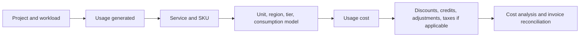

# Reading GCP Pricing Tables, SKUs, and Billing Units

## 1. Why must you know how to read Google Cloud pricing tables?

An architecture that runs on Google Cloud does not automatically have predictable costs. For example, a retail application using **Cloud Run**, **Cloud SQL**, **Cloud Storage**, and **VPC** may pay for compute time, memory, storage capacity, operation counts, and network traffic under different **SKUs**. If you only look at the headline price of one service, the engineering team can easily miss significant charges.

In the **CLOUD_PROVIDERS_GCP** module, learners progress from project organization, IAM, and VPC to Compute Engine, GKE, Cloud Run, storage, databases, deployment, and operations. The **Billing and Budgets** section adds an essential cross-cutting skill: **accurately reading a pricing line item, understanding measurement units, calculating projected costs, and verifying actual charges**.

After this lesson, you will be able to:

1. Distinguish between a **Cloud Billing account**, **service**, **SKU**, **consumption model**, and **pricing tier**.
2. Read the key columns in the **Pricing table**: SKU ID, geographic scope, pricing unit, per-unit quantity, and tiered usage start thresholds.
3. Convert between usage units and pricing units; calculate single-tier or multi-tier estimates using transparent formulas.
4. Identify root causes of discrepancies across public pricing, estimates, Billing reports, the **Cost table**, and invoices.
5. Apply this skill when selecting services or evaluating a Google Cloud architecture for performance, reliability, and cost.

> **Convention:** All unit prices in the calculation exercises below are **hypothetical figures for learning the math**, not current Google Cloud prices. When making deployment decisions, look up prices on the **date of verification**, under your **exact billing account, region, currency, SKU, and consumption model**.

## 2. The big picture: from resources to charges

A **Cloud Billing account** is the payment account used to pay for one or more linked Google Cloud projects. Projects organize and control resources; a billing account manages payment methods and aggregates charges. One project does not automatically equate to a separate invoice.

When a workload runs, services record **usage**. Usage is tagged with a **service** (such as Compute Engine), a **SKU** (a specific type of resource or operation with a defined pricing structure), and attributes such as location, time interval, and applied pricing model. Cloud Billing uses these attributes to calculate costs.



This diagram only describes logical relationships. One workload can generate **multiple SKU line items** across different services, projects, or regions; discounts and surcharges do not necessarily appear as a reduction on the same price line.

### Key terminology

| Term | Meaning in Cloud Billing | Question to ask |
| --- | --- | --- |
| **Service** | The product reporting usage, e.g., Compute Engine, Cloud Storage, Cloud SQL | Which product incurred the cost? |
| **Service ID** | Service identifier used to join technical datasets | Am I looking at the right service? |
| **SKU (Stock Keeping Unit)** | Identifier for a billable resource or operation type | **What** am I actually paying for? |
| **SKU ID** | Unique SKU identifier, more stable than descriptions for analysis and reconciliation | Which pricing row matches this usage row? |
| **Usage** | Quantity consumed measured over a time interval | How much was consumed? |
| **Pricing unit** | Unit used to express the price | Is the unit price per GiB, GiB-month, hour, second, or million requests? |
| **Per unit quantity** | How **many** pricing units the listed price applies to | Is the rate for 1 unit or 1,000,000 units? |
| **Pricing tier** | A price bracket corresponding to a usage threshold | Does increasing volume change the unit rate? |
| **Consumption model** | Pricing model applied to a quantity of SKU usage in a given context | Is it billed at the default rate or a commitment-based rate? |
| **List price** | Public price or standard table price at the time of viewing | Is this my actual contract rate? |
| **Contract price** | Negotiated rate for the billing account, if any | Am I authorized to view and use custom pricing? |
| **Credits** | Reductions applied to payable amounts under eligible programs | On which report line is the reduction recorded? |

**A SKU is not a VM name or a project name.** For example, one Compute Engine VM can trigger separate charges for compute capacity, persistent disks, snapshots, and networking. A Cloud SQL database can likewise incur instance, storage, backup, and network traffic charges. Exact SKUs depend on the service, configuration, and current pricing schedule.

## 3. Opening the right pricing view and context

Google Cloud has several pages and tools with similar names. Each answers a different question:

| Where to look | What is it for? | Key points to note |
| --- | --- | --- |
| **Individual product pricing pages** | Understand billing models, exceptions, examples, Free Tier, and billable features | Service documentation is the foundation before calculating prices |
| **Cloud Billing → Pricing** (**Pricing table**) | Look up **SKU prices** and pricing tiers across services | Shows prices current at viewing time; permissions determine whether contract prices appear |
| **Google Cloud Pricing Calculator** | Estimate pre-deployment costs based on planned configuration and usage | Estimate results are not a billing guarantee |
| **Cloud Billing → Reports** | Analyze accrued spend trends, filtering by project, service, SKU, labels, and time | Always verify active filters and time range |
| **Cloud Billing → Cost table** | Reconcile costs and credits for an **invoice month** by project/service/SKU | Suited for tracing charges back to an invoice/statement |
| **Cloud Billing export → BigQuery** | Analyze historical usage/cost or pricing in detail via SQL | Export must be enabled proactively; granularity and history depend on export type |
| **Cloud Billing Catalog API / Pricing API** | Retrieve metadata and pricing programmatically | Catalog API gives public prices; Pricing API serves account-specific pricing with proper permissions |

### How to read the Pricing table

1. Open **Google Cloud Console → Billing** and select the **Cloud Billing account** to analyze.
2. In the Billing page, open **Pricing**. Users with limited permissions may only see the **public pricing** table, while users with `billing.accounts.getPricing` can view **contract prices** if the billing account has an applicable agreement.
3. Choose **View all SKUs** to browse the full catalog, or **SKUs with historical usage** to focus on consumed SKUs, where permissions allow.
4. Filter by **Service description** (e.g., Cloud Storage), then inspect **SKU ID**, **SKU description**, **Consumption model**, **Geo taxonomy**, **Unit**, **Per unit quantity**, **Tiered usage start**, and **List price**.
5. If a SKU has multiple rows, check whether they represent **pricing tiers** or different **consumption models** before summing or comparing.
6. Check the **currency** of the billing account. A billing account's pricing table may display in a currency other than USD.

**Common pitfall:** The Pricing table reflects **current prices**, whereas the Cost table and invoices reflect prices and billing terms for a specific usage window or invoice period. SKU prices can change over time. The Pricing table **does not automatically include credits** such as promotional credits or separately accounted grants.

## 4. Decoding a SKU row

A hypothetical row in the pricing table might read as follows:

| Field | Illustrative value | How to read it |
| --- | --- | --- |
| Service | Cloud Storage | Service generating the charge |
| SKU description | Standard Storage – illustrative location | Type of usage being priced; verify exact region and storage class |
| SKU ID | `HYPOTHETICAL_SKU_ID` | Identifier to join pricing tables and reports; **not a real SKU ID** |
| Geo taxonomy | Applicable region / location | Geographic scope where the price applies |
| Unit | GiBy.mo | Average stored capacity multiplied by duration, commonly read as GiB-month |
| Per unit quantity | 1 | Price applies to one unit of the Unit column |
| Tiered usage start | 0 | First tier starts at usage 0 |
| List price | **0.02 USD** | Hypothetical unit price per GiB-month |

From this table, you can read: "The service bills storage by **GiB-month**, at a hypothetical rate of **0.02 USD per GiB-month**, for the selected location and pricing tier."

What **cannot be concluded yet**: total bucket cost. A bucket can also incur operation fees, retrieval fees, data transfer, minimum storage duration charges, or other fees depending on storage class and configuration. Always read the Cloud Storage pricing page and inspect all active SKUs.

### SKU ID, SKU description, and location

Two SKUs with very similar descriptions can still have different prices due to **region, machine type, storage class, data transfer direction, or features**. When analyzing across periods:

- Prefer joining on **`sku.id`**, then cross-check **service, consumption model, location, unit, and effective price timestamp**.
- Use `sku.description` for human readability, but do not treat the description as a unique primary key.
- Do not infer location from part of a SKU name if the **geo taxonomy** field or product documentation specifies the official scope.

## 5. Accurately understanding billing units

### 5.1. Distinguishing capacity from capacity-over-time

| Common unit | How to read it | Where you encounter it |
| --- | --- | --- |
| **B**, **GB**, **GiB** | Data size | Data transfer, data processing, volume capacity |
| **GiB-month / GiBy.mo** | GiB multiplied by fraction of a month | Data storage or provisioned storage |
| **GiB-hour**, **GiB-second** | Memory capacity multiplied by time | Certain compute/serverless services |
| **vCPU-hour**, **vCPU-second** | Number of vCPUs multiplied by time | Compute resources billed by capacity and duration |
| **instance-hour** | Number of instances multiplied by hours used | Certain instance-based billing models |
| **request / operation / event** | Count of requests or operations | APIs, serverless, messaging, object access |
| **1,000 / 1,000,000 operations** | Price for a specified batch of operations | When the price column is not per single request |
| **GB processed / TiB scanned** | Data read or processed | Certain query and data analytics engines |
| **data transfer (egress)** | Volume transferred by defined direction and destination | Traffic leaving Cloud to the internet or across specific network boundaries |

**GB** typically uses decimal units: **1 GB = 10⁹ bytes**. **GiB** uses binary units: **1 GiB = 2³⁰ bytes**. Similarly, 1 TiB = 1,024 GiB. Therefore **100 GB ≠ 100 GiB**. When converting units, rely on the exact symbol shown in the pricing table and reports rather than converting arbitrarily.

**GiB-month** does not mean "every time you write 1 GiB you pay for a full month." It is a combined measure of **capacity** and **duration**: for example, holding an average of 50 GiB across an entire month equals roughly 50 GiB-months under the service's measurement rules. Check product documentation for exact timing rules, minimum storage durations, and rounding behavior.

### 5.2. Usage units and pricing units can differ

In Billing exports, you may encounter:

- `usage.amount` and `usage.unit`: quantity and unit used to report raw usage.
- `usage.amount_in_pricing_units` and `usage.pricing_unit`: quantity converted into the unit used for pricing.

For example, a service may report duration in **seconds**, while overview pages explain pricing per **hour**; or the pricing table lists a price **per 1 million requests**. You cannot multiply a raw "request" count directly by a "per million requests" rate without dividing by the proper scaling factor.

### 5.3. Single-tier estimation formula

For a SKU with only **one tier** and no other discounts, a basic estimate is:

```text
Cost = Usage (converted to pricing unit)
       ÷ Per unit quantity
       × Listed unit price for Per unit quantity
```

**Hypothetical** example: the price is **0.40 USD per 1,000,000 requests**, and the workload has **2,400,000 billable requests** in the period.

```text
2,400,000 / 1,000,000 × 0.40 USD = 0.96 USD
```

If you mistakenly read 0.40 USD as the price for **one request**, the estimate will be off by a factor of one million. The `Per unit quantity` column is therefore just as important as the unit price figure.

### 5.4. Time-averaged storage capacity

**Hypothetical** example: data occupies **150 GiB for 20 days** of a 30-day month, assuming the SKU bills by **GiB-month with pro-rata daily conversion**:

```text
Converted usage = 150 GiB × (20 / 30) = 100 GiB-months
If hypothetical unit price = 0.02 USD/GiB-month:
Estimated cost = 100 × 0.02 = 2.00 USD
```

This is a model for understanding units. Actual costs can vary due to product-specific timing rules, minimum storage duration, class, tier, operation charges, or incremental data during the period.

## 6. Reading tiered pricing

A SKU can have **one pricing tier** or **multiple tiers**. In the Pricing table, each tier of a SKU is represented by a row; the **Tiered usage start** column indicates the **starting threshold** of that tier in pricing units.

Suppose a data transfer SKU has a purely **hypothetical** pricing schedule:

| Tier | Tiered usage start | Usage range in period | Hypothetical unit price |
| --- | ---: | --- | ---: |
| 1 | 0 GiB | 0 to under 100 GiB | 0.00 USD/GiB |
| 2 | 100 GiB | 100 to under 1,000 GiB | 0.08 USD/GiB |
| 3 | 1,000 GiB | 1,000 GiB and above | 0.06 USD/GiB |

For total usage of **1,350 GiB**, calculate each bracket separately:

```text
Tier 1: 100 GiB × 0.00 USD =  0.00 USD
Tier 2: 900 GiB × 0.08 USD = 72.00 USD
Tier 3: 350 GiB × 0.06 USD = 21.00 USD
                             ----------
Total hypothetical cost      93.00 USD
```

Do not multiply the entire **1,350 × 0.06 USD**; bracket splitting is part of the calculation. Likewise, do not assume a free tier applies to every networking SKU.

### At what scope are pricing tiers aggregated?

Depending on the SKU, tiers may aggregate usage **per project** or **per billing account**; the aggregation interval may also be **daily** or **monthly**. When inspecting the Pricing table, check these fields:

- **Aggregation level:** e.g., `PROJECT` or `ACCOUNT` where applicable.
- **Aggregation interval:** e.g., `ONE_DAY` or `ONE_MONTH` where applicable.
- **Tiered usage start:** starting threshold for each tier.

Tier aggregation by billing account **does not mean** usage across different billing accounts in the same Organization is pooled together. Moreover, each SKU has its own tier schedule: usage of one SKU normally does not advance tiers for a different SKU.

**Common misreading:** Two projects each use 600 GiB. If tiers apply **per project**, each project may restart from threshold 0; if tiers apply **per account**, the combined 1,200 GiB can cross into the next bracket. Total cost is not necessarily the same even though total data volume is identical.

## 7. A single service can generate multiple cost lines

When estimating, break a workload down into its consumption components instead of picking a single number for "Compute Engine price" or "Cloud SQL price."

| Service | Quantities to check on the current pricing table | Frequently overlooked costs |
| --- | --- | --- |
| **Compute Engine** | VM type, vCPU, RAM, runtime, disks, associated IP addresses | Persistent Disk, snapshots, network egress, load balancing, licenses |
| **GKE** | Node/cluster resources by operating mode, pod/compute, disks | Node infrastructure, networking, load balancers, monitoring/logging |
| **Cloud Run** | Requests, CPU, memory, billable instance time, and billing mode | Min instances, outbound traffic, Cloud Logging, downstream services |
| **Cloud SQL** | Instance/compute, storage, backups, high availability, networking | Standby replicas, disk growth, backups/PITR, data transfer |
| **Cloud Storage** | Capacity × time, storage class, operations, retrieval | Minimum storage duration, egress, and read/write operations |
| **VPC / networking** | Data transfer direction, source/destination, regions, network services | Internet egress, cross-region transfer, NAT, load balancers |
| **BigQuery** | Query processing/slot model, stored data, features | Bytes scanned, metadata, networking, streaming per configuration |

This is a **question map**, not a fixed SKU catalog. Some components may be free within conditional limits, bundled into product pricing, or priced differently depending on service edition.

### 7.1. Distinguishing ingress, egress, and internal transfer

Many beginners see "100 GiB of data transferred" and immediately pick the **internet egress** price. That lacks critical context. Before looking up a SKU, you need to know:

1. **From where to where?** VM → database in the same zone, VM → different region, Cloud Storage → internet, or client → service?
2. **In which direction?** Ingress into the platform or egress leaving the platform?
3. **Through which products?** VPC, Cloud NAT, load balancers, CDN, and intermediary services can carry separate charges.
4. **Which regions?** Source and destination can change both the SKU and the unit price.

Data transfer charges, where applicable, must be calculated on the exact **billable byte count**. Free transfer in one scenario does not mean all traffic between services is free.

### 7.2. Allocated compute vs. actually utilized compute

A system whose CPU averages 10% utilization **does not automatically** pay 10% of the VM price. For configurations billed by duration of **provisioned resources**, you must consider machine type and existence/runtime according to service rules. Conversely, serverless models may bill based on requests and billable compute time, but still require checking min instances, concurrency, and billing settings.

Therefore, **utilization** is telemetry for right-sizing and future cost optimization; it is not always a direct billing input for every SKU.

## 8. Capstone exercise: estimating a small workload

Suppose an application runs two instances, with disks and outbound data transfer. For calculation practice, **assume** a 30-day month equal to 720 hours; all unit prices and line items below are fabricated solely for this exercise.

| Hypothetical billable component | Usage quantity | Hypothetical unit price | Estimate |
| --- | ---: | ---: | ---: |
| vCPU | 2 instances × 2 vCPU × 720 hours = 2,880 vCPU-hours | 0.025 USD/vCPU-hour | **72.00 USD** |
| RAM | 2 instances × 8 GiB × 720 hours = 11,520 GiB-hours | 0.003 USD/GiB-hour | **34.56 USD** |
| Disk | 2 × 100 GiB × 1 month = 200 GiB-months | 0.05 USD/GiB-month | **10.00 USD** |
| Internet egress | 80 GiB within hypothetical billable scope | 0.12 USD/GiB | **9.60 USD** |
| **Total before discounts and other charges** | | | **126.16 USD** |

Check the addition: **72.00 + 34.56 + 10.00 + 9.60 = 126.16 USD**.

In a real architecture, you must verify which machine types and SKUs Compute Engine uses (in some cases billing does not split identically to this illustrative table), how runtime duration is metered, disk classes, network paths, commitment/usage discounts, and companion services.

The **126.16 USD total is not an estimate for a real Compute Engine or Cloud Run configuration**. Actual rates, discount eligibility, and all related fees must be checked against current pricing tables or the Pricing Calculator.

### From estimate to architectural questions

If the application is only busy for two hours per day, measure usage before deciding:

- Run always-on VMs or move part of the workload to Cloud Run?
- Provision a larger Cloud SQL tier, scale at the application layer, or optimize queries first?
- Deploy in a single region or multi-region to meet defined RTO/RPO targets?
- Store long-lived data in which Storage class, and are there retrieval or minimum-duration fees?

**Cost optimization must go hand in hand with security, reliability, and performance.** A cheaper configuration that drops connections, misses SLOs, or violates data-retention requirements is not an optimal architecture.

## 9. Why do list prices differ from the actual amount paid?

Charges recorded in Cloud Billing can be affected by **usage time, region, pricing tier, consumption model, contract pricing, credits, taxes, and adjustments**.

| Concept | Correct understanding |
| --- | --- |
| **List price** | Public price for the SKU and tier at the time of lookup |
| **Contract price** | Custom negotiated price, if the billing account has one and the viewer has permission |
| **Consumption model** | Pricing context applied to usage, such as default on-demand or a commitment-linked model |
| **Sustained use discounts / committed use discounts** | Discount programs governed by product terms and commitment structures; presentation can vary by discount type and timing |
| **Free Tier / free usage tier** | Free within defined limits or conditions; does not mean every project gets an independent quota |
| **Promotional credits** | Credits that can reduce the payable balance, subject to program terms |
| **Taxes / adjustments / support** | Charges beyond core usage that can appear on the total bill |

In particular, following recent changes to **spend-based committed use discounts**, some committed rates are reflected directly via the **consumption model** rather than solely as a credit line item. When comparing the same SKU across periods, cross-check both the **consumption model ID** and active program documentation; do not assume every discount appears in a single `credits` column.

In a simplified calculation, we can express this as:

```text
Usage cost across applicable SKUs, tiers, and pricing models
  ± adjustments/discounts accounted for by program mechanics
  - eligible credits
  + taxes/surcharges/support if incurred
  = amount to reconcile against reports/invoices
```

This is a **conceptual accounting flow**, not a rigid formula applicable to every schema field or contract type. Some discounts are already baked into the **effective unit price**, so subtracting the same discount again would **double-count** it.

### Differences between usage month and invoice month

**Usage month** is when resources were consumed; **invoice month** is the period recorded on the invoice/statement. The two periods can diverge due to reporting latency, adjustments, and invoice closing mechanics. Therefore, do not expect queries grouped by `usage_start_time` to match an invoice filtered by `Invoice month` down to the cent.

To explain invoice totals, start with the **Cost table** filtered by invoice month with default filters before drilling down into individual SKUs. That table surfaces usage, credits, taxes, adjustments, and line items that reconcile with the invoice total.

## 10. Analyzing costs with reports and BigQuery

### 10.1. Finding a SKU driving costs

When you observe an unusual charge:

1. Go to **Cloud Billing → Reports** to identify the **billing account**, project, and timeframe where the cost accrued.
2. Group or filter further by **Service** and **SKU**.
3. If the goal is invoice reconciliation, open **Cost table**, select **Invoice month**, and inspect rows by **Project → Service → SKU → Consumption model**.
4. Record the **SKU ID**, description, usage, pricing unit, cost, credits, consumption model, and location.
5. Open **Pricing table** to check the unit price active at view time, then verify with historical details or pricing export data if recalculating a past period.
6. Check whether usage growth came from **longer runtime, higher capacity, more requests, egress**, or crossing a pricing tier; confirm whether configurations, workloads, or discount levels changed.

**Do not** simply divide total project spend by total requests to conclude "the request SKU got more expensive": total spend may include databases, logging, networking, credits, and many other SKUs.

### 10.2. Export types and when to use them

When recurring SQL analysis is needed, you can enable **Cloud Billing export to BigQuery** from the billing account with proper permissions and setup:

| Export type | Typical fields | Purpose |
| --- | --- | --- |
| **Standard usage cost data** | Billing account, project, service/SKU, usage, cost, credits, currency | Cost reporting by service and period |
| **Detailed usage cost data** | Standard fields plus partial resource-level details | Pinpoint specific cost-generating resources where supported |
| **Pricing data** | SKU, pricing model, tiers, unit, currency, geographic metadata, and price timestamp | Verify unit prices by billing account |

Detailed export automatically includes resource-level metadata in certain cases such as Compute Engine; for **GKE cost allocation**, you must enable the corresponding feature to receive fuller cluster cost breakdowns. Enabling export **does not automatically backfill all historical data**; review backfill policies, latency, and dataset location rules for each export type.

### 10.3. Example SQL grouped by SKU

Example reading **standard usage cost export** data. Replace the table name with the actual table created in your project. The illustrative query uses the **2026-11-01 to 2026-11-30** window by `usage_start_time` and only inspects regular usage rows; this query is **not intended to reconcile the invoice total**:

```sql
SELECT
  project.id AS project_id,
  service.description AS service_name,
  sku.id AS sku_id,
  sku.description AS sku_name,
  usage.pricing_unit AS pricing_unit,
  SUM(usage.amount_in_pricing_units) AS usage_in_pricing_units,
  SUM(cost) AS cost_before_credits,
  SUM(
    IFNULL(
      (SELECT SUM(c.amount) FROM UNNEST(credits) AS c),
      0
    )
  ) AS credits_total,
  SUM(
    cost + IFNULL(
      (SELECT SUM(c.amount) FROM UNNEST(credits) AS c),
      0
    )
  ) AS cost_plus_credits
FROM `BILLING_PROJECT.DATASET.gcp_billing_export_v1_XXXXXX_XXXXXX_XXXXXX`
WHERE usage_start_time >= TIMESTAMP('2026-11-01')
  AND usage_start_time < TIMESTAMP('2026-12-01')
  AND cost_type = 'regular'
GROUP BY project_id, service_name, sku_id, sku_name, pricing_unit
ORDER BY cost_plus_credits DESC;
```

In this export, `credits.amount` is typically negative when representing a credit reduction. The `cost_plus_credits` column is one view of **net usage across the filtered rows**, excluding taxes, certain invoice-level items, and pricing mechanics outside the query's scope. Aggregating across multiple timestamps also does not prove that **a SKU has only one price**, since tiers, consumption models, or effective dates may differ.

To inspect pricing **per billing account** in BigQuery, use the **pricing data export** table named like `cloud_pricing_export`; look up `sku.id`, `pricing_as_of_time`, unit, tier, consumption model, and currency per the current schema. Do not assume joining solely on `sku.id` suffices to determine a single price across all times.

**Operational note:** BigQuery queries can incur data-analysis charges. Check scanned byte volume and permissions before running against live datasets.

## 11. Common misconceptions

| Misconception | Correct understanding and action |
| --- | --- |
| "The price of a VM is the entire system cost." | Also check storage, networking, load balancer, backup, logging, and dependent service SKUs. |
| "Today's list price is the exact rate paid last month." | Check historical pricing timestamps and terms; use Cost table and exports when reconciling. |
| "0.40 USD per 1 million requests means 0.40 USD/request." | Read `Per unit quantity` and convert usage into pricing units. |
| "100 GB = 100 GiB." | Check decimal vs. binary units before multiplying by rates. |
| "GiB-month is the number of GiB uploaded during the month." | GiB-month reflects stored capacity integrated over storage duration. |
| "Same service name means the same price in every region." | Check SKU/geo taxonomy and product-specific pricing tables. |
| "All usage above a threshold gets the new unit rate." | Check each tiered bracket and the tier aggregation scope. |
| "Free Tier guarantees a zero bill." | Check Free Tier conditions, out-of-scope usage, network fees, and other services. |
| "Having a budget automatically shuts down services at the threshold." | Cloud Billing budgets are typically used to **monitor and send alerts**, not as an automatic hard spend cap for all workloads. |
| "Cost Table, Pricing Table, and Reports show the same kind of figures." | Pricing Table shows **SKU unit prices**; Reports show **cost trends**; Cost Table is used for **invoice reconciliation**. |
| "Adding a label assigns all costs to that label." | Not every charge or resource supports labels/cost attribution in the same way; check unlabeled portions. |

## 12. Practice exercises and self-check questions

### Exercise 1: Reading a pricing table without provisioning resources

In Google Cloud Console or official pricing documentation:

1. Pick any **service** within your study scope, such as Cloud Storage or Compute Engine.
2. Locate **one SKU** and record: SKU ID, SKU description, region/geo taxonomy, unit, per unit quantity, and list price.
3. Check how many pricing tiers the SKU has and which consumption models exist.
4. Record the **lookup date**, **currency**, and whether you are viewing **public pricing** or **billing account pricing**.
5. Explain in one sentence: "What quantity does this SKU charge for, and in what unit?"

### Exercise 2: Calculating charges from a hypothetical pricing row

A hypothetical service charges **0.25 USD per 10,000 operations**. A workload has **380,000 billable operations** in the period, with no free tier, brackets, or discounts. Result:

```text
380,000 / 10,000 × 0.25 USD = 9.50 USD
```

Try substituting usage with **1,200,000 operations**, verify the result (**30.00 USD**), and explain why you must divide by `Per unit quantity = 10,000`.

### Exercise 3: Calculating tiered pricing by scope

A hypothetical SKU has two tiers: 0–500 GiB at **0.10 USD/GiB**, and usage above 500 GiB at **0.07 USD/GiB**. Total usage is 800 GiB. Result:

```text
500 × 0.10 + 300 × 0.07 = 50 + 21 = 71.00 USD
```

Assuming tiers apply **per project**, recalculate when usage is split across **two projects at 400 GiB each**. The hypothetical total becomes **80.00 USD** if each project starts over at tier 1. Change the assumption to aggregation **per billing account** and explain why the total can drop back to **71.00 USD**.

### Exercise 4: Explaining actual cost variances

Suppose an estimate was 120 USD, Reports show 150 USD, yet the selected monthly invoice is 142 USD. Write an ordered checklist of checks:

1. Are the billing account, usage window, and invoice month aligned?
2. Which SKUs saw increased usage, new appearances, or tier shifts?
3. Did region, machine type, storage class, or egress change?
4. Were any consumption models, contract rates, credits, or adjustments applied?
5. Are there taxes, support fees, or ingestion timing differences?

Never conclude there is a billing calculation error from three numbers alone. Reconcile using **SKU-level and accounting-period data**.

## 13. Pre-deployment pricing checklist

- [ ] Identify the exact project and Cloud Billing account.
- [ ] Describe the workload, deployment regions, and all components that may incur charges.
- [ ] Look up the exact **service + SKU**, including SKU ID and geo taxonomy.
- [ ] Record **pricing unit**, **per unit quantity**, tiers, and aggregation scope/interval.
- [ ] Select the right **consumption model**, price type, and currency; note the verification date.
- [ ] Estimate usage from traffic, runtime, capacity, requests, and data transfer.
- [ ] Account for all related components: compute, database, storage, network, logging, and backups.
- [ ] Separate **list price**, **contract price**, **discounts**, and **credits** to avoid double-counting.
- [ ] Cross-check with the Pricing Calculator and budget headroom for growth or misconfiguration.
- [ ] Set up Billing reports, budgets, and alerts; verify actual costs after deployment.

## 14. Official Google Cloud documentation

Unit prices, discount programs, and table columns are subject to change. Prioritize official documentation when current data is needed:

1. [View and download prices for Google Cloud services – Pricing table](https://cloud.google.com/billing/docs/how-to/pricing-table)
2. [Get publicly available Google Cloud pricing information – Cloud Billing Catalog API](https://cloud.google.com/billing/v1/how-tos/catalog-api)
3. [Get started with the Cloud Billing API](https://cloud.google.com/billing/v1/getting-started)
4. [Google Cloud Pricing Calculator](https://cloud.google.com/products/calculator)
5. [View and download cost details – Cost table](https://cloud.google.com/billing/docs/how-to/cost-table)
6. [Set up Cloud Billing export to BigQuery](https://cloud.google.com/billing/docs/how-to/export-data-bigquery-setup)
7. [Structure of Standard usage cost export](https://cloud.google.com/billing/docs/how-to/export-data-bigquery-tables/standard-usage)
8. [Structure of pricing data export](https://cloud.google.com/billing/docs/how-to/export-data-bigquery-tables/pricing-data)

**Key takeaway when reading pricing tables:** always answer five questions: **what usage type am I buying (SKU), where (location), how much (usage), in what unit/tier (pricing unit and tier), and under what pricing terms (consumption model, contract, credits)?** Answering these five clearly gives you a solid foundation for estimating, debugging cost spikes, and improving architectures on Google Cloud.
