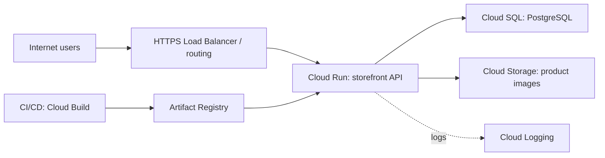
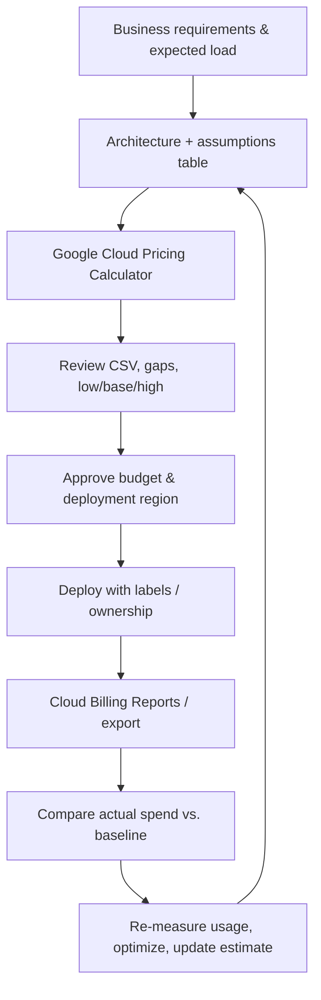

# Estimating Architectures with Google Cloud Pricing Calculator

Before deploying a system to Google Cloud, engineering teams need to answer: **How much is the planned architecture expected to cost per month, which items make up the largest share, and how will costs change if traffic grows?** The Google Cloud Pricing Calculator turns architectural choices into a **usage-assumption-based cost estimate**. This is a critical step when choosing between Compute Engine, Google Kubernetes Engine (GKE), and Cloud Run, designing storage/databases, securing resources, planning budgets, and preparing for release.

Within the **Billing and Budgets** chapter, this lesson covers an estimation methodology **starting from architecture and load requirements**, how to populate the calculator, checking commonly overlooked charges, sensitivity analysis, and handing off the estimate to track actual spend. You will practice on a hypothetical retail system; all traffic, capacity, and rough unit prices in this lesson are **illustrative data only**, not Google Cloud's actual pricing schedule or a formal quote.

## Learning objectives

After this lesson, you will be able to:

1. Distinguish between a **cost estimate**, **list price**, **contract price**, **budget**, and **actual invoice**.
2. Decompose a Google Cloud architecture into the line items that must be estimated in the calculator.
3. Convert business requirements into inputs with consistent units: requests, vCPUs, RAM, runtime hours, GiB-months, data transfer, and storage operations.
4. Build and share a multi-product estimate, selecting the right region, configuration, and usage model.
5. Compare Cloud Run, Compute Engine, and GKE options using the same set of assumptions.
6. Build low/baseline/high scenarios, document items not modeled by the calculator, and reconcile against Cloud Billing after deployment.

## 1. Understanding the exact scope of Pricing Calculator

Go to the [Google Cloud Pricing Calculator](https://cloud.google.com/products/calculator). The tool lets you add products and configure expected usage to build an estimate. The interface provides features such as **Add to estimate**, viewing **Cost details**, selecting currency, opening detailed breakdowns, **Download .csv**, and **Share**. Labels, input options, and product support may change over time and across product types.

Most importantly, **the calculator does not measure live workloads**. It calculates based on configurations and usage levels **declared by the user**. An estimate is a planning document, **not a fixed price, payment commitment, or spending cap**. Actual invoice charges are determined by real consumption and applicable billing terms.

| Concept | What is it used for? | What it should not be mistaken for |
| --- | --- | --- |
| **Pricing Calculator estimate** | Pre-deployment budgeting and architecture comparison | Official invoice, price guarantee, or spending limit |
| **Public list price** | Public rate by product, SKU, region, and usage type | Guaranteed rate applicable to every account |
| **Contract price** | Custom rate tied to a Cloud Billing account, if any | Standard discount for all customers |
| **Cloud Billing budget** | Cost-monitoring target and alert configuration | Automatic prevention of all charges exceeding the budget |
| **Cloud Billing reports/exports** | Observing actual usage costs after deployment | Perfect forecast for future traffic |
| **Quota/limits** | Usage cap for a specific resource type or API | Total cost-management tool replacing budgets |

For example: Estimating a system at **500 USD/month** does not mean the invoice will stop at 500 USD. If more egress, log storage, backups, or resource scaling occur than expected, actual charges may be higher.

### Pricing by billing account

The calculator can let you **sign in and link a Cloud Billing account** to view account-specific contract rates when an agreement exists and the user has appropriate permissions. Google Cloud documentation notes built-in roles such as **Billing Account Viewer** or **Billing Account Administrator** as roles that can grant the required permissions to view contract pricing. Only connect authorized billing accounts and protect pricing details per internal policy.

When not linked to an account with contract rates, explicitly note that the estimate is based on **public list prices**. Do not arbitrarily reduce total cost by an assumed percentage and label it as an actual contract rate.

## 2. Start from the architecture, not a SKU list

Suppose a retail application has a REST API, a PostgreSQL database, product images, and users accessing it over the Internet. Illustrative architecture:



The diagram shows services to **evaluate when building an estimate**; it does not claim every component is mandatory for every Cloud Run application. If you use Cloud Run's default domain/routing and do not deploy a separate load balancer, do not add a hypothetical load balancer to the baseline. If an external load balancer is used, include its corresponding line items.

**Breaking down costs by layer:**

| Architecture layer | Candidate services | Parameters to gather |
| --- | --- | --- |
| Application compute | Cloud Run / VM / GKE | Request count, execution duration, concurrency, CPU, RAM, runtime hours or node count |
| Database | Cloud SQL | Engine/edition, region, HA, CPU/RAM, storage, backups, I/O, outbound transfer |
| Object storage | Cloud Storage | Capacity in TB/GiB by storage class and location, reads/writes, retrieval, egress |
| Container images/builds | Artifact Registry, Cloud Build | Image size, build count, build duration, image storage and transfer |
| Networking | Load Balancing, Cloud NAT, VPC/data transfer | Internet traffic, inter-region, inter-zone, outbound traffic, active network components |
| Observability | Cloud Logging/Monitoring | Log volume, retention, metrics, traces, and ingested data volume |
| Protection/recovery | Snapshots, database backups, replication | Retained capacity, growth rate, number of regions, and DR strategy |

An item may be bundled into a product or billed separately. **Read the scope of each calculator configuration** so you neither omit items nor double-count the same charge.

## 3. Standardize assumptions before opening the calculator

Mixing up **GB** and **GiB**, confusing **months** with **hours**, or using **average** traffic for every component are major sources of error. Build an assumptions table independent of the calculator UI.

### Sample assumptions set for the retail system

| Group | Baseline assumption | Unit/scope | Source and items to confirm |
| --- | --- | --- | --- |
| Primary region | `asia-southeast1` (Singapore) | Region | Latency, data, and availability requirements |
| API traffic | 8,000,000 | Requests/month | User and behavior forecast |
| Request duration | 350 | ms/request average | Benchmark; also check p95/p99 |
| Cloud Run sizing | 2 vCPU, 1 GiB RAM | Per instance | Load testing, runtime constraints |
| Target concurrency | 20 | Concurrent requests/instance | Must be verified via load testing |
| Minimum instances | 0 | Instances | Cold starts accepted in this example |
| Cloud SQL | PostgreSQL, HA | 2 vCPU, 8 GiB RAM (illustrative input) | Verify actual edition/shape supported in region |
| Cloud SQL storage | 200 | GiB provisioned storage | Table and index growth |
| Database backups | 200 | GiB reference backup data | Retention, incremental backups, and HA/DR |
| Cloud Storage | 1.5 TiB | Standard, pre-selected location | Average stored volume, lifecycle |
| Object reads | 10,000,000 | Requests/month | Distinguish operation classes per pricing table |
| Object writes | 50,000 | Requests/month | Uploads and metadata operations |
| Internet egress | 6 TiB | Monthly, by destination and path | Break down source/destination; may involve CDN |
| Logs | 100 GiB | Log ingestion/month | Logging filters, retention |

All values in this table are a **simulation exercise**. CPU/RAM shapes, editions, and storage classes must be verified in the calculator for the chosen **product, date, region, and billing mode**. For real applications, take figures from load tests, traces, existing telemetry, or approved business requirements.

### Unit conversions

- A billing month can use **730 hours** to approximate a VM running 24/7 on a yearly average; actual calendar months have 28–31 days, or 672–744 hours. State this assumption explicitly.
- **1 GiB = 2^30 bytes**; **1 TiB = 1,024 GiB**. **1 GB = 10^9 bytes**, which does not equal 1 GiB.
- **6 TiB = 6 × 1,024 = 6,144 GiB**; **1.5 TiB = 1,536 GiB**.
- **350 ms = 0.35 seconds**. Theoretical total "request-seconds" is `8,000,000 × 0.35 = 2,800,000 request-seconds`; this is **not** billable vCPU-seconds because concurrency, scaling, idle time, CPU allocation, and billing mode all affect billing.
- Storage size usually requires **average capacity over the period**, not just month-end size. For example, linear growth from 1 TiB to 2 TiB can yield roughly a 1.5 TiB average, though actual data must be verified.

An example YAML template for recording assumptions in a design doc (**not a config imported directly into the calculator**):

```yaml
estimate:
  name: retail-prod-baseline
  date: "YYYY-MM-DD"
  currency: USD
  region: asia-southeast1
  period: monthly
  compute:
    service: Cloud Run
    requests_per_month: 8000000
    request_duration_ms_avg: 350
    vcpu_per_instance: 2
    memory_gib_per_instance: 1
    concurrency_per_instance: 20
    min_instances: 0
  database:
    service: Cloud SQL for PostgreSQL
    high_availability: true
    storage_gib: 200
  network:
    internet_egress_tib_month: 6
    destinations: "to be measured"
  assumptions:
    - "Prices depend on region and contract"
    - "HA, backup and transfer must be reviewed separately"
```

## 4. Workflow in Google Cloud Pricing Calculator

The UI may evolve; below is the **logical sequence** based on current calculator capabilities.

1. Open [Pricing Calculator](https://cloud.google.com/products/calculator). Choose the appropriate **display currency** so all stakeholders compare using the same unit.
2. If contract pricing is required, sign in and link a **Cloud Billing account** with pricing-view permissions; otherwise, note explicitly that public list prices are used.
3. Click **Add to estimate**, find the first product—for example **Cloud Run**—then enter the region and the load/configuration parameters requested by the UI.
4. Continue adding **Cloud SQL**, **Cloud Storage**, **networking/Load Balancing**, logging, builds, and all actual products present in the diagram. For products lacking matching input fields, add a **manual out-of-calculator line item**.
5. Open **Cost details** or **detailed view** to inspect each product/SKU and the monthly estimate total; cross-check against the assumptions table.
6. Use **Share** or **Download .csv** to hand off the figures. Record the calculation date, currency, region, scope, architecture version, and reviewer alongside the export.
7. Duplicate or create separate estimates for **low/base/high** or alternative architectures, and compare line items rather than only the bottom-line total.

For every row in the calculator, ask yourself:

> **"Which product is this cost calculated for, in which region, for how many units, over what duration, and which part of the diagram does it cover?"**

Not finding a product or option in the UI does not mean it is **free**. When the tool does not model something completely, use the service's official pricing page, SKUs in Cloud Billing Pricing reports, or consult your FinOps/cost management team to complete the estimate.

### What should an estimate record include?

| Handoff field | Illustrative value |
| --- | --- |
| Estimate name | `retail-prod-baseline-v1` |
| Date and author | Date prepared, responsible person/team |
| Architecture | Cloud Run + Cloud SQL HA + Cloud Storage + CI/CD |
| Environment and region | Production, `asia-southeast1` |
| Currency and price type | USD, public list price or billing-account contract rate |
| Period | **Monthly** cost; multiply by 12 only as reference when load is steady |
| Input assumptions | Requests, duration, compute size, GiB-months, egress, operations |
| Attached files/links | Calculator share link, exported CSV, architecture diagram |
| Excluded items | Taxes, external services, labor, separate licenses, traffic-spike risk |
| Confidence level | Measured vs. benchmarked vs. unverified assumptions |

## 5. Selecting inputs for each service group

### 5.1 Compute Engine: always-on and VM counts

When sizing Compute Engine, check:

- **Machine family/type**, vCPU and RAM counts; some custom CPU/RAM shapes have distinct pricing rules.
- **Region/zone**, number of VMs, and **runtime hours per month**. A VM running all month differs from one running only business hours.
- **Persistent Disk/Hyperdisk**, capacity, disk type, provisioned performance fees where applicable; snapshots and image storage.
- **Network egress**, external IP addresses, load balancers, and companion networking services.
- Purchasing model and pricing programs, such as **on-demand**, **Spot VMs**, **sustained use discounts**, or **committed use discounts**, if supported by the resource type and current terms.

Example of two VMs running 24/7 assuming 730 hours/month:

```text
VM-hours      = 2 VMs × 730 hours/VM = 1,460 VM-hours/month
Disk capacity = 2 × 100 GiB = 200 GiB
```

The VM-hours figure is **usage**, not money. In the calculator, you must select the **exact machine type and region** to pull unit rates, then add disks, snapshots, and networking. Do not apply hypothetical VM prices across different machine generations.

### 5.2 GKE: the cluster alone is not the full cost

When estimating a GKE cluster, distinguish **Standard** from **Autopilot**, as billing bases and resource units differ. Depending on mode and configuration:

- Cluster management fee (where applicable), billing rules, and any exemption policies.
- Node VMs, CPU/RAM or requested/allocated workload resources, runtime, and autoscaling.
- Boot disks, Persistent Volumes, load balancers, data transfer, ingress controllers, logging/metrics.
- Number of regions/zones, spare capacity, HA requirements; East–West and cross-zone traffic if present.

**Do not** add full cluster node costs and also enter those exact same nodes as a separate Compute Engine group unless intentionally modeling two distinct sets of resources. When comparing GKE to Cloud Run, factor in operational management effort and complexity as an **off-sheet criterion**.

### 5.3 Cloud Run: driven by load, sizing, and billing mode

Key Cloud Run inputs include:

- Region, **vCPU/RAM**, execution duration, request count, concurrency, minimum and maximum instances.
- **Request-based billing** vs. **instance-based billing** (where applicable); how vCPU-seconds/GiB-seconds and requests are metered differs by choice.
- Startup time, hourly traffic shape, acceptable latency, and instance request-packing efficiency.
- Networking, load balancers, Cloud SQL connections, VPC egress, and logs if applicable.

Conceptual formula:

```text
Total ≈ vCPU time cost
      + memory time cost
      + request cost (if applicable)
      + data transfer / dependent services cost
```

**Do not** compute `requests × request duration × vCPU count` as total billed CPU while ignoring **concurrency and instance lifetime**. If `min instances > 0`, resources may incur charges even at low request volume depending on billing mode. Traffic bursts can also increase concurrent instances.

### 5.4 Cloud SQL: include HA, backups, and growth

For Cloud SQL (PostgreSQL, MySQL, or SQL Server), inspect:

- **Engine, edition, region**, machine tier, vCPU/RAM, and instance count.
- **High availability** and standby/replica setup; the difference between HA and read replicas.
- Storage type/capacity, growth, provisioned IOPS/throughput where applicable, backups, and retention.
- Network egress, cross-region replication for DR, and separate test/staging environments.
- Licensing and pricing terms associated with engine, configuration, or edition choices.

A database holding 200 GiB of data **does not by default** consume only 200 GiB of storage. Backups, indexes, free space, replicas, and snapshots can push billed storage higher. For a conservative estimate, include backup capacity matching retention policy and test failover/restore plans.

### 5.5 Cloud Storage: capacity and operations

Object storage costs can involve:

- **Storage class** (e.g., Standard, Nearline, Coldline, Archive), bucket location (regional, dual-region, multi-region), and **average GiB-months**.
- Request counts by operation class per the pricing schedule.
- Data retrieval, minimum storage duration, or early deletion fees where applicable.
- **Data transfer** to the Internet, other regions, or other services; CDN if used.
- Replication, lifecycle transitions, and object versioning when enabled.

Do not assume moving to a "colder" storage class always lowers total cost: cheaper per-GiB storage can come with retrieval or minimum-duration charges. Evaluate **access frequency and data lifecycle** before choosing a class.

### 5.6 Networking and observability: commonly omitted costs

An estimate with only CPU/RAM and storage is rarely complete. Also check:

| Item | Questions to answer |
| --- | --- |
| Internet egress | How many GiB/month, where are the source and **destination**, and which network tier? |
| Inter-region / inter-zone | Is there replication, cross-region service calls, or cross-zone traffic? |
| Load Balancer | Is one used, which type, how many forwarding rules, and how much data processed? |
| Cloud NAT | Do private workloads reach the Internet through NAT? |
| CDN | How much cache hit, cache fill, egress to users, and invalidations? |
| Cloud Logging | Log volume ingested/stored, retention, exclusions; is there duplication? |
| Monitoring/Trace | Do metric types, traces, and ingest volume exceed free tiers? |
| Artifact Registry/Build | Image sizes, build minutes, and data transfer; does it grow with deployments? |

Data transfer pricing can depend on **source/destination location, path type, and SKU**, so do not multiply all traffic by a single generic "egress rate." Pay particular attention to traffic **between components**, across regions, and out to end users.

## 6. Hands-on practice: estimating a retail system

Create `retail-prod-baseline-v1` using the assumptions from Section 3. Save both a CSV export and an independent assumptions table for review.

### Step A — Build the baseline

Populate the components corresponding to the diagram:

| Component | Input values/notes | Estimate boundary |
| --- | --- | --- |
| Cloud Run API | 8M requests/month, 350 ms avg, 2 vCPU/1 GiB, concurrency 20, min instances 0 | Choose the right billing mode |
| Cloud SQL PostgreSQL | Region `asia-southeast1`, illustrative 2 vCPU/8 GiB shape, HA, 200 GiB storage | Add backups/replicas per policy |
| Cloud Storage | 1.5 TiB Standard, 10M reads, 50k writes | Select proper bucket location, class, and operation classes |
| Network | 6 TiB outbound/month | Split by destination and path; check LB/CDN/NAT |
| Observability | 100 GiB log ingest/month | Specify retention and other telemetry types |
| Build/Artifact Registry | Build count + image storage per period | Include only if actually deployed |

If a calculator product requests a different unit than your table, **convert and document it**. For instance, 6 TiB equals 6,144 GiB; do not type "6" into a GiB field and assume it is correct.

### Step B — Audit missing items

Map every box in the diagram to at least one line in the estimate or an **unestimated** note. Review HA, backups, cross-zone/region traffic, SSL/DNS if applicable, paid IAM/security tooling, log retention, support plans, and third-party licenses. Not every item has to be supported by the calculator; any unmodeled item must be logged as a risk.

### Step C — Inspect the breakdown

Open detailed view and build a summary table, **leaving dollar cells blank until populated from the live calculator**:

| Group | Estimated USD/month (fill from output) | Share (%) | Confidence level |
| --- | ---: | ---: | --- |
| Cloud Run | — | — | Medium, requires load test |
| Cloud SQL + backup | — | — | Medium |
| Cloud Storage | — | — | Higher if actual data exists |
| Network/LB/NAT | — | — | Low until traffic destinations are measured |
| Logs/Monitoring | — | — | Low until sampling is known |
| Build/Artifact Registry | — | — | Medium |
| **Total calculator estimate** | **—** | **100% once filled** | Excludes out-of-scope items |
| Off-calculator items / internal buffer | — | — | Categorized separately |

Once populated, calculate each group's share as:

```text
Group share (%) = Group cost / Total estimated cost × 100
```

**Note:** An "internal buffer" is a risk margin proposed by governance, **not a Google Cloud SKU**. Do not add a contingency percentage to individual rows and then add it again to the total.

## 7. Sanity-checking with independent math

The calculator gives detailed pricing; still, quick mental math catches unit-entry errors. The independent example below **does not use real Google Cloud unit prices**:

Assume two VMs run continuously, with a **hypothetical rate of 0.10 USD/hour** per VM and each 100 GiB disk at a **hypothetical rate of 0.08 USD/GiB-month**. At 730 hours/month:

```text
VM-hours               = 2 × 730 = 1,460 VM-hours
Hypothetical VM cost   = 1,460 × 0.10 = 146 USD
Disk capacity          = 2 × 100 = 200 GiB-months
Hypothetical disk cost = 200 × 0.08 = 16 USD
Subtotal               = 146 + 16 = 162 USD/month
```

**162 USD is purely the arithmetic result of two rates invented for this exercise.** It is not a Compute Engine quote and excludes snapshots, networking, IPs, load balancers, logging, taxes, and other charges.

Apply the same method using **actual consumption figures and unit rates pulled from the calculator** to cross-check:

```text
Component cost = Σ (billable quantity per SKU × SKU unit price)
Total cost     = Σ (component costs in the same period/currency)
```

For tiered pricing, free tiers, discounts, or billing-account usage aggregation, simple multiplication may not hold; apply the specific billing rules.

## 8. Scenario analysis and architecture comparison

A single number easily creates false certainty. Build three scenarios sharing the same core architecture:

| Assumption | Low | Baseline | High |
| --- | ---: | ---: | ---: |
| API requests/month | 3M | 8M | 20M |
| Internet egress/month | 2 TiB | 6 TiB | 15 TiB |
| Average Cloud Storage | 0.8 TiB | 1.5 TiB | 3 TiB |
| Logs ingest/month | 40 GiB | 100 GiB | 250 GiB |
| Cloud SQL CPU/RAM | Per low-load test | Per baseline shape | Consider scale-up/replica |
| Other assumptions | Hold constant unless sensitivity-tested | Baseline values | Change deliberately and document |

Workflow:

1. Duplicate or create new estimates for low/base/high.
2. Hold **region, currency, contract model, and untested assumptions** constant.
3. Vary only the designated variables; for databases, check at which threshold sizing must scale up or add replicas.
4. Record the new total and per-group deltas. Draw conclusions only after accounting for all relevant items.

Cost sensitivity to load can be calculated as:

```text
Cost Δ (%) = (New scenario cost - Baseline cost)
             / Baseline cost × 100
```

Totals do not necessarily scale linearly: Cloud Run has rounding/scaling behaviors and billing settings; databases and VMs/GKE have **baseline fixed costs** even at low traffic; data transfer has pricing tiers and routing boundaries.

### Option A vs. B: Cloud Run or GKE/Compute Engine?

Suppose both run the same API under the same load. To compare fairly:

- **Hold constant** the database, object storage, region, egress, HA requirements, log retention, and SLOs.
- Option A: Cloud Run with tested request concurrency, CPU/RAM, min instances, and billing model.
- Option B: GKE Standard/Autopilot or Compute Engine with equivalent node/VM counts, autoscaling, disks, LB, and availability.
- Check what is **bundled** in each product to avoid double-counting.
- Beyond Google Cloud fees, record deployment time, cluster/OS maintenance, operational skill requirements, and load-scaling behavior.

**Never choose the cheaper option on paper** if the estimate does not yet reflect equal availability, security, performance, and operational requirements.

## 9. Factors that cause estimates to diverge from invoices

| Common divergence | Why does it happen? | Mitigation |
| --- | --- | --- |
| Wrong region selected | SKU rates and availability vary by location | Lock region/zone per architecture and enter consistently |
| Using 730 hours for scheduled workloads | VMs/jobs only run a few hours per day | Calculate scheduled active hours |
| Ignoring traffic | Internet or cross-region egress can be substantial | Measure source/destination and pick matching transfer SKUs |
| Using month-end capacity as the average | Data grows or shrinks during the period | Estimate average GiB-months |
| Entering only the primary database | HA, replicas, backups/retention omitted | Model every required component |
| Assuming serverless has zero idle cost | Min instances, instance-based billing, or background work | Model actual configuration settings |
| Subtracting free tier twice | Free tier has service/billing-account scope limits | Check aggregation rules and what the calculator already deducts |
| Applying an unsupported "20% discount" | Discount levels depend on contract/CUD/SKU | Check Cloud Billing price sheets and eligibility rules |
| Forgetting off-tool charges | Support, licenses, taxes, partner fees, out-of-scope items | Track in a separate adjustment table |
| Comparing different currencies or periods | USD/mo vs. annual/VND quotes are not directly comparable | Normalize period, assumed exchange rate, and tax handling |
| Relying on stale estimates | Prices/products/architectures change | Record version/date and refresh estimates before approval |

### Free tier, CUDs/SUDs, and contract pricing

- **Free tier:** Terms vary by product and billing account and can change; do not assume every environment receives an independent free allowance. Verify whether the calculator already reflects the allowance.
- **Sustained use discounts:** May apply to eligible resource groups under specific rules; do not apply manual extra discounts if the estimate already includes them.
- **Committed use discounts (CUDs):** Trade usage or spend commitments for conditional discounts. Account for **term length, region/scope, actual utilization, and unused commitment**; discounted unit rates cannot be treated as risk-free savings.
- **Contract pricing:** Use only when granted pricing access for the applicable billing account. Otherwise, state that the estimate uses public list prices pending confirmation.
- **Promotional credits:** Typically time-bound and conditional; cost governance should separate **gross usage cost**, **discounts**, **credits**, and **net payable**.

### Taxes and exchange rates

The calculator lets you pick a display currency, but this does not replace the **actual billing currency, invoice-time exchange rate, taxes, and adjustments**. For budgets in Vietnam, if using USD to compare architectures and VND for approval, state the **internal conversion rate and effective date** explicitly. Never claim a USD estimate already includes all taxes.

## 10. From estimate to budget and operations

Once a baseline is approved, the next step is turning it into a **financial reference point**, not treating it as an automatic spending cap:



Sound practices:

1. Create a **Cloud Billing budget** scoped to the right Cloud Billing account, project, or labels, with alert thresholds aligned to team policy. **A budget alert alone does not guarantee spend stops.**
2. Apply workload labels such as `environment=prod`, `team=retail`, `cost_center=commerce` where supported; maintain a project ↔ owner mapping.
3. Track actual spend via Cloud Billing Reports or Billing export to BigQuery; separate forecasted spend from accrued charges.
4. Compare across the same **month, currency, project, service group, and price type**. Attribute variances to usage, region, runtime, resource counts, discounts, credits, and adjustments.
5. Schedule reviews at production launch, after major architectural changes, or whenever actual spend diverges materially from baseline. Usability and reliability must be checked alongside cost.

A simple variance-tracking table:

| Group | Monthly estimate | Monthly actual | Variance | Cause / action |
| --- | ---: | ---: | ---: | --- |
| Compute | From calculator | From Billing | Actual - estimate | Review runtime, autoscaling |
| Database | From calculator | From Billing | Actual - estimate | Backups, storage, replicas |
| Network | From calculator | From Billing | Actual - estimate | Egress growth, region changes |
| Observability | From calculator | From Billing | Actual - estimate | Log volume, retention |
| Total | Properly scoped sum | Properly scoped sum | Actual - estimate | Avoid mixing periods/taxes |

If actual cost differs from the estimate, examine both **usage changes** and **pricing scope/terms** rather than concluding the calculator was wrong.

## 11. Pre-approval estimate review checklist

- [ ] Architecture diagram covers compute, database, storage, networking, builds, observability, and DR.
- [ ] Product choices satisfy IAM, VPC, data protection, HA, reliability, and deployment requirements.
- [ ] Sources are documented for load, runtime, request volume, retention, and data growth assumptions.
- [ ] Region, zone, machine type, storage class, and service editions are selected consistently.
- [ ] Units are converted accurately: hours/month, GiB-months, requests, GiB transferred.
- [ ] Out-of-scope or subtle items are included or noted: backups, replicas, cross-region, data transfer, LB, NAT, logs, support, licenses.
- [ ] Free tier, contract pricing, CUDs/SUDs, taxes, and currency are handled under applicable terms.
- [ ] Low/base/high scenarios and alternative architectures exist where design decisions remain open.
- [ ] CSV export or Share link is saved with calculation date, owner, and architecture version.
- [ ] Budget alerts, labels, and post-deploy Cloud Billing comparison steps are defined.

## 12. Practice exercises

### Exercise 1: Decomposing an architecture

An e-commerce site uses a Cloud Run API, Cloud SQL PostgreSQL, an image bucket, Artifact Registry, and an external Application Load Balancer. Build a table of at least **10 required inputs** for the estimate, grouped by service. Specify which inputs must be measured via load testing and which come from architectural design.

<details>
<summary>Suggested answer</summary>

Inputs can include: region, requests/month, duration, Cloud Run CPU/RAM and concurrency, min instances, Cloud SQL edition/HA/CPU/RAM/storage/backups, bucket capacity and storage class, reads/writes, egress by destination, load balancer type, log volume, and build frequency. Requests, duration, optimal concurrency, read/write counts, and egress should be estimated from telemetry/load tests; region, HA, storage class, and retention are design decisions.
</details>

### Exercise 2: Catching a unit mistake

A team enters **6** into the "GiB data transfer per month" field because business requirements state "6 TiB/month." What is wrong, and what value should be entered if the field expects GiB?

<details>
<summary>Answer</summary>

6 TiB equals 6 × 1,024 = **6,144 GiB**. Entering 6 GiB understates data transfer by a factor of **1,024** compared to the requirement.
</details>

### Exercise 3: Comparing cost and SLOs

You have two options: autoscaling Cloud Run and a three-node always-on GKE Standard cluster. Which conditions must be held constant before concluding which option is cheaper?

<details>
<summary>Suggested answer</summary>

Hold load requirements, deployment region, data volume, latency/SLO, HA, network egress, storage, database, logging, and shared components constant. Include GKE cluster management/VM/Persistent Volume/LB fees, Cloud Run concurrency/min-instance behavior, and non-infrastructure operational overhead. Never decide from CPU/RAM prices alone.
</details>

### Exercise 4: Estimate lower than the invoice

After the first month in production, networking costs are 3× higher than estimated while CPU is close to plan. List hypotheses to investigate.

<details>
<summary>Suggested answer</summary>

Possible causes include omitted Internet egress, CDN cache misses, cross-region/cross-zone transfers, backup/replication traffic, load balancer data processing, NAT, or traffic destination breakdowns. Inspect Cloud Billing SKU/network costs, actual traffic path diagrams, and transfer logs/metrics; update assumptions rather than inflating the entire estimate by an arbitrary percentage.
</details>

### Exercise 5: Presenting for approval

Submit a package containing: architecture diagram; unit-consistent assumptions table; low/base/high estimates; CSV/calculator link; unestimated items table; Cloud Billing budget plan; and a 30-day post-launch reconciliation plan. Explain why the estimate **does not guarantee** an identical first-month invoice.

## Official reference documentation

- [Google Cloud Pricing Calculator](https://cloud.google.com/products/calculator): build per-product estimates, inspect details, export CSVs, and share links.
- [Estimate your monthly costs — Cloud Billing](https://cloud.google.com/billing/docs/how-to/estimate-costs): estimate purpose, limitations, and linking a billing account for contract pricing.
- [Google Cloud Pricing](https://cloud.google.com/pricing): public pricing information and usage-based pricing models.
- [View and download prices — Cloud Billing](https://cloud.google.com/billing/docs/how-to/pricing-table): SKU rates, public list prices, and contract prices when authorized.
- [Compute Engine pricing](https://cloud.google.com/compute/all-pricing): VM, disk, and related pricing factors.
- [GKE pricing](https://cloud.google.com/kubernetes-engine/pricing): Standard, Autopilot, and billable components.
- [Cloud Run pricing](https://cloud.google.com/run/pricing): request, CPU, RAM metering, and billing models.
- [Cloud SQL pricing](https://cloud.google.com/sql/pricing): database infrastructure and related options.
- [Cloud Storage pricing](https://cloud.google.com/storage/pricing): storage classes, operations, retrieval, and data transfer.
- [VPC pricing](https://cloud.google.com/vpc/network-pricing): data transfer and networking charges.
- [Cloud Billing budgets and alerts](https://cloud.google.com/billing/docs/how-to/budgets): tracking costs and budget alerts.
- [Cloud Billing export to BigQuery](https://cloud.google.com/billing/docs/how-to/export-data-bigquery): analyzing actual spend and post-deploy reconciliation.
