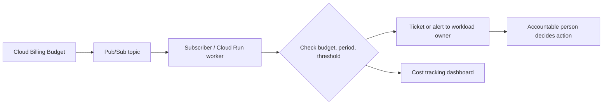

# Setting Up Budgets and Spend Alerts

> **Chapter:** Billing and Budgets  
> **Module:** CLOUD_PROVIDERS_GCP  
> **Module scope:** Explore Google Cloud from project organization, IAM, and VPC to Compute Engine, GKE, Cloud Run, storage, and database services. Through deployment scenarios, learners know how to select services, secure resources, automate releases, and monitor reliability alongside costs.

When applications run on Google Cloud Platform (GCP), costs do not only appear when creating a virtual machine. A project can incur charges from Compute Engine runtime, GKE resources, Cloud Run requests and allocated resources, data storage, databases, logs, network traffic, or other services. **Cloud Billing budgets** let you set spend targets and send alerts when actual or forecasted costs reach defined thresholds.

The most important point to grasp from the outset: **budgets and alerts are not hard spending caps**. They do not automatically stop resources from running or reject requests once a budget is exceeded. Administrators must read alerts, identify the root cause, and take appropriate control actions.

## Learning objectives

After this lesson, you will be able to:

1. Distinguish between **Cloud Billing account**, **project**, **budget**, **alert threshold**, and **notification channel**.
2. Create a monthly budget for a project or group of projects, selecting the right cost scope to monitor.
3. Configure alert thresholds based on **actual cost** and **forecasted cost**.
4. Configure and verify notification destinations via email, Cloud Monitoring, or Pub/Sub when appropriate.
5. Read cost reports, investigate alerts, handle budget-overrun situations, and verify your final configuration.

## 1. Where do budgets sit in Google Cloud?

A **Cloud Billing account** manages the payment relationship and can be linked to multiple **projects**. A project is the governance boundary for resources, IAM, APIs, and many quotas; charges generated by resources are recorded to the linked billing account, depending on charge type.

```text
Cloud Billing account
├── Project: gcp-dev-lab
│   ├── Compute Engine
│   ├── Cloud Storage
│   └── Cloud Run
├── Project: gcp-staging
│   └── GKE
└── Project: gcp-production
    └── Cloud SQL

Budgets belong to Cloud Billing account
├── Budget for all costs of the billing account
├── Budget tracking only project gcp-dev-lab
└── Budget tracking an eligible group of projects/services/labels
```

A budget is configured within the scope of a **Cloud Billing account**, but can be **filtered** to include only costs from selected projects, services, or attributes. Therefore, **a budget scoped to one project does not mean that project owns a separate billing account**.

| Concept | Answers the question | Example |
|---|---|---|
| **Billing account** | Which entity records and pays for the costs? | The company's billing account |
| **Project** | Which governance boundary do the resources belong to? | `gcp-dev-lab` |
| **Budget** | What is the spend target for a given scope and period? | 100 USD/month for the lab project |
| **Budget amount** | What dollar baseline is used for comparisons and threshold calculations? | 100 USD |
| **Alert threshold** | At what percentage of the budget should alerts trigger? | 50%, 80%, 100% |
| **Notification** | Which person or system receives the alert? | Cost owner, Monitoring channel, Pub/Sub |
| **Billing report** | Where are costs coming from and how are they changing? | Breakdown by project, service, SKU, and time |

**Note on currency:** budgets use the currency of the billing account. If an example says 100 USD but your billing account uses another currency, enter and interpret numbers in the **actual currency displayed** rather than converting with an assumed exchange rate.

## 2. Components that define a budget

### 2.1. Monitoring scope

The scope must reflect the governance question being asked. Common options include:

- **Billing account:** tracks all costs belonging to the selected billing account.
- **Project:** tracks one or more projects linked to that billing account.
- **Service:** filters one or more service groups, such as Compute Engine, Cloud Storage, or Cloud SQL.
- **Labels or supported filters:** narrows scope when resources are tagged and cost data satisfies the filter criteria. Not all charges carry the desired label; labels added later do not retroactively attach to past usage data.
- **Pricing/discount conditions:** depending on the UI and calculation mode, filters may let you include or exclude certain credits, discounts, or related charges. Always check the displayed definition before comparing a budget with an invoice.

**Example:** if one billing account pays for both a learning project and a production project, a 100 USD budget for the learning project must select **only the learning project** in the filter. Leaving the scope set to the entire billing account means production costs alone can breach the budget immediately even when the lab is barely used.

### 2.2. Budget period

Period options in the UI may include **monthly, quarterly, yearly, or a custom time range**, depending on supported features. For engineering teams or lab projects, **monthly** is usually easiest to compare against Cloud Billing reports and operate.

A monthly budget tracks spend within the configured calendar month; thresholds reset each cycle. A custom budget can serve a short-term campaign, but check start/end dates and forecast support for that option.

### 2.3. Budget amount

- **Specified amount:** enter a fixed amount. Well suited for new projects, lab environments, and agreed internal spending targets.
- **Last period's spend**, if supported by the UI: uses the previous period's spend as the baseline. Suitable for observing trends in steady-state workloads, though an unusual spike in the prior period can skew the baseline.

The budget amount should be driven by governance goals: expected consumption volume, environment, cost tolerance, and who is accountable for responding.

### 2.4. Actual vs. forecasted thresholds

**Actual spend** is cost already recorded in billing data within the budget scope, subject to reporting latency. **Forecasted spend** is the system's predicted spend for the budget period based on current information; a forecast **is neither an invoice nor a guarantee of the final period amount**.

Example for a **100 USD/month** budget:

| Threshold | Type | Meaning |
|---|---|---|
| **50%** | Actual | Alerts when recorded costs reach roughly 50 USD |
| **80%** | Actual | Alerts so the team checks spend trends at roughly 80 USD |
| **100%** | Actual | Signals that the 100 USD target has been reached or exceeded |
| **100%** | Forecasted | Alerts if projected period-end total is expected to reach or exceed 100 USD, even before actual spend hits that mark |

Thresholds are **percentages of the budget amount**, not separate fixed amounts per alert. One budget can have multiple thresholds. The ability to add forecasted thresholds may depend on the period, available data, or current UI options.

## 3. Preparation: accounts, access, and baseline data

Before taking action, know clearly:

1. **Which Billing account** pays for the project you need to monitor.
2. **The exact Project ID** of that project; avoid confusing the display name with the project ID.
3. **Who is responsible for reading alerts**: project owner, engineering team, FinOps, or cost manager.
4. **Expected spend per cycle** and the actions to take when thresholds are reached.
5. **IAM permissions** required to view or manage Cloud Billing budgets. Access can be granted via appropriate cost-management or Billing account administration roles; being Project Owner does not automatically guarantee permission to manage budgets on the billing account.

In the Console, go to **Billing** and select the right billing account. If you cannot see the billing account or the Budgets & alerts menu, verify your signed-in account and request permissions on the **billing account** instead of adding overly broad permissions to the project.

If you need to check a project's billing link from Cloud Shell, you can run read-only commands:

```bash
PROJECT_ID="gcp-dev-lab"  # Replace with actual project ID

gcloud auth list --filter="status:ACTIVE"
gcloud billing projects describe "$PROJECT_ID"
```

This only inspects the billing link when the identity has permission; it **does not create a budget**. If the lab is solely to learn budget configuration, do not deploy VMs, clusters, or databases that generate test charges.

## 4. Practical scenario: monthly budget for a development project

Suppose a team builds an API on **Cloud Run**, stores images in **Cloud Storage**, tests data with **Cloud SQL**, and occasionally uses **Compute Engine**. The team has two separate environments, development and production, linked to the same billing account.

In this exercise, the team wants to **monitor only the development project**, with these assumptions:

| Parameter | Illustrative value |
|---|---|
| Billing account | The account linked to the development project |
| Monitored project | `gcp-dev-lab` |
| Budget name | `gcp-dev-lab-monthly-budget` |
| Period | Calendar month |
| Service scope | All services in the development project |
| Budget amount | 100 USD (replace with actual account currency) |
| Actual thresholds | 50%, 80%, 100% |
| Forecasted threshold | 100%, if available |
| Recipients | Cost owner and operations group per authorized setup |

The objective is **early detection of overspend trends**, cost reconciliation, and timely action. This configuration **does not replace** quotas, resource-usage policies, or the organization's spend-approval process.

## 5. Hands-on: creating a budget via Google Cloud Console

This is the primary method for this lesson because you can view the budget name, filters, amount, thresholds, and notification channels all in one flow. Button labels and positions may vary with UI updates; rely on the meaning of the corresponding fields.

### Step 1 — Open the budget management screen

1. Sign in to [Google Cloud Console](https://console.cloud.google.com/).
2. Open **Billing**; if you have multiple billing accounts, choose the **exact** account paying for the project to monitor.
3. Open **Budgets & alerts**.
4. Click **Create budget**.

**Checkpoint:** the header or context banner in the Console must show you are working inside the **intended billing account**. If the billing account is wrong, stop before saving.

### Step 2 — Set name and scope

1. Enter **Name**: `gcp-dev-lab-monthly-budget`.
2. Select **Period** as **Calendar month**.
3. Under **Projects**, select `gcp-dev-lab`. Add other projects only when they genuinely share the same cost-accountability scope.
4. Under **Services**, leave all project services selected if the goal is an overall budget. Filter to a single service only when creating a specialized budget.
5. For **Labels** or additional filters, leave defaults if the lab has not yet adopted a consistent tagging strategy.
6. Review options regarding credits or discounts, if displayed in the UI, to understand the exact figure used for comparison.
7. Review the scope summary before clicking **Next**.

**Mistake to avoid:** leaving the scope defaulted to the entire billing account while assuming the budget only monitors the project selected at the top of the Console. Scope must be verified **directly inside the budget configuration**.

### Step 3 — Set amount

1. Select **Specified amount** for a new project or lab.
2. Enter **100** if the billing account currency is USD and the lab is actually approved for that threshold. For other accounts, enter the amount agreed upon by the owner.
3. Double-check the amount and currency symbol on screen.
4. Proceed to **Actions** or the thresholds/notifications step.

In production environments, budgets should be grounded in load and cost forecasts; 100 USD here is strictly an **educational example**, not a safe default for every architecture.

### Step 4 — Configure alert thresholds

Under **Alert threshold rules**, create or edit the rules:

| Threshold | Trigger | What the team should do upon receiving |
|---|---|---|
| 50% | Actual | Review cost breakdown and compare against planned usage |
| 80% | Actual | Identify fast-growing services, clean up unused resources, consider plan adjustments |
| 100% | Actual | Notify the budget owner and execute the agreed response plan |
| 100% | Forecasted | Check burn rate before actual spend hits the target ceiling |

If the screen supports adding/removing thresholds, you can combine three actual thresholds and one forecasted threshold in the same budget. Check **Actual vs. Forecasted** on each row: accidentally setting forecasted instead of actual changes what the alert means.

**Example:** mid-month, recorded spend is only 65 USD, yet end-of-month forecast is 115 USD. The **80% actual** threshold has not been reached; the **100% forecasted** threshold may already qualify. Alert delivery depends on system processing cycles and forecast criteria; there is no guarantee of instant delivery the moment spend changes.

### Step 5 — Configure notification destinations

Cloud Billing supports notification options depending on configuration, commonly including:

- **Email notifications tied to billing account permissions**: suitable when billing roles are already assigned to the right owners. Check the exact recipient group displayed by the UI; do not assume all project members receive alerts.
- **Cloud Monitoring notification channels**: useful when routing alerts to a shared email address or organization-managed channels. Channels must be created/authorized properly and linked to the budget where supported.
- **Pub/Sub notifications**: used when an automated system needs to ingest events and act—such as opening tickets, sending structured messages, or generating reports. Requires configuring the topic/subscription, identity, and publish/subscribe permissions; Pub/Sub **does not automatically email teams on its own**.

For a basic lab, choose the organization-approved **email** option. If adding a Cloud Monitoring channel, verify the channel is verified and recipients can actually receive notifications.

Under **Manage notifications** or the equivalent section:

1. Inspect the billing account's default email recipients.
2. If the organization wants additional recipients, use an appropriate channel rather than granting billing admin permissions just to receive emails.
3. Select and save valid channels if used.
4. Do not enable Pub/Sub just to test if you do not yet need automation or do not know how to secure the messages and subscriber.

### Step 6 — Save and verify the budget

1. Click **Finish / Save**.
2. Return to **Budgets & alerts** and locate `gcp-dev-lab-monthly-budget`.
3. Reopen the budget and verify scope, period, amount, thresholds, and notification settings.
4. Confirm the project in the filter is indeed the development project; note the configuration timestamp so administrators know when monitoring began.

**Seeing the budget in the list proves the configuration was saved; it is not proof that emails reached recipients.** If the project has not incurred costs yet, there may be no alert to observe right away. Never deliberately spin up costly resources just to breach a threshold and trigger an email.

## 6. Analyzing spend figures and alert timing

Suppose a 100 USD/month budget has the following recorded figures on a given day:

| Cost source | Illustrative recorded cost |
|---|---:|
| Compute Engine | 30 USD |
| Cloud Storage | 10 USD |
| Cloud SQL | 20 USD |
| Cloud Run and other services | 15 USD |
| **Total actual** | **75 USD** |

Total spend is 75% of the budget; the 50% actual threshold has been crossed, while the 80% actual threshold has not yet been reached. Suppose the system forecasts total monthly spend at 110 USD—the 100% forecasted threshold may trigger an early alert.

The next day, actual spend rises to 85 USD: the 80% actual threshold is crossed. If spend continues to 106 USD, the 100% actual threshold is crossed. These amounts illustrate how thresholds are evaluated, **not a processing schedule or delivery-time SLA**.

In practice, account for:

- **Billing data latency:** usage, reports, and budgets can update at different times.
- **Credits/discounts handling:** numbers in budgets and reports may differ if different filters or display modes are selected.
- **Periods:** compare using the exact month and reporting timezone/window applied by the billing system; do not manually sum across multiple months.
- **Invoice variance:** taxes, adjustments, and period-end items may not match the cost chart viewed mid-month.
- **Forecasts:** shift as usage or workload patterns change; forecasting never replaces tracking actuals.

## 7. Combining budgets with cost reports

A budget answers **"are we approaching our spend target?"** To learn **"which service caused the cost?"**, open **Cloud Billing → Reports** (or an equivalent cost report).

An alert investigation workflow:

1. Open the right **billing account** and select the time window matching the budget.
2. Filter by the same **project** as the budget configuration; if the budget filters by service or labels, apply the exact same filters to compare.
3. **Group by service** to spot which service category grew: Compute Engine, GKE, Cloud SQL, Cloud Storage, Cloud Run, networking, etc.
4. When granularity is needed, inspect **SKU** or detailed cost types as supported by the report, and check which dates saw the increase.
5. Correlate with system changes: new VMs, idle clusters still running, releases increasing request volume, excessive logging, long data retention, egress spikes, or unused resources.
6. Assign the workload owner to remediate, then continue monitoring actuals and forecasts.

### Common cost drivers by service

| Category | Causes to check when costs rise | Example mitigations |
|---|---|---|
| **Compute Engine** | VMs running after hours, leftover disks and IPs, oversized machine types | Stop/delete unused lab resources, right-size VMs, monitor usage |
| **GKE** | Nodes, workloads, storage, networking, and leftover cluster resources | Review allocations, autoscaling, deployment history, orphaned resources |
| **Cloud Run** | Request spikes, CPU/memory sizing, concurrency, min instances | Tune application and scaling settings to match real load |
| **Cloud Storage** | Data growth, storage class, requests, versioning/soft delete, egress | Appropriate lifecycle policies, clean up redundant objects, check retention requirements |
| **Cloud SQL** | Instances, storage, backups, HA, and provisioned capacity | Right-size capacity, review backups/retention and lab environments |
| **Networking and logs** | Internet/cross-region traffic; increased log ingestion/retention | Inspect data transfer architecture, log types, and retention policies |

Never immediately delete production resources solely because of an alert. Every action must weigh data impact, availability, RTO/RPO, and approval from the system owner.

### Using exported data for long-term analysis

When an organization needs multi-project analysis, team-level cost tracking, or dashboards, enable **Cloud Billing export to BigQuery** in accordance with permissions and data policies. This channel supports historical queries and joins with governance metadata, though it may incur BigQuery storage and query charges. Budgets and alerts still need to be configured separately.

## 8. Designing notifications and response workflows

A budget is only meaningful when **a person or process is accountable** once an alert arrives.

| Alert level | Appropriate recipients | Suggested response |
|---|---|---|
| **50% actual** | Project owner or cost manager | Check consumption pace and unusual increases |
| **80% actual** | Workload engineers and FinOps | Investigate by service/SKU, clean up lab resources, or adjust plans |
| **100% forecasted** | Budget owner and operations | Assess burn rate, expected changes, and early cost-reduction steps |
| **100% actual** | Budget owner, operations, and approvers | Escalate per procedure, review resources, and confirm additional spend |

The organization must decide who is authorized to modify a budget. **Raising a budget amount does not reduce actual costs**; it changes the governance target and requires justification, approval, and renewed tracking.

### 8.1. Automation with Pub/Sub: when is it needed?

At multi-project scale, a Cloud Billing budget can publish **structured notifications** to a Pub/Sub topic for event-driven handling, provided features and permissions are properly configured.



Implementation details to address:

- **Authentication and IAM:** allow only authorized services to publish/read messages; never skip identity or input validation.
- **Repeated and updated messages:** budget notifications can repeat over time; handle idempotently, such as keying on budget, period, and threshold level to avoid duplicate tickets.
- **Latency:** messages are not real-time cost streaming. Automation must tolerate spend amounts shifting after receipt.
- **Safety:** avoid automatically disabling billing, deleting projects, or shutting down production workloads from a single message, which can cause outages, data loss, or complex recovery.
- **Subscriber monitoring:** track processing errors, retries, and dead-letter queues by design so alerts are not silently dropped in the receiving application.

Conceptual processing logic example:

```text
When receiving a budget notification:
  1. Verify the source and parse payload fields accurately.
  2. Identify the corresponding budget, billing period, and actual/forecasted threshold.
  3. Compare against processed state to prevent duplicate alerts.
  4. Create a ticket or notify the workload owner.
  5. Record an audit trail and monitor handling outcome.
```

Do not build automation assuming a fixed payload schema from an improvised example: consult the **current budget event schema** and handle optional fields in real deployments.

## 9. Real-world scenarios

### Scenario A — Budget accidentally covers production

A team intended to monitor 100 USD for the dev project, but saved the budget with **All projects** in the same billing account. Daily production spend immediately pushes the budget over 100%.

**Diagnosis:** reopen the budget and inspect the Projects field. Compare with Reports filtered by project. **Fix:** narrow the scope to only the dev project and ensure recipients understand earlier alerts used the wrong scope.

### Scenario B — Cloud Run spend rises faster than expected

A test API experiences a sudden surge in requests. Actual spend is only 65%, yet forecasted spend already exceeds 100%.

**Diagnosis:** inspect Cloud Run metrics, request patterns, instance sizing, memory/CPU, and Reports. **Fix:** check for retry loops or missing client rate limits, optimize the app and scaling settings, and re-check the forecast afterward.

### Scenario C — GKE costs stay flat with zero users

The team stops sending requests, yet the cluster still maintains running nodes or provisioned resources.

**Diagnosis:** inspect node pools, autoscaling, workloads, storage, and related charges in Reports. **Fix:** scale down or clean up lab-environment resources properly; never assume zero requests equals zero cost.

### Scenario D — Budget breached, yet nobody received an email

The budget shows 100% reached, but the engineering team never saw a notification.

**Diagnosis:** check notification settings, recipient billing permissions, selected Monitoring channels, email status and spam folders, scope/thresholds, and data update timing. If using Pub/Sub, inspect the topic, publisher permissions, subscription, and consumer. **Fix:** route notifications to the accountable team, re-verify, and log the alerting incident.

### Scenario E — 100 USD budget differs from reports or invoices

A manager sees the budget figure differing from cost reports or the invoice.

**Diagnosis:** compare time ranges, project/service scopes, credits/discounts, currency, cost types, and ingestion latency. **Fix:** align filters identically, verify whether the period has finalized, and reconcile invoice-level adjustments or taxes.

## 10. How to verify a budget after setup

The budget-creation exercise can be completed **without provisioning any additional billable services**. Use this checklist:

| Check item | Expected outcome |
|---|---|
| Billing account | Matches the account linked to the target project |
| Name | Clear, identifiable budget name and defined owner |
| Scope | Filters to the exact projects, services, and labels needed |
| Period | Cycle matches cost-review cadence |
| Amount | Dollar figure and currency confirmed |
| Actual thresholds | Milestones align with response levels |
| Forecasted threshold | Enabled if needed and supported by the UI |
| Email/channels | Correct destinations configured; recipients know their duties |
| Saved config | Budget appears under Budgets & alerts and reads back accurately |
| Reports | Able to open Reports, apply matching filters, and inspect charges |
| Response plan | Clear responder and action plan when thresholds trigger |

If the organization can perform a safe test without generating unusual spend, validate the notification channel using supported testing features. **Never deliberately drive up spend past a budget just to test alerts.**

### Troubleshooting in order

| Issue | Common cause | Resolution |
|---|---|---|
| Cannot see Budgets & alerts | Wrong billing account selected or missing permissions | Verify identity/billing account; request the proper role |
| Project missing from scope list | Project linked to another billing account or lacks access | Check project ID and billing link |
| Budget amount looks unexpected | Last period's spend selected or wrong currency | Check Amount and currency |
| Alerts arrive too late | Usage/billing data and alert delivery have latency | Add earlier thresholds; supplement with metrics/Reports |
| No forecasted alerts | Forecast window or data insufficient, or feature unavailable | Review eligibility and keep actual thresholds |
| Emails not arriving | Wrong recipients, unverified channel, or incomplete config | Check notification settings and destinations |
| Costs missing when filtering by label | Resources lack labels or charges do not support labels | Check tagging policy; use project/service filters |
| Pub/Sub receives events but creates no ticket | Subscriber error, insufficient permissions, or duplicate handling | Inspect logs, subscription, retries, and idempotency |

## 11. Budget management principles across multiple environments

- **Separate budgets by purpose:** billing-account-level budgets for overall governance; per-project budgets for dev/staging/production to assign clear ownership. Multiple budgets can monitor overlapping scopes, and having multiple budgets does not double charges on your invoice.
- **Pair with technical controls:** least-privilege IAM, quotas, resource creation policies, infrastructure approvals, and automated lab cleanup where appropriate. Quotas cap a specific usage dimension, **not your total monthly bill**.
- **Design for visibility early:** estimate Compute Engine, GKE, Cloud Run, Cloud SQL, storage, networking, and logs before launch. Evaluate both idle baseline costs and peak-load costs.
- **Define clear response ownership:** every budget needs an owner, notification destination, response tier, and review cadence. Never route alerts solely to one individual not on operational rotation.
- **Review regularly:** after architecture changes, new projects, billing account switches, traffic shifts, or product price updates, re-verify scope, amount, and notification settings.
- **Control financial risk:** budgets should leave enough reaction buffer before unacceptable spend occurs; services capable of rapid scaling need extra monitoring and usage governance.

## 12. Self-check questions

**1. A 100 USD budget reaches 100% actual spend. Does Google Cloud automatically shut down the project?**  
**Answer:** no. A budget is a monitoring/alerting tool; actions on resources must be designed and executed separately.

**2. A billing account has two projects, dev and production. How should you scope a budget to monitor only dev?**  
**Answer:** in the budget configuration, filter **Projects** to include only the dev project and verify the scope before saving.

**3. If actual spend is 65 USD but month-end forecast is 115 USD on a 100 USD budget, which threshold may trigger first?**  
**Answer:** **100% forecasted** may be met; the **80% actual** threshold has not yet been reached. Actual alert timing depends on data updates and delivery systems.

**4. Should you grant Billing Account Administrator to all developers just so they receive budget emails?**  
**Answer:** no. Use appropriate notification channels or organizational routing; billing admin roles must only be granted based on job duties.

**5. Is checking the budget alone enough to explain why Cloud Run costs increased?**  
**Answer:** no. Combine Billing Reports by project/service/SKU with workload metrics and configurations to pinpoint the cause.

**6. Why set 50%, 80%, and 100% actual thresholds instead of only 100%?**  
**Answer:** earlier thresholds create lead time to investigate and adjust before hitting the spend target; 100% is often too late for preventive action.

**7. Does having two budgets monitoring the same project cause Google to bill usage twice?**  
**Answer:** no. Budgets are monitoring/alert scopes and do not duplicate service usage charges. However, the same cost can appear in multiple budget reports.

## Key takeaways

- **Cloud Billing budgets track spend targets, but they are not cost-blocking locks.**
- Select the exact **billing account, project, period, amount, and filters** before configuring thresholds.
- Combine **actual thresholds** to track accrued spend with **forecasted thresholds** to detect overspend risk earlier.
- Alerts only add value when **routed to the right people and tied to concrete actions**; both billing data and forecasts have latency and accuracy limits.
- When costs rise, use **Billing Reports and operational telemetry** to trace the source; continuously review budgets as architecture or scale changes.

## Official reference documentation

- [Google Cloud — Create, edit, or delete budgets and budget alerts](https://cloud.google.com/billing/docs/how-to/budgets)
- [Google Cloud — Programmatic notifications for Cloud Billing budgets](https://cloud.google.com/billing/docs/how-to/notify)
- [Google Cloud — View your cost trends and forecasts](https://cloud.google.com/billing/docs/how-to/reports)
