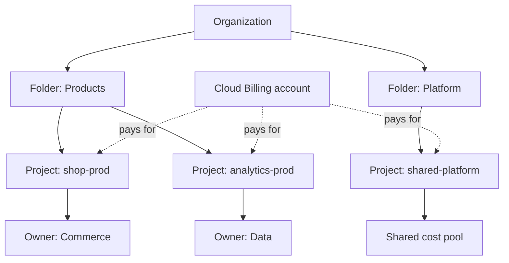
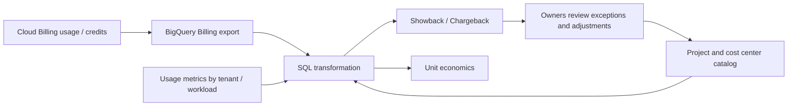

# Allocating Costs by Project, Labels, and Usage Units

When an organization runs multiple systems on Google Cloud (GCP), asking "how much did we spend this month?" is only the starting point. To govern costs effectively, you must also answer: **which product owns the cost, which team is accountable, which environment generated it, which resources consumed it, and how much does a single business unit actually cost?**

This lesson belongs to the **Billing and Budgets** chapter of the `CLOUD_PROVIDERS_GCP` module. Cost allocation connects decisions across Organization/Folder/Project structure, IAM, VPC, Compute Engine, GKE, Cloud Run, storage, and databases with release workflows, reliability monitoring, and budget controls. A functionally healthy system without clear cost ownership becomes difficult to optimize as it scales.

The goal of this lesson is to design an allocation rule set that is **explainable, traceable back to Billing data, and updated consistently**. All financial figures and project names below are hypothetical examples for learning purposes.

## 1. Three perspectives on the same charge

| Perspective | Question answered | Common units | Example |
| --- | --- | --- | --- |
| **Project** | Which GCP resource scope recorded the charge? | Project ID, billing account | `shop-prod`, `analytics-prod`, `shared-platform` |
| **Label** | Which team, product, or environment owns this resource/usage? | `team`, `product`, `environment`, `cost_center` | `team=commerce`, `environment=prod` |
| **Usage unit** | Who actually consumed the resource and how much? | Department, tenant, business flow; runtime hours, GiB-months, requests, orders | Team Commerce; Customer A; 80,000 orders/month |

"Usage unit" has **two distinct meanings to separate**:

1. **Allocation recipient (consumer/cost owner):** team, department, product, internal customer, tenant; the entity ultimately accountable or reported to for the cost.
2. **Consumption metering unit:** vCPU-hours, byte-months, request count, successfully processed orders. This is the metric used to decide how costs are split.

For example, Cloud SQL might be recorded under a platform project with the label `product=orders`, yet multiple tenants share that database. A label alone does not show how many queries each tenant ran; you also need application-level telemetry and an allocation rule.

### Showback, chargeback, and unit economics

- **Showback:** publishing reports showing how much cost each team generates so teams have visibility and improve usage behavior; no actual funds or budgets are transferred between units.
- **Chargeback:** booking or transferring costs back to cost centers or accountable units under an agreed, auditable rule.
- **Unit economics:** calculating cost per unit of business output, such as USD/successful order or USD/1,000 API requests; requires combining GCP spend with **business metrics**, and cannot be derived from Billing alone.

These approaches can coexist. Early on, showback is typically useful to validate metadata quality before enforcing chargeback for financial accounting.

## 2. Understanding Billing account, Organization, Folder, and Project relationships

Google Cloud organizes resources in Organizations, Folders, and Projects, while a **Cloud Billing account** manages payment for linked projects. One billing account can pay for many projects; each project links to one billing account at a time when billing is enabled. Folders and Organizations govern structure, permissions, and policies; they do not automatically split every charge by department.



This is a logical model for discussion. When measuring costs, always verify which billing account paid for each project during each timeframe and whether any charges lack a specific project ID.

### Choosing projects as the primary cost boundary

| Project organization pattern | Strengths | Limitations to address |
| --- | --- | --- |
| One project per product and environment | Easy to assign owners, budgets, IAM, quotas, and isolate dev/prod | More projects to manage; shared services require separate allocation. |
| One project per department | Easy departmental cost reporting | Multiple products or tenants inside one department cannot be separated cleanly. |
| Shared platform project | Centralizes networking, observability, CI/CD, or shared databases | Billing attributes costs to platform rather than end consumers; needs allocation drivers. |
| Multiple teams sharing one project | Fewer projects to administer upfront | Difficult to separate IAM and costs without strict labels, telemetry, and rules. |

**Design principle:** use projects for stable permission and cost boundaries; use labels for finer analysis inside projects; use usage telemetry to split shared pools or allocate to tenants. Never create thousands of projects solely to track which customer sent each request.

## 3. Designing a taxonomy before tagging

An effective labeling system requires a consistent metadata dictionary, owners, and validation rules. Example:

| Label key | Example values | Purpose | Rule |
| --- | --- | --- | --- |
| `environment` | `dev`, `staging`, `prod` | Separate costs by environment | Use a controlled value set; avoid mixing `production` with `prod`. |
| `team` | `commerce`, `data`, `platform` | Accountable engineering team | Assign an owner to maintain mappings during renames or reorgs. |
| `product` | `orders`, `analytics` | Attribute by product | Stable identifier across projects/regions. |
| `cost_center` | `cc_102`, `cc_205` | Reconcile with financial systems | Codes sourced from finance governance with effective dates. |
| `owner` | `team_commerce` | Route alerts and assign accountability | Avoid putting personal email addresses into labels unnecessarily. |
| `workload` | `api`, `batch`, `database` | Compare workload categories | Classify consistently; avoid unbounded free-text values. |

The keys above are **illustrative conventions**, not built-in Google Cloud labels. GCP enforces character, length, and count limits on labels; verify per-resource limits in documentation before rollout. Never put sensitive data, tokens, or customer PII in labels.

### Distinguishing three easily confused metadata types

1. **Project labels:** metadata attached to a project, useful for managing project ownership. Do not assume every charge row automatically includes those labels in the Billing export `labels` field.
2. **Resource labels:** metadata attached to resources **that support labels**; depending on service/SKU and export type, eligible labels appear in Billing for cost breakdown. Not every service or charge carries labels.
3. **Resource Manager tags:** key/value tags with a distinct governance model, usable in IAM Conditions or Organization Policies where supported. Do not treat tags and labels as identical or assume both appear identically in Billing reports.

For chargeback, the safest practice is maintaining an approved **project → owner/cost center mapping table** and treating resource labels as supplemental detail. That way, rows lacking `labels` can still be attributed by project when the project has a clear owner.

### Inspecting metadata with read-only tools

```bash
# View labels of a project you are permitted to inspect
gcloud projects describe PROJECT_ID \
  --format="yaml(projectId,name,labels)"

# View labels of a specific Compute Engine VM
gcloud compute instances describe VM_NAME \
  --project=PROJECT_ID \
  --zone=ZONE \
  --format="yaml(name,labels)"
```

These two commands do not assign labels. To enforce policy in practice, embed labels into Infrastructure as Code or provisioning pipelines, define who can modify them, monitor drift, and require labels on supported resource types. Adding or changing a label **does not rewrite historical cost records**.

## 4. Where does cost data come from?

| Source | Best suited when | Limitations |
| --- | --- | --- |
| **Cloud Billing Reports** | Visual trend inspection, filtering, and grouping by project, service, SKU, and supported labels | Primarily interactive analysis; granularity and grouping depend on UI and permissions. |
| **Cost table / invoices** | Reconciling invoice periods, taxes, adjustments, and total payable | Not directly equivalent to daily usage-date cost charts. |
| **Cloud Billing export to BigQuery (standard usage cost)** | SQL analysis by project, service, SKU, labels, and usage timestamps | Must enable export, manage dataset/IAM, normalize data, and monitor BigQuery costs. |
| **Detailed usage cost export** | Needing deeper resource-level granularity on supported services | Larger storage/query cost; resource-level coverage depends on the service. |
| **Application metrics, Cloud Monitoring, logs** | Splitting shared resources across teams/tenants; calculating cost per request, job, or order | Requires custom instrumentation and period alignment; not an invoice source. |

**Never treat a dashboard figure as the sole "source of truth"** for chargeback. First align on period definition, currency, cost types, credit handling, and invoices. Cloud Billing data has latency and can receive post-usage adjustments; usage dates and invoice months can differ.

### 4.1. Enabling export and storing data properly

A typical implementation flow:

1. Identify the Cloud Billing account and an administrator authorized to manage export settings.
2. Create or select a BigQuery dataset in a financial analytics project; configure data location, retention, and IAM.
3. In Billing, configure **BigQuery export** for the needed datasets: standard usage cost and, if required, detailed usage cost.
4. Verify generated export tables and actual schemas; record the export start timestamp. Historical backfill depends on export type and dataset location, so do not assume full history prior to enablement.
5. Restrict dataset read access since data reveals consumption, resource structure, and business metadata; monitor BigQuery storage/query spend.

Illustrative data pipeline:



### 4.2. Key fields in Billing exports

Exact schemas vary by export type and version, but common concepts include:

| Field group | Examples | How to use |
| --- | --- | --- |
| Billing & project | `billing_account_id`, `project.id` | Identify the billed account and related project; some charges have no project. |
| Service & SKU | `service.description`, `sku.id`, `sku.description` | Understand which product and billable item generated the charge. |
| Time | `usage_start_time`, `usage_end_time`, `invoice.month` | Scope by **usage time** or reconcile by **invoice month**; never mix both rules in one report. |
| Location/resource | `location` and, in detailed export where available, resource metadata | Analyze regions/locations; inspect specific resources where supported. |
| Labels | `labels` and project metadata fields if exported | Extract `team`/`cost_center` labels for granularity; handle an "unlabeled" group. |
| Currency and cost | `cost`, `currency`, `credits`, `cost_type` | Compute pre/post-credit amounts, separate charge types, and avoid mixing currencies. |
| Usage volume | `usage.amount`, `usage.unit`, `usage.amount_in_pricing_units`, `usage.pricing_unit` | Measure service consumption per SKU and corresponding pricing unit. |

Note: column names and coverage in **standard** or **detailed** tables can evolve. Before deploying SQL in production, inspect your live export table schema and compare against official documentation.

## 5. Project-level allocation: the most auditable baseline

Suppose a company has four projects:

| Illustrative Project ID | Owner | Purpose | Default allocation group |
| --- | --- | --- | --- |
| `shop-prod` | Commerce | APIs, Cloud SQL, Cloud Storage handling orders | Commerce |
| `analytics-prod` | Data | Data analytics, BigQuery jobs | Data |
| `shop-dev` | Commerce | Order-processing dev/test | Commerce, dev environment |
| `shared-platform` | Platform | Shared networking, logging, CI/CD | Shared cost pool |

After choosing the period and charge types, sum costs by project. This suffices for owner-level showback **when each project has one clear owner**. For `shared-platform`, you need an allocation policy so Platform is not saddled with costs driven by other teams.

### 5.1. SQL: total cost by project and resource label

The example below uses BigQuery Standard SQL. Replace table and timestamps with real data; `labels` reflects **labels exported on the usage row**, not automatically project labels.

```sql
-- Example usage period October 2026, in UTC.
-- Replace table name with the actual export table of your billing account.
WITH line_items AS (
  SELECT
    COALESCE(t.project.id, 'no_project') AS project_id,
    COALESCE(
      (
        SELECT l.value
        FROM UNNEST(t.labels) AS l
        WHERE l.key = 'cost_center'
        LIMIT 1
      ),
      'unlabeled'
    ) AS resource_cost_center,
    t.currency,
    t.cost AS cost_before_credits,
    IFNULL(
      (SELECT SUM(c.amount) FROM UNNEST(t.credits) AS c),
      0
    ) AS credit_amount
  FROM
    `YOUR_EXPORT_PROJECT.billing_export.gcp_billing_export_v1_XXXXXX_XXXXXX_XXXXXX` AS t
  WHERE t.usage_start_time >= TIMESTAMP('2026-10-01')
    AND t.usage_start_time < TIMESTAMP('2026-11-01')
)
SELECT
  project_id,
  resource_cost_center,
  currency,
  ROUND(SUM(cost_before_credits), 2) AS cost_before_credits,
  ROUND(SUM(credit_amount), 2) AS credits,
  ROUND(SUM(cost_before_credits + credit_amount), 2) AS cost_after_credits
FROM line_items
GROUP BY project_id, resource_cost_center, currency
ORDER BY cost_after_credits DESC;
```

In many rows, credits are negative values representing discounts or reductions. The illustrative formula is:

\[
\text{Cost after credits} = \sum(\text{cost}) + \sum(\text{credits.amount})
\]

Do not equate "after credits" with "final invoice total" without checking **taxes, adjustments, rounding, projectless fees, ingestion timing, and `invoice.month`**. For invoice reconciliation, run a separate query by invoice month incorporating `cost_type` and adjustment entries.

**Why use a subquery for `labels`?** Because `labels` is an array, `CROSS JOIN UNNEST(labels)` followed by summing `cost` duplicates a usage row whenever a resource carries multiple labels. A subquery fetching a single key avoids this bug. For strict accounting, also check duplicate keys, invalid values, and owner-selection rules.

### 5.2. What if a project or row has no labels?

Never turn `unlabeled` into a fictional team name. Apply an ordered fallback hierarchy:

1. If the row has a trusted, approved resource label, allocate by that label.
2. If no resource label exists, look up the **effective-dated** project ownership table (project ID → product/team/cost center).
3. If the project belongs to shared infrastructure, place it into a shared pool allocated by a dedicated driver.
4. If no owner can be determined, place it into **Unallocated** with an assigned resolver; never dump it onto the largest team.

When a project transfers between teams, mappings should include `valid_from`/`valid_to` dates so historical periods still reflect the owner at the time usage occurred. This keeps chargeback reproducible and auditable.

## 6. Allocating by SKU and consumption units

A **SKU (Stock Keeping Unit)** in Billing represents a billable item within a service—such as a compute, storage, or data-transfer category. One GCP product can generate many SKUs; the same service across different regions, machine types, storage tiers, or billing units can carry different rates.

Example summing usage volume and pre-credit cost by SKU:

```sql
SELECT
  t.service.description AS service_name,
  t.sku.id AS sku_id,
  t.sku.description AS sku_name,
  t.usage.pricing_unit AS pricing_unit,
  t.currency,
  SUM(t.usage.amount_in_pricing_units) AS pricing_quantity,
  ROUND(SUM(t.cost), 2) AS cost_before_credits
FROM
  `YOUR_EXPORT_PROJECT.billing_export.gcp_billing_export_v1_XXXXXX_XXXXXX_XXXXXX` AS t
WHERE t.usage_start_time >= TIMESTAMP('2026-10-01')
  AND t.usage_start_time < TIMESTAMP('2026-11-01')
GROUP BY service_name, sku_id, sku_name, pricing_unit, currency
ORDER BY cost_before_credits DESC;
```

You can inspect consumption using `usage.amount`/`usage.unit` or `usage.amount_in_pricing_units`/`usage.pricing_unit`. **Never sum together** GiB-months and requests, vCPU-seconds and bytes, or disparate SKUs to fabricate a "total usage" metric. To compute an SKU's average effective rate, divide cost by quantity in the **same unit** and note whether credits/discounts are included.

### Distinguishing billing units from business units

| Billing unit | Business unit | Supplemental data needed |
| --- | --- | --- |
| Compute-seconds / resource time | USD/1,000 successful API requests | Request metrics or app logs; distinguish succeeded, failed, and retried requests. |
| Storage byte-time | USD/GB of retained data per tenant | Actual object or record volume per tenant and retention duration. |
| Network egress bytes | USD/GB of product data transferred | Measured per workload/path; define which egress belongs in the shared pool. |
| Database instance / storage / I/O | USD/order | Successful order count, rules for splitting shared DB and idle DB overhead. |

Billing explains **what unit the provider charges for**. The application explains **what business value users generate**. Both datasets must align by period and scope before computing unit economics.

## 7. Splitting shared costs across teams and tenants

Hard-to-attribute items typically include shared VPC/networking, Cloud NAT, centralized logging/monitoring, CI/CD, multi-tenant databases, cross-project storage, idle capacity, and non-resource-tagged support or adjustment fees.

### 7.1. Ordered allocation rules

| Priority | Method | Example driver | Relative reliability |
| --- | --- | --- | --- |
| 1 | **Direct assignment** by project/resource with clear owner | Dedicated product project | High if mapping and labels are complete. |
| 2 | **Measured consumption** inside a shared pool | GiB log ingest per team, CPU-seconds/job, egress bytes per workload | High when telemetry has full coverage and matching period. |
| 3 | **Explainable proxy** | Request count, job count, tenant count, data volume, average load share | Depends on how closely the proxy tracks actual cost drivers. |
| 4 | **Fixed policy split** | 50/30/20 based on budget or headcount | Easy interim option; state assumptions and review cadence clearly. |
| 5 | **Unallocated with resolution owner** | Charges that cannot be reliably attributed or lack telemetry | More transparent than arbitrary assignment. |

For every shared cost pool, define:

- **What goes into the pool?** Select the SKU/service/project set, charge types, and whether credits, discounts, taxes, or support are included.
- **Who are the recipients?** Teams, products, or tenants; should dev environments or platform teams be excluded?
- **Which driver is approved?** Needs matching-period telemetry; how are missing data and retries handled?
- **Rounding and reconciliation?** Allocated amounts must sum to the pool total under the rules, including any remaining unallocated amount.
- **Who approves exceptions?** Whenever structure or ownership changes, version the rule set.

### 7.2. Formula and example

For a pool `P` and usage unit `i`:

\[
\text{allocated}_{i} = P \times \frac{u_i}{\sum_j u_j}
\]

Where `u_i` is the consumption of unit `i` measured with the **same driver and in the same period**. If the denominator is zero or telemetry is missing, apply an approved fallback rule or leave unallocated.

Suppose in October (all figures in USD, post-credit, pre-tax), we have:

| Cost item | Amount | Initial attribution |
| --- | ---: | --- |
| `shop-prod` | 1,400 | Commerce |
| `analytics-prod` | 600 | Data |
| `shop-dev` | 150 | Commerce |
| `shared-platform` | 300 | Shared pool |
| **Total** | **2,450** | |

The `shared-platform` pool is split **70% to Commerce, 30% to Data** based on a measured, approved shared driver (purely illustrative figures). Then:

- Commerce receives `1,400 + 150 + 300 × 70% = 1,760 USD`.
- Data receives `600 + 300 × 30% = 690 USD`.
- Conservation check: `1,760 + 690 = 2,450 USD`.

If Commerce processed **80,000 successful orders**, allocated infrastructure cost per order is:

\[
\frac{1760\ \mathrm{USD}}{80000\ \mathrm{orders}} =
0.022\ \mathrm{USD/order}
\]

This is **cost per order within the chosen infrastructure scope**, excluding personnel, marketing, payment processing fees, revenue, or off-GCP costs. Compare figures across months only when pool scope, successful-order definitions, and credit rules remain consistent.

### 7.3. Multi-tenant scenario

Suppose one Cloud Run service and Cloud SQL instance serve 20 enterprise customers. All run inside one project and access the same database. Adding a `tenant_id` label to the shared service does not generate 20 separate billing rows. You must meter at the application or connection layer, such as:

- Valid requests and processing duration per tenant;
- CPU time or processed jobs per tenant if instrumented;
- Data volume and storage lifecycle per tenant;
- Database reads/writes, if measured reliably without prohibitive overhead.

Drivers should reflect **what actually drives cost**. Splitting database costs by request count fails if one tenant runs heavy analytical queries; splitting storage by requests does not reflect retained data volume. When exact measurement is infeasible, report estimated ratios and error bounds rather than claiming false precision.

## 8. Credits, discounts, taxes, and reporting periods

A Billing period may contain adjustments for credits, committed use discounts, promotions, free tier, taxes, refunds, or corrections. Certain credit/discount types are represented differently depending on export version and contract structure. Therefore, establish policy before running chargeback:

| Decision | Question to settle | Control tip |
| --- | --- | --- |
| Gross vs. net | Report before or after credits/discounts? | Publish both columns when helpful; compute net from the right source to avoid deducting credits twice. |
| Commitments/discounts | Which team receives savings and who bears unused commitment risk? | Allocate commitment benefits and fees by policy; verify logic against live billing data. |
| Taxes/support/adjustments | Put into which pool, split proportionally, or keep at Finance? | Explicitly handle projectless items and retroactive adjustments. |
| Currency | Are there multiple currencies or converted reports? | Never sum different currencies directly; apply consistent exchange rates and timestamps if converting. |
| Period | Based on `usage_start_time` or `invoice.month`? | Operational reporting by usage period; financial close by invoice period. |
| Late postings | What if an old-month charge arrives after reports close? | Define a restatement/adjustment process and close calendar. |

**Common conflict example:** a dashboard on Oct 31 shows October's total by usage timestamps, while October's invoice may reflect entries and adjustments under distinct invoicing rules. Two differing totals are not automatically a bug; first check whether billing account, currency, filters, charge types, and data finalization match.

## 9. Budgets and alerts: acting on allocated data

Once owners exist, map costs to budgets:

1. Assign an owner per project or project group; define monthly/quarterly spend targets by environment.
2. Create a **Cloud Billing budget** with the proper scope (billing account, project, service, or UI-supported filters); verify label filters if tracking team spend.
3. Configure alert thresholds such as **50%, 90%, 100%** of budget, plus forecasted alerts if helpful. Define recipients, operational channels, and response SLAs.
4. Use BigQuery/Cloud Billing Reports to pinpoint root causes: rising SKUs, idle resources, traffic growth, log retention, cross-region egress, retry storms, or newly created resources.
5. When thresholds trigger, owners assess **SLO impact** before downsizing capacity, changing storage classes, or shutting down resources.

**A Billing budget is a monitoring and notification tool; by default it is not a hard cap and does not shut down services at the threshold.** You can integrate Pub/Sub, Cloud Functions/Cloud Run, or approval workflows to respond per policy, but automation must be engineered safely. Billing reporting latency also means alerts are never instantaneous.

### Recurring FinOps KPIs to track

| Metric | Calculation / interpretation | Signal to watch |
| --- | --- | --- |
| Owned cost ratio | Directly or rule-allocated cost / total in-scope cost | Sudden rise in Unallocated or missing labels. |
| Prod vs. dev ratio | Prod spend vs. dev/test spend for the same product | Dev/test running after hours or orphaned snapshots. |
| Cost by service/SKU | Totals by service and SKU across periods | Rapid growth in egress, logging, storage, or databases. |
| Shared pool share | Shared cost / total cost | Pool grows while drivers or user counts stay flat. |
| Cost per successful order | Total cost allocated to Orders / successful orders | Unit cost rises while traffic drops, retries spike, or DB idles. |
| Budget variance | Actual/forecast vs. same-period budget | Breaches prompt root-cause analysis, not blind cuts. |

Do not watch total dollars in isolation: compare against throughput and service quality to distinguish **healthy growth** from **waste**. A system whose cost rises 20% while processing 50% more orders may actually be improving its unit economics.

## 10. Rolling out an allocation policy in engineering teams

### Phase 1 — Standardize ownership

Inventory every billed project: project ID, billing account, owner, product, environment, cost center, effective date. Route unidentifiable costs to a triage queue instead of ignoring them. Maintain least privilege: engineers do not need Billing account admin rights just to view an allocation dashboard.

### Phase 2 — Tagging and deployment standards

Standardize `environment`, `team`, `product`, and `cost_center` keys across supported resources; apply labels automatically in Terraform or deployment pipelines. Audit resources that do not support labels and set up project-level fallback mappings. Ensure service accounts/automation have sufficient permissions to create resources, not unbounded privileges.

### Phase 3 — Collect, reconcile, report

Enable Billing export, leave raw data untouched, and transform it into versioned allocation tables. Add tenant-level metrics where needed. Reconcile source totals against allocated totals per period/currency; report Unallocated explicitly rather than forcing 100% allocation via baseless estimates.

### Phase 4 — Operate and refine

Hold monthly FinOps reviews across Finance, Platform, and product owners; inspect anomalies and update models as architectures evolve. If migrating from Compute Engine to Cloud Run, or from dedicated Cloud SQL to a shared database, revisit drivers so old formulas are not applied to new cost structures.

An auditable allocation table might include:

```text
period_start | period_end | currency | billing_account
project_id   | resource_id (if available) | service | sku
raw_cost     | credits | cost_after_credits
owner_team   | product | environment | cost_center
allocation_rule_id | allocation_version | driver_name
driver_quantity | allocated_amount | allocation_status
```

Preserve **data sources, rule versions, and run timestamps**. If someone later asks "why was Team Commerce charged 1,760 USD in October?", you can trace every chargeback line back to the underlying projects/SKUs, shared pools, and approved ratios.

### Reconciliation checklist before publishing chargeback

- [ ] Period definition (usage time vs. invoice month) is defined and applied consistently across all reports.
- [ ] All cost rows are processed consistently by currency and credit rules.
- [ ] Direct + allocated shared + unallocated totals reconcile with the source total for selected charge types.
- [ ] No cost duplication occurs during `UNNEST(labels)` or allocation joins.
- [ ] Projects that changed owners mid-period use effective-dated mappings.
- [ ] Missing labels, non-labelable resources, and projectless charges are explicitly identified.
- [ ] Shared pool drivers cover the same period, have documented telemetry sources, and have missing-data fallback rules.
- [ ] Reports clearly disclose excluded items (taxes, support, off-GCP costs, labor, etc.).
- [ ] Owners and Finance have reviewed material exceptions prior to period close.

## 11. Common mistakes

1. **Assuming a project equals a department:** shared projects can serve multiple teams, and one team can own multiple projects.
2. **Tagging today and expecting full historical backfill:** metadata changes over time, and exports have latency and varying coverage.
3. **Summing raw usage quantities across SKUs:** mixes incompatible units and pricing mechanics.
4. **Running uncontrolled `UNNEST(labels)` before summing cost:** multiplies costs when resources carry multiple labels.
5. **Dumping all shared costs onto Platform:** understates product costs and obscures real consumption drivers.
6. **Splitting database costs evenly across tenants:** ignores differing tenant storage, query weight, or load when telemetry is missing.
7. **Mixing usage-time and invoice-month data:** operational reports fail to match invoices due to period cutoffs, taxes, or adjustments.
8. **Assigning all discounts to one team:** distorts optimization incentives and can double-count or misallocate commitment benefits.
9. **Treating budgets as spend shutoff switches:** alerts arrive with delay and do not guarantee services stop at the threshold.
10. **Optimizing dollars while ignoring SLOs:** savings are meaningless if they raise transaction error rates or recovery times.

## 12. Applied exercises

### Scenario A — Cost center for the orders product

A company has projects `orders-prod`, `orders-dev`, and `shared-observability`. Resources in `orders-prod` carry `team=commerce` and `cost_center=cc_102`, while some Cloud SQL rows lack labels in the export. Propose an owner-resolution priority order, how to report missing labels, and how to split shared logging.

### Scenario B — Multi-tenant SaaS

Three tenants share one Cloud Run service, one Cloud SQL instance, and one bucket. Tenant A generates 70% of requests but uses 15% of storage; Tenant B generates 20% of requests but uses 75% of storage; Tenant C accounts for the remainder. Pick **two distinct drivers** for compute and storage, and explain why splitting the entire bill by request count would be wrong.

### Scenario C — Reconciliation discrepancy

A BigQuery report grouped by `usage_start_time` for October shows 2,450 USD after credits; Finance states the October invoice is 2,520 USD. List the differences to inspect before concluding the SQL is wrong: time basis, currency, taxes, `cost_type`, credits, late-arriving data, export coverage, and billing account filters.

### Scenario D — Budgeting and optimization

An owner notices the current month's report is 30% above plan. Analysis shows Cloud Logging surged while order volume remained flat. Propose how to break down by SKU, inspect log volume and retention, confirm ownership, and measure impact on troubleshooting capability before altering configurations.

### Self-check questions

1. Why use projects as the first layer of cost allocation yet still need labels and consumption metrics?
2. Distinguish project labels, resource labels, and Resource Manager tags.
3. What does "Unallocated" mean, and why is it acceptable in a transparent report?
4. Why must credit handling be standardized before calculating `cost per order`?
5. Does a budget exceeding 100% automatically lock all GCP resources?
6. How do you verify that an allocation table preserves the total source cost?

Remember the operational workflow: **define consumers and reporting period → group by project → enrich with labels and owner mappings → measure and split shared usage → reconcile cost/credits/invoices → publish showback or chargeback → monitor budgets and unit economics**.

### Official documentation for reference

- [Cloud Billing documentation](https://cloud.google.com/billing/docs)
- [Cloud Billing export to BigQuery](https://cloud.google.com/billing/docs/how-to/export-data-bigquery)
- [Cloud Billing reports](https://cloud.google.com/billing/docs/how-to/reports)
- [Cost allocation with labels](https://cloud.google.com/billing/docs/how-to/labels-usage)
- [Create, edit, or delete budgets and budget alerts](https://cloud.google.com/billing/docs/how-to/budgets)
- [Google Cloud resource labels](https://cloud.google.com/resource-manager/docs/creating-managing-labels)
- [FinOps Foundation](https://www.finops.org/framework/)

Before applying to real financial data, verify export schemas, per-service labeling support, invoice periods, and the allocation policy approved in your organization.
