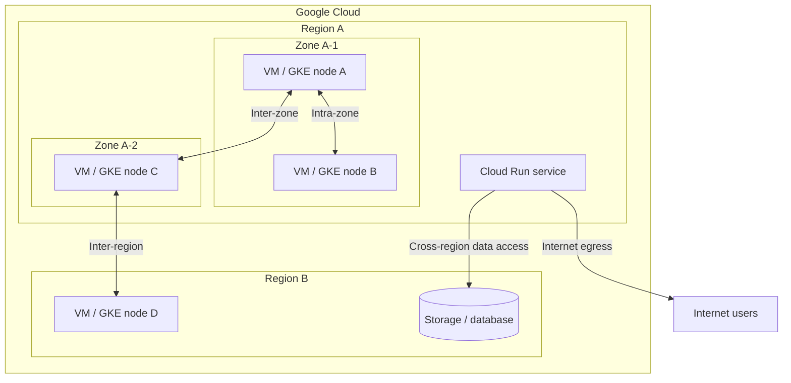

# Data Transfer Costs Between Zones, Regions, and the Internet

## 1. Why can network traffic increase your GCP bill?

When Java developers deploy Spring Boot applications to **Cloud Run**, **GKE**, or **Compute Engine**, costs do not come solely from CPU, RAM, and storage. Bytes transferred between two components of the system can also incur charges, even when both sit inside Google Cloud. For example:

- A Java API runs in one zone, while another service on a VM resides in a different zone of the same region.
- A worker in Singapore reads data from a bucket or database located in another region.
- The backend serves millions of images or JSON responses to users over the Internet.
- The application calls external APIs through Cloud NAT or serves data through a load balancer/CDN.

These network paths follow **different billing models**. Calling all of them "bandwidth" and multiplying by one flat unit rate leads to flawed estimates. In the **Billing and Budgets** chapter of the **CLOUD_PROVIDERS_GCP** module, this lesson shows how to identify **which traffic category applies, which service incurs the charge, how to calculate it, and how to observe it on your bill**, so you can select a GCP architecture that balances reliability and budget control.

### Learning outcomes

After this lesson, you will be able to:

1. Distinguish **ingress**, **egress**, **intra-zone**, **inter-zone**, **inter-region**, and **Internet egress**.
2. Identify how **VPC, internal/external IPs, regions, Network Service Tiers**, and service types affect network charges.
3. Compare data paths across **Compute Engine/GKE**, **Cloud Run**, **Cloud Storage**, **Cloud SQL**, and components such as **Cloud NAT, Load Balancing, and Cloud CDN**.
4. Estimate charges using **GiB × applicable unit rate**, accounting for transfer direction, tiered pricing, and companion fees.
5. Use **Billing Reports, SKUs, Budgets, and Billing export to BigQuery** to spot anomalies and choose optimal architectures for Java systems.

> **Guiding principle:** all calculation tables and pricing examples in this lesson must be re-verified against [Google Cloud VPC network pricing](https://cloud.google.com/vpc/network-pricing), the **actual service pricing page**, [Cloud Billing](https://cloud.google.com/billing/docs), or the **Cloud Pricing Calculator** before entering an estimate. Rates change by region, destination, tier, time, contract, and free-tier policies. Any hypothetical unit prices are explicitly marked and **are not quotes**.

## 2. Defining locations and data transfer directions

### 2.1. Organization, project, region, and zone are not the same boundary

A **project** is a management boundary for many resources and a common unit for cost allocation; a **billing account** can pay for multiple projects. A **region** is a geographic area hosting resources, such as `asia-southeast1` (Singapore). A **zone** is a deployment location within a region, such as `asia-southeast1-a` and `asia-southeast1-b`.

Two VMs in two different projects **do not necessarily** incur inter-region charges; two VMs in the same project **can still** incur inter-region charges if placed in two different regions. What matters is the actual location, product, and path of **source → destination**, plus the IP and network type used.

### 2.2. Ingress and egress

| Concept | Meaning | Example |
| --- | --- | --- |
| **Ingress (data transfer in)** | Data entering a resource or service boundary | User uploads 20 MiB to a Java API |
| **Egress (data transfer out)** | Data leaving a resource or billing boundary | API returns 2 MiB JSON or an image to a browser |
| **Intra-zone** | Data between resources in the same zone | VM A ↔ VM B inside `asia-southeast1-a` |
| **Inter-zone** | Data between zones in the same region | VM A in `-a` ↔ VM B in `-b` |
| **Inter-region** | Data moving between two regions | Singapore ↔ Tokyo |
| **Internet egress** | Data leaving Google Cloud to a public Internet destination | Cloud Run returns an API response to users |
| **Hybrid connectivity** | Transfer to systems outside Google Cloud over private links/VPN | VM ↔ data center over Cloud Interconnect |

For many Google Cloud services, **inbound data transfer** carries no general network ingress transfer fee. However, **services processing ingress** such as load balancers, Cloud NAT, or write/storage operations may still incur separate charges. Notably, data sent in **response** to a request is usually **egress** and can be billed. Never conclude that "free upload" means the entire transaction is free.

Diagram illustrating three fundamental scopes:



Arrows in the diagram indicate **paths that must be classified**; the diagram does not imply all edges cost the same.

## 3. Pricing depends on product and path, not just distance

### 3.1. Compute Engine and GKE nodes

Per [VPC network pricing](https://cloud.google.com/vpc/network-pricing), typical rules for **VM → VM traffic** are:

| Source → destination | Key condition | Common billing rule |
| --- | --- | --- |
| Two VMs in the **same zone** | Eligible internal IPv4 or IPv6 addresses within the same VPC | **No intra-zone data transfer charge** |
| Two VMs in **different zones, same region** | Eligible traffic within the same VPC | **Inter-zone**, billed per GiB |
| Two VMs in **different regions** | Source and destination regions differ | **Inter-region**, unit rate depends on geographic region pair |
| VM → Internet | Data actually traversing out to the Internet | **Internet egress**, depends on source region, destination, and Network Service Tier |
| VM → a GCP service | Libraries/APIs targeting a Google-managed product | **Service-group-specific rules apply**; do not assume identical to VM → VM |

The published list rate on the VPC page for **VM → VM between two zones in the same region** under eligible conditions was **0.01 USD/GiB** at reference time; always re-verify current pricing before use. Traffic between VMs in the same zone over eligible internal IPs can be **0 USD**. When using external IPs or separate VPCs, check the **exact row in the pricing table**, as routing and classification rules differ. In GKE, **nodes are VMs**, so pod-to-pod communication across nodes in different zones can generate inter-zone traffic, alongside load balancer or other service fees.

You cannot infer from a Kubernetes Service name that all application packets stay inside one zone. Scheduling, replica placement, node pools, affinity, and routing policies all affect the path; also weigh **availability** before trying to force traffic within a single zone.

### 3.2. From VMs to GCP services: many exceptions

The VPC network pricing page has a **dedicated section for VM → Google services**. Some transfers to Google Cloud services in the **same region** incur no data transfer out fee, yet **exceptions** exist—such as Cloud SQL, GKE, Memorystore, and Filestore—where VM → VM rules may apply. Cross-region connections generally require checking inter-region pricing for the specific service and path.

Thus, when a Java app on Compute Engine writes to Cloud SQL, do not just ask "are both in Singapore?" Also verify **zones and connection method**. **DB instance**, operation, backup, or storage charges remain separate items even if a network path is free.

### 3.3. Cloud Run

Cloud Run does not require managing individual instance zones like Compute Engine. Per [Cloud Run pricing](https://cloud.google.com/run/pricing):

- **Cloud Run → Google Cloud resources in the same region** has cases with **no data transfer charge**, such as between two Cloud Run services in the same region, per Cloud Run's specific rules.
- **Cloud Run → VPC network** follows the corresponding VM/VPC data transfer rules; review Direct VPC egress or Serverless VPC Access configurations.
- **Cloud Run → Internet** uses outbound Internet pricing under the Premium Network Service Tier, subject to published service and geographic free allowances/limits.
- If using a **Serverless VPC Access connector**, the connector itself can incur resource charges separate from traffic data fees.

Example: a user calls Spring Boot on Cloud Run in Singapore, the API queries a database in the same region, and returns 500 KiB of JSON to users in Vietnam. **The outbound Internet response** must be included in your estimate, even though the same-region backend database path may follow different pricing rules. Beyond networking, Cloud Run also bills CPU, RAM, requests, and instance time according to the chosen billing mode.

### 3.4. Cloud Storage

Cloud Storage has its [own pricing schedule](https://cloud.google.com/storage/pricing): **storage**, **operations/data processing**, **network usage**, and additional feature-driven fees. Specifically:

- Reading data from a bucket to resources in an **eligible same location** may have free network transfer. Transfers between zones in the same region count as same location under Cloud Storage rules.
- **Region**, **dual-region**, and **multi-region** are not interchangeable; a single region is not automatically treated as the same location as a multi-region encompassing it.
- Reading/downloading data from a bucket to **another region** or the **Internet** can incur **Cloud Storage** network rates, not necessarily VM rates.
- Reading objects can also incur **operation charges**, **retrieval fees** for applicable storage classes, or replication fees. Separate these from egress.

Example: a Java API in Singapore reads a file from a Singapore bucket and returns it to users outside Google Cloud. Evaluate **at least two segments**: bucket → API and API → Internet; plus object read operations, CPU/instance time, and CDN/load balancer if present. Never assume bucket → API cost equals the entire file-serving cost.

### 3.5. Cloud SQL, load balancers, Cloud NAT, and CDN

| Component | Questions to ask | Charges beyond data egress |
| --- | --- | --- |
| **Cloud SQL** | Are app and DB in the same region/zone? Private or public connection? Cross-region read replicas? | DB instance, storage, backups, HA/replication, data transfer per service policy |
| **Cloud Load Balancing** | Which load balancer handles requests/responses, and how much data is processed? | Forwarding rules, data processing, policies/features by tier |
| **Cloud NAT** | Which VMs or workloads reach the Internet via NAT? How many GiB pass through NAT? | Gateway hourly fees, per-GiB processed fees, IP addresses, plus Internet egress |
| **Cloud CDN** | How many requests are cache hits? Where do cache misses fetch from origin? | Cache lookups, cache data transfer out, cache fill, and associated LB/Storage fees |
| **Cloud VPN/Interconnect** | Which path reaches on-premises, and where is the attachment region? | Tunnel/attachment fees, capacity/port fees, and data transfer by link type |

Per [Cloud NAT pricing](https://cloud.google.com/nat/pricing), Public NAT can charge **hourly gateway fees + per-GiB processed fees + IP address fees + egress fees**. With [Cloud CDN](https://cloud.google.com/cdn/pricing), "cache hits" can still incur **cache data transfer out** and **lookup** fees; never assume all cached bytes are free. These two examples show that a single byte can touch multiple **SKUs**.

## 4. Network Service Tiers and Internet egress

When data travels to users outside Google Cloud, check two separate factors:

1. **Traffic destination**, such as the recipient's geographic region; pricing tables may group destinations and volume tiers.
2. **Network Service Tier**: **Premium Tier** is typically the default; **Standard Tier** uses a different routing model and pricing table where the product/setup supports configuring it.

Never assume "Standard is always better" or arbitrarily apply Standard Tier tables to Cloud Run: each product and IP/load-balancer type supports tier selection differently. Read the source resource's documentation and note that **a lower price does not always deliver an equivalent network experience**.

In this lesson, the unit rate for a flow is denoted `r(source, destination, service, tier, volume)`. With tiered pricing, split traffic across **each tier** instead of applying a single flat rate to all GiB.

## 5. Data transfer cost calculation methodology

### 5.1. Draw a data-flow graph before looking up prices

Represent each system component as a node and each data transfer as a **directed** edge. For each edge, record:

| Attribute | Example |
| --- | --- |
| Source | Cloud Run API, Singapore region |
| Destination | User browser or bucket/DB |
| Billable source service | Cloud Run / Compute Engine / Cloud Storage |
| Source and destination zone/region | `asia-southeast1` → `asia-northeast1` |
| IP/network type | Internal VPC, external IP, Internet, VPC connector |
| Total directional bytes | 300 GiB/month, measured after compression if applicable |
| SKU/pricing table | Inter-zone, inter-region, Internet out, CDN cache out |
| Companion fees | NAT/LB/CDN, read/write operations, replication |

Do not double-count the same flow under **one SKU**, but do not omit intermediate network hops and proxy services either. For example, a browser fetching images via CDN can generate **cache transfer out**, **cache lookup**, and on cache misses **cache fill**.

### 5.2. Unit conversions

Google Cloud expresses many networking items in **GiB**, where:

```text
1 KiB = 1,024 bytes
1 MiB = 1,024 KiB
1 GiB = 1,024 MiB = 1,073,741,824 bytes
GiB = bytes / 1,073,741,824
```

Do not confuse **GB (10^9 bytes)** with **GiB (2^30 bytes)**; verify the exact unit shown on the SKU. For HTTP requests, measure **actual transmitted bytes** (which may include headers and protocol overhead depending on metering), rather than assuming it equals on-disk object size.

### 5.3. General formulas

For a single path and a single pricing tier:

```text
Path cost ≈ Billable GiB × Unit rate/GiB
```

For multiple flows and tiers:

```text
Total network cost
  = Σ (billable GiB per flow and tier × corresponding rate)
  + processing, gateway, IP, LB, CDN, connection fees... where applicable
```

This is an **estimate**, not a substitute for the period-end invoice. Taxes, credits/discounts, baseline service fees, units, and contract pricing rules can make actual bills differ from simple multiplication.

### 5.4. Numerical example — all unit rates below are HYPOTHETICAL

Suppose a Java system has:

- 300 GiB/month exchanged between VM A and VM B in two zones of the same region.
- 100 GiB/month sent from a VM to another region.
- 500 GiB/month of API responses out to the Internet.

Assume **purely for math practice**: inter-zone is `0.01 USD/GiB`, inter-region is `0.08 USD/GiB`, and Internet is `0.12 USD/GiB`. The last two rates **are not real unit prices for any specific GCP route**; even the first rate requires verifying eligibility and current pricing.

| Transfer path | GiB/month | Hypothetical rate | Illustrative cost |
| --- | ---: | ---: | ---: |
| Inter-zone | 300 | 0.01 USD/GiB | 3.00 USD |
| Inter-region | 100 | 0.08 USD/GiB | 8.00 USD |
| Internet egress | 500 | 0.12 USD/GiB | 60.00 USD |
| **Total of three sample items** | | | **71.00 USD** |

For a real estimate, replace each hypothetical rate with the **exact SKU/tier rate for that path, service, and billing account**, then add NAT/CDN/LB, Cloud Run/GKE/VMs, DB, storage, replication, and companion charges. If traffic spans multiple tiers, split it across multiple rows.

### 5.5. Estimation example from Java API characteristics

Suppose a system handles **1,000,000 requests/month**, with each response averaging **200 KiB** after compression, excluding non-payload overhead. Then:

```text
1,000,000 × 200 KiB = 200,000,000 KiB
200,000,000 / 1,048,576 ≈ 190.7 GiB
```

Response traffic excludes other requests, file downloads, internal calls, and protocol overhead. If the API returns a 2 MiB JSON payload instead of 200 KiB, the same request count generates more than 10× the traffic. Therefore, **response payload size and call frequency** are two critical design levers, especially for Java APIs serving mobile/web clients across countries.

## 6. Four architectural scenarios and how to interpret costs

### 6.1. Spring Boot on GKE: pods across multiple zones

A regional GKE cluster spreads nodes across multiple zones for high availability. Service A calls Service B, and if source and destination pods sit on nodes in different zones, that traffic can incur VM/GKE-node inter-zone data transfer charges.

**How to evaluate:**

1. Observe **service-to-service** traffic volume, not just inbound Internet HTTP request counts.
2. Inspect node/pod distribution across zones and actual network paths.
3. For high-volume streams, evaluate placement or topology-aware routing where supported by the platform, while assessing resilience if a zone fails.
4. Never cram the entire system into a single zone solely to save transfer fees: losing fault tolerance can cost far more than the network savings.

### 6.2. Cloud Run in Singapore calling Cloud SQL or Cloud Storage in another region

An API in `asia-southeast1` frequently reading files or data stored in a distant region can incur inter-region data transfer, higher latency, and complex data-compliance issues. However, placing everything in the same region **does not automatically** eliminate all costs:

- Cloud Run, Cloud SQL, and Cloud Storage each have distinct networking rules; check the **exact service pair**.
- Cloud SQL still incurs instance, storage, backup/replication, and connection charges.
- Cloud Storage carries operation/retrieval fees alongside data transfer.
- If users are distributed globally, Internet egress from the API or CDN still applies.

Solutions usually start by **co-locating data and compute** where business logic permits, then applying caching, pagination, batching, or intentional replicated/read-only data. Replication also costs money, so compare before and after.

### 6.3. Cloud Run or Compute Engine calling external Internet services

A Java application may call third-party payment APIs, email providers, data warehouses, or AI endpoints. Classify traffic by direction:

- Request payloads **leaving GCP to the Internet** can incur egress.
- Responses **entering GCP** may count as free ingress transfer within applicable scope.
- Passing through Cloud NAT or a load balancer/proxy can add **traffic-processing fees** on top of network egress.

Never rely on a DNS lookup alone to assume a path stays internal. Verify the route, endpoint, IP, source region, and **actual SKUs**.

### 6.4. Serving images or large files to users

Suppose a Java API generates signed URLs for a Cloud Storage object or streams files directly through the API. There are at least two architectures:

**Option A — Proxy through the app:** browser → Cloud Run API → Cloud Storage. Object bytes flow through the app back to the browser; Cloud Run consumes compute/streaming resources, and outbound Internet traffic may incur service network charges.

**Option B — Controlled direct object access:** browser → Cloud Storage via short-lived signed URL or a configured CDN distribution. Internet/data transfer charges shift to Cloud Storage/CDN while offloading streaming from the app. Calculate the **actual total cost** of both options alongside URL security, access control, cache policies, and logging requirements.

Optimization is not merely "add a CDN": if content is rarely accessed repeatedly, cache fill/lookup fees can make CDN less cost-effective. If content is popular with a high cache hit ratio, CDN offloads the origin and improves latency.

## 7. Measuring and tracing network costs in Cloud Billing

### 7.1. Billing Reports: start with the big picture

In **Google Cloud Console → Billing → Reports** (UI may evolve), pick the right billing account and timeframe, then filter by project, service, SKU, or location where supported. Start from **which system is spiking**, then drill down to **which SKU**.

SKU names to look for often contain terms like **Data Transfer**, **Egress**, **Inter-zone**, **Inter-region**, **Internet**, **Load Balancing**, **NAT**, or **CDN**; exact wording can change. Do not rely solely on the keyword "network," as services report network fees across various SKU groups.

A project's total cost also includes compute, storage, logging, monitoring, and non-network charges. Never equate "Cloud Run's bill" with "Cloud Run data transfer fees."

### 7.2. Cloud Billing export → BigQuery

For large systems or daily comparisons, enable **standard usage cost export** or **detailed usage cost export** in Cloud Billing. Records typically include service, SKU, project, location, usage, cost, credits, and other fields depending on export type. **There is no guarantee of instant export**; latency and backfill rules depend on dataset location.

The illustrative SQL below groups costs by **service and SKU**; replace dataset/table placeholders and dates with real values:

```sql
SELECT
  service.description AS service_name,
  sku.description AS sku_name,
  ROUND(SUM(cost), 2) AS gross_cost
FROM `YOUR_BILLING_PROJECT.YOUR_DATASET.gcp_billing_export_v1_XXXX`
WHERE usage_start_time >= TIMESTAMP('2026-11-01')
  AND usage_start_time < TIMESTAMP('2026-12-01')
  AND project.id = 'YOUR_APPLICATION_PROJECT_ID'
GROUP BY service_name, sku_name
ORDER BY gross_cost DESC;
```

**Note:** `SUM(cost)` in this illustrative query represents **cost before accounting for separate credits/discount columns** per the schema; do not treat it as the final invoice payable. Instead of filtering only SKUs containing `egress` upfront, inspect the full SKU table first and group transport-related SKUs; some gateway or CDN fees do not contain that keyword. BigQuery analytics can also incur query/storage charges.

When investigating, cross-reference at least **three sources**: the system traffic diagram, Cloud Monitoring/log metrics, and SKU-level usage/cost. Billing tells you the cost; logs/metrics reveal **which business flow** produced those bytes.

### 7.3. Example anomaly investigation table

| Billing symptom | Investigation questions | How to verify |
| --- | --- | --- |
| Inter-zone rises after scaling GKE | Which pods call across nodes in different zones? | Node/pod placement, network flow/metrics, change logs |
| Inter-region rises after adding replicas | What data is replicating across regions? | Replica/bucket locations, replication schedules, SKUs |
| Internet egress rises while RPS stays flat | Larger responses? Users downloading more files? | Request/response sizes, endpoint metrics, storage access |
| NAT charges rise | Which workloads use NAT for Internet access, and how many GiB are processed? | NAT metrics/logs (if enabled), network path, SKUs |
| High CDN cost while origin stays busy | What are cache hit ratio, TTL, and cache fill volume? | CDN hit/miss metrics, content-type, headers |

## 8. Budgets, alerts, and cost controls

### 8.1. Estimate before deployment

For a Java project, list at least:

1. **External Internet traffic:** API responses, downloads, outbound uploads, HTTP calls to external providers.
2. **Internal traffic:** inter-zone, inter-region, connections from compute to DB, cache, message brokers, or object storage.
3. **Intermediary services:** NAT, load balancers, CDN, VPN/Interconnect.
4. **Non-network costs:** VMs/GKE/Cloud Run, Cloud SQL, Cloud Storage, logging/monitoring, backups.
5. **Growth events:** user counts, requests, response sizes, replication, retries, and incident-driven traffic surges.

For variable traffic, build three scenarios—**normal, growth, and peak load**—and document every variable assumption. Use the [Google Cloud Pricing Calculator](https://cloud.google.com/products/calculator) for product estimates and reconcile against live Billing data.

### 8.2. Budgets vs. spending caps

Per [Cloud Billing Budgets](https://cloud.google.com/billing/docs/how-to/budgets) documentation, **alerts-only budgets** monitor spend and notify at thresholds (actual or forecasted). They **do not automatically stop all charges** when thresholds are breached. Google Cloud also offers **spend cap budgets for supported scenarios/services**, which require separate configuration and careful review of scope and terms before relying on them.

For learning projects:

- Set a budget scoped to the project/service or supported labels with thresholds such as **50%, 80%, 100%**.
- Verify alert recipients and the incident response runbook when alerts fire.
- For non-continuous workloads, use scheduled shutdown/cleanup or controlled automation per organizational policy.
- Remember Billing data arrives with latency; never use notifications as a guaranteed instantaneous cost-cutoff switch.

### 8.3. Technical measures to reduce network costs

| Measure | Expected effect | Trade-offs to weigh |
| --- | --- | --- |
| Co-locate compute with DB/buckets | Reduces unnecessary inter-region flows and latency | Data residency, availability, data migration cost |
| Compress JSON/text responses | Reduces Internet egress bytes | Compression/decompression CPU; already-compressed payloads |
| Pagination, projection, field selection | Shrinks payload per request | More round-trips, UX impact |
| Batch requests, eliminate N+1 calls | Cuts overhead and repeated transfer | Batch size, partial retries |
| Appropriate API/client/CDN caching | Cuts repeated origin transfers | TTL, invalidation, sensitive data, and cache fees |
| Avoid tight polling loops | Eliminates unnecessary request/response traffic | Webhooks, Pub/Sub, or proper backoff |
| Optimize microservice traffic | Reduces inter-zone/inter-region chatter | Topology, HA, latency, coupling |
| Lifecycle/retention policies | Cuts unnecessary stored and re-fetched data | Never delete audit or recovery data |

An architectural change is only truly optimal when both **total cost** and reliability metrics remain acceptable. For instance, collapsing an app into a single zone can reduce inter-zone fees while increasing outage risk if that zone fails.

## 9. Hands-on practice: measuring costs of a Java API

### Lab A — Classifying traffic paths

Suppose a system has a Spring Boot API on Cloud Run in `asia-southeast1`, Cloud SQL PostgreSQL in the same region, a Cloud Storage bucket in `asia-northeast1`, and user browsers outside GCP.

Draw the graph and label:

- **Cloud Run → Cloud SQL**: check Cloud Run and Cloud SQL rules, connection setup, and underlying service fees.
- **Cloud Run → Tokyo bucket**: cross-region; check exact source/service pricing and transfer direction.
- **Cloud Run → browser**: Internet data transfer out; check region/tier.
- **Browser → Cloud Run**: inbound upload; still check request/compute processing costs.

Build an estimate table for 10,000, 100,000, and 1,000,000 requests, holding JSON response size constant to see volume-driven cost growth.

### Lab B — Calculating from bytes and SKUs

An endpoint `GET /orders/export` returns a CSV averaging 5 MiB and is called 100,000 times/month. Calculate response volume:

```text
100,000 × 5 MiB = 500,000 MiB
500,000 / 1,024 ≈ 488.28 GiB
```

From this **GiB** volume, look up the matching **Internet egress SKU** by region/tier/service. Also calculate a scenario where enabling compression shrinks each file to 2 MiB and compare the remaining GiB. This exercise calculates **payload traffic only**; include overhead, rates, and companion fees in real estimates.

### Lab C — Tracing anomalies in Billing

1. On a test project with billing, inspect **Billing Reports** by project and SKU over a timeframe with data.
2. List SKUs related to data transfer, Internet egress, NAT, CDN, or LB if any.
3. For each SKU, identify the billable service and probable path from your deployment diagram.
4. If Billing export is enabled, run a query grouping by `service.description` and `sku.description` and cross-check against reports.
5. Propose one measurable change—shrinking response size, moving a bucket to the same region where appropriate, or improving cache hit rate—noting both implementation effort and risks.

**You do not need** to deliberately generate heavy traffic to finish this exercise. Use sample data and spreadsheets if you lack live GCP/billing resources.

### Lab D — Budget control

Create an alerts-only budget for your learning project, select thresholds and recipients, and document the response procedure when breached. Verify whether you are using **alerts-only** or a supported **spend cap** mechanism, stating explicitly which mechanism actually caps spend. Clean up unneeded test resources after evaluation.

## 10. Pre-production launch checklist

- [ ] Complete **source → destination** diagram highlighting major byte flows in the system.
- [ ] Clearly distinguish **zone**, **region**, **project**, **VPC**, **internal/external IP**, and Internet exit points.
- [ ] Know **which service owns the SKU** for each network cost line.
- [ ] Verified against the exact pricing pages for **Compute Engine/GKE, Cloud Run, Cloud Storage, Cloud SQL, NAT, and LB/CDN** in use.
- [ ] Estimate includes **post-compression GiB**, request counts, retry frequency, cache fill, replication, and peak traffic.
- [ ] Separated **network egress** from compute/storage/operations and intermediary fees.
- [ ] Configured **Billing Reports or Billing export**, request-size/traffic metrics, and a SKU review cadence.
- [ ] Set up **budgets/alerts** and accountable responders, with clear understanding of which features actually cap spend.
- [ ] Balanced every optimization against **latency, data residency, security, HA, and recovery**.

When deploying Java applications on Google Cloud, the question to answer is not merely "which region is the server in?", but **where every byte travels from and to, which services it traverses, under which SKU it appears, and whether it truly needs to move at all**. Analyzing traffic paths enables sound trade-offs across Cloud Run, GKE, Compute Engine, databases, and storage while building auditable budgets.

## 11. Official Google Cloud references

- [VPC network pricing — ingress, VM-to-VM, inter-zone, inter-region, Internet egress](https://cloud.google.com/vpc/network-pricing)
- [Cloud Run pricing — networking and VPC](https://cloud.google.com/run/pricing)
- [Cloud Storage pricing — network usage and location](https://cloud.google.com/storage/pricing)
- [Cloud NAT pricing — gateway and processing](https://cloud.google.com/nat/pricing)
- [Cloud CDN pricing — cache transfer out, cache fill, lookup](https://cloud.google.com/cdn/pricing)
- [Cloud Billing budgets and alerts](https://cloud.google.com/billing/docs/how-to/budgets)
- [Set up Cloud Billing export to BigQuery](https://cloud.google.com/billing/docs/how-to/export-data-bigquery-setup)
- [Google Cloud Pricing Calculator](https://cloud.google.com/products/calculator)
