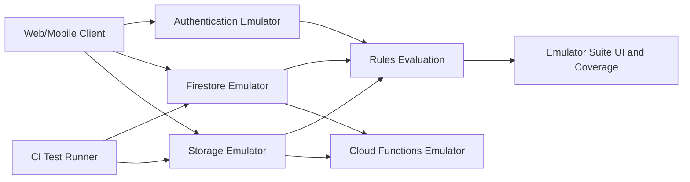
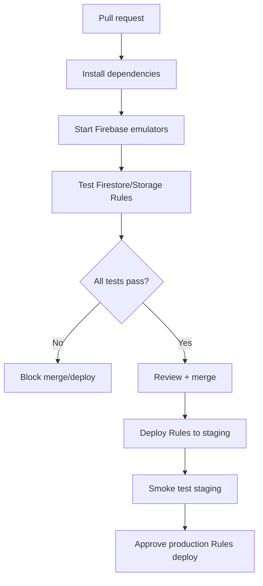

# Firebase Local Emulator Suite and Security Rules Testing

When building applications with Cloud Firestore, Realtime Database, or Cloud Storage for Firebase, functional testing alone is not enough: the system must guarantee that users cannot read, modify, or delete someone else's data. **Firebase Security Rules** enforce service-side access conditions for requests coming from Firebase client SDKs. The **Firebase Local Emulator Suite** runs simulated services on a developer machine or in CI so you can test these rules without touching production data.

In the `CLOUD_PROVIDERS_GCP` module, learners explore Google Cloud from project organization, IAM, and VPCs to Compute Engine, GKE, Cloud Run, storage services, and databases. Through deployment scenarios, learners select services, secure resources, automate releases, and monitor reliability and cost. The Firebase Emulator Suite adds a fast feedback loop for web/mobile apps and GCP-integrated backends: testing access rules before deployment, verifying Authentication–Firestore–Storage integration, and turning security requirements into automated tests.

Emulators are environments for **development, prototyping, and testing**, not a self-hosted Firebase version for production. Differences from live services must be understood; passing emulator tests does not mean every index, limit, IAM policy, or live behavior has been verified.

## Learning Objectives

After this lesson, learners will be able to:

- Explain the components of the Firebase Local Emulator Suite and how they collaborate to test applications.
- Set up a demo project, Firebase CLI, `firebase.json`, `firestore.rules`, `storage.rules`, and required emulators.
- Distinguish Firebase Security Rules from Google Cloud IAM and understand how Admin SDK/server SDKs access data.
- Write Firestore Rules following the *deny by default* principle, distinguishing get/list/create/update/delete, enforcing ownership, and validating schemas.
- Use `@firebase/rules-unit-testing` to test anonymous, owner, non-owner, and collection query scenarios.
- Test Storage Security Rules, consider Realtime Database Rules, and simulate Authentication.
- Run tests via `firebase emulators:exec`, inspect rules evaluation results, and view rule coverage reports.
- Integrate Security Rules tests into CI/CD and recognize emulator limitations compared to production.

## 1. What Is the Firebase Local Emulator Suite?

### How It Works

The Firebase Local Emulator Suite consists of local simulator processes for several Firebase/GCP products. Applications call emulators via Firebase SDKs or supported APIs instead of calling live resources. Emulators interoperate: Authentication supplies request identities; Firestore/Realtime Database/Cloud Storage evaluate Security Rules; Cloud Functions can react to events emitted inside the emulators.



### Common Emulators

| Emulator | Role | Common Default Port |
|---|---|---|
| Authentication | Simulates sign-in, tokens, and users to test auth flows. | `9099` |
| Cloud Firestore | Reads/writes documents, executes queries, and evaluates Firestore Security Rules. | `8080` |
| Realtime Database | Reads/writes JSON tree data and evaluates Realtime Database Rules. | `9000` |
| Cloud Storage for Firebase | Uploads/downloads objects and evaluates Storage Security Rules. | `9199` |
| Cloud Functions | Runs HTTP/background functions locally. | `5001` |
| Firebase Hosting | Serves the web app locally. | `5000` |
| Pub/Sub | Supports event-driven workflows inside the emulator suite. | `8085` |
| Emulator Suite UI | Inspects data, logs, and rules evaluation traces. | `4000` |

Ports can be customized in `firebase.json`. Not every Firebase product has an emulator or supports every feature. Emulators in Preview/Beta may change behavior; always check the corresponding service documentation when writing tests.

### Which Tests Should Use Emulators?

| Test Type | Suitable Tools | Goal |
|---|---|---|
| Business logic unit tests | Language test framework, mocks/stubs | Verify logic with no network or Firebase dependency. |
| Security Rules unit tests | `@firebase/rules-unit-testing` + emulator | Ensure requests are allowed/denied by actor and data. |
| Integration tests | Real SDKs pointed at emulators | Verify flows across Auth → Firestore → Storage → Functions. |
| Live environment smoke tests | Firebase staging project with isolated permissions and quotas | Verify deployed config, indexes, IAM, and production differences. |

Do not use the Admin SDK as a substitute for Security Rules unit tests: the Admin SDK typically accesses resources via IAM and **bypasses Firebase Security Rules**. Rules tests must send requests through client-like SDK contexts so rules are enforced.

## 2. Setting Up the Environment and Demo Project

### Required Tools

A typical test environment includes:

- A Node.js version supported by Firebase CLI and the Firebase JS SDK.
- Firebase CLI (`firebase-tools`) and package manager `npm`.
- A compatible Java Runtime/JDK when using Java-dependent emulators such as Firestore or Realtime Database.
- An editor to manage rule files and JavaScript tests.
- Local ports not occupied by other services.

Example installing the CLI and test library in a Node.js project (do not run these commands on a production machine):

```bash
npm init -y
npm install --save-dev firebase-tools @firebase/rules-unit-testing
npm install firebase

npx firebase --version
```

In this example, `firebase` is the Firebase JavaScript Client SDK used to issue requests evaluated by Security Rules. `@firebase/rules-unit-testing` creates simulated user contexts and provides test assertions. `firebase-tools` starts and stops emulators across the CI lifecycle. Pin dependencies with a lockfile, update them on a schedule, and test when upgrading Firebase CLI.

### Why Use a `demo-*` Project?

Firebase supports **demo projects** whose project IDs start with `demo-`, such as `demo-rules-lab`. A demo project has no real Firebase resources. If code accidentally calls an un-emulated service, the request fails rather than mutating production data. This provides a useful safety guardrail for local and CI tests.

If you run emulators with a real project ID, an SDK not configured to connect to the emulator could still call live resources in that project. Therefore, never use production credentials, production projects, or real user data in security tests. Keep the project ID consistent across Firebase CLI, the app, the Auth emulator, the Firestore emulator, and unit tests.

### Configuring `firebase.json`

Example configuration explicitly specifying rule files and ports:

```json
{
  "firestore": {
    "rules": "firestore.rules"
  },
  "storage": {
    "rules": "storage.rules"
  },
  "emulators": {
    "auth": { "host": "127.0.0.1", "port": 9099 },
    "firestore": { "host": "127.0.0.1", "port": 8080 },
    "storage": { "host": "127.0.0.1", "port": 9199 },
    "ui": { "enabled": true, "port": 4000 }
  }
}
```

Save the file in the same directory as `firestore.rules`, `storage.rules`, and `package.json`. You can run `firebase init emulators` to bootstrap configuration and then review the CLI-generated files. If testing Realtime Database, add `database.rules` and the `database` emulator entry.

**Warning:** If you omit rule file paths and also do not load rules via the testing API, the Firestore/Realtime Database/Storage emulators may run with open rules. Passing tests when rules were never loaded is an unreliable result. CI should verify that rule files exist and are loaded successfully.

### Specifying Project ID at Runtime

You can pass the demo project directly on the command line:

```bash
npx firebase emulators:start \
  --only auth,firestore,storage \
  --project demo-rules-lab
```

The Emulator Suite UI is typically accessible at `http://127.0.0.1:4000`. In interactive mode, the process runs until manually stopped. In CI or test scripts, use `emulators:exec` so the CLI starts emulators, runs tests, and shuts emulators down automatically.

### Avoid Exposing Emulators to Public Networks

Emulators are built for development and do not offer production security guarantees. Bind to `127.0.0.1` when tests run on a single host. In Docker or multi-container runners, configure internal networking and restrict ports rather than exposing endpoints to the Internet.

## 3. Understanding Firebase Security Rules

### How Firebase Security Rules Differ from IAM

Firebase Security Rules govern access from Firebase client SDKs to Firestore, Realtime Database, and Cloud Storage for Firebase. Rules can inspect `request.auth`, resource paths, old/new document data, operation types, and metadata to allow or deny a request.

Google Cloud IAM governs infrastructure permissions and server-side APIs. A Java/Spring Boot backend using the Google Cloud Firestore server SDK or Firebase Admin SDK usually authenticates via a service account/IAM and **is not subject to Firebase Security Rules**. You must implement backend authorization independently, such as validating user tokens in APIs, verifying roles from trusted sources, and scoping service account IAM permissions.

| Client / Access Path | Primary Access Control |
|---|---|
| Firebase Web/Android/iOS SDK calling Firestore | Firestore Security Rules. |
| Firebase Web/Android/iOS SDK calling Storage for Firebase | Storage Security Rules. |
| Firebase Client SDK calling Realtime Database | Realtime Database Security Rules. |
| Java/Spring Boot using Firestore server client, Admin SDK, or REST with server credentials | Google Cloud IAM and backend-enforced authorization; does not rely on Firebase Security Rules. |

Never interpret passing rules tests as proof that a Cloud Run or GKE backend is secure. If the backend service account holds broad IAM roles, requests routed through the backend must enforce user authorization independently.

### Deny by Default

A secure posture defaults to denying access, then selectively allows specific operations and actors. Avoid test rules like:

```text
allow read, write: if true;
```

This configuration allows any client to read/write data matching the path. Never deploy it to an environment containing real data. Similarly, `request.auth != null` only checks that the user signed in; it does not prove the user is authorized to view someone else's data.

### Key Data Variables in Firestore Rules

- `request.auth`: authentication info; exposes `uid` and `token` (custom claims) when authenticated.
- `resource.data`: existing document data prior to update/delete, or the document evaluated on read.
- `request.resource.data`: incoming document state proposed by a create/update operation.
- `request.query`: query metadata, such as document limit.
- `get()` and `exists()`: read other documents inside Security Rules within rule evaluation limits.

Never trust client-supplied `ownerId`, `role`, or `isAdmin` fields unless verified against `request.auth.uid`, server-issued custom claims, or an authoritative permissions document.

## 4. Firestore Security Rules Example: Personal Notes

### Business Requirements

An application lets users store notes in a `notes` collection. Each document contains `ownerId` and `title`:

```json
{
  "ownerId": "alice",
  "title": "Team meeting schedule"
}
```

Rules:

1. Only the owner may read their own notes.
2. Unauthenticated users cannot read or write.
3. Creators must set `ownerId` equal to their own Firebase Auth UID.
4. Owners may edit `title`, but cannot transfer `ownerId` to another user.
5. Accept only the two fields `ownerId` and `title`; `title` must be a non-empty string up to 120 characters.

### `firestore.rules` File

```javascript
rules_version = '2';
service cloud.firestore {
  match /databases/{database}/documents {
    match /notes/{noteId} {
      function signedIn() {
        return request.auth != null;
      }

      function isOwner() {
        return signedIn() && resource.data.ownerId == request.auth.uid;
      }

      function validNote() {
        return request.resource.data.keys().hasAll(['ownerId', 'title'])
          && request.resource.data.keys().hasOnly(['ownerId', 'title'])
          && request.resource.data.title is string
          && request.resource.data.title.size() > 0
          && request.resource.data.title.size() <= 120
          && request.resource.data.ownerId == request.auth.uid;
      }

      allow get, list: if isOwner();
      allow create: if signedIn() && validNote();
      allow update: if isOwner()
        && validNote()
        && request.resource.data.ownerId == resource.data.ownerId;
      allow delete: if isOwner();
    }
  }
}
```

Explanation:

- `match /notes/{noteId}` covers only documents in the `notes` collection and does not automatically grant access to subcollections.
- `allow get` applies when reading a single specific document.
- `allow list` applies when querying/listing the collection.
- `allow create` validates the new document and creator's UID.
- `allow update` validates both existing data and updated data to prevent ownership transfer.
- `allow delete` allows only the owner to delete the document.
- `rules_version = '2'` uses modern Rules syntax, which matters when working with recursive wildcards and collection group queries.

Helper functions `signedIn`, `isOwner`, and `validNote` reduce duplication. Although `validNote` reads `request.auth.uid`, it is only invoked in create/update branches after short-circuiting `&&` has verified the actor is signed in. For larger schemas, organize validation helpers clearly and test each boundary case.

### Firestore Rules Are Not Filters

A query does not silently filter out documents the user is unauthorized to read. If rules allow reads only when `resource.data.ownerId == request.auth.uid`, the client must query with a constraint guaranteeing every matched document belongs to that user:

```javascript
import { collection, getDocs, query, where } from 'firebase/firestore';

const mine = query(
  collection(db, 'notes'),
  where('ownerId', '==', auth.currentUser.uid)
);

const result = await getDocs(mine);
```

Calling `getDocs(collection(db, 'notes'))` without a filter is denied because the query could return another user's documents. Tests must cover both scenarios. Also, a query allowed by rules may still require an index in production Firestore; the emulator does not enforce all index requirements identically to the live service.

## 5. Writing Security Rules Unit Tests with Node.js

### Modern Testing APIs

The `@firebase/rules-unit-testing` package provides core APIs:

| API | Purpose |
|---|---|
| `initializeTestEnvironment()` | Creates a test environment connected to emulators and optionally loads rules. |
| `authenticatedContext(uid, tokenOptions)` | Simulates an authenticated actor, optionally with custom claims. |
| `unauthenticatedContext()` | Simulates an unauthenticated request. |
| `withSecurityRulesDisabled()` | Writes test fixture data bypassing rules. Use only for test setup, never when asserting permissions. |
| `assertSucceeds(promise)` | Verifies the operation is permitted. |
| `assertFails(promise)` | Verifies the operation is denied by Security Rules. |
| `clearFirestore()` | Clears Firestore data for the test project to prevent cross-test interference. |
| `cleanup()` | Cleans up test contexts and client resources on teardown. |

The testing library uses the Firebase Client SDK under the hood to send client-like requests. It works only when the corresponding emulator is already running; it does not start emulators itself.

### Test File `tests/firestore.rules.test.mjs`

The following example uses Node.js's built-in test runner. `firebase.json` and `firestore.rules` sit at the project root; tests run from the project root. Tests use modern modular Firebase JS APIs and a consistent demo project.

```javascript
import { readFileSync } from 'node:fs';
import { before, after, beforeEach, test } from 'node:test';
import {
  initializeTestEnvironment,
  assertSucceeds,
  assertFails
} from '@firebase/rules-unit-testing';
import {
  doc, collection, query, where,
  setDoc, getDoc, updateDoc, deleteDoc, getDocs
} from 'firebase/firestore';

let env;

before(async () => {
  env = await initializeTestEnvironment({
    projectId: 'demo-rules-lab',
    firestore: {
      host: '127.0.0.1',
      port: 8080,
      rules: readFileSync('firestore.rules', 'utf8')
    }
  });
});

beforeEach(async () => {
  await env.clearFirestore();
});

after(async () => {
  if (env) await env.cleanup();
});

async function seedNote(id, ownerId) {
  await env.withSecurityRulesDisabled(async (context) => {
    await setDoc(doc(context.firestore(), 'notes', id), {
      ownerId,
      title: 'Test record'
    });
  });
}

test('owner can read and edit title', async () => {
  await seedNote('note-1', 'alice');
  const db = env.authenticatedContext('alice').firestore();
  const noteRef = doc(db, 'notes', 'note-1');

  await assertSucceeds(getDoc(noteRef));
  await assertSucceeds(updateDoc(noteRef, { title: 'Updated' }));
});

test('unauthenticated user cannot read notes', async () => {
  await seedNote('note-1', 'alice');
  const db = env.unauthenticatedContext().firestore();

  await assertFails(getDoc(doc(db, 'notes', 'note-1')));
});

test('bob cannot read or delete alice note', async () => {
  await seedNote('note-1', 'alice');
  const db = env.authenticatedContext('bob').firestore();
  const noteRef = doc(db, 'notes', 'note-1');

  await assertFails(getDoc(noteRef));
  await assertFails(deleteDoc(noteRef));
});

test('alice can create with own ownerId, bob cannot impersonate alice', async () => {
  const alice = env.authenticatedContext('alice').firestore();
  const bob = env.authenticatedContext('bob').firestore();

  await assertSucceeds(setDoc(doc(alice, 'notes', 'new-1'), {
    ownerId: 'alice', title: 'Valid'
  }));
  await assertFails(setDoc(doc(bob, 'notes', 'new-2'), {
    ownerId: 'alice', title: 'Impersonation'
  }));
});

test('owner cannot change ownerId or add unknown fields', async () => {
  await seedNote('note-1', 'alice');
  const alice = env.authenticatedContext('alice').firestore();
  const noteRef = doc(alice, 'notes', 'note-1');

  await assertFails(updateDoc(noteRef, { ownerId: 'bob' }));
  await assertFails(updateDoc(noteRef, { isAdmin: true }));
});

test('query must be scoped by ownerId', async () => {
  await seedNote('note-1', 'alice');
  await seedNote('note-2', 'bob');
  const alice = env.authenticatedContext('alice').firestore();

  const mine = query(collection(alice, 'notes'), where('ownerId', '==', 'alice'));
  await assertSucceeds(getDocs(mine));
  await assertFails(getDocs(collection(alice, 'notes')));
});
```

These tests intentionally include **negative cases**. If you only test that the owner can read data, an overly permissive open rule would still pass. Conversely, if you only test denials, a deny-all rule would pass. The suite must verify both allowed and denied actions.

### Why Clear Data Between Tests?

Emulators generally keep data in memory for the lifetime of the process. If an earlier test creates a document and a later test relies on that ID, outcomes can change when execution order shifts or the suite re-runs. `clearFirestore()` keeps tests independent. Always `await` every setup/assert/cleanup operation to avoid race conditions.

The Node test runner executes tests in a file sequentially by default unless concurrency is enabled. If you enable parallel execution or run multiple test files sharing the same project ID, concurrent `clearFirestore()` calls can wipe each other's fixtures. When parallelizing, assign separate project IDs/namespaces per worker or serialize tests targeting the same emulator dataset.

## 6. Simulating Authentication and Custom Claims

### Mocking Auth for Rules Unit Tests

`authenticatedContext('alice')` creates a context with `request.auth.uid == 'alice'` during Firestore/Storage Rules evaluation. You do not need to run an email/password login flow to test authorization rules. `unauthenticatedContext()` creates a context without an Auth token to test anonymous access.

You can supply custom claims via `tokenOptions` to test role-based access:

```javascript
const editor = env.authenticatedContext('alice', { role: 'editor' });
const viewer = env.authenticatedContext('bob', { role: 'viewer' });
```

Rules can inspect `request.auth.token.role`, though in production custom claims must be set by a privileged backend. Never trust a client-supplied role inside a document unless verified by an authoritative source. The unit testing library intentionally allows mocking claims to exercise rule branches; it does not mean production clients can alter their own tokens.

### Authentication Emulator for Integration Tests

The Authentication emulator simulates user creation, sign-in, and token issuance locally. When testing a running web app, point the Auth SDK to `http://127.0.0.1:9099`. Firestore/Storage emulators accept tokens issued by the Auth emulator when configured with the same project ID.

Distinguish the two test types:

- Rules unit tests: use `authenticatedContext` to construct `request.auth` quickly without simulating the full login flow.
- App integration tests: use the Auth emulator and client SDKs to test sign-in, user session state, and cross-service operations.

Never use Auth emulator tokens in production. Never load production credentials or real user data into local environments.

## 7. Connecting Firebase Client SDKs to Emulators

### Web SDK Example

In code restricted to local/dev/test builds, connect SDKs to emulators **before** issuing the first request:

```javascript
import { initializeApp } from 'firebase/app';
import { getAuth, connectAuthEmulator } from 'firebase/auth';
import { getFirestore, connectFirestoreEmulator } from 'firebase/firestore';
import { getStorage, connectStorageEmulator } from 'firebase/storage';

const app = initializeApp({
  apiKey: 'demo-api-key',
  authDomain: 'demo-rules-lab.firebaseapp.com',
  projectId: 'demo-rules-lab',
  appId: 'demo-app'
});

const auth = getAuth(app);
const db = getFirestore(app);
const storage = getStorage(app, 'gs://demo-rules-lab.firebasestorage.app');

if (import.meta.env?.DEV) {
  connectAuthEmulator(auth, 'http://127.0.0.1:9099');
  connectFirestoreEmulator(db, '127.0.0.1', 8080);
  connectStorageEmulator(storage, '127.0.0.1', 9199);
}
```

This snippet illustrates a bundler app providing `import.meta.env.DEV` (such as Vite). With Node.js or other bundlers, use the appropriate environment check rather than copying this variable verbatim. In production release builds, ensure the emulator branch is never activated.

`127.0.0.1` refers to the machine running the app. Inside an Android emulator, the host machine is typically `10.0.2.2`; in Docker/Kubernetes, use configured DNS/network names to reach the emulator container. Do not use local host addresses if the test device runs on a separate machine.

### Environment Variables for Server SDKs

Several Google Cloud server SDKs and Firebase Admin SDKs support environment variables to connect to emulators. For example, Firestore Java/Node server SDKs use:

```bash
export FIRESTORE_EMULATOR_HOST=127.0.0.1:8080
```

Do not include an `http://` prefix. Other Firebase emulators have their own variables, such as `FIREBASE_AUTH_EMULATOR_HOST`. However, **requests from server SDKs/Admin SDKs generally bypass Security Rules**, even when pointed at emulators. Use them to test backend logic and workflows, never as proof that rules reject an unauthorized user.

## 8. Cloud Storage for Firebase Security Rules

### How Storage Rules Differ from Firestore Rules

Cloud Storage for Firebase organizes data by buckets and object paths rather than collections/documents. Storage Rules can evaluate the path, Firebase Auth, upload size, and metadata such as `contentType`. Use rules to restrict who may upload, read, overwrite, or delete files.

Example requirement: users may only upload and read images inside their own folder, with image files smaller than 5 MiB.

### `storage.rules` File

```javascript
rules_version = '2';
service firebase.storage {
  match /b/{bucket}/o {
    match /users/{userId}/{fileName} {
      function isOwner() {
        return request.auth != null && request.auth.uid == userId;
      }

      allow read: if isOwner();
      allow create, update: if isOwner()
        && request.resource.size < 5 * 1024 * 1024
        && request.resource.contentType.matches('image/.*');
      allow delete: if isOwner();
    }
  }
}
```

This rule illustrates objects placed directly under `/users/{userId}/`. If nested subfolders are needed, design path matchers carefully and test recursive wildcards thoroughly. The rules permit reads/writes only for matching UIDs and client-declared MIME types.

**Security note:** `contentType` is client-supplied metadata; checking metadata strings in rules does not guarantee the file bytes are actually a safe, non-malicious image. For sensitive uploads, validate content on the backend, scan files, restrict downloads, and implement independent malware/content verification workflows.

### Test Matrix for Storage Rules

| Actor | Operation | Path | Expected |
|---|---|---|---|
| Authenticated Alice | Upload PNG under 5 MiB | `/users/alice/avatar.png` | Allowed. |
| Authenticated Bob | Download Alice's file | `/users/alice/avatar.png` | Denied. |
| Anonymous | Upload file | `/users/alice/avatar.png` | Denied. |
| Authenticated Alice | Upload file over 5 MiB | `/users/alice/big.png` | Denied. |
| Authenticated Alice | Upload text with contentType `text/plain` | `/users/alice/report.txt` | Denied. |
| Authenticated Alice | Delete own file | `/users/alice/avatar.png` | Allowed. |

Use `initializeTestEnvironment` with `storage: { host, port, rules }`, then obtain `.storage()` contexts for Alice/Bob/anonymous to send requests via the Firebase Storage Client SDK. Apply `assertSucceeds`/`assertFails` to upload/download/delete Promises. During setup, `withSecurityRulesDisabled` seeds fixtures independently of the rules under test.

## 9. Realtime Database Rules

Realtime Database stores data as a JSON tree and uses a different rules syntax from Firestore or Storage. If your system uses Realtime Database, configure `database.rules.json` in `firebase.json` and run the `database` emulator on port 9000.

Example allowing users to read/write only profiles under their own UID:

```json
{
  "rules": {
    "profiles": {
      "$uid": {
        ".read": "auth != null && auth.uid === $uid",
        ".write": "auth != null && auth.uid === $uid",
        ".validate": "newData.hasChildren(['displayName']) && newData.child('displayName').isString()"
      }
    }
  }
}
```

In Realtime Database, `.read`, `.write`, and `.validate` serve distinct roles. Validation does not always behave identically across write types, particularly deletions. Write tests for creates, updates, partial updates, deletes, queries, and missing/invalid field types. Do not copy Rules syntax from Firestore into Realtime Database because variable names and evaluation semantics differ.

## 10. Running Automated Tests with `emulators:exec`

### Running Interactively

To observe behavior manually in the Emulator Suite UI:

```bash
npx firebase emulators:start \
  --only auth,firestore,storage \
  --project demo-rules-lab
```

While emulators are running, open the UI and run tests in a separate terminal:

```bash
node --test
```

Node discovers matching test files such as `tests/firestore.rules.test.mjs`. Ensure your Node.js version supports the built-in test runner.

### Running in CI

The following command starts the specified emulators, runs tests, and shuts them down:

```bash
npx firebase emulators:exec \
  --only auth,firestore,storage \
  --project demo-rules-lab \
  "node --test"
```

`emulators:exec` exits with the test command's exit code; the pipeline must fail if tests fail. Never let Rules deployment proceed when unit tests fail.

Example script in `package.json`:

```json
{
  "scripts": {
    "test:rules": "firebase emulators:exec --only auth,firestore,storage --project demo-rules-lab \"node --test\""
  }
}
```

In CI, install dependencies from the lockfile (e.g., `npm ci`) and run `npm run test:rules`. For multi-suite projects, you can use Mocha/Jest/Vitest instead of Node's built-in runner, provided every test Promise is awaited and test environments are properly cleaned up.

### Example Pipeline Model



Never test against a production project to protect live data. Only deploy rules from reviewed source code that passed unit tests; staging environments must use synthetic data and dedicated test permissions.

## 11. Inspecting Rule Coverage and Debugging

### Request Evaluation in the Emulator UI

The Firestore Emulator provides a UI for inspecting requests and Rules evaluation traces. When a request is unexpectedly denied:

1. Check the actor (`request.auth.uid`) and mocked custom claims.
2. Check whether the operation is `get`, `list`, `create`, `update`, or `delete`.
3. Inspect the document path and `resource.data`/`request.resource.data` contents.
4. Identify which expression evaluated to `false` or lacked required data.
5. Compare against test cases and add a negative test for any uncovered branch.

### Firestore Rule Coverage Report

While the Firestore Emulator is running on port 8080, open the HTML report:

```text
http://127.0.0.1:8080/emulator/v1/projects/demo-rules-lab:ruleCoverage.html
```

Or retrieve the JSON report:

```text
http://127.0.0.1:8080/emulator/v1/projects/demo-rules-lab:ruleCoverage
```

The report shows how many times each rule expression evaluated and its return values, helping uncover untested branches. For the Realtime Database emulator, coverage endpoints take the form `/.inspect/coverage?ns=DATABASE_NAME` or `/.inspect/coverage.json?ns=DATABASE_NAME`.

High coverage alone does not prove rules are correct; an overly broad rule can execute frequently while still failing to prevent data leaks. Pair coverage with a test matrix covering both expected allowed and expected denied cases. When using `emulators:exec`, the emulator terminates as soon as the script finishes; to collect coverage reports in CI, fetch the report **before** the emulator shuts down or wrap test execution in a script that pulls the report prior to exit.

## 12. Emulator Limitations Compared to Production

Emulators simulate many Firebase behaviors but do not provide a complete replica of production services.

### Cloud Firestore

- **Indexes:** Emulators may execute queries that require a composite index in production. Staging/production tests must verify required indexes.
- **Transactions:** Locking and concurrent transaction handling differ from production; some operations may stall longer in the emulator.
- **Limits:** Emulators do not enforce every production request limit, transaction size limit, or quota behavior.
- **Performance/latency:** Local execution speed does not measure real network latency, scalability, or cost.
- **Multiple databases:** Emulators support named databases, though UI and certain configuration behaviors have limits; verify against your Firebase CLI version.

### Authentication, Storage, and Functions

- The Authentication emulator simulates identities locally but does not replace testing real external OAuth provider verification flows.
- The Storage emulator supports rules testing but does not represent every operational and security feature of production Cloud Storage.
- The Functions emulator helps test event-driven integration, but real timeouts, quotas, concurrency, and live Google Cloud service interactions require separate verification.
- Any SDK or API not pointed at an emulator may hit live resources if configured with a real project ID. Use a demo project to lower that risk.

### IAM, Java Backends, and Spring Boot

Firebase Security Rules tests do not evaluate Cloud Run, GKE, service account, or Cloud Storage IAM permissions. If a Java/Spring Boot backend uses the Firebase Admin SDK or Google Cloud client libraries, emulators can help test data and events, but they do not prove the backend blocks unauthorized users. Test REST API authorization and GCP staging environments with real IAM.

## 13. Comprehensive Security Rules Testing Strategy

### Access Control Matrix

Good design starts with a table of actor × operation × resource × expected result:

| Actor | Resource | Get | List/query | Create | Update | Delete |
|---|---|---|---|---|---|---|
| Anonymous | `/notes/n1` | Deny | Deny | Deny | Deny | Deny |
| Alice (owner) | Alice's note | Allow | Allow with valid query | Allow with valid data | Allow keeping ownerId unchanged | Allow |
| Bob (non-owner) | Alice's note | Deny | Deny if query requests Alice's data | Deny impersonating Alice | Deny | Deny |
| Alice | Note with extra non-schema field | — | — | Deny | Deny | — |

Specifically test **edge cases** such as missing `request.auth`, missing `ownerId` field, null `title`, non-string types, empty title, overlong title, unfiltered queries, batch writes, and unintended subcollection access.

### Security Invariants to Test

For multi-user applications, common invariants include:

1. No user can read another user's data without explicit permission.
2. Clients cannot grant themselves roles or alter server-managed authorization fields.
3. Documents cannot be created with an owner different from the authenticated UID.
4. Unbounded queries cannot dump all records when users are restricted to their own records.
5. File uploads conform to defined path, size, and metadata limits.
6. Rules deny undefined collections/paths by default.
7. Whenever a new collection is added or schema changes, tests are updated alongside rules.

### Do Not Use Bypassed Fixtures as Assertions

`withSecurityRulesDisabled` is essential when seeding data a normal client cannot create directly, such as another user's document. However, placing the action under test inside the bypass callback defeats Security Rules verification. Seed data via bypass, then switch to authenticated/unauthenticated client contexts for the tested action.

### Consistency Between Tests and Deployment Config

The rule files read by tests must be the exact files configured in `firebase.json` for deployment. If CI tests `test.rules` while the pipeline deploys a different `firestore.rules`, test results do not protect the deployed policy. When rules grow complex and are generated from templates, test and version-control the final generated output alongside code.

## 14. From Emulators to Staging and Production

### Recommended Lifecycle

1. Design rules using deny-by-default and write the test matrix.
2. Author `firestore.rules`, `storage.rules`, and tests in the same pull request.
3. Run `firebase emulators:exec` in CI. Fail the pipeline if any positive or negative test fails.
4. Review Rules changes as security-sensitive code.
5. Deploy rules to a **real Firebase staging project** with synthetic data and IAM isolated from production.
6. Smoke test client SDKs, Auth, Firestore/Storage indexes, networking, and integrations not fully simulated by emulators.
7. Deploy to production only after approval; monitor `permission-denied` rates and user behavior.
8. Maintain a rules rollback or hotfix procedure in case legitimate users are accidentally blocked.

### Selective Rules Deployment

Once the workflow is controlled and target project verified, Firebase CLI supports deploying rules selectively:

```bash
# Point to the real staging project before running.
firebase deploy --only firestore:rules --project STAGING_PROJECT_ID

firebase deploy --only storage --project STAGING_PROJECT_ID
```

These commands are **live** cloud operations, not offline tests. Never deploy to production without verifying the project ID, permissions, and test results. When multiple Firestore databases exist in one project, verify `firebase.json` and database targets to avoid deploying rules to the wrong scope.

### Post-Release Observation

Monitor client `permission-denied` errors, backend logs, and user experience. A rules change can break legacy queries or trigger errors immediately after deploy even when unit tests are green. Before loosening rules as a "quick fix," inspect the rule path, actor, claims, schema, and live query; never relax rules to `allow read, write: if true`.

## 15. Practical Scenario: Multi-User Notes Application

### Problem Statement

A web app uses Firebase Authentication and Cloud Firestore. Each user can create, read, edit, and delete their own notes. Image attachments are stored in Cloud Storage for Firebase under a UID prefix. A Spring Boot backend handles advanced business logic without accidentally bypassing authorization.

### Required Test Cases

| Test ID | Scenario | Expected |
|---|---|---|
| F01 | Alice creates note with `ownerId=alice` | Allow |
| F02 | Bob creates note with `ownerId=alice` | Deny |
| F03 | Anonymous user reads Alice's note | Deny |
| F04 | Alice edits the title of her own note | Allow |
| F05 | Alice updates `ownerId=bob` | Deny |
| F06 | Bob deletes Alice's note | Deny |
| F07 | Alice queries with `where('ownerId','==','alice')` | Allow |
| F08 | Alice queries the collection without a filter | Deny |
| S01 | Alice uploads her image under the size limit | Allow |
| S02 | Bob downloads Alice's image | Deny |
| S03 | Alice uploads a file with invalid contentType | Deny |
| S04 | Anonymous user uploads an image | Deny |

Once tests pass, run the web app against emulators to verify the Auth login flow, note persistence, and image upload. Use the Emulator UI to inspect documents, requests, and rules traces. Then test in a Firebase staging project to catch differences in indexes, IAM, and features outside emulator coverage.

## 16. Troubleshooting

| Symptom | Common Cause | How to Check |
|---|---|---|
| Tests fail with `ECONNREFUSED` | Emulator not running or wrong host/port. | Check `firebase emulators:exec`, ports `8080/9199`, project ID, and firewall. |
| Every test is allowed | Rules not loaded; emulator running open rules or test using bypass/Admin SDK. | Inspect `firebase.json`, `initializeTestEnvironment({ rules })`, and active SDK context. |
| Every test is denied | Deny-all rules, wrong path, missing auth, or unseeded fixture. | Check rule traces, `request.auth`, document paths, and setup data. |
| Query fails with `permission-denied` | Query lacks a condition required by Rules or cannot be proven safe. | Add `where` clauses, review `list` rule, and test with the SDK. |
| Flaky tests | Missing `await`, tests sharing a dataset, or uncleaned contexts. | Use `clearFirestore()`, `await`, sequential runs, or isolated project IDs. |
| Auth user unrecognized | SDK project ID differs from CLI; Auth SDK not pointed to emulator. | Align project IDs and connect the Auth emulator before requests. |
| Storage test hits production | Forgot `connectStorageEmulator` or used a real project ID. | Use a demo project, check URLs, and verify `DEV/test` guards. |
| Tests pass locally but prod reports missing index | Emulator does not enforce compound indexes completely. | Create Firestore indexes as required and verify in staging. |
| Spring Boot backend reads data bypassing Rules | Admin SDK/server credentials bypass Security Rules. | Enforce authorization in the API server and isolate IAM roles. |
| Coverage report is empty | No requests reached emulator or emulator stopped before fetching report. | Run test cases while emulator is active, then open `ruleCoverage.html`. |

Never fix missing permissions by opening all Rules; investigate the specific actor, condition, and resource path. If overly broad rules are discovered in production, restrict them via incident response, inspect logs, and assess potentially exposed data.

## 17. Pre-Merge Checklist for Security Rules Changes

- [ ] Firebase CLI, Firebase SDK, and `@firebase/rules-unit-testing` versions are pinned in a lockfile.
- [ ] Tests use a `demo-*` project ID consistently across CLI, SDK, and test environment.
- [ ] `firebase.json` references the exact `firestore.rules`/`storage.rules` files being deployed.
- [ ] Emulators bind only to internal test networks; never used for production.
- [ ] Rules default to deny, with no `allow read, write: if true` outside controlled experiments.
- [ ] Positive and negative tests cover authenticated/unauthenticated and owner/non-owner cases.
- [ ] Firestore tests cover get, list, create, update, delete, and filtered/unfiltered queries.
- [ ] Schema checks cover authorization fields, `ownerId` immutability, and missing/invalid types.
- [ ] Storage tests cover owner paths, file size, `contentType`, and malicious file considerations.
- [ ] Fixtures use `withSecurityRulesDisabled` only during setup; assertions use normal client contexts.
- [ ] Tests run sequentially or on isolated datasets with `clearFirestore` and `cleanup`.
- [ ] CI runs `firebase emulators:exec` and halts deployment if tests fail.
- [ ] Rule coverage and untested branches are reviewed without relying on coverage as sole proof of security.
- [ ] Java/Spring Boot backends enforce their own authorization since Admin/server SDKs are not governed by Firebase Security Rules.
- [ ] Staging smoke tests verify indexes, IAM, quotas, and emulator differences.
- [ ] Security Rules rollback procedures and post-deploy `permission-denied` monitoring are in place.

## 18. Conclusion

The Firebase Local Emulator Suite provides a fast, safer environment to test Firebase flows without altering production data. Combining the Firestore, Authentication, and Storage emulators verifies that Security Rules allow the right users, operations, and data. The `@firebase/rules-unit-testing` library turns those policies into repeatable CI tests.

The key to testing Security Rules is not writing numerous happy-path read/write tests, but expressing access boundaries clearly and testing forbidden actions: unauthenticated access, cross-UID reads/writes, ownership tampering, overly broad queries, and invalid uploads. Once tests pass, still validate staging with live services—especially for indexes, quotas, IAM, and backends using server SDKs. This workflow helps GCP/Firebase applications protect data effectively across development and release lifecycles.

## References

- [Firebase Local Emulator Suite — Overview](https://firebase.google.com/docs/emulator-suite)
- [Install, configure and integrate Local Emulator Suite](https://firebase.google.com/docs/emulator-suite/install_and_configure)
- [Connect your app to the Cloud Firestore Emulator](https://firebase.google.com/docs/emulator-suite/connect_firestore)
- [Connect your app to the Authentication Emulator](https://firebase.google.com/docs/emulator-suite/connect_auth)
- [Connect your app to the Cloud Storage Emulator](https://firebase.google.com/docs/emulator-suite/connect_storage)
- [Set up the Local Emulator Suite for Security Rules](https://firebase.google.com/docs/rules/emulator-setup)
- [Build unit tests for Security Rules](https://firebase.google.com/docs/rules/unit-tests)
- [Test Cloud Firestore Security Rules](https://firebase.google.com/docs/firestore/security/test-rules-emulator)
- [Rules unit testing library API](https://firebase.google.com/docs/reference/emulator-suite/rules-unit-testing/rules-unit-testing)
- [Generate Security Rules test reports](https://firebase.google.com/docs/rules/emulator-reports)
- [Write and manage Cloud Firestore Security Rules](https://firebase.google.com/docs/firestore/security/get-started)
- [Secure Cloud Storage for Firebase with Security Rules](https://firebase.google.com/docs/storage/security)
- [Manage and deploy Firebase Security Rules](https://firebase.google.com/docs/rules/manage-deploy)
- [Cloud Firestore IAM and Security Rules](https://firebase.google.com/docs/firestore/security/overview)
