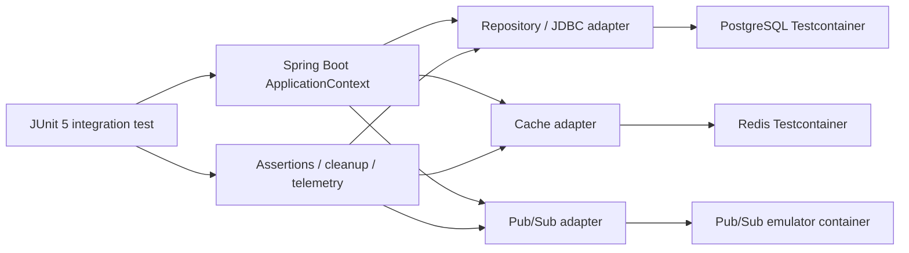
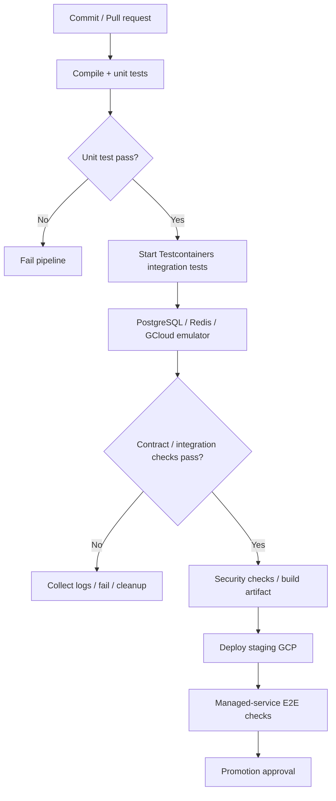

# Testcontainers for Backing Data Components of GCP Applications

A Java/Spring service deployed to Google Cloud typically depends on multiple systems: Cloud SQL or AlloyDB for transactional storage, Memorystore for caching, Pub/Sub for event exchange, Firestore or Spanner for data persistence, and occasionally Cloud Storage for file storage. Unit tests with mocks verify logic quickly, but do not prove the application connects properly, runs real SQL, handles transactions accurately, or interacts cleanly with a message broker.

**Testcontainers for Java** lets tests spin up required dependencies inside lifecycle-managed containers, obtain dynamic endpoints, execute application code against test services, and clean up resources upon completion. For GCP applications, some dependencies run protocol-compatible open-source engines while others use official emulators; neither completely replaces testing against live managed services.

This lesson belongs to the **GCP Application Testing** chapter of the **CLOUD_PROVIDERS_GCP** module. The focus is designing reliable integration tests for backing data components of Java/Spring applications before deploying to Cloud Run, GKE, or other Google Cloud environments.

## 1. Learning Objectives

After this lesson, you will be able to:

- Explain how Testcontainers differs from mocks, embedded databases, emulators, and live GCP environments.
- Set up JUnit 5, Testcontainers 2.x, and Spring Boot with Maven/Gradle.
- Run a PostgreSQL container to test JPA, JDBC, Flyway, and transactional constraints.
- Run a Redis container to test caching, TTLs, and key/value behavior.
- Use Testcontainers GCloud to run Pub/Sub, Firestore, or Spanner emulators.
- Inject dynamic endpoints and test credentials into the application context without hard-coding ports.
- Structure test fixtures, test isolation, startup timing, and teardown.
- Identify which parts must be verified on real GCP—specifically IAM, networking, quotas, and managed-service features.
- Design CI testing pipelines with controlled resources and Docker daemon access.

## 2. Where Does Testcontainers Fit in the Testing Strategy?

Different test levels address different risks:

| Test Level | Dependencies | Goal | Relative Speed |
|---|---|---|---|
| Unit tests | In-memory mocks or fakes | Verify logic, calculations, validation | Very fast |
| Component tests | Containerized real services or contract-backed fakes | Verify repositories, caches, serialization, and adapters | Medium |
| Integration tests | Multiple components started together | Verify communication flows, transactions, events, and data flow | Slower |
| E2E on GCP | Managed services and real IAM/networking | Verify platform integration, configuration, and operations | Slower / higher cost |

For example, in an ordering service: unit tests verify order totals; a PostgreSQL container verifies unique constraints and transactions; a Redis container verifies cache invalidation; the Pub/Sub emulator verifies basic publish/consume; E2E on GCP verifies service account permissions, networking, quotas, delivery semantics, and the deployed system.

**You do not need Testcontainers for every test.** Use mocks for pure logic; use containers when database, broker, or client integration behavior is what you are verifying. A healthy suite has many unit tests, selective integration tests, and a small, high-value E2E suite.

### 2.1. Why Not Just Use H2 Instead of PostgreSQL?

H2 is an embedded database useful in some cases, but it is not equivalent to PostgreSQL:

- Different SQL syntax, data types, extensions, and indexing behavior.
- Different isolation levels, locking, transactions, and concurrency semantics.
- Different behavior for JSONB, UUID, arrays, collations, or constraints.
- Migrations that pass on H2 are not guaranteed to run on Cloud SQL for PostgreSQL.

Using a PostgreSQL image matching the Cloud SQL major version tests real SQL and drivers far more accurately. However, a PostgreSQL container **does not simulate** the Cloud SQL connector, IAM database authentication, HA/failover, backups, private IP, or managed-service limits.

### 2.2. Containers Are Not Always Equivalent to Emulators

A PostgreSQL database container runs real PostgreSQL. A Redis container runs real Redis. In contrast, the Pub/Sub Emulator or Firestore Emulator is a protocol/behavior simulator built for development and testing; features and semantics may differ from the production service.

| GCP Dependency | Component to Use in Testcontainers | Additional Verification Needed on GCP |
|---|---|---|
| Cloud SQL for PostgreSQL / AlloyDB | `PostgreSQLContainer`, matching major version | Cloud SQL Auth Proxy/Connector, IAM, HA, backups, performance |
| Memorystore for Redis | Redis image via `GenericContainer` | TLS/auth topology, cluster mode, failover, managed networking |
| Pub/Sub | `PubSubEmulatorContainer` | IAM, retry policies, ordering, DLQ, quotas, exactly-once per config |
| Firestore | `FirestoreEmulatorContainer` | Composite indexes, security rules, TTL, IAM, latency, and quotas |
| Spanner | `SpannerEmulatorContainer` | IAM, transaction performance, splits/replicas, production limits |
| Cloud Storage | Third-party emulator or HTTP-contract fake | IAM, signed URLs, retention, generations, checksums, bucket policies |

In this table, "additional verification" does not mean every feature is absent from the emulator; rather, these are behaviors **that should not be assumed proven** by local tests alone.

## 3. Test Suite Architecture

A clean architecture for a Spring Boot application:



Testcontainers starts the backing services used in tests. Spring Boot receives dynamic addresses from Testcontainers via `@ServiceConnection` or `@DynamicPropertySource`. Adapters should expose clear interfaces or configuration points instead of constructing Cloud clients with fixed endpoints inside business logic.

## 4. Prerequisites and Version Management

Requirements:

1. A JDK compatible with the application (e.g., JDK 21).
2. Maven/Gradle and JUnit Jupiter.
3. A running container runtime compatible with the Docker API.
4. Permission to pull images from a registry or an approved image cache/mirror.
5. Sufficient CPU/RAM for the total number of concurrent containers.
6. Network connectivity allowing the test application to reach port-mapped containers.

Testcontainers checks for a usable container runtime at execution time. If no supported Docker socket or endpoint is found, tests fail before reaching application code. CI pipelines should not assume a Docker daemon is available merely because the runner itself runs inside a container.

### 4.1. Testcontainers 2.x Versions and Packages

Examples in this lesson use **Testcontainers 2.0.5** and JUnit 5. In Testcontainers 2.x, specialized modules use updated artifact/package names. For example:

- PostgreSQL: `org.testcontainers:testcontainers-postgresql` with class `org.testcontainers.postgresql.PostgreSQLContainer`.
- GCloud: `org.testcontainers:testcontainers-gcloud` with classes under package `org.testcontainers.gcloud`.
- JUnit Jupiter: `org.testcontainers:testcontainers-junit-jupiter`.
- GenericContainer: class `org.testcontainers.containers.GenericContainer` in the core library.

Do not mix Testcontainers 1.x and 2.x guides: older tutorials reference the `postgresql` artifact or `org.testcontainers.containers.PostgreSQLContainer`. Align your BOM and APIs to **one** consistent version; do not copy legacy imports into code using the newer artifacts.

### 4.2. Maven Dependency Management

Example additions for a Spring Boot application using Spring JDBC/JPA and the PostgreSQL driver:

```xml
<dependencyManagement>
  <dependencies>
    <dependency>
      <groupId>org.testcontainers</groupId>
      <artifactId>testcontainers-bom</artifactId>
      <version>2.0.5</version>
      <type>pom</type>
      <scope>import</scope>
    </dependency>
  </dependencies>
</dependencyManagement>

<dependencies>
  <dependency>
    <groupId>org.springframework.boot</groupId>
    <artifactId>spring-boot-starter-test</artifactId>
    <scope>test</scope>
  </dependency>
  <dependency>
    <groupId>org.springframework.boot</groupId>
    <artifactId>spring-boot-testcontainers</artifactId>
    <scope>test</scope>
  </dependency>
  <dependency>
    <groupId>org.testcontainers</groupId>
    <artifactId>testcontainers-junit-jupiter</artifactId>
    <scope>test</scope>
  </dependency>
  <dependency>
    <groupId>org.testcontainers</groupId>
    <artifactId>testcontainers-postgresql</artifactId>
    <scope>test</scope>
  </dependency>
  <dependency>
    <groupId>org.testcontainers</groupId>
    <artifactId>testcontainers-gcloud</artifactId>
    <scope>test</scope>
  </dependency>
  <dependency>
    <groupId>org.postgresql</groupId>
    <artifactId>postgresql</artifactId>
    <scope>runtime</scope>
  </dependency>
</dependencies>
```

`testcontainers-gcloud` is only needed for GCP emulator tests. If you only use PostgreSQL or Redis `GenericContainer`, there is no need to pull all modules into the dependency graph.

### 4.3. Gradle Dependencies

```groovy
dependencies {
    testImplementation platform("org.testcontainers:testcontainers-bom:2.0.5")
    testImplementation "org.springframework.boot:spring-boot-starter-test"
    testImplementation "org.springframework.boot:spring-boot-testcontainers"
    testImplementation "org.testcontainers:testcontainers-junit-jupiter"
    testImplementation "org.testcontainers:testcontainers-postgresql"
    testImplementation "org.testcontainers:testcontainers-gcloud"
    runtimeOnly "org.postgresql:postgresql"
}

tasks.withType(Test).configureEach {
    useJUnitPlatform()
}
```

If the application uses the Spring Boot parent/BOM to manage Testcontainers, inspect the resolved version before overriding it; Spring and Testcontainers BOMs must be compatible with your current JDK/Spring Boot versions. The sample above demonstrates managing a consistent 2.0.5 version, not a mandate for unverified upgrades.

## 5. Container Lifecycle with JUnit 5

`@Testcontainers` activates the extension; `@Container` marks containers to start/stop with the test lifecycle. `static` fields typically scope containers to an entire test class, whereas instance fields are recreated per test method.

Simple example running Redis:

```java
import org.junit.jupiter.api.Test;
import org.testcontainers.containers.GenericContainer;
import org.testcontainers.junit.jupiter.Container;
import org.testcontainers.junit.jupiter.Testcontainers;
import org.testcontainers.utility.DockerImageName;

import static org.junit.jupiter.api.Assertions.assertTrue;

@Testcontainers
class RedisAvailabilityIT {

    @Container
    static GenericContainer<?> redis = new GenericContainer<>(
            DockerImageName.parse("redis:7.4-alpine"))
            .withExposedPorts(6379);

    @Test
    void redisPortIsMapped() {
        assertTrue(redis.isRunning());
        assertTrue(redis.getMappedPort(6379) > 0);
        System.out.println(redis.getHost() + ":" + redis.getMappedPort(6379));
    }
}
```

This is only a container smoke test and does not verify the cache adapter. Business tests should create a real Redis client, perform set/get operations, and verify TTL or cache invalidation.

### 5.1. Do Not Hard-Code `localhost:port`

Testcontainers typically maps container ports to **dynamic host ports**. Test code must query:

```java
String host = redis.getHost();
int port = redis.getMappedPort(6379);
```

Never assume `localhost:6379`, because on CI, Docker Desktop, or remote runtimes, the host/port can differ. Two containers exposing 6379 can still run in parallel because their mapped ports differ.

### 5.2. Lifecycle and Reuse

A `static` container can be shared across test methods in the same class, but data inside PostgreSQL/Redis **does not automatically reset** between methods. If sharing a container to reduce startup time, clean up database tables, key prefixes, or fixtures between tests.

Spring TestContext can cache `ApplicationContext` instances across test classes. If a cached context holds the endpoint of a stopped container, subsequent tests will fail unexpectedly. Design base classes, context caching, and lifecycles consistently so a cached context never reuses connections to a container already torn down by the JUnit extension.

## 6. PostgreSQL Testcontainer for Cloud SQL and AlloyDB Adapters

Suppose a Spring Boot application has a repository storing orders in Cloud SQL for PostgreSQL. We want to test:

- Entity mapping and SQL syntax.
- Unique constraints and foreign keys.
- Transaction commit/rollback.
- Migrations running cleanly on the target PostgreSQL version.
- Idempotency on repeated repository calls.

### 6.1. Spring Boot + DynamicPropertySource Example

This example uses Spring JDBC with an illustrative table. In real projects, schemas are typically managed by Flyway/Liquibase.

```java
import org.junit.jupiter.api.BeforeEach;
import org.junit.jupiter.api.Test;
import org.springframework.beans.factory.annotation.Autowired;
import org.springframework.boot.test.context.SpringBootTest;
import org.springframework.jdbc.core.JdbcTemplate;
import org.springframework.test.context.DynamicPropertyRegistry;
import org.springframework.test.context.DynamicPropertySource;
import org.testcontainers.junit.jupiter.Container;
import org.testcontainers.junit.jupiter.Testcontainers;
import org.testcontainers.postgresql.PostgreSQLContainer;

import static org.junit.jupiter.api.Assertions.assertEquals;
import static org.junit.jupiter.api.Assertions.assertThrows;

@Testcontainers
@SpringBootTest
class OrderRepositoryIT {

    @Container
    static PostgreSQLContainer postgres =
            new PostgreSQLContainer("postgres:16.6")
                    .withDatabaseName("orders_test")
                    .withUsername("test")
                    .withPassword("test");

    @DynamicPropertySource
    static void databaseProperties(DynamicPropertyRegistry registry) {
        registry.add("spring.datasource.url", postgres::getJdbcUrl);
        registry.add("spring.datasource.username", postgres::getUsername);
        registry.add("spring.datasource.password", postgres::getPassword);
    }

    @Autowired
    JdbcTemplate jdbc;

    @BeforeEach
    void resetData() {
        jdbc.execute("""
            CREATE TABLE IF NOT EXISTS orders (
              id BIGINT PRIMARY KEY,
              external_id TEXT NOT NULL UNIQUE
            )
            """);
        jdbc.execute("TRUNCATE TABLE orders");
    }

    @Test
    void persistsAndEnforcesUniqueBusinessKey() {
        jdbc.update(
            "INSERT INTO orders (id, external_id) VALUES (?, ?)",
            1L, "ext-101");

        long count = jdbc.queryForObject(
            "SELECT COUNT(*) FROM orders WHERE external_id = ?",
            Long.class, "ext-101");
        assertEquals(1L, count);

        assertThrows(
            org.springframework.dao.DataIntegrityViolationException.class,
            () -> jdbc.update(
                "INSERT INTO orders (id, external_id) VALUES (?, ?)",
                2L, "ext-101")
        );
    }
}
```

Prerequisites: the project includes `spring-boot-starter-jdbc` (or matching JPA/JDBC starter), test starter, and the PostgreSQL driver. If the application uses Flyway/Liquibase, run the real migrations to create tables rather than creating tables in `@BeforeEach`; seed test data via SQL fixtures or repository setup.

This approach verifies **real PostgreSQL constraints**. It does not test the Cloud SQL Auth Proxy, private networking, IAM DB auth, or high-availability configuration.

### 6.2. `ServiceConnection` When Supported by Spring Boot

Spring Boot can automatically extract connection details from containers via `@ServiceConnection`, avoiding manual registration of URL, username, and password with `@DynamicPropertySource`.

```java
import org.junit.jupiter.api.Test;
import org.springframework.boot.test.context.SpringBootTest;
import org.springframework.boot.testcontainers.service.connection.ServiceConnection;
import org.testcontainers.junit.jupiter.Container;
import org.testcontainers.junit.jupiter.Testcontainers;
import org.testcontainers.postgresql.PostgreSQLContainer;

@Testcontainers
@SpringBootTest
class OrderServiceConnectionIT {

    @Container
    @ServiceConnection
    static PostgreSQLContainer postgres =
        new PostgreSQLContainer("postgres:16.6");

    @Test
    void startsWithPostgresDatasource() {
        // Invoke the real repository or service and assert business outcomes.
    }
}
```

This requires `spring-boot-testcontainers` and a compatible Spring Boot version. Spring creates `ConnectionDetails` for recognized containers, overriding matching connection properties. If you need PostgreSQL configured with complex options or custom clients, use `@DynamicPropertySource` for fine-grained property control.

### 6.3. Testing Transactions and Isolation

A valuable integration test should verify:

- Unique constraints actually reject duplicate inserts.
- Rollbacks leave no persisted state after exceptions.
- Concurrent transactions handle optimistic locking or conflicts per business rules.
- Migration upgrades preserve existing data.
- SQL queries execute cleanly on the intended major version.

Do not place `@Transactional` on every test assuming every side effect rolls back: asynchronous tasks, message consumers, or transactions on separate threads commit independently. For such tests, perform explicit cleanup and verify persisted state post-execution.

## 7. Redis Testcontainer for Cache and Session State

Memorystore can provide Redis for caching, distributed locks, or ephemeral state. A Redis container runs real Redis, making it suitable for testing key serialization, TTLs, expiration, and cache adapters. However, it does not replace a managed Memorystore environment with real HA, TLS, networking, or operational policies.

### 7.1. `GenericContainer` and Spring `DynamicPropertySource`

```java
import org.junit.jupiter.api.Test;
import org.springframework.beans.factory.annotation.Autowired;
import org.springframework.boot.test.context.SpringBootTest;
import org.springframework.data.redis.core.StringRedisTemplate;
import org.springframework.test.context.DynamicPropertyRegistry;
import org.springframework.test.context.DynamicPropertySource;
import org.testcontainers.containers.GenericContainer;
import org.testcontainers.junit.jupiter.Container;
import org.testcontainers.junit.jupiter.Testcontainers;
import org.testcontainers.utility.DockerImageName;

import java.time.Duration;

import static org.junit.jupiter.api.Assertions.assertEquals;

@Testcontainers
@SpringBootTest
class CacheAdapterIT {

    @Container
    static GenericContainer<?> redis = new GenericContainer<>(
            DockerImageName.parse("redis:7.4-alpine"))
            .withExposedPorts(6379);

    @DynamicPropertySource
    static void redisProperties(DynamicPropertyRegistry registry) {
        registry.add("spring.data.redis.host", redis::getHost);
        registry.add("spring.data.redis.port", () -> redis.getMappedPort(6379));
    }

    @Autowired
    StringRedisTemplate template;

    @Test
    void writesAndReadsCacheEntry() {
        template.opsForValue().set("test:order:101", "PAID",
                Duration.ofMinutes(1));

        assertEquals("PAID",
                template.opsForValue().get("test:order:101"));

        template.delete("test:order:101");
    }
}
```

Prerequisite: `spring-boot-starter-data-redis`. Property names and structure vary by Spring Boot version; this example uses the `spring.data.redis.*` namespace.

### 7.2. What to Test

- Key and value serialization/deserialization.
- Whether TTLs are set and refreshed properly on rewrites.
- Cache invalidation after underlying data updates.
- Cache miss behavior, cache server unavailability, and fallbacks.
- Concurrent requests causing races or stale values.
- Tenant/environment key prefixes to prevent collisions.

Do not use `Thread.sleep(60_000)` to wait for TTL expiration; use short TTLs with reasonable margin, poll expiration state within bounded timeouts, and avoid overly tight timing assertions. When running parallel tests, isolate keys by test ID.

## 8. Pub/Sub Emulator via Testcontainers GCloud

Testcontainers provides the **GCloud** module to launch emulators for several Google Cloud services. Testcontainers documentation marks this module as **INCUBATING**, so its API may evolve across versions. The examples use Testcontainers 2.0.5.

### 8.1. Starting `PubSubEmulatorContainer`

```java
import org.junit.jupiter.api.Test;
import org.testcontainers.gcloud.PubSubEmulatorContainer;
import org.testcontainers.utility.DockerImageName;

import static org.junit.jupiter.api.Assertions.assertTrue;

class PubSubEmulatorSmokeIT {

    @Test
    void startsPubSubEmulator() {
        try (PubSubEmulatorContainer emulator =
                 new PubSubEmulatorContainer(
                     DockerImageName.parse(
                       "gcr.io/google.com/cloudsdktool/google-cloud-cli:583.0.0-emulators"
                     ))) {

            emulator.start();
            String endpoint = emulator.getEmulatorEndpoint();
            assertTrue(endpoint.contains(":"));
        }
    }
}
```

Pin the Google Cloud CLI emulator image to a CI-verified tag. `getEmulatorEndpoint()` returns the host and mapped port for external clients to connect.

This is only a container smoke test. Integration tests must create topics/subscriptions, publish messages, receive/ack them, and assert effects on business data.

### 8.2. Configuring the Java Pub/Sub Client for the Emulator

The gRPC client must connect to the local endpoint without real credentials. Below is an example creating a test topic:

```java
import com.google.api.gax.core.NoCredentialsProvider;
import com.google.api.gax.grpc.GrpcTransportChannel;
import com.google.api.gax.rpc.FixedTransportChannelProvider;
import com.google.api.gax.rpc.TransportChannelProvider;
import com.google.cloud.pubsub.v1.TopicAdminClient;
import com.google.cloud.pubsub.v1.TopicAdminSettings;
import com.google.pubsub.v1.TopicName;
import io.grpc.ManagedChannel;
import io.grpc.ManagedChannelBuilder;
import org.testcontainers.gcloud.PubSubEmulatorContainer;
import org.testcontainers.utility.DockerImageName;

public class PubSubClientExample {

    static void createTopic() throws Exception {
        try (PubSubEmulatorContainer emulator =
                 new PubSubEmulatorContainer(
                     DockerImageName.parse(
                         "gcr.io/google.com/cloudsdktool/google-cloud-cli:583.0.0-emulators"))) {

            emulator.start();

            ManagedChannel channel = ManagedChannelBuilder
                .forTarget(emulator.getEmulatorEndpoint())
                .usePlaintext()
                .build();

            try {
                TransportChannelProvider provider =
                    FixedTransportChannelProvider.create(
                        GrpcTransportChannel.create(channel));

                TopicAdminSettings settings = TopicAdminSettings.newBuilder()
                    .setTransportChannelProvider(provider)
                    .setCredentialsProvider(NoCredentialsProvider.create())
                    .build();

                try (TopicAdminClient client = TopicAdminClient.create(settings)) {
                    client.createTopic(TopicName.of("test-project", "orders"));
                }
            } finally {
                channel.shutdownNow();
                channel.awaitTermination(
                    10, java.util.concurrent.TimeUnit.SECONDS);
            }
        }
    }
}
```

This snippet uses `google-cloud-pubsub` and related gRPC dependencies managed by the Google Cloud BOM. Never use real ADC when talking to an emulator. In Spring applications, isolate transport, credentials, and project ID configuration under the test profile so emulator settings never leak into production configuration.

### 8.3. What to Verify in Event Flows

A Pub/Sub integration test should:

1. Start the emulator and create test topics/subscriptions.
2. Start the application's publishing adapter.
3. Emit an event with a valid event ID and payload.
4. Wait for consumer processing using a timeout-bounded eventual consistency check.
5. Assert expected database state changes.
6. Re-send a duplicate event and verify idempotency.
7. Verify malformed data handling, retries, and ack/nack within emulator capabilities.

Do not use fixed sleeps to guess when a message has been processed; use bounded polling (such as Awaitility) or controlled message-receiving hooks. Each test needs dedicated topics/subscriptions or cleanup to prevent leftover messages.

### 8.4. Pub/Sub Emulator Limitations

The emulator is very helpful for protocols and basic message flows, but does not replace testing:

- IAM, service accounts, and Workload Identity Federation.
- Quotas, latency, scaling, network failures, and managed routing.
- Exactly-once delivery, ordering keys, or dead-letter policies across all edge cases.
- Push authentication, retry behavior, and advanced features that may differ from the live service.

For critical production flows, run a set of contract/E2E tests in a GCP sandbox project with real topics and subscriptions managed with explicit lifecycles.

## 9. Firestore and Spanner Emulators

### 9.1. `FirestoreEmulatorContainer`

Example starting the Firestore emulator and configuring the Java client:

```java
import com.google.auth.oauth2.NoCredentials;
import com.google.cloud.firestore.Firestore;
import com.google.cloud.firestore.FirestoreOptions;
import org.junit.jupiter.api.Test;
import org.testcontainers.gcloud.FirestoreEmulatorContainer;
import org.testcontainers.utility.DockerImageName;

import static org.junit.jupiter.api.Assertions.assertNotNull;

class FirestoreAdapterIT {

    @Test
    void canConnectToFirestoreEmulator() throws Exception {
        try (FirestoreEmulatorContainer emulator =
                 new FirestoreEmulatorContainer(
                     DockerImageName.parse(
                         "gcr.io/google.com/cloudsdktool/google-cloud-cli:583.0.0-emulators"))) {

            emulator.start();

            FirestoreOptions options = FirestoreOptions
                .getDefaultInstance()
                .toBuilder()
                .setProjectId("test-project")
                .setHost(emulator.getEmulatorEndpoint())
                .setCredentials(NoCredentials.getInstance())
                .build();

            try (Firestore db = options.getService()) {
                db.collection("orders").document("order-101")
                    .set(java.util.Map.of("status", "NEW")).get();

                var snapshot = db.collection("orders")
                    .document("order-101").get().get();

                assertNotNull(snapshot.getData());
            }
        }
    }
}
```

This snippet uses `google-cloud-firestore`, assuming a client version compatible with the Testcontainers example. Real tests should cover queries, transactions, batch writes, and application data mapping.

The Firestore emulator does not fully validate production indexes, IAM, security rules (depending on setup), TTLs, or quotas. If your application depends on rules or indexes, include supplemental tests in the appropriate environment.

### 9.2. `SpannerEmulatorContainer`

The Spanner emulator uses a separate image. Example startup:

```java
import org.junit.jupiter.api.Test;
import org.testcontainers.gcloud.SpannerEmulatorContainer;
import org.testcontainers.utility.DockerImageName;

import static org.junit.jupiter.api.Assertions.assertTrue;

class SpannerSmokeIT {

    @Test
    void startsSpanner() {
        try (SpannerEmulatorContainer emulator =
                 new SpannerEmulatorContainer(
                     DockerImageName.parse(
                         "gcr.io/cloud-spanner-emulator/emulator:1.4.0"))) {

            emulator.start();
            assertTrue(emulator.getEmulatorGrpcEndpoint().contains(":"));
        }
    }
}
```

When testing a real Spanner adapter, configure `SpannerOptions` with the emulator gRPC endpoint, create a test instance/database, and apply DDL before inserting/querying. Tests must verify mutations and transactions, not just container startup. Do not expect the emulator to reproduce distributed performance, IAM, or multi-region consistency of the managed Spanner service.

### 9.3. Choosing Emulators by Testing Value

| Adapter | Valuable Local Tests | Checks on Real GCP |
|---|---|---|
| Firestore | Data mapping, query logic, basic transactions | Indexes, IAM, security rules, quotas |
| Spanner | DDL, mutations, SQL, basic transaction behavior | Latency, scaling, transaction constraints, IAM |
| Pub/Sub | Serialization, publish/consume, ack flow | Managed delivery behavior, IAM, quotas |
| Bigtable | Row keys, families, mutations, reads | Capacity, performance, IAM |
| Datastore | Basic entities/queries | Index config, IAM, operational behavior |

Do not spin up emulators for backends the application does not actually use; keeping containers minimal makes tests faster and lighter on resources.

## 10. Cloud Storage and the `fake-gcs-server` Option

Unlike Pub/Sub, Firestore, or Spanner, **the Testcontainers GCloud module does not provide an official Cloud Storage emulator in the module list above**. When testing a Cloud Storage adapter, you have three options:

- Fake or mock `Storage`/HTTP clients in unit tests to verify business logic and error mapping.
- Run a third-party Cloud Storage-compatible emulator via `GenericContainer`, such as `fake-gcs-server`, pinned to a version and API surface verified by the project.
- Run integration tests against a real bucket in a sandbox project when verifying generation preconditions, IAM, metadata, retention, checksums, signed URLs, or live policies.

Never call `fake-gcs-server` an official Google Cloud emulator. Third-party emulators can diverge from production APIs. In CI pipelines, pin the image digest/tag, verify image trustworthiness, and prevent accidental access to live buckets.

A simple abstraction lets you swap backends per test tier:

```java
public interface ObjectStore {
    void put(String key, byte[] data);
    byte[] get(String key);
    void delete(String key);
}
```

Unit tests focus on business service behavior via a fake `ObjectStore`. Integration tests focus on the concrete adapter using an emulator or a real GCP bucket. By separating the adapter, tests avoid booting emulators for every business logic case.

## 11. Separating Test and Production Configuration

The most common pitfall is tests accidentally calling live GCP services because a bean uses default ADC or a property was not overridden.

### 11.1. Profile-Based Configuration

In Spring Boot:

- `application.yaml` holds shared baseline settings.
- `application-test.yaml` holds only non-sensitive test environment settings.
- `@DynamicPropertySource` supplies dynamic endpoints once containers start.
- `@ServiceConnection` supplies connection details for supported containers.
- Clients targeting emulators need explicit `host`, `projectId`, and `NoCredentials`/`NoCredentialsProvider`.
- Test beans can use `@TestConfiguration` to replace production clients with emulator-bound clients.

Never let the production profile auto-detect a Pub/Sub emulator from stale environment variables. Never use default credentials to talk to local emulators, and never pass `NoCredentials` to real GCP clients.

### 11.2. Client Factories and Dependency Injection

Expose adapter interfaces and factories accepting configuration. For example:

```java
public interface EventPublisher {
    void publish(String topic, String payload);
}
```

In production, the adapter uses the live Google Cloud Pub/Sub client and ADC. In tests, the same interface is wired with the emulator endpoint and fake credentials. Business logic does not care where the endpoint comes from, only about publish outcomes and error mapping.

### 11.3. `DynamicPropertySource` or `ServiceConnection`?

| Approach | Advantage | When to Use |
|---|---|---|
| `@DynamicPropertySource` | Explicit properties, works with custom adapters/emulators | Clients needing custom host, port, or project ID |
| `@ServiceConnection` | Spring Boot auto-configures `ConnectionDetails` | Container types recognized by Spring, such as PostgreSQL |
| `@TestConfiguration` | Customizes complex beans and transports | GCloud emulators, custom credentials, multiple clients |
| Process env vars | Suits certain client SDKs | Test runners controlling processes independently |

Do not assume `@ServiceConnection` automatically recognizes every `PubSubEmulatorContainer` or `FirestoreEmulatorContainer`. Depending on the integration, you will still configure clients or beans manually.

## 12. Test Data, Isolation, and Deterministic Assertions

### 12.1. A New Container Does Not Always Mean Clean Tests

A `static` container retains data from earlier test methods. If multiple tests run in parallel, `TRUNCATE` or `FLUSHALL` can wipe another test's data.

Isolation strategies:

- Use unique key prefixes per test ID.
- Use separate databases/schemas where supported by the backend.
- Initialize fixtures in `@BeforeEach` and clean up owned state in `@AfterEach`.
- Use transaction rollback for appropriate synchronous tests.
- Use per-test-class containers when stronger isolation is required.
- Avoid shared external databases lacking namespaces or isolation.

### 12.2. Seeding with Migrations and Fixtures

For PostgreSQL:

1. Start the container.
2. Let Spring Boot/Flyway/Liquibase run the application's migrations.
3. Seed minimal sample data with minimal ordering dependencies.
4. Call the real repository/service.
5. Assert DB, event, or cache state.
6. Clean up only the data created by the test.

Avoid fake schemas differing from production because they defeat the purpose of integration tests.

### 12.3. Eventual Consistency and Timeouts

Message brokers and asynchronous workers do not guarantee immediately visible results. Instead of:

```java
Thread.sleep(2000); // flaky if CI is slow
```

Use Awaitility or bounded polling:

```java
await()
    .atMost(java.time.Duration.ofSeconds(10))
    .pollInterval(java.time.Duration.ofMillis(200))
    .untilAsserted(() ->
        assertEquals("PROCESSED", orderRepository.findStatus("order-101"))
    );
```

This example assumes Awaitility is declared as a test dependency with the necessary static imports. Timeouts must accommodate reasonable variance without masking hangs; logs must report which condition remained unmet.

### 12.4. Do Not Assert Only That the Container Started

A test like `assertTrue(postgres.isRunning())` proves only that the runtime booted. Valuable tests verify application contracts: SQL, transactions, caching, serialization, retries, idempotency, and business output.

## 13. Networking and Multi-Container Communication

### 13.1. Test JVM Running on the Host

When the test JVM runs outside containers:

```java
String host = redis.getHost();
int mappedPort = redis.getMappedPort(6379);
```

Spring/clients must use `host` and `mappedPort`; never use the internal container port unless sharing a network.

### 13.2. Application Also Running in a Container

When both the application and dependencies are managed by Testcontainers:

- Create a shared `Network`.
- Assign a network alias to the database/Redis container.
- Connect the application container via the alias and **internal port**.
- Avoid routing through mapped host ports from inside another container unnecessarily.
- Close the `Network` and containers after tests.

Conceptual example:

```java
try (Network network = Network.newNetwork()) {
    GenericContainer<?> redis = new GenericContainer<>("redis:7.4-alpine")
        .withNetwork(network)
        .withNetworkAliases("redis")
        .withExposedPorts(6379);

    // Application container on the same network connects to redis:6379.
    redis.start();
    // ... create app container, run tests, close container.
}
```

This snippet requires importing `org.testcontainers.containers.Network` and `GenericContainer`; it illustrates network topology rather than a complete test with assertions. When running against a remote Docker runtime, pay attention to hostnames, mapped ports, and container-to-container visibility.

### 13.3. Wait Strategies and Readiness

Do not assume a newly started process is immediately ready to serve requests. With `GenericContainer`, configure an appropriate wait strategy:

```java
GenericContainer<?> redis = new GenericContainer<>("redis:7.4-alpine")
    .withExposedPorts(6379)
    .waitingFor(
        org.testcontainers.containers.wait.strategy.Wait
            .forListeningPort()
            .withStartupTimeout(java.time.Duration.ofSeconds(60))
    );
```

Dedicated database containers typically include built-in readiness logic. If tests still fail to connect, inspect container logs and verify open ports, DNS resolution, and authentication rather than blindly extending timeouts.

## 14. Performance and Test Suite Organization

### 14.1. Reducing Startup Time

Containers are slower than mocks because images must be pulled and processes started. Optimization practices:

- Pin and pre-pull images onto CI runners where appropriate.
- Share `static` containers within a class while preserving data isolation.
- Group integration tests by shared dependencies.
- Limit how many heavy containers run concurrently.
- Do not boot every emulator for tests that only need PostgreSQL.
- Separate fast unit tests from integration tests in CI.
- Keep test fixtures small and avoid importing production dumps.

Do not enable reusable containers by default in shared CI without strict cleanup, isolation, and security policies. Container reuse is an experimental/version-dependent feature that can leak data between runs.

### 14.2. Categorizing and Running Tests

Use clear naming and tags, such as:

- `*Test` for fast unit tests.
- `*IT` for integration tests.
- JUnit `@Tag("integration")` for filtering.
- Maven Surefire for unit tests and Failsafe for ITs as configured.
- Dedicated Gradle test tasks or profiles to select groups.

Crucially, ensure CI actually executes the tests you wrote. Naming classes `*IT` when Surefire ignores them and Failsafe is unconfigured silently skips the suite.

### 14.3. Tracking Duration and Stability

Record:

- Container startup time and image pull time.
- Test execution duration.
- Flaky test counts and root causes.
- Retry occurrences.
- RAM/CPU utilization.
- Registry, Docker daemon, and port/network failures.

Never auto-retry all failing tests just to turn CI green without preserving evidence. Retries can help distinguish unstable CI infrastructure from business bugs; log and monitor flake rates.

## 15. Running Testcontainers in Cloud Build or CI

### 15.1. Verifying the Container Runtime

Cloud Build and many CI systems execute steps inside containers; how Docker API access works depends on the runner and configuration. Never assume Testcontainers has access to a Docker socket or sibling-container privileges in every step.

A Testcontainers pipeline requires:

1. A runner with a permitted Docker-compatible daemon.
2. Proper Docker endpoint environment variables where required.
3. Permissions to pull images and access registries.
4. Sufficient RAM/CPU/disk for PostgreSQL and emulators.
5. Network access allowing the test JVM to reach mapped ports.
6. Cleanup mechanisms on failure or timeout.
7. Security controls around the Docker socket given its elevated privileges.

If default Cloud Build does not meet these requirements, use an approved worker pool/runner with container-daemon support or run integration tests on a suitable CI environment. Never mount the Docker socket or run privileged containers without a security review.

### 15.2. CI Pipeline Design



Production credentials must never be used for local emulator tests. If a test job requires GCP permissions, use a sandbox project's service account with Workload Identity Federation or an appropriate runner identity mechanism.

### 15.3. Container Image Security

Pull images only from approved registries; pin tags or digests per policy. Monitor base images for CVEs and update on a regular cadence. Avoid `latest` tags in reproducible pipelines. If mirroring images via Artifact Registry, update Testcontainers image names or substitutions accordingly.

Never place production JSON keys into test containers. Testcontainers may expose environment variables and logs; do not pass unnecessary secrets into containers.

### 15.4. Diagnostics on Failure

When a test fails, collect:

- Test name and failing assertion.
- Container ID, image, and mapped port (without logging secrets).
- Bounded logs from PostgreSQL, Redis, or emulators.
- Start, ready, and stop timestamps.
- Testcontainers/JDK/Spring versions.
- Application logs containing correlation IDs.

Restrict logs containing user payloads or credentials. For networking failures, `DOCKER_HOST`, host/mapped ports, and wait-strategy logs are far more actionable than raising timeouts unconditionally.

## 16. When Must You Test on Real GCP?

Testcontainers is most effective for validating business adapters and protocols in isolation. Certain behaviors require managed-service integration/E2E tests:

| Risk | Why Testcontainers Is Insufficient | How to Verify |
|---|---|---|
| IAM/service accounts | Emulators typically skip real authentication/authorization | Test with a least-privilege service account in a sandbox project |
| VPC/private IP | Docker networks do not replicate full GCP networking | Deploy to staging or an ephemeral test workload on GCP |
| Cloud SQL connector | PostgreSQL containers lack Cloud SQL Auth Proxy behavior | Test real Cloud SQL connections and IAM DB auth if used |
| Pub/Sub managed delivery | Emulators can differ on retries, ordering, and quotas | Test real topics/subscriptions with small controlled traffic |
| Firestore indexes/rules | Emulators may miss production configuration enforcement | Test indexes and IAM/security rules in a matching environment |
| Spanner scaling | Emulators lack distributed topology | Run performance/consistency tests on a representative instance |
| Cloud Storage policies | Fake emulators do not fully reproduce retention/IAM/generations | Test a dedicated bucket configured with production-like policies |
| Reliability and failover | Containers usually run as single instances | Run chaos/failover exercises in staging or sandbox |

Aim for a **verification matrix**, not a single test type covering every risk.

## 17. Multi-Component Order Flow Example

Suppose Spring Boot handles:

1. Receiving an order creation request.
2. Writing the order to PostgreSQL.
3. Updating or invalidating the Redis cache.
4. Publishing an `OrderCreated` event via Pub/Sub.
5. Another worker consuming the event and generating a report.

The test suite should split into:

- **RepositoryIT:** PostgreSQL container; tests schema, transactions, and unique constraints.
- **CacheAdapterIT:** Redis container; tests TTL, invalidation, and serialization.
- **PublisherIT:** Pub/Sub emulator; tests topics, publishing, subscriptions, acks, and idempotency.
- **OrderFlowIT:** combines just the containers needed to test end-to-end inside the JVM/adapter boundary.
- **GcpStagingE2E:** uses real Cloud SQL, Memorystore, Pub/Sub, and IAM to verify deployment config, permissions, and managed behavior.

For `OrderFlowIT`, seed data cleanly, use unique test IDs, wait for async processing with a timeout, and assert final state. When a test fails, logs should pinpoint which stage failed: DB write, cache invalidation, publish, or consume.

## 18. Common Errors and Troubleshooting

| Symptom | Possible Cause | Resolution |
|---|---|---|
| `Could not find a valid Docker environment` | Daemon/socket unavailable | Check Docker runtime and CI configuration |
| `Connection refused` | Wrong host/port, container not ready | Use `getHost`/`getMappedPort` and wait strategies |
| Spring still uses local DB | Test property not overridden or context cached | Check `@DynamicPropertySource`/`@ServiceConnection` |
| PostgreSQL import not found | Using Testcontainers 2.x with 1.x package import | Use `org.testcontainers.postgresql.PostgreSQLContainer` |
| Tests pass individually, fail as a suite | Data bleed or improper test context reuse | Isolate fixtures, cleanup, and lifecycles |
| Pub/Sub test calls production | Client defaults to ADC and endpoint not overridden | Point gRPC to emulator and use `NoCredentials` |
| Redis test flaky on TTL | Overly tight timing assertion | Use polling/timeouts with sufficient margin |
| Emulator passes but GCP fails | IAM, quotas, indexes, or managed features differ | Add staging/E2E managed-service tests |
| CI hits OOM | Too many heavy containers in parallel | Limit parallelism and optimize images/fixtures |
| Image pull errors | Rate limits, missing tag, proxy issues | Pin image versions, use registry mirrors, pre-pull |
| Unusually slow tests | Repeated image pulls, too many containers started | Group ITs, cache images, control reuse carefully |
| Secrets appear in logs | Production config passed into tests by mistake | Use isolated test env config and redaction |

## 19. Hands-On Exercise

**Goal:** build integration tests for a Spring Boot service using PostgreSQL, Redis, and a Pub/Sub emulator.

1. Set up a JDK, a Docker-compatible runtime, and dependencies based on Testcontainers 2.0.5.
2. Write `OrderRepositoryIT` using `PostgreSQLContainer`, injecting dynamic JDBC properties and testing unique constraints.
3. Write `CacheAdapterIT` using `GenericContainer` with Redis, testing set/get and deleting keys by test prefix.
4. Write smoke test `PubSubEmulatorSmokeIT` using `PubSubEmulatorContainer`, then create a topic/subscription via an emulator-configured client.
5. Extend the Pub/Sub test to publish and consume a message containing an order ID; assert the processed payload.
6. Add a test simulating duplicate event delivery and verify the consumer is idempotent.
7. Add the JUnit `integration` tag and configure the build to run ITs separately.
8. Run the full suite twice to catch data bleed, teardown bugs, and context caching issues.
9. Run on a CI runner with an approved Docker runtime; capture failure logs without logging credentials.
10. Add at least one managed-service E2E test in a sandbox project to verify IAM and networking.

**Completion criteria:** tests do not rely on pre-installed local Redis/PostgreSQL, never hit production GCP services, use no fixed ports, clean up test data afterwards, and produce reproducible results.

## 20. Pre-Adoption Checklist for GCP Projects

- [ ] Target backends and required test levels are clearly identified.
- [ ] Testcontainers 2.x is used consistently without mixing 1.x modules/packages.
- [ ] JUnit Jupiter and the Docker API runtime are properly configured.
- [ ] Container image versions are pinned per policy.
- [ ] Tests use dynamic hosts and mapped ports provided by Testcontainers.
- [ ] Spring receives endpoints via `ServiceConnection`, `DynamicPropertySource`, or `TestConfiguration`.
- [ ] GCloud emulator clients use `NoCredentials` and dedicated test endpoints.
- [ ] Fixture data never leaks across tests or parallel workers.
- [ ] Asynchronous tests use timeout-bounded polling rather than arbitrary sleeps.
- [ ] SQL migrations/constraints are verified against real PostgreSQL.
- [ ] Redis tests cover TTL, serialization, and invalidation.
- [ ] Pub/Sub tests cover messages, ack/retry/idempotency within emulator limits.
- [ ] An E2E suite on Google Cloud verifies IAM, networking, and managed features.
- [ ] CI Docker socket/runner privileges adhere to least-privilege approved architecture.
- [ ] Tests contain no production keys, secrets, or real user data.
- [ ] CI actually executes integration tests rather than only compiling them.
- [ ] Logs and metrics are sufficient to diagnose container startup and connectivity failures.
- [ ] Test suite remains stable across full and appropriately parallelized runs.

## Conclusion

Testcontainers lets Java/Spring applications test integrations against backing components far more realistically than mocks: PostgreSQL executes real SQL and transactions; Redis handles real caching/TTLs; Pub/Sub, Firestore, and Spanner emulators verify client contracts without requiring every developer to provision GCP resources. Containers launch on demand, expose dynamic endpoints, and clean up per the configured lifecycle.

However, a container passing locally does not guarantee GCP production will behave identically. IAM, networking, quotas, managed-service behaviors, performance, and failover still require verification in an appropriate GCP project. A sustainable strategy uses unit tests for business logic, Testcontainers for adapters/components, and real staging/E2E for platform assumptions.

## References

- [Testcontainers for Java — Overview](https://java.testcontainers.org/)
- [Testcontainers for Java — JUnit 5 Quickstart](https://java.testcontainers.org/quickstart/junit_5_quickstart/)
- [Testcontainers for Java — PostgreSQL module](https://java.testcontainers.org/modules/databases/postgres/)
- [Testcontainers for Java — GCloud module](https://java.testcontainers.org/modules/gcloud/)
- [Testcontainers for Java — Network and communicating with containers](https://java.testcontainers.org/features/networking/)
- [Testcontainers for Java — Waiting for container readiness](https://java.testcontainers.org/features/startup_and_waits/)
- [Spring Boot — Testcontainers integration](https://docs.spring.io/spring-boot/reference/testing/testcontainers.html)
- [Google Cloud — Pub/Sub emulator](https://cloud.google.com/pubsub/docs/emulator)
- [Google Cloud — Firestore emulator](https://cloud.google.com/firestore/native/docs/emulator)
- [Google Cloud — Spanner emulator](https://cloud.google.com/spanner/docs/emulator)
- [Google Cloud — Best practices for testing applications](https://cloud.google.com/docs/terraform/best-practices/testing)
