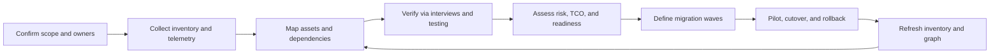
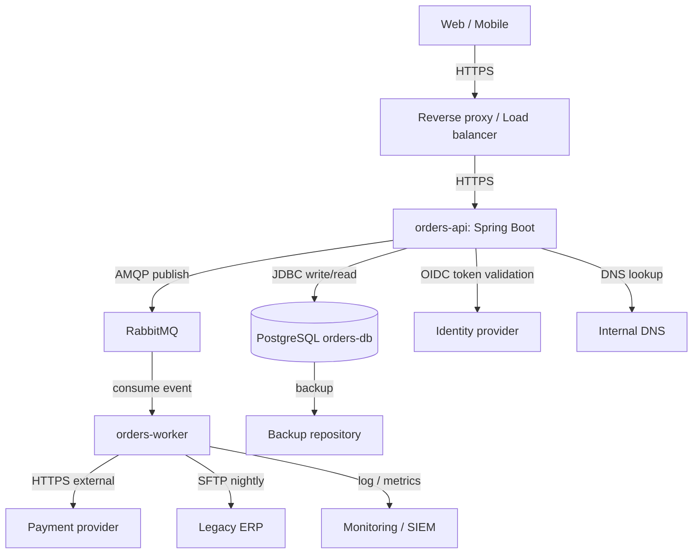
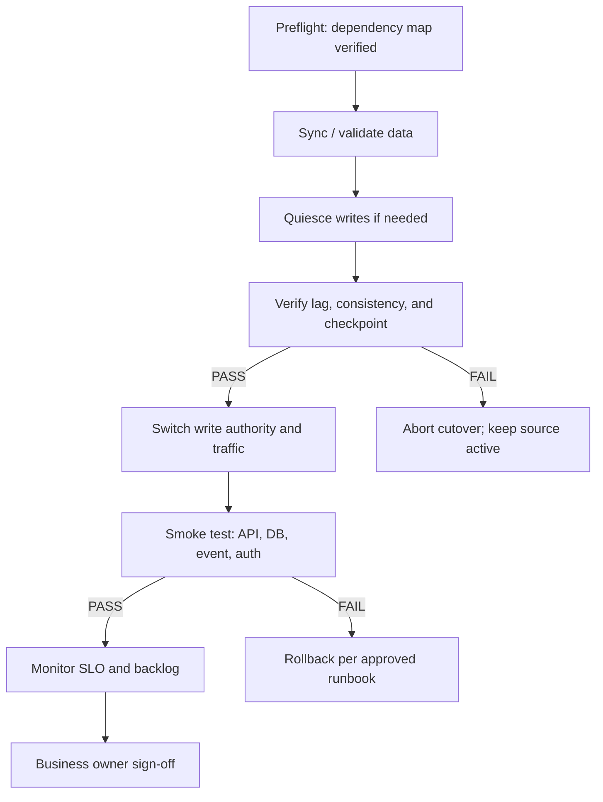

# Source System Discovery and Dependency Cataloging

A plan to migrate an application to Google Cloud usually fails not because you cannot provision a VM or a Kubernetes cluster, but because a lesser-known service is overlooked: an internal authentication system, a DNS server, a month-end batch job, a connection to a payment provider, or a database written to by multiple applications. If you only count VMs and disk sizes, the migration team does not yet know **how the system actually operates**, making it difficult to choose the migration order, limit downtime, or design a rollback.

Source system *discovery* is the process of finding, measuring, and verifying existing technology assets, workloads, and dependencies before deciding on the target architecture. The output is not just an inventory table, but a **relationship map backed by evidence, accountable owners, and confidence levels**. This serves as the input for cloud readiness assessment, selecting rehost/replatform/refactor strategies, network and IAM design, cost estimation, migration wave grouping, and cutover rehearsals.

In the **Migrating to Google Cloud** chapter of the `CLOUD_PROVIDERS_GCP` module, the content focuses on source discovery from on-premises, hosting environments, or another cloud. Subsequent parts of the journey may deploy Compute Engine, GKE, Cloud Run, Cloud Storage, databases, VPC, and IAM; however, **you should not decide on target services before understanding the source workloads, data, and dependencies**. The lesson uses a Java/Spring Boot system as a running case study, though the methodology applies equally to commercial applications, middleware, batch jobs, and legacy systems.

## 1. Required Outputs After the Discovery Phase

A high-quality discovery effort must answer the following questions:

- **What exists?** Applications, VMs, physical servers, containers, databases, storage, load balancers, network services, deployment tools, and third-party systems.
- **Who is accountable?** Business owners, technical owners, operations teams, security, DBAs, and vendor support contacts.
- **How does it run?** OS/JDK/framework versions, CPU/RAM/disk, peak usage, batch schedules, peak hours, seasonality, licenses, and support lifecycles.
- **What does it depend on?** APIs, databases, message brokers, identity providers, DNS, NTP, PKI, file shares, secret stores, CI/CD, and external integrations.
- **How critical is it?** Business impact, SLO/SLA, RTO, RPO, maintenance windows, audit requirements, and data residency.
- **Can it migrate together or must it go first?** Tightly coupled workload groups, shared resources, cross-network connections, startup order, and cutover/rollback procedures.
- **Is the data trustworthy?** Where did the evidence come from, over what period was it observed, has the owner confirmed it, and what assumptions remain unverified?

At a minimum, deliverables should include an **asset inventory**, a **workload catalog**, a **dependency register/graph**, a list of **risks and assumptions**, and a proposed **migration wave** grouping. A nice diagram without records and operational evidence is not sufficient to serve as a migration plan.

## 2. Distinguishing Asset, Workload, Dependency, and Migration Wave

| Term | Meaning | Example |
|---|---|---|
| Asset | A concrete resource that can be managed or measured | VM `vm-app-02`, database instance, NAS share, firewall |
| Workload | A collection of components fulfilling a business or technical objective | Order-processing service consisting of API, worker, database, queue |
| Application/service | A functional unit that is owned and operated | `orders-api`, `payments-adapter`, ERP system |
| Dependency | A relationship where the operation of one component relies on another | `orders-api` calls `payments-api` over HTTPS |
| Shared service | A service used by multiple workloads | Active Directory, DNS, PKI, Kafka, file gateway |
| Migration wave | A group of workloads/data migrated in a planned, controlled phase | Wave 2: orders + adapter + related batch jobs |
| Cutover | The point or procedure for switching operations to the new environment | Rerouting traffic, switching DB write authority, validating new transactions |
| Rollback/failback | Controlled reversion when a deployment fails to meet requirements | Reverting to old endpoints and safely restoring data synchronization |

**One workload can span multiple assets; one asset can serve multiple workloads.** For example, a single PostgreSQL instance shares three databases across two applications. If you only assign each VM to a single application, the migration team will miss shared relationships and misjudge the blast radius when shutting down the old system.

### The Discovery → Assessment → Planning Cycle



Discovery is an **iterative process**, not a one-time activity that is locked down permanently. Source systems continue to change while the migration team prepares networking, the landing zone, and the target architecture. Google Cloud Architecture Center also recommends continuously updating workload, infrastructure, and dependency mappings throughout the migration.

## 3. Defining Scope, Accountability, and Evidence Gathering

Before running infrastructure scanning tools, list the business units, sites, environments, and permissions authorized for discovery. A project may span multiple data centers, VMware vCenters, bare metal, some AWS/Azure VMs, managed databases, and SaaS systems. Never assume that data from a single vCenter represents the entire production environment.

### Building a Controlled Scope

1. List **business capabilities** and critical services: sales, payments, HR, reporting, authentication, backups.
2. Select environments to discover: production, staging, disaster recovery, branch offices, and batch/ETL.
3. Identify data sources: CMDB, asset register, hypervisor, cloud accounts, monitoring, SIEM, APM, network flows, DNS, load balancers, code/config, and owner interviews.
4. Document permitted connection/scanning zones, run schedules, types of permissions granted to collectors, and approvers.
5. Classify the sensitivity of collected metadata, storage location, retention, and access controls.
6. Define completion criteria: percentage of assets with owners, percentage of workloads with a dependency map, count of unverified relationships, and an exceptions list.

### Simple Role Matrix

| Role | Contribution in Discovery | Decision / Sign-off |
|---|---|---|
| Migration lead | Coordinates scope, schedule, and blocker resolution | Approves inventory baseline and proposed waves |
| Business owner | Describes processes, critical windows, and service continuity | Confirms criticality, downtime, and cutover windows |
| Application owner | Provides architecture, APIs, batch jobs, config, and dependent apps | Confirms service map and integration contracts |
| Infra/VM team | Provides hosts, CPU/RAM/storage, hypervisor, and capacity | Confirms asset inventory and infrastructure limits |
| DBA/data owner | Provides databases, capacity, replication, backups, and data lineage | Confirms write permissions, RPO, and data transfer approach |
| Network/security/IAM | Provides routes, firewalls, DNS, TLS, proxies, and identities | Confirms connection flows, security, and compliance |
| SRE/operations | Provides telemetry, on-call, runbooks, and maintenance schedules | Confirms SLOs, monitoring, recovery, and testing |

Do not let dependency verification be handled solely by VM administrators. An open TCP port shows connectivity, but it does not reveal business impact, SLAs, or handling sequences when an endpoint changes; input from the application owner and data owner is required.

### Security Policy for Discovery Activities

Guest discovery tools can observe hostnames, IP addresses, process names, command-line arguments, network sockets, and middleware configurations. Some fields may inadvertently contain tokens, sensitive URLs, or internal data. Use **least-privilege** collector accounts, protect credentials in a secret store, encrypt data at rest and in transit, and inspect content before exporting it outside the organization.

Do not place passwords in command-line flags, emails, shared CSVs, or architecture diagrams. Restrict access to raw scans, topology documents, export files, and endpoint lists. PCI/HIPAA environments or those with strict data residency require separate approval workflows before scanning and syncing data to the cloud.

## 4. Multi-Layer Inventory Collection

Collecting only VM, CPU, and RAM details is insufficient to design an architecture. A workload should be described across the following layers:

| Layer | Key Information Fields | Example Verification Sources |
|---|---|---|
| Business | Service name, owner, criticality, peak schedule, SLO/RTO/RPO | Business owner, SLA, incident history |
| Application | Runtime, modules, versions, API contracts, JVM flags, cron, config | Source/config review, APM, application owner |
| Compute | VM/physical host, OS, vCPU, RAM, container, hypervisor, uptime | vCenter, OS inventory, cloud API, collector |
| Storage & Data | Database engine, schema, volume, growth, backup, replication, sensitive data | DBA, backup catalog, DB metrics, data owner |
| Network | IP, subnet, VLAN/VPC, DNS, port, protocol, LB, firewall, egress, TLS | Netflow, firewall logs, DNS, LB config |
| Identity & Secrets | AD/LDAP/OIDC, service accounts, certificates, HSM, secret manager | IAM/security team, PKI, config metadata |
| Middleware/Integration | Kafka/RabbitMQ, Redis, SMTP, SFTP, ESB, SaaS API | Broker metadata, integration inventory, traces |
| Operations | CI/CD, artifact store, scheduler, monitoring, alerts, on-call, runbooks | CI platform, ticketing, observability |
| Constraints | Licensing, support/EOL, residency, performance, latency, compliance | Vendor, security, business and legal stakeholders |

For Java/Spring Boot applications, separately record the **JDK/Spring version**, application server (Tomcat/JBoss/WebLogic), native/JNI libraries, JAR/WAR packaging, JDBC drivers, JVM heap/GC flags, thread counts, and containerization readiness. A single VM may run multiple Java processes serving different workloads, so never infer VM ↔ application relationships from the hostname alone.

### Unified Identifiers and Asset Deduplication

Every asset and workload should have an ID independent of IP or hostname. IPs can change, hostnames can collide across environments, and a machine can have multiple NICs. For example:

- `WL-ORDER-PROD`: production order-processing workload.
- `APP-ORDERS-API`: Java API component.
- `ASSET-VM-0102`: source VM, linked to the hypervisor/cloud account ID.
- `DB-ORDERS-PRIMARY`: database deployment currently serving writes.
- `EXT-PAYMENT-PROVIDER`: third-party system.

Use `environment`, `site`, `owner`, `source_system`, `first_seen`, `last_seen`, and `evidence` to disambiguate records. When the same asset appears in both the CMDB and a collector, merge them using a stable ID and retain the evidence sources; do not create two separate assets just because their names differ.

## 5. Verifiable Workload and Asset Catalog Templates

A useful inventory typically has **two parts**: a workload table describing business capabilities and an asset table describing resources. Separating these two layers properly handles many-to-many relationships.

### Workload Catalog Table (Hypothetical Example)

| Workload ID | Components | Owner | Criticality | Environment | RTO/RPO | Discovery Focus |
|---|---|---|---|---|---|---|
| `WL-ORDER-PROD` | `orders-api`, `orders-worker`, PostgreSQL | Commerce team | High | PROD | 2h / 15m | Java API + transactions + queue |
| `WL-REPORT-PROD` | Scheduler, reporting ETL, object archive | Data team | Medium | PROD | 24h / 8h | Daily/monthly batch |
| `WL-IDENTITY-PROD` | AD/LDAP and OIDC gateway | Security team | Critical | PROD | 1h / 5m | Shared service, broad blast radius |

The RTO/RPO values in the table are illustrative only and are not default targets from Google Cloud or every enterprise. Values must be approved by the business owner and cross-checked against the actual capabilities of the database, backups, and related services.

### Asset Inventory Table (Hypothetical Example)

| Asset ID | Type / Source | Key Configuration | Linked Workloads | Utilization / Backlog |
|---|---|---|---|---|
| `ASSET-VM-0102` | VMware Linux VM | 4 vCPU, 16 GiB RAM, JDK 17 | `WL-ORDER-PROD` | CPU peak 65%; 23:00 batch job |
| `DB-ORDERS-PRIMARY` | PostgreSQL database | 800 GiB, growing 35 GiB/month | `WL-ORDER-PROD`, `WL-REPORT-PROD` | Accessed by 2 apps; verify write permissions |
| `MQ-BROKER-01` | RabbitMQ cluster | 3 nodes, persistent queues | `WL-ORDER-PROD`, `WL-REPORT-PROD` | Retry queue and DLQ unverified |
| `IDP-01` | OIDC/LDAP gateway | Active-passive, TLS | Multiple workloads | Critical shared dependency |

These figures are educational examples, not real scan outputs. A real source table should also include `asset_id`, `source_id`, IP/subnet, OS, storage IOPS/throughput, software inventory, licenses, data classification, timestamps, evidence sources, and **confidence**. Do not mix observed values (e.g., `CPU 65%`) with estimates or recommendations (e.g., `target VM 2 vCPU`) in the same field without clear labels distinguishing them.

### Sample CSV Structure for Cross-Team Exchange

```csv
workload_id,asset_id,environment,component,owner,source,first_seen,last_seen,confidence,status
WL-ORDER-PROD,ASSET-VM-0102,prod,orders-api,commerce-team,vcenter+apm,2026-10-15,2026-11-15,verified,in_scope
WL-ORDER-PROD,DB-ORDERS-PRIMARY,prod,postgresql,commerce-team,dba+monitoring,2026-10-15,2026-11-15,verified,in_scope
WL-ORDER-PROD,MQ-BROKER-01,prod,rabbitmq,platform-team,network+app-owner,2026-10-20,2026-11-15,probable,to_validate
```

This CSV format is a **proposed schema for internal project use**, not a standard Migration Center import format. If using Migration Center import, you must follow the schema supported by Google Cloud for each asset type. Avoid putting passwords, customer information, or tokens into CSV exports.

## 6. Choosing the Right Discovery Approach and Tools

No single tool fully understands applications, databases, network connections, and business processes. You need to combine **automated collection** with **interviews and manual evidence**. Google Cloud Migration Center helps discover infrastructure and analyze migrations; APM, tracing, logs, CMDBs, and application owners fill in the missing business semantics.

| Collection Method | Strengths | Limitations and Notes |
|---|---|---|
| CMDB, diagrams, tickets | Service names, owners, contracts, and business processes | May be outdated or missing new resources |
| vCenter/hypervisor/cloud inventory | VM lists, CPU, RAM, storage, performance history | Lacks full visibility into app logic or business dependencies |
| OS-level guest discovery | Processes, services, ports, packages, middleware, host config | Requires credentials and network access; may contain sensitive metadata |
| Network flow/firewall/LB logs | IP/port/protocol, traffic direction, frequency | Connections may be health checks, scans, or proxied/NATed traffic |
| APM/distributed tracing | Call chains, APIs, and request-path dependencies | Depends on instrumentation and sampling; may miss batch or rare traffic |
| DBA/scheduler/broker metadata | Database mapping, replication, queues, cron/batch | Not all services have centralized metadata |
| Owner interviews and testing | Verifies roles, criticality, failover, and business flows | Time-consuming; opinions must be backed by evidence and sign-off |

### Google Cloud Migration Center: Starting Point for Source Infrastructure

Migration Center can collect server, VM, and select database inventories to estimate sizing, TCO, and target recommendations. Collection methods include:

1. **One-time discovery:** use the `mcdc` CLI to take a point-in-time snapshot, running inventory discovery, guest discovery, or IP range scans as supported by the platform.
2. **Continuous discovery:** install the **discovery client** on a Windows machine that can reach in-scope assets, configured for periodic scans over multiple days or weeks.
3. **Manual collection/import:** export data from existing tools or run asset-specific collection scripts, then import into Migration Center.

The `mcdc` CLI runs on Linux and Windows and supports **offline assessment**. Data collected by the CLI is not automatically uploaded until an operator runs the export step to Migration Center. Conversely, the discovery client in connected mode can sync data automatically based on configuration. Deployment methods and scanning permissions must be approved according to organizational policy.

Distinguish key limitations:

- The **Windows GUI discovery client** can discover Windows/Linux hosts, but do not use it as a general-purpose database scanner. For databases, use `mcdc` CLI guest discovery with database engine options, or appropriate database collection scripts/imports.
- The `mcdc` CLI supports inventory discovery for environments such as VMware, AWS, and Azure within feature-specific limits, as well as guest discovery over SSH/WMI/vSphere or locally executed collection scripts.
- Collection capabilities depend on the operating system, collector permissions, and access method. `root`/administrator privileges provide deeper visibility but expand security risk; choose privileges based on collection requirements.
- The discovery client and reports primarily support **infrastructure/network** assessment and do not automatically verify data tables, business transactions, contracts, or permissions within source applications.

Illustrative example of **an SSH guest discovery command** on a Linux host where `mcdc` CLI is installed and authorized to reach the source machine:

```bash
# Run on a collector host approved by the organization
./mcdc discover ssh 192.0.2.10
```

`192.0.2.10` is an example address (documentation range). Exact command names, authentication mechanisms, and SSH permissions depend on the CLI/OS version; check the documentation for your `mcdc` version and test on a small scope before scanning in bulk. Never pass passwords directly on the command line due to the risk of exposure in shell history or process lists. Do not run production scans outside approved schedules.

### Database Discovery as a Separate Stream

Databases require deeper data than observing ports `5432`, `3306`, or `1433`. For PostgreSQL, MySQL, or SQL Server, you can use database collection scripts or guest discovery supporting the respective engine. Information to collect includes engine/version/edition, replication topology, size, transaction rate, IOPS, backups, accessing clients, schemas, extensions, stored procedures, licensing, and acceptable latency.

An IP communicating over the PostgreSQL port does not prove it is an **application database**: it could be a management connection, monitoring, or a shared client. Have the DBA confirm the specific instance, database/schema, read/write permissions, sensitive data, and role during cutover. Never scan table rows containing customer data just to build an inventory; collect only required metadata using read-only privileges per procedure.

### Cloud Asset Inventory for Existing GCP Environments

**Cloud Asset Inventory** is a metadata inventory service for **Google Cloud resources**, such as Compute Engine, Cloud Storage, IAM policies, and resource relationships. It is useful when an organization already has a landing zone or workloads on GCP and wants to compare target assets against the design. Cloud Asset Inventory **does not replace discovery of on-premises VMs/applications** and is not a sole real-time source for production operational decisions. For source systems outside GCP, Migration Center, source tooling, and owner confirmation are still required.

## 7. Measuring Load Long Enough to Avoid Target Sizing Errors

A point-in-time CPU snapshot can severely underestimate a workload. A VM may sit idle during the day yet spike during month-end batch processing, or an application may see multiples of normal traffic on promotional days. To size Compute Engine, GKE, or Cloud Run, collect **time series** data and record the context of each period.

Metric groups to capture:

| Group | Observed Metrics | Migration Significance |
|---|---|---|
| Compute | CPU p50/p95/peak, RAM used/committed, processes, threads, JVM heap | Estimate capacity, headroom, and runtime configuration |
| Disk | Used/free, growth, IOPS, throughput, p95 latency, backup size | Choose storage class, migration bandwidth, and copy duration |
| Network | Ingress/egress, peak Mbps, connection count, endpoints and ports | Design VPC, VPN/Interconnect, firewalls, egress costs |
| Application | RPS, p95/p99 latency, error rate, sessions, concurrency, batch duration | Establish SLO baseline and verify post-migration |
| Database | QPS/TPS, connections, slow queries, replication lag, growth | Assess downtime, CDC, and Cloud SQL/Spanner/AlloyDB sizing |
| Reliability | Incidents, recovery time, backup/restore tests, cron/scheduler windows | Design RTO/RPO and rollback |

The measurement window should **cover the business cycle**, not merely a fixed number of days. For typical services, several days to a few weeks may provide a solid picture; for monthly or quarterly batches, supplement with historical logs or cross-period observation. When peak data is missing, mark it as `estimated` and apply a documented safety margin rather than presenting falsely precise sizing.

Some observational details—such as peak timing, CPU throttling, and file IO—cannot be inferred from provisioned CPU/RAM. Ensure you distinguish **provisioned capacity** from **actual usage** and **requirements**. For example, a 16-vCPU VM does not necessarily need 16 vCPUs in GCP; conversely, low average CPU does not mean an application does not require high CPU in short bursts.

### Checking Collected Data Quality

After each collection cycle, reconcile these metrics:

- **Coverage:** discovered assets / estimated assets in scope; which subnets or cloud accounts remain unscanned?
- **Freshness:** last seen timestamp for assets/connections; were any VMs recently added or decommissioned?
- **Completeness:** which assets lack an owner, OS, CPU, RAM, database mapping, or metrics?
- **Confidence:** which relationships are owner-confirmed versus merely inferred from ports/network flows?
- **Outliers:** unusually high RAM, duplicate hostnames, mismatched network flows, or IP changes.
- **Temporal coverage:** were nightly batches, month-end runs, backup windows, and DR exercises observed?

Do not delete an "unknown asset" from the diagram just because it could not be scanned; mark it as unidentified and assign someone to investigate. An unknown endpoint may turn out to be the most critical dependency during cutover.

## 8. The Dependency Catalog Must Be a Directed Graph

A flat list saying "orders-api depends on database and payment" is not enough to execute a migration. You must describe **who calls whom**, over what channel, dependency severity, failure behavior, and active time windows. Represent applications/resources as **nodes**, and connections or dependencies as **edges** with attributes.

### Defining a Dependency Edge

| Field | Example | Why It Is Needed |
|---|---|---|
| `source` → `target` | `orders-api` → `orders-db` | Identifies call direction and blast radius |
| `type` | sync API / async event / SQL / file / identity / DNS | Distinguishes cutover and retry approaches |
| `protocol`/`port` | TCP 5432, HTTPS 443, AMQP 5672 | Prepares firewalls, VPC, proxies, and LBs |
| `endpoint` | `orders-db.internal.example` | Records configured DNS names rather than IPs alone |
| `purpose` | Write orders | Explains business impact if it fails |
| `criticality` | blocking / degraded / optional | Prioritizes waves and smoke tests |
| `frequency` | Per request / nightly / month-end | Prevents missing infrequent dependencies |
| `latency_budget` | p99 under 50 ms (assumed) | Evaluates cross-region hybrid latency risk |
| `auth` | mTLS, OIDC, service account, DB role | Prepares IAM, DNS, certificates, secrets |
| `evidence` | Trace, firewall flow, config, owner | Shows how to verify or challenge the edge |
| `owner/status` | Commerce team / verified | Prevents unowned graph edges |

A link may represent a **bidirectional business dependency** while technical calls are asymmetric. For instance, `orders-api` publishes an event to a broker, and the broker delivers it to `reporting-worker`: those are two distinct edges with different semantics, not a single arrow directly from the API to reporting.

### Example Source Graph for an Ordering System



This diagram is **hypothetical for learning how to build a graph**, not a real production topology. For instance, the payment provider might be called directly by the API instead of the worker; verify this using traces and owners. Diagrams are only views; the dependency register must hold the detailed attributes, evidence, timestamps, and discovery sources for every edge.

### Direct, Indirect, and Cyclic Dependencies

- **Direct:** `orders-api` calls `orders-db` via JDBC.
- **Indirect:** `orders-api` depends on `payment-provider` through the broker and worker; payment failures can grow the backlog even while the API still accepts requests.
- **Shared:** multiple applications share DNS, an identity provider, or a broker. Changing a shared system can impact multiple waves.
- **Cyclic:** A calls B, and B calls A (or both share a database that is hard to split). Components in dependency cycles usually need to migrate in the same wave, have their interfaces decoupled, or use a temporary hybrid bridge.
- **Temporal:** payroll only connects to the ERP on the last day of the month; a two-day observation window can miss it completely.

Before assigning a workload to a wave, identify **strongly connected components**—or at least groups of resources that are bidirectionally coupled or hard to separate. This establishes the practical migration unit, which does not necessarily match a single application entry in the CMDB.

## 9. Network Connections Do Not Equal Business Dependencies

Migration Center can generate a network dependencies report showing connections between server assets based on collected data. The report helps surface IPs, ports, protocols, connection frequencies, and unidentified assets. Migration Center's visualization feature displays a server connection graph and is documented by Google Cloud as **Preview**; do not rely solely on a Preview feature for critical gating checks without verifying support limitations.

Interpret network data with particular care:

| Observation | Could Be | Further Verification Needed |
|---|---|---|
| API calls TCP 5432 | PostgreSQL workload | Actual database/schema, read/write, pooling, TLS |
| Many hosts call TCP 443 on one IP | API/IdP/SaaS or proxy | TLS SNI, hostname, proxy route, application traces |
| Port 53 traffic | DNS resolver | Which domains, TTL, private zones, split-horizon |
| TCP 5672 connection | AMQP broker | Exchange, queue, routing key, retry/DLQ, consumers |
| Infrequent short connections | Health check or scheduled cron | Run schedule, owner, long-term logs |
| Multiple IPs behind NAT/LB | Single backend or multiple services | LB config, reverse proxy, DNS, service discovery |
| No connections observed | No traffic during observation window | Run batch/test, inspect config, ask owner |

A Migration Center network dependencies report can aggregate connections monthly, and retention or collection capability depends on the collection method. Current documentation notes that the network dependencies report uses OS scan data from the discovery client; vSphere inventory alone is insufficient to infer all application connections. When using the CLI or other methods, verify the exact data types collected and whether visualization supports those inputs.

**Evidence should be classified:**

1. `observed`: matching flow/trace/log for the endpoint within a specified timeframe.
2. `declared`: configured or confirmed by the owner, though not yet seen in telemetry.
3. `inferred`: deduced from ports, packages, server names, or patterns; requires verification.
4. `deprecated`: previously existed, with evidence that it is no longer in use.
5. `unknown`: insufficient evidence to confirm or rule out.

Do not treat `inferred` as `verified`. Every relationship should store `confidence`, `observed_at`, `validated_by`, and a follow-up action if doubts remain. This is especially critical when the network team prepares firewall rules or DBAs prepare database cutover.

## 10. Surveying Java and Spring Boot Applications Before Migration

For Java/Spring systems running on VMs or application servers, OS scans only show running processes and installed libraries. Supplement them with controlled code/config reviews and application-team interviews to uncover hard-to-observe integrations. The following areas often determine whether you can lift-and-shift to Compute Engine as-is or should replatform to GKE/Cloud Run:

| Inspection Area | Questions and Evidence | Risk If Missed |
|---|---|---|
| Java/runtime | JDK/JRE, Spring version, app server, native libraries, unsupported OS | Incompatible or end-of-life runtime |
| Packaging | JAR/WAR/EAR, startup scripts, systemd services, local config | New container fails to start properly |
| Database | JDBC URL, connection pool, driver, SQL dialect, XA/distributed transactions | DB incompatibility or latency timeouts |
| HTTP/gRPC | Base URL, proxy, mTLS, API gateway, retry/backoff, timeouts | Requests fail across hybrid networks |
| Identity | LDAP/AD, OIDC/SAML, service credentials, certificate truststores | Login/authorization failures after cutover |
| Messaging | Kafka/RabbitMQ/JMS, consumer groups, queues, DLQ, ordering | Lost/duplicated events, unprocessed backlog |
| Scheduler | `@Scheduled`, Quartz, cron, Airflow, shell scripts, month-end batches | Duplicate or skipped job runs |
| Local state | File uploads, `/tmp`, shared NFS/SMB, in-memory sessions, caches | Data loss when stateless or Pods rotate |
| Observability | Log files, trace propagation, JMX/Actuator, alerts and dashboards | Blindness during migration troubleshooting |
| Security | Secrets, `keystore`/`truststore`, TLS version, certificate rotation | Secret leaks, handshake errors, policy violations |
| Deployment | CI/CD, artifact repository, rollback scripts, DB migration tools | Inconsistent deployment or rollback |

For example, in a Spring Boot application, properties such as `spring.datasource.url`, `spring.kafka.bootstrap-servers`, `spring.rabbitmq.host`, `spring.security.oauth2.*`, and custom app configurations often reveal integration clues. Record only **sanitized property names, service types, and endpoints**—never copy passwords, tokens, or raw secrets into migration documentation.

### Evidence Sources to Cross-Check

1. List of application processes, JVM command lines, listening ports, and process owners.
2. Configuration/secret stores and environment variable names related to DB, Kafka, OIDC, SFTP; do not export sensitive values.
3. API gateway/OpenAPI specs, service discovery, reverse proxy, and load balancer configurations.
4. Distributed traces and application logs along real business flows; reconcile with the network graph.
5. Scheduler/Quartz tables, batch calendars, broker events, and dead-letter queues.
6. Database client metadata, schema permissions, and transactions touching other systems.
7. Source repositories, dependencies/SBOMs, and build scripts if organizationally permitted; note EOL runtimes and licenses.

For an application using a "shared" database, clarify whether it **reads, writes, or runs schema migrations**. Two applications reading the same DB can be separated across waves much more easily than two applications writing to the same table. A single batch job that modifies data can dictate the cutover timing for the entire system.

## 11. Evaluating Data Dependencies and Operational Constraints

Moving compute before understanding data flows easily introduces latency, unexpected data egress, and unsynchronized writes across two systems. For each database, file store, object archive, or event stream, create a **data dependency passport**:

| Field | Information to Collect |
|---|---|
| System of record | Which system is the authoritative data source? |
| Owner/classification | Data owner, public/internal/confidential/restricted, PII/PCI if applicable |
| Engine and version | PostgreSQL/MySQL/SQL Server/Oracle, extensions, collation, charset |
| Size/growth | Current size, growth/month, churn, largest tables/files |
| Change rate | TPS/QPS, CDC volume, write patterns, peak/off-peak |
| Consistency | Strong/eventual, transaction boundaries, cross-system writes |
| Backup/restore | Backup schedule, retention, restore tests, encrypted backups |
| RTO/RPO | Owner-approved targets, acceptable replication lag |
| Consumers | APIs, batch jobs, analytics, vendors, and each consumer's owner |
| Cutover method | Quiesce writes, bulk load, CDC, dual-run, verification, and rollback |

### Types of Data Dependencies to Document Explicitly

- **Online transactions:** new requests must write to the primary database; switching application endpoints must stay synchronized with switching write authority.
- **Read-only/reporting:** can migrate later if replication lag and latency are acceptable, but data egress must be measured.
- **Batch/ETL:** cron jobs running on infrequent schedules; define sources, targets, and processing windows.
- **File transfers:** SFTP/SMB/NFS, naming conventions, permissions, file locking, retries, and receipt confirmation mechanisms.
- **Event streams:** topics/queues, consumer offsets, ordering keys, exactly-once assumptions, idempotency, and DLQs.
- **Identity data:** groups/roles in AD/LDAP/OIDC, access permissions, token/certificate trust, and time dependencies.

Never assume **backup = DR**. Having backups without restore testing does not prove you can meet RTO/RPO. If data is replicated asynchronously, measure lag and quantify data-loss risk at cutover. If considering a dual-write approach, evaluate idempotency, conflict resolution, and rollback reversibility—never implement it based merely on the idea of "writing to both places."

## 12. Translating Source Dependencies into GCP Architectural Requirements

Discovery is not the final solution-selection step, yet every discovered constraint should become a **design requirement** so the architecture team can compare options.

| Source Finding | GCP Architecture Question | Options to Evaluate (Do Not Apply Blindly) |
|---|---|---|
| Java app has local state | Can it be made stateless by externalizing sessions/files? | Compute Engine rehost, GKE, Cloud Run, and external storage |
| System uses SMB/NFS | Are POSIX locking, throughput, and file permissions required? | Filestore or suitable alternative; Cloud Storage has different semantics |
| PostgreSQL primary with read/write batches | Can engine/version change; what HA/RPO is needed? | Cloud SQL PostgreSQL, AlloyDB, or self-managed DB as needed |
| Many hardcoded internal endpoints | How will split-horizon DNS, routing, firewalls, and TLS work? | VPC, Cloud DNS, Cloud VPN/Interconnect, load balancing |
| Legacy queue with ordering/transaction semantics | Can protocols change while preserving non-duplicate processing? | Pub/Sub, or keep broker on GKE/VM if compatibility requires it |
| Uses AD/LDAP or on-prem IdP | How will hybrid identity and secret rotation work? | IAM federation, Cloud Identity/IdP integration, Secret Manager |
| Vendor only allowlists static source IPs | Where does egress exit, and what NAT/allowlists are needed? | Cloud NAT, egress proxy, dedicated networking |
| App logs written to disk | What structured logging, retention, and audit trails are needed? | Cloud Logging/Monitoring, OpenTelemetry |

Selecting a Google Cloud service must be driven by **capabilities, SLAs, technical limits, data residency, and total cost**, not simply similar service names. For example, RabbitMQ and Pub/Sub have different processing models; migrating brokers may require changing producer/consumer code and contracts rather than just a configuration tweak.

### Hybrid Connectivity Models During Transition

Not every component can move at once. Discovery must therefore map communication paths between source and GCP during the hybrid phase: DNS, routing, MTU, bandwidth, firewalls, source IPs, proxies, and TLS. Placing an application in a GKE region far from an on-premises database can multiply per-transaction latency severalfold. If a request executes dozens of SQL round trips, the impact can far exceed the latency of a single HTTP call.

Benchmark the application in hybrid mode before production cutover; explicitly document **which dependencies remain at the source**, who owns the connectivity, and data transfer costs. Verify both the application → database/API direction and callbacks/notifications from source systems or vendors → GCP.

## 13. Building a Workload Passport for Decision-Making

A **workload passport** is a structured summary for a migration unit. Illustrative example (using hypothetical names and IPs):

```yaml
workload_id: WL-ORDER-PROD
name: orders-platform
business_capability: order-processing
environment: production
business_owner: commerce-lead
technical_owner: orders-team
criticality: high
source_environment:
  provider: on-premises-vmware
  assets:
    - ASSET-VM-0102
    - ASSET-VM-0103
    - DB-ORDERS-PRIMARY
    - MQ-BROKER-01
runtime:
  application: Spring Boot
  jdk: "17"
  packaging: jar
nonfunctional:
  rto: 2h
  rpo: 15m
  business_peak: month-end-and-campaigns
  data_classification: confidential
dependencies:
  - target: DB-ORDERS-PRIMARY
    type: sql
    direction: outbound
    role: blocking
    evidence: app-config-plus-dba
    confidence: verified
  - target: MQ-BROKER-01
    type: amqp
    direction: outbound
    role: degraded-if-unavailable
    evidence: network-flow-plus-app-owner
    confidence: verified
open_questions:
  - Can reporting workload share the database during cutover?
  - Does nightly ERP transfer support replay after failure?
candidate_strategy: assessment-required
```

This is a **migration-team-defined documentation template**, not a manifest for a Google Cloud API. `candidate_strategy: assessment-required` signals that no final technical decision has been made until open questions are resolved. Prefer linking to evidence and approvers in an official management system rather than embedding raw secrets or data dumps in YAML.

### Sample Dependency Register (CSV)

```csv
edge_id,source,target,type,protocol,criticality,frequency,evidence,confidence,owner,validated_at
DEP-001,orders-api,orders-db,sql,tcp/5432,blocking,per-request,trace+dba,verified,commerce-team,2026-11-10
DEP-002,orders-api,rabbitmq,message,amqp/5672,degraded,per-order,config+flow,verified,platform-team,2026-11-10
DEP-003,orders-worker,legacy-erp,file,sftp/22,blocking,nightly,scheduler+owner,verified,integration-team,2026-11-12
DEP-004,orders-api,identity-provider,auth,https/443,blocking,on-login,config-only,probable,security-team,
```

For edge `DEP-004`, the `validated_at` field is intentionally blank: it is an assumption not yet signed off by the owner. This helps maintain a **discovery gap backlog** instead of making an incomplete dependency map look ready for cutover.

## 14. Grouping Migration Waves Based on the Dependency Graph

After discovery, the migration team begins organizing workloads into migration waves. Do not prioritize solely by small VMs or low CPU usage. Ordering must be based on dependencies, criticality, rollback feasibility, and learning opportunities from a pilot.

Key principles:

1. **Pilot first with a low-dependency workload that has a simple rollback.** This tests the landing zone, IAM, logging, networking, CI/CD, and change processes.
2. **Group tightly coupled components.** Applications and databases with high round-trip counts may need to move close together to avoid hybrid latency.
3. **Plan shared dependencies separately.** Shared DNS, IdP, PKI, and brokers require owners, hybrid capability, and change windows compatible with other waves.
4. **Account for dependency direction.** If A calls B, you may need to prepare B or ensure A can still reach B over hybrid connectivity before moving A.
5. **Distinguish soft vs. hard dependencies.** A message queue tolerates temporary disruption differently than a synchronous call with no fallback.
6. **Avoid unsplit dependency cycles.** Migrate strongly connected components together, or refactor/introduce a bridge beforehand.
7. **Do not bundle too many critical services in one window.** Limit blast radius; define checkpoints and stop/go criteria.

### Example Wave Breakdown from the Discovered Graph

| Wave | Primary Workloads | Prerequisites | Mandatory Checks |
|---|---|---|---|
| 0 — Foundation | VPC, DNS, IAM, connectivity, observability, CI/CD | Landing zone, quotas, policies, and team ownership ready | Routing, TLS, logs/metrics, account access |
| 1 — Pilot | Stateless internal reporting service | Read path to source database over hybrid; rollback ready | RPS/latency, report accuracy, network egress |
| 2 — Core data | PostgreSQL and components requiring sync | CDC/backup, replication lag, owner-approved RPO | Row counts, checksums, query correctness, app smoke test |
| 3 — Orders | `orders-api`, `orders-worker`, queue adapter | Target DB ready; payment/ERP/IdP endpoints tested | Order creation, simulated payment, event replay, rollback |
| 4 — Legacy cleanup | Remaining legacy components, traffic drain, decommission | Zero producers/consumers using old endpoints | Zero valid traffic, archived backups, owner sign-off |

This is only **one illustrative plan**. If reporting has write access to the same database or payments must move alongside orders, the sequence must change. Wave 0 can run in parallel with part of discovery, but that does not authorize migrating workloads while critical dependencies remain unknown.

### Prioritizing by Risk and Readiness

You can use a relative scoring matrix before finalizing wave order. Example 1–5 scale:

| Criterion | Low Score | High Score |
|---|---|---|
| Dependency complexity | Few dependencies, no cycles | Many shared services and dependency cycles |
| Data complexity | Stateless, rebuildable | Multi-source transactional writes, strict RPO |
| Compatibility | Supported runtime, ready image | EOL OS, native plugins, tricky licensing |
| Cutover/rollback | Simple DNS or routing rollback | Hard-to-reverse schema/data conversions |
| Observability | Full metrics, logs, traces, and tests | No baseline, unclear ownership |

A higher score indicates higher risk, not higher priority to migrate early. Summed scores can support initial comparisons, but final decisions must involve the business owner, migration lead, and relevant engineering teams. Sometimes a high-risk critical workload must move early to unblock other systems; technical judgment cannot be replaced by a single scoring formula.

## 15. Preparing Cutover and Rollback During Discovery

If you are still asking "which database does this app call?" on deployment day, discovery is incomplete. From the dependency register, list all changes required when moving a workload:

- **Network/DNS:** domain names, private DNS zones, endpoints, LB, NAT, proxies, source IP allowlists, firewall rules, TLS certificates.
- **Identity:** service accounts, DB/schema permissions, OIDC redirect URIs, client certificates, token issuers/audiences, secret rotation.
- **Data:** restore-point backups, CDC, replication lag, primary write authority, schema compatibility, validation, and cutover sequencing.
- **Messaging:** event producers/consumers, offsets, DLQs, replay, idempotency, and backlog drain.
- **Application:** configurations, feature flags, deployment versions, health endpoints, JVM memory/concurrency, fallbacks.
- **Operations:** monitoring dashboards, alert routing, on-call, incident commander, rollback owner, and maintenance windows.
- **External parties:** vendor allowlists, callback endpoints, SLAs, change schedules, and coordination plans.

### Illustrative Cutover Flow for the Ordering Application



Rollback is not always as simple as pointing DNS back to the old system: once new transactions have been written to the target database, the source may be missing data or suffer conflicts. Rollback conditions, reverse-sync methods, write-freeze points, and decision cutoffs must be designed upfront with DBAs and business owners.

Never use a DNS change as proof that all traffic has moved. Client caches, DNS TTLs, connection pools, job schedulers, and external partners may keep hitting the old endpoint. Monitor active connections, access logs, and transaction counts on both source and target to decide when decommissioning is safe.

## 16. Quality Control and Inventory Sign-Off

Discovery requires a **sign-off** step so the inventory does not remain perpetually in draft. Each workload can progress through states: `discovered` → `mapped` → `validated` → `migration-ready` → `migrated` → `decommissioned`. Clearly define transition criteria; never mark a workload `migration-ready` simply because all spreadsheet columns are filled in.

### Proposed Acceptance Criteria

| Criterion | Verification Method |
|---|---|
| Every workload has an owner and service boundary | Confirmed by application owner and business owner |
| Assets are mapped to workloads | Includes source ID, environment, software/runtime, timestamp |
| Critical dependencies have direction and classification | Includes source/target, protocol, purpose, criticality, and evidence |
| Shared services are identified | DNS, IdP, brokers, CI/CD, monitoring, backups have owners |
| Data inventory and RPO/RTO approved | Confirmed by DBA, data owner, and business owner |
| Telemetry covers full business cycle | Includes peak/batch/backup windows or a gap list |
| Unknown endpoints are triaged | Has an action owner, deadline, or risk mitigation plan |
| Migration waves have prerequisites and rollback | Has runbook, stop/go criteria, tests, and approver |
| Security/privacy review complete | Collector permissions, data handling, retention, and consent approved |

You can set internal targets such as 100% of **critical dependencies** confirmed by owners before cutover and zero unmitigated `high` blockers. These numbers are example project criteria, not Google Cloud defaults. Align with migration governance upfront to avoid changing acceptance criteria at the last minute.

### Managing Changes to the Catalog

- Version baselines and effective timestamps of the inventory/graph.
- Assign owners to each record, with `last_verified_at` and a review cadence.
- Ingest changes from CMDB, CI/CD, monitoring, and tickets; evaluate impacts on dependencies and waves.
- Link to evidence rather than embedding sensitive data directly.
- Reconcile the graph after every pilot, migration wave, or incident that reveals a new dependency.
- Separate `observation` fields from `assumption` and `decision` fields for auditability.

## 17. Common Pitfalls

| Pitfall | Consequence | Mitigation |
|---|---|---|
| Exporting only a VM list | No visibility into which apps, DBs, and integrations move together | Build a workload catalog and many-to-many asset mapping |
| Treating the CMDB as the sole source | Misses new VMs, shadow IT, batch jobs, and legacy endpoints | Cross-check scanners, telemetry, tickets, and owners |
| Scanning for a single workday | Misses nightly/month-end batches and peak seasons | Collect across full cycles or supplement with historical data |
| Inferring apps from IP/port alone | Confuses proxies, DNS, NAT, and health checks with dependencies | Corroborate with traces, configs, and application owners |
| Omitting call direction and write authority | Wrong cutover order, database split-brain | Record direction, read/write roles, and consistency contracts |
| Ignoring shared services | One change breaks multiple waves | Maintain a shared service register and review blast radius |
| Storing raw configs with secrets in the catalog | Increases credential/data exposure risk | Record only necessary metadata, enforce RBAC, and sanitize |
| Treating idle VMs as unused resources | Shuts down periodic batch systems | Check schedulers, business calendars, and long-term logs |
| Choosing Cloud Run/GKE before discovery | Forced redesign upon discovering local state/unsupported runtimes | Keep `candidate strategy` in assessment until evidence is complete |
| Moving apps before DB without measuring latency | Slows transaction times across hybrid network | Benchmark cross-network dependencies, reorder waves, or optimize app |
| Lacking data rollback | Cannot revert to source after new transactions occur | Design checkpoints/CDC/reverse sync and stop/go gates |
| Failing to update the catalog after pilot | Subsequent waves rely on stale assumptions | Assign owners and run continuous discovery refresh loops |

## 18. Case Study Exercise: Discovering an E-Commerce System

Suppose an enterprise runs an ordering system on VMware, a PostgreSQL database, RabbitMQ, an OIDC provider, an on-premises ERP server, a batch reporting server, and a payment SaaS. The goal is to evaluate migrating the Java/Spring application tier to GCP without disrupting critical transactions.

1. **Define scope:** list sites, VM clusters, environments, owners, and permitted discovery windows.
2. **Create workload catalog:** separate `orders`, `payment-adapter`, `reporting`, `identity`, and `ERP integration`; assign at least one owner per workload.
3. **Create asset inventory:** record VM IDs, OS/JDK versions, CPU/RAM, disks, DB instances, brokers, backups, IP/subnets, and evidence sources.
4. **Collect telemetry:** observe request rates, CPU, RAM, disk IOPS, network flows, database connections, and batch schedules over a representative cycle.
5. **Draw a directed dependency graph:** include API → DB, API → broker, worker → ERP, API → IdP, payment adapter → SaaS, and reporting → DB.
6. **Verify each edge:** distinguish observed from inferred, and add frequency, owner, write authority, latency, TLS, criticality, and status.
7. **Build a risk register:** e.g., shared DB, nightly SFTP, webhook callbacks, vendor IP allowlists, TLS certificates, hard-to-rollback systems.
8. **Propose migration waves:** identify the pilot workload, tightly coupled groups to move together, shared services to keep hybrid, and prerequisites for enabling production.
9. **Draft a cutover checklist:** DNS, firewalls, DB replication, consumer offsets, IdP redirects, smoke tests, and rollback checkpoints.
10. **Sign-off:** write three unanswered questions and identify who is responsible for resolving them before go/no-go.

The practical deliverables are a workload catalog, an asset table, a dependency register, a graph diagram, a gap list, and a wave proposal. No real Google Cloud resources are needed to complete this exercise; the focus is demonstrating that **every migration decision is grounded in evidence and source constraints**.

## 19. Pre-Design Checklist

- [ ] Scope of data centers, VMware/cloud accounts, databases, and SaaS integrations is confirmed.
- [ ] Inventory covers production, batch, DR, observability, and shared services.
- [ ] Workloads and assets have unique IDs, owners, environments, and data sources.
- [ ] CPU/RAM/IOPS/network, peak seasons, and growth are observed or marked as estimated.
- [ ] Java/JDK/Spring runtimes, OS, licenses, local state, and deployment processes are inventoried.
- [ ] Every blocking dependency has source/target, direction, protocol, endpoint, and business purpose.
- [ ] Database read/write roles, data classification, RTO/RPO, backups, and replication are verified by a DBA.
- [ ] Unknown endpoints, NAT/proxy traffic, batch schedules, and vendor callbacks are reviewed.
- [ ] IAM, OIDC/LDAP, DNS, PKI, secrets, and TLS are included in the dependency graph.
- [ ] Collected data is protected; no raw credentials exist in catalogs/exports.
- [ ] Migration waves define prerequisites, go/no-go criteria, and rollback paths.
- [ ] Business owner, application owner, DBA, network/security, and SRE have confirmed relevant sections.
- [ ] Baseline version, verification date, and a catalog refresh plan exist for the duration of the project.

## 20. Conclusion

Source system discovery lays the foundation for a safe migration to Google Cloud. A server list tells you **how many resources exist**, whereas a workload catalog and dependency graph explain **why they must operate together**, in what order they must move, and what can break when endpoints or data change. Combine Migration Center, telemetry, CMDB, DBA/network team inputs, and owner interviews; clearly record the source, timestamp, and confidence of each finding. Only then can you design landing zones, Compute Engine/GKE/Cloud Run, databases, hybrid networking, IAM, and migration waves that can be tested, measured, and rolled back.

## References

- [Migrate to Google Cloud: Assess and discover your workloads — Cloud Architecture Center](https://docs.cloud.google.com/architecture/migration-to-gcp-assessing-and-discovering-your-workloads)
- [Migrate to Google Cloud: Best practices for validating a migration plan](https://docs.cloud.google.com/architecture/migration-to-google-cloud-best-practices)
- [About infrastructure discovery and assessment — Migration Center](https://docs.cloud.google.com/migration-center/docs/discovery-and-assessment-overview)
- [Start an asset discovery — Migration Center](https://docs.cloud.google.com/migration-center/docs/start-asset-discovery)
- [Migration Center discovery client overview](https://docs.cloud.google.com/migration-center/docs/discovery-client-overview)
- [Migration Center discovery client CLI overview](https://docs.cloud.google.com/migration-center/docs/discovery-client-cli-overview)
- [Run a guest discovery — Migration Center](https://docs.cloud.google.com/migration-center/docs/run-guest-discovery)
- [Discover and import databases — Migration Center](https://docs.cloud.google.com/migration-center/docs/discover-and-import-databases)
- [Visualize network dependencies — Migration Center (Preview)](https://docs.cloud.google.com/migration-center/docs/visualize-network-dependencies)
- [Generate and analyze network dependencies report — Migration Center](https://docs.cloud.google.com/migration-center/docs/network-dependencies-report)
- [About migration planning — Migration Center](https://docs.cloud.google.com/migration-center/docs/migration-planning-overview)
- [Cloud Asset Inventory overview](https://docs.cloud.google.com/asset-inventory/docs/asset-inventory-overview)
