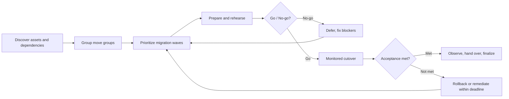
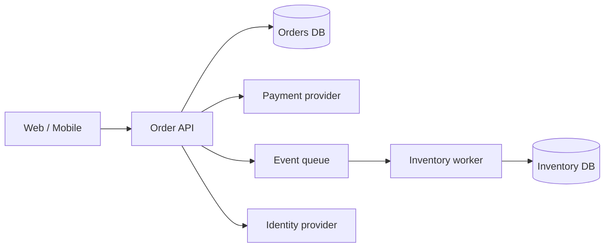
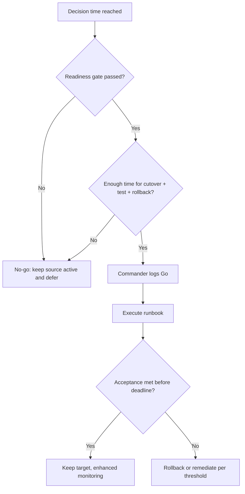

# Planning Migration Waves, Acceptance Criteria, and Cutover Plans

> **Chapter:** Migrating to Google Cloud  
> **Scope:** Moving workloads from existing systems to Google Cloud, from sequencing migration order to acceptance and traffic cutover.

## 1. The Big Picture

To move a system from a data center or another cloud to Google Cloud, simply copying VMs or databases is not enough. The delivery team must also manage dependencies, determine when the target service is safe enough to serve users, and prepare to return to the source if incidents occur. The three core questions are:

1. **Which group moves first?** Break the work into *migration waves*, each with a defined scope, sequence, and expected outcomes.
2. **What proves the system is ready?** Define measurable acceptance criteria and *Go/No-go* decision gates with metrics, evidence, and approvers.
3. **How do we cut over, and what happens if it fails?** Author a timed *cutover runbook* specifying actions, owners, checks, stop limits, and a rollback/failback plan.

Google Cloud Migration Center recommends cataloging applications, mapping dependencies, grouping workloads into waves, testing, and refining the plan across waves. Exact technical steps depend on the target: Compute Engine, GKE, Cloud Run, Cloud SQL, or other data services. No single cutover procedure fits every workload verbatim.

**After this lesson, you will be able to:** build a wave backlog from a catalog and dependency graph; write a measurable acceptance matrix; design Go/No-go gates; construct a cutover and rollback timeline with clear accountability; and explain when it is safe to finalize and decommission the source system.

## 2. Terminology and Work Boundaries

| Term | Meaning | Example |
| --- | --- | --- |
| **Migration program** | Overall program, including budget, goals, catalog, and roadmap. | Migrate 30 applications in two quarters. |
| **Migration wave** | A set of workloads grouped by characteristics or dependencies with its own schedule. | Wave 1 includes two low-dependency internal services. |
| **Move group** | A group of resources that must move together or in strict sequence. | Order API, event queue, and transactional datastore. |
| **Sprint / batch** | A smaller execution unit within a wave, with checklists and owners. | Environment build sprint, rehearsal sprint, and cutover sprint. |
| **Cutover** | The event of shifting business operations to the target, potentially including writer, endpoint, DNS, or route changes. | Routing users to the application on GCP. |
| **Rollback / failback** | Returning to the source or pre-change steady state and handling newly generated data. | Stop writes on target, reconcile new orders, shift traffic back to source. |
| **Finalize / decommission** | Handover, migration completion, and source retirement after stabilization. | Stop replication tools and then delete old VMs per approval. |

A wave may contain multiple move groups; a single move group may require multiple technical steps within the same maintenance window. **A VM list cannot replace a business flow diagram and data relationship map.**



## 3. Required Inputs Before Defining Waves

Every application needs a record verified by both its technical owner and business owner.

| Data Category | Questions to Answer | Impact on Wave Sequencing |
| --- | --- | --- |
| Catalog and ownership | Which apps/VMs/databases/queues are running? Who is accountable? | Defines scope and approvers. |
| Dependencies | Synchronous APIs, batch jobs, webhooks, shared databases, message queues, SSO, DNS? | Prevents splitting apps tightly coupled to source. |
| Data | Volume, change rate, consistency needs, replication/CDC, backups? | Drives copy time, final sync, and rollback design. |
| Business | Criticality, peak hours, peak seasons, user groups, RTO/RPO? | Determines risk tolerance and maintenance windows. |
| Landing zone | Projects, VPC, Cloud VPN/Interconnect, firewalls, IAM, quotas, logging, monitoring? | Sets prerequisite gates before moving workloads to GCP. |
| Security/compliance | Sensitive data, residency, encryption, licenses, retention? | Surfaces legal and technical blockers. |
| Portability | Rehost, replatform, refactor, replace, or retire; supported OS and services? | Guides tooling, testing, and execution time. |
| Operations | Baseline p95, error rate, peak load, SLOs, backup schedule, on-call coverage? | Establishes acceptance thresholds and monitoring. |

### 3.1. Resolving Dependencies Before Ordering

Example ordering flow:



When moving the Order API to Google Cloud, it may still need connectivity to the source Orders DB, payment webhooks, queues, and inventory synchronization. Moving the API alone in an independent wave can spike latency or corrupt data if those relationships have not been tested.

Follow this sequence:

1. Document **every dependency edge**: network route, DNS, authentication, protocol, SLA, traffic volume, and read/write direction.
2. Classify each as **must move together**, **can run hybrid temporarily**, or **already independent**.
3. Bundle tightly coupled transactional components or shared data writers into **move groups**; identify groups that can move to GCP earlier.
4. Specify requirements for cross-wave dependencies: Cloud VPN/Interconnect, firewalls, private DNS, latency budgets, API/schema compatibility, and transaction locking.
5. For every exception that splits a wave, record test evidence and the risk-accepting owner.

Never assume that just because servers can reach each other over the network, a distributed transaction will behave properly under disconnects, retries, or duplicate queue deliveries.

## 4. Prioritizing and Designing Waves

Google Cloud recommends selecting a first workload that is low criticality, low dependency, requires minimal refactoring, and can tolerate a cutover window. Subsequent waves expand incrementally based on lessons from the first wave. Prioritization must also account for business value, architectural change scope, compliance, and operational readiness.

**A practical prioritization matrix** can score items from 1 to 5 across: delivered value, complexity, outage risk, dependency count, operations team readiness, and rollback feasibility. Scores support discussion only; never use them to override mandatory data or compliance requirements.

### 4.1. Example: Roadmap for a Commerce System

| Group | Hypothetical Scope | Why Placed Here | Required Gate |
| --- | --- | --- | --- |
| **Foundation (Wave 0)** | Google Cloud projects, IAM, VPC, Cloud VPN, DNS, secrets, monitoring, backups, quotas | Prepares the platform so workloads can run and be observed. | Networking/IAM/quotas/audit/backups tested. |
| **Wave 1 — Pilot** | Admin portal, non-critical report export worker | Few dependencies, simple recovery, ideal for learning the process. | Test clone or trial environment, rollback rehearsal, on-call ready. |
| **Wave 2 — Read path** | Catalog API and cache, related read-only data components | Traffic is controllable once data path and cache are consistent. | Load test, cache invalidation, latency, external endpoints. |
| **Wave 3 — Transaction path** | Order API, Orders DB, queue, Inventory worker in a tight move group | Sensitive to data loss/split-brain; requires write freeze and final sync. | Healthy CDC, data reconciliation, full Go/No-go, rollback plan for new writes. |
| **Wave 4 — Consolidation** | Remaining batches/partners, optimization, and source retirement | Cleans up lingering dependencies and closes the program. | Zero source clients remaining; retention and recovery satisfied. |

**Wave 0** is the preparation phase, so some organizations do not count it as a migration wave. **Wave 4** includes decommissioning, but only after acceptance; never delete the source at the moment of cutover.

### 4.2. Sample Wave Record

The IDs, durations, and targets below are **examples** and must be replaced with real data in practice:

```yaml
wave_id: "W03"
name: "Transaction path"
scope:
  move_groups: ["MG-ORDERS"]
  workloads: ["order-api", "orders-db", "inventory-worker"]
source: "on-premises"
target: "gcp-prod"
business_owner: "Commerce Lead"
technical_owner: "Application Lead"
migration_commander: "Migration Lead"
window: "YYYY-MM-DD 22:00-23:00 Asia/Ho_Chi_Minh"
blocked_by: ["private-connectivity", "payment-allowlist", "cdc-health"]
migration_pattern: "app deployment + database continuous migration"
planned_downtime_minutes: 30
target_rpo_minutes: 0
risk: "high"
readiness_evidence:
  - "uat-report"
  - "reconciliation-report"
  - "rollback-drill-report"
gate_status: "PENDING"
cutover_runbook_version: "W03-v1.0"
rollback_owner: "Database Lead"
```

For example, `RPO = 0` is a **hypothetical business target**, not a tool guarantee. Every target must be validated through rehearsal; if unachievable, change the approach or obtain formal risk re-approval.

### 4.3. Managing Team Capacity

Do not run too many waves concurrently when the same DBA, network, or SRE teams must be on call. Each wave needs dedicated time for preparation, rehearsal, execution, stabilization monitoring, and retrospectives. Waves sharing a database, load balancer, or payment channel require coordinated scheduling to avoid overlapping changes on a single point of failure.

## 5. Measurable Acceptance Criteria

A criterion is only useful if it includes **what must be met + measurement + threshold + timing + owner + evidence**. For example, "the application works well" cannot serve as a Go/No-go basis. Separate criteria into:

- **Pre-cutover readiness:** data, target, and resources meet conditions to start.
- **Post-cutover acceptance:** users and business flows are served properly on GCP.
- **Exit/finalize:** stable long enough, ownership handed over, and old environment eligible for retirement.

### 5.1. Sample Acceptance Matrix

**All numbers are illustrative thresholds for learning how to write criteria**; production must be grounded in your system's own baseline, SLOs, load profile, and SLAs.

| ID | Criterion | Example Measurement and Threshold | Evidence | Owner |
| --- | --- | --- | --- | --- |
| A01 | Business functionality | 100% of critical flows (login, order placement, payment, refunds if applicable) PASS; zero unaccepted Sev 1/2 defects. | UAT results, test request/transaction IDs. | Business/QA |
| A02 | Data completeness | Zero missing transactions committed before freeze; reconcile primary keys, row counts, total transaction value, and checksums at a common timestamp. | Source and target reconciliation report. | DBA/Business |
| A03 | Data synchronization | At promotion time, replication lag within approved threshold, ideally 0 when zero data loss is targeted. | Migration job/CDC metrics, final logs. | DBA |
| A04 | Performance | API p95 within SLO; no slower than 20% over baseline under equivalent load over a 30-minute test. | Cloud Monitoring, load-test report. | App/SRE |
| A05 | Availability | 5xx error rate under 1%, green health checks over 60 minutes of observation; downtime within approved limit. | Timestamped dashboards, synthetic tests. | SRE |
| A06 | Connectivity and integrations | DNS/TLS, firewalls, SSO, webhooks, external allowlists, queue consumers, and batch jobs pass all critical cases. | Connectivity matrix/test logs. | Network/App |
| A07 | Security | IAM, encryption/secrets, logging, data residency, and network access comply with policy; no unintended exposed endpoints. | Security approval/audit logs. | Security |
| A08 | Recovery/operations | Backups succeed, restores rehearsed; dashboards/alerts, on-call, and runbooks have assigned owners. | Restore drill/alert test report. | Operations/DBA |
| A09 | Quotas and cost | Quotas cover projected load; cost forecast within approved budget. | Quota checklist, cost estimate. | Platform/FinOps |
| A10 | Handover | Business and Operations sign-off; CMDB, service catalog, docs, and dashboards updated. | Sign-off/approval record. | Migration Lead |

Tests must run before opening traffic and repeat **after actual cutover**. Results from *test-clone* or staging prove only partial capabilities, not production acceptance. Beyond functional testing, measure backlogs, latency, error rates, memory, CPU, quotas, logs, and end-of-day batch processes.

### 5.2. RTO, RPO, Downtime, and Observation Window

- **RTO:** maximum acceptable time to restore service after an incident; does not automatically equal the scheduled maintenance window.
- **RPO:** acceptable data-loss window. RPO of 0 requires evidence ensuring all committed transactions are preserved during cutover or recovery.
- **Cutover downtime:** measured from when users actually lose service until the target serves stably; never just take "migration job succeeded."
- **Observation window:** period of heightened monitoring after cutover (e.g., 24–72 hours, or one full business cycle), distinct from the maintenance window.

For **Database Migration Service** continuous migrations, Google Cloud guidance requires stopping writes at the source, waiting for replication lag to reach zero or near zero, and then promoting. Promoting before lag drains can leave the target missing data. Reconciling business totals, primary keys, and transactions is a mandatory additional step—it cannot be replaced by a single lag metric.

## 6. Go/No-Go: Who Authorizes the Switch?

The Go/No-go meeting happens ahead of the maintenance window or right before cutover, attended by the **Migration Commander**, Business Owner, App, DBA, SRE/Operations, Network, and Security if required.

**A Go gate passes only when:**

1. The right scope/runbook version is approved; maintenance window, contact points, and on-call roster are complete.
2. The landing zone has projects, IAM, VPC, firewalls, DNS/LB, hybrid connectivity, quotas, TLS/secrets, logging/monitoring, and backups ready.
3. Functional, load, integration, and security tests pass; any remaining defects have assigned owners and formal risk acceptance.
4. Replication/CDC is healthy and measured, and the freeze/final sync/reconciliation plan has been rehearsed.
5. Rollback has been tested: owner, backup/restore, handling of newly written data, time estimates, and final decision cutoff.
6. No conflicting parallel releases, batch jobs, or IAM/DNS changes exist; all primary owners are available.
7. Business Owner and Commander confirm **Go** with a timestamped record.

Call **No-go** if data integrity cannot be assured, critical dependencies remain untested, rollback capability is lost, staffing is missing, target infrastructure lacks capacity, or remaining time is insufficient for both testing and reversion. Never "rush to hit the schedule" when a mandatory gate fails.



## 7. Building a Timed Cutover Runbook

A solid runbook records **timestamp, owner, action, expected outcome, measurement method, and failure action**. Required fields include:

- Wave/move group, source/target systems, runbook version, list of all endpoints and data components.
- Start/end times **with time zones**, Go/No-go decision points, rollback cutoff deadline, and buffer time.
- SLA/SLO, RTO/RPO, downtime budget, baseline, and locations of dashboards/reconciliation reports.
- Per-step technical owners, Commander, business approver, on-call/escalation paths, and coordination channel.
- Procedures to freeze writes, drain open transactions, run final sync, promote, enable target writer, shift traffic, and resume jobs.
- Reversion steps for each change (DNS, routes, LB, feature flags, database endpoints) and handling of data generated at the target.
- Where evidence, decisions, and actual timestamps are logged.

### 7.1. Illustrative Timeline

Assuming a **22:00–23:00 Vietnam time** maintenance window for a service with an API and a pre-synchronized database. Timings depend on actual capability; **never execute from this table without rehearsal**.

| Milestone | Executor | Action and Completion Signal | If Failed |
| --- | --- | --- | --- |
| **T-7 days to T-48 hours** | Lead/App/DBA/SRE | Lock scope, rehearse cutover + rollback, test restores, verify target configs, quotas, and on-call. | Defer if blockers remain. |
| **T-48 to T-24 hours** | Network/SRE | Verify DNS, load balancers, firewalls, certs, health; consider controlled TTL reduction so old caches expire. | Do not assume all resolvers honor TTL. |
| **T-60 minutes** | Commander/Business/Tech teams | Roll call, review readiness evidence, confirm window and Go/No-go. | Log No-go; source stays active. |
| **T-15 minutes** | App/DBA | Stop dependent batches/jobs, post maintenance notice, verify backups and source writers. | Do not proceed if writes are uncontrolled. |
| **T0** | App/DBA | Put app in maintenance/read-only mode; let open transactions finish, record checkpoint/timestamp. | Block promotion if writes continue. |
| **T+5 minutes** | DBA/Migration Engineer | Final sync; check replication lag, reconcile data, and inspect final logs. | No-go/rollback if critical data is missing. |
| **T+15 minutes** | DBA/Platform | Promote database or cut over VM per tool; ensure only one side accepts writes. | Guard against split-brain and assess failback. |
| **T+25 minutes** | Network/App | Switch DNS/LB/routing/endpoints; verify health from real networks. | Do not route traffic to an unhealthy target. |
| **T+30–40 minutes** | QA/Business/SRE | Smoke test transactions, webhooks, queues, auth, p95, error rate, and new writes. | Escalate and evaluate against rollback thresholds. |
| **T+40 minutes** | Commander/Business | Decide **Accept**, **Fix within window**, or **Rollback** based on metrics and remaining time. | Do not pass the rollback decision deadline. |
| **T+40–60 minutes** | App/DBA/SRE | Accept: enter enhanced on-call and announce. Rollback: follow Section 8 and verify recovery. | Extend maintenance only with explicit approval. |
| **T+24–72 hours** | Ops/Business | Verify peaks, batches, backups, reports, and costs; sign off handover if passed. | Do not finalize while severe defects persist. |

**This is a coordination template, not a command sequence applicable to every product.** With **Migrate to Virtual Machines**, cutover stops the source VM, runs final replication, and creates the target Compute Engine VM; target testing and downtime scheduling are required. With continuous database migration, follow Database Migration Service procedures for stopping writes and promoting. For Cloud Run/GKE, app deployment may be fast, but database, schema, and client compatibility remain distinct risks.

### 7.2. Verifying the Target and Public Endpoints

Read-only commands like these examples can be used after replacing placeholders with real values:

```bash
# Check status of a migrated VM on Compute Engine:
gcloud compute instances describe app-prod-01 \
  --project=TARGET_PROJECT \
  --zone=asia-southeast1-b \
  --format="value(status)"

# Check HTTPS health endpoint; use the appropriate internal/customer hostname:
curl --fail --silent --show-error --max-time 10 \
  https://app.example.com/healthz
```

A command returning OK is just one signal. Maintain Cloud Monitoring dashboards for request rate, error rate, p95/p99 latency, CPU/memory/saturation, delayed jobs, queue backlogs, and replication lag. Business smoke tests must cover transactions, data, and external integrations. Never print secrets, tokens, or personal data to logs.

## 8. Rollback/Failback When Migration Fails Acceptance

**Rollback does not mean everything automatically reverts to its prior state.** After cutover, the target system may have already accepted orders, updated inventory, fired webhooks, or generated invoices. Simply pointing DNS back to the source risks losing transactions or replaying events out of order.

### 8.1. Defining Rollback Thresholds Before Go

Example trigger conditions:

- Confirmed transactions are missing in target data or downstream systems, or signs of duplicate payments appear.
- Critical business flows cannot complete within the allotted time.
- Error rate, latency, availability, or network metrics breach approved thresholds during the observation window.
- Single-writer enforcement cannot be guaranteed; data/security risk exceeds acceptable bounds.
- The **rollback decision deadline** is reached with insufficient time left to restore and validate the source before the maintenance window closes.

Never lower acceptance thresholds mid-incident just to turn a failure into a "PASS."

### 8.2. Principled Rollback Procedure

1. **Commander issues the stop order**, recording timestamp and reason; block further new writes at the target if stateful.
2. DBA/App identify the last committed transaction at the source, new transactions at the target, unprocessed messages/webhooks, and idempotency mechanisms.
3. Choose the recovery path: if no new data was written, traffic can shift back; if new writes occurred, run controlled reconciliation and sync—or hold in maintenance—to guarantee zero lost or duplicate transactions.
4. Re-enable the source and source endpoints, confirming only one side holds write authority; restore DNS/LB/routes/queues/cron to approved state.
5. Run post-rollback smoke tests and data reconciliation, confirm with the business, monitor SLIs, and communicate incident status.
6. Preserve logs, snapshots, backups, and decision records for root-cause analysis; update the runbook before retrying.

**Google Cloud limitations that must be documented in the plan:**

- With **Migrate to Virtual Machines**, cutover stops the source VM and replication. Per Google Cloud documentation, rollback is a **manual operation**: restart the source VM, route traffic back to the source, and handle any new data created on the target VM as needed. That data **does not automatically sync back** to the source.
- With **Database Migration Service**, promotion terminates the initial replication relationship and makes the target an independent primary depending on the method; do not assume an "undo" button or automatic reverse replication exists. Pre-design reconciliation, restore, or reverse data transfer procedures.
- For **stateless applications** on Cloud Run/GKE, rolling back a release or traffic quickly does not guarantee backward compatibility of schemas, databases, or contracts; you may need backward-compatible schema migrations during the transition period.
- Lowering DNS TTL only helps partially due to client caches, connection pooling, and retries; account for existing sessions and partner IP allowlists.

### 8.3. Choosing the Right Traffic-Shifting Pattern

| Cutover Pattern | When Appropriate | Key Risks |
| --- | --- | --- |
| **Big bang** | Small business scope, dense dependencies, maintenance accepted. | Entire system switches at once; large downtime and blast radius; requires clear freeze and rollback. |
| **Canary / gradual traffic** | Stateless backends or engineered routing and data consistency mechanisms. | Sessions, request distribution, and writers can become inconsistent; never allow two independent primaries to write concurrently. |
| **Blue/green** | Two application deployments can run side by side. | App rollback is easier, yet databases, schemas, and data still need their own plan. |

## 9. Decision Authority and Decision Log

| Role | Responsibility |
| --- | --- |
| **Migration Commander / Lead** | Locks scope and timeline, issues Go/No-go, stop, or rollback orders, coordinates communications. |
| **Business Owner** | Confirms business thresholds and acceptable disruption; signs off acceptance. |
| **Application Lead** | Manages writes and feature flags, verifies endpoints/business flows, operates the app. |
| **Database Lead** | Manages replication/CDC, final sync, promotion, data checks, backups, and failback. |
| **Network/Platform Lead** | Manages DNS, LB, firewalls, IAM, VPN/Interconnect, quotas, and target resources. |
| **SRE/Operations** | Manages dashboards, alerts, SLOs/SLIs, incidents, and post-cutover monitoring. |
| **Security/Compliance** | Verifies access controls, encryption, auditing, and policy-compliant data handling. |

Organizations may use a full RACI matrix; what matters is that every step has an **executor**, every gate has a **decider**, and post-cutover **on-call coverage** is assigned.

**Decision log template to archive with the wave record:**

```text
WAVE: W03                  RUNBOOK: W03-v1.0
TIME: YYYY-MM-DD HH:mm Asia/Ho_Chi_Minh
DECISION: GO | NO-GO | ACCEPT | ROLLBACK
COMMANDER: <decision-maker>
BUSINESS OWNER: <business approver>
EVIDENCE:
  - UAT/functional: PASS/FAIL + report
  - Data reconciliation: PASS/FAIL + last transaction/checkpoint
  - Replication lag: <value + timestamp>
  - SLI: error rate, p95 latency, availability
  - Network/IAM/security: PASS/FAIL + owner
  - Rollback readiness: READY/BLOCKED
TIME REMAINING: <minutes>
RISK ACCEPTANCE: <if any>
REASON: <evidence supporting decision>
NEXT ACTION: <owner + deadline>
```

Archive **No-go** decisions as well. They provide data to refine estimation accuracy, staffing capacity, and gate quality for the next wave.

## 10. Post-Cutover Acceptance and Wave Closure

Once the target receives traffic, do not close the wave merely because the migration job reports `Succeeded`.

1. **0–2 hours:** monitor requests, errors, latency, orders and new writes, queue backlogs, webhooks, audits, and rollback triggers.
2. **24–72 hours or one full business cycle:** verify peak loads, end-of-day batches, reports, backups, costs, and infrequent clients.
3. **Operations handover:** update on-call rotations, dashboards, CMDB, IP/DNS records, knowledge base, incident procedures, backup/restore, and ownership.
4. **Retrospective:** log actual durations, downtime, replication variance, blockers, decisions, lessons learned, and gate refinements for the next wave.
5. **Finalize / decommission:** clean up migration resources, stop replication, delete source assets, or optimize spend only after formal sign-off, completion of the observation window, and compliance with backup/retention/audit policies. Deleting the source eliminates rollback options.

## 11. Scenario Exercise

A system consists of a **web frontend**, **Order API**, **PostgreSQL**, **Redis**, **Inventory worker**, and **payment webhooks**. The objective is to migrate to Google Cloud. The business allows zero loss of confirmed orders and accepts at most 20 minutes of downtime within an approved window.

Tasks:

1. Draw a complete dependency graph covering all read/write flows and external components; define at least two move groups or justify why everything must move together.
2. Propose three waves, including one low-criticality pilot, with entry/exit gates and owners.
3. Write at least six acceptance criteria with measurements, thresholds, evidence, and sign-off owners.
4. Build a timeline from T-48 hours to T+24 hours, including Go/No-go, write freeze, final sync, promotion, smoke tests, and rollback deadline.
5. Assume **10 new orders are created on GCP** before a defect is detected. Explain why immediately flipping DNS back to the source is dangerous, and design a plan to reconcile, deduplicate, and preserve those transactions.
6. Complete the decision log template with Accept, Fix within window, or Rollback based on concrete metrics.

**Self-assessment criteria:** Dependency owners and plans exist for every critical flow; no two locations accept uncontrolled concurrent writes; decision deadlines leave enough time for rollback; data reconciliation exists for failback; source environments are cleaned up only after full acceptance.

## 12. Official Documentation

1. [Google Cloud Migration Center — Plan your migration waves](https://docs.cloud.google.com/migration-center/docs/plan-migration-waves): application catalog, prioritization, and wave grouping.
2. [Migration Center — About migration planning](https://docs.cloud.google.com/migration-center/docs/migration-planning-overview): intake requirements, inventory, dependencies, and migration approaches.
3. [Migration Center — Execute your migration](https://docs.cloud.google.com/migration-center/docs/migration-execution): migration checklist, waves/move groups, RACI, runbooks, testing, and rollback.
4. [Google Cloud Architecture Center — Best practices for validating a migration plan](https://docs.cloud.google.com/architecture/migration-to-google-cloud-best-practices): POC, success criteria, downtime, and rollback.
5. [Migrate to Virtual Machines — VM migration process](https://docs.cloud.google.com/migrate/virtual-machines/docs/5.0/discover/lifecycle): replicate, test-clone, cut-over, finalize, and rollback limitations.
6. [Migrate to Virtual Machines — Migrate VM groups](https://docs.cloud.google.com/migrate/virtual-machines/docs/5.0/migrate/migrating-vm-groups): VM group cut-over, testing, and snapshot consistency limits.
7. [Database Migration Service — Promote a PostgreSQL migration job](https://docs.cloud.google.com/database-migration/docs/postgres/promote-migration): stopping writes, checking replication lag, promotion, and data impact.

> **Note:** Applications, metrics, thresholds, schedules, and roles in this lesson are illustrative only; for production use, replace them with baselines, policies, owners, and official procedures for each service in use.
