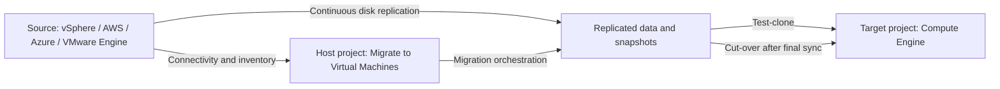

# Migrate to Virtual Machines and VM Migration

## Objectives and Position in Google Cloud Architecture

**Migrate to Virtual Machines (M2VM)** is a service that migrates virtual machines (VMs) and VM disks from supported source environments to **Compute Engine** or Google Cloud storage disks. It is a **rehost/lift-and-shift** strategy: preserve most of the operating system and application, make the necessary adaptations so the VM runs on the new infrastructure, and only then consider application modernization.

This lesson sits within **CLOUD_PROVIDERS_GCP**, linking migration decisions to projects, IAM, VPC, Compute Engine, security management, deployment, reliability, and cost. After this lesson, you will be able to:

1. Choose the right migration path for each VM source type and identify compatibility limits.
2. Prepare the host project, target project, identities, networking, quotas, and cutover plan.
3. Execute the workflow: onboard → replicate → target details → test-clone → cut-over → finalize.
4. Validate applications post-migration, troubleshoot failures, and perform controlled rollbacks.

M2VM is suitable when you need to move VM-based applications to Compute Engine with relatively minor initial software changes. It **does not automatically convert** applications into Cloud Run, GKE, or Cloud SQL, does not resolve every application dependency automatically, and does not guarantee zero-disruption migration.

## 1. Choosing the Migration Path and Understanding Components

The primary sources listed by Google Cloud for M2VM 5.x:

| Source | Example | Preparation Required |
|---|---|---|
| VMware vSphere in a data center | On-premises Linux/Windows app VMs | vCenter, **Migrate Connector**, vSphere permissions, connectivity to Google Cloud APIs |
| Amazon Web Services | Amazon EC2 | Create an AWS source and appropriate access permissions per integration guidance |
| Microsoft Azure | Azure Virtual Machines | Register an Azure app, grant Azure source permissions, verify disk-type limits |
| Google Cloud VMware Engine | VMs running in VMware Engine | Configure VMware Engine source and appropriate connectivity |

**Destination:** typically a Compute Engine VM in a **target project**; if only disk data is needed, the **disk migration** workflow writes data to a Persistent Disk instead of migrating a full VM. Verify OS versions and per-source limits before choosing a strategy: M2VM supports migrating **64-bit x86** Linux/Windows Server VMs; do not assume every distribution, kernel version, or ARM architecture is supported.

In your design, distinguish:

- **Host project:** project that enables the M2VM API, registers sources, and orchestrates migration operations. Required.
- **Target project:** project receiving the migrated Compute Engine VMs; can be the same as the host project or a separate project.
- **Source:** connection to vSphere, EC2, Azure, or VMware Engine to read inventory and replicate disks.
- **Migrate Connector:** component deployed in the VMware environment to connect vCenter and transfer data; not required for every cloud source.
- **Test-clone:** test VM built from a completed replication cycle while the source continues running.
- **Cut-over:** production transition action that stops the source VM, runs a final sync, and creates the target VM.



For VMware sources, Migrate Connector reads inventory and performs disk/vCenter operations, connecting to Google Cloud APIs over HTTPS port 443. Actual network paths and authentication mechanisms depend on the source type. Replication synchronizes disk data periodically (initial sync plus incremental deltas) **while the source VM can still serve users**; afterward, M2VM performs **OS adaptation** so the VM adapts to Compute Engine. Application testing remains the implementation team's responsibility.

Official docs: [M2VM architecture](https://docs.cloud.google.com/migrate/virtual-machines/docs/5.0/discover/architecture), [migration process](https://docs.cloud.google.com/migrate/virtual-machines/docs/5.0/discover/lifecycle).

## 2. Pre-Migration Discovery and Planning

Do not start by clicking **Start Replication**. First, inventory each VM and map it to an **application group** or **migration wave** to avoid missing dependencies.

| Information Group | What to Record | Why |
|---|---|---|
| Source | Hypervisor/cloud, OS and version, CPU architecture, CPU/RAM, disks, boot mode, encryption | Verify compatibility and target configuration |
| Software | Startup services, licenses, agents, batch schedules, kernel drivers | Spot items that may break after OS adaptation |
| Data | Used capacity, data churn rate, sensitivity, RPO, backups, databases | Estimate copy duration and plan consistency |
| Connectivity | IP addresses, DNS, ports, ingress/egress flows, proxies, LDAP/AD, DB, message brokers | Design VPC, firewalls, and traffic routing |
| Operations | Monitoring, logs, backups, maintenance windows, on-call, RTO, rollback procedure | Ensure post-cutover operability |
| Cost | Target machine type, disk size/tier, bandwidth, test-clones, parallel source resources | Avoid unnecessary dual-environment spend |

For example, a web VM accessing PostgreSQL via an internal address and authenticating against Active Directory may **boot cleanly yet remain unusable** if the target VPC lacks routes to the DB or internal DNS. Verify end-to-end service paths, not just VM status.

For write-heavy databases, disk-level snapshots do not replace application-consistent backup/restore procedures. Coordinate with system owners to schedule write throttling or freezes, validate transactions, and take an independent backup before cutover. Explicitly define **RTO** (acceptable outage duration) and **RPO** (acceptable data loss), and validate them through rehearsals rather than treating them as built-in M2VM guarantees.

### Checking Compatibility

- Cross-check source OS and versions against the [supported operating systems list](https://docs.cloud.google.com/migrate/virtual-machines/docs/5.0/discover/supported-os-versions).
- Check Compute Engine quotas for CPUs, disks, IPs, subnets, and machine type availability in the target zone. Do not assume source vCPU/RAM counts and zone names carry over unchanged.
- On Azure, **ephemeral OS disks** and **non-managed disks** are not supported under the Azure source workflow; data on **temporary disks** is not guaranteed to survive migration.
- Check licenses, hardware/IP-bound software, UEFI/BIOS requirements, and agent or driver compatibility on Compute Engine. Carefully assess systems tied to peripherals or custom kernel modules.
- Resolve VPC firewalls, proxies, private access, or CMEK key requirements before replicating data.

## 3. Preparing Google Cloud: Projects, APIs, IAM, and Networking

### 3.1. Host Project and Required Services

Create or select a host project with valid billing, target region, and deployment permissions. The example below assumes **Google Cloud CLI** is installed and the user can enable APIs; replace `HOST_PROJECT_ID` with the actual ID:

```bash
gcloud auth login
gcloud config set project HOST_PROJECT_ID

gcloud services enable \
  vmmigration.googleapis.com \
  servicemanagement.googleapis.com \
  servicecontrol.googleapis.com \
  iam.googleapis.com \
  cloudresourcemanager.googleapis.com \
  compute.googleapis.com

gcloud services list --enabled --project=HOST_PROJECT_ID
```

The host project can double as the target project for simple labs. In multi-team environments, teams usually separate the migration host project from production target projects to apply dedicated IAM, quotas, budgets, and policies. Before test-clone or cut-over, **add the target project to M2VM** if it differs from the host project.

### 3.2. IAM Permissions and Service Accounts

| Principal | Example Role or Permission | Notes |
|---|---|---|
| Migration administrator | `roles/vmmigration.admin` on host project | Registers sources and executes migration actions |
| Progress viewer | `roles/vmmigration.viewer` | Monitors progress without operating migrations |
| Target project adder | `roles/vmmigration.admin` on host and appropriate target permissions (docs cite `roles/resourcemanager.projectIamAdmin`) | May need a target admin to grant service agent roles |
| Target configurator | `roles/compute.viewer` on target project; Shared VPC may need host VPC view access | Reads machine types, networks, and subnets to configure targets |
| M2VM service agent | Service account created by M2VM when the API is enabled | Must hold required permissions on target to create VMs and disks |
| M2VM service agent on Shared VPC | `roles/compute.networkUser` on the Shared VPC host/subnet | Allows attaching to Shared VPC subnets |

These are **reference roles**, not bulk-grant commands. The service account used to **run the target VM** has its own separate permissions; never attach broad admin roles if the application needs least privilege. Also review IAM on the vCenter/AWS/Azure side and secret handling per source.

Docs: [enable services and predefined roles](https://docs.cloud.google.com/migrate/virtual-machines/docs/5.0/get-started/enable-services), [roles and permissions reference](https://docs.cloud.google.com/migrate/virtual-machines/docs/5.0/reference/roles-reference).

### 3.3. Target Networking and Readiness

Provision VPCs, subnets, firewall rules, routes, Private Google Access/VPN/Interconnect as needed, and DNS for target VMs. Verify:

1. Target VMs receive valid IPs, subnets, and routes without CIDR overlap against connected environments.
2. Engineers and test systems can access VMs via organization-approved paths (e.g., IAP, VPN, bastion); never open SSH/RDP to the public Internet just for quick checks.
3. VMs can reach required dependencies such as databases, registries, internal endpoints, LDAP/AD, license servers, and DNS.
4. The target service account holds permissions for only the Google Cloud services genuinely required.
5. Quota headroom covers replica disks, test-clone VMs, and production VMs during parallel operation.

For VMware sources, Migrate Connector must reach Google Cloud APIs over HTTPS/443 via the Internet, Cloud VPN, Private Google Access, or Cloud Interconnect depending on supported designs. Do not confuse the **replication path** with the **target application path to business dependencies**: they are two separate concerns that must be tested independently.

## 4. Registering the Migration Source

Open [Google Cloud Console → Migrate to Virtual Machines](https://console.cloud.google.com/migrate/virtual-machines) in the **host project**, select **Sources**, and configure the appropriate source type.

### If the Source Is VMware vSphere

1. Confirm the vSphere/vCenter version is supported and create a vCenter account with the minimum privileges required by Migrate Connector (disk reads, snapshots, change tracking, shutdown at cut-over).
2. Deploy the **Migrate Connector** VM/appliance from the OVA per official instructions, connecting to vCenter and Google Cloud APIs. The connector needs a Google Cloud registration account and operational service account; protect credentials carefully.
3. Verify networking, DNS, vCenter certificate/thumbprint, and API reachability; on the connector, use the `m2vm` CLI to inspect status and register.
4. Register the connector to the host project and region, then verify the source shows as **Active** under Sources.

On the **Migrate Connector appliance** itself, reference management commands are:

```bash
m2vm status
m2vm register
m2vm status
```

`m2vm register` is interactive and prompts for vCenter, project, region, and identity details; run it only per connector instructions. Do not run these commands on application VMs or confuse them with `gcloud`.

### If the Source Is AWS, Azure, or VMware Engine

- **AWS EC2:** configure the AWS source, authentication, and source permissions per documentation; verify the source becomes Active and lists target VMs.
- **Azure VM:** register an Azure application, assign the required roles, and create an Azure source with matching source/target regions; store the client secret securely and track its expiration date.
- **Google Cloud VMware Engine:** create a VMware Engine source per documentation and verify connectivity and source access permissions.

Registration flows, quotas, and source-side charges differ by platform, so never copy VMware connector assumptions to AWS/Azure. See: [VMware source](https://docs.cloud.google.com/migrate/virtual-machines/docs/5.0/migrate/create-a-vmware-source), [Migrate Connector](https://docs.cloud.google.com/migrate/virtual-machines/docs/5.0/migrate/migrate-connector), [AWS source](https://docs.cloud.google.com/migrate/virtual-machines/docs/5.0/migrate/create-an-aws-source), [Azure source](https://docs.cloud.google.com/migrate/virtual-machines/docs/5.0/migrate/create-an-azure-source), [VMware Engine source](https://docs.cloud.google.com/migrate/virtual-machines/docs/5.0/migrate/create-a-gcve-source).

## 5. Executing Migration in Phases

The following workflow covers **VM migration** to Compute Engine; UI button labels may vary slightly across Console releases. Detailed walkthrough: [Migrate individual VMs](https://docs.cloud.google.com/migrate/virtual-machines/docs/5.0/migrate/migrating-vms).

### Phase 1 — Onboard VMs

In **Sources**, select an **Active** source, inspect the inventory, and select target VMs. Click **Add Migrations → VM Migration** and confirm. VMs transition through initialization and eventually reach **Ready**. M2VM creates migrations only for selected VMs; VMs can be organized into migration groups for wave management.

**Checkpoint:** confirm exact VM IDs, complete disk sets, no unintended out-of-scope production VMs, and service-owner approval for the change window.

### Phase 2 — Start Replication

In **Migrations**, select VMs in the Ready state and choose **Migration → Start Replication**. Monitor `Replication status`, `Replication history`, and the **adaptation report**.

- The first cycle transfers full disk data; subsequent cycles transfer incremental deltas.
- Replication runs in the background while the source VM stays online; watch for snapshot errors, permission issues, bandwidth limits, disk space, and source throttling.
- Run test-clones only after at least one replication cycle completes.
- Replication policy/frequency can be adjusted in the UI. A short interval does not automatically guarantee a small RPO if copying takes longer or links saturate.

**Checkpoint:** replication is stable across several cycles; measure duration, estimate remaining data, and review the adaptation report before testing.

### Phase 3 — Set VM Target Details

Select **Edit target details** to configure the target Compute Engine VM. Define:

| Field | Design Question |
|---|---|
| Project, region, zone | Where will the VM run? Does it meet residency, SLA, and regional dependency needs? |
| Machine type, vCPU/RAM | What size matches measured load and supportability? |
| Disks | Are capacity/tier, disk names, and IOPS/throughput adequate? |
| VPC, subnet, IP, firewall | Can it reach dependencies and receive valid traffic? |
| Service account, security | Least privilege, access method, encryption, organizational policy? |
| VM name, metadata/labels | Does it follow ops naming conventions and distinguish test from production? |

Do not assume every advanced Compute Engine setting is configurable in the M2VM screen; some attributes can only be changed after the VM is created. **Target details take effect at test-clone/cut-over time**, so subsequent edits do not retroactively update existing test-clone VMs.

### Phase 4 — Test-Clone in an Isolated Environment

In **Migrations**, pick a replicated VM and select **Cut-Over and Test-Clone → Test-Clone**. The service launches a test VM from the latest completed replication cycle while the source continues running. Place test VMs in a separate subnet with non-production names; prevent them from connecting concurrently to production queues, schedulers, mail relays, or DBs if doing so causes side effects.

Minimum test suite:

- **Boot/OS:** VM boots, partitions/disks mount properly, system clock and agents work.
- **Application:** services start, endpoints respond, read/write smoke tests and dependency connections succeed.
- **Network/IAM:** DNS, TLS, ingress/egress, firewalls, application identity, and secrets work.
- **Operations:** logs, metrics, backups, alerts, restart policies, and monitoring are configured.
- **Data:** reconcile records or checksums in an application-appropriate way rather than comparing disk size alone.

Example **verification commands on a Linux test-clone VM** (adjust service names/URLs for your app):

```bash
uname -a
lsblk -f
df -h
systemctl --failed
systemctl status example-app
curl --fail --show-error --silent http://127.0.0.1:8080/health
```

Windows VMs can be checked in PowerShell using `Get-Service`, `Get-Disk`, `Get-Volume`, and `Test-NetConnection`. For databases or multi-disk systems, verify **application consistency** rather than treating a successful test-clone as proof of universal data consistency. Archive test results and defects before approving production cutover.

### Phase 5 — Scheduled and Approved Cut-Over

Proceed to cut-over only after application, infrastructure, security, and operations leads approve test results. Prepare a runbook with start/end times, on-call owners, abort thresholds, DNS/load balancer switch steps, and recovery procedures.

**Before the window:**

1. Confirm the latest replication succeeded and production target details, quotas, and networking meet requirements.
2. Prepare independent backups and a write-freeze plan; lower DNS TTL ahead of cut-over if policy permits.
3. Pause batch jobs, block new transactions, or put the app into maintenance mode per design; verify how data divergence will be detected.
4. Record baselines: request rate, response time, DB status, health checks, IP/DNS configs, and contact roster.

**During the window:**

1. In **Migrations**, select VMs with active replication and valid target details.
2. Choose **Cut-Over and Test-Clone → Cut-Over**.
3. M2VM **stops the source VM**, runs a final disk sync, halts replication, and creates the target Compute Engine VM. This phase **incurs downtime**; never promise "zero downtime."
4. Wait for `Cut-over job completed` and verify the target VM is healthy.
5. Run smoke tests, then switch DNS/load balancers/routes to the target; reopen writes only after operations confirms the cutover succeeded.

If cut-over starts and fails mid-way, assess both source and target states before retrying. Canceling cut-over **does not automatically restart** the source VM.

### Phase 6 — Finalize Once Stable

After stable production operation and once the rollback retention period passes, select the VM in **Cut-Over** and click **Finalize**. This action **deletes replication data and storage resources** tied to the migration. It **does not delete the cut-over Compute Engine VM**, and it **does not automatically delete test-clones**; delete unused test-clones manually and confirm billing stops.

Do not finalize immediately after the VM boots for the first time: once replication state is deleted, you lose the ability to reuse replication data for another cut-over attempt. Documentation specifies active lifetimes for migrating VMs; do not leave migrations open indefinitely because expiration rules and ongoing resource costs apply.

## 6. Rollback and Troubleshooting

**Post-cutover rollback is a manual procedure.** During cut-over, the source VM is stopped and **new data written to the target VM does not automatically replicate back to the source**. Therefore, define the data cutoff point and reconciliation method before shifting traffic back—especially for transactional applications.

Typical operational playbook:

1. Detect a failure trigger—such as persistent health check failures, DB connectivity loss, or latency breaching thresholds.
2. Stop the target VM from accepting new writes; identify all transactions committed on the target.
3. Process data created while running on the target per business rules (export, reconcile, replay, or accept loss within approved RPO).
4. Restart the source VM once safe and revert DNS/load balancers/routes to the source. Never allow two VMs to write concurrently to the same logical system unless the app supports it.
5. To retry later, investigate root cause, **Resume Replication** per M2VM procedures, and schedule a new cut-over; finalize only after the target is confirmed stable.

Common troubleshooting scenarios:

| Symptom | Investigation Path |
|---|---|
| Source `Offline` or VMs missing | Source connectivity and registration, Migrate Connector status or AWS/Azure permissions, region, inventory filters |
| Replication failing or slow | Snapshot/change-tracking permissions, disk capacity, data churn rate, outbound bandwidth, quotas, operation logs |
| Test-clone fails to boot | OS support, OS adaptation errors, bootloader, kernel/drivers, disk layout, serial console output |
| VM boots but service fails | App config, secrets, DNS, subnet/firewall, DB dependencies, routing, service account |
| Target VM creation fails | Target/Shared VPC IAM, quotas, region/zone, machine type availability, org policy limits |
| Cut-over takes longer than expected | Final sync duration, late data churn, shutdown handling, disk/VM creation capacity |
| Costs continue rising post-migration | Undeleted test-clone VMs, unfinalized migrations, leftover disks/snapshots/IPs, or source still running |

Use **Replication History**, **Test-Clone/Cut-Over History**, the **adaptation report**, and product logs to pinpoint failing steps. Never manually delete snapshots managed by M2VM during replication, as this can break the sync chain.

References: [Migration progress details](https://docs.cloud.google.com/migrate/virtual-machines/docs/5.0/migrate/migration-progress-details), [VM migration process and rollback](https://docs.cloud.google.com/migrate/virtual-machines/docs/5.0/discover/lifecycle).

## 7. Illustrative Scenario: Moving an Internal Web VM from VMware

Suppose an organization runs VM **`web-legacy-01`** on Linux x86-64 in vSphere with 4 vCPUs, 8 GiB RAM, and a 150 GiB disk; its HTTPS service connects to PostgreSQL and internal DNS. The goal is to run on Compute Engine with approved downtime during an evening maintenance window.

**Discovery.** The team documents OS version, web services, ports, DB target, DNS paths, TLS certificates, daily write volume, backups, and compliance constraints. If PostgreSQL stays on-premises, the target VM needs VPN/Interconnect and matching firewall rules; if the DB also moves, the DB tier needs its own wave and data-consistency plan.

**Preparation.** Use host project `mig-host` and target project `app-prod` (illustrative names); enable APIs, deploy Migrate Connector connected to vCenter, grant least-privilege IAM, and create isolated test and production subnets in the target region. Choose Compute Engine machine and disk types via benchmarking rather than blindly copying vCPU/RAM counts.

**Test migration.** Onboard the VM and start replication. Once initial sync finishes, launch a test-clone in the isolated subnet and verify `systemctl`, mounts, test DB connectivity, and the HTTPS endpoint. If DB connectivity fails, fix routing/firewalls and recreate the test-clone whenever target details affecting VM configuration change.

**Cut-over.** Within the approved window, put the web app in maintenance mode, verify the final backup, trigger Cut-over, wait for final sync, and provision the production VM. Verify instance state, app health, TLS certificates, a test DB transaction, and metrics; then switch DNS or load balancers to the target IP/VIP.

**Stabilization.** Monitor HTTP errors, latency, CPU, disks, logs, and backups over the agreed observation window. If rollback is needed, freeze writes on the target, handle newly generated data, boot the source VM, and restore routing. After the acceptance period concludes, finalize and delete test-clones.

Reference command to **inspect Compute Engine VM details** (not a cut-over command):

```bash
gcloud compute instances describe web-legacy-01 \
  --project=TARGET_PROJECT_ID \
  --zone=TARGET_ZONE
```

The command above applies only if the configured production VM name is `web-legacy-01`; substitute your actual Compute Engine VM name. For multi-VM systems, migrate in **migration waves** grouped by dependencies and validate each batch before scaling out.

## 8. Cost, Security, and Post-Migration Operations

**Migrate to Virtual Machines 5.x does not charge a service fee for migrating into Google Cloud**, yet resource charges still apply during and after migration: Compute Engine for test-clones/cut-overs, disks/snapshots and replication storage, networking/egress, supporting services, as well as corresponding source charges on EC2/EBS or Azure VMs/disks/networking.

To keep operations controlled:

- Set budgets/alerts per host and target project; attach labels where possible to separate test from production spend.
- Ensure production VMs have RPO-aligned backups/snapshots, Cloud Monitoring/Logging, health alerts, OS patching, and dedicated recovery procedures.
- Audit firewalls and IAM roles post-migration; revoke source/connector credentials or permissions per security policy once no longer needed.
- Delete source resources only after business and operations confirm success; finalizing a migration does not delete the source VM.
- Re-evaluate machine and disk sizing after a few weeks of real telemetry; only then decide on cost optimization, autoscaling, or app modernization.

See [Migrate to Virtual Machines pricing](https://cloud.google.com/migrate/virtual-machines/pricing) and [Google Cloud Pricing Calculator](https://cloud.google.com/products/calculator).

## 9. Acceptance Checklist

Use this table in the cut-over record, replacing the expected-evidence column with concrete artifacts from your system:

| Check Item | Expected Evidence |
|---|---|
| Compatibility and inventory | Exact source VMs, supported OS/disks, dependency map, and system owners |
| Host/source/target | APIs enabled, Active source, IAM, region, quotas, and VPC verified |
| Replication | Initial sync and latest cycle completed with zero blocking errors |
| Test-clone | Verified boot, networking, application, data, security, and monitoring |
| Cut-over plan | Approved maintenance window, owners, backups, rollback thresholds, and comms plan |
| Production acceptance | Health, business transactions, logs, latency, DNS, backups, and monitoring meet standards |
| Finalize/cleanup | Approved after stabilization period; replication state and test-clones cleaned up |
| Operational docs | CMDB, runbooks, incident contacts, cost tracking, and access permissions updated |

## 10. Self-Check Questions

1. Why can replication run while the source VM is live, yet cut-over still requires a downtime window?
2. How do the host project and target project differ in role? How does Shared VPC affect IAM permissions?
3. What does a test-clone verify, and why does a successful test-clone not eliminate the need for application testing?
4. After a failed cut-over, why shouldn't you simply boot the source VM and let both source and target accept writes?
5. What resources does Finalize delete, and what does it leave untouched? How does that impact cost?

## Official Google Cloud Documentation

- [Migrate to Virtual Machines 5.0 — Overview](https://docs.cloud.google.com/migrate/virtual-machines/docs/5.0)
- [Migrate to Virtual Machines architecture](https://docs.cloud.google.com/migrate/virtual-machines/docs/5.0/discover/architecture)
- [VM migration process](https://docs.cloud.google.com/migrate/virtual-machines/docs/5.0/discover/lifecycle)
- [Enable Migrate to Virtual Machines services](https://docs.cloud.google.com/migrate/virtual-machines/docs/5.0/get-started/enable-services)
- [Migrate individual VMs](https://docs.cloud.google.com/migrate/virtual-machines/docs/5.0/migrate/migrating-vms)
- [Supported operating systems](https://docs.cloud.google.com/migrate/virtual-machines/docs/5.0/discover/supported-os-versions)
- [Roles and permissions reference](https://docs.cloud.google.com/migrate/virtual-machines/docs/5.0/reference/roles-reference)
- [Migration progress details](https://docs.cloud.google.com/migrate/virtual-machines/docs/5.0/migrate/migration-progress-details)
- [Migrate to Virtual Machines pricing](https://cloud.google.com/migrate/virtual-machines/pricing)

*References checked November 19, 2026. Console UI, APIs, and quotas may change; verify against the official documentation for your environment before production deployment.*
