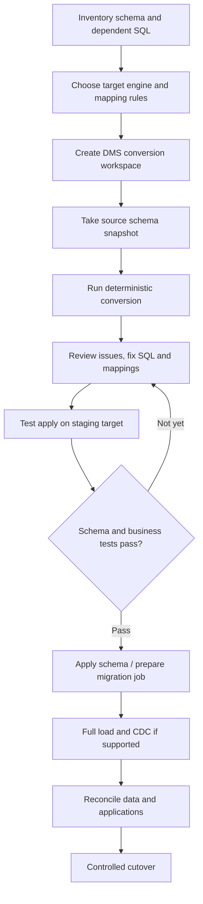

# Schema Conversion, SQL Dialects, and Compatibility

When moving a database to Google Cloud, transferring the data is only part of the job. Applications also depend on how the database defines tables, keys, data types, SQL statements, and transaction behavior. A copy with the right row count can still fail if legacy queries do not compile, foreign keys lose validity, or timestamps and monetary amounts are interpreted differently.

Within the Google Cloud learning path—spanning project organization, IAM, VPC, Compute Engine, GKE, Cloud Run, storage, databases, automation, and reliability/cost monitoring—this lesson focuses on **converting database structure and behavior**. The primary example is **SQL Server → Cloud SQL for PostgreSQL**. Key differences for Oracle, MySQL, and Spanner are introduced so you know when to re-evaluate the design.

**Objectives after this lesson:** classify schema and SQL dialect changes; map data types and objects; use Database Migration Service (DMS) conversion workspaces within their proper scope; verify compatibility across data, queries, transactions, and applications; and plan cutover with clear stop and rollback gates.

## 1. Framing the Conversion Problem Correctly

Three compatibility layers must be separated:

| Layer | What to Evaluate | Example Failure If Overlooked |
| --- | --- | --- |
| **Schema / DDL** | Tables, columns, data types, primary/foreign keys, indexes, views, sequences, identities, defaults, checks, triggers, procedures | Converting `IDENTITY` into a plain `BIGINT` column causes new inserts to lack keys |
| **SQL dialect / DML** | Query syntax, functions, paging syntax, upserts, parameters, quoting, NULL ordering, error handling | SQL Server `SELECT TOP` fails to run on PostgreSQL |
| **Runtime behavior** | Transaction isolation, locking, collations, time zones, NULLs, drivers, ORM, connections, privileges, performance traits | String comparisons or timestamps return different results even though the query succeeds |

**Homogeneous migration** keeps the same engine—for example, self-managed PostgreSQL → Cloud SQL for PostgreSQL or MySQL → Cloud SQL for MySQL. Risks stem primarily from differences in versions, configurations, extensions, privileges, and managed-service features.

**Heterogeneous migration** changes engines—for example, Oracle/SQL Server → Cloud SQL for PostgreSQL. Here you must translate DDL, SQL, and business rules. Automatic DMS support must be checked for the **exact source–destination pair and version**; never assume every database migration path includes a conversion workspace.

The destination also determines how much must change:

- **Cloud SQL for PostgreSQL** and **AlloyDB for PostgreSQL** are built on the PostgreSQL ecosystem, yet supported features, extensions, and versions must still be checked on the target service and release.
- **Cloud SQL for MySQL** or **Cloud SQL for SQL Server** keeps the matching dialect, though full compatibility with every self-managed feature is not guaranteed.
- **Spanner** supports either GoogleSQL or PostgreSQL dialect per database. Spanner's PostgreSQL dialect does not equal a full PostgreSQL server; its distributed architecture, in-database code execution, transactions, and locking model must be evaluated separately.

## 2. Discovery Before Schema Translation

Start with a snapshot of the source structure and a catalog of SQL calls across the entire application. Do not merely export a `CREATE TABLE` file: there are views, triggers, procedures, jobs, permissions, ETL pipelines, and SQL generated dynamically by ORMs.

### 2.1. Inventorying Objects and Dependencies

| Object Group | Questions to Answer | Output Artifact |
| --- | --- | --- |
| Tables / columns | Table count, sizes, PKs, nullable/computed/generated columns, identities, defaults, special types? | Source DDL, sizes, row counts, type conversion paths |
| Constraints / indexes | FKs, uniques, checks, filtered indexes, partitioning, which workload each index serves? | Dependency graph, rebuild priority |
| Functions / procedures / triggers | T-SQL, PL/SQL, dynamic SQL, system access, side effects? | List of code to translate or move to app tier |
| Users / jobs / integrations | Logins, roles, schedulers, linked servers, ETL, BI, CDC, auditing? | IAM plan and replacement services |
| Application SQL | Raw SQL, JDBC, JPA/Hibernate, batches, reports, migrations (Flyway/Liquibase)? | SQL inventory, calling flows, risk level |
| Data semantics | Time zones, encodings, precision, collations, empty strings/NULLs, enums, binary? | Data conversion rules and reconciliation tests |

For SQL Server, sample query to list columns (run on the **source**, read-only per policy):

```sql
SELECT
    TABLE_SCHEMA, TABLE_NAME, COLUMN_NAME,
    DATA_TYPE, CHARACTER_MAXIMUM_LENGTH,
    NUMERIC_PRECISION, NUMERIC_SCALE, IS_NULLABLE
FROM INFORMATION_SCHEMA.COLUMNS
WHERE TABLE_SCHEMA NOT IN ('sys', 'INFORMATION_SCHEMA')
ORDER BY TABLE_SCHEMA, TABLE_NAME, ORDINAL_POSITION;
```

To list procedures, views, functions, and triggers, query `sys.objects`, `sys.sql_modules`, `sys.indexes`, and `sys.foreign_keys` according to granted permissions. `INFORMATION_SCHEMA` views do not expose every SQL Server-specific feature, so supplement them with system metadata and DDL exported by administrative tooling.

### 2.2. Building a Compatibility Matrix

Place each finding into one of four buckets:

1. **Direct equivalent:** e.g., `DECIMAL(18,2)` → `NUMERIC(18,2)` when limits and rounding match.
2. **Syntax change needed:** `TOP (20)` → `LIMIT 20`, `ISNULL` → `COALESCE` after checking type-coercion rules.
3. **Model change needed:** SQL Server `rowversion` or SQL Server Agent jobs have no simple semantic 1:1 translation in PostgreSQL; you may need a versioning/ETag mechanism or a different scheduler.
4. **Incompatible / product decision needed:** depends on missing target features, service limits, latency, or transaction behavior failing SLOs.

Every backlog entry should list the **object/code path**, issue type, impact, fix approach, owner, test case, and acceptance criteria. Prioritize by impact on data and business correctness rather than raw count of tool-reported errors.

## 3. Data Type Conversion: Semantics Matter More Than Type Names

The table below is a **starting point for evaluation**, not a blind automatic mapping for every case.

| Source SQL Server | Common PostgreSQL Candidate | What Must Be Verified |
| --- | --- | --- |
| `INT` / `BIGINT` | `integer` / `bigint` | Value range, signedness, key auto-generation |
| `DECIMAL(p,s)`, `NUMERIC(p,s)` | `numeric(p,s)` | Precision/scale, rounding, overflow |
| `NVARCHAR(n)` | `varchar(n)` or `text` | Unicode, character length vs. source length, normalization, collation |
| `BIT` | `boolean` | 0/1/NULL mapping, drivers, filter predicates |
| `UNIQUEIDENTIFIER` | `uuid` | String formatting and UUID generation method |
| `DATETIME2(p)` | `timestamp(p) without time zone` | Are values genuinely UTC or merely local time? |
| `DATETIMEOFFSET(p)` | `timestamp(p) with time zone` (`timestamptz`) | Preserves the instant, but original offset is not retained as a separate attribute |
| `VARBINARY(MAX)` | `bytea` | Size, streaming/batching, consumer encoding |
| `IDENTITY` | `GENERATED ... AS IDENTITY` | Preserving existing keys, seeding sequences, insert behavior |

For **Oracle → PostgreSQL**, sensitive areas typically include `NUMBER` (with or without precision/scale), Oracle `DATE` (which includes a time component, unlike PostgreSQL `date`), `VARCHAR2`, `CLOB`/`BLOB`, sequences, synonyms, packages, and PL/SQL. For example, an unconstrained `NUMBER` without `p,s` may require `numeric` or a target type chosen from actual value bounds; blindly converting it to `integer` can lose data. Oracle treats empty strings as NULL in many contexts, whereas PostgreSQL distinguishes `''` from `NULL`—a behavioral shift that requires testing.

For **MySQL → PostgreSQL**, pay attention to `UNSIGNED`, `ENUM`/`SET`, `AUTO_INCREMENT`, zero-dates, JSON, string comparison rules, and collations; verify actual inputs before picking types. If staying on MySQL in Cloud SQL for MySQL, several dialect rewrites are avoided, though checking engine/version/SQL modes remains vital.

### 3.1. Time, Time Zones, and Currency

- `timestamp without time zone` stores a calendar date and time without tying it to a global instant. `timestamptz` represents a specific instant displayed in the session time zone; define how source values are interpreted on load.
- If the source app stores UTC in `datetime2`, you can keep `timestamp` by UTC convention, or convert to `timestamptz` **after designing and testing proper UTC attachment**. Never assume default casts infer intent.
- For monetary values, use exact decimal types sized to business ranges; verify addition, tax math, rounding rules, and import bounds—avoid `float` whenever exact arithmetic is required.
- Test boundary values, historical dates, leap days, micro/millisecond precision, and JSON/JDBC serialization.

### 3.2. Keys, Indexes, and Constraints

PKs/FKs and unique constraints protect integrity; indexes keep queries within SLOs. Having the same column list does not guarantee equivalent indexes: filtered indexes, included columns, collations, operator classes, NULL ordering, and partitioning may differ. For tables lacking primary keys, check DMS migration/update support and CDC requirements specifically; never invent an arbitrary key just to satisfy a tool if it is not genuinely stable and unique.

Order object creation carefully: schemas/tables, keys, data, complex indexes/constraints, views, and functions/triggers (depending on load strategy and verified constraints). When using conversion tools, follow the apply order documented for that migration path; disabling FKs/triggers temporarily for fast loads requires full re-validation afterward.

## 4. Practical Example: SQL Server → Cloud SQL for PostgreSQL

A sales system uses an orders table and must preserve `order_id` so external systems can continue referencing it.

### 4.1. Source SQL Server DDL

```sql
CREATE TABLE dbo.orders (
    order_id BIGINT IDENTITY(1,1) NOT NULL PRIMARY KEY,
    customer_id BIGINT NOT NULL,
    amount DECIMAL(18,2) NOT NULL,
    status NVARCHAR(20) NOT NULL
        CONSTRAINT DF_orders_status DEFAULT N'NEW',
    created_at DATETIME2(3) NOT NULL
        CONSTRAINT DF_orders_created_at DEFAULT SYSUTCDATETIME(),
    CONSTRAINT CK_orders_amount CHECK (amount >= 0)
);

CREATE INDEX IX_orders_customer_time
    ON dbo.orders (customer_id, created_at DESC);
```

Here, business **convention** treats `created_at` as UTC, though SQL Server `DATETIME2` itself carries no time zone. Legacy rows must be audited to confirm adherence to that convention.

### 4.2. Target PostgreSQL DDL Design

This is an **illustrative author-written design template**, not a guarantee that DMS generates identical DDL:

```sql
CREATE SCHEMA IF NOT EXISTS sales;

CREATE TABLE sales.orders (
    order_id BIGINT GENERATED BY DEFAULT AS IDENTITY PRIMARY KEY,
    customer_id BIGINT NOT NULL,
    amount NUMERIC(18,2) NOT NULL,
    status VARCHAR(20) NOT NULL DEFAULT 'NEW',
    created_at TIMESTAMP(3) WITHOUT TIME ZONE NOT NULL
        DEFAULT (CURRENT_TIMESTAMP AT TIME ZONE 'UTC'),
    CONSTRAINT ck_orders_amount CHECK (amount >= 0)
);

CREATE INDEX ix_orders_customer_time
    ON sales.orders (customer_id, created_at DESC);
```

Design rationale:

- `dbo` is deliberately mapped to `sales`; if keeping the original schema name instead, update connection/search paths and dependent objects accordingly.
- `GENERATED BY DEFAULT AS IDENTITY` allows loading existing `order_id` values. Once loaded, inspect and sync the sequence before the app inserts new rows; DMS or target procedures may already handle this, so **check and measure before altering**.
- `DATETIME2(3)` is kept as `TIMESTAMP(3) WITHOUT TIME ZONE` because the source follows a UTC convention. The target default specifies UTC explicitly to minimize session time-zone sensitivity.
- PK, `CHECK`, defaults, and indexes must all be tested with real data and workloads. Constraint names, schemas, and creation order may differ when produced by conversion tools.

If switching to `timestamptz`, first verify the meaning of historical data and convert with an explicit source time zone; then re-test both applications and reports.

### 4.3. Converting SQL Queries and Functions

SQL Server query fetching a customer's 20 most recent orders:

```sql
SELECT TOP (20)
    order_id,
    ISNULL(status, N'UNKNOWN') AS status,
    amount
FROM dbo.orders
WHERE customer_id = @customer_id
  AND created_at >= DATEADD(day, -7, SYSUTCDATETIME())
ORDER BY created_at DESC, order_id DESC;
```

PostgreSQL version:

```sql
SELECT
    order_id,
    COALESCE(status, 'UNKNOWN') AS status,
    amount
FROM sales.orders
WHERE customer_id = $1
  AND created_at >= (CURRENT_TIMESTAMP AT TIME ZONE 'UTC')
                    - INTERVAL '7 days'
ORDER BY created_at DESC, order_id DESC
LIMIT 20;
```

Both queries need a **tie-breaker in `ORDER BY`** for deterministic results when multiple rows share `created_at`. `$1` is a PostgreSQL positional placeholder in direct SQL examples; JDBC `PreparedStatement` typically uses `?` and binds parameters via the driver. Never concatenate user input directly into SQL.

| SQL Server / Oracle / MySQL | PostgreSQL Reference | Risk Requiring Testing |
| --- | --- | --- |
| SQL Server `TOP (n)`, MySQL `LIMIT n`, Oracle `FETCH FIRST ...` | `LIMIT n` or `FETCH FIRST n ROWS ONLY` | Missing `ORDER BY`, tie ordering, paging |
| SQL Server `ISNULL(x,y)`, Oracle `NVL(x,y)`, MySQL `IFNULL(x,y)` | `COALESCE(x,y)` | Return types, implicit casts, NULL handling |
| SQL Server `GETDATE()` / `SYSUTCDATETIME()` | `CURRENT_TIMESTAMP` or explicit timezone expression | Transaction timestamp vs. wall-clock time, time zones |
| SQL Server `DATEADD(day, 7, ts)` | `ts + INTERVAL '7 days'` | DST, column types, date arithmetic |
| Oracle `DECODE` | `CASE ... END` | NULL comparison, type casting, default branch |
| MySQL `ON DUPLICATE KEY UPDATE` | `INSERT ... ON CONFLICT (...) DO UPDATE` | Needs matching unique/PK; multiple unique keys |
| SQL Server `[name]`, MySQL backticks | Standard `"name"` if quoting is required | PostgreSQL folds unquoted identifiers to lowercase |
| T-SQL/PLSQL procedures, packages, jobs | PL/pgSQL or application/service logic | Transactions, exceptions, cursors, dynamic SQL, permissions |

In PostgreSQL, `NULL` is not equal to itself, and `WHERE col = NULL` does not match NULLs—use `IS NULL`. Test `NOT IN` when sets contain NULL, `COUNT(col)` vs. `COUNT(*)`, integer division, accented strings, and default sort order. These differences can silently skew reports without raising syntax errors.

### 4.4. Upserts and Sequence Synchronization

For a table with a unique key on `order_id`, a PostgreSQL upsert statement can look like:

```sql
INSERT INTO sales.orders
    (order_id, customer_id, amount, status, created_at)
VALUES ($1, $2, $3, $4, $5)
ON CONFLICT (order_id) DO UPDATE
SET customer_id = EXCLUDED.customer_id,
    amount      = EXCLUDED.amount,
    status      = EXCLUDED.status,
    created_at  = EXCLUDED.created_at;
```

This statement is an application pattern example, **not guidance to write to the target concurrently with DMS**. If idempotent replay is needed, verify event versions, update ordering, and stale-write protection. `ON CONFLICT` relies on a matching constraint; it cannot blindly replace every legacy `MERGE` or upsert procedure.

After replication finishes, source writes are locked, and target catch-up is confirmed, inspect sequence values if the cutover procedure requires it:

```sql
SELECT MAX(order_id) AS max_id, COUNT(*) AS row_count
FROM sales.orders;

SELECT last_value, is_called
FROM sales.orders_order_id_seq;
```

The exact sequence name in this example may differ depending on schema creation tools; use `pg_get_serial_sequence('sales.orders', 'order_id')` instead of guessing. Adjust sequences only during a controlled cutover step after inspecting current state.

## 5. What Does a DMS Conversion Workspace Do—and Not Do?

Google Cloud **Database Migration Service** supports documented migration paths, including same-engine workflows and engine-changing paths such as SQL Server → Cloud SQL for PostgreSQL or Oracle → Cloud SQL for PostgreSQL. On paths with a conversion workspace, tooling helps translate objects into target syntax and inspect results. Supported scope varies by **source type, destination, version, and object type**; always check the support matrix and limitations for your chosen path.

The workflow can be visualized as:



### 5.1. Controlled Execution Sequence

1. Confirm DMS-supported source/target engines and versions; prepare connectivity, least-privilege permissions, and a **staging/test** destination database.
2. Create a conversion workspace matching the supported path; capture a schema snapshot via the source connection profile or Cloud Storage metadata files if documented for that path.
3. Select object groups to convert. DMS performs **deterministic conversion**; some workflows offer Gemini-assisted conversion features. Automated outputs must still be reviewed by engineers who understand the system.
4. Review conversion issues, inspect source/target code side by side, and fix syntax via the interactive editor or custom conversion mappings where supported. Re-run conversion iteratively.
5. Use the workspace's **Test application** feature to verify schema deployment against the target database, then **Apply** once issues are resolved. A clean apply only proves DDL can execute—**it does not prove application or data correctness**.
6. Create and run the migration job per path-specific docs; monitor initial load, CDC/replication lag, and object errors. Validate data integrity before promoting/cutting over.

**Limitations to remember:** DMS documentation for SQL Server → PostgreSQL states that objects created after the job starts and schema changes made mid-job **are not automatically propagated to the target**; instance-level jobs, logins, certificates, and permissions also require separate handling. For structural changes during migration, refresh the snapshot/conversion workspace and update the job per path docs. Depending on the source, tables without primary keys or specific CDC settings may require special handling.

### 5.2. How Far Do Automation and Gemini Assistance Go?

Conversion workspaces reduce mechanical work such as renaming common types, functions, and DDL. However:

- Dynamically concatenated SQL, stored procedures with side effects, cross-database permissions, and error/transaction logic need manual review.
- AI-assisted output is not proof of semantic equivalence. Reviewers need source SQL, target SQL, input/output test suites, and documented decisions.
- Some objects cannot or should not be recreated inside the target database; consider moving them to Java/Spring logic, Cloud Run, jobs/schedulers, or other services with proper transaction and idempotency testing.

In CI/CD, manage approved SQL and test migrations with schema-versioning tools like Flyway/Liquibase if used by the project; define clearly which tool is the **source of truth** for DDL so re-running migrations does not create duplicate objects or conflict with DMS. Keep runtime application privileges separate from schema-migration privileges, using IAM, Secret Manager, and private networking where appropriate.

## 6. Verifying Compatibility Across Four Layers

### 6.1. Schema Layer: Inventory and Structural Comparison

Reconcile counts and definitions: tables/columns, data types, `NOT NULL`, defaults, PKs, FKs, uniques, checks, indexes, sequences, views, functions, triggers, and skipped objects. Do not compare names alone; verify inter-object dependencies and migration execution order.

Metadata inspection queries on the **target PostgreSQL**:

```sql
SELECT table_schema, table_name, column_name,
       data_type, is_nullable, column_default
FROM information_schema.columns
WHERE table_schema = 'sales'
ORDER BY table_name, ordinal_position;

SELECT conname, contype, convalidated
FROM pg_constraint
WHERE conrelid = 'sales.orders'::regclass;
```

`convalidated` surfaces constraints that have not yet been validated. If constraints were intentionally created as `NOT VALID` to speed data loading, run `VALIDATE CONSTRAINT` and verify zero violations before handover.

### 6.2. Data Layer: Comparing After a Consistency Barrier

Run sample checks **separately on source and target**, using engine-appropriate syntax:

```sql
-- Target PostgreSQL
SELECT COUNT(*) AS rows_total,
       COUNT(DISTINCT order_id) AS distinct_orders,
       COUNT(*) FILTER (WHERE customer_id IS NULL) AS null_customers,
       MIN(created_at) AS first_order,
       MAX(created_at) AS last_order,
       SUM(amount) AS total_amount
FROM sales.orders;
```

Compare at the **same logical point in time**: after a consistent snapshot or once source writes stop and replication catches up. While CDC is active, mismatched row counts at two different timestamps do not automatically indicate an error. For large tables, partition by PK or date ranges and reconcile row counts, MIN/MAX, monetary totals, status counts, NULL counts, string lengths, and per-row hashes after normalizing types, time zones, and encodings.

Never rely on total row count as the sole criterion: two rows can swap values while `COUNT(*)` remains identical. For sensitive data, store only hashes/validation summaries and protect logs—never dump raw production rows into test artifacts.

### 6.3. SQL and Transaction Layer

Build a suite of **golden queries** covering critical operations: order lookups, search, paging, row-level authorization, payment recording, inventory updates, and report reconciliation.

Each test case needs inputs, expected outputs, schema version, affected row count, and error conditions. Beyond the happy path, include NULLs, empty strings, Unicode, large numbers, boundary dates, duplicate keys, and rolled-back transactions.

Specifically test:

- **Transactions/isolation:** phantom reads, lock waits, deadlocks, retries, and concurrent transactions; never assume SQL Server isolation/locking matches PostgreSQL.
- **Constraints and upserts:** unique/FK violations, cascading, triggers, returned IDs; application retries can execute an operation multiple times.
- **Ordering and collations:** `ORDER BY` for paging, case sensitivity, accented characters, NULL ordering; verify indexes still accelerate the queries.
- **Planner/performance:** compare execution plans (`EXPLAIN (ANALYZE, BUFFERS)` for PostgreSQL in test environments), slow queries, bloat, connection pools, IOPS/CPU limits, and scalability.
- **Driver/ORM:** JDBC types, ORM-generated SQL, JVM time zones, entity mappings, Hibernate dialects, native queries, migration scripts, connection timeouts, and exception codes.

### 6.4. Application and Operations Layer

Run smoke/integration tests, then load-test with data distributions resembling production. Test batch jobs, BI, reports, scheduled tasks, and external services. Verify IAM/database roles, TLS, networking, secret rotation, backups/PITR, error monitoring, and target cost forecasts.

Illustrative acceptance table:

| Verification | Suggested Criterion | Result |
| --- | --- | --- |
| DDL | Zero apply errors; all mandatory objects created with valid dependencies | PASS/FAIL |
| Data | Reconciled at snapshot/CDC barrier; zero missing keys, rows, or amounts | PASS/FAIL |
| Golden queries | Semantically equivalent outputs per agreement; edge cases pass | PASS/FAIL |
| Transactions | Retries, rollbacks, isolation, and concurrency meet requirements | PASS/FAIL |
| Performance | p95 latency, throughput, batch load, and cost stay within budget | PASS/FAIL |
| Operations | Monitoring, tested backup/restore, least-privilege roles, and rollback plan ready | PASS/FAIL |

p95 thresholds, rounding tolerances, and outage durations must be **agreed upon by the project team prior to migration**; no single default threshold suits every system.

## 7. Cutover, Rollback, and Post-Migration Schema Changes

**Reference cutover runbook:**

1. Freeze DDL on the source and confirm all changes are reflected in the conversion workspace. If schema edits are unavoidable while migration runs, follow the DMS refresh workflow rather than altering target tables directly and breaking replication.
2. Inspect all jobs, replication errors, CDC lag, and skipped-object lists; run reconciliation against defined checkpoints.
3. Switch the app to read-only or pause writes per design, record the last transaction checkpoint, wait for target catch-up, and run final reconciliation.
4. Check sequences/identities, DB privileges, extensions, connection strings, session time zones, and query execution plans. Shift traffic via the rehearsed pattern: canary, config switch, or full cutover.
5. Monitor application errors, p95/p99, transaction rollbacks, lag, and data accuracy over the defined observation period. Decommission the source only after the approved safety retention window expires.

**Rollback must be designed before cutover.** Once the target accepts new writes, switching the connection string back to the old source can drop new transactions or split the source of truth. Define stop thresholds, decision authority, recovery checkpoints, data reversion mechanisms (if feasible), and how long the source stays intact. Never assume DMS provides automatic reverse replication.

Post-cutover, every new DDL change must go through the same migration-script, review, test, backup, and performance-observation pipeline. Stop or finalize migration jobs per path docs once no longer needed; avoid keeping replication privileges and streams open longer than necessary.

## 8. Common Errors and How to Handle Them

| Symptom | Likely Cause | Verification and Fix |
| --- | --- | --- |
| `TOP`, `NVL`, `GETDATE` syntax errors | Untranslated dialect or missing function mapping | Inspect source SQL, rewrite for target, run golden query |
| Monetary totals off by small cents/units | Scale/rounding shift or floating-point type used | Check `numeric(p,s)`, calculations, and boundary inputs |
| Timestamps shifted by hours | Source stored local time while target assumed UTC | Check app/DB/session time zones and conversion logic |
| Duplicate or missing rows after CDC | Unstable key, event ordering, or table fails DMS rules | Check path limitations, PKs, and replication checkpoints |
| DDL applies cleanly yet Java fails | Native SQL, JDBC types, ORM dialect, or legacy procedures | Run integration tests per repository/service |
| Paging order shifts across runs | Collation, NULL ordering, or missing tie-breaker | Add deterministic `ORDER BY` and test duplicate values |
| Sequence generates already-used IDs | Data loaded with explicit keys without syncing sequences | Verify sequences post-cutover before opening writes |
| Triggers/permissions/jobs missing | Objects or instance-level features outside transfer scope | Check supported object list and build replacements |
| CDC runs yet new schema objects are missing | DDL created after the migration job started | Refresh snapshot/conversion workspace and update job per docs |
| Queries slower post-migration | Different plans, indexes, stats, collations, or pooling | Compare `EXPLAIN`, indexes, stats, concurrency, and target sizing |

## 9. Graded Practice Scenario

**Context:** A Java/Spring application uses SQL Server with table `dbo.orders` (10 million rows), daily order reports, an order-aggregation stored procedure, and a nightly SQL Server Agent job. The team plans to move to Cloud SQL for PostgreSQL, needing minimal downtime and exact monetary accuracy.

Prepare a migration dossier containing:

1. **Inventory** of objects, dependencies, and queries; classify direct equivalents, syntax rewrites, logic rewrites, and unsupported items.
2. **Schema map** SQL Server → PostgreSQL for `BIGINT IDENTITY`, `DECIMAL`, `NVARCHAR`, `DATETIME2`, PK, FK, indexes, and sequences. Justify the time-zone choice and `dbo` → `sales` mapping.
3. **SQL rewrites** for at least three queries: top N recent orders, daily revenue sum, and constrained upsert. Use safe parameterization.
4. **Conversion workspace:** describe taking a snapshot, reading conversion issues, fixing, and test-applying on a staging target; mark which items require manual review.
5. **Compatibility tests:** at least 12 cases covering NULLs, Unicode, time zones, rounding, sequences, duplicate keys, rollbacks, paged queries, concurrency, and constraint violations.
6. **Cutover runbook:** when source writes freeze, how CDC catch-up is verified, data reconciliation steps, when Java connection strings flip, cutover abort conditions, and handling new target writes on rollback.
7. **Operations:** propose how to replace the SQL Server Agent job, store secrets, monitor migration/query errors, run backups, and restrict privileges.

**Passing criteria:** The dossier explains *why* every data field or behavior changed, where equivalence tests live, who owns error resolution, and clear stop gates. Simply reporting "conversion completed" because the tool applied DDL cleanly is not accepted.

## Official References

- [Google Cloud — Database Migration Service: documentation and migration paths](https://cloud.google.com/database-migration/docs)
- [Google Cloud — SQL Server → Cloud SQL for PostgreSQL: migration guide](https://cloud.google.com/database-migration/docs/sqlserver-to-csql-pgsql/guide)
- [Google Cloud — SQL Server → PostgreSQL: convert schema and SQL code](https://cloud.google.com/database-migration/docs/sqlserver-to-csql-pgsql/convert-sql)
- [Google Cloud — SQL Server → PostgreSQL: known limitations](https://cloud.google.com/database-migration/docs/sqlserver-to-csql-pgsql/known-limitations)
- [Google Cloud — SQL Server → PostgreSQL: conversion issues reference](https://cloud.google.com/database-migration/docs/sqlserver-to-csql-pgsql/conversion-issues-reference)
- [Google Cloud — Oracle → Cloud SQL for PostgreSQL: conversion workspace](https://cloud.google.com/database-migration/docs/oracle-to-postgresql/about-conversion-workspaces)
- [Google Cloud — Oracle → PostgreSQL: fix and test converted schema](https://cloud.google.com/database-migration/docs/oracle-to-postgresql/convert-sql)
- [Google Cloud — Migrating Oracle users to Cloud SQL: data types](https://cloud.google.com/solutions/migrating-oracle-users-to-cloud-sql-for-postgresql-data-types)
- [Google Cloud — Migrating PostgreSQL to Spanner PostgreSQL dialect](https://cloud.google.com/spanner/docs/migrating-postgres-spanner-pgcompat)
- [Google Cloud — Spanner application migration](https://cloud.google.com/spanner/docs/application-migration)

Conversion documentation and product limits evolve by release; cross-check the official support page for your exact migration path before planning production execution.
