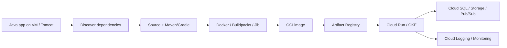
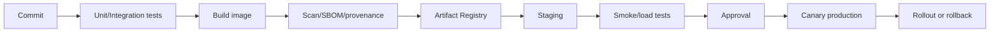

# Migrating Java Applications to Containers on GCP

Moving a Java application from physical servers, virtual machines, or traditional application servers to containers on Google Cloud is a **replatform** or **modernization** step: shifting the deployment unit from a host to an OCI image built, tested, and released consistently. Containers do not automatically turn a legacy system into a cloud-native one. The engineering team still must address OS dependencies, configuration, data, sessions, networking, security, monitoring, and rollback.

In the `CLOUD_PROVIDERS_GCP` module, learners explore Google Cloud from project organization, IAM, and VPC to Compute Engine, GKE, Cloud Run, storage, and databases. Through deployment scenarios, learners learn how to choose services, secure resources, automate releases, and monitor reliability and cost. This lesson applies those principles to a concrete journey: discovering a Java app, building an image, pushing to Artifact Registry, running on Cloud Run or GKE, and shifting traffic safely.

Examples use a Spring Boot app named `order-api`, Java 21, Maven, and region `asia-southeast1`. Replace placeholders `PROJECT_ID`, `REGION`, `SERVICE_ACCOUNT_EMAIL`, and `IMAGE_URI` with approved values. Never run deploy commands against production without testing and verifying permissions.

## Learning Objectives

After this lesson, you will be able to:

- Survey Java runtimes, app servers, OS/native dependencies, databases, filesystems, and external services.
- Distinguish containerization, replatforming, refactoring, and when to remain on a Compute Engine VM.
- Choose Cloud Run services, Cloud Run Jobs, Cloud Run worker pools, GKE Autopilot, or GKE Standard for each workload.
- Containerize Spring Boot JARs and Tomcat WARs using multi-stage Dockerfiles, Buildpacks, or Jib.
- Use Artifact Registry, Cloud Build, and image digests to build a traceable CI/CD pipeline.
- Externalize configuration, secrets, runtime identity, and persistent data out of the image.
- Design health checks, resource limits, DB pools, networking, monitoring, canary rollouts, and rollbacks.
- Plan cutover, verify SLOs, test restores, and decommission legacy servers.

## 1. From Java on a VM to Java in a Container

### Differences in the Deployment Unit

On a VM, an application may depend on a pre-installed JDK, sysadmin-managed Tomcat, files in `/etc`, logs in `/var/log`, cron, keystores, and state stored on disk. Those details might not live in Git and can differ across VMs. A container image captures the runtime and artifact consistently; the execution platform provides configuration, networking, IAM identity, and storage.



| Aspect | Java on a VM | Java in a Container |
|---|---|---|
| Runtime | JDK, libraries, process manager configured on the host. | JRE/JDK, app, and dependencies packaged inside the image. |
| Release | Copy JAR/WAR and restart process or server. | Build/push image and update revision/Deployment. |
| Configuration | Local files, scripts, system properties. | Environment variables, Secret Manager, ConfigMaps/volumes. |
| Local data | Can persist on VM disk. | Container filesystem must not be used for durable data. |
| Scaling | Add VMs and load balance. | Cloud Run autoscaling or GKE replicas/HPA. |
| Rollback | Restore old artifact and config. | Switch revision/image, still must handle data/schemas. |

Containerization standardizes environments and releases; it does **not** automatically fix technical debt, race conditions, distributed transactions, or apps bound to a single fixed host.

### Migration Strategies

1. **Near as-is containerization:** package the WAR with a compatible Tomcat/JBoss. Minimizes initial change scope while carrying forward legacy architectural limits.
2. **Targeted replatform:** convert to an executable JAR, externalize config, logs, and state; adopt Cloud SQL/Cloud Storage/Secret Manager.
3. **Refactor/modernize:** split services, convert batches to jobs, adopt Pub/Sub for events, reshape domain boundaries, and upgrade frameworks where business value warrants it.
4. **Stay on a VM temporarily:** workloads tied to kernel/OS hooks, specialty-licensed software, container-incompatible binaries, or unmet operational requirements.

Do not upgrade the JDK, migrate `javax` to `jakarta`, switch databases, split into microservices, and cut over the entire system simultaneously unless strictly necessary. Separate changes to simplify testing and rollback.

## 2. Discovery: Surveying the Application and Mapping Dependencies

Before writing a Dockerfile, inventory:

| Area | Key Questions | Where to Check |
|---|---|---|
| Build | Maven/Gradle? Is the build reproducible? | `pom.xml`, `build.gradle`, CI logs. |
| Runtime | Java 8/11/17/21? JDK vendor, JVM flags, charset/timezone? | `java -version`, startup scripts. |
| Packaging | JAR, WAR, EAR? Tomcat/JBoss/WebSphere version? | Artifacts and app server configs. |
| Native | JNI, fonts, CA certs, time zone, `glibc`, shared libs, shell scripts? | OS packages, integration tests. |
| State | HTTP sessions, local caches, file uploads, cron, long-running threads? | Code, logs, file paths. |
| Data | PostgreSQL/MySQL/Oracle? Schema migrations, backups, RPO/RTO? | Datasource configs and DB inventory. |
| Network | DNS, private endpoints, proxies, static egress IP, VPN? | Flow logs, firewall rules, dependency map. |
| Security | Secrets, keystores, IAM, mTLS, certificates? | Credential inventory and policies. |
| Capacity | Peak CPU/RAM, heap, GC, p95 latency, requests/sec? | APM and monitoring baselines. |
| Operations | Health checks, deployment windows, rollback owner, SLOs? | Runbooks, change history. |

**Example:** a Tomcat VM stores uploads in `/var/app/uploads`, keeps sessions in memory, runs an email cron job, and points a JDBC URL at an internal database. If you drop the WAR into a container and run three replicas, uploads are not shared across replicas, sessions disappear on restarts, and cron may fire three times. Resolve each dependency before scaling.

### Common Blockers

- **Java EE/Jakarta:** `javax.servlet.*` code may not run on Tomcat 10+ or Spring Boot 3 without migrating to `jakarta.*`. Keep a compatible server version in phase one if needed.
- **Native libraries:** JNI, font rendering, time-zone data, OS certificates, or shared libs may be missing from minimal base images.
- **CPU architecture:** image manifests/native binaries must match the target runtime architecture; verify before deploying.
- **Sessions/files:** local container disk is not durable storage; sticky sessions do not replace a shared session store.
- **Credentials:** legacy VM service accounts/keys do not automatically become service identities on Cloud Run/GKE.
- **Networking:** private databases/APIs may require Direct VPC egress, VPC connectors, VPN/Interconnect, firewalls, and DNS.
- **Lifecycle:** background workers, cron jobs, and unbounded tasks may not fit a Cloud Run HTTP service that scales to zero.

Establish baselines before changing anything: p50/p95/p99 latency, error rate, throughput, CPU/RAM, GC, DB connections, backlogs, cost, and incident frequency. These metrics serve as post-migration acceptance criteria.

## 3. Choosing the Target: Cloud Run, GKE, or Compute Engine?

| Workload | Candidate Target | Rationale |
|---|---|---|
| Stateless REST/GraphQL API, HTTP web app with variable traffic | **Cloud Run services** | Revisions, autoscaling, and low operational overhead. |
| Bounded batch jobs, ETL, scheduled runs | **Cloud Run Jobs** | Runs to completion without an HTTP listener. |
| Continuous workers/consumers, long-running processing | **GKE** or **Cloud Run worker pools** where appropriate | Explicit process lifecycle and scaling control. |
| Kubernetes operators, custom networking, multi-service policies | **GKE Autopilot or Standard** | Full Kubernetes API, Deployments, Services, HPA, RBAC. |
| Legacy app needing kernel/OS hooks or container-unfriendly software | **Compute Engine** first | Lowers risk when containerization is not yet viable. |

Cloud Run Jobs are not for HTTP services. A Cloud Run service requires an ingress container listening on the platform-provided port. GKE adds flexibility alongside Kubernetes operational responsibility; do not pick GKE merely because an app is packaged as a container image.

### Migrate to Containers Tooling

Google Cloud **Migrate to Containers** can extract workloads from VMs and generate container artifacts for select applications—including workloads on Tomcat, JBoss, WebSphere, or Linux—depending on supported source versions and environments. It is an option for long-lived VM apps or missing source pipelines. Generated artifacts still require review for images, configuration, networking, IAM, licensing, and runtime behavior.

When source code, Maven/Gradle, and CI already exist, building images directly from source usually yields clearer dependency management and provenance.

## 4. Preparing a Java App to Run Cloud-Native

### Externalized Configuration

Never hardcode DB hosts, passwords, ports, or profiles in source code. With Spring Boot:

```yaml
# src/main/resources/application.yaml
spring:
  application:
    name: order-api

server:
  address: 0.0.0.0
  port: ${PORT:8080}
  shutdown: graceful

app:
  region: ${APP_REGION:asia-southeast1}
  downstream-url: ${DOWNSTREAM_URL:http://localhost:9090}

management:
  endpoints:
    web:
      exposure:
        include: health,info
  endpoint:
    health:
      probes:
        enabled: true
```

`PORT` is injected by Cloud Run for ingress containers; the app must bind `0.0.0.0`, not just `127.0.0.1`. `SPRING_PROFILES_ACTIVE=prod` selects a Spring profile, not a security boundary: IAM and project isolation govern which data an app can access.

### Externalizing State

| VM Habit | Container-Appropriate Solution |
|---|---|
| HTTP sessions in Tomcat RAM | Stateless session tokens or a shared session store; do not rely solely on sticky sessions. |
| Uploads to `/var/app/uploads` | Store objects in Cloud Storage. |
| Logs written to `/var/log/app.log` | Write structured JSON to stdout/stderr for Cloud Logging ingestion. |
| Cron running inside web process | Cloud Scheduler + Cloud Run Jobs or Kubernetes CronJob. |
| Local cache as primary data source | External cache/database with explicit idempotency and cache invalidation. |
| Long-lived temp files on disk | Cloud Storage or durable data services. |

Containers can restart, swap revisions, or scale out at any moment. HTTP handlers, queue consumers, and transactions must implement retries, timeouts, graceful shutdown, and duplicate-delivery handling.

### Database Connectivity and Schema Migrations

- Verify JDBC drivers, SQL dialects, schemas, encodings, collations, and time zones.
- Use Cloud SQL where appropriate for PostgreSQL/MySQL/SQL Server; if data stays on-premises during hybrid transition, ensure private connectivity, acceptable latency, and failover.
- Run Flyway/Liquibase under controlled release steps rather than having every replica apply heavy migrations concurrently at startup.
- Use **expand-and-contract** schema changes so old and new versions coexist during canary rollouts.
- Size connection pools against max replicas; for example, 30 containers × pool size 20 can open 600 connections.
- Test backup/restore, RPO/RTO, transaction retries, and DB failover prior to cutover.

Hikari example:

```yaml
spring:
  datasource:
    url: ${JDBC_URL}
    username: ${DB_USER}
    password: ${DB_PASSWORD}
    hikari:
      maximum-pool-size: 5
      connection-timeout: 30000
```

Inject `DB_PASSWORD` via Secret Manager or an approved secret store—never bake literal values into the image.

### Graceful Shutdown

Cloud Run sends `SIGTERM` before stopping an instance and allows only a short shutdown window. Spring Boot supports graceful shutdown; configure timeouts appropriately, close connection pools, and drain in-flight requests within platform limits. Move long-running tasks to jobs or external work queues outside the web process.

## 5. Creating a Docker Image for a Spring Boot JAR

### Project Structure

```text
order-api/
├── pom.xml
├── src/main/java/
├── src/main/resources/application.yaml
├── src/test/
├── Dockerfile
├── .dockerignore
└── cloudbuild.yaml
```

### Multi-Stage Dockerfile

```dockerfile
# Build stage: Maven and JDK.
FROM maven:3.9-eclipse-temurin-21 AS builder
WORKDIR /workspace
COPY pom.xml ./
COPY src ./src
RUN mvn -B -DskipTests package

# Runtime stage: omit Maven and build tools.
FROM eclipse-temurin:21-jre-jammy
WORKDIR /app
COPY --from=builder /workspace/target/*.jar /app/app.jar
USER 10001:10001
EXPOSE 8080
ENTRYPOINT ["java", "-jar", "/app/app.jar"]
```

This example assumes Maven produces **one** executable Spring Boot JAR in `target/`. If `original-*.jar`, test JARs, or multiple modules exist, reference the exact artifact path to avoid copying the wrong file. Depending on your pipeline, `mvn package` can run tests inside the Dockerfile; `-DskipTests` is appropriate only when CI already runs tests beforehand.

In production, pin reviewed base images by digest, scan for CVEs, schedule updates, and match `linux/amd64` or your target platform architecture. `USER 10001:10001` drops privileges; the app must not expect write access to `/app`. If fonts, CA certs, time zones, or native libs are needed, install only required packages rather than copying the entire VM.

### Docker Build Context

```dockerignore
.git
.idea
.vscode
target
build
*.log
.env
.env.*
*.pem
*.p12
*.tfstate
*.tfstate.*
```

`.dockerignore` reduces the risk of leaking unwanted files into images and speeds up builds, though it does not replace secret scanning. Never pass tokens via `ARG`/`ENV` or bake credentials into layers. For private package registries, use short-lived tokens and build secrets where supported.

### Local Testing

```bash
docker build -t order-api:local .
docker run --rm \
  -p 8080:8080 \
  -e PORT=8080 \
  -e SPRING_PROFILES_ACTIVE=dev \
  order-api:local
```

Verify `/actuator/health` or business endpoints; re-run with resource limits to observe JVM memory, threads, and GC. Local tests do not verify production IAM or networking.

## 6. Buildpacks and Jib: Options Without Managing Dockerfiles

### Cloud Native Buildpacks

Buildpacks detect Java source, runtimes, and dependencies to produce container images. With Cloud Run, `gcloud run deploy --source .` builds an image from source and deploys in one step:

```bash
gcloud run deploy order-api \
  --source . \
  --project=PROJECT_ID \
  --region=asia-southeast1
```

This is a **live deployment command**: run it only in an approved test project. For non-default Java versions, consult Buildpacks documentation and `project.toml`; never assume every builder matches your legacy app's JDK.

### Jib

**Jib** builds OCI images directly from Maven/Gradle for Java, usually without requiring a Docker daemon on the build machine. Jib separates dependencies and class files into distinct layers for strong build caching. Example Maven plugin—pin the version and configure auth/base image before use:

```xml
<plugin>
  <groupId>com.google.cloud.tools</groupId>
  <artifactId>jib-maven-plugin</artifactId>
  <version>3.4.5</version>
  <configuration>
    <to>
      <image>asia-southeast1-docker.pkg.dev/PROJECT_ID/java-images/order-api</image>
    </to>
  </configuration>
</plugin>
```

| Build Method | Best Suited For | Watch Out For |
|---|---|---|
| Multi-stage Dockerfile | OS/native lib control and complex builds. | Base images, non-root runtime, secrets, layer hygiene. |
| Buildpacks | Standard apps wanting fast source-to-deploy. | Runtime/builder versions, policies, provenance. |
| Jib | Pure Maven/Gradle Java, strong caching, no Docker daemon. | Plugin versions, base image, registry credentials. |

Choose one build method your team can support well; do not maintain all three in the same pipeline.

## 7. Artifact Registry and Image Management

Artifact Registry stores Docker/OCI images in repositories with IAM, regional location, and lifecycle policies. Image URLs follow:

```text
REGION-docker.pkg.dev/PROJECT_ID/REPOSITORY/IMAGE:TAG
```

For example: `asia-southeast1-docker.pkg.dev/my-project/java-images/order-api:release-001`. The repository is a separate resource that must exist before pushing:

```bash
gcloud services enable artifactregistry.googleapis.com \
  --project=PROJECT_ID

gcloud artifacts repositories create java-images \
  --repository-format=docker \
  --location=asia-southeast1 \
  --description="Java service images" \
  --project=PROJECT_ID
```

Push from an authorized workstation or CI runner:

```bash
gcloud auth configure-docker asia-southeast1-docker.pkg.dev

IMAGE="asia-southeast1-docker.pkg.dev/PROJECT_ID/java-images/order-api:release-001"
docker build -t "$IMAGE" .
docker push "$IMAGE"

gcloud artifacts docker images list \
  asia-southeast1-docker.pkg.dev/PROJECT_ID/java-images \
  --include-tags
```

The build identity needs Artifact Registry Writer (`roles/artifactregistry.writer`) on the repository, while Cloud Run/GKE runtimes need image read access; verify cross-project access explicitly. The Docker credential helper handles authentication only—it does not grant IAM permissions.

**Supply chain security:** use trusted base images, pin digests, scan dependencies/containers for vulnerabilities, generate SBOM/provenance, restrict push permissions, keep secrets out of images, and retain images long enough for rollback. For production releases, deploy by **image digest** (`image@sha256:...`) rather than mutable tags alone.

## 8. Deploying Java Containers to Cloud Run

### Service Identity

Create a dedicated runtime service account granted only what the application genuinely uses:

```bash
gcloud services enable run.googleapis.com --project=PROJECT_ID

gcloud iam service-accounts create order-api-runtime \
  --project=PROJECT_ID \
  --display-name="Order API runtime"
```

Example runtime roles: `roles/pubsub.publisher` on a topic, `roles/secretmanager.secretAccessor` on a secret, `roles/cloudsql.client` for Cloud SQL, and bucket-scoped Cloud Storage roles. Keep the deployer separate from the runtime identity; the deployer needs `iam.serviceAccounts.actAs` to attach the service account to the service.

### Deploy Image

```bash
gcloud run deploy order-api \
  --image=asia-southeast1-docker.pkg.dev/PROJECT_ID/java-images/order-api:release-001 \
  --project=PROJECT_ID \
  --region=asia-southeast1 \
  --service-account=order-api-runtime@PROJECT_ID.iam.gserviceaccount.com \
  --port=8080 \
  --memory=1Gi \
  --cpu=1 \
  --concurrency=40 \
  --max-instances=5 \
  --timeout=60s \
  --set-env-vars=SPRING_PROFILES_ACTIVE=prod
```

CPU/RAM/concurrency settings are load-testing examples, not universal JVM recommendations. Verify Cloud Run Invoker, ingress, and public-access policies per requirements; never make a service public just for quick smoke tests.

### Runtime Contract

A Cloud Run **service** must listen on `0.0.0.0` at the configured port (`PORT`). HTTP requests must finish within the request timeout. Container filesystems are not durable storage. Instances can scale in, restart, and receive `SIGTERM`; applications must shut down gracefully and never rely on a permanently running web process to complete mandatory background work.

Never copy JSON service account keys into images or set `GOOGLE_APPLICATION_CREDENTIALS` to a local key on Cloud Run; use Application Default Credentials (ADC) fetched from the service identity via the metadata server.

### Checking Revisions and Health

```bash
gcloud run services describe order-api \
  --project=PROJECT_ID --region=asia-southeast1

gcloud run revisions list \
  --service=order-api \
  --project=PROJECT_ID --region=asia-southeast1
```

If the service is private, the test runner needs an identity authorized to invoke Cloud Run and a valid identity token. Do not expose the service publicly just to run tests. Spring Actuator `/actuator/health/liveness` and `/actuator/health/readiness` work well for probes; never expose `/actuator/env` or `/actuator/configprops` publicly.

### Cloud Run Jobs for Batch Work

Batches or data migrations that run to completion should use Cloud Run Jobs. Jobs do not listen on an HTTP port; the process must exit with code `0` on success and non-zero on failure. Do not port an email cron job from a VM into a web container where every replica executes the schedule independently.

## 9. Deploying on GKE When Kubernetes Is Needed

GKE Autopilot minimizes node management and enforces resource guardrails; GKE Standard allows deeper node pool and infrastructure customization. Both require managing Deployments, Services, RBAC, IAM, networking, and observability.

Example `Deployment`/`Service`:

```yaml
apiVersion: apps/v1
kind: Deployment
metadata:
  name: order-api
spec:
  replicas: 2
  selector:
    matchLabels:
      app: order-api
  template:
    metadata:
      labels:
        app: order-api
    spec:
      serviceAccountName: order-api-ksa
      containers:
        - name: order-api
          image: asia-southeast1-docker.pkg.dev/PROJECT_ID/java-images/order-api:release-001
          ports:
            - containerPort: 8080
          env:
            - name: PORT
              value: "8080"
            - name: SPRING_PROFILES_ACTIVE
              value: prod
          startupProbe:
            httpGet:
              path: /actuator/health/liveness
              port: 8080
            periodSeconds: 10
            failureThreshold: 30
          readinessProbe:
            httpGet:
              path: /actuator/health/readiness
              port: 8080
          livenessProbe:
            httpGet:
              path: /actuator/health/liveness
              port: 8080
          resources:
            requests:
              cpu: 250m
              memory: 512Mi
            limits:
              memory: 1Gi
---
apiVersion: v1
kind: Service
metadata:
  name: order-api
spec:
  type: ClusterIP
  selector:
    app: order-api
  ports:
    - port: 80
      targetPort: 8080
```

Create the Kubernetes ServiceAccount `order-api-ksa` beforehand and configure Workload Identity Federation for GKE if the workload calls Google Cloud APIs. Never store Google Cloud JSON keys in Kubernetes Secrets for authentication. `ClusterIP` exposes the service only inside the cluster; public HTTP requires a Gateway/Ingress, load balancer, TLS, and appropriate policies.

```bash
kubectl apply -f deployment.yaml
kubectl rollout status deployment/order-api

# Roll back to the previous Deployment revision during an incident:
kubectl rollout undo deployment/order-api
```

`kubectl rollout undo` reverts only the Deployment spec/image; it does not revert database schemas or external side effects. Tune requests/limits from real load tests and verify HPA cannot overwhelm Cloud SQL.

## 10. IAM, Secret Manager, Cloud SQL, and Networking

### Separating Build, Deploy, and Runtime Identities

| Principal | Responsibility | Reference Permissions |
|---|---|---|
| Build identity | Run tests, build/push images. | Artifact Registry Writer on target repository. |
| Deployer identity | Update Cloud Run/GKE. | Cloud Run Developer and `actAs` on runtime SA; or Kubernetes RBAC. |
| Runtime identity | Call Google Cloud APIs at request time. | Secret Accessor, Cloud SQL Client, Pub/Sub Publisher, resource-scoped Storage roles. |
| Auditor | Inspect provenance/logs/configs. | Appropriately scoped read-only IAM. |

Never grant project Owner/Editor to a runtime identity just to "quickly fix" a `PERMISSION_DENIED` error.

### Secrets

Store passwords and API keys in **Secret Manager**—never in `Dockerfile`, `application-prod.yaml`, Cloud Build substitutions, image layers, or image `ENV`. Cloud Run can mount secret versions as environment variables or volumes; Spring or Google Cloud client libraries can also fetch from Secret Manager using a runtime identity with `roles/secretmanager.secretAccessor`.

Manage versions and rotation per policy; do not assume a JVM that loaded a secret at startup automatically refreshes when a new secret version is added. If a secret leaks, revoke and rotate it on the target system—clearing logs is not enough.

### Cloud SQL and VPC

The application needs matching JDBC drivers, database users, network paths, and Cloud SQL Client permissions. For private IP, configure Direct VPC egress / VPC connectors on Cloud Run or VPC-native networking on GKE alongside firewall rules. Check connection timeouts, DNS, TLS/certificates, IAM, max connections, and failover.

Cloud SQL Client does not replace database authentication. Under autoscaling, total connections equal per-instance pool × max instances; keep Hikari pools appropriately small and use retries/backpressure.

### Data Storage

Invoices, uploaded images, and reports belong in Cloud Storage with proper location, bucket IAM, and lifecycle policies. Signed URLs reduce API bandwidth load, but restrict HTTP methods, expiration, and conditions. Never use a container's `/tmp` directory for data requiring recovery.

## 11. CI/CD: Build Once, Deploy Across Environments



Example `cloudbuild.yaml`:

```yaml
substitutions:
  _IMAGE_URI: asia-southeast1-docker.pkg.dev/$PROJECT_ID/java-images/order-api:$SHORT_SHA

options:
  dynamicSubstitutions: true

steps:
  - id: test
    name: maven:3.9-eclipse-temurin-21
    entrypoint: mvn
    args: ["-B", "test"]

  - id: image
    name: gcr.io/cloud-builders/docker
    args: ["build", "-t", "${_IMAGE_URI}", "."]

images:
  - "${_IMAGE_URI}"
```

`images` tells Cloud Build to push the built image; the build service account needs repository writer permissions. `dynamicSubstitutions: true` lets `_IMAGE_URI` expand `$PROJECT_ID` and `$SHORT_SHA`, even on manual runs. In triggers, `$SHORT_SHA` comes from the commit; for manual submissions, pass `_IMAGE_URI` explicitly rather than relying on trigger variables:

```bash
gcloud builds submit \
  --config=cloudbuild.yaml \
  --project=PROJECT_ID \
  --substitutions=_IMAGE_URI=asia-southeast1-docker.pkg.dev/PROJECT_ID/java-images/order-api:release-001 \
  .
```

Enforce testing, dependency scanning, image scanning, release approvals, provenance, and digests. Build an image once and promote the exact same digest from staging to production. Never expose production secrets to untrusted pull-request builds. Tests inside the Dockerfile can be skipped only when Cloud Build runs tests in a mandatory preceding step.

## 12. Shifting Traffic: Blue/Green, Canary, and Rollback

### Choosing a Strategy

| Approach | Mechanism | Risks |
|---|---|---|
| Big-bang | Switch 100% of traffic at once. | Large blast radius, rushed rollbacks. |
| Blue/green | Run old/new concurrently, switch routing post-test. | Extra resource cost and data consistency handling. |
| Canary | Shift 1–5% traffic, then ramp based on metrics. | Requires per-version routing and SLO tracking. |
| Shadow | Mirror traffic to observe without side effects. | Risk of duplicate writes if not isolated. |

### Cloud Run Rollout

For a service with a live revision, deploy the new revision with zero traffic:

```bash
gcloud run deploy order-api \
  --image=IMAGE_URI \
  --project=PROJECT_ID \
  --region=asia-southeast1 \
  --no-traffic \
  --tag=candidate
```

Smoke-test the tagged revision via proper IAM/ingress. Once verified, shift 5% traffic:

```bash
gcloud run services update-traffic order-api \
  --project=PROJECT_ID \
  --region=asia-southeast1 \
  --to-revisions=NEW_REVISION=5,OLD_REVISION=95
```

Rollback:

```bash
gcloud run services update-traffic order-api \
  --project=PROJECT_ID \
  --region=asia-southeast1 \
  --to-revisions=OLD_REVISION=100
```

Replace `IMAGE_URI`, `NEW_REVISION`, and `OLD_REVISION` with real names. Traffic shifts are not strictly instantaneous: in-flight requests may complete on the previous revision. Rolling back the app **does not** roll back DB schemas, published messages, written invoices, or rotated secrets.

### Cutover Checklist

1. Test backup/restore and RTO/RPO; save snapshots and runbooks.
2. Freeze incompatible schema changes; use expand-and-contract.
3. Deploy with no traffic; smoke-test auth, DB, Storage, Pub/Sub, and health.
4. Define error-rate, p95 latency, and business metrics as canary gates.
5. Shift traffic incrementally via LB/DNS/Cloud Run per the chosen architecture.
6. Monitor DB load, SLOs, billing, retries, and duplicate events.
7. Keep the legacy workload ready for rollback within the defined window while preventing double writes.
8. Decommission old VMs/Tomcat after stabilization and confirming zero remaining consumers.

## 13. JVM Performance, Autoscaling, and Cost

### Java Memory Inside Containers

Modern Java detects container resource limits, yet never assume `-Xmx` can equal total container RAM. RSS also includes metaspace, direct buffers, thread stacks, JIT, JNI, and OS memory. For example, you might use:

```bash
JAVA_TOOL_OPTIONS="-XX:MaxRAMPercentage=65.0 -XX:+ExitOnOutOfMemoryError"
```

65% is an **example**, not a universal rule. Measure RSS, heap, GC pauses, CPU, and thread counts under realistic load to tune heap and resource limits. Newer JVM versions or base images can alter startup and GC behavior; compare against pre-migration baselines.

### Common Bottlenecks

- Cold starts driven by Spring context initialization, JIT, config/secret loading, and DB connection startup.
- Excessive request concurrency inflating threads, heap, and lock contention.
- Rapid autoscaling overwhelming DB pools or downstream services.
- Long-lived connections resetting; SDKs need bounded retries and reconnect logic.
- Cross-region databases/APIs increasing latency and egress fees.
- Oversized container images slowing pulls/startups and widening attack surface.
- Background tasks inside HTTP services getting throttled or killed by instance lifecycles.

Model costs across Cloud Run/GKE compute, Cloud SQL, Artifact Registry, Cloud Build, Cloud Storage, VPC egress, and Cloud Logging/Monitoring. Compare equivalent workloads and SLOs—not vCPU unit price alone.

## 14. Post-Migration Observability and Acceptance

### Logging

Emit structured JSON logs to stdout/stderr containing severity, service, event, request/trace ID, duration, error code, and release/revision. Never log access tokens, passwords, session cookies, PII, or sensitive payloads.

```json
{
  "severity": "ERROR",
  "service": "order-api",
  "event": "order_submit_failed",
  "code": "UPSTREAM_TIMEOUT",
  "duration_ms": 2800
}
```

### Metrics

| Group | Metrics to Track |
|---|---|
| API | RPS, 4xx/5xx, p95/p99 latency, timeouts, SLO burn rate. |
| JVM | Heap/non-heap, GC pauses, threads, startup duration. |
| Container | CPU, RSS/OOM, instance count, cold starts, deployment failures. |
| Database | Connections, query latency, saturation, failovers/retries. |
| Async | Queue backlog, ack latency, retries/DLQs, duplicate handling. |
| Migration | Old vs. new success rate, canary traffic, business transactions, cost. |

Cloud Monitoring dashboards and alerts should center on user-facing SLIs/SLOs; "container is running" does not prove business workflows succeed.

## 15. Case Study: Tomcat VM to Cloud Run

**Current state:** Java WAR on a Tomcat VM, PostgreSQL on a separate VM, invoice uploads written to `/var/app/invoices`, in-memory sessions, a reporting cron job, and passwords stored in config files.

**Target state:** Order API packaged as an executable Spring Boot JAR on Cloud Run, images in Artifact Registry, invoices in Cloud Storage, passwords in Secret Manager, database on Cloud SQL (or hybrid during transition), reporting cron moved to Cloud Run Jobs, and sessions using an external store or stateless auth.

**Phase A — Discovery:** verify Java/Tomcat versions, `javax`/`jakarta`, native libraries, JVM flags, network links, and baseline SLOs. If converting to a JAR is not yet feasible, containerize the WAR with a compatible Tomcat first to narrow scope.

**Phase B — Containerization:** build a Dockerfile or pick Buildpacks/Jib, externalize configs and secrets out of the image, and add unit/integration tests. Configure health probes, graceful shutdown, and container memory.

**Phase C — Staging:** push to Artifact Registry, deploy privately to Cloud Run with a least-privilege runtime service account, validate Cloud SQL/Storage/Pub/Sub/VPC, and measure costs. Confirm scheduled jobs do not run concurrently in duplicates.

**Phase D — Canary:** coordinate DNS/load balancers to shift traffic from VM to Cloud Run, run old and new side by side on backward-compatible schemas, monitor errors/p95/business success rate, and prevent double writes.

**Phase E — Stabilize:** tune heap, DB pools, autoscaling, and log volume; review SLOs, data consistency, security findings, and runbooks. Shut down the VM only after the rollback window closes and zero dependent integrations remain.

### Suggested Acceptance Criteria

| Item | Condition |
|---|---|
| Functionality | Critical user journeys pass across staging and canary. |
| Performance | p95 meets agreed baseline/SLO under equivalent load. |
| Errors | 5xx, timeouts, and retries stay within the error budget. |
| Data | Backup/restore tested; zero lost invoices/transactions. |
| Security | Narrow IAM, zero secret leaks, container/dependency scans pass policy. |
| Operations | Dashboards, alerts, runbooks, rollback owner, and costs approved. |

## 16. Troubleshooting

| Symptom | Common Cause | Where to Check |
|---|---|---|
| Cloud Run not ready/listening | Bound `localhost`, wrong `PORT`, crash or slow startup. | `${PORT:8080}`, `0.0.0.0`, startup logs, probes. |
| `UnsupportedClassVersionError` | Java compiler target higher than runtime JRE. | `java -version`, Maven compiler/release, image JRE. |
| `ClassNotFoundException` | Incompatible app server or `javax`/`jakarta` mismatch. | Dependency tree, WAR/JAR, Tomcat/Spring versions. |
| Image fails to start | Wrong architecture, `ENTRYPOINT`, native lib, or missing JAR. | Local `docker run`, image manifest, startup stderr. |
| Artifact Registry 403 | Build/deployer lacks repo IAM or cross-project pull. | Actual principal and Artifact Registry roles. |
| Secret `PERMISSION_DENIED` | Wrong runtime service account or missing Secret Accessor. | Secret IAM, project/version, audit logs. |
| DB timeouts / too many connections | Wrong egress route or Hikari pool × replicas too high. | VPC, JDBC, Cloud SQL connections, autoscaling. |
| Uploads lost after restart | Data written to ephemeral container filesystem. | Move to Cloud Storage; re-test upload/download. |
| Cron runs multiple times | Every web replica starts its own scheduler. | Move to Cloud Run Jobs/CronJob with locking/idempotency. |
| App rollback fails to fix errors | Incompatible schema or data change already applied. | Expand-and-contract, backups, DB rollback plan. |
| Unexpected cost spike | High min-instances, log ingestion/egress, oversized DB tier. | Billing, Cloud Monitoring, cleanup/lifecycle rules. |

Never resolve IAM errors by granting project Owner or embedding JSON keys in images; identify the exact principal, resource scope, and network path.

## 17. Java-to-Container Migration Checklist

- [ ] JDK, build tools, WAR/JAR/EAR, native libraries, licenses, and OS dependencies are inventoried.
- [ ] Baseline RPS, p95, error rate, heap/GC, CPU/RAM, and database connections are measured.
- [ ] Workloads are classified: HTTP service, batch/job, worker, or stay on VM.
- [ ] Cloud Run/GKE/Jobs chosen based on execution model and SLOs.
- [ ] Configs, secrets, logs, uploads, HTTP sessions, and cron are decoupled from the VM.
- [ ] A plan addresses Java EE `javax`/Jakarta and compatible app servers.
- [ ] Image builds are reproducible, non-root, secret-free, scanned, and pinned by base image/digest.
- [ ] Local container smoke tests, unit/integration tests, and load tests exist.
- [ ] Artifact Registry has scoped reader/writer IAM; deployments use image digests.
- [ ] Build, deploy, and runtime identities are separated and use short-lived credentials.
- [ ] Secret Manager, Cloud SQL, Storage, Pub/Sub, IAM, and VPC egress are verified.
- [ ] App listens on `PORT` over `0.0.0.0` with proper health checks and graceful shutdown.
- [ ] JVM heap, resource limits, Hikari pool, concurrency, and autoscaling are load-tested.
- [ ] CI/CD enforces scanning, provenance, approvals, and rollback.
- [ ] Cutover/canary, data migration, backup/restore, and SLO gates have owners.
- [ ] Runbooks, legacy VM decommission plan, and rollback paths within the migration window exist.

## 18. Conclusion

Migrating Java applications to containers on Google Cloud begins with **dependency discovery**, not writing a Dockerfile. Images must be decoupled from state, secrets, and environment config; the JVM must respect container resource limits; and applications must tolerate instance restarts, concurrency, and variable downstream connectivity. Multi-stage Dockerfiles, Buildpacks, or Jib build images; Artifact Registry stores and governs them; and Cloud Run, Jobs, or GKE run workloads according to execution needs.

Migration success is measured by business correctness, SLOs, security, rollback readiness, data integrity, and post-cutover cost. A process built on baselines, staging, canary rollouts, auditing, tested backups/restores, and clear operational ownership is far safer than lifting entire VMs blindly without preparation.

## References

- [Google Cloud — Containerized application migration](https://docs.cloud.google.com/docs/migration/scenarios/container-migration)
- [Google Cloud — Migrate to Containers overview](https://docs.cloud.google.com/migrate/containers/docs/getting-started)
- [Google Cloud — Migrate to Containers migration journey](https://docs.cloud.google.com/migrate/containers/docs/migration-journey)
- [Google Cloud — Deploy Java Spring Boot to Cloud Run](https://docs.cloud.google.com/run/docs/quickstarts/build-and-deploy/deploy-java-service)
- [Google Cloud — Cloud Run container runtime contract](https://docs.cloud.google.com/run/docs/container-contract)
- [Google Cloud — Deploy Cloud Run services](https://docs.cloud.google.com/run/docs/deploying)
- [Google Cloud — Rollouts, rollbacks, and traffic migration](https://docs.cloud.google.com/run/docs/rollouts-rollbacks-traffic-migration)
- [Google Cloud — Cloud Run service identity](https://docs.cloud.google.com/run/docs/securing/service-identity)
- [Google Cloud — Artifact Registry Docker quickstart](https://docs.cloud.google.com/artifact-registry/docs/docker/store-docker-container-images)
- [Google Cloud — Artifact Registry Docker authentication](https://docs.cloud.google.com/artifact-registry/docs/docker/authentication)
- [Google Cloud — Cloud Build Java containerization](https://docs.cloud.google.com/build/docs/building/build-containerize-java)
- [Google Cloud — GKE Workload Identity Federation](https://docs.cloud.google.com/kubernetes-engine/docs/concepts/workload-identity)
- [Google Cloud — Cloud SQL from Cloud Run](https://docs.cloud.google.com/sql/docs/postgres/connect-run)
- [Google Cloud — Secret Manager overview](https://docs.cloud.google.com/secret-manager/docs/overview)
- [Google Cloud — Cloud Logging structured logging](https://docs.cloud.google.com/logging/docs/structured-logging)
- [Jib project](https://github.com/GoogleContainerTools/jib)
- [Spring Boot — Container Images](https://docs.spring.io/spring-boot/reference/packaging/container-images/index.html)
