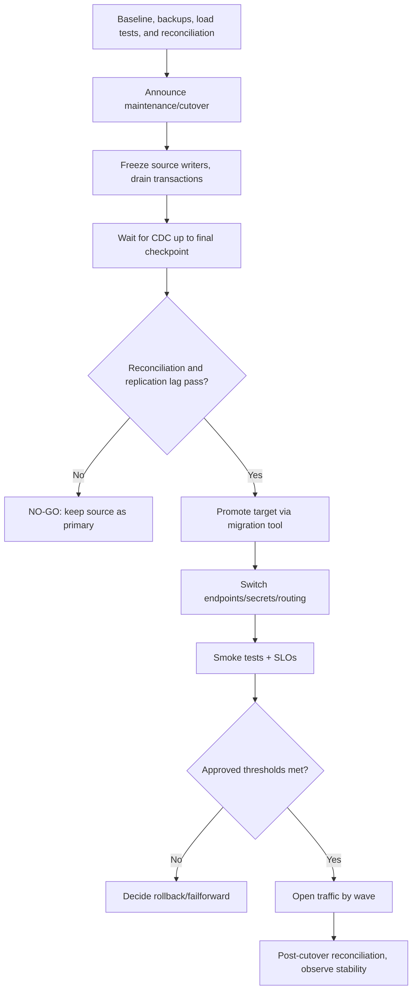

# Data Reconciliation, Load Testing, and Rollback Planning

Migrating an application to Google Cloud does not end when the new VM, Cloud SQL instance, Cloud Run service, GKE cluster, or bucket starts running. A migration is acceptable only when **data is accurate and complete**, **performance handles real-world load**, and **the recovery plan has been rehearsed**.

For example, an ordering system moves its PostgreSQL database from on-premises to Cloud SQL for PostgreSQL. Row counts may match while the final updates on the source have not yet been applied by CDC. The API may pass a smoke test at 5 requests/sec yet time out at 500 requests/sec. Once new orders hit the destination after cutover, editing the connection string back to the old database cannot automatically bring those new orders back to the source.

This lesson belongs to the **Migrating to Google Cloud** chapter in the **CLOUD_PROVIDERS_GCP** module. It follows dependency discovery, selecting Compute Engine/GKE/Cloud Run, databases and storage, IAM/VPC, automated delivery, observability, reliability, and cost.

## 1. Learning Objectives

After this lesson, you will be able to:

- Distinguish structural validation, row counts, key-by-key reconciliation, hashing, and business invariants.
- Choose consistent checkpoints when moving data via snapshots, CDC, or incremental copies.
- Design an auditable reconciliation report with pass/fail criteria ranked by criticality.
- Build a load test plan covering workload mix, throughput, p95/p99 latency, error rate, and saturation.
- Define Go/No-go thresholds grounded in SLOs, RTO, RPO, and business requirements.
- Author cutover and rollback/failback/failforward runbooks tailored to data state.
- Articulate the limits of DMS, Datastream, and backup/PITR, plus actions needed before and after the target accepts new writes.
- Execute rehearsals and validate migrations once production traffic opens.

## 2. Three Pillars of Migration Verification

| Pillar | Question to Answer | Evidence |
|---|---|---|
| Data reconciliation | Are source and destination data complete, accurate, and consistent? | Row counts, key diffs, checksums, invariants, checkpoints |
| Load testing | Can the target handle current load, peaks, and expected failure modes? | RPS/TPS, p95/p99, error rate, CPU, memory, DB connections |
| Rollback/recovery | If an incident hits, can app and data recover within approved limits? | Runbook, rehearsal, backup/PITR tests, RTO/RPO, approvers |

Never treat any one pillar as proof substituting for the other two. Data accurate at rest can diverge under concurrent writes; a passing load test can miss a single dropped order; having backups does not prove you can restore within RTO.

### 2.1. Roles in a Migration Wave

- **Migration lead / incident commander:** coordinates the change window and holds STOP authority.
- **DBA / data owner:** manages schemas, snapshots, CDC, reconciliation, backups, and recovery.
- **Application owner:** validates business flows, endpoints, retries, caches, and background workers.
- **SRE / on-call:** monitors SLIs/SLOs, load tests, alerts, and recovery time.
- **Security / IAM owner:** verifies identities, permissions, encryption, networking, and audit trails.
- **Business approver:** confirms risk bounds, downtime, and acceptable data-loss tolerance.

Every step must have an owner, deadline, and go/abort criteria. Never wait until cutover hour to decide who holds decision authority.

## 3. Cataloging Data Requiring Verification

Scope goes beyond SQL tables. A workload may use:

| Data Type | Example | Verification Approach |
|---|---|---|
| Transactional | Orders, payments, ledgers | PKs, amounts, transactions, statuses, invariants |
| Reference/master | Customers, products, lookup codes | Key lists, versions, foreign keys |
| Object/blob | Images, PDFs, docs in Cloud Storage | Object manifests, sizes, checksums, metadata |
| Analytical | BigQuery partitions, summary tables | Partition aggregations, freshness, totals |
| Events/queues | Pub/Sub or outbox tables | Event IDs, offsets/checkpoints, backlogs, idempotency |
| Cache | Redis/Memorystore | Typically invalidated or rebuilt deliberately |
| Search index | Lookup indices | Document counts, sample query results, freshness |

Separate **sources of truth**, derived data, caches, and rebuildable datasets. Never treat a cache like a transactional database. If an object underwent type, schema, or encoding conversion, define the mapping before comparing values.

### 3.1. Data Inventory

For each dataset, record:

- Source endpoint/engine, destination service, and location.
- Data owner, sensitivity classification, and retention.
- Record scope: tenants, time ranges, soft deletes, archived rows.
- Schema mapping and transformation version.
- Initial load, CDC, or incremental sync method.
- Snapshot checkpoint and transaction log position.
- Expected volume, size, and churn rate.
- Pass/fail rules for standard vs. critical data.

Any table group lacking clear reconciliation criteria should be considered **unready for cutover**, even if the copy tool reports completion.

## 4. Reconciling Schema Before Reconciling Content

Inspect both source and destination:

- List of databases, schemas, tables, and collections.
- Column names, types, precision/scale, nullability, and defaults.
- Primary keys, unique keys, foreign keys, and indexes.
- Collations, Unicode encodings, time zones, and timestamp precision.
- Sequences/identities and next values.
- Triggers, stored procedures, scheduled jobs, and extensions.
- Partitioning, TTL, retention, auditing, and soft-delete behavior.

For example, if `decimal(18,2)` became `float`, both sides might report identical row counts while monetary amounts are subtly rounded. If source timestamps stored local time while the target assumed UTC, rows may shift by hours and land in different date partitions.

In heterogeneous migrations, source and target schemas may **intentionally differ**. Maintain a mapping specification and test transformations instead of comparing raw DDL blindly.

## 5. Five Layers of Data Reconciliation

### 5.1. Layer 1: Row Counts

Example with PostgreSQL:

```sql
-- Run on source and target snapshots at the same logical checkpoint.
SELECT COUNT(*) AS order_count
FROM orders
WHERE created_at < TIMESTAMPTZ '2026-11-01 00:00:00+00';
```

Hypothetical report:

| Dataset | Source | Destination | Variance | Verdict |
|---|---:|---:|---:|---|
| `customers` | 1,800,000 | 1,800,000 | 0 | Count pass; insufficient alone |
| `orders` | 3,200,000 | 3,199,998 | -2 | Fail; investigate |
| `order_items` | 8,100,000 | 8,100,000 | 0 | Verify content |
| `payment_events` | 4,400,000 | 4,400,000 | 0 | Verify event IDs and business rules |

Matching row counts do not prove rows are identical. One missing key and one extra key cancel out in `COUNT`.

### 5.2. Layer 2: Chunked Aggregations

Partition large datasets by date, tenant, or primary-key range to localize discrepancies:

```sql
SELECT
  DATE(created_at AT TIME ZONE 'UTC') AS event_day,
  COUNT(*) AS row_count,
  SUM(total_minor_units) AS total_minor_units
FROM orders
WHERE created_at >= TIMESTAMPTZ '2026-10-01 00:00:00+00'
  AND created_at <  TIMESTAMPTZ '2026-11-01 00:00:00+00'
GROUP BY 1
ORDER BY 1;
```

For multi-currency data, group by `currency`; never sum USD and VND into a meaningless total. For decimals, normalize rounding before comparing. When keys are skewed, chunk by PK range or stable token range rather than date alone.

### 5.3. Layer 3: Key and Row-by-Row Matching

Check:

- Keys present in source but missing at destination.
- Keys present at destination that do not belong to source scope.
- Rows with matching keys whose normalized values differ.
- Versions, modified timestamps, and soft-delete tombstones.
- Foreign key values and domain-critical columns.

Illustrative SQL when both snapshots are staged in a **single comparison database**:

```sql
SELECT
    COALESCE(s.id, d.id) AS order_id,
    CASE
      WHEN s.id IS NULL THEN 'ONLY_DESTINATION'
      WHEN d.id IS NULL THEN 'ONLY_SOURCE'
      WHEN s.status IS DISTINCT FROM d.status
        OR s.total_minor_units IS DISTINCT FROM d.total_minor_units
        THEN 'VALUE_MISMATCH'
      ELSE 'MATCH'
    END AS verdict
FROM source_snapshot_orders s
FULL OUTER JOIN destination_snapshot_orders d USING (id)
WHERE s.id IS NULL
   OR d.id IS NULL
   OR s.status IS DISTINCT FROM d.status
   OR s.total_minor_units IS DISTINCT FROM d.total_minor_units;
```

Do not assume SQL can query two databases across separate networks directly. For cross-system comparisons, run a reconciliation job reading key chunks or load controlled snapshots into an isolated comparison environment.

### 5.4. Layer 4: Hashing and Checksums

On large tables, chunked hashing catches subtle differences even when counts match. Workflow:

1. Select column list and transformation version.
2. Normalize encoding, time zones, decimals, nulls, and array ordering.
3. Sort by stable primary key.
4. Encode records unambiguously using length-prefixed or canonical serialization.
5. Compute per-record hashes (e.g., SHA-256), then aggregate chunk hashes deterministically.
6. Compare checksums; drill down to individual keys on mismatch.
7. Log snapshot checkpoint, record count, algorithm/version, and result.

```text
for each deterministic primary-key chunk:
  source_rows = read_source_at_checkpoint(chunk)
  destination_rows = read_destination_at_checkpoint(chunk)
  assert primary_keys match

  for each key:
    source_hash = SHA256(canonicalize(source_row))
    destination_hash = SHA256(canonicalize(destination_row))
    if source_hash != destination_hash:
      record_mismatch(key)

  save_report(chunk, mismatch_count, checkpoint)
```

Do not treat `COUNT` or summed CRC32 values as strong cryptographic proof. CRC32C is great for catching transit corruption, but collisions can occur and it should not replace strong checksums for financial records.

### 5.5. Layer 5: Business Invariants

Some discrepancies never surface when checking individual columns in isolation:

- `order_total = SUM(order_items) + tax - discount`.
- Ledger balances reconcile across committed transactions.
- Zero successful payments without a valid order.
- Zero duplicate event processing causing duplicate invoices.
- Inventory never goes negative outside explicitly agreed exceptions.
- Foreign keys and uniqueness remain intact.
- Totals by currency/tenant/day match the accounting system.

Business owners must sign off on invariants and tolerances. For monetary data, a single mismatched transaction can be a severe defect; never apply a blanket 0.1% tolerance across every table.

## 6. Choosing a Consistent Checkpoint

### 6.1. Risks While Data Continues Mutating

Reading source at 10:00 and destination at 10:03 while CDC runs can show:

- New orders present on source but not yet at destination.
- Price updates committed on source while destination still holds the prior version.
- Deletes applied on one side before the other reaches the same checkpoint.

Comparing two unaligned timestamps produces false mismatches—or worse, masks genuinely missing data.

### 6.2. Checkpoint Strategies

- **Write freeze:** stop source writes and wait for CDC to catch up to the final position.
- **Consistent snapshot:** read at a transactionally consistent snapshot per engine capabilities.
- **Log watermark:** record meaningful LSN/WAL, binlog position, GTID, or event sequence on both ends.
- **Application version:** use domain sequences/versions if engineered upfront.

Never rely on wall-clock timestamps from two hosts as proof of sync when clock skew exists or timestamps do not reflect commit order. Likewise, do not mix source LSNs with downstream event offsets without a defined mapping.

### 6.3. DMS, Datastream, and GCP Transfer Tools

| Need | Suitable Tool | What Must Be Verified |
|---|---|---|
| Database to Cloud SQL/AlloyDB | Database Migration Service for supported engines/types | Full load, CDC, replication delay, promotion |
| CDC to analytics/supported targets | Datastream | Backfill, apply ordering, delay, schema changes |
| Files and large objects | Storage Transfer Service or data transfer tooling | Manifests, checksums, failure retries, metadata |
| Heterogeneous schemas | Dedicated conversion tools + transform/ETL | Mappings, precision, duplicates, semantics |
| Near-zero downtime requiring parallel writes | Engineered CDC, outbox, or dual-write | Conflicts, idempotency, partial failures |

DMS handles initial loads and CDC across supported scenarios. "Migration job Running" or "Completed" only reflects tool state—it does not verify business invariants.

### 6.4. Pre-Promotion Gate

Before switching writes from source to destination:

- Confirm zero uncontrolled writers remain on the source.
- Stop batches/schedulers, drain open transactions, and verify write freeze.
- Record the final committed checkpoint.
- Wait for CDC to apply all changes through that checkpoint.
- Verify replication delay is at or near 0 per approved criteria.
- Confirm zero un-backfilled tables or unresolved errors.
- Reconcile critical data by key, hash, and invariants.
- Smoke-test IAM permissions, network links, secrets, and target applications.

Near-zero replication lag **does not prove** data correctness if schema mappings failed or events were filtered out. Pair it with a reconciliation report.

## 7. Reconciliation Reports and Mismatch Triage

A report can be stored as JSON/YAML:

```yaml
migration_wave: orders-wave-3
source: onprem-postgres
destination: cloudsql-postgres-orders
checkpoint: checkpoint-id-or-log-position
snapshot_time_utc: "2026-11-01T00:00:00Z"
mapping_version: "v4"
datasets:
  - name: orders
    source_count: 3200000
    destination_count: 3200000
    missing_keys: 0
    extra_keys: 0
    content_mismatches: 0
    invariant_failures: 0
    status: PASS
  - name: payment_events
    source_count: 4400000
    destination_count: 4400000
    missing_keys: 0
    content_mismatches: 0
    invariant_failures: 0
    status: PASS
approved_by: DATA_OWNER
```

This is illustrative data. Production reports should also record start/end timestamps, job identity, partitions, hash algorithm, read-error counts, run/retry IDs, and approver signatures.

Classifying mismatches:

| Category | Meaning | Investigation Path |
|---|---|---|
| `MISSING_TARGET` | Key on source, missing at destination at checkpoint | CDC backlog, filters, failed copy |
| `EXTRA_TARGET` | Unexpected key only at destination | Test data, stale sink, duplicates |
| `CONTENT_MISMATCH` | Key matches, values differ | Transforms, timestamps, unapplied updates |
| `IN_FLIGHT` | Still catching up to watermark | Re-check after catch-up |
| `INTENTIONAL_EXCLUDE` | Explicitly excluded from migration | Cross-check mapping spec |
| `READ_PERMISSION_ERROR` | Tool lacked permissions to inspect | IAM, snapshots, connections |
| `BUSINESS_INVARIANT` | Business logic violated despite row parity | Check mappings and transactions |

Never mark a report `PASS` when a critical table was skipped due to permission errors or job timeouts. Every exception needs an owner, rationale, deadline, and decision.

## 8. Performance Baselines Before Shifting Load

Load-testing the target is meaningless without knowing source load. Capture a baseline across a representative period:

- RPS/TPS by hour, day, and campaign peak.
- Client-side and server-side p50, p95, p99 latency.
- Error ratio, timeouts, retries, and circuit-breaker trips.
- CPU, memory, disk IOPS, and network egress/ingress.
- DB connections, pool wait times, query latency, and locks/deadlocks.
- Request payload and response size distributions.
- Read/write ratio, hot keys, and queries per request.
- Queue backlogs, message age, and batch completion times.

Align on units, percentile definitions, and time windows. Never compare client-measured p95 on source against server-measured p95 on target without accounting for TLS and network hops.

### 8.1. Workload Mix

Hypothetical example:

| Request Group | Share | Characteristics |
|---|---:|---|
| Read catalog | 55% | Read-heavy, cached |
| Read order | 20% | SQL reads |
| Create/update order | 15% | Transactions, locks, events |
| Authentication/profile | 10% | IAM/sessions, data lookups |

Assume steady-state traffic of 200 RPS, observed peak of 500 RPS, and capacity test target of 750 RPS. These are **illustrative figures**—substitute your organization's real measurements. A system surviving 500 read-only RPS can collapse under 100 write RPS due to locks or database connections.

## 9. Types of Load Tests to Run

| Test | Objective |
|---|---|
| Baseline | Compare target vs. source under identical workload |
| Load / steady-state | Confirm sustained committed throughput |
| Spike | Test abrupt short-duration bursts |
| Stress | Find degradation limits and load-shedding behavior |
| Soak | Uncover memory/connection leaks and queue buildup |
| Failover | Test recovery when a node, instance, or dependency fails |
| Migration rehearsal | Measure downtime, CDC catch-up, cutover, and rollback |

Never run uncontrolled stress tests against production. Run tests in approved projects/environments with strict timeboxes, quota/budget caps, and explicit abort criteria.

### 9.1. Example k6 Load Test

Example strictly for an **approved staging/sandbox environment**, targeting a read-only endpoint with test data:

```javascript
import http from 'k6/http';
import { check } from 'k6';

const baseUrl = __ENV.BASE_URL;
if (!baseUrl) {
  throw new Error('Set BASE_URL to an approved staging endpoint');
}

export const options = {
  scenarios: {
    steady: {
      executor: 'constant-arrival-rate',
      rate: 50,
      timeUnit: '1s',
      duration: '5m',
      preAllocatedVUs: 50,
      maxVUs: 150
    }
  },
  thresholds: {
    http_req_failed: ['rate<0.01'],
    http_req_duration: ['p(95)<800']
  }
};

export default function () {
  const res = http.get(baseUrl + '/api/catalog?limit=20', {
    timeout: '10s',
    tags: { operation: 'catalog-read' }
  });
  check(res, { 'status is 200': r => r.status === 200 });
}
```

50 RPS, p95 < 800 ms, and < 1% errors are illustrative, **not default SLOs**. With k6's arrival-rate executor, `preAllocatedVUs` and `maxVUs` cap concurrent virtual users, not target RPS directly. If the load generator itself saturates, measured RPS drops below target even before the target system saturates.

For write tests, use dedicated load-test accounts/tenants and idempotency keys. Never put real customer data or production credentials into load scripts.

### 9.2. Load Ramp-Up Sequence

1. Warm up at low load, verifying autoscaling and readiness.
2. Hold at average steady-state load.
3. Ramp to observed production peak.
4. Test required headroom capacity.
5. Run a soak test long enough to expose leaks or backlog drift.
6. Ramp down and verify clean recovery.
7. Repeat with write-heavy and mixed workloads.
8. Inspect newly generated records after the test.

Define stop triggers upfront: error rate breaching danger thresholds, database disk filling up, unbounded queue age growth, budget overrun, or collateral impact on shared environments.

### 9.3. Throughput and Concurrency Formula

By Little's Law, near steady state:

```text
concurrency ≈ throughput × average response time

500 requests/second × 0.25 second ≈ 125 in-flight requests
```

This is an average approximation. Track p95/p99, retries, bursts, and connection reuse as well—never judge user experience from mean latency alone.

## 10. Monitoring GCP Components During Load Tests

### 10.1. Cloud Run

Watch request count, p95/p99, error ratio, CPU/memory, instance count, container concurrency, startup latency, and max-instances throttling. Hitting max instances queues requests and causes timeouts; scaling instances up too fast can trigger a connection storm on Cloud SQL.

Size connection pools and concurrency against DB capacity; never raise max instances in isolation while ignoring downstream bottlenecks.

### 10.2. GKE

Watch pod readiness, crashes/restarts, resource requests/limits, CPU throttling, HPA desired vs. actual replicas, pending pods, cluster/node autoscaler activity, ingress latency, and service-to-service errors.

HPA may demand more replicas when the node pool is out of capacity, leaving pods `Pending`. During load tests, distinguish application errors from platform scheduling bottlenecks.

### 10.3. Compute Engine and Databases

On VMs/Cloud SQL/AlloyDB, watch CPU, memory, disk IOPS, active connections, pool wait times, slow queries, lock waits, deadlocks, transaction latency, and network RTT. When CDC is active, monitor WAL/binlog growth, apply throughput, and replication delay under rising write load.

Load tests can spike replication backlogs ahead of cutover. Measure catch-up duration after throttling or stopping writes, not just API throughput.

### 10.4. Illustrative Criteria Table

| Metric | Source Baseline | Staging Target | Example Gate |
|---|---:|---:|---|
| Stable throughput | 500 RPS | 520 RPS | ≥ 500 RPS |
| HTTP error ratio | 0.08% | 0.06% | ≤ 0.1% |
| p95 latency | 380 ms | 350 ms | ≤ 450 ms |
| p99 latency | 900 ms | 820 ms | ≤ 1,000 ms |
| Peak DB connections | 320 | 280 | ≤ 400 |
| CDC delay under write test | 2 s | 3 s | ≤ 10 s |

All numbers are hypothetical. For real projects, lock thresholds and sign-off owners before running tests; never move goalposts after seeing results just to report `PASS`.

## 11. Combining Load Testing with Data Verification

An empty database does not represent production. Ensure test datasets mirror production across:

- Row counts, table sizes, and tenant distributions.
- Hot keys and temporal skew.
- Indexes, partitions, query statistics, and read/write ratios.
- Small vs. large payload distributions.
- Queue/event traffic and downstream dependency chains.

Never copy sensitive data into sandboxes without approved masking. Masking should roughly preserve data distributions without exposing PII.

After load tests, verify:

- Committed transaction counts and final order numbers.
- Zero duplicate payment event processing.
- Queue backlogs drain cleanly once load stops.
- Retries and timeouts did not create duplicate rows.
- Zero data corruption, hung locks, or sequence collisions.
- Test data is cleaned up within scope without touching real users.

## 12. Pre-Cutover Go/No-Go Gate

Preparation checklist:

- [ ] Workload inventory, dependencies, and source/destination are locked.
- [ ] Data mappings and reconciliation report exist at an explicit checkpoint.
- [ ] Zero critical mismatches; any minor exceptions are formally approved.
- [ ] Migration job/CDC has zero unresolved errors; replication delay meets threshold.
- [ ] Load, stress, and soak tests meet minimum criteria.
- [ ] IAM, secrets, VPC, DNS, certificates, and target endpoints are tested.
- [ ] Backup/PITR and restore rehearsals passed.
- [ ] Every writer and background job is cataloged.
- [ ] Write-freeze and in-flight transaction drain procedures exist.
- [ ] SLO dashboards, alerts, and on-call are staffed.
- [ ] Clear point of no return and data-state-specific runbooks exist.
- [ ] Business owner signed off on RPO/RTO and downtime window.

A structured gate definition:

```yaml
cutover_gate:
  data:
    critical_mismatches: 0
    source_writes_frozen: true
    all_changes_to_checkpoint_applied: true
  load:
    peak_throughput_passed: true
    p95_within_slo: true
    error_ratio_within_slo: true
  recovery:
    restore_rehearsal_passed: true
    rto_rpo_approved: true
  security:
    iam_and_network_verified: true
  decision: APPROVE_OR_NO_GO
```

This is an illustrative checklist, not a Google Cloud API configuration. Never proceed with cutover if any mandatory condition lacks evidence.

## 13. Step-by-Step Cutover Runbook



Sample execution sequence:

1. **T-1 day:** freeze code/schemas, verify backups and rehearsals, save baseline reconciliation.
2. **T-60 min:** open war room; confirm decision maker, SRE, DBA, and data owner.
3. **T-15 min:** disable write-capable batches/schedulers; lower DNS TTL if approved.
4. **T0:** freeze source writers and drain in-flight requests/transactions.
5. **T+N:** record final transaction checkpoint; wait for CDC to apply all changes through it.
6. **T+N:** run final reconciliation and confirm zero critical mismatches.
7. **T+N:** promote destination per migration type and wait for completion.
8. **T+N:** switch application configs, service accounts, endpoints, routing, and workers.
9. **T+N:** run smoke tests with synthetic data, measure SLIs, and inspect error logs.
10. **T+N:** ramp traffic in waves while watching performance and integrity.
11. **T+N:** sign off cutover and enter the observation window.
12. **Afterward:** retain source and backups through the fallback window—do not delete immediately.

Every T+N step needs a rehearsal-backed time limit. If a step exceeds its cap, the incident commander invokes the corresponding STOP/NO-GO/rollback branch.

### 13.1. DMS PostgreSQL Promotion

For PostgreSQL continuous migration, Google Cloud specifies:

- Stop all writes, scripts, and client connections to the source.
- Wait for replication delay to reach 0 or near 0.
- Run promote on the validated job.
- Promotion breaks the replication link and makes the target an independent primary database.

Reference command—**run only after formal cutover approval**:

```bash
gcloud database-migration migration-jobs promote MIGRATION_JOB_ID \
  --region=REGION \
  --project=PROJECT_ID
```

The command returns a long-running operation; do not treat the returned operation ID as completion. Monitor job/operation status before switching applications. Post-promotion, re-verify backups, PITR, privileges, and IaC config on the destination per engine/migration mode requirements.

## 14. Distinguishing Rollback, Failback, and Failforward

- **Rollback:** undo a change step or revert the application to a prior version on compatible data.
- **Failback:** move the workload from target back to the previous source, potentially requiring reverse data synchronization.
- **Failforward:** keep the target as source of truth and fix issues via config, scaling, code rollback, or targeted recovery.

Swapping a connection string is not a data rollback plan.

### 14.1. Decision Matrix

| State | Viable Path | Condition |
|---|---|---|
| Before write freeze | Abort migration and stay on source | Source intact and authoritative |
| After freeze, before promote | Usually safe to reopen source after checks | Zero half-finished transactions/jobs |
| After promote, before target writes | Can consider routing back to source | Must verify zero side effects or new writes |
| Target has accepted new writes | Do not flip straight back to source | Needs reverse sync/reconciliation or failforward |
| New schema incompatible with old app | Code rollback may be unsafe | Use expand/contract, forward fix, or restore |
| Target has runtime bug, data is sound | Prefer app rollback or failforward | Confirm target database remains authoritative |

**The point of no simple return** arrives once the target commits new transactions absent from the source. After DMS promotion, do not assume reverse replication exists; failback requires an independently designed and tested mechanism.

### 14.2. Rollback Before Promotion

1. Halt cutover tasks and declare NO-GO.
2. Confirm source data and access permissions remain intact.
3. Inspect in-flight transactions and job schedules.
4. Reopen source writers in approved order.
5. Restore schedulers, consumers, and application endpoints to pre-cutover state.
6. Run smoke tests on source and verify business invariants.
7. Log root cause and improve before the next migration attempt.

Do not destroy replication state or delete the destination mid-investigation if comparison data is still needed as evidence.

### 14.3. Failback After Destination Writes

High-risk scenario: new orders committed on target Cloud SQL are missing on the old source. To return to source:

1. Throttle or halt target writes per emergency procedure.
2. Record checkpoints and preserve post-cutover data/events.
3. Identify keys/versions existing only at the destination.
4. Define conflict resolution per entity.
5. Execute reverse replication/CDC if pre-designed, supported, and tested—or run controlled export/replay.
6. Reconcile keys, content, events, and invariants.
7. Shift traffic only after the source is confirmed consistent.
8. Run smoke tests and monitor transaction counts and side effects.

Without a reliable reverse-sync mechanism, failback cannot be promised in minutes. Expect extended maintenance, a forward fix, or restore+replay within approved RPO.

### 14.4. Rolling Back Code While Keeping Cloud SQL

If a failure comes from a container image, config, or feature flag, it is often simpler and safer to:

- Keep target Cloud SQL as the authoritative data source.
- Revert the Cloud Run revision or GKE image to a known-good release.
- Confirm schemas and event formats remain backward-compatible with old code.
- Use feature flags to disable faulty paths.
- Monitor latency, error ratio, and consistency.

Application rollback does not automatically undo data migrations, schema changes, or externally emitted events.

## 15. RPO, RTO, and Backup/PITR

**RPO** is the maximum acceptable data loss (measured in time). **RTO** is the maximum acceptable time to restore service after an outage. Both must be defined by the business.

For example, a payment system demands RPO=0 for confirmed transactions; a 15-minute-old snapshot violates that requirement. For analytics replayable from event logs, a few minutes of freshness lag may be acceptable.

Before migration:

- Verify source backups run and can actually restore.
- Verify backup/retention on the destination post-promotion.
- Check KMS keys, restore permissions, and backup storage locations.
- Rehearse restores into an isolated environment—never overwrite production.
- Measure actual restore duration against RTO.
- Separate data restore procedures from application rollback procedures.
- Keep source and backups intact until the fallback window closes.

PITR recovers to a supported point in time, yet **does not preserve transactions occurring after that point**. When zero data loss is required, you need replay/merge mechanisms or reliable replication.

### 15.1. Example Rehearsal Timeline

| Step | Measured Time | Limit |
|---|---:|---:|
| Write freeze | 2 min | 5 min |
| CDC catch-up | 4 min | 10 min |
| Final reconciliation | 3 min | 8 min |
| Endpoint/routing switch | 5 min | 10 min |
| Smoke test and decision | 4 min | 7 min |
| Total cutover | 18 min | 40 min |

Numbers are illustrative. In real systems, if an individual step breaches its cap, trigger the rollback/NO-GO branch rather than burning through the entire maintenance window.

## 16. What Must a Rollback Runbook Contain?

```text
MIGRATION_WAVE: orders-wave-3
CURRENT_SOURCE_OF_TRUTH: [source | destination]
LAST_VERIFIED_CHECKPOINT: [...]
DESTINATION_WRITES_SINCE_CUTOVER: [yes | no | unknown]

STOP TRIGGERS:
  - critical data mismatch
  - error ratio or latency exceeds agreed SLO
  - migration step exceeds maximum duration
  - IAM/network failure prevents safe operations

ACTIONS:
  1. Incident commander declares STOP.
  2. Pause or restrict new writes and traffic as authorized.
  3. Record checkpoints; preserve logs, backup and evidence.
  4. Confirm whether destination has committed new writes.
  5. Select rollback app / failback data / failforward.
  6. Execute the corresponding tested branch.
  7. Reconcile data and run smoke tests.
  8. Confirm SLI recovery, communicate, document incident.
```

If new-write status is `unknown`, never default to `no`. Verify before switching back to source. Every runbook branch needs an owner, exact commands/actions, maximum duration, and success criteria.

## 17. Reducing Migration Blast Radius

### 17.1. Waves and Canaries

Migrating by tenant, region, or workload reduces risk. However, application canaries do not solve data divergence automatically. Old and new versions must agree on which datastore is authoritative; never let a user write concurrently to two databases without conflict/reconciliation logic.

### 17.2. Dual-Write and Outbox

Dual-writes can shrink downtime at the cost of partial failures where one write succeeds and the other fails. If used, require:

- Idempotency keys and event IDs.
- Retry rules and partial-success handling.
- Outbox or change logs for replay.
- Conflict resolution and transaction ordering.
- Periodic checkpoint-based reconciliation.
- Narrow scope and rehearsals with failure injection.

Never bolt dual-write onto production on cutover day just to "have a rollback."

### 17.3. DNS, Secrets, and Background Writers

- DNS TTL does not force every client to refresh immediately.
- Connection pools may hold stale connections after secrets or endpoints change.
- Batch jobs, schedulers, and message consumers may bypass HTTP routing.
- External integrations might keep pushing data to the old source.
- IAM/VPC/private IP changes must be tested from the workload's real identity.

Inventory every writer—not just frontend APIs.

## 18. Observability During and After Cutover

Shared dashboard:

| Layer | Metrics |
|---|---|
| User experience | Availability, p95/p99, error ratio, RPS |
| Runtime | CPU/memory, concurrency, restarts, OOM, autoscaling |
| Database | Connection count, locks, slow queries, disk I/O |
| CDC/pipeline | Backfill progress, errors, replication lag, checkpoints |
| Messaging | Pub/Sub unacked messages, oldest message age, retries |
| Network | Latency, connectivity, load balancer errors |
| Security | IAM denials, secret access, KMS/audit logs |
| Cost | VM/instance counts, DB tier, network egress, operation volume |

Monitor for hours or days post-cutover depending on SLA and risk. Decommission the source only after the fallback window ends, zero dependencies remain, data owners sign off, and zero critical mismatches exist.

## 19. Common Mistakes

| Mistake | Consequence | How to Avoid |
|---|---|---|
| Reconciling row counts only | Corrupt content slips through | Check keys, hashes, and invariants at a checkpoint |
| Comparing at two different timestamps | False mismatches from in-flight CDC | Use consistent checkpoints or write freezes |
| Watching replication lag alone | Misses mapping or backfill bugs | Verify individual tables and payloads |
| Load-testing an empty database | Unrepresentative performance | Use production-like scale and distributions |
| Testing read-only requests | Misses lock and write bottlenecks | Mirror production read/write mix |
| Under-powered load generator | Misjudges target capacity | Monitor generator machines too |
| Running unapproved load tests on prod | Impacts live users and bills | Use sandboxes and explicit stop triggers |
| Promoting while source writers run | Lost or divergent data | Freeze, drain, and checkpoint |
| Flipping DNS back after new target writes | Source misses new transactions | Run reverse sync or fail forward |
| Having backups without restore tests | Real RTO remains unknown | Rehearse restore and PITR |
| Rolling back code across breaking schemas | Old app fails to run | Maintain expand/contract compatibility |
| Forgetting background consumers | Writes hit the wrong DB | Catalog every writer completely |
| Deleting the source immediately | Eliminates fallback options | Retain per plan |
| No per-step deadlines | Unbounded downtime extension | Timebox steps and enforce STOP gates |

## 20. Guided Practice Exercise

**Context:** A Java/Spring order-processing app runs on self-managed PostgreSQL moving to Cloud SQL for PostgreSQL, with the app moving to Cloud Run or GKE.

**Test dataset:**

- 100,000 `orders` and 300,000 `order_items`.
- 10,000 `payment_events` with unique event IDs.
- Ongoing updates/deletes simulated during initial copy.
- Zero real user data.

**Tasks:**

1. Create source/destination schemas in a test project.
2. Seed sample data and simulate write bursts.
3. Run initial copy and continuous sync using appropriate tooling.
4. Record checkpoints, run counts, and compare keys/hashes by chunk.
5. Intentionally inject a mismatch to observe a `FAIL` report.
6. Run k6/JMeter with a controlled read/write mix and measure p95/p99.
7. Ramp down and verify database connections and CDC catch-up.
8. Rehearse write freeze, checkpointing, and final reconciliation.
9. Trigger a NO-GO before promotion and verify the source keeps serving.
10. Practice application rollback while target stays active, without attempting un-engineered reverse data sync.
11. Archive evidence: test reports, timelines, and decision records.

**Example completion criteria:** zero critical mismatches, zero duplicate payments, peak throughput and latency meet hypothetical SLOs, promotion runs only after CDC reaches the checkpoint, runbooks distinguish pre- vs. post-destination writes, and a restore rehearsal record exists.

## 21. Final Sign-Off Checklist

- [ ] Schema mappings, encoding, time zones, precision, and constraints are verified.
- [ ] Data shares a common logical snapshot/checkpoint.
- [ ] Counts, keys, hashes, and business invariants meet criteria.
- [ ] Mismatches are classified and resolved or formally waived.
- [ ] CDC/backfill/replication lag shows zero unresolved errors.
- [ ] Baselines captured and load/stress/soak tests executed.
- [ ] Load test data is representative and free of PII.
- [ ] Peak RPS, p95/p99, error ratio, and saturation are checked.
- [ ] DMS promote/cutover is gated on write freeze and reconciliation.
- [ ] RTO/RPO, backups/PITR, and restore rehearsals are signed off.
- [ ] Every writer, job, and consumer appears in the runbook.
- [ ] Owners, war room, alerts, deadlines, and stop triggers are defined.
- [ ] Pre-promotion rollback has been tested.
- [ ] Post-target-write failback relies on tested reverse sync or avoids promising instant failback.
- [ ] Code rollback / failforward playbooks exist when target data is sound.
- [ ] Auditing, telemetry, and post-cutover reconciliation are ready.
- [ ] Source is decommissioned only after stabilization and formal sign-off.

## Conclusion

Data reconciliation, load testing, and rollback planning form the verification triad for a Google Cloud migration. Reconciliation requires consistent checkpoints combining counts, keys, hashes, and business invariants; load testing must mirror real traffic and data, measuring p95/p99 latency, throughput, error ratios, saturation, and CDC catch-up speed.

Rollback is dependable only when you draw a clear line between before and after the target accepts new writes. DMS promotion severs source-to-target replication per its supported workflow and does not automatically create reverse sync. Runbooks should prioritize transaction safety, include failforward options where appropriate, rehearse backups/PITR, and secure Go/No-go gate approval ahead of cutover day.

## References

- [Google Cloud Architecture Center — Migrate large datasets](https://docs.cloud.google.com/architecture/migration-to-google-cloud-transferring-your-large-datasets)
- [Google Cloud Architecture Center — Validate a migration plan](https://docs.cloud.google.com/architecture/migration-to-google-cloud-best-practices)
- [Google Cloud Migration Center — Execute your migration](https://docs.cloud.google.com/migration-center/docs/migration-execution)
- [Google Cloud — Database Migration Service overview](https://docs.cloud.google.com/database-migration/docs/overview)
- [Google Cloud — Verify a MySQL migration](https://docs.cloud.google.com/database-migration/docs/mysql/verify-migration)
- [Google Cloud — Promote a PostgreSQL migration job](https://docs.cloud.google.com/database-migration/docs/postgres/promote-migration)
- [Google Cloud — Promote a MySQL migration job](https://docs.cloud.google.com/database-migration/docs/mysql/promote-migration)
- [Google Cloud — Cloud Run load testing best practices](https://docs.cloud.google.com/run/docs/about-load-testing)
- [Google Cloud — Migrate data and batch across regions](https://docs.cloud.google.com/architecture/migrate-across-regions/prepare-data-and-batch-workloads)
- [Google Cloud — Datastream FAQ](https://docs.cloud.google.com/datastream/docs/faq)
- [Google Cloud — Cloud SQL PostgreSQL replication lag](https://docs.cloud.google.com/sql/docs/postgres/replication/replication-lag)
