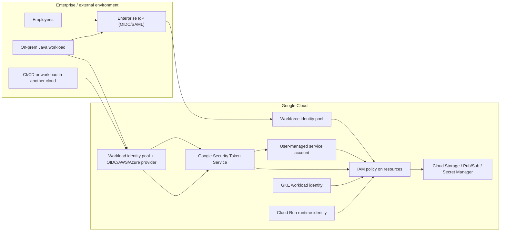
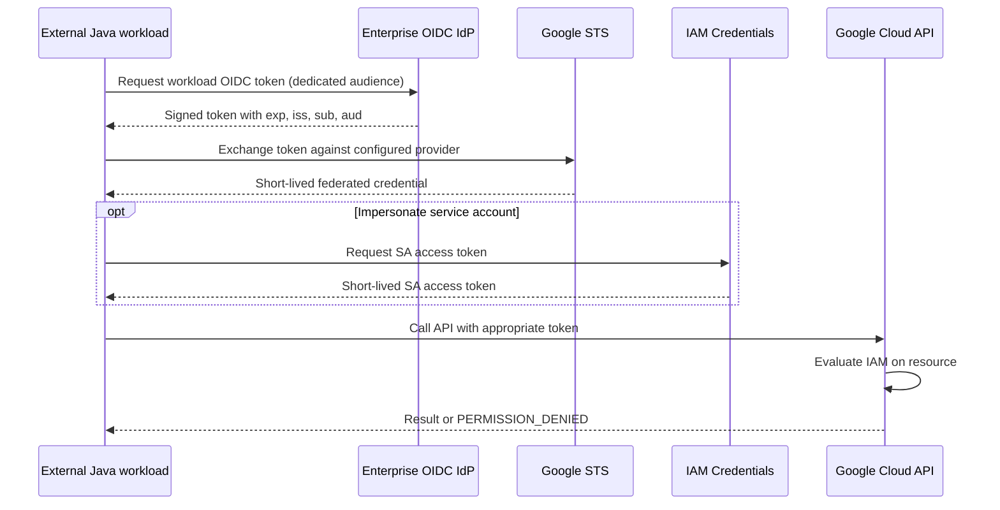
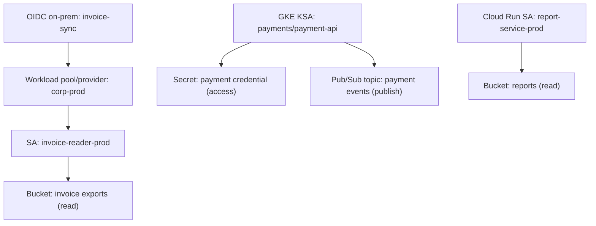

# Federating Enterprise Identity With Workloads on GCP

> **Chapter:** Hybrid and Multicloud Infrastructure  
> **Scope:** Google Cloud, module `CLOUD_PROVIDERS_GCP`. This lesson connects project organization, IAM, VPC, Compute Engine, GKE, Cloud Run, storage, and database knowledge with real-world deployment scenarios: service selection, resource protection, release automation, reliability monitoring, and cost control.

## 1. Learning Objectives and Business Problem

After this lesson, learners can:

1. Distinguish **human identity**, **workload identity**, **service account**, **identity provider (IdP)**, and **IAM permissions**.
2. Choose the right mechanism for enterprise users, applications on GCP, on-premises applications, applications on other clouds, and CI/CD pipelines.
3. Explain the short-lived token exchange flow via **Security Token Service (STS)**, **Workload Identity Federation (WIF)**, and **service account impersonation**.
4. Design attribute mappings, trust conditions, least-privilege permissions, and production/staging environment isolation.
5. Implement a reference scenario where a Java application running outside GCP accesses Cloud Storage without long-lived JSON keys.
6. Operate, audit, troubleshoot, and revoke access when an identity provider or workload experiences an incident.

### Background

An enterprise runs Active Directory/Microsoft Entra ID or an OIDC/SAML IdP, Java business systems in a data center, Kubernetes services on GKE, Cloud Run applications, and release pipelines on an external CI platform. These applications need to call Cloud Storage, Pub/Sub, or Secret Manager. An unsafe approach is copying Google service account JSON keys onto every server, container, and source repository. Keys can remain valid for a long time, leaks are hard to detect, and lifecycle management becomes manual.

The preferred design is **authenticate existing identity → verify trust conditions → obtain short-lived credentials → IAM evaluates permissions on target resources**. Identities may originate from an enterprise IdP, another cloud, Kubernetes, or a Google-managed runtime; however, **not all of them use the same pool or the same protocol**.

## 2. Separating Five Core Concepts

| Concept | Function | Example | Misconception to avoid |
|---|---|---|---|
| Identity provider (IdP) | Issues identity assertions after authentication | Enterprise OIDC issuer, Microsoft Entra ID, Okta, AWS identity | Successful IdP authentication does not mean GCP permissions are granted |
| Principal | Entity recognized by IAM | Google user, group, service account, federated subject | A principal can be an application rather than a human |
| Workload | Running process that needs to call APIs | On-prem Java batch, GKE pod, Cloud Run service | A workload should not use a developer's personal account |
| Authentication / federation | Proves identity and exchanges tokens | OIDC JWT → Google STS → access token | Does not automatically grant access to every resource |
| Authorization (IAM) | Determines permitted actions on a resource | `roles/storage.objectViewer` on a specific bucket | A valid token can still receive `PERMISSION_DENIED` |

A **Service account (SA)** is an identity for applications on Google Cloud. An SA is typically attached to a GCP runtime or **impersonated with authorization** (*service account impersonation*) by an external identity to obtain a short-lived access token. Do not equate an SA with an SA private key file: **an SA can be used without creating keys**.

**Federation** establishes a conditional trust relationship with another identity source. It does not migrate all enterprise accounts into Google Cloud, does not synchronize all groups by default, and does not create a private network connection in place of VPN/Interconnect.

### 2.1. Human identity and machine identity are two different problems

- **Employees/administrators**: use Google Workspace/Cloud Identity (optionally linked to a corporate directory) or **Workforce Identity Federation** to access the console, CLI, and APIs according to assigned roles. SSO/MFA and joiner–mover–leaver processes belong to the workforce layer.
- **Workloads outside GCP**: use **Workload Identity Federation** with a workload identity pool/provider, linking a token from an external IdP/CI/cloud to obtain short-lived credentials.
- **Workloads on GKE**: use **Workload Identity Federation for GKE**, based on Kubernetes service account (KSA) identities and the GKE metadata mechanism.
- **Workloads on Cloud Run/Compute Engine**: attach a **user-managed service account** to the running resource so the metadata server provides tokens without distributing private keys.

Despite similar names, **Workforce Identity Federation** and **Workload Identity Federation** are two distinct products/scopes. Never use a workforce pool to identify a daemon or pipeline, and never use a workload pool to grant employees console login access.

## 3. Reference Architecture for Hybrid Infrastructure



**Arrows represent identity and authorization relationships, not network paths.** In the direct branch, IAM grants permissions to the federated principal on the target resource; in the impersonation branch, the principal is allowed to obtain an SA token and the resource grants permissions to the SA. Choose **one** clear pattern per application—do not accidentally accumulate permissions across both.

### 3.1. Three-layer trust model

1. **Identity source**: who signs/issues tokens, which issuer endpoint is used, what `sub` and `aud` mean, and how signing keys rotate?
2. **Federation boundary**: which pool/provider accepts tokens, what mapping rules (`google.subject`, custom attributes), `attributeCondition`, and audiences are accepted?
3. **Resource boundary**: which principal/SA is granted IAM roles on a specific project, bucket, topic, secret, or resource set?

Rejection at any layer must cause access to fail. VPCs, firewalls, private routing, and DNS are still required if the application or service requires private network connectivity; token federation does not create a tunnel.

## 4. Mechanism Selection Table by Runtime Location

| Target | Preferred mechanism | Needs SA JSON key? | Characteristics |
|---|---|---|---|
| Operations staff | Cloud Identity/Google Workspace or Workforce Identity Federation | No | SSO, MFA, user lifecycle, IAM for users/groups/federated principals |
| On-prem Java batch with valid OIDC token | Workload Identity Federation + STS, direct or impersonation | No | Requires a trusted issuer and short-lived tokens |
| Application on AWS/Azure | Workload Identity Federation with appropriate provider | No | Leverages the cloud's native workload identity |
| External CI/CD pipeline | Workload Identity Federation with CI issuer, filtering repo/branch/environment | No | Avoids storing SA keys as CI secrets |
| Pod on GKE | Workload Identity Federation for GKE | No | Binds KSA/namespace to Google Cloud permissions |
| Cloud Run / Compute Engine | Attach user-managed service account | No | Runtime metadata supplies credentials |
| Legacy app without federation support | Evaluate proxy/token broker first | Discouraged | Long-lived keys only as a controlled exception |

**Decision rule:** prefer native runtime identities and short-lived credentials; use service account impersonation only when compatibility, centralized policy, or APIs lack direct-principal support.

## 5. IAM Foundations and Principal Structure

### 5.1. Separating projects, pools, and service accounts

A production design typically includes:

- Application resource projects (buckets, topics, secrets) separated from staging/dev.
- An identity administration project hosting pools/providers, or a shared security project with strict change controls.
- Dedicated service accounts scoped by **application + environment + purpose**, e.g., `invoice-reader-prod@PROJECT_ID.iam.gserviceaccount.com`.
- IAM roles bound at the narrowest resource level; never grant `roles/editor` or `roles/owner` by default.
- Separation between those who **manage federation/providers**, those who **grant permission to use SAs**, and those who **modify resource IAM**.

Creating a pool/provider **does not automatically grant access**. Only after an IAM policy binds the right principal or SA to a role can the corresponding APIs be called.

### 5.2. Principal syntax in IAM

For external Workload Identity Federation, the pool path uses the **project number**, not the alphanumeric project ID:

```text
principal://iam.googleapis.com/projects/PROJECT_NUMBER/locations/global/workloadIdentityPools/POOL_ID/subject/SUBJECT

principalSet://iam.googleapis.com/projects/PROJECT_NUMBER/locations/global/workloadIdentityPools/POOL_ID/attribute.ATTRIBUTE_NAME/ATTRIBUTE_VALUE
```

- `principal://.../subject/...` identifies a single specific subject.
- `principalSet://.../attribute.../...` identifies a set of subjects matching a mapped attribute. The attribute must be narrow enough not to include unintended workloads.
- `google.subject` must come from a trusted and stable source; avoid using only email or display names that can be changed or reused.
- `attribute.env=prod` **alone is insufficient** if multiple applications can emit `env=prod`. Add tenant/workload/repository/issuer checks in the provider condition or use a narrower principal.

**Distinction:** the pool lives in the project holding the trust configuration, while resources/SAs receiving IAM roles may live in another project. When constructing member principals, use the **project number of the project owning the pool**, not the target resource project's number.

### 5.3. Attribute mapping and access conditions

A typical OIDC JWT contains claims such as `iss`, `sub`, `aud`, `exp`, `tenant`, `environment`, and `workload_id`. Not all IdPs emit identical claim names.

Example design:

| IdP claim | Provider mapping | Purpose |
|---|---|---|
| `sub` | `google.subject=assertion.sub` | Uniquely identifies the subject |
| `workload_id` | `attribute.workload_id=assertion.workload_id` | Distinguishes applications |
| `environment` | `attribute.env=assertion.environment` | Isolates environments |
| `tenant` | Checked in condition | Accepts only the enterprise tenant |
| `aud` | Provider's allowed audiences list | Prevents accepting tokens issued for another recipient |

Example condition:

```text
assertion.tenant == 'company-prod' &&
assertion.environment == 'prod' &&
assertion.workload_id == 'invoice-sync'
```

Issuer, signature, expiration, audience, and attribute conditions must all match. **Never** trust claims supplied directly by an application if the token-issuing system does not enforce integrity and claim-issuance policies.

## 6. External Workload Identity Federation Flow



Operational steps:

1. The enterprise IdP authenticates the workload via its own mechanism (mTLS, managed identity, agent, or internally managed secret) and issues an OIDC token **specifically for** the trust relationship with Google.
2. Google STS validates the token against the provider: issuer, signing keys, audience, mappings, and conditions.
3. For **direct** access, the federated principal calls the API using IAM permissions on the target resource.
4. For **impersonation**, IAM checks `roles/iam.workloadIdentityUser` for the federated principal on the SA; IAM Credentials issues an SA access token; the API evaluates IAM attached to the SA.
5. Client libraries refresh credentials before expiry, provided the enterprise token source also supplies fresh tokens.

**Security note:** both the source token and Google token are bearer credentials valid for their lifetime. Never place tokens in URLs, logs, HTTP errors, CI artifacts, snapshots, or committed configuration files.

## 7. Lab: On-Prem Java Reading Cloud Storage Without an SA Key

Assume:

- The `invoice-sync` application runs in the enterprise data center.
- The enterprise operates OIDC issuer `https://identity.corp.example/oidc`. This is an **illustrative address** and must be replaced with a real issuer verifiable by GCP.
- The IdP issues tokens with `aud=gcp-invoice-prod`, `tenant=company-prod`, `environment=prod`, `workload_id=invoice-sync`, a stable `sub`, and valid signature/`exp`.
- The application is only allowed to **read objects** in bucket `gs://invoice-prod-export`.
- The operator has permissions to manage workload pools/providers and appropriate IAM bindings. Never use Owner for routine operations.

### 7.1. Prepare variables and services

The commands below illustrate Bash CLI usage; **do not run them verbatim in production**. Replace placeholders, verify projects/buckets, and apply changes through an approved workflow.

```bash
export PROJECT_ID="identity-security-prod"
export PROJECT_NUMBER="$(gcloud projects describe "$PROJECT_ID" --format='value(projectNumber)')"
export RESOURCE_PROJECT_ID="finance-prod"
export POOL_ID="corp-onprem-prod"
export PROVIDER_ID="corp-oidc"
export SA_EMAIL="invoice-reader-prod@finance-prod.iam.gserviceaccount.com"
export BUCKET="gs://invoice-prod-export"

# APIs used for trust exchange, impersonation, and resource APIs.
gcloud services enable sts.googleapis.com iam.googleapis.com \
  iamcredentials.googleapis.com --project="$PROJECT_ID"

# If the service account is in another project, enable required APIs there.
gcloud services enable iamcredentials.googleapis.com \
  storage.googleapis.com --project="$RESOURCE_PROJECT_ID"
```

In multi-project environments, verify which services are enabled on the consumer/quota project, organization policies, and `serviceusage.services.enable` permissions. Do not enable APIs indiscriminately on projects outside your assigned scope.

### 7.2. Create the workload identity pool

```bash
gcloud iam workload-identity-pools create "$POOL_ID" \
  --location="global" \
  --display-name="Corporate on-prem production" \
  --description="WIF for approved on-prem production workloads" \
  --project="$PROJECT_ID"
```

The pool is a trust configuration scope. It holds no workload private keys and does not yet grant the workload access to Cloud Storage.

### 7.3. Create an OIDC provider with claim validation

```bash
gcloud iam workload-identity-pools providers create-oidc "$PROVIDER_ID" \
  --project="$PROJECT_ID" \
  --location="global" \
  --workload-identity-pool="$POOL_ID" \
  --display-name="Corporate workload OIDC" \
  --issuer-uri="https://identity.corp.example/oidc" \
  --allowed-audiences="gcp-invoice-prod" \
  --attribute-mapping="google.subject=assertion.sub,attribute.workload_id=assertion.workload_id,attribute.env=assertion.environment" \
  --attribute-condition="assertion.tenant == 'company-prod' && assertion.environment == 'prod' && assertion.workload_id == 'invoice-sync'"
```

**Real-world checks before applying:**

- The issuer URL must match the JWT `iss` field and have reachable OIDC/JWKS metadata per provider requirements. If the IdP cannot meet this, consider a dedicated token-issuing/broker architecture rather than disabling signature checks.
- The audience value must match the exact `aud` claim issued by the IdP; an audience assigned to another application must not be reused.
- The definition and condition above **deliberately restrict to one workload**. For multiple applications, redesign with separate pools/providers or a shared condition plus narrow bindings—never remove the condition "just to make it work."
- The provider can live in a dedicated identity project; it does not need to match the project containing the bucket.
- If upgrades or rollbacks are needed, manage the provider via IaC with reviews and verify provider status before shifting traffic.

### 7.4. Allow the federated workload to impersonate the right SA

First create the SA in the resource project if it does not exist:

```bash
gcloud iam service-accounts create invoice-reader-prod \
  --project="$RESOURCE_PROJECT_ID" \
  --display-name="Invoice export read-only workload"
```

Then grant least-privilege permissions:

```bash
# Only identities with attribute.workload_id=invoice-sync in the pool
# (and passing the provider condition) can impersonate this SA.
export WIF_MEMBER="principalSet://iam.googleapis.com/projects/$PROJECT_NUMBER/locations/global/workloadIdentityPools/$POOL_ID/attribute.workload_id/invoice-sync"

gcloud iam service-accounts add-iam-policy-binding "$SA_EMAIL" \
  --project="$RESOURCE_PROJECT_ID" \
  --member="$WIF_MEMBER" \
  --role="roles/iam.workloadIdentityUser"

# Data permissions are attached only to the target bucket, not project-wide Storage Admin.
gcloud storage buckets add-iam-policy-binding "$BUCKET" \
  --member="serviceAccount:$SA_EMAIL" \
  --role="roles/storage.objectViewer"
```

In this example, the application **cannot** create buckets, delete objects, read other buckets, or administer IAM. Specific metadata/object-list permissions depend on SDK calls and bucket policies; if `list` is unnecessary, evaluate a custom role or narrower access design.

**Key rule:** `roles/iam.workloadIdentityUser` is granted **on the SA**, whereas `roles/storage.objectViewer` is granted **on the bucket**. Do not confuse permission to impersonate an SA with permission to read data. If the bucket resides in another project, the binding syntax still uses the SA email, though you need IAM-editing permission on that bucket.

### 7.5. Create the external-account credential configuration

A credential configuration describes how the SDK exchanges tokens; it is **not an SA JSON key**. Suppose the OIDC token source is updated by an internal IdP/agent into a file with restricted read permissions:

```bash
export PROVIDER_RESOURCE="projects/$PROJECT_NUMBER/locations/global/workloadIdentityPools/$POOL_ID/providers/$PROVIDER_ID"

gcloud iam workload-identity-pools create-cred-config \
  "$PROVIDER_RESOURCE" \
  --service-account="$SA_EMAIL" \
  --credential-source-file="/var/run/corp-identity/oidc-token" \
  --output-file="/etc/gcp/invoice-wif-config.json"
```

Operational notes:

- `/var/run/corp-identity/oidc-token` contains a **sensitive token**, must be atomically updated by a trusted agent, and must be mounted/ACL-restricted solely to the intended workload; never commit it to Git.
- `/etc/gcp/invoice-wif-config.json` is an external account configuration; it contains no private key, yet still requires integrity protection and trusted distribution to prevent tampering with endpoints or paths.
- The SDK can refresh Google tokens, but **cannot recover** an expired source OIDC token if the IdP/agent stops issuing fresh ones.
- When running in containers, pay attention to read-only mounts, UID/GID, and clock sync; never forge a fresh token by copying an old JWT file.
- In environments without reachable OIDC/JWKS endpoints by design, use a proper connectivity/issuer solution rather than turning off verification.

### 7.6. Java using Application Default Credentials (ADC)

Google Cloud client libraries support ADC, including external-account configurations in compatible auth library versions. The Maven example below illustrates dependency coordinates only; synchronize the exact version with your project's BOM:

```xml
<dependency>
    <groupId>com.google.cloud</groupId>
    <artifactId>google-cloud-storage</artifactId>
</dependency>
```

Program listing objects (if listing is unnecessary, switch to reading a known object):

```java
import com.google.api.gax.paging.Page;
import com.google.cloud.storage.Blob;
import com.google.cloud.storage.Storage;
import com.google.cloud.storage.StorageOptions;

public final class InvoiceExportReader {
    public static void main(String[] args) {
        // ADC: external-account config when running on-prem,
        // metadata identity when running on GCP.
        Storage storage = StorageOptions.getDefaultInstance().getService();

        Page<Blob> page = storage.list(
            "invoice-prod-export",
            Storage.BlobListOption.prefix("exports/")
        );

        for (Blob blob : page.iterateAll()) {
            System.out.println(blob.getName());
        }
    }
}
```

Configuring the Java process in an **external environment**:

```bash
export GOOGLE_APPLICATION_CREDENTIALS="/etc/gcp/invoice-wif-config.json"
java -jar invoice-sync.jar
```

Never point `GOOGLE_APPLICATION_CREDENTIALS` to an SA JSON key file. On Cloud Run/GKE, prefer the identity supplied by runtime/metadata, typically **without** setting this variable. Distinguish CLI `gcloud auth login` from **application ADC**: being logged into the CLI does not mean the Java process uses the same credentials.

### 7.7. Least-privilege testing

Verify in order:

1. A valid OIDC token arrives from the real issuer with matching `aud` and claims. Do not print tokens to logs.
2. STS accepts the token and IAM Credentials permits impersonation of the right SA.
3. Java reads data from the **granted bucket** and cannot read another production bucket.
4. Tokens with wrong tenant, environment, workload ID, audience, issuer, signature, or expired timestamps are all rejected.
5. Revoking the IAM binding on the SA or disabling the provider prevents **newly issued** credentials from working; note that **already issued** tokens may remain valid until expiry.
6. Audits capture the test; metadata paths and token sources remain protected across application restarts or rollouts.

Never run `gcloud auth print-access-token` to paste bearer tokens into terminals, CI artifacts, or support channels.

## 8. Option: Granting Permissions Directly to a Federated Principal

Instead of SA impersonation, certain services/resources support granting IAM roles directly to the workload principal:

```bash
export DIRECT_MEMBER="principalSet://iam.googleapis.com/projects/$PROJECT_NUMBER/locations/global/workloadIdentityPools/$POOL_ID/attribute.workload_id/invoice-sync"

gcloud storage buckets add-iam-policy-binding "$BUCKET" \
  --member="$DIRECT_MEMBER" \
  --role="roles/storage.objectViewer"
```

With **direct access**, the credential config omits `--service-account`. Permissions are evaluated directly on the federated principal rather than through an SA identity. Verify that the target API and client library support this mechanism; many older integrations only support the SA path.

| Criterion | Direct resource access | Service account impersonation |
|---|---|---|
| IAM subject on resource | Federated principal/`principalSet` | Google service account |
| Permission grant point | Directly on resource | SA impersonation permission + SA permissions |
| Compatibility | Depends on API/resource | Often convenient across more APIs |
| Audit trail | Tied directly to federated principal | Adds IAM Credentials step; requires correlation |
| Configuration risk | Overly broad `principalSet` | Reusing one SA too broadly or letting many principals impersonate it |

Never grant both permission sets just to work around a missing-permission error. Pick one trust path, inspect logs carefully, and enforce least privilege.

## 9. GKE: Federating Kubernetes Identity With Google Cloud IAM

On GKE, applications should use **Workload Identity Federation for GKE**, rather than mounting SA keys into Kubernetes Secrets.

### 9.1. Participating entities

- **Kubernetes ServiceAccount (KSA)**: the identity declared by a pod via `serviceAccountName`.
- **GKE metadata server**: supplies workload credentials based on the assigned identity; configuration depends on cluster/node pool mode.
- **KSA IAM principal**: used to grant permissions directly on resources or to permit impersonating a Google service account.

GKE Autopilot and GKE Standard differ in WIF setup behavior; on Standard, verify the cluster workload pool and node pool metadata configuration. Do not assume creating a KSA alone is enough.

### 9.2. Example granting permissions directly to a KSA

Suppose a GKE cluster uses workload pool `PROJECT_ID.svc.id.goog`, namespace `payments`, and KSA `report-reader`:

```yaml
apiVersion: v1
kind: ServiceAccount
metadata:
  name: report-reader
  namespace: payments
---
apiVersion: apps/v1
kind: Deployment
metadata:
  name: report-reader
  namespace: payments
spec:
  replicas: 2
  selector:
    matchLabels:
      app: report-reader
  template:
    metadata:
      labels:
        app: report-reader
    spec:
      serviceAccountName: report-reader
      containers:
        - name: app
          image: REGION-docker.pkg.dev/PROJECT/REPO/report-reader:VERSION
          ports:
            - containerPort: 8080
```

Grant permissions directly on the bucket:

```bash
export GKE_PROJECT_ID="gke-prod-project"
export GKE_PROJECT_NUMBER="$(gcloud projects describe "$GKE_PROJECT_ID" --format='value(projectNumber)')"
export KSA_PRINCIPAL="principal://iam.googleapis.com/projects/$GKE_PROJECT_NUMBER/locations/global/workloadIdentityPools/$GKE_PROJECT_ID.svc.id.goog/subject/ns/payments/sa/report-reader"

gcloud storage buckets add-iam-policy-binding "gs://reports-prod" \
  --member="$KSA_PRINCIPAL" \
  --role="roles/storage.objectViewer"
```

Inside the pod, Java libraries use ADC via the metadata server with no JSON credential file needed.

**Risk to recognize:** KSAs with the same namespace and name across clusters sharing the same workload identity pool may be treated by IAM as an equivalent principal. Where strict per-cluster isolation is required, design namespaces/SAs, policies, projects, and supported selectors/conditions accordingly, and test across clusters.

### 9.3. If impersonation must be used on GKE

The alternative path grants `roles/iam.workloadIdentityUser` on a Google SA to the KSA principal and sets the `iam.gke.io/gcp-service-account` annotation on the KSA (per cluster-supported mechanics). Data permissions then live on the Google SA. Do not mix both mapping styles without a concrete requirement and targeted tests.

### 9.4. GKE operational requirements

- Namespaces and permissions to create/edit KSAs are security boundaries, not just naming conventions.
- Do not allow ordinary workloads to freely edit pod `serviceAccountName` or privileged KSA annotations.
- NetworkPolicy, GKE RBAC, Pod Security, and node metadata exposure must all be controlled together.
- Metadata tokens do not replace image supply chain security, admission policies, or dependency patching.

## 10. Cloud Run and Compute Engine: Using Runtime Service Accounts

A Cloud Run service is assigned a dedicated service account; the Java app uses ADC by default:

```bash
gcloud run services update invoice-api \
  --project="finance-prod" \
  --region="asia-southeast1" \
  --service-account="invoice-api-prod@finance-prod.iam.gserviceaccount.com"
```

Calls such as `StorageOptions.getDefaultInstance().getService()`, `SecretManagerServiceClient.create()`, or Pub/Sub clients automatically use the runtime identity's permissions without pointing `GOOGLE_APPLICATION_CREDENTIALS` to a key file.

Distinguish three permissions:

1. **Deploy permission** of the human/pipeline updating Cloud Run.
2. **actAs permission** (`roles/iam.serviceAccountUser`) to attach the SA to the runtime under the applicable permission model.
3. **Resource permissions of the runtime SA** to read secrets, download objects, or publish messages.

On Compute Engine, similarly prefer a VM-attached service account and the metadata server, while reviewing both IAM roles and VM OAuth access scopes per current configuration. Never mix build environment SAs with production runtime SAs.

## 11. Enterprise Workforce Identity: SSO, Groups, and Workforce Federation

A common requirement is "employees log in with company accounts to manage GCP workloads." This is the **workforce layer**, not application WIF.

### 11.1. Two common integration approaches

**Option A — Managed Google identities:** use Cloud Identity/Google Workspace, organize accounts/groups, and optionally sync lifecycle from an internal directory. IAM grants roles to managed Google groups/users, while an enterprise IdP can provide federated sign-in per organizational setup.

**Option B — Workforce Identity Federation:** configure a workforce pool/provider trusting an external OIDC/SAML IdP, map user/group attributes, and grant IAM to the corresponding principals or principal sets. Employees use supported sign-in flows without necessarily provisioning separate Google-managed user accounts solely for IAM recognition.

Both approaches have different implications for group management, organization policies, console/CLI UX, access lifecycle, and SIEM integration. Choose based on identity requirements, not simply because an IdP supports OIDC.

### 11.2. Safety rules for groups and lifecycle

- Only use trusted group claims with controlled membership governance and avoid spoofable group names.
- Enforce SSO/MFA, device management, and conditional authentication at the IdP based on risk.
- When a user leaves the organization, revoke access at the IdP/groups/IAM and assess active sessions/tokens.
- Never grant production deploy permissions to everyone in a broad "developers" group.
- Maintain break-glass identities with separate storage, monitoring, and periodic testing; never use them routinely.
- Audits must trace back to the **real individual** performing human actions; never share operator accounts.

**Typical path:** employee SSO → workforce/Google principal → IAM deploy permission; deployed service → runtime SA → IAM resource permission. Deploy permissions must never implicitly become application data read permissions.

## 12. AWS, Azure, and CI/CD: Same Trust Model, Different Assertion Sources

### 12.1. Workloads running on AWS/Azure

Workload Identity Federation provides dedicated provider/credential types for AWS and Azure. The common pattern is using the **native identity of the source environment**, exchanging short-lived credentials via Google STS, and accessing APIs via IAM.

- **AWS**: bind trust to authorized accounts/roles; restrict roles and execution paths rather than trusting every identity in an account.
- **Azure**: use platform-issued workload identities with matching issuer/audience/claims in the provider config; avoid confusing user tokens with app/managed identity tokens.
- **Kubernetes outside GCP**: evaluate appropriate OIDC/JWT IdPs, cluster/namespace boundaries, and rotation workflows.
- **On-premises without trusted OIDC**: design a secure workload identity source first; never stand up an issuer that accepts arbitrary self-signed tokens from compromised hosts.

Despite different sources, the three mandatory checks remain **issuer/audience/subject (or native identity)**, **attribute conditions**, and **least-privilege IAM**.

### 12.2. External CI/CD pipeline example

For CI platforms supporting OIDC, restrict trust using issuer-signed claims tied to immutable entities where available: organization/repository ID, protected branch or environment, workflow, and event source. Never trust an easily renamed `repo_name` string alone.

Dangerous scenario: a pipeline triggered from an external pull request runs against a provider accepting any branch and obtains production deploy permissions. The fix is provider policies/bindings allowing identities only from approved repositories, protected environments, release refs, and authorized workflows; pipeline edits must go through code review.

Never store JSON keys in CI secret stores as a default pattern. When revoking a provider or IAM binding, verify whether the issuing system retries or caches old tokens.

## 13. Designing Permissions by Trust Boundary

### 13.1. Permission matrix pattern

| Principal or SA | Resource | Illustrative least-privilege role | Should NOT have |
|---|---|---|---|
| `invoice-sync` federated principal | SA `invoice-reader-prod` | `roles/iam.workloadIdentityUser` | Impersonating deploy/admin SAs |
| `invoice-reader-prod` SA | Bucket `invoice-prod-export` | `roles/storage.objectViewer` | Project-wide `roles/storage.admin` |
| `report-reader` KSA | Bucket `reports-prod` | `roles/storage.objectViewer` | Access to other buckets |
| `invoice-api-prod` SA | Single app secret | `roles/secretmanager.secretAccessor` on that specific secret | Project-wide Secret Admin |
| Deploy pipeline | Cloud Run service + runtime SA | Required deploy permissions + `roles/iam.serviceAccountUser` on that exact SA | Unnecessary business data read permissions |

Illustrative roles must be verified against actual API calls and organizational policies. Custom roles may be needed when predefined roles are broader than required. Never blindly grant `roles/iam.serviceAccountTokenCreator` to "fix" WIF impersonation if `roles/iam.workloadIdentityUser` is the proper role.

### 13.2. Environment isolation and excess-permission control

A production design should include at least:

- IdP claims or cloud identities distinguishing dev/staging/prod via controlled, authoritative values.
- Matching provider conditions; prevent staging tokens from being accepted in production.
- Separate SAs and resource IAM; scope permissions per bucket, secret, or topic.
- Review workflows for any changes to `allowed-audiences`, mappings, conditions, impersonation bindings, and project-level IAM.
- Policies blocking creation/export of SA keys where supported by the organization, with exception monitoring.
- Periodic audits of unused bindings, anomalous credentials, and departed accounts.

**Never treat an environment string as proof of trust** if callers control the claim themselves. Ensure the IdP issues `environment=prod` solely to properly attested workloads.

## 14. Token Security and Trust Lifecycle

### 14.1. Threat model

| Threat | Manifestation | Control |
|---|---|---|
| Wrong-audience token | Token issued for system A used against GCP | Dedicated audience and strict allowlist |
| Subject/claim spoofing | Provider trusts user-supplied attributes | Trusted signed issuer; explicit mapping and condition |
| Overly broad provider | Any identity from an issuer enters the pool | Restrict tenant, workload ID, repo/role, environment |
| Token leakage | JWT or access token appears in logs/CI artifacts | Masking, file protection, short TTL, restricted telemetry payloads |
| Shared service account | One SA used by many apps, accumulating roles | One SA per app/environment, periodic IAM reviews |
| PR/pipeline injection | Untrusted job obtains production permissions | Protected branches/environments, OIDC claim filtering |
| Compromised workload | Attacker abuses container metadata/tokens | Runtime hardening, isolation, RBAC, network controls |
| Stale identity lifecycle | Decommissioned workload retains access | Revoke providers/bindings, inventory, and alerts |
| Old token still valid | Binding revoked, yet prior token remains active | Short TTL, incident plan accounts for token expiration window |

### 14.2. Configuration controls

- Fully validate JWTs from registered issuers; never write custom token parsers or skip signature/audience/expiry checks.
- Accept only required HTTPS IdP endpoints; manage signing key lifecycles and JWKS rotation plans.
- Keep enterprise token TTLs appropriately short, synchronize clocks, and implement bounded retry/backoff.
- Never issue OAuth access tokens with broader scopes/permissions than needed, and never issue user-delegated tokens out of scope.
- Separate pool/provider administrators from consuming applications, preserving change history in IaC/reviews.
- Consider Organization Policies to restrict service account key creation/upload where supported.
- When using external account configs, load configs only from trusted sources; while the config file is not a secret, tampering with it can redirect credential endpoints.

### 14.3. Incident revocation procedure

1. Identify the source identity, pool/provider, principal or SA, and accessed resources.
2. Block token issuance at the IdP or isolate the compromised workload.
3. Remove the IAM binding or disable the provider; if needed, revoke SA permissions on resources.
4. Remember that **already-issued short-lived tokens may remain valid until expiry**; consider isolating apps/resources and tightening network controls.
5. Analyze Cloud Audit Logs and IdP/CI logs, correlating timestamps, providers, principal subjects, SAs, and requests.
6. Recover using reviewed providers/bindings; run negative tests and add alerts.

Never delete logs, and never revert to issuing service account keys just because a token system hit a temporary issue.

## 15. Observability, Auditing, and Diagnostics

### 15.1. Log sources

- **Cloud Audit Logs** record IAM changes, service accounts, workload identity pools/providers, and API calls per enabled log types.
- **STS** and the **IAM Service Account Credentials API** can leave useful traces during token exchange/impersonation; verify Data Access log configuration, log viewer permissions, and retention periods.
- **IdP/CI audit logs** show which workload/subject received a token, under which login conditions, and from which job/pod/role.
- **Application logs** should log only correlation IDs, operation types, error codes, and authorized target resources; **never log JWTs or access tokens**.

Example Cloud Logging filter for investigations, adjusted to your project, log type, and actual fields:

```text
(
  protoPayload.serviceName="sts.googleapis.com" OR
  protoPayload.serviceName="iamcredentials.googleapis.com"
)
```

Depending on the record type, inspect `protoPayload.authenticationInfo.principalSubject`, service account, resource name, method name, status, and timestamp. Not every successful exchange appears if the corresponding log type is not enabled; absence of logs **does not prove** absence of access.

### 15.2. Recommended metrics and alerts

- Failed token exchanges by provider/issuer, error rate per minute, and spikes following IaC changes.
- Impersonation requests from unexpected principals or SAs.
- First-ever use of a federated principal against production resources.
- Any change to `allowed-audiences`, `attribute-mapping`, `attribute-condition`, `workloadIdentityUser` bindings, or admin roles.
- Newly created SA keys, if the organization still permits exceptions.
- Access outside normal hours or deployment paths according to IdP/CI context.

Control costs by selecting necessary logs, configuring tiered retention, and alerting on thresholds rather than collecting unbounded debug payloads.

## 16. Layered Troubleshooting

| Symptom | Suspected layer | How to check |
|---|---|---|
| `invalid_grant` or token rejected during exchange | IdP / STS | Check `iss`, `aud`, `exp`, signature, clock skew, mapping, condition; never paste tokens in chat |
| Cannot retrieve source token | External IdP/agent | Is the token file fresh, mount/ACL correct, workload permissions, network/DNS |
| `PERMISSION_DENIED` on SA impersonation | IAM on SA | `roles/iam.workloadIdentityUser` on the **exact SA**, member principal path, and project number |
| Exchange succeeds, but Cloud Storage denies | Resource IAM | Role on bucket, right SA or direct principal, resource name, IAM conditions |
| Java uses the wrong identity | ADC | Inspect `GOOGLE_APPLICATION_CREDENTIALS`, default credential chain, workload metadata |
| Works locally, fails on GKE | GKE identity | Cluster workload pool, node/metadata setup, pod KSA, namespace, and IAM |
| Cloud Run cannot access Secret Manager | Runtime SA | SA attached to revision, `secretAccessor` role on that secret, distinct from deployer account |
| Works in staging, fails in prod | Trust boundary | Different issuer/audience/claim/prod provider/binding is intentional by design |
| 403 appears during token refresh | TTL / refresh / quota | Fresh source token, client library, IAM Credentials API quota, and retry/backoff |
| No audit records visible | Logging | Admin Activity/Data Access config, log exclusions, right log project, viewer permissions |

### Safe investigation order

1. **Identify the source:** where is the app running and what identity type does it use?
2. **Identify the credential:** does ADC pick an external-account file or metadata? Never decode/share JWTs on public channels.
3. **Identify trust:** are issuer, audience, attribute condition, principal URI, and project number accurate?
4. **Identify authorization:** is the failure at SA impersonation or at the resource API? Separate the two tests.
5. **Identify environment:** were staging/prod, cluster, namespace, service account, or bucket/secret mixed up?
6. **Verify evidence:** correlate request timestamps, audit logs, and IdP logs before changing IAM.

Record **expected failure conditions** as automated tests, not just "can read bucket."

## 17. Design Scenario: Three Applications, One Organization

Suppose an enterprise runs:

- `invoice-sync` on-prem reading only the export bucket.
- `payment-api` on GKE accessing only one secret and publishing to one Pub/Sub topic.
- `report-service` on Cloud Run reading only the report bucket.

Design plan:

| Application | Execution identity | Permissions | Boundary controls |
|---|---|---|---|
| `invoice-sync` | Corporate OIDC → WIF → `invoice-reader-prod` SA | Storage Object Viewer on export bucket | Provider restricts tenant, env, workload ID; dedicated SA impersonation |
| `payment-api` | KSA `payments/payment-api` via WIF for GKE | Secret Accessor on one secret; Pub/Sub Publisher on one topic | Protected namespace/KSA, resource-scoped permissions |
| `report-service` | Cloud Run runtime SA `report-service-prod` | Storage Object Viewer on report bucket | Deployer can only `actAs` that exact SA; no SA keys created |

**Target diagram:**



If on-prem is compromised, an attacker must not naturally gain access to payment secrets or the reports bucket. If that happens, permissions were overly broadened at the provider, principal set, or SA/resource level.

### Verification lab

1. Inventory each workload: runtime location, IdP/issuer, token audience, subject, environment, SA, and target resources.
2. Choose direct access or impersonation with explicit justification.
3. Draft an illustrative IAM table specifying resource levels and roles.
4. Build a test flow in a sandbox without real data.
5. Test three success cases and at least four failure cases: wrong audience, wrong environment, unauthorized SA, unauthorized resource.
6. Simulate revoking an IAM binding and retest after the short-lived token lifetime; document cache latency effects.
7. Inspect IdP/GCP logs and estimate logging/STS/IAM Credentials costs against current pricing docs before scaling up.

## 18. Production Deployment Checklist

**Identity and trust**

- [ ] Clearly distinguished human vs. workload identity without mixing workforce/workload pools.
- [ ] Issuer has clear ownership/governance; signing keys, discovery/JWKS, audience, and TTL verified.
- [ ] `google.subject` is stable and unforgeable; mappings and conditions restrict tenant, workload, and environment.
- [ ] For AWS/Azure/CI, restricted allowed accounts/roles/repositories/environments issuing tokens.

**IAM and applications**

- [ ] Service accounts scoped per workload/environment; no default overly broad SAs.
- [ ] Impersonation bindings granted only on the right SA; data roles scoped narrowly to resources.
- [ ] Direct principal permissions verified if not using an SA.
- [ ] GKE uses proper KSA/namespace; Cloud Run/VMs use runtime SAs and ADC.
- [ ] No SA private keys stored in Git, container images, default CI secrets, or on-prem hosts.

**Operations and incidents**

- [ ] Provider owner, IaC/code review workflow, and IAM review schedule established.
- [ ] Rotation/revocation schedule, IdP outage plan, and redundancy aligned with RTO/RPO requirements.
- [ ] Both positive **and** negative tests automated.
- [ ] Audit correlation established from IdP through STS/IAM Credentials to resource APIs.
- [ ] Tokens never appear in logs, telemetry, HTTP errors, or artifacts; monitoring costs budgeted.
- [ ] Organizational policies, region/data residency, and compliance risks verified for identity federation flows.

## 19. Glossary and Conclusion

| Term | Brief explanation |
|---|---|
| IdP | System that authenticates and issues identity assertions |
| OIDC | Identity protocol built on OAuth 2.0, commonly using JWTs |
| STS | Google service exchanging external credentials for short-lived federated credentials |
| Workload Identity Federation | Mechanism for workloads outside GCP to federate identities and call Google Cloud |
| Workforce Identity Federation | Mechanism for workforce users from external IdPs to use Google Cloud IAM |
| Service account impersonation | Federated principal authorized by IAM to obtain an SA's access token |
| ADC | Standard credential discovery chain in Google Cloud libraries |
| KSA | Kubernetes ServiceAccount attached to a pod |
| IAM principalSet | Expression grouping principals by pool/attribute with conditions |

**Conclusion:** Federating enterprise identity with workloads on GCP requires designing across three boundaries: **a trusted identity source**, **conditional federation**, and **resource-level IAM**. On-premises, other clouds, GKE, and Cloud Run have different starting points yet share the same principles: **short-lived credentials, no SA key distribution, least privilege, traceability, and revocability**. Success is not just calling an API; it is also proving that a different identity, a different environment, and an out-of-scope resource are all **denied**.
