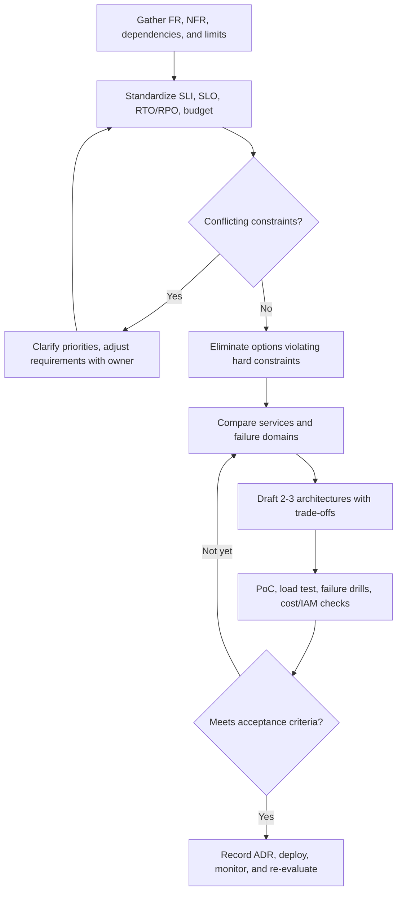
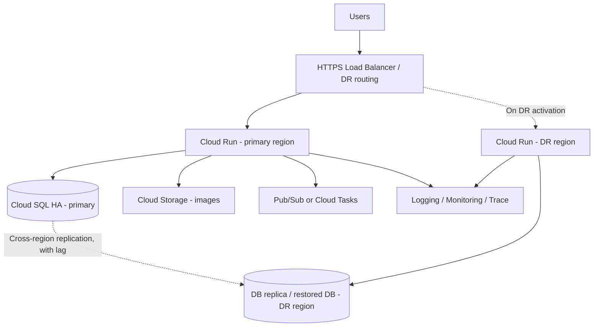

# Turning Non-Functional Requirements into GCP Service Choices

## 1. From Business Requirements to Architectural Decisions

When designing a system on Google Cloud, knowing **what the application needs to do** is not enough to choose services. Two applications that share the same order-placement functionality may require different architectures: an internal system might tolerate one hour of downtime, whereas a payment platform needs low latency, strict data controls, and a verified incident recovery procedure.

**Functional requirements** (FR) describe behavior: users create orders, make payments, and view history; the system sends notifications. **Non-functional requirements** (NFR) describe quality attributes and constraints: speed, reliability, resilience, security, data residency, scalability, cost, and operability.

This lesson belongs to the **GCP Architecture Design** chapter of the `CLOUD_PROVIDERS_GCP` module. From foundational project organization, IAM, and VPC to Compute Engine, GKE, Cloud Run, storage, and databases, the goal is to **choose services based on evidence and measurable constraints**, protect resources, automate releases, and monitor reliability alongside cost.

After this lesson, learners will be able to:

1. Turn vague statements such as “the system must be fast and always available” into SLIs/SLOs, RTO/RPO, test conditions, and accountable owners.
2. Distinguish **mandatory constraints** from trade-off goals; detect conflicting NFRs before selecting services.
3. Build a mapping table from NFRs to Cloud Run, GKE, Compute Engine, Cloud SQL, Spanner, Cloud Storage, and corresponding networking, security, and operations services.
4. Compare at least two architectures along with their residual risks, documenting the decision with an ADR (Architecture Decision Record).
5. Build a plan for load testing, recovery testing, IAM verification, SLO monitoring, and cost control.

> **Core Principle:** NFRs define the **acceptance criteria**; service design is only a **technical hypothesis**. An architecture is accepted only after test data and operational procedures prove its ability to meet those criteria.

## 2. Writing Verifiable NFRs

A statement like “the application must scale well” is not a sufficient requirement for selection. Describe it using this template:

> Under **defined load conditions and scope**, the system must achieve **metric (SLI)** with **threshold (SLO)** over **evaluation window**, with a defined **measurement method**, **priority level**, and **accountable owner**.

| Initial Statement | Measurable NFR — Illustrative Example | Acceptance Evidence |
|---|---|---|
| “The page must be fast” | `p95` response time for lookup API ≤ 350 ms at 250 requests/second, representative data size, steady load for 30 minutes | Load test results, Cloud Monitoring, and Cloud Trace |
| “Always available” | **99.95% uptime** SLO over a 30-day window, measured by synthetic probes from outside the system | SLO dashboard, downtime event timeline, and error budget |
| “No lost orders” | RPO ≤ 15 minutes for order data in a full-region outage scenario | Recovery drill results with confirmed transaction counts |
| “Fast recovery” | RTO ≤ 60 minutes from declaring a region outage until order-placement functionality is restored | DR drill report, start/end timestamps, recovered data |
| “Secure” | 100% of runtime accounts use no static service account keys; only authorized identities access PII; secrets are absent from images/repositories | IAM review, audit logs, repository scans, and negative access tests |
| “Stay within budget” | Estimated operating cost around 1,500 USD/month at assumed load and alerts when forecast exceeds budget | Pricing Calculator, billing export, budgets, cost dashboard |
| “Data in the right place” | PII data and backups reside only in locations approved by legal/data owners | Resource inventory, location policies, and backup/replica location checks |

The numbers above are **only learning scenarios**, not default commitments of GCP services or price quotes. Pricing, quotas, versions, features, and SLAs of each service must be verified at implementation time.

### 2.1. Distinguishing SLI, SLO, and SLA

- **SLI (Service Level Indicator):** an observable metric, such as the ratio of successful requests or `p95` latency of an endpoint.
- **SLO (Service Level Objective):** a target level for an SLI, such as “≥ 99.9% of valid requests succeed over 28 days”.
- **SLA (Service Level Agreement):** a service agreement between parties that may include commitments, conditions, and compensation mechanisms. **The SLA of Cloud Run/Cloud SQL is not automatically the SLO of the entire application.**

For example, with a **request-based** SLO: out of 1,000,000 valid requests, a 99.9% success target allows at most 1,000 failed requests within the defined window. This is a **request-based error budget**.

With a **time-based** SLO of 99.95% over 30 days, the equivalent downtime if calculated linearly is:

```text
30 days × 24 hours × 60 minutes × (1 - 0.9995) = 21.6 minutes
```

Do not use 21.6 minutes to interpret a **request-based** SLO; sampling methods, exclusion scopes, and actual traffic make the two measurements different. When defining an SLO, you must clearly specify the denominator, which statuses count as errors, the measurement point, and how client-side errors are excluded.

### 2.2. Distinguishing HA, DR, RTO, and RPO

| Concept | Question to Answer | Example |
|---|---|---|
| High availability (HA) | How do we minimize disruption when a single component or zone fails? | Cloud SQL HA configuration with primary/standby in two zones **within the same region** |
| Disaster recovery (DR) | How does the system operate if an **entire region** or data suffers a major outage? | Recovery scenario in a second region, starting the app and shifting traffic |
| RTO | What is the maximum acceptable service downtime after an incident? | 60 minutes to restore core functionality |
| RPO | What is the maximum acceptable data loss measured in time? | 15 minutes of data written prior to the incident |

**Common Pitfall:** Cloud SQL HA protects against machine/zone failures, not automatically against a full-region outage. Backups and replicas have different recovery capabilities; **asynchronous replicas** can lag, so they do not inherently guarantee a specific RPO. RTO/RPO must be measured via actual drills, including DNS/routing changes, secret recovery, and external dependencies. [See DR planning guide](https://docs.cloud.google.com/architecture/dr-scenarios-planning-guide).

### 2.3. Prioritization Classification

Place each NFR into one of three tiers:

1. **Hard constraint:** mandatory; any option violating it is rejected, even if cheaper or faster. For example, data must only be stored in approved geographic regions, or self-managed VMs are prohibited.
2. **Mandatory verifiable SLO:** must achieve measurement/drill results before go-live, e.g., `p95` ≤ 350 ms, RTO ≤ 60 minutes.
3. **Optimization goal:** open to trade-offs, e.g., reducing operational effort, cost, or emissions while the above constraints are still met.

If two constraints are simultaneously impossible, clearly inform the requirement owner and propose adjustments. For example, “data must not leave a country that has only one approved GCP region” alongside “guarantee operation when the entire region fails” is a conflict that must be resolved via policy and recovery location choices, **not by enabling two-zone HA**.

## 3. Process for Turning NFRs into Service Choices



**Step 1 — Survey load and dependencies.** Document the application type (HTTP, batch, streaming, transactional), user regions, average/peak traffic, data size, read/write ratio, query types, payload sizes, external APIs, and data retention periods. Distinguish the system of record from caches, logs, objects, and analytics data.

**Step 2 — Standardize metrics.** Define critical endpoints, `p50/p95/p99`, RPS/TPS, 5xx errors, concurrency, SLO windows, growth, and RTO/RPO for each data class. Assign a business owner, a technical owner, and a measurement method.

**Step 3 — Lock down constraints.** Verify data countries/regions, encryption and key requirements, identity model, infrastructure admin rights, special protocols, team skills, and cost limits.

**Step 4 — Draft options.** Select compute, database, storage, networking, IAM, logging, and DR as **a complete system**; evaluate availability by location and quotas, avoiding conclusions drawn from a single product's feature set.

**Step 5 — Verify and record decisions.** Run PoC/load tests, controlled failure injection, restore tests, review actual costs, and record an ADR along with conditions for revisiting the choice. NFRs change as volume, markets, and compliance requirements evolve.

## 4. Mapping NFRs to Google Cloud Service Groups

### 4.1. Compute: Operational Requirements Determine Abstraction Level

| Key Need | Candidate Service | When Suitable | Trade-offs to Account For |
|---|---|---|---|
| Stateless HTTP APIs, variable traffic, small team wanting low ops | **Cloud Run** | Request-driven containers, auto-scaling, revision deployments | Cold starts, concurrency, instance/quota limits, app must handle statelessness; each deployment is location-scoped |
| Multiple microservices needing deep Kubernetes control, custom policies/networking and scheduler | **GKE Autopilot or Standard** | Existing Kubernetes operational capability and need for the K8s ecosystem | Cluster baseline cost, autoscale/cluster configuration, upgrades, observability, security posture |
| Needs OS/kernel privileges, specialized software, or VM model | **Compute Engine** + Managed Instance Groups where appropriate | Workloads not easily containerized or requiring VM-level control | Self-managed OS, patching, images, capacity, load balancing, failover |
| Scheduled jobs that run to completion and stop | **Cloud Run jobs**, **Cloud Scheduler**, **Batch** depending on workload | No continuously running HTTP endpoint needed | Time limits, resources, retries, idempotency, and scheduling |

Do not pick GKE solely based on a forecast that “it will grow large in the future”; orchestration control requirements are the more important reason. Similarly, Cloud Run does not automatically eliminate system bottlenecks: if the database has a maximum connection limit, scaling up API instances can push the bottleneck down to the database. [Google Cloud: Choose compute options](https://docs.cloud.google.com/docs/compute-area/choose-compute-options).

To meet latency targets, Cloud Run supports configuring **minimum instances** to reduce cold starts and **concurrency** based on CPU/processing characteristics; minimum instances are a best-effort target and incur idle resource costs. Test with realistic traffic before picking exact numbers. [Cloud Run min instances](https://docs.cloud.google.com/run/docs/configuring/min-instances) · [Cloud Run concurrency](https://docs.cloud.google.com/run/docs/about-concurrency).

### 4.2. Data: Access Patterns and Consistency Matter More Than Product Names

| Data Characteristic / NFR | Candidate Service | Architectural Notes |
|---|---|---|
| Relational transactions, SQL, joins, compatibility with existing apps | **Cloud SQL** (PostgreSQL/MySQL/SQL Server depending on support) | HA across two zones in one region; backups/PITR, replicas, and cross-region DR must be designed separately |
| Large-scale SQL transactions, strong consistency, geographic distribution needs | **Spanner** | Regional/dual-region/multi-region have different availability, latency, edition, and cost characteristics; place compute near write regions |
| Document apps, flexible data sync, no traditional SQL joins required | **Firestore** | Review query/index model, transactions, quotas, database location, and per-operation cost |
| High-throughput key/wide-column datasets, access by row key | **Bigtable** | Suitable for time-series/IoT or key-based lookups; design row keys to avoid hotspots |
| Objects, images, files, exports, backups | **Cloud Storage** | Regional/dual-region/multi-region impacts latency, data residency, redundancy, egress, and price |
| Analytical OLAP/BI queries | **BigQuery** | Does not replace primary transactional databases; control scans, partitioning, and access permissions |
| Cache to reduce latency and backend load | **Memorystore** | Data can be reconstructed; do not treat cache as a system of record or rely on it for RPO |

For example, an ordering service needing transactions and foreign keys within one region can typically start with Cloud SQL HA; a system needing strongly consistent SQL writes across multiple regions with strict RTO may evaluate Spanner multi-region, while accepting trade-offs in write latency and cost. **Do not assume that replacing Cloud SQL with Spanner automatically makes the entire system multi-region**: APIs, identity, queues, DNS, keys, dependencies, and deployment methods must all tolerate failures accordingly.

Cloud Storage **dual-region** provides object redundancy across two regions; cross-region replication can be asynchronous. For very tight RPO, examine **turbo replication**, supported region pairs, and actual replication objectives. Creating a multi-region bucket does not mean newly written data is immediately present everywhere simultaneously. [Cloud Storage locations](https://docs.cloud.google.com/storage/docs/locations) · [Availability and durability](https://docs.cloud.google.com/storage/docs/availability-durability).

### 4.3. Messaging, Networking, and Security

| NFR | Common GCP Choice | What Must Be Verified |
|---|---|---|
| Prevent slow tasks from increasing API latency | **Pub/Sub** + Cloud Run/GKE workers; **Cloud Tasks** for HTTP tasks needing dispatch/retry control | At-least-once/redelivery, idempotency, retries, dead-letter handling, ordering if used |
| Public HTTPS and protection layer in front of backends | **Application Load Balancer**, **Cloud Armor**, **Cloud CDN** where content fits | TLS, cache policy, rate limiting, WAF, origin accessibility, and permissions |
| Access internal services/DBs without public IPs when possible | **VPC**, appropriate private connectivity, firewall/IAM/Private Service Connect per service | Routes, DNS, egress, project separation, IP exhaustion, network latency |
| Keep secrets out of source code | **Secret Manager**, runtime service account | Secret rotation, per-principal read permissions, audit logs; never log sensitive values |
| Least-privilege identity and build/deploy controls | **IAM**, dedicated service accounts, Workload Identity Federation / Workload Identity per environment | Separate CI/CD and runtime permissions; avoid long-lived keys and unnecessary editor roles |
| Data location policies / customer-managed keys | Organization Policy resource locations, **Cloud KMS/CMEK** where supported | Allowed regions, backup/replica/log locations, keys and decrypt rights, services supporting CMEK |
| SLOs, troubleshooting, and cost | **Cloud Monitoring**, Cloud Logging, Cloud Trace, Billing budgets/exports | Metrics matching SLIs, burn-rate alerts, egress costs, retention, and observability data access control |

**Security guardrails must be checked on every data flow**, not just via an “encryption enabled” checkbox. For example, an HTTP → Cloud Run → Cloud SQL and Cloud Storage flow involves at least two types of IAM principals and separate network/data-location policies.

## 5. Designing Reliability from Failure Domains

Scope failures in tiers instead of jumping straight to “multi-region”:

| Failure Scope | Commonly Considered Measures | Limitations |
|---|---|---|
| Single process/container | Readiness, startup checks, retries with backoff, multi-instance deployment, idempotency | Unbounded retries can overload downstream services |
| Single VM/node | Managed Instance Group, GKE replicas/health probes, managed services capable of replacing instances | Supporting services can still be a single point of failure |
| Single zone | Regional services with zone redundancy, Cloud SQL HA, regional GKE / multi-zone VMs when needed | Does not protect against a full-region outage |
| Single region | App deployment in a second region, routing/failover, DB replication/restore plan, adequate secrets/IAM in target region | Data consistency, quotas, standby running cost, data residency, and RPO/RTO must be verified |
| Accidental deletion or ransomware | Isolated backups, versioning/retention, PITR, recovery policies, and restricted delete permissions | Replication can **replicate deletions or logic bugs**; backups remain essential |

**Cloud Run is deployed in a single region** (though internally managed with zone redundancy). To serve from multiple regions, deploy to multiple regions and configure appropriate global load balancing. **Automatic cross-region failover requires additional mechanisms to detect healthy backends** such as Cloud Run service health with readiness probes/minimum instances or documented supported mechanisms; having just a load balancer and two endpoints is not enough to guarantee automatic failover when an app returns errors. [Cloud Run: multiple regions](https://docs.cloud.google.com/run/docs/multiple-regions) · [Service health](https://docs.cloud.google.com/run/docs/configuring/configure-service-health).

For transactional data, ask: during the 60-minute recovery window, can the system accept **new orders**, or only serve read pages? DR testing must verify transaction correctness, not just HTTP 200. With asynchronous replicas, measure replication lag, realistic data loss bounds, promotion procedures, and how to prevent split-brain writes to two primaries during region switchover.

## 6. Case Study: Online Ordering Platform

### 6.1. Requirements Set and Assumptions

A team is deploying a Spring Boot API serving customers in Southeast Asia, with a transactional database and product images. This is a **hypothetical** NFR set for design practice:

| ID | NFR | Priority | Verification Criteria |
|---|---|---|---|
| NFR-01 | Order create/read API has `p95` ≤ 350 ms at 250 RPS, bursting to 500 RPS for 5 minutes | Must meet | 30-minute load test with representative data/connection pool; report `p95/p99`, throughput, and 5xx |
| NFR-02 | Availability ≥ 99.95% by synthetic uptime over 30 days | Must meet | SLO monitoring and error budget |
| NFR-03 | Full-region outage: RTO ≤ 60 minutes | Must meet | Traffic switchover and DB recovery drill, measured until business acceptance |
| NFR-04 | Order data: RPO ≤ 15 minutes on full-region outage | Must meet | Compare transactions committed before outage against post-DR data |
| NFR-05 | PII stored only in **approved locations**; e.g., organization approves Singapore and Jakarta | Hard constraint | Audit project/resource locations, DB replicas, backups, buckets, and logs |
| NFR-06 | Runtime uses dedicated service accounts, externalized secrets, access logs; least privilege | Hard constraint | IAM audit, unauthorized access tests, secret handling, and log checks |
| NFR-07 | Optimize total cost around 1,500 USD/month at current load assumptions | Optimization goal | Pricing Calculator and post-pilot billing; review egress, storage, and standby separately |

**Functional assumptions:** stateless HTTP API, PostgreSQL with relational transactions, image objects on Cloud Storage, asynchronous email sending; the application does not require kernel privileges or custom Kubernetes. Do not assume a 1,500 USD budget is guaranteed to suffice — actual resources must be calculated.

### 6.2. Choosing a Baseline and Identifying Additions for DR

**Single-region baseline option**:

- Cloud Run running Spring Boot; autoscale on load, cap max instances to avoid overwhelming PostgreSQL, tune concurrency after testing, and set minimum instances if cold starts affect `p95`.
- Cloud SQL for PostgreSQL **HA in the primary region**; enable backups and point-in-time recovery; tune connection pooling and limit connections across Cloud Run instances.
- Regional Cloud Storage for images if users and most compute are in the same region; consider dual-region if image availability is needed during a primary region outage and the region pair is approved.
- Pub/Sub or Cloud Tasks for asynchronous email/notification delivery; implement idempotent consumption and error-handling paths.
- Secret Manager, least-privilege IAM, Cloud Logging/Monitoring/Trace, and budget alerts.

The baseline can meet many operational, performance, and **zone-failure** goals, but **does not prove NFR-03/04 under a region outage**. Therefore, do not mark the architecture compliant based solely on Cloud SQL HA.

**Additions needed for cross-region DR** if locations are approved:

1. Deploy the API or prepare a warm standby version in a second region; ensure Artifact Registry images, configuration, runtime identity, secrets, quotas, and appropriate DB connectivity are in place. Test routing via a global Application Load Balancer when needed.
2. Define the data strategy: cross-region replica availability for the chosen engine/edition, backup/PITR, and promote/restore procedures; set replication lag alerts. Verify technical limits before signing off on RPO.
3. Run a DR drill: simulate primary region unavailability, shift traffic, restore/enable DB writes, verify new orders, and reconcile lost or duplicate transactions. Measure from trigger time until **business operations** work, not just app startup.
4. Define conditions for **failback**, reconciliation, handling duplicate/interrupted transactions, and split-brain prevention. Conduct periodic drills, keeping runbooks and owners up to date.



The diagram shows a **design option**, not that every arrow is already automated. Under normal operation, the secondary DB typically does not accept writes; writes are permitted only after executing promote/failover per an approved runbook and verifying consistency. For object content, image readability must also be verified after losing the primary region, not just the database.

### 6.3. Comparing Options and Elimination Criteria

| Option | Pros | Risks / Trade-offs | Pre-PoC Conclusion |
|---|---|---|---|
| **A:** Cloud Run + Cloud SQL HA + regional Storage in one region | Simple, easy to operate, zone redundancy | Losing the entire region impacts compute/DB; does not prove NFR-03/04 | **Reject if** full-region outage protection is mandatory |
| **B:** Cloud Run in two regions + primary Cloud SQL HA, DR replica/backup + routing + runbook | Keeps PostgreSQL, provides region recovery path, controls cost via warm/cold standby | Async replica has lag; promote, failback, IAM/secrets, consistency, and RTO must be drilled | **Candidate** if DR drill proves RTO/RPO and location policy |
| **C:** Multi-region app + suitable Spanner dual/multi-region + multi-region storage/dependencies | High consistency and data distribution capability, reduces burden on some DR components | Differences in DB model, edition, cost, write latency, schema/SQL migration, and remaining dependencies | **Candidate** when scale/availability needs justify the migration |

If regulations change NFR-05 to “PII **only** inside Singapore”, Option B using a replica in Jakarta must be rejected. Spanner's actual topology must also be checked, without assuming a multi-region configuration exists entirely within Singapore. The right decision may be to **renegotiate RTO/RPO or storage scope**, or choose another compliant DR approach; never unilaterally replicate PII into prohibited regions.

### 6.4. NFR → Design → Test Traceability Matrix

| NFR | Design Decision to Verify | Test / Observation | Owner |
|---|---|---|---|
| NFR-01 | Cloud Run concurrency/min-max instances + SQL/index/cache tuning, co-locate compute near DB | Load test at 250 RPS and 500 RPS burst; measure `p95/p99`, DB CPU, pool, cold starts | Backend Lead / SRE |
| NFR-02 | Health checks, sufficient capacity, rollback, autoscale, SLO alerts | Synthetic uptime, burn-rate alerts, deploy rollback checks | SRE |
| NFR-03 | Secondary region, routing + DB promote/runbook | Region outage drill; time from incident to successful new order ≤ 60 minutes | SRE + DBA |
| NFR-04 | Backup/PITR, replica within acceptable lag, transaction reconciliation | Compare committed transactions pre/post-failover, measured RPO ≤ 15 minutes | DBA + Product Owner |
| NFR-05 | Location policy, placement of DB/replicas/buckets/backups/analytics/logs | Inventory review, config audit, and data path locations | Security / Data Owner |
| NFR-06 | Dedicated SAs, least-privilege IAM, Secret Manager, audit | Policy review, negative access tests, secret scans, log checks | Security |
| NFR-07 | Sizing, autoscale, storage lifecycle, budget/FinOps | Pricing estimate, Billing export, and post-pilot adjustments | FinOps / Product Owner |

> **Acceptance Gate:** a matrix row may only be marked “passed” when backed by corresponding measurement or test evidence. “Service supports it” does not equal “system is configured and verified”.

## 7. Measuring Performance, Scalability, and Reliability Before Finalizing Design

A credible PoC must simulate **data volume, request distribution, and dependencies** similar to production. Practical steps:

1. **Create a baseline:** record `p50/p95/p99`, 5xx, CPU/memory, cold starts, concurrency, DB connection count, and cost at low load.
2. **Step up load:** e.g., 50 → 150 → 250 RPS, holding each step long enough for the autoscaler and DB to stabilize. Run an additional 500 RPS burst for 5 minutes.
3. **Exercise the data path:** order-creation transactions, indexed queries, write latency, queue backlog, cache hit ratio; check for errors from DB connection limits or quotas before raising max instances.
4. **Test releases:** canary or traffic splitting where appropriate, health checks, and rollbacks; observe `p95` changes immediately after deploy.
5. **Inject failures:** restart instances; disconnect a dependency in the lab; drill DB promotion, region switchover, and backup restoration. Measure RTO/RPO along with order accuracy.
6. **Verify observability:** Cloud Monitoring SLOs, burn-rate alerts, logs with correlation/trace IDs, DBA/SRE dashboards; record test reports per release/version.

Example definition of a request-based SLI:

```text
SLI_success_rate =
  count(valid requests with response codes defined as successful)
  --------------------------------------------------------------
  count(all valid requests in the measurement window)

SLO_success_rate >= 0.999 over 28 days
```

If an API returns HTTP 200 while order persistence fails, looking only at HTTP status misjudges correctness. Add a **business SLI**, such as “proportion of orders successfully written and read back”. Synthetic probes must traverse critical dependencies and run from a monitoring vantage point independent of the target region under test.

A load test showing `p95` at 300 ms but 15% 503 responses still **fails** the target; watch both latency and error rate. Test sudden load spikes, startup times, database saturation, and recovery after load subsides.

## 8. Building In Security, Data, and Cost Controls from the Start

### 8.1. Security and Compliance

- Use folders/projects to separate environments; apply IAM via service accounts with required permissions, never using personal accounts as runtime identities.
- Define data flows across ingress, compute, queues, databases, storage, and logging/backups. Document how data is encrypted, where it resides, how long it is retained, and who can read it.
- Use Secret Manager for credentials; use CMEK when required by policy **and** supported by the specific service in the intended location.
- Choose private connectivity, authentication/authorization, and Cloud Armor based on the threat model; do not treat network isolation as a substitute for IAM.
- For data policies, verify the **locations of replicas, logs, backups, analytics data, and export pipelines**, rather than only the primary DB location.

### 8.2. Practical TCO Estimation Formula

```text
Estimated total monthly cost
  = baseline and load-driven compute
  + database/replicas/backups
  + object storage and request operations
  + networking, inter-region egress, and load balancing
  + logs/metrics/traces and retention
  + related build/deployment/security tooling
  + related licenses, support, and operational effort
```

Include **standby environments** and DR drills, not just steady-state production. Use the [Google Cloud Pricing Calculator](https://cloud.google.com/products/calculator) with explicit assumptions for RPS, resources, GB-months, egress, and requests; compare against Billing export after the pilot. **Billing budgets primarily provide alerts, not an instant billing shutoff mechanism**; curbing consumption requires combining quotas, autoscale caps, policies, and operational response, though such caps can also cause errors during traffic spikes.

Cost is a quality variable: dropping to 0 minimum instances can increase cold starts, cutting replicas/regions can worsen RTO, and adding caching can introduce consistency or data-exposure risks. Every optimization must document its impact on other SLOs.

## 9. Recording Decisions with ADRs and Change Governance

After comparison and testing, write a concise yet traceable **Architecture Decision Record**:

```markdown
# ADR-001: Select Cloud Run + Cloud SQL HA and Cross-Region DR Strategy

Status: Proposed (not yet approved for production deployment)

## Context
- Stateless Spring Boot API, PostgreSQL transactions.
- NFR-01: p95 <= 350 ms at 250 RPS.
- NFR-03/04: on region outage, RTO <= 60 minutes, RPO <= 15 minutes.
- NFR-05: use only locations approved by the data owner.

## Options
A. Single region: Cloud Run + Cloud SQL HA.
B. Two regions: Cloud Run + primary Cloud SQL HA, DR strategy
   based on replica/backup, routing, and runbook.
C. Multi-region app + Spanner with appropriate edition/topology.

## Proposed Decision
Test B first as it preserves the PostgreSQL model and can meet DR needs.
Approve only after load testing, region failover drill, IAM checks,
data residency verification, and cost review. If RPO or RTO fails, re-evaluate C.

## Consequences
- Must operate replication lag alerts and a DR drill schedule.
- Requires promote/failback runbooks and split-brain checks.
- Costs include standby, egress, and supporting resources.

## Revisit Triggers
Changes in RTO/RPO, major traffic growth, failed DR drills, data location
policy changes, or TCO exceeding approved thresholds.
```

In formal architecture documentation, include a dependency map, data flow diagrams, versioned NFR tables, PoC/DR drill evidence, a risk register, and owner sign-offs. Store ADRs alongside IaC configurations or in the architecture governance repository so decisions stay coupled with actual changes.

## 10. Common Architectural Thinking Pitfalls

| Misconception | Why It Is Wrong | How to Address |
|---|---|---|
| “Using a managed service gives enough HA” | Managed does not automatically survive region loss or data logic bugs | List failure domains and verify each service's topology |
| “Cloud SQL HA can fail over across regions” | Cloud SQL HA uses zones within a single region | Design cross-region DR with separate replicas/backups and runbooks |
| “Having backups means RPO = 0” | Backup/PITR timestamps, accessibility, and restore durations vary | Define RPO/RTO, drill them, and measure lost transactions |
| “Two Cloud Run regions means automatic failover” | Proximity routing does not necessarily detect app-level errors | Configure supported health/failover mechanisms and test end-to-end switchover |
| “Good average latency means the SLO is met” | Tail latency `p95/p99` and 5xx rates can still be terrible | Measure percentiles, errors, and business outcomes under real load |
| “Adding instances always increases throughput” | DB connections, external quotas, and queues can be bottlenecks | Capacity-test the full processing path and set appropriate caps |
| “Multi-region is always cheaper and faster” | Cross-region consensus, replication, and egress can increase latency/cost | Use only when justified by NFRs; measure write paths and TCO |
| “Setting a billing budget stops all charges” | Budget alerts are not hard billing caps | Combine alerts + quotas/limits + cost reviews |
| “Cloud Storage multi-region = zero data loss right on upload” | Cross-region replication may not have completed yet | Check redundancy models and replication objectives |
| “Compliance is just picking the database region” | Logs, backups, exports, caches, and replicas also hold data | Trace the entire data lifecycle and dependent resources |

## 11. Tabletop Exercise Before Infrastructure Deployment

Suppose a new system requires: an HTTP API at 100 RPS normal / 800 RPS peak; `p95` ≤ 250 ms; SQL order storage; product images; RTO 4 hours; RPO 1 hour; data must reside in approved locations; limited budget and ops staff.

Create a design document with four sections:

1. **NFR contract:** translate each statement into SLIs, SLOs, load profiles, measurement sources, and owners; flag hard constraints.
2. **Two options:** e.g., Cloud Run + Cloud SQL + Cloud Storage versus GKE + Cloud SQL or a DR-enabled variant; explain why the workload does or does not need orchestration.
3. **Decision matrix:** map the 6 most important NFRs to services, configurations, tests, and residual risks; state rejection reasons.
4. **Verification:** outline an 800 RPS load test, a backup restore test, and a DR drill, along with a projected budget using the Pricing Calculator.

A submission is acceptable when it **does not promise RTO/RPO from service names alone**, identifies location hard constraints, and recommends release only after test reports meet the criteria.

## 12. Official Documentation to Cross-Reference

- [Google Cloud Well-Architected Framework](https://docs.cloud.google.com/architecture/framework) — six pillars: operational excellence, security, reliability, cost, performance, sustainability.
- [Well-Architected: Reliability](https://docs.cloud.google.com/architecture/framework/reliability) — reliability goals, redundancy, and operations.
- [Disaster recovery planning guide](https://docs.cloud.google.com/architecture/dr-scenarios-planning-guide) — how to define RTO/RPO and choose recovery strategies.
- [Choose compute options](https://docs.cloud.google.com/docs/compute-area/choose-compute-options) — Cloud Run, GKE, Compute Engine, and compute choices.
- [Cloud Run: serve traffic from multiple regions](https://docs.cloud.google.com/run/docs/multiple-regions) — multi-region deployment and routing.
- [Cloud Run: automate cross-region failover](https://docs.cloud.google.com/run/docs/configuring/configure-service-health) — service health, readiness, and limitations.
- [Cloud SQL: high availability](https://docs.cloud.google.com/sql/docs/mysql/high-availability) — intra-region HA limits (MySQL example; check the page for your engine).
- [Spanner: instance configurations](https://docs.cloud.google.com/spanner/docs/instance-configurations) — regional, dual-region, and multi-region.
- [Cloud Storage bucket locations](https://docs.cloud.google.com/storage/docs/locations) — locations, replication, latency, and cost.
- [Cloud Storage availability and durability](https://docs.cloud.google.com/storage/docs/availability-durability) — cross-region replication risks.
- [Google Cloud Pricing Calculator](https://cloud.google.com/products/calculator) — estimating prices from load and resource assumptions.

This document is designed as a **verifiable decision-making methodology**. When applying it, re-check regional availability, quotas, pricing, SLAs, and edition-specific features at the time of architecture design.
