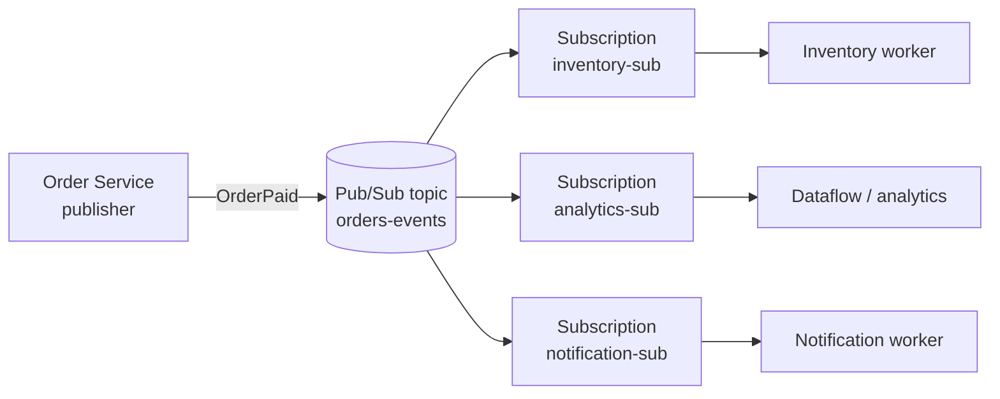
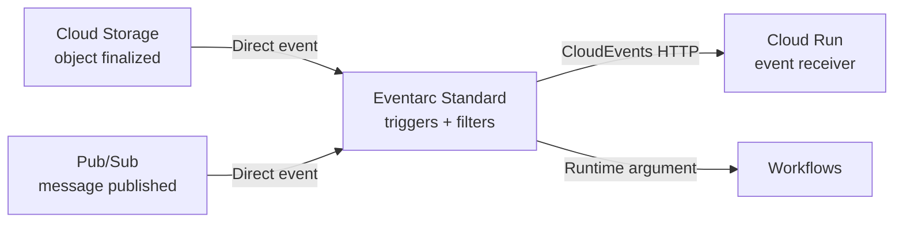
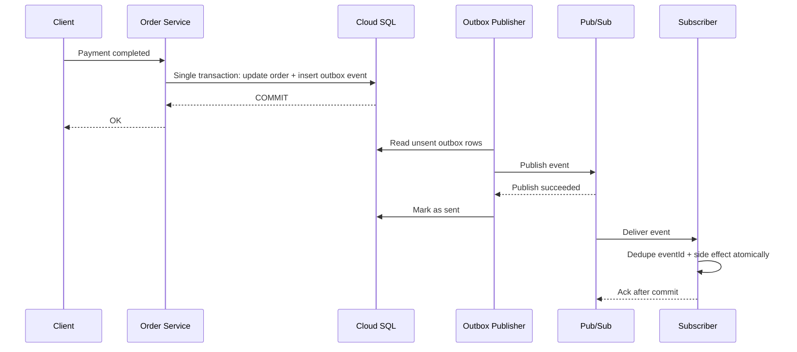
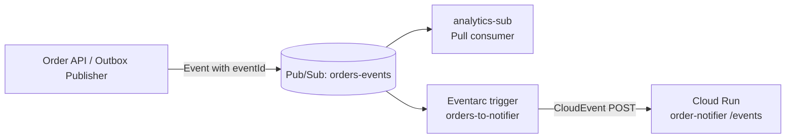

# Event-Driven Architecture with Pub/Sub and Eventarc

## Lesson Objectives

In the **GCP Architecture Design** chapter, this lesson explains how to build an **event-driven** architecture on Google Cloud using **Pub/Sub** and **Eventarc**, from defining business events and selecting delivery mechanisms to ensuring safe reprocessing, deploying, and operating event-receiving services.

This is part of **CLOUD_PROVIDERS_GCP**: learning how to organize projects and IAM, connect VPCs, choose Compute Engine/GKE/Cloud Run, use storage and database services, automate releases, observe reliability, and manage costs. After this lesson, learners will be able to:

1. Explain event-driven architecture (EDA), distinguishing events, commands, and synchronous requests.
2. Design fan-out flows using Pub/Sub topics and independent subscriptions.
3. Use Eventarc to route events from Google Cloud, Pub/Sub, or supported sources to Cloud Run/Workflows/GKE.
4. Apply event contracts, idempotency, retries, dead-letter handling, ordering, security, and observability.
5. Choose architectures suited to data consistency, resilience, and cost constraints.

> **Principle:** Pub/Sub and Eventarc decouple services in time and deployment location; business correctness still depends on transaction design, event contracts, and consumer processing code.

## 1. What Problems Does Event-Driven Architecture Solve?

A naive synchronous architecture often looks like `Order API → Payment API → Inventory API → Email API` inside a single HTTP request. If the email service is slow or fails, the buyer may wait a long time even though payment already completed. As the number of services grows, direct calls increase coupling and create cascading failures.

In EDA, a **producer** service emits an **event** describing what just happened, such as `OrderPaid`. Multiple **consumers** subscribe to receive the event and run their own work: fulfilling inventory, sending notifications, recording analytics. The producer does not need to know which consumers exist or how long they take to process.

- **Event**: a fact that has occurred, expressed in the past tense: `OrderPaid`, `InvoiceIssued`, `ObjectFinalized`.
- **Command**: a request for a system to perform an action, e.g., `ReserveInventory`. A command usually has one responsible executor and may require an explicit response.
- **Query**: reading current data, generally better suited to synchronous HTTP/gRPC.
- **Message**: the unit of data carried over a messaging system; a message can carry an event or a command, but must be interpreted according to a **contract**.
- **Eventual consistency**: consumers update their own replicas or state at different times; data may temporarily be non-uniform across services.

**When it fits:** multiple independent downstream consumers, variable load spikes, tolerance for processing latency, needing to add consumers with minimal producer changes, or reacting to Cloud Storage/Google Cloud events.

**When to consider alternatives:** operations needing an immediate response to the caller, transactional steps that must complete atomically together, long-running approval workflows with explicit state, or hourly scheduled batch tasks. You can combine synchronous HTTP, Cloud Tasks, or Workflows with EDA; not every step needs to be forced into an event.

## 2. Roles of Pub/Sub and Eventarc

| Criterion | Pub/Sub | Eventarc Standard | Eventarc Advanced |
|---|---|---|---|
| Primary role | Publish/subscribe messaging system; delivers messages via topics/subscriptions | Filters and routes events from providers to destinations via triggers | Buses, enrollments, and pipelines to centralize, filter, transform, and route across many sources and destinations |
| Configuration units | Topic, subscription, publisher, subscriber | Trigger, provider, event filters, destination, trigger service account | Bus, enrollment, pipeline, and destinations |
| Sources | Publishers sending data to topics | Pub/Sub, Cloud Storage, Cloud Audit Logs, supported Google/third-party sources | Multiple Google, custom, and supported third-party sources |
| Destinations | Pull/push consumers, export subscription types | Cloud Run, Cloud Run functions, GKE, Workflows, internal HTTP, and supported destinations | Destinations via bus/pipeline mechanisms per Advanced docs |
| Received format | Raw Pub/Sub message (byte `data` plus `attributes`) | **CloudEvents** over HTTP for HTTP destinations | CloudEvents mechanisms with additional filtering/transformation capabilities |
| When to choose | Need active control over backlogs, acks, subscriptions, DLQs, processing streams | Need simplified routing from an event provider to a service | Want centralized governance across many sources/destinations, advanced filtering, or transformation |

**Do not treat Eventarc as a total replacement for Pub/Sub.** Eventarc Standard commonly uses Pub/Sub as its underlying transport layer. When events are already in a topic and you simply want to push directly to Cloud Run, current Cloud Run documentation even recommends **direct Pub/Sub push triggers** for simpler configuration; use Eventarc-based triggers when you want a unified CloudEvents format across providers or matching filtering/routing conditions. The data format Cloud Run receives differs between the two approaches.

### 2.1. Pub/Sub: Topics and Subscriptions

A **topic** is where producers publish messages; a **subscription** is where consumers receive them. Each subscription maintains its own backlog and ack checkpoints. Publishing one message to a topic with multiple subscriptions creates **per-subscription fan-out**. Two workers reading from **the same** pull subscription share the workload rather than each receiving a copy.



To add fraud checks, you can add a new subscription and consumer without touching Order Service. Conversely, adding consumers to the **same** subscription does not produce fan-out across every instance.

### 2.2. Eventarc: Provider → Filter → Trigger → Destination

Eventarc Standard receives events from supported providers; a **trigger** declares the event type, filters, and destination, for example:

- Cloud Storage emits `google.cloud.storage.object.v1.finalized` when an object is created or overwritten with a new generation.
- Pub/Sub emits `google.cloud.pubsub.topic.v1.messagePublished` when a message is published to a topic.
- Cloud Audit Logs emits `google.cloud.audit.log.v1.written` if an audit record matches `serviceName` and `methodName`; certain audit log types must be enabled beforehand to generate records.
- Destinations can be Cloud Run services, Cloud Run functions, Workflows, or GKE, depending on supported combinations.



**Eventarc Standard does not guarantee FIFO.** Using Pub/Sub as transport does not remove the need for application idempotency; nor does a **pull subscription's** exactly-once feature automatically apply to Eventarc triggers.

Sources: [Pub/Sub subscription overview](https://docs.cloud.google.com/pubsub/docs/subscription-overview), [Eventarc Standard overview](https://docs.cloud.google.com/eventarc/standard/docs/overview), [Choose Standard or Advanced](https://docs.cloud.google.com/eventarc/advanced/docs/choose-product-edition).

## 3. Designing the Event Contract Before Writing Triggers

Do not publish entire database rows merely because it is convenient. Events need **business meaning**, **stable identity**, **versioning**, **occurrence timestamp**, and enough data for consumers to make decisions. Example JSON payload carried in Pub/Sub `message.data`:

```json
{
  "eventId": "evt-20261119-00421",
  "eventType": "com.example.order.paid",
  "schemaVersion": 1,
  "aggregateId": "order-2048",
  "occurredAt": "2026-11-19T08:30:00Z",
  "traceId": "7d9bdc7e8fb9440c",
  "data": {
    "orderId": "order-2048",
    "currency": "VND",
    "amount": 590000
  }
}
```

This is a **custom application event contract**, not a full CloudEvent envelope. `eventType` inside the business payload differs from Eventarc's `ce-type` header, which indicates the transport event type when the provider is Pub/Sub (`google.cloud.pubsub.topic.v1.messagePublished`).

Contract design:

1. **`eventId` generated by the producer** and stable for the same logical event. Pub/Sub also assigns a `messageId` per publish call, but republishing the same logical event can create a new `messageId`. For business logic, deduplicating by business `eventId` is essential.
2. **`eventType` and `schemaVersion`** help consumers interpret semantics. Prefer backward-compatible changes: add optional fields with defaults; never arbitrarily rename or delete fields.
3. **`occurredAt` is the event time**, distinct from `publishTime` (when Pub/Sub received it) and processing time; use the right timestamp for latency reporting or event-time windowing.
4. **`aggregateId`** such as an order ID serves tracing, logical partitioning, and can act as an **ordering key** if strict per-aggregate ordering is mandated.
5. Use Pub/Sub attributes for simple routing/filtering, e.g., `eventType=com.example.order.paid` and `schemaVersion=1`. **Pub/Sub subscription filters evaluate attributes**, not arbitrary nested JSON inside `data`.
6. Minimize PII, secrets, and large records. Store large payloads in Cloud Storage with appropriate access controls and send an event carrying only the URI/metadata and version.
7. If you want Pub/Sub to validate payload structure at publish time, attach a **Pub/Sub schema** using Apache Avro or Protocol Buffers (distinct from the JSON convention illustrated above).

### Distinguishing Data Envelopes

A **Pub/Sub message** has `data` as a byte sequence and `attributes` as key/value string pairs; SDKs send/receive bytes, while the JSON API typically represents `data` as base64.

**Pub/Sub push** delivers an HTTP JSON payload to endpoints structured roughly like:

```json
{
  "message": {
    "data": "eyJldmVudElkIjoiZXZ0LTEifQ==",
    "messageId": "123456789",
    "attributes": {"eventType": "com.example.order.paid"}
  },
  "subscription": "projects/demo-project/subscriptions/notification-push"
}
```

**Eventarc Standard** delivers **CloudEvents binary content mode**: metadata sits in HTTP headers `ce-id`, `ce-source`, `ce-type`, and `ce-specversion`, while the HTTP body contains the event data. When the source is Pub/Sub, the JSON body contains objects like `message` (with `data` still base64-encoded) and `subscription`. Example:

```http
POST /events HTTP/1.1
Content-Type: application/json; charset=utf-8
ce-specversion: 1.0
ce-id: 123456789
ce-source: //pubsub.googleapis.com/projects/demo-project/topics/orders-events
ce-type: google.cloud.pubsub.topic.v1.messagePublished

{"message":{"data":"eyJldmVudElkIjoiZXZ0LTEifQ==","messageId":"123456789"}}
```

These illustrative values are not real resource identifiers. Events from Cloud Storage carry a different `ce-type` and body; receivers must check the event type before parsing. When delivering to **Workflows**, Eventarc passes the event as a JSON runtime argument object instead of requiring the workflow to parse HTTP headers manually.

Sources: [Pub/Sub schemas](https://docs.cloud.google.com/pubsub/docs/schemas), [Eventarc event format](https://docs.cloud.google.com/eventarc/standard/docs/event-format), [CloudEvents JSON format](https://docs.cloud.google.com/eventarc/docs/cloudevents-json).

## 4. Delivery Semantics: The Most Common Source of Bugs

### 4.1. At-Least-Once Delivery and Idempotency

By default, Pub/Sub provides **at-least-once delivery**. Due to network errors, timeouts, failed acks, or retries, a subscriber may receive the same message **multiple times**. A delivered message that has not been successfully acknowledged can be redelivered.

For example, a consumer handling `OrderPaid` by awarding loyalty points:

- Attempt 1: database adds 100 points, but the consumer crashes **before acking**.
- Attempt 2: Pub/Sub redelivers the event.
- If the handler blindly adds another 100 points, the account gets **200 points** — a business bug.

Use an **inbox/idempotency record** in the consumer's database:

```text
BEGIN TRANSACTION
  INSERT INTO processed_events(consumer_name, event_id)
  VALUES ('loyalty', 'evt-20261119-00421')
  ON CONFLICT DO NOTHING;

  If INSERT succeeds:
      UPDATE loyalty_balance ... (add 100 points)
  If INSERT conflicts:
      skip business change (already processed)
COMMIT
ACK or return HTTP 2xx only after COMMIT succeeds
```

You must have a **unique constraint** on `(consumer_name, event_id)`; reading and checking in two separate operations cannot prevent race conditions when two instances process concurrently. If downstream is an external API, use an idempotency key supported by that provider or an appropriate result-recording and reconciliation mechanism.

**Pub/Sub's exactly-once delivery has a narrow scope:** it is optional for **pull/StreamingPull subscriptions**, scoped by `messageId` within the same region and reliant on successful acks. **Push/export subscriptions do not support exactly-once.** That feature does not automatically guarantee “exact once business transaction” when the same business action is published multiple times or when a failure occurs between a side effect and an ack. Therefore, systems should still implement idempotent handling.

### 4.2. Ordering and Concurrency

By default, Pub/Sub **does not guarantee ordering**. You can enable message ordering on a subscription and publish with `orderingKey=order-2048`; messages sharing an ordering key published in the same region are delivered in the order Pub/Sub received them. This **does not provide global ordering across all orders**. With ordered delivery, later messages with the same key can be blocked by an earlier failing message; scaling concurrency requires balance.

Eventarc Standard **offers no FIFO guarantee**. If an application requires strict ordering across all events for one aggregate, evaluate a Pub/Sub subscription with ordering enabled and a pull consumer; additionally, include an `aggregateVersion` and check versions in the database to detect out-of-order arrivals.

### 4.3. Acks, Retries, and Dead-Letter Handling

| Scenario | Approach |
|---|---|
| Successful processing | Pull subscriber calls ack after durable commit; Pub/Sub push/Eventarc returns HTTP 2xx after commit |
| Transient error (DB timeout, 503) | Do not ack or return non-2xx HTTP status so the system redelivers per retry policy |
| Long-running operation | Configure ack deadline, rely on client library lease extension (pull), or offload to a fitting job; avoid exceeding request timeouts |
| Permanently invalid message | Log root cause, route to dead-letter/quarantine per supported mechanism, alert the service owner |
| Cascading failures | Cap concurrency, max instances/rate, apply backoff, circuit breakers, and prevent retry storms |
| Reprocessing needed | Use Pub/Sub retain/seek/snapshots where supported; make consumers idempotent before replaying |

With a **Pub/Sub dead-letter topic (DLQ)**, configuration sits on the **subscription**, with `maxDeliveryAttempts` between **5 and 100**; forwarding to the DLQ is **best-effort**, so do not depend on an exact delivery count. A DLQ must have its own **separate subscription for reading**, and the Pub/Sub service agent needs publish permission on the DLQ plus appropriate subscribe permissions per documentation. Returning messages from a DLQ back into the system should follow a controlled process of fixing the root cause, reviewing, and replaying.

For Eventarc Standard, retries are tied to the underlying Pub/Sub transport; **carefully inspect the retry policy of triggers and Eventarc-managed subscriptions**. Current documentation notes Eventarc defaults to **24-hour** message retention with exponential backoff; certain Cloud Run triggers created via the **Console** may configure **single delivery with no retries**. Therefore, never assume every Eventarc trigger retries indefinitely. If you require deep DLQ/replay/ack control, consider application-managed Pub/Sub subscriptions operated independently.

Sources: [subscription properties](https://docs.cloud.google.com/pubsub/docs/subscription-properties), [exactly-once delivery](https://docs.cloud.google.com/pubsub/docs/exactly-once-delivery), [dead-letter topics](https://docs.cloud.google.com/pubsub/docs/dead-letter-topics), [Eventarc Standard overview](https://docs.cloud.google.com/eventarc/standard/docs/overview).

## 5. Designing Transactional Flows Without Dropping Events

### 5.1. The Dual-Write Problem

Suppose Order Service:

1. Updates order status from `CREATED` to `PAID` in Cloud SQL.
2. Publishes `OrderPaid` to Pub/Sub.

If step 1 commits and step 2 suffers a network error, the order is paid yet downstream systems never receive the event. Reversing the order—publishing first then writing to the DB—is equally dangerous: the event is emitted, yet the DB transaction might roll back. **Two separate systems do not share a single atomic transaction.**

### 5.2. Transactional Outbox

A durable pattern for producers with a transactional database:



The outbox publisher can run on a scheduler, via CDC, or a fitting architecture. If the publisher publishes successfully yet crashes before marking the row sent, the same event **can be republished**. The outbox pattern **reduces the risk of dropped events**, yet consumers still need deduplication.

Key implementation details: write the order and outbox row **in the same transaction on the same database**, implement publish retries with backoff, manage outbox table retention/size, and alert if unpublished events accumulate for too long.

### 5.3. Choreography and Orchestration

If `OrderPaid` triggers several independent reactions (sending email, analytics, loyalty points), **choreography** via fan-out fits well. If a multi-step flow like `ReserveInventory → ChargePayment → ShipOrder` requires strict timeouts and explicit compensating steps, use **Workflows/Saga orchestration** so workflow state stays visible; emit events only after state transitions commit. Never expect publishing multiple events to magically form a cross-service atomic transaction.

## 6. Security: IAM, Identities, Network Permissions, and Data

### 6.1. Separating Identities by Responsibility

| Principal | Typical Permissions | Where Granted |
|---|---|---|
| Producer service account | `roles/pubsub.publisher` | On the corresponding topic (prefer narrowest scope) |
| Pull subscriber service account | `roles/pubsub.subscriber` | On the subscription the consumer reads |
| Eventarc trigger creator | Permission to create triggers and `roles/iam.serviceAccountUser` to attach the service account | Project/SA as required |
| **Trigger service account** for Eventarc → private Cloud Run | `roles/run.invoker` | On the target **Cloud Run service** |
| Trigger service account receiving direct events from other Google services | May require `roles/eventarc.eventReceiver` | Per event type/source; **not needed** when solely routing direct Pub/Sub events |
| Google-managed service agents | Service roles provisioned by Google Cloud | Preserve Google Cloud-managed roles; do not reuse as an app runtime SA |

Direct Cloud Storage triggers may also require the **Cloud Storage service agent** to hold `roles/pubsub.publisher` because the transport layer uses Pub/Sub. Older projects with a Pub/Sub service agent enabled prior to **April 8, 2021** have specific IAM requirements around Service Account Token Creator; check documentation when deploying.

**Target Cloud Run services should require authentication.** Eventarc uses the trigger service account to send requests, so grant `roles/run.invoker` to that exact identity; never open public access just to make a trigger work. Meanwhile, the Cloud Run runtime service account used to access databases/secrets carries distinct permissions from the trigger service account.

### 6.2. Additional Security Layers

- Publish only from authorized workload identities/SAs; avoid storing service account keys in code or repositories.
- Validate event type, payload size, schema version, and IDs; message contents are **not implicitly trustworthy** merely because they arrived via Pub/Sub.
- Apply encryption, CMEK, and location policies per organizational needs; for residency requirements, configure **Pub/Sub message storage policies** (and consider `enforceInTransit`) and align source/trigger/destination regions per the support matrix.
- Keep sensitive information out of attributes, logs, or Cloud Storage URLs; use Secret Manager and enforce access controls.
- Audit changes to topics/subscriptions, triggers, and IAM; separate dev/test/prod projects and manage configs via Terraform/CI.
- For direct Cloud Storage events, **bucket and trigger must match location rules** per documentation (same project and corresponding location); Eventarc Pub/Sub triggers use a **single-region location**—do not try creating global Pub/Sub triggers.

Sources: [Eventarc Cloud Run roles and permissions](https://docs.cloud.google.com/eventarc/docs/roles-permissions), [Eventarc locations](https://docs.cloud.google.com/eventarc/docs/understand-locations), [Pub/Sub message storage policies](https://docs.cloud.google.com/pubsub/docs/resource-location-restriction).

## 7. Step-by-Step Example: Pub/Sub → Eventarc Standard → Cloud Run

### 7.1. Scenario Requirements

Suppose an ordering system emits `OrderPaid`. We want the `order-notifier` Cloud Run service to receive events via Eventarc, while `analytics-sub` acts as an **independent subscription** for the analytics pipeline.



Creating an Eventarc trigger **does not require manually creating a subscription for it**; it manages its own routing transport. The following sample assumes a billing-enabled project, an already deployed `order-notifier` Cloud Run service in a supported region, Google Cloud CLI installed, and sufficient IAM permissions to enable APIs and create SAs/triggers. **These are illustrative Bash commands**; replace uppercase placeholders with actual values. Do not run in production without reviewing organizational policies.

### 7.2. Enable APIs, Create Topic and Subscription

```bash
gcloud config set project PROJECT_ID

gcloud services enable \
  pubsub.googleapis.com \
  eventarc.googleapis.com \
  eventarcpublishing.googleapis.com \
  run.googleapis.com \
  logging.googleapis.com

gcloud pubsub topics create orders-events

# Illustrative subscription for an independent consumer group.
gcloud pubsub subscriptions create analytics-sub \
  --topic=orders-events
```

In production, grant only `roles/pubsub.publisher` to the publisher on the topic, and `roles/pubsub.subscriber` to the analytics worker on the subscription. **Each independent team/processor needs its own subscription** to receive every event.

### 7.3. Create the Eventarc Identity and Cloud Run Invoke Permission

```bash
gcloud iam service-accounts create order-events-trigger \
  --display-name="Eventarc trigger for order events"

# Allow the trigger to invoke the authenticated Cloud Run service.
gcloud run services add-iam-policy-binding order-notifier \
  --region=REGION \
  --member="serviceAccount:order-events-trigger@PROJECT_ID.iam.gserviceaccount.com" \
  --role="roles/run.invoker"
```

The trigger creator also needs appropriate Eventarc permissions and **Service Account User** rights on `order-events-trigger` to attach that SA. For **direct Pub/Sub events**, you do not need to grant `roles/eventarc.eventReceiver` to the trigger SA. Wait for IAM propagation to complete before diagnosing failures after enabling APIs or creating your first trigger.

### 7.4. Create the Pub/Sub → Cloud Run Trigger

```bash
gcloud eventarc triggers create orders-to-notifier \
  --location=REGION \
  --destination-run-service=order-notifier \
  --destination-run-region=REGION \
  --destination-run-path=/events \
  --event-filters="type=google.cloud.pubsub.topic.v1.messagePublished" \
  --transport-topic=projects/PROJECT_ID/topics/orders-events \
  --service-account=order-events-trigger@PROJECT_ID.iam.gserviceaccount.com

gcloud eventarc triggers describe orders-to-notifier \
  --location=REGION
```

Replace `REGION` with the selected Eventarc and Cloud Run location; verify provider/destination region compatibility in the support matrix. The filter `type=google.cloud.pubsub.topic.v1.messagePublished` receives **every message published to the declared topic**—it does not automatically filter by `eventType` inside the JSON payload.

Basic Eventarc filters use **exact match** and do not natively support wildcards or regex. Eventarc Advanced supports richer filtering/transformation, so never assume a Standard trigger can filter arbitrary JSON fields. If one topic carries multiple event types and you only want to process `OrderPaid`, consider separate topics, Pub/Sub subscription attribute filters (for application-managed consumers), or checking `eventType` inside the handler.

### 7.5. Publish a Test Event

```bash
gcloud pubsub topics publish orders-events \
  --message='{"eventId":"evt-demo-001","eventType":"com.example.order.paid","schemaVersion":1,"aggregateId":"order-demo-01","data":{"orderId":"order-demo-01"}}' \
  --attribute=eventType=com.example.order.paid
```

Wait for the trigger to transition to **ACTIVE** before evaluating. You can inspect:

```bash
gcloud eventarc triggers list --location=REGION

gcloud run services logs read order-notifier \
  --region=REGION \
  --limit=50

# For manual lab verification only; --auto-ack immediately acknowledges
# messages from analytics-sub and is not a production pattern.
gcloud pubsub subscriptions pull analytics-sub \
  --limit=5 \
  --auto-ack
```

Pulling from `analytics-sub` does not consume messages away from the Eventarc trigger: each subscription tracks its own progress independently. A newly created trigger may take a moment to become active; check logs, IAM, regions, topics, and HTTP statuses before concluding a message was lost.

Sources: [Route Pub/Sub events to Cloud Run](https://docs.cloud.google.com/eventarc/standard/docs/run/route-trigger-cloud-pubsub), [Eventarc authenticated Cloud Run](https://docs.cloud.google.com/eventarc/standard/docs/run/pubsub-authenticated), [Cloud Run Pub/Sub trigger options](https://docs.cloud.google.com/run/docs/triggering/pubsub-triggers).

## 8. Java/Spring Boot Consumer: Safely Reading CloudEvents

The following example shows a Spring Boot endpoint **receiving Pub/Sub events via Eventarc**, not a direct Pub/Sub push. The Cloud Run service serves `/events` per the trigger in section 7.

```java
@RestController
public class OrderEventController {
    private final ObjectMapper mapper;
    private final OrderEventService service;

    public OrderEventController(ObjectMapper mapper, OrderEventService service) {
        this.mapper = mapper;
        this.service = service;
    }

    @PostMapping(path = "/events", consumes = MediaType.APPLICATION_JSON_VALUE)
    public ResponseEntity<Void> onEvent(
            @RequestHeader("ce-type") String cloudEventType,
            @RequestHeader("ce-id") String cloudEventId,
            @RequestBody JsonNode body) throws Exception {

        if (!"google.cloud.pubsub.topic.v1.messagePublished"
                .equals(cloudEventType)) {
            // Do not process data from an unsupported event type.
            return ResponseEntity.badRequest().build();
        }

        String encoded = body.path("message").path("data").asText(null);
        if (encoded == null || encoded.isBlank()) {
            return ResponseEntity.badRequest().build();
        }

        byte[] raw = Base64.getDecoder().decode(encoded);
        JsonNode event = mapper.readTree(raw);

        String eventId = event.path("eventId").asText(null);
        String kind = event.path("eventType").asText(null);
        String orderId = event.path("data").path("orderId").asText(null);

        if (eventId == null || orderId == null) {
            return ResponseEntity.badRequest().build();
        }

        // Multiple event types may share a topic. Unneeded types
        // are acknowledged as ignored (avoiding pointless retries).
        if (!"com.example.order.paid".equals(kind)) {
            return ResponseEntity.noContent().build();
        }

        // applyPaidOnce must run inside a DB transaction:
        // unique (consumer_name, event_id) + side effect.
        // On transient errors, an exception returns HTTP 5xx for retry.
        service.applyPaidOnce(eventId, orderId);

        return ResponseEntity.noContent().build(); // HTTP 204 after commit
    }
}
```

Add the corresponding Java imports (`ObjectMapper`, `JsonNode`, `Base64`, `ResponseEntity`, `MediaType`, and Spring annotations); `OrderEventService.applyPaidOnce` is a **hypothetical business API you must implement** with a transaction and unique constraint. This snippet focuses on illustrating the HTTP/CloudEvents boundary and is **not yet a standalone buildable and deployable application**.

For malformed messages, Eventarc may retry when the receiver returns a non-2xx status. In production, establish a **poison message** policy: quarantine or safely record the error and identifiers, then ack once isolated; do not let a permanent schema error loop endlessly. Handler code must cap payload size, validate `schemaVersion`, catch base64/JSON parsing errors, and avoid logging sensitive data. `cloudEventId` tracks delivery; the business `eventId` is the deduplication key in this example.

**Never return HTTP 2xx before side effects are durably persisted** if retries are to work meaningfully. Conversely, completing processing and then returning 5xx causes redelivery—which is why `applyPaidOnce` must be idempotent.

### When switching to direct Pub/Sub push

With a **direct push subscription**, Cloud Run receives a Pub/Sub push HTTP body (`message`, `subscription`) **without Eventarc adding `ce-*` headers**. When switching delivery mechanisms, update the handler to match the input contract and authenticate OIDC push endpoints per Pub/Sub configuration. Choose this path when you simply need a subscription pushing messages to Cloud Run and want direct control over the subscription, retries, and DLQ.

## 9. Error Handling, Monitoring, and Production Operations

### 9.1. Metrics and Alerts to Have

| System Area | Observation | Meaning and Action |
|---|---|---|
| Pub/Sub subscription | `subscription/num_unacked_messages_by_region` | Continuously rising unacked messages may mean consumers are falling behind |
| Pub/Sub subscription | `subscription/oldest_unacked_message_age_by_region` | Backlog age, critical for event-to-action latency SLOs |
| Pub/Sub subscription | `subscription/delivery_latency_health_score` | Diagnoses latency across Pub/Sub and subscriber components |
| Pub/Sub DLQ | `subscription/dead_letter_message_count` | Detects messages exceeding processing limits and routed to the DLQ |
| Eventarc trigger | Trigger ACTIVE state, event delivery failures, and related logs | Detects IAM issues, wrong routes/filters, or destination failures |
| Cloud Run receiver | HTTP 4xx/5xx, p95/p99 latency, concurrency, instances, and application errors | Evaluates retry pressure and processing capacity limits |
| Application | Events received/processed/duplicated/quarantined, lag from `occurredAt`, side-effect errors | Measures business correctness, not just delivery status |

Google Cloud Monitoring provides both regional and global metrics. When tracking regional resilience, Pub/Sub documentation recommends using **`_by_region`** metrics for backlogs rather than relying solely on global series. Define an SLO such as “99% of `OrderPaid` events processed within 2 minutes” measured from event occurrence to consumer commit (this is a **design target**, not a Pub/Sub/Eventarc SLA).

### 9.2. Essential Tests

1. **Happy path:** publish one valid event → each independent consumer updates exactly once.
2. **Duplicate:** publish two messages with the same `eventId` → side effect occurs only once.
3. **Out of order:** emit `OrderCancelled` before `OrderPaid` to verify aggregate versioning or business handling of late events.
4. **Consumer down:** stop one consumer; observe backlog, retries, and message age while other consumers keep running.
5. **Poison message:** send invalid schema/fields; verify alerting and quarantine/DLQ flow.
6. **IAM denied:** revoke permissions in a test environment then restore; observe 403s and trigger logs.
7. **Scale/load:** publish a burst of messages; check concurrency, throttling, cost, and SLO compliance.
8. **Replay:** intentionally replay test data; verify idempotency and ensure no duplicate transactions or emails.

### 9.3. Troubleshooting Guide

| Symptom | Common Causes | Investigation |
|---|---|---|
| Publish succeeds, consumer never runs | Wrong subscription/topic, filter mismatch, trigger not ACTIVE | Check topology, trigger state, attributes, and logs |
| Cloud Run returns 403 | Trigger SA lacks `roles/run.invoker` or misconfigured auth | Verify IAM on the exact service/region and actual caller identity |
| Cloud Run returns repeated 5xx | DB error, timeout, invalid payload, unhandled exception | Inspect request logs, error logs, and correlation IDs; distinguish transient vs. poison |
| Duplicate emails or double loyalty points | Non-idempotent handler, ack before commit, or missing DB unique constraint | Check outbox/inbox, transaction boundaries, and dedupe keys |
| Growing backlog | Under-provisioned consumer, downstream slowdown, flow control | Check lag, CPU/memory/concurrency; scale consumers carefully |
| Unexpected event ordering | Ordering not enabled, multiple regions, different keys, or Eventarc | Verify delivery semantics; enforce `aggregateVersion` |
| Failures appear only after schema change | Consumer incompatible with new schema version | Restore backward-compatible contract, add contract tests, quarantine |
| Surprise bill | Too many subscribers, large payloads, retry storms, or verbose logs | Break down Pub/Sub, Eventarc, Cloud Run, egress, and Logging costs |

Sources: [Pub/Sub monitoring](https://docs.cloud.google.com/pubsub/docs/monitoring), [Eventarc observability](https://docs.cloud.google.com/eventarc/standard/docs/observability).

## 10. Scalability, Multi-Region, and Cost

- **Traffic spikes:** Pub/Sub buffers backlogs so consumers process at sustainable rates. Cloud Run can autoscale, but max instances/concurrency and target database quotas must align; pushing too fast simply shifts the bottleneck onto the DB.
- **Ordering:** ordering keys reduce parallelism within an aggregate and risk head-of-line blocking if one event fails. Enable only when genuinely required by business rules.
- **Regions:** Pub/Sub topic names are global, yet message storage/processing locations can be restricted by policy. Eventarc triggers follow provider-specific location rules; weigh sources, destinations, data residency, latency, network egress, and DR.
- **Availability:** multi-zone/multi-region redundancy for producers/consumers does not eliminate the need for retries and idempotency. Design around RTO/RPO, message retention limits, replay mechanisms, and data partitioning requirements.
- **Data retention:** Pub/Sub subscriptions have finite retention and expiration states; do not use them as a long-term historical event store. For multi-month auditing or replay, archive event records into an appropriate storage system (such as Cloud Storage or BigQuery per policy).
- **Cost:** factor in Pub/Sub publish/delivery volume and retention, multiple subscriptions multiplying deliveries, Eventarc routed events, Cloud Run requests and CPU/memory, network egress, and Cloud Logging. Retry storms or oversized payloads can spike bills rapidly. Use labels and Cloud Billing budgets/alerts, tracking costs per environment.
- **Right tool for the job:** one-to-one scheduled/retried HTTP jobs may fit Cloud Tasks; stateful multi-step flows may fit Workflows; complex stream transformations and real-time analytics may need Dataflow. EDA does not require forcing every flow through a single topic.

References: [Pub/Sub pricing](https://cloud.google.com/pubsub/pricing), [Eventarc pricing](https://cloud.google.com/eventarc/pricing), [Cloud Run pricing](https://cloud.google.com/run/pricing), [Pub/Sub location policies](https://docs.cloud.google.com/pubsub/docs/resource-location-restriction).

## 11. Pre-Deployment Design Checklist

| Acceptance Question | Passing Criterion |
|---|---|
| Does the event represent a past fact? | Clear name/meaning; producer publishes only after the business fact commits |
| Are contracts and versions defined? | `eventId`, `eventType`, `schemaVersion`, timestamps, business IDs, and compatibility rules |
| Is fan-out set up properly? | Each independent consumer group has its own subscription or suitable trigger/routing |
| Is processing idempotent? | Unique constraint and side effect in the same transaction, or a valid idempotency key |
| How is dual-write handled? | Verified outbox or equivalent mechanism |
| Are retries bounded? | Clear timeouts, backoff, retention, poison-message handling, and DLQ/quarantine |
| Is ordering truly needed? | If so, ordering keys/`aggregateVersion` are set with regional limits understood |
| Is least privilege applied? | Publisher, subscriber, trigger SA, Cloud Run Invoker, and service agents cleanly separated |
| Is end-to-end monitoring active? | Backlog/lag, consumer errors, business metrics, correlation IDs, and alerts |
| Are ops and cost covered? | Playbooks for error handling/replay, sensitive data handling, quotas, regions, and budgets |

## 12. Self-Check Questions

1. Why do two consumers reading from the same subscription not get fan-out to both? What must be configured so each group receives every event?
2. How do **direct Pub/Sub push** and **Eventarc Pub/Sub triggers** differ in the HTTP payload delivered to Cloud Run?
3. Why does Pub/Sub pull exactly-once delivery not eliminate the need for business-level idempotency?
4. What risk does the transactional outbox pattern solve, and under what condition can it still publish duplicates?
5. If strict ordering of state transitions within a single order is required, which strategy should you choose and what are Eventarc's limitations?
6. Why should a handler not return HTTP 2xx before updating the database? What should happen to messages that fail due to invalid schemas?
7. When an Eventarc trigger fails to deliver to a private Cloud Run service, which identities and IAM permissions must you check?
8. If a system suddenly spikes to 100,000 events/minute, how should backlog, concurrency, databases, retention, and cost be evaluated?

## Official Google Cloud Documentation

- [Pub/Sub overview, topics, and subscriptions](https://docs.cloud.google.com/pubsub/docs/subscription-overview)
- [Pub/Sub subscription properties](https://docs.cloud.google.com/pubsub/docs/subscription-properties)
- [Pub/Sub exactly-once delivery](https://docs.cloud.google.com/pubsub/docs/exactly-once-delivery)
- [Pub/Sub dead-letter topics](https://docs.cloud.google.com/pubsub/docs/dead-letter-topics)
- [Pub/Sub schemas](https://docs.cloud.google.com/pubsub/docs/schemas)
- [Pub/Sub monitoring](https://docs.cloud.google.com/pubsub/docs/monitoring)
- [Eventarc Standard overview](https://docs.cloud.google.com/eventarc/standard/docs/overview)
- [Eventarc Standard event format](https://docs.cloud.google.com/eventarc/standard/docs/event-format)
- [Eventarc Pub/Sub → Cloud Run](https://docs.cloud.google.com/eventarc/standard/docs/run/route-trigger-cloud-pubsub)
- [Eventarc roles and permissions for Cloud Run](https://docs.cloud.google.com/eventarc/docs/roles-permissions)
- [Eventarc Advanced vs Standard](https://docs.cloud.google.com/eventarc/advanced/docs/choose-product-edition)
- [Cloud Run Pub/Sub trigger options](https://docs.cloud.google.com/run/docs/triggering/pubsub-triggers)

*Documentation verified on November 19, 2026. Depending on edition, source, location, IAM, and trigger configuration, exact API/CLI behavior and semantics may differ; consult the corresponding documentation before production deployment.*
