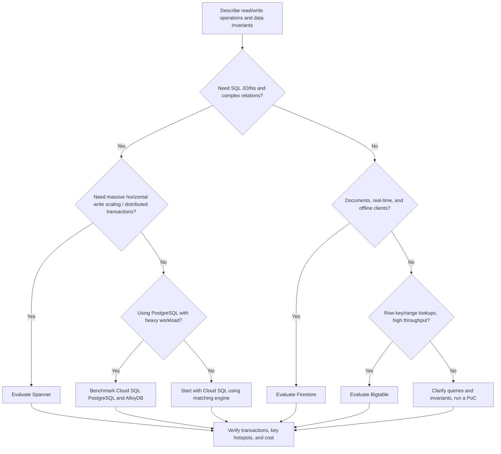
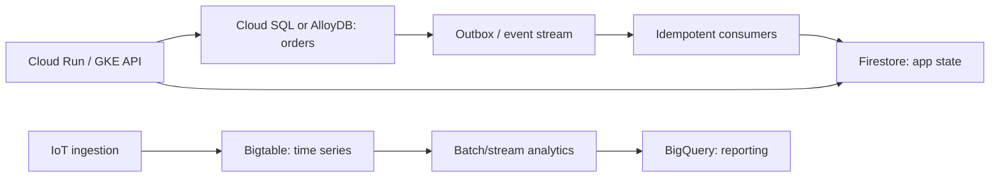

# Choosing Cloud SQL, AlloyDB, Spanner, Firestore, or Bigtable

When designing a database on Google Cloud, the crucial choice is not which service is “strongest”, but which service best satisfies your application's **data invariants, query patterns, transaction requirements, scaling model, and budget**. An e-commerce store, a real-time chat system, a multi-region transactional ledger, and an IoT ingestion system collecting billions of metrics have completely different storage requirements, even though all of them may run on Cloud Run or GKE.

In the **CLOUD_PROVIDERS_GCP** track, learners have covered project organization, IAM, VPC, Compute Engine, GKE, Cloud Run, storage, databases, release automation, and reliability/cost monitoring. This lesson in the **GCP Architecture Design** chapter connects those topics into an architectural decision that can be justified, verified, and operated.

After this lesson, learners will be able to:

1. Distinguish relational, document, and wide-column/key-value models; identify transaction, consistency, and query requirements.
2. Evaluate **Cloud SQL, AlloyDB for PostgreSQL, Spanner, Firestore, and Bigtable** based on the actual capabilities supported by Google Cloud.
3. Choose an initial option, explain when to switch or combine services, and recognize the costs/risks of each choice.
4. Build a proof of concept (PoC) with criteria for performance, correctness, disaster recovery, and cost before finalizing the architecture.

> **Principle:** Define how the application **reads, writes, and mutates data within a single business flow** before looking at total capacity or advertised speed. A data design that fails to satisfy business transactions is hard to fix by adding CPU or replicas.

## 1. Lock Down Requirements Before Picking a Product

Write a **workload profile** for each data domain, not just the whole application. An e-commerce system may need to store relational orders, document-shaped user profiles, and time-series clickstream metrics.

| Design Question | Information to Determine | Impact on Selection |
|---|---|---|
| Model and queries | Tables and JOINs, document by ID, prefix/range-key lookups, aggregations? | Determines relational vs. NoSQL and indexing strategy |
| Business invariants | Must multiple tables/rows or documents be updated atomically? | Eliminates options lacking the required transaction scope |
| Consistency | Must writes be immediately readable everywhere? Is stale replica data acceptable? | Determines consistency/routing/replication |
| Current load and growth | Read/write QPS, read/write ratio, record size, 1–3 year volume, growth multiplier | Distinguishes scale-up, read scaling, and distributed write scaling |
| Latency and location | p50/p95/p99 by region, where clients reside, multi-region writes needed? | Affects network distance, topology, and placement |
| Availability | RTO, RPO, HA/DR needs, backup/restore time | Determines topology and operational procedures |
| Compatibility | Existing PostgreSQL/MySQL/SQL Server, JDBC, ORMs, extensions, custom SQL? | Determines migration effort and code changes |
| Cost, ops, security | Steady vs. spiky load, budget, IAM, sensitive data, backup responsibility? | Determines provisioned vs. serverless capacity and access controls |

**Distinguish three frequently confused goals:**

- **HA (high availability)**: keeps the service running when a component or zone fails; does not automatically guarantee recovery of accidentally deleted data.
- **DR (disaster recovery)**: recovers during a disaster or regional outage; requires verifying RTO/RPO, replication, and an actual region-switchover plan.
- **Scale**: increases processing capacity. Separate **read scaling** (replicas/read pools) from **write scaling** (sharding or distributed architecture); adding many read replicas does not give a single primary infinite write capacity.

Do not cite “one million users” as a capacity metric without knowing how many queries/second they generate, how complex the queries are, and how data is distributed.

## 2. Quick Comparison of the Five Services

| Criterion | **Cloud SQL** | **AlloyDB for PostgreSQL** | **Spanner** | **Firestore** | **Bigtable** |
|---|---|---|---|---|---|
| Primary model | Managed RDBMS | PostgreSQL-compatible RDBMS | Distributed relational DB; SQL and ACID | Serverless NoSQL document DB | Wide-column/key-value ordered by row key |
| Notable queries | SQL, JOINs, indexes, engine-specific transactions | PostgreSQL SQL, JOINs, hybrid OLTP/analytics per system capabilities | GoogleSQL or PostgreSQL dialect with limitations; SQL queries | Document and index queries; real-time listeners in Native mode | Key lookups, prefix/range scans, streaming; no relational JOINs |
| Transactions | ACID per MySQL/PostgreSQL/SQL Server | ACID per PostgreSQL | Distributed transactions, strong consistency; serializable/external consistency in matching mode | Atomic transactions on single/multiple documents within product limits | Row-level atomic; multi-row ACID is not the primary model |
| Write scaling | Primarily scaling up primary; consider app-level sharding | Primary handles writes, decoupled storage/compute; read scaling via read pools | Horizontal distributed scaling across workloads via key design and capacity | Scales automatically with load, still subject to hotspots and document/index limits | Horizontal scaling across row-key ranges and compute nodes |
| Read consistency | Primary per engine; read replicas may lag | Reads via primary/read pools; check replica lag | Strong reads by default; stale reads optional | Strongly consistent reads from server by default; offline cache may be stale | Strong within single cluster; multi-cluster is usually eventual across clusters |
| Ops / capacity | Choose tier, storage, HA, replicas; manage connections | Choose cluster, primary/read pools, capacity; tune workloads | Choose instance/capacity/regions, design distributed schema/keys | Serverless, billed by usage, storage, and indexes | Choose compute/clusters/capacity/replication, monitor hotspots |
| Typical starting fit | Conventional relational apps, migrating MySQL/PG/SQL Server | Heavy-transaction PostgreSQL or needing higher perf/read scale | Very large OLTP, strong transactions across many keys/regions | Real-time mobile/web, documents, offline sync | IoT, metrics, time series, massive key-addressed datasets |
| Watch-outs | Primary scaling ceiling, replica lag, connection counts | Baseline/capacity cost; verify extension and feature support | Key and SQL design differ from traditional DBs; cost/topology | No relational JOINs; index/read costs, hot documents | Careful row-key design required; no JOINs, single-row transactions only |

This table shows architectural tendencies, not hard limits. Capabilities, editions, quotas, and pricing structures change over time and by region. Always verify versions, editions, and official documentation when selecting an actual configuration.

Common misconceptions to clear up right away:

- **Firestore is not simply an eventual-consistency database.** Server reads/queries are strongly consistent by default; client offline caches may be stale. Firestore supports multi-document transactions with specific limits and retry behavior.
- **Bigtable does not merely “store columns” like an OLAP warehouse.** Its model is lexicographically sorted row keys, column families, qualifiers, and cell versions; performance hinges on key-based access patterns. Bigtable does not replace BigQuery for general SQL analytics.
- **Spanner's PostgreSQL interface does not make it a full PostgreSQL server.** Spanner supports a subset of syntax and select clients; extensions, stored procedures, and admin tools must be checked individually.
- **AlloyDB is PostgreSQL-compatible**, yet support for specific extensions/flags and read-pool behavior must be verified for the chosen version/edition.

## 3. Selection Process via Elimination Questions

### 3.1. Decision Tree for Primary Workloads



This tree suggests **candidates to test**, not final answers. If requirements span multiple data patterns, a multi-datastore architecture can make sense, provided you define the system of record and event synchronization.

### 3.2. Early Elimination Criteria

1. Business requires atomic money transfers across accounts with cross-table constraints and strict auditing: start with **relational** (Cloud SQL, AlloyDB, or Spanner depending on load and regions).
2. Web/mobile clients need near-real-time sync, offline support, and mostly path/index document queries: consider **Firestore Native mode**.
3. High-volume per-device metric writes and time-range reads per device: consider **Bigtable**, testing row-key design first.
4. Existing MySQL/PostgreSQL/SQL Server application needing rapid migration at moderate load: consider **Cloud SQL** to minimize code changes.
5. Heavy PostgreSQL workload with high read traffic and mixed OLTP + analytical queries: benchmark **AlloyDB**, including its columnar engine and read pools if fitting.
6. Strong relational consistency across a massive distributed dataset with regional/multi-region needs: consider **Spanner**, re-evaluating primary key design and SQL differences.

Do not pick Bigtable merely for “billions of rows”, Spanner merely for HA, or AlloyDB merely because you heard it is faster. Speed and cost depend on query mix, data shape, region, topology, configuration, and testing.

## 4. Deep Dive into Each Service and Application Boundaries

### 4.1. Cloud SQL: Familiar Relational Database for Operational Apps

Cloud SQL manages **MySQL, PostgreSQL, and SQL Server** with backups, HA/failover, networking, maintenance, and monitoring. Java/Spring apps generally keep using familiar JDBC, ORMs, or SQL libraries, while still verifying engine versions, extensions, flags, privileges, connectivity, and migration workflows.

**Choose when:**

- You already have a relational schema, FOREIGN KEYs, JOINs, and engine-level transactions; load and growth fit within primary tiers and replicas.
- You want to reduce DBA toil and lift existing apps onto Compute Engine, GKE, or Cloud Run with minimal code changes.
- The team wants an easy-to-understand operational baseline with clear backup/PITR/HA options and predictable budgeting.

**Characteristics and limits:**

- Architecture relies on a **primary** for writes; read replicas primarily provide **read scaling** via asynchronous replication. A replica read may lag behind a fresh commit on the primary.
- HA is an explicit configuration with added cost; a single-zone instance will not meet production RTO/RPO. Check regional support for HA/DR options.
- Cloud SQL does not scale writes infinitely on a single primary; if all traffic hammers one hot table/row, adding replicas does not relieve the write bottleneck.
- From Cloud Run/GKE, plan **connection pooling** and connection limits. An instance can choke on connection exhaustion even when CPU is low.

**Example:** a single-market order management system handling a few hundred requests/second needing inventory checks and foreign keys during order creation. Cloud SQL for PostgreSQL is a sensible baseline. If the workload grows sharply, measure bottlenecks before upgrading instances, adding read replicas, tuning indexes, or switching products.

### 4.2. AlloyDB for PostgreSQL: PostgreSQL for Demanding Workloads

AlloyDB speaks PostgreSQL protocols and syntax, but decouples **compute** from **distributed storage**, featuring a **primary instance** for writes and **read pool instances** for read traffic. Google Cloud describes a columnar engine that accelerates certain scans, JOINs, and aggregations using an in-memory columnar store.

**Evaluate when:**

- Your app already runs on PostgreSQL, wants to preserve most SQL/ORM code, and needs higher OLTP performance/capacity or mixed OLTP + analytical reads.
- Workloads are read-heavy, need horizontal read-pool scaling, or benefit from AlloyDB operational optimizations.
- You have a plan to manage read routing and test data lag across read-serving instances.

**Do not assume that:**

- AlloyDB is Spanner: writes still flow through a single primary per the service's architecture; read pools do not turn it into multi-primary distributed SQL.
- Every PostgreSQL extension behaves identically to self-managed PostgreSQL: verify supported extensions/versions/flags and test migration scripts.
- The columnar engine speeds up every query: it targets specific query patterns and uses resources/overhead; measure with your real workload.

**Example:** a PostgreSQL ordering service with heavy continuous operational reporting and far more reads than writes; run a PoC comparing Cloud SQL PostgreSQL and AlloyDB using identical data, queries, connection pools, and RPO/RTO requirements. If AlloyDB delivers better performance and total cost at target load, you have evidence to select it.

### 4.3. Spanner: Distributed Relational OLTP with Strong Consistency

Spanner is a managed distributed database supporting SQL and ACID transactions at scale. At **serializable** isolation, Spanner documentation describes **external consistency**: transaction commit order aligns with real-world time order. Strong reads are the default; stale reads can be explicitly chosen to optimize certain workloads.

**Evaluate when:**

- Relational data and read/write load must scale horizontally across many partitions while preserving transactional invariants.
- The application requires strong consistency and multi-region availability matching a supported Spanner topology.
- The team is ready to design schemas/queries for a distributed environment and test latency/cost of multi-key or multi-region transactions.

**Design traps:**

- Monotonically increasing keys or timestamps as the **primary key prefix** under heavy writes easily cause hotspots; use distributed UUIDs, bit-reversed sequences, or query-aligned sharding.
- Transactions spanning many keys can raise latency or contention; keep transactions tight, implement retry logic, and measure p99.
- **Spanner's PostgreSQL dialect is a subset of PostgreSQL**; it does not include every trigger, extension, custom procedure, or existing SQL construct by default. Using PostgreSQL JDBC/PGAdapter does not erase semantic and administrative differences.

**Example:** a global ticketing system preventing double-booking across multiple regions at high transaction volume. Spanner is a strong candidate to enforce seat/inventory invariants in distributed transactions, provided you test specific transaction flows and multi-region topology; smaller regional scale may still fit Cloud SQL or AlloyDB.

### 4.4. Firestore: Serverless Document Database for Web/Mobile and Real-Time

Firestore stores **documents in collections**. With **Firestore in Native mode**, client SDKs provide real-time listeners and offline caching/sync suited for web and mobile. Queries rely on fields/indexes; models typically denormalize data for fast reads, without RDBMS-style relational JOINs.

**Key distinctions:**

- Server reads in Firestore are **strongly consistent** per documentation. Offline client caches may be stale or unsynced; do not confuse client caches with server read guarantees.
- Firestore supports **multi-document transactions** and atomic batched writes within size/time limits. Contention can automatically retry transactions; transaction callbacks must avoid external side effects.
- Serverless does not mean every write pattern scales infinitely. One hot document, sequentially indexed fields, or huge index fan-outs can degrade latency and drive up costs.
- **Editions and data-access modes differ**: Standard edition and Enterprise edition have distinct capabilities/pricing/limits; Firestore Native API, Datastore mode, and MongoDB compatibility are not one interchangeable interface. Pick the right edition/mode before deploying, as mode cannot simply be switched after database creation.

**Choose when:**

- Applications need real-time per-user/per-room state, flexible document schemas, offline-first sync, and path/ID/index queries.
- Teams prefer client SDKs and serverless operations without heavy relational JOINs or cross-table reporting queries.
- Per-operation/storage/index billing aligns with projected scale and read/write patterns.

**Illustrative document example:**

```json
{
  "roomId": "room-21",
  "lastMessage": {
    "authorId": "user-007",
    "text": "Meeting starts at 9 AM",
    "sentAt": "2026-11-19T02:00:00Z"
  },
  "memberCount": 18
}
```

Stored at `rooms/room-21`; clients can subscribe to this document. Actual messages usually live in a separate subcollection `rooms/room-21/messages/{messageId}` to avoid appending every message into an ever-growing “messages array” in a single document. For very high-traffic rooms, still evaluate write contention on aggregate documents like `memberCount` or `lastMessage`.

### 4.5. Bigtable: High Throughput, Row-Key Data, and Time Series

Bigtable uses a **sparse wide-column** model with lexicographically sorted row keys, column families, and timestamped cell versions. The most efficient access pattern is **single row-key lookups or contiguous key-range scans**. Datasets can be huge, such as billions of IoT readings or metric histories.

**Choose when:**

- High-rate continuous event/metric ingestion requiring near-direct lookups by device, customer, sensor ID, or time range.
- Key/range access fits naturally and data can be denormalized/precomputed for read paths.
- The team is prepared to design row-key schemas, compute nodes, column families, garbage collection/retention, and replication routing.

**Key limitations:**

- Bigtable **does not support relational JOINs**; SQL capabilities/APIs on Bigtable do not turn it into an ORM-ready relational RDBMS.
- Atomicity and transactions are generally **single-row**; do not use Bigtable directly to replace multi-row/multi-account balance transfers.
- Single-cluster reads/writes can provide strong consistency. With multi-cluster replication, replication is **eventual across clusters**; app profiles and routing affect read-your-writes and single-row transactions.
- Row keys prefixed by an increasing timestamp concentrate writes onto a tiny key range; construct distributed keys using entity/hash prefixes aligned with queries.

**Row-key design example:** to fetch metrics for a device over a time range, you might use:

```text
<bucket-or-hash>#<device-id>#<reverse-or-normalized-timestamp>
07#sensor-0021#20261119090000
14#sensor-0098#20261119090000
```

This is a **key sketch**, not a copy-paste production schema. While the two sample lines show matching placeholder timestamps, real queries must construct timestamp values and prefixes per defined rules, deciding whether reads target a device or a global time window. Using a **unique device ID** prefix across millions of devices distributes writes well, though a handful of ultra-chatty devices can still create hotspots. Adding shard hashes spreads load, yet reading one device may then scan multiple shards—a trade-off you must measure.

## 5. Criteria That Commonly Reverse Decisions

### 5.1. Transactions, Consistency, and Geographic Distribution

Do not treat “ACID” as a simple binary yes/no checkbox. Document the exact **transaction scope** and how data is read:

| Requirement | Candidates and Caveats |
|---|---|
| Multi-table writes and JOINs in one business request | Cloud SQL, AlloyDB; Spanner if large-scale distribution is needed |
| Transactions updating relational rows across partitions | Spanner; test contention and latency |
| Transactions across one or a few related documents | Firestore, within product limits and retry rules |
| Updating one time-series/record row by key | Bigtable; verify API and app profile used |
| Immediate read-after-write on read replicas | Cloud SQL/AlloyDB: route to primary or tolerate replica lag |
| Read-after-write across multiple Bigtable clusters | Choose routing/consistency intentionally; multi-cluster defaults to eventual |
| Offline clients reading while disconnected | Firestore Native SDK cache, but reads may be stale and offline writes have limits |

Transferring funds between two accounts is an example that **must not** be split into two independent writes hoping for “eventual consistency” if balance invariants must hold at commit time. When designing cross-service eventual consistency, use outboxes, idempotency, reconciliation, compensation, and business flows that explicitly tolerate intermediate states.

### 5.2. Queries, Indexes, and Access Cost

- With Cloud SQL/AlloyDB, query cost depends on execution plans, indexes, CPU, memory, I/O, and connections. Inspect `EXPLAIN (ANALYZE, BUFFERS)` in test environments when permitted; fix ORM N+1 queries.
- With Spanner, queries must consider **key distribution**, split counts, transactions, and index structures. Designs tuned for traditional RDBMS engines can create hotspots when scaled horizontally.
- With Firestore, every query pattern ties to indexes and operation/index-entry counts. A real-time screen with thousands of listeners or unbounded pagination can spike read bills; denormalization can multiply writes.
- With Bigtable, a full table scan filtering arbitrary columns is far costlier than queries using a matching row-key prefix. Design schemas for target queries; use BigQuery for ad-hoc or large-scale analytics when appropriate.

### 5.3. What “Serverless” Means and Baseline Costs

“Serverless” describes capacity provisioning and billing mechanics, **not guaranteed cheapness at every scale**. Firestore generally bills on document reads/writes/deletes, storage, and edition-dependent usage. Bigtable and Spanner charge for compute/capacity or processing units alongside storage/replication; Cloud SQL/AlloyDB include instance/compute, storage, backups, networking, HA, and replicas. Check **current regional/edition pricing**; never hardcode static cost figures without knowing the workload and point-in-time rates.

A practical total cost model:

```text
Monthly TCO ≈ compute or capacity
            + storage + backups + replication
            + operations / I/O / indexes (if applicable)
            + network egress + monitoring
            + operational, development, and migration effort
```

For Firestore and Bigtable, a large share of architectural cost can come from **access operations driven by the data model**. Estimating bills solely from record counts or gigabytes without a query profile leads to costly mistakes.

## 6. Four Real-World Design Scenarios

### 6.1. Java/Spring Order Management System

**Requirements:** create orders, deduct inventory, and insert payment records inside a transaction; SQL JOINs, daily reports; single-country traffic with steady growth.

**Initial candidate:** Cloud SQL for PostgreSQL or MySQL. Invariants and queries fit relational SQL, and the Java team uses Hibernate/JDBC. Test primary throughput, lock contention, connection pooling from Cloud Run/GKE, failover, and backup plans.

**When to revisit:** if PostgreSQL bottlenecks at high scale or under heavy reads/hybrid analytics, benchmark AlloyDB. If data and transactions must span multiple regions beyond a single-primary model, test Spanner and evaluate schema/dialect migration. Do not use Firestore or Bigtable as a transactional ledger merely because they are NoSQL.

### 6.2. Chat Platform and User Presence Tracking

**Requirements:** mobile clients update chat rooms in real time, read recent conversations offline, and each user maintains a room list; message documents are the primary retrieval unit.

**Initial candidate:** Firestore Native mode. Collections for accounts, rooms, and messages; client listeners on queries; configure Security Rules/IAM properly so reads stay scoped to authorized users. For high-volume chats, avoid packing all messages into one document; manage pagination and indexes.

**Boundary:** the chat platform's billing/invoicing module may still need Cloud SQL for balances/transactions; you do not have to force the entire application into one database.

### 6.3. IoT Monitoring Platform with Massive Telemetry

**Requirements:** numerous sensors emitting per-second readings, queried by sensor and time window, retaining history; high continuous writes, minimal JOINs.

**Initial candidate:** Bigtable. Design row keys by sensor + timestamp using hotspot-avoidance strategies; choose column families, garbage collection, read/write routing, and cluster counts based on workload. Test range-scan read costs and replication.

**Addition:** export aggregated or ad-hoc analytical datasets to BigQuery via an appropriate pipeline. This lets Bigtable remain a fast key-lookup store while BigQuery serves ad-hoc SQL reporting. Design event pipelines and reconciliation when the two systems update asynchronously.

### 6.4. Multi-Region Reservations with Strict Invariants

**Requirements:** multiple geographic sites concurrently updating seat/resource counts, zero overselling allowed, high write volume; transactions require consistency across related records.

**Candidate:** Spanner, if workload and budget justify its distributed architecture and strong consistency. Test read/write transactions under an actual multi-region topology, retry behavior, and p99 latency. Design primary keys without monotonically increasing leading timestamps.

**Mandatory sanity check:** a Cloud SQL/AlloyDB cluster in a primary region with HA/DR may already solve the problem if total transaction load is modest. Do not adopt a globally distributed database before measuring real requirements.

## 7. When Multiple Databases Must Work Together

An architecture can combine two or three services if **data boundaries are clear**:



**Organizational principles:**

1. Explicitly designate the **system of record** for each aggregate/invariant. For example, paid amounts live authoritatively in the relational transaction store, while Firestore holds an asynchronously updated display projection.
2. Sync via events/outboxes and idempotent consumers when no cross-database transaction exists. Monitor lag, retries, dead-letters, deduplication, and replays.
3. Splitting data layers does not remove consistency needs; UIs must account for potentially stale projections. For reads requiring immediate freshness, route to the system of record or wait for a version watermark.
4. Plan connection limits, private networking, secrets/identities, and error observability per client, especially when Cloud Run scales instances rapidly.
5. Maintain mechanisms to **rebuild read models**, back up/restore, and reconcile after incidents. Never treat Firestore or Bigtable copies as backups for the transactional store.
6. Avoid unnecessary “polyglot persistence”: each database adds operational overhead, permission models, sync pipelines, cost, and new failure modes.

## 8. Security, Reliability, and Operations When Finalizing Architecture

### 8.1. Networking and Access Controls

- Cloud SQL/AlloyDB: use service-supported secure connectivity (private IP / Cloud SQL connectors or proxy per product), appropriate service identities, TLS as needed, least-privilege DB roles, and secret rotation. Infrastructure IAM access **does not replace** in-engine database privileges.
- Spanner: instance/database-level IAM and product-provided data controls; verify storage locations and replication topology against policies.
- Firestore: distinguish Native SDK client access governed by Security Rules from backend access via Google Cloud server SDKs/IAM; backend permission checks must be enforced by application code—never assume Security Rules substitute for IAM.
- Bigtable: IAM at instance/table scope, app profiles/routing, and private network connectivity; separate ingestion identities from batch analytics identities.

For sensitive data, define encryption, key management, retention, audit logs, backups, restore rights, and deletion policies. Never assume all five services share identical admin features or custom encryption-key support.

### 8.2. SLOs and Mandatory Tests

- Define per-operation p95/p99 latency targets, availability targets, RTO, and RPO upfront.
- Set alerts on connection errors, CPU/storage/capacity, replication lag, transaction retries/contention, throttling, quotas, and cost.
- Drill failover/recovery in a controlled environment; measure reconnection times, client retries, and write correctness.
- Test backups **and restores**, including point-in-time recovery if supported; a backup that has never been restored is not a reliable DR plan.
- Simulate sudden load spikes, key/document hotspots, concurrent writes on the same entity, and regional network loss.
- Cross-check the latest regional/edition limits against official documentation before going to production.

## 9. Proof of Concept and Decision Matrix

An evidence-based decision requires running the same test suite across viable candidates. Comparisons must use **the same dataset, key distribution, network region, and retry/connection model**. Never compare a simple single query on service A against an unrelated synthetic benchmark on service B.

### 9.1. Sample Scoring Table

Scores from 1–5 are assigned by the **project team after testing**, not taken from a static product ranking.

| Criterion and Sample Weight | Evidence-Based Scoring Method |
|---|---|
| Business correctness – 30% | Transactional invariants and consistency pass/fail under concurrency tests |
| Queries and integration – 20% | Golden queries/SDK/ORM compatibility; code change and migration effort |
| Performance and growth – 20% | p95/p99, throughput, hotspots, and headroom at projected load |
| Reliability – 15% | HA/DR tests, restores, actual measured RTO/RPO |
| Total cost – 10% | 12-month estimate from benchmark metrics and region/edition pricing |
| Operations and skills – 5% | Team readiness, monitoring, security, day-2 operations |

**How to use:** eliminate candidates that fail mandatory invariants first; then score the remaining candidates. Weights are illustrative—finance teams may weight integrity higher, while IoT projects may prioritize throughput and retention. Record benchmark links, configs, pricing snapshots, and test dates alongside scores.

### 9.2. Test Scenarios

1. **Generate representative data:** realistic skewed key distributions, small/large records, foreign keys or nested documents, retention rules, and hot/cold ratios.
2. **Measure core business operations:** read by ID, filtered/range reads, writes/updates, multi-object transactions if applicable, pagination, batch/analytics, deletes/TTL.
3. **Measure concurrency:** scale concurrent users, hammer a single key/document, test read-after-write, replication lag, and replica failover.
4. **Measure resources/cost:** CPU/compute/capacity, storage/indexes, operation counts, network egress, backups, replication, and operational overhead.
5. **Assess migration:** SQL dialect differences, drivers/JDBC, extensions, indexing, scripts, CDC, and expected cutover downtime.
6. **Document conclusions:** chosen service, top two risks, mitigations, switchover/rollback criteria, and scheduled re-evaluation date as load grows.

### 9.3. Exercise

A company is building an **online learning platform** serving millions of learners with four data domains:

- Course enrollments and payments with strict transactional constraints.
- Class announcements and per-learner progress requiring real-time mobile updates and offline support.
- Video playback events, interaction ticks, and telemetry generated continuously with long-term retention.
- Consolidated analytical reports for product and finance teams.

Draft an architectural proposal meeting these requirements:

1. For each data domain, pick **at most two candidates** among Cloud SQL, AlloyDB, Spanner, Firestore, and Bigtable; designate the system of record and explain why other services were eliminated.
2. Diagram write/read flows, describe payment invariants, event synchronization, and duplicate-event handling.
3. Design a representative schema or key structure: payment table, progress document path, and telemetry row key; analyze hotspot risks.
4. Define 6 test scenarios covering transactions, latency, concurrency, read-after-write, offline behavior, and DR, plus how evidence will be collected.
5. Outline cost structures at low/medium/high load tiers; fixed price quotes are unnecessary without a locked region and configuration.
6. State criteria for evaluating AlloyDB or Spanner instead of Cloud SQL, and explain why Bigtable is unsuitable as a payment transaction store.

**Passing criteria:** decisions are anchored in actual queries, data invariants, SLOs, client experience, and test evidence. Answers stating only “Firestore is fast, Spanner scales, Bigtable handles big data” do not justify a selection.

## Official Documentation to Reference

- [Google Cloud — Database Services](https://cloud.google.com/products/databases)
- [Cloud SQL — Introduction](https://cloud.google.com/sql/docs/introduction)
- [Cloud SQL for PostgreSQL — Replication and Read Replicas](https://cloud.google.com/sql/docs/postgres/replication)
- [AlloyDB — Architecture Overview](https://cloud.google.com/alloydb/docs/overview)
- [AlloyDB — Columnar Engine](https://cloud.google.com/alloydb/docs/columnar-engine/about)
- [Spanner — Transactions Overview](https://cloud.google.com/spanner/docs/transactions)
- [Spanner — PostgreSQL Interface, Capabilities, and Limitations](https://cloud.google.com/spanner/docs/postgresql-interface)
- [Spanner — Schema and Hotspot Best Practices](https://cloud.google.com/spanner/docs/schema-design)
- [Firestore — Native Mode Overview](https://cloud.google.com/firestore/native/docs/overview)
- [Firestore — Editions and Data Access Modes](https://cloud.google.com/firestore/native/docs/editions-overview)
- [Firestore — Transactions and Batched Writes](https://cloud.google.com/firestore/native/docs/manage-data/transactions)
- [Firestore — Read/Write Scale](https://cloud.google.com/firestore/native/docs/understand-reads-writes-scale)
- [Firestore — Offline Data](https://cloud.google.com/firestore/native/docs/manage-data/enable-offline)
- [Bigtable — Overview](https://cloud.google.com/bigtable/docs/overview)
- [Bigtable — Schema and Row Key Design](https://cloud.google.com/bigtable/docs/schema-design)
- [Bigtable — Replication and Consistency](https://cloud.google.com/bigtable/docs/replication-overview)
- [Bigtable — Routing and Single-Row Transactions](https://cloud.google.com/bigtable/docs/routing)

**Note:** descriptions, pricing, transaction limits, availability SLAs, and editions are subject to change. For production, re-verify documentation for your specific region, edition, and version, and benchmark against real project workloads at implementation time.
