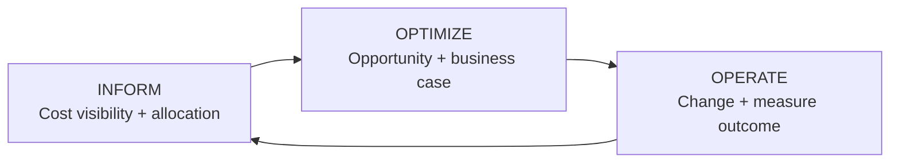
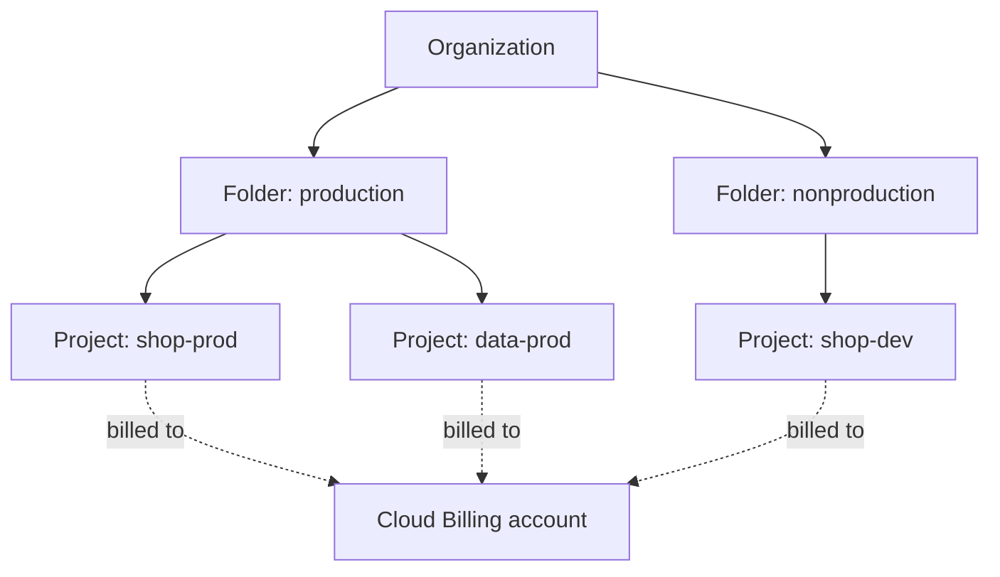

# Setting Up a FinOps Process for Teams Using Google Cloud

## Objectives and Context

**FinOps (Cloud Financial Operations)** is how **engineering, finance, and business** teams collaborate to manage technology costs based on usage data, product value, and clear accountability. The goal is not just to reduce the Google Cloud bill: a cost-saving decision that makes an application lose reliability, increases response time, or slows down releases can end up increasing the **cost per business outcome**.

This lesson belongs to the **Performance and FinOps** chapter of the **CLOUD_PROVIDERS_GCP** module. After learning about projects, IAM, VPC, Compute Engine, GKE, Cloud Run, storage, databases, deployment, and reliability, the team can combine those capabilities into a repeatable **cost – performance – value** control process.

After this lesson, learners will be able to:

1. Organize FinOps accountability for each project, team, product, and shared cost.
2. Establish cost visibility using Cloud Billing Reports, Budgets, Cost Anomalies, and Billing Export to BigQuery.
3. Build allocation rules, showback/chargeback, KPIs, and budget plans.
4. Handle threshold alerts, investigate cost spikes, and prioritize optimization opportunities based on metrics.
5. Run recurring FinOps meetings, verify realized savings, and protect application SLOs.

**Prerequisites:** the organization has at least one Google Cloud Billing account linked to its projects; implementers are granted appropriate cost-viewing permissions, while permissions to modify resources are granted only to authorized teams. Names, dollar amounts, accounts, and projects in this lesson are **illustrative examples**.

## 1. Understanding FinOps as an Operational Loop

The FinOps Foundation describes three continuously repeating phases:

| Phase | Question | Team Activities | Outcome |
|---|---|---|---|
| **Inform** (visibility) | Who is using what, how much does it cost, and what value does it generate? | Assigning owners, cost allocation, reporting, forecasting, unit economics | Reliable cost reporting by team/product |
| **Optimize** (options) | Where can value be improved or waste reduced? | Rightsizing, autoscaling, storage, networking, CUDs, design improvements | Prioritized list of opportunities with estimates, risks, and owners |
| **Operate** (execution) | Who makes changes, verifies results, and prevents recurrence? | Approval, implementation, SLO monitoring, before/after comparison, policy updates | Verified outcomes and regular optimization habits |



The three phases **do not necessarily run linearly**. FinOps may be standardizing labels for one team while SRE adjusts resources for another team and Finance reviews long-term usage commitments. A practical approach is to implement with a **small scope, measurable data, and short cycles**, then scale out.

Distinguish common concepts:

- **Cost visibility:** knowing which project, service, SKU, team, and time period costs come from.
- **Allocation:** attributing costs to the responsible unit, with rules for handling unallocated spend.
- **Showback:** reporting costs so teams understand their consumption; no internal money transfer.
- **Chargeback:** accounting/charging costs back to teams under an agreed financial policy.
- **Unit economics:** cost per business outcome, such as cost per 1,000 orders or per GB of data processed.
- **Rate optimization:** paying the right rate for the workload you need to run (e.g., CUDs).
- **Usage optimization:** adjusting the resources currently being consumed (e.g., shutting down idle VMs).
- **Architecture optimization:** changing the design to achieve the same goal with better resource efficiency.

Sources: [FinOps Framework – Phases](https://framework.finops.org/framework/phases/), [What is Cloud FinOps? – Google Cloud](https://cloud.google.com/learn/what-is-finops).

## 2. Forming the FinOps Team and Decision Accountability

FinOps is a **cross-functional** responsibility. A single person managing the invoice can rarely tell whether a VM can be shut down, which cluster has a strict SLO, or which cost increase is driven by higher sales volume.

| Role | Responsibilities | Typical Decision Authority |
|---|---|---|
| **FinOps lead / Cloud Center of Excellence** | Define taxonomy, reporting, cadence, optimization backlog; drive reconciliation | Coordinate, finalize measurement rules, and present options |
| **Engineering/Product owner** | Confirm system ownership, prioritize product value, accept proposals | Approve application behavior changes and team budget targets |
| **SRE/Platform** | Measure performance, tune configurations, autoscaling, optimize resources, protect reliability | Implement approved infrastructure changes |
| **Finance/FP&A** | Budgeting, forecasting, defining allocated costs, recording actual spend | Finalize cost classification, financial reporting, showback/chargeback |
| **Security/Governance** | IAM, resource/tag policies, auditing, restricting cost data access | Approve policy exceptions and access |
| **Procurement/Management** | Evaluate long-term commitments, contracts, risk levels, and benefits | Approve CUD purchases or long-term financial obligations |

A minimal **RACI** matrix for each task:

| Activity | Responsible (does the work) | Accountable (final accountability) | Consulted |
|---|---|---|---|
| Defining labels and owners | Platform/FinOps | FinOps lead | Finance, Product |
| Forecasting cost per product | Finance + Product analyst | Product owner | FinOps, SRE |
| Handling cost anomaly alerts | Resource owner + SRE | Product owner | FinOps |
| Rightsizing VM/GKE/Cloud SQL | SRE/Engineering | Service owner | FinOps, Security |
| Purchasing 1-year or 3-year CUDs | FinOps/Procurement | Financially authorized person | SRE, Finance |
| Invoice reconciliation and allocation methodology | Finance | Finance lead | FinOps, Product |

**Artifacts to create at kickoff:** project → team → owner → application catalog; allocation rules; standard reports; budgets; anomaly response procedure; optimization backlog; decision records. There is no need to buy specialized tools before teams agree on naming conventions and ownership.

## 3. Setting Scope: Billing Account, Project, Labels, and Tags

### 3.1. Designing Cost Management Units

In Google Cloud, one **Cloud Billing account** can pay for multiple **projects**, while at any given time a project is linked to **one** Cloud Billing account. Organizational structure is typically arranged as `Organization → Folder → Project → Resource`, whereas the Billing account is a separate payment relationship.

Example:



**Do not use project names as the sole source of truth**: a single project can host multiple services or teams, and a single product can run across multiple projects. For accurate cost management, choose **project as the default boundary**, then supplement with labels/tags for shared costs or multiple applications within the same project.

### 3.2. Minimal Taxonomy

Agree on labels before rolling them out broadly. Example of applying **resource labels** where services support them:

| Key | Example Value | Rule |
|---|---|---|
| `team` | `checkout`, `analytics`, `platform` | Matches the responsible team directory |
| `application` | `storefront`, `etl` | Matches the application catalog |
| `environment` | `prod`, `staging`, `dev` | Fixed list of allowed values |
| `cost_center` | `cc100`, `cc200` | Synchronized with Finance |
| `owner` | `checkout-team` | Use team name; avoid putting emails or personal data in labels |
| `managed_by` | `terraform`, `manual` | Helps attribute resource lifecycle accountability |

**Labels** are key/value pairs attached to supported resources and can appear in Billing Export. **Resource Manager tags** are a separate governance mechanism that can be inherited across the hierarchy and support policy enforcement; some tags also appear in Billing data. Tags and labels are **not completely equivalent** in terms of supported resource targets and when data is exported. Verify support for each service before assuming every cost line item carries a label.

Operational policy should require that creating a resource declares owner, cost center, and environment; CI/Terraform should validate required values on supported resource types; and unlabeled costs should have allocation rules or be explicitly accounted for as `unallocated`. **Adding labels today does not retroactively label usage data from previous months**.

### 3.3. Rules for Shared Costs

A starter model can use four buckets:

1. **Direct cost**: resources/projects with a clear owner, assigned 100% to that team.
2. **Shared platform cost**: shared VPC, CI, observability, clusters; allocated by an agreed ratio (usage, workload count, revenue, or even split), while keeping **unallocated shared** figures transparent when data is insufficient.
3. **Central/enterprise cost**: organization-level fees/taxes/adjustments/commitments; Finance defines separate accounting rules rather than forcing everything onto one team.
4. **Unallocated cost**: missing data or missing labels; publish its share, assign a responsible person, and set a target resolution date.

Do not force shared costs onto an arbitrary team just to make a "100% allocated" report look neat while being inaccurate. When moving from **showback** to **chargeback**, Finance must approve the definition of net/gross cost and how discounts, taxes, currency fluctuations, and shared costs are handled.

Sources: [Cloud Billing exports to BigQuery](https://docs.cloud.google.com/billing/docs/how-to/export-data-bigquery-setup), [BigQuery export schema](https://docs.cloud.google.com/billing/docs/how-to/export-data-bigquery-tables/standard-usage).

## 4. Google Cloud Tools by Operational Objective

| Objective | Tool | Practical Notes |
|---|---|---|
| View costs over time/service/project/SKU | **Cloud Billing Reports** | Supports filtering, grouping, comparison, and forecasting; data has latency |
| Set cost plans and reminders | **Budgets & alerts** | Alerts when thresholds are crossed; **does not stop spending by default** |
| Investigate abnormal cost increases | **Cost Anomalies** | Uses anomaly detection models for spikes and root-cause breakdown by service/SKU/region |
| Granular data, audit, chargeback, BI | **Cloud Billing export to BigQuery** | Standard, Detailed, Pricing, and CUD data; incurs storage/query costs |
| List optimization opportunities | **FinOps hub / Recommender** | Idle, rightsizing, commitments, potential savings; requires risk review |
| Load trends and SLOs | **Cloud Monitoring/Logging** | Connects resource consumption with latency, errors, CPU, requests, throughput |
| Pre-design estimation | **Google Cloud Pricing Calculator** | Estimates based on assumptions; must be compared against actual spend |
| Set up automated rules | **Budgets API, Pub/Sub, Workflows/Cloud Run, CI/IaC** | Automation with appropriate permissions and approval mechanisms |

**Basic IAM:** users viewing total costs on a Billing account may need `roles/billing.viewer` (Billing Account Viewer); users enabling exports need appropriate Cloud Billing and BigQuery permissions (such as Billing Account Costs Manager or Billing Account Administrator depending on the export type). Users who only have access to specific projects may only see costs for the projects they are authorized to view. **Reading recommendations** and **applying recommendations** require different permissions. Do not grant `roles/billing.admin` to every team member just so they can view reports; prefer least privilege, restricted BigQuery dataset access, and summary reports for people who do not need granular billing data.

**FinOps hub** provides recommendation categories such as shutting down idle resources, rightsizing, configuration changes, and purchasing CUDs; **potential savings** numbers are estimates and may not reflect all existing CUDs already owned. The FinOps score and certain account-level features are only available when the viewer has appropriate permissions, and a single score should not be used as a KPI to evaluate teams.

Sources: [Billing Reports](https://docs.cloud.google.com/billing/docs/how-to/reports), [FinOps hub](https://docs.cloud.google.com/billing/docs/how-to/finops-hub), [Cost Anomalies](https://docs.cloud.google.com/billing/docs/how-to/manage-anomalies).

## 5. Establishing a Weekly Repeatable FinOps Process

### Step 1 — Define Baselines and Targets

Over the last 30 days (or multiple periods if workloads are seasonal), record costs by billing account, project, service, and SKU. Reconcile:

- **Gross** cost before credits versus **net** cost after credits, according to internal definitions.
- Costs grouped by **usage month** versus **invoice month**.
- New/decommissioned projects, services with increased load, request volume, job counts, GB stored, and deployment changes.
- Performance/SLOs and commitments nearing expiration or being paid for while underutilized.

Choose a **decision-useful baseline**, for example: net cost per 1,000 orders, allocated cost percentage, dev environment cost, or validated recommendation backlog. If a product doubles its transactions, a 30% invoice increase can still be a good outcome in terms of **unit cost**.

### Step 2 — Assign Owners and Publish Transparent Reports

The FinOps lead and Platform establish the `project → application → team → cost_center` mapping and agree on shared labels. Create three views from the same data source:

- **Executive/Finance:** total cost versus budget, forecast, variance, and unit economics.
- **Engineering owner:** cost by service/SKU, changes across deployments, and list of optimizable resources.
- **Platform:** shared costs, label hygiene, quotas, cross-project optimization, and CUDs.

Display the data cutoff date and currency on every dashboard. Every report must state the **time zone**, gross/net basis, treatment of credits/taxes, and time range; otherwise, two dashboards can each be individually accurate while showing different totals.

### Step 3 — Create Budgets, Thresholds, and Alerts

In **Google Cloud Console → Billing → Cost management → Budgets & alerts**:

1. Select the billing account and scope by project/service/label or assigned scope.
2. Choose the budget period (e.g., monthly) and amount in the Billing account's currency.
3. Set thresholds for **actual spend** or **forecasted spend**, such as 50%, 80%, and 100%.
4. Specify appropriate email recipients; optionally configure **Pub/Sub programmatic notifications** to integrate with runbooks/on-call.
5. Save the budget; verify recipient permissions and test the notification flow using a validated operational test in an authorized environment.

For example, `shop-prod` has a budget of 12,000 USD/month, with actual spend alerts at 6,000, 9,600, and 12,000 USD; forecasted spend can alert early before reaching 100%. These are **illustrative figures**, not a budget recommendation for every team.

**Budgets are not hard spending caps.** Alerts have latency due to billing data updates and may arrive after costs have already been incurred. Automatically disabling billing/projects upon hitting a threshold can break production services and lock out access; if automated actions are desired, apply environment-based policies with owner confirmation and proper approval. For dev/test, authorized resources can be automatically stopped instead of disabling the entire project.

Source: [Create budgets and alerts](https://docs.cloud.google.com/billing/docs/how-to/budgets).

### Step 4 — Monitor and Handle Anomalies

Configure **Cost Anomalies** with appropriate absolute and percentage increase thresholds. When an alert triggers, distinguish between:

- **Legitimate growth:** traffic spikes, marketing campaigns, batch migrations, scheduled jobs, planned upgrades.
- **Configuration changes:** larger VMs, increased Cloud Run min instances, increased GKE nodes/requests, BigQuery queries scanning large amounts of data.
- **Waste:** idle instances, forgotten disks/snapshots, excessive logging, test resources without expiration dates.
- **Operational/security risk:** leaked credentials, abnormal API usage, infinite loops, or jobs retrying continuously.

**Runbook when receiving an alert:**

```text
1. Receive alert -> record timestamp, billing account/project, and deviation amount.
2. Open Cost Anomalies and Billing Reports -> isolate service/SKU/region.
3. Tag the owner, check recent deployments and business volume.
4. Correlate Cloud Monitoring/Logging with requests, CPU, jobs, and errors.
5. Classify: expected / unexpected / needs further investigation.
6. If unexpected: contain the specific workload per policy;
   roll back or apply appropriate limits, avoiding arbitrary system shutdowns.
7. Record impact, action taken, approver, and outcome 24-48 hours later.
8. Update thresholds/configurations and hold a postmortem when impact is significant.
```

An alert rule such as "an increase of $200 and 20% above expected" is only an **example configuration**. Cost Anomalies also provides **early signals for certain AI workloads** in preview, where figures are not yet final invoiced costs. Do not confuse anomaly detection with budget alerts: budgets compare **spend against a plan**, whereas anomalies compare **spend against expected behavior based on history**.

Source: [View and manage cost anomalies](https://docs.cloud.google.com/billing/docs/how-to/manage-anomalies).

### Step 5 — Maintain an Owner-Assigned Savings Backlog

Each proposal must include:

| Field | Example |
|---|---|
| ID and scope | `FIN-027`, project `shop-prod`, VM `batch-worker-3` |
| Responsible unit | Platform + Batch owner |
| Evidence | Low VM CPU, runs nightly jobs only; 30-day chart |
| Action | Adjust instance size, conditional stop/start schedule |
| Estimated savings | 150 USD/month **pre-implementation estimate** |
| Risk | Delayed job or insufficient CPU during peak load |
| Allowed conditions | Job SLO finishes before 06:00 and backup is verified |
| Approval and schedule | Application owner/SRE, test in staging first |
| Verified outcome | Compare cost and latency after 1–2 cycles, record variance |

Measure **realized savings** based on observed post-change cost, adjusted for traffic and seasonality; do not sum all "potential savings" across multiple recommendations as guaranteed savings. Avoid double-counting opportunities, such as both rightsizing a VM and buying a CUD for the same original footprint.

## 6. Setting Up Billing Export to BigQuery for Repeatable Analysis

Cloud Billing Reports are suitable for quick inspection. When you need team-level reporting, auditable SQL, shared cost allocation, SKU analysis, and chargeback, use **Cloud Billing export to BigQuery**.

### 6.1. Preparing the Export

1. Select or create a dedicated **FinOps project** with billing enabled and linked to the Billing account to export.
2. Create a BigQuery dataset (e.g., `finops_billing`) in a **location supported by Cloud Billing export**; configure restricted access permissions and consider residency requirements.
3. In **Billing → Billing export → BigQuery export**, enable at least **Standard usage cost export**. Enable **Detailed usage cost export** if resource-level information is needed, and add **Pricing/CUD metadata export** if required by your use case.
4. Ensure the Google-managed export service account retains write access to the dataset; do not revoke this IAM permission while export is active.
5. Verify that export tables appear and have complete daily data before using them in official reports. Create a **BigQuery view** to normalize the schema so dashboards do not break directly on column changes.

Standard table names:

- Standard: `gcp_billing_export_v1_BILLING_ACCOUNT_ID`.
- Detailed: `gcp_billing_export_resource_v1_BILLING_ACCOUNT_ID`.
- Pricing: `cloud_pricing_export`.
- Google Cloud also offers **FOCUS usage cost export**, currently described as **Preview** in current documentation; FOCUS is a cross-provider data standard and is not required to start this lab.

**Data limitations to disclose:** export values arrive in multiple batches and are not guaranteed to be up to date at the exact moment of usage; when first enabling export with a BigQuery dataset in multi-region `US` or `EU`, retroactive data may be included from the start of the previous month, whereas datasets in a supported single region typically start from the enablement date. Initial backfill can take several days. Label/hierarchy changes do not update historical records; Billing Export data and invoices may differ across periods when adjustments or late postings occur.

**Billing Export also incurs BigQuery costs** for storage and queries; use partitioning/filtering, aggregated dashboards, and query volume controls. Billing data can be financially and architecturally sensitive, so restrict IAM on datasets, views, and service accounts.

Sources: [Set up Cloud Billing export](https://docs.cloud.google.com/billing/docs/how-to/export-data-bigquery-setup), [Billing data export tables and timing](https://docs.cloud.google.com/billing/docs/how-to/export-data-bigquery-tables).

### 6.2. Example SQL: Cost by Day, Project, and Service

After enabling Standard export, replace `FINOPS_PROJECT.finops_billing.gcp_billing_export_v1_XXXXXX_XXXXXX_XXXXXX` with your actual table name. The following query uses **GoogleSQL (BigQuery Standard SQL)**; the time range is just an example for October 2026:

```sql
WITH billing_rows AS (
  SELECT
    DATE(usage_start_time, 'Asia/Ho_Chi_Minh') AS usage_day,
    COALESCE(project.id, '_no_project') AS project_id,
    service.description AS service,
    currency,
    cost AS gross_cost,
    IFNULL(
      (SELECT SUM(c.amount) FROM UNNEST(credits) AS c),
      0
    ) AS credit_amount
  FROM
    `FINOPS_PROJECT.finops_billing.gcp_billing_export_v1_XXXXXX_XXXXXX_XXXXXX`
  WHERE
    usage_start_time >= TIMESTAMP('2026-10-01 00:00:00+07')
    AND usage_start_time < TIMESTAMP('2026-11-01 00:00:00+07')
)
SELECT
  usage_day,
  project_id,
  service,
  currency,
  ROUND(SUM(gross_cost), 2) AS gross_cost,
  ROUND(SUM(credit_amount), 2) AS credits,
  ROUND(SUM(gross_cost + credit_amount), 2) AS net_cost
FROM billing_rows
GROUP BY 1, 2, 3, 4
ORDER BY usage_day DESC, net_cost DESC;
```

**How to read this:**

- `cost` is typically the gross amount of the usage row, and `credits.amount` is typically negative; net = cost + credits. Do not take `SUM(cost)` and call it the post-discount figure.
- `usage_start_time` reflects when the usage occurred and can be analyzed by day. `invoice.month` (YYYYMM) is the **invoice month** and may differ from the usage month; when reconciling invoices, group by `invoice.month` and account for taxes, adjustments, and rounding.
- Explicitly output the currency from the export; **do not directly sum different currencies** if aggregating across multiple sources.
- For cost allocation, build an additional view using `project.id`, resource labels, or project labels along with an `unallocated` rule; avoid relying on resources that may be unlabeled or only labeled after a change.

The export table contains actual incurred usage data; rows without a project or adjustment rows should not be silently dropped. Google recommends considering summation in **micros** when exact monetary reconciliation is needed to avoid floating-point discrepancies.

Source: [Standard export schema and query examples](https://docs.cloud.google.com/billing/docs/how-to/export-data-bigquery-tables/standard-usage).

### 6.3. Example SQL: Measuring Allocation Coverage by Cost Center

The following query illustrates one way to extract the `cost_center` label at the resource or project level, routing unlabeled rows to `unallocated`. Adjust taxonomy and access permissions to match your environment:

```sql
WITH attributed_rows AS (
  SELECT
    COALESCE(
      (SELECT l.value
       FROM UNNEST(labels) AS l
       WHERE l.key = 'cost_center' LIMIT 1),
      (SELECT pl.value
       FROM UNNEST(project.labels) AS pl
       WHERE pl.key = 'cost_center' LIMIT 1),
      'unallocated'
    ) AS cost_center,
    cost + IFNULL(
      (SELECT SUM(c.amount) FROM UNNEST(credits) AS c), 0
    ) AS net_cost
  FROM
    `FINOPS_PROJECT.finops_billing.gcp_billing_export_v1_XXXXXX_XXXXXX_XXXXXX`
  WHERE
    usage_start_time >= TIMESTAMP('2026-10-01')
    AND usage_start_time < TIMESTAMP('2026-11-01')
)
SELECT
  cost_center,
  ROUND(SUM(net_cost), 2) AS net_cost
FROM attributed_rows
GROUP BY cost_center
ORDER BY net_cost DESC;
```

**Note when measuring KPIs:** if credits/adjustments make certain rows negative, using only a **percentage of net cost** can produce negative allocation percentages or percentages exceeding 100%. Organizations should clearly define the denominator, typically calculating **positive eligible gross usage cost** and placing taxes/adjustments/CUD fees into a separate bucket before reporting "allocation coverage"; net reports are used for financial reconciliation rather than necessarily sharing the same denominator as labeling coverage.

## 7. Choosing Which Optimization Comes First: Benefits, Risks, and Performance

### 7.1. Three Opportunity Categories

**1. Usage optimization**

- Compute Engine: remove unused VMs, shut down dev/test VMs outside permitted hours, downsize machine types based on measured CPU/memory/IO, clean up unused disks/IPs/snapshots.
- GKE: inspect requests/limits, pod bin-packing, Horizontal Pod Autoscaler, cluster autoscaler, and node pools for different workloads; evaluate OOM risks, latency, pod disruption, and workload bursts.
- Cloud Run: tune min/max instances, concurrency, memory/CPU allocation, and execution time; check cold starts, timeouts, latency, and request/CPU costs.
- Cloud SQL: evaluate instance size, replica count, storage capacity, and backup configuration after load measurement; never cut redundancy/HA solely to save money.
- BigQuery: limit `SELECT *` on large tables, use partition pruning/clustering, materialized views, or appropriate reservations; monitor bytes processed and slot utilization.
- Cloud Storage: lifecycle policies, storage classes, retention, removing duplicate objects; account for retrieval/early deletion fees and restore requirements before changing storage classes.
- Network: analyze cross-region egress, Internet egress, NAT, load balancers, and redundant data transfers; choose architectural placement aligned with residency and latency.

**2. Rate optimization**

- Review **committed use discounts (CUDs)** programs by service, region, term, and eligibility conditions. Google Cloud offers both **resource-based** and **spend-based** commitments, typically for **1 or 3 years**; terms and discount calculation models vary by product, with some transitioning to new consumption models.
- Only purchase commitments when you understand the **stable usage baseline**, product roadmap, likelihood of decommissioning/migrating workloads, spend already covered by other CUDs, and internal allocation rules.
- Distinguish Recommender's `savings potential` from **actual post-purchase benefit**. Underutilized CUDs can increase net cost. Never treat a tool recommendation as an automatic purchase decision.

**3. Architecture optimization**

- Consider moving suitable workloads from always-on VMs to Cloud Run/jobs/event-driven architectures, optimizing queries or batch windows, adjusting caching/CDN, reusing connections, and compressing data.
- Quantify **migration cost**, implementation effort, operational cost, performance, and risk before comparing against keeping the current architecture.

Sources: [FinOps hub recommendations](https://docs.cloud.google.com/billing/docs/how-to/finops-hub), [Committed use discounts](https://docs.cloud.google.com/docs/cuds), [Committed use discount recommendations](https://docs.cloud.google.com/docs/cuds-recommender).

### 7.2. Auditable Prioritization Matrix

A proposal is prioritized when savings are meaningful, easy to validate, low risk, and reasonable in effort. Example qualitative framework:

| Proposal | Potential Savings | Effort/Risk | Approach |
|---|---|---|---|
| Delete unused test disks | Medium | Low if backup and owner confirmed | Prioritize early |
| Schedule staging VM shutdown | Medium | Low–medium | Pilot on one project |
| Reduce CPU on production DB | High | High (SLO/HA) | Benchmark, evaluate peak load and rollback |
| Buy 3-year CUD for new workload | High on paper | High (long-term commitment) | Confirm multi-month baseline and financial review |
| Optimize BigQuery query scans | Medium–high | Low–medium | Prioritize by bytes processed and business freshness |

**Mandatory guardrails:** before and after changes, measure p95/p99 latency, error rate, throughput, saturation, batch completion, RPO/RTO if applicable, and rollback success rate. If cost drops but the SLO is violated, the change **fails**.

## 8. Shared KPIs for Finance, Product, and Engineering

KPIs must have a **definition, data source, owner, and cadence**. Avoid evaluating a team solely on absolute invoice spend.

| KPI | Suggested Formula / Definition | Purpose |
|---|---|---|
| **Budget variance** | (`Actual net cost - Budget`) / `Budget` | Track over/under-budget performance |
| **Forecast accuracy** | `1 - ABS(Forecast - Actual) / Actual` when Actual is greater than 0 | Forecasting quality |
| **Allocation coverage** | `Allocated eligible gross usage cost / Total eligible gross usage cost` | Measure completeness of owner attribution |
| **Unit cost** | `Relevant cost / Number of successful business units` | Evaluate efficiency as volume changes |
| **Realized savings** | `Baseline normalized cost - Actual comparable cost` | Prove improvements, normalized for load changes |
| **Waste backlog aging** | Days an idle/rightsizing opportunity remains unresolved | Action discipline |
| **Commitment utilization** | Actual usage against purchased commitments per product definition | Avoid overbuying CUDs |
| **SLO compliance** | % of time or requests meeting reliability targets | Quality protection condition |

For example, a product grows from 100,000 orders/month to 160,000 orders/month, while net cost increases from 5,000 USD to 6,400 USD:

- Initially `unit cost = 5,000 / 100,000 = 0.050 USD/order`.
- Next period `unit cost = 6,400 / 160,000 = 0.040 USD/order`.
- The bill grew by 28%, yet **cost per order fell by 20%**. This is a good result as long as SLOs and quality did not degrade, even though total spend increased.

However, if products share resources, you must clearly define **which costs belong in the numerator** and avoid arbitrarily injecting Finance-allocated discounts into unit cost.

### Minimal Metric Set for New Teams

At kickoff, you can start with four numbers: **actual vs budget**, **cost by owner**, **unallocated percentage**, and **top cost anomalies + actions**. Only after 1–2 cycles with a reliable baseline should you add unit economics, realized savings, commitment utilization, and cost per SLO-compliant transaction.

## 9. FinOps Operating Cadence: Who Does What?

| Cadence | Activities | Responsible | Output |
|---|---|---|---|
| **Daily** | Review anomalies, budget alerts, unusual resource growth; route alerts to owners | On-call/SRE + FinOps | Incident ticket if criteria exceeded |
| **Weekly (30–45 min)** | Top 5 variances by project/service, savings backlog, post-optimization SLO checks | FinOps lead, Engineering owners | Action list with owners and deadlines |
| **Monthly** | Usage vs invoice reconciliation, forecast updates, showback/chargeback, allocation rate | Finance + FinOps + Product | Cost report, variance analysis, and decisions |
| **Quarterly** | Roadmap review, CUD renewals/new commitments, unit economics, policies, and targets | Management, Procurement, Finance, Platform | Financial plan and next-quarter backlog |

**Weekly FinOps meeting agenda (30 minutes):**

1. 5 min: review budget and forecast, changes compared to last week.
2. 10 min: top 3 largest cost increases, classify changes as demand-driven or bugs/errors.
3. 10 min: decide on measured optimization opportunities and their risks to SLOs.
4. 5 min: record owners, deadlines, and verification results from the previous cycle.

A one-page decision record can be kept for each proposal:

```text
ID: FIN-027
Owner: checkout-platform
Scope: shop-prod / Compute Engine / batch-worker-3
Cost baseline: 30 days, net USD after identified credits
Observed usage: CPU p95, memory, IOPS, request/job rate
Proposal: change machine type after benchmarking
Estimated savings: [USD/month], calculation method
Risk/SLO: job completes <= 06:00, error rate, rollback path
Approver: service owner + SRE
Change window: [date, time]
Validation: metrics at 7 and 30 days post-change
Decision: ACCEPT / REJECT / DEFER
```

If a change could disrupt production, integrate it with existing **change management**; do not create a separate FinOps approval workflow that conflicts with operational processes.

## 10. Applied Scenario: E-Commerce Team on GCP

Suppose a company has three projects:

- `shop-prod`: Cloud Run, Cloud SQL, load balancer for the ordering API.
- `data-prod`: BigQuery, Cloud Storage, and analytics pipelines.
- `platform-shared`: observability, builds, networking, and shared resources.

The entire team's budget is **12,000 USD/month**. Billing Reports show last month's net cost was **11,200 USD**, consisting of:

| Cost Group | Illustrative Amount | Situation |
|---|---:|---|
| Shop API/DB | 5,200 USD | Traffic grew 40%, database is stable |
| Analytics | 3,400 USD | Several BigQuery queries scan large volumes of data |
| Platform shared | 2,600 USD | Staging VMs and old backup disks |
| **Total** | **11,200 USD** | Within budget, but optimization opportunities exist |

**Step 1 – Inform:** the team agrees on cost centers, confirms the Billing Export data source, and chooses completed orders as the unit cost denominator for `shop-prod`. Shared items are reported separately, after which Finance approves the allocation ratio. The budget still has 800 USD remaining under plan, but the upward trend is not ignored.

**Step 2 – Optimize:** FinOps hub flags an idle VM and an old disk; engineers verify they do not hold critical data. The data team spots a query scanning the entire events table every hour; testing partition pruning reduces bytes processed. Meanwhile, the production DB has low CPU but high peak latency: **do not downsize the instance** until load testing and a rollback plan are ready.

**Step 3 – Operate:** owners create two change tickets (cleaning up old resources and optimizing the query), measuring cost and latency before and after. If savings are proven after 30 days, the team updates the baseline, reports to Finance, and adds guardrails so test resources have expiration dates.

**Step 4 – Control:** set budget alerts at 50/80/100%; Cost Anomalies notifies on unexpected spikes. Weekly, FinOps reviews top anomalies and the backlog. Monthly, Finance reconciles the invoice; only after several months of a stable baseline does the team consider CUDs for predictable workloads.

The key lesson from this scenario: **do not pick the "cheapest optimization" solely by how much spend it cuts**. Success is only declared when savings are verified, the order flow still meets its SLO, and teams agree with the allocation methodology.

## 11. 30–60–90 Day Implementation Plan

| Milestone | Activities | Exit Criteria |
|---|---|---|
| **Days 1–30: cost visibility** | Appoint FinOps lead, project inventory, taxonomy, create budgets and enable export; publish baseline | Every project has an owner, service/project reports exist, at least one budget alert is active |
| **Days 31–60: turn into action** | Classify shared/unallocated costs, review anomalies weekly, pilot 2–3 low-risk optimizations | Backlog, change records, SLO guardrails, and before–after cost measurements in place |
| **Days 61–90: standardize** | Unit cost, forecasting, showback/chargeback, review commitments based on usage history | Finance can reconcile reports; cadence and next-cycle backlog established |

This is a sample plan for teams starting out; it can be shortened for organizations that already have strong tooling and data, or extended when access controls and allocation models are complex. The outcome after 90 days is a **working operational process**, not a promise to cut a fixed percentage of spend.

## 12. Common Risks and Pitfalls

| Pitfall | Consequence | Remedy |
|---|---|---|
| Equating FinOps with cutting the bill | Over-cutting, SLO degradation, lost customers | Measure unit cost and performance guardrails |
| Treating budgets as hard limits | Costs continue accruing after alerts | Account for latency, add runbooks and appropriate controls |
| No assigned owners | Alerts go unhandled, shared items hard to allocate | Map project/resource → owner and track unallocated share |
| Mixing gross/net or usage/invoice month | Reports mismatch, Finance cannot reconcile | Standardize definitions, time zone, credits, adjustments |
| Assuming labels exist on every export row | Artificially high allocation coverage | Track missing/unallocated share and per-service coverage |
| Buying CUDs based on one week of usage | Paying for unused commitments when load shifts | Use multi-period data, Finance approval, and utilization reviews |
| Treating every recommendation as guaranteed savings | Double-counted savings, risky changes | Measure actuals, review technical risk and SLOs |
| Auto-disabling production projects on budget breach | Service outages, difficult recovery | Separate environments and use approved safe actions |
| Meeting only when the bill spikes | Lack of control habits, backlog ignored | Daily/weekly/monthly cadence with owners and evidence |

## 13. FinOps Process Acceptance Checklist

- [ ] Every project in scope has a clear billing account, owner, cost center, and environment.
- [ ] Each team has appropriate report viewing permissions without needing full Billing Admin access.
- [ ] Label/tag taxonomy and shared/unallocated cost policies are approved by Finance.
- [ ] Cloud Billing Reports provide standard views by time, project, service/SKU, gross/net, and currency.
- [ ] Budgets and alert recipients are tested; appropriate actual and forecasted thresholds are configured.
- [ ] Cost Anomalies has a triage process and an assigned on-call owner.
- [ ] Standard or Detailed export to BigQuery is active; data latency and dataset permissions are verified.
- [ ] Dashboards use clear KPI definitions, and reports include a data cutoff date.
- [ ] Optimization proposals have an owner, savings estimate, SLO risk assessment, and rollback plan.
- [ ] Weekly FinOps meetings, monthly Finance reconciliations, and quarterly CUD reviews are in place.
- [ ] Realized savings are verified post-implementation; recommendation double-counting is avoided.
- [ ] Handover documentation and an action list for the next cycle exist.

## 14. Self-Check Questions

1. Why can a team with an increasing cloud bill but decreasing unit cost still be considered better optimized? What additional metrics should be observed?
2. Distinguish **showback**, **chargeback**, **gross cost**, **net cost**, **usage month**, and **invoice month**.
3. What happens if a project exceeds its budget? Why does a budget alert not mean Google Cloud has stopped charging?
4. When Cost Anomalies reports a cost spike, what evidence should you check to distinguish a marketing campaign from an idle resource or an error loop?
5. Why does attaching labels to resources today not automatically change last month's billing data?
6. When should you use Standard Billing Export versus Detailed Export, and what are the data latency limitations?
7. Why should you not purchase a 3-year CUD based solely on one week of high usage?
8. A proposal to reduce Cloud SQL vCPU causes p99 latency to exceed the SLO: what should the FinOps team confirm before booking savings?
9. Who is responsible for deciding shared cost allocation? If no agreement has been reached yet, how should the dashboard display it?
10. Propose a four-week FinOps plan for a new team that has three projects and no reliable reporting yet.

## References

- [FinOps Foundation – FinOps phases: Inform, Optimize, Operate](https://framework.finops.org/framework/phases/)
- [What is Cloud FinOps? – Google Cloud](https://cloud.google.com/learn/what-is-finops)
- [Cloud Billing Reports](https://docs.cloud.google.com/billing/docs/how-to/reports)
- [Create, edit or delete budgets and budget alerts](https://docs.cloud.google.com/billing/docs/how-to/budgets)
- [View and manage cost anomalies](https://docs.cloud.google.com/billing/docs/how-to/manage-anomalies)
- [Set up Cloud Billing data export to BigQuery](https://docs.cloud.google.com/billing/docs/how-to/export-data-bigquery-setup)
- [Understand Billing Export tables, data availability and limitations](https://docs.cloud.google.com/billing/docs/how-to/export-data-bigquery-tables)
- [Standard usage cost export schema and query examples](https://docs.cloud.google.com/billing/docs/how-to/export-data-bigquery-tables/standard-usage)
- [FinOps hub and optimization recommendations](https://docs.cloud.google.com/billing/docs/how-to/finops-hub)
- [Committed use discounts](https://docs.cloud.google.com/docs/cuds)
- [Committed use discount recommender](https://docs.cloud.google.com/docs/cuds-recommender)
- [Google Cloud Pricing Calculator](https://cloud.google.com/products/calculator)

*Reference verified on 19/11/2026. Features, UI names, IAM permissions, export types, and discount models may change over time and by Billing account; verify against official Google Cloud documentation and actual contract terms before production deployment or signing financial commitments.*
