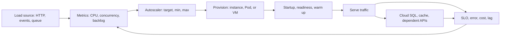
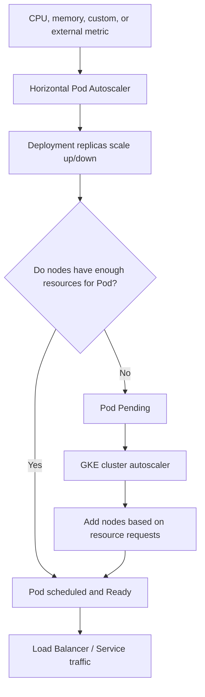
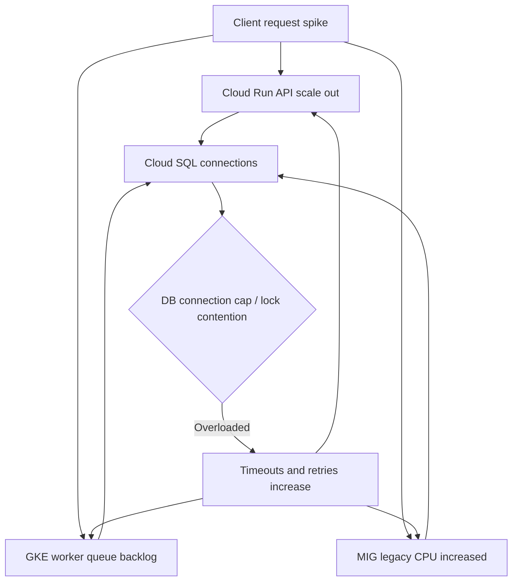

# Optimizing Autoscaling Across Cloud Run, GKE, and Compute Engine

Autoscaling helps applications handle sudden traffic spikes without keeping full peak capacity running all the time. However, "scaling as fast as possible" can inflate bills, overwhelm Cloud SQL with connections, trigger Pod CPU contention, or cause restart thrashing when load fluctuates. **Optimizing autoscaling** means choosing the right signals and capacity bounds for each platform, then validating **latency, errors, stability, and cost** together.

In the **Performance and FinOps** chapter of the **CLOUD_PROVIDERS_GCP** module, knowledge of projects, IAM, VPC, Compute Engine, GKE, Cloud Run, data services, and observability comes together into a practical infrastructure optimization methodology. This lesson focuses on three common workload types: HTTP services on **Cloud Run**, containerized applications orchestrated by **GKE**, and applications running on **Compute Engine managed instance groups (MIGs)**.

**After this lesson, learners will be able to** distinguish the scaling mechanisms of the three platforms; calculate an initial capacity baseline; configure example setups for Cloud Run, HPA/cluster autoscaler, and MIGs; identify when scaling harms downstream dependencies; run load tests; and make FinOps decisions grounded in SLOs rather than CPU percentage alone.

## 1. Autoscaling Is a Control Loop, Not a Single Number

An autoscaler repeats these steps: **measure signal → compare against target → propose replica count → provision capacity → observe outcome**. Signals can be concurrent requests, CPU, queue depth, unscheduled Pods, HTTP load balancer load, or Cloud Monitoring metrics.



You must distinguish four time intervals:

1. **Detection delay:** latency in collecting metrics and the control loop determining that scaling is needed.
2. **Provisioning delay:** time to allocate an instance/Pod/VM, pull the image, and load configuration.
3. **Readiness / warm-up:** time until the application is ready to accept requests and reach steady throughput; JVMs also incur JIT compilation, class loading, and connection pool initialization.
4. **Scale-in / stabilization:** cooldown period before removing capacity to avoid continuous creation/deletion thrashing and dropping in-flight requests.

**Scaling up** increases per-unit capacity; **scaling out** increases replica count; **scaling in** reduces replicas. Different scaling directions have different impacts on cost, HA, and connection limits. On Google Cloud, determine whether your target is at the **request, Pod, or VM** level before modifying configurations.

### 1.1. Minimal Workload Profile

| Information | How to Collect | Why It Matters |
| --- | --- | --- |
| RPS/QPS over time | Cloud Monitoring, load balancer, tracing | Distinguishes steady load, hourly patterns, bursts, and queues |
| p50/p95/p99 latency | Request metrics and tracing | Insufficient capacity usually surfaces first in tail latency |
| Error rate and error types | 429, 503, 5xx, timeouts, OOM | Separates capacity exhaustion from application/dependency bugs |
| CPU, memory, GC, thread/connection counts | Container, VM, JVM metrics | Low CPU does not guarantee remaining headroom |
| Startup + readiness time | Deployment events, logs, tracing | Estimates lead time needed before peak load arrives |
| Dependencies | Database connections, cache hit rate, API quotas | Prevents over-scaling from bottlenecking downstream systems |
| Cost structure | Billing export, SKUs, resource utilization | Measures cost/request, cost/transaction, and idle baseline cost |

Each workload needs **clear SLOs**, for example: 99% request success rate; p95 latency under 250 ms at 300 RPS; maximum 200 DB connections. These are **hypothetical exercise values**, not Google Cloud defaults.

## 2. Matrix for Choosing an Autoscaling Mechanism

| Criterion | Cloud Run services | GKE (Standard/Autopilot) | Compute Engine MIG |
| --- | --- | --- | --- |
| Scaling unit | Service/revision container **instance** | **Pod** via HPA; **node** via cluster autoscaler | **VM** in a MIG |
| Primary signals | CPU, request concurrency, on-demand requests; supports custom targets | HPA: CPU/memory/custom/external; cluster autoscaler: scheduling demand from Pod requests | CPU, HTTP load-balancing capacity, Cloud Monitoring metrics, schedules |
| Scale to zero | Can scale to 0 service instances when min=0 | HPA and cluster autoscaler are separate loops; scaling to 0 Pods/nodes depends on configuration, version, Autopilot/Standard | Min replicas can be configured per support/policy, though VM startup and readiness are slower than containers |
| Provisioning time | Spins up container instance, depends on image/startup and quota | HPA creates Pod; if nodes are full, adds node provisioning time | VM boot, startup script, application boot, and health checks |
| Operational effort | Minimal infrastructure management | Pod orchestration, resource requests, node capacity, and policies | Image templates, MIG, autoscaler, health checks, and VM updates |
| Controls | Concurrency, CPU/memory, min/max, billing, scaling targets | HPA behavior, metrics, Pod requests, node pool bounds, scheduling | MIG policies and bounds, initialization period, scale-in controls |
| Costs to monitor | vCPU/memory active or lifecycle duration, requests, min instances, egress | Pod requests/capacity, node/cluster overhead, idle headroom, disks, networking | VM uptime, disks, LB, idle headroom, networking |
| Best fit | Stateless HTTP/event containers with variable traffic | Multi-microservice systems needing orchestration, custom metrics, diverse workloads | VM/legacy apps, specialized agents, OS-level control |

**Comparison notes:** Cloud Run services, Cloud Run jobs, and worker pools have distinct execution/billing models. GKE Autopilot is not a variant of Cloud Run; GKE node scaling is not equivalent to HPA Pod scaling. A GKE node pool's underlying MIG must be managed solely by the **GKE cluster autoscaler**; never attach a Compute Engine autoscaler directly to that MIG, as the two controllers will conflict.

## 3. Calculating Initial Sizing from Actual Load

### 3.1. Little's Law to Estimate Concurrent Requests

In steady state, Little's Law states:

\[
L \approx \lambda \times W
\]

Where `L` is the average number of concurrent requests inside the system, `\lambda` is throughput in requests/second, and `W` is average processing time in seconds (measured across the same system boundary).

**Hypothetical example:** 600 requests/second averaging 0.2 seconds/request → roughly **120 concurrent requests in flight**. If one Cloud Run instance handles **20 concurrent requests** while still meeting its SLO, and you plan at **60% of benchmarked concurrency capacity**, estimate:

```text
Average concurrent requests = 600 RPS × 0.2 seconds = 120
Effective slots/instance ≈ 20 × 0.60 = 12
Baseline instances ≈ ceil(120 / 12) = 10 instances
```

This is only a **planning method**, not the exact internal formula of the Cloud Run autoscaler. The system is also affected by CPU, warm-up, concurrency limits, adaptive concurrency tuning, skew, and bursts; p95/p99 cannot be derived from average `W`. Handling sudden bursts requires headroom benchmarking and evaluating min instances.

### 3.2. HPA/MIG Utilization Ratio Formula

Simple model for a target-utilization autoscaler:

\[
N_{\mathrm{new}} \approx \left\lceil N_{\mathrm{current}} \times
\frac{U_{\mathrm{measured}}}{U_{\mathrm{target}}}\right\rceil
\]

For example, with 6 Pods, measured CPU utilization at 90% **relative to CPU requests**, and an HPA target of 60% → `ceil(6 × 90/60) = 9` Pods. The Kubernetes controller also applies stabilization, tolerance, metric freshness, and min/max bounds, so instantaneous counts may differ.

With a MIG, 6 VMs at 90% CPU and a 60% target similarly suggest 9 VMs, **if CPU is the governing signal**. When multiple signals are configured, Compute Engine picks the largest recommended size across signals. Never mix Pod CPU utilization relative to `requests.cpu` with VM CPU utilization in the same ratio comparison.

**Rule:** set `min` to maintain baseline capacity and prevent cold starts; set `max` based on backend capacity/quotas/budget and tested peak load. `max` is a guardrail with trade-offs: hitting the cap increases pending queues, latency, and 429/503 errors.

## 4. Cloud Run: Balancing Concurrency, CPU, Min/Max, and Billing

Cloud Run services automatically scale container instances based on CPU, request concurrency, and on-demand traffic. According to current documentation, default utilization targets for CPU and concurrency are **60%**, and the service allows tuning these targets when needed; Adaptive Concurrency Tuning can also adjust effective concurrency dynamically. Never assume an instance always accepts requests up to its configured concurrency limit when CPU is already saturated.

### 4.1. Controlling Instance Count with Concurrency

`concurrency` is the **maximum simultaneous requests per instance**, not RPS. Higher values can lower instance count and cost when the app handles asynchronous I/O well; lower values prevent CPU/memory contention and trigger scale-out earlier.

- **I/O-bound** (waiting on DB/HTTP): can handle higher concurrency, but monitor connection pools and timeouts.
- **CPU-bound** (compression, encryption, image processing): excessive concurrency builds internal queueing and tail latency.
- **JVM/Java Spring**: monitor thread pools, DB connection pools, and memory/GC; do not pick concurrency based on vCPU count alone.
- **Multi-vCPU with single-threaded hotspot**: average CPU across all vCPUs may look low even when one core is pegged; lowering concurrency sometimes helps the autoscaler react better.
- **Long/streaming requests**: concurrent requests hold slots longer; analyze their pattern separately rather than using average RPS alone.

### 4.2. Example Configuration on an Existing Service

Below is an **illustrative command for a test project after load measurement**; substitute real service/region names and verify permissions, quotas, and costs:

```bash
gcloud run services update orders-api \
  --region=asia-southeast1 \
  --concurrency=40 \
  --cpu=1 \
  --memory=512Mi \
  --min=2 \
  --max=30 \
  --cpu-throttling
```

Meaning:

| Setting | Effect | What to Verify |
| --- | --- | --- |
| `--concurrency=40` | Configured cap of 40 requests/instance | How many requests can one instance handle cleanly at target p95? |
| `--cpu=1`, `--memory=512Mi` | Resources per instance | CPU saturation, memory/GC, startup, OOM |
| `--min=2` | Keeps at least 2 warm instances at service-level | Idle cost; is it enough to meet cold-start SLOs? |
| `--max=30` | Scaling ceiling at service-level | DB pools, API quotas, and traffic impact if capped |
| `--cpu-throttling` | Selects request-based billing / CPU allocation | Is there background work running after responses finish? |

Current documentation distinguishes **service-level** `--min`/`--max` from **revision-level** `--min-instances`/`--max-instances`. Prefer service-level unless revision-specific behavior is needed. During rollouts, traffic splitting, and instance replacements, actual instance counts can temporarily **exceed the max limit**; therefore, never treat `max` as an absolute hard lock on spend or DB connections.

**Watch your backend:** if each instance opens a pool of up to 5 DB connections, 30 instances can open ~150 connections — excluding batch jobs, remaining revisions, and transient max overshoots. Compute safety margins beforehand; use backpressure/pooling and quotas instead of expecting `--max` to stop all overloads.

### 4.3. Billing and Min Instances

Two billing modes for **Cloud Run services**:

- **Request-based (default):** CPU is billed during request handling plus startup/shutdown; idle instances kept warm by `min` still incur idle charges per billing rules.
- **Instance-based:** resources are billed across the entire instance lifecycle, including idle time; CPU can remain allocated outside active requests. If background work is needed, consider instance-based billing and min instances; however, instances can still be terminated, so long retryable work should use mechanisms such as Cloud Tasks or Cloud Run jobs.

Example inspecting current configuration before/after tuning:

```bash
gcloud run services describe orders-api \
  --region=asia-southeast1
```

Min instances reduce cold starts at the cost of higher baseline spend. Set `min` from recurring off-peak traffic and startup requirements rather than keeping 100% of peak capacity warm by default. Changing concurrency without adjusting pools can shift the bottleneck from CPU to the database. Monitor Cloud Run instance count, request count, latency, CPU, pending/429s, and revision settings in Cloud Monitoring.

### 4.4. When to Choose Another Platform

Cloud Run excels for HTTP APIs and certain event-driven workflows; however, workloads requiring Kubernetes orchestration, specialized networking/pod scheduling, or tight VM dependencies may fit GKE/MIG better. For non-HTTP queue workers, pick the right Cloud Run resource type (jobs/worker pools) or GKE queue workers based on load profile; avoid creating dummy HTTP endpoints solely to drive scaling.

## 5. GKE: HPA Scales Pods, Cluster Autoscaler Scales Nodes

GKE has **two independent yet coupled control loops**:



- **HPA** scales Deployment/StatefulSet replica counts based on CPU, memory, or custom/external metrics. HPA **does not directly create nodes**.
- **Cluster autoscaler** adds/removes nodes when Pods cannot be scheduled or when nodes are underutilized and Pods can be moved elsewhere. Decisions rely primarily on **Pod resource requests**, not directly on actual node CPU percentage.
- **VPA** helps rightsize requests/limits; some update modes recreate Pods to change requests. Avoid configuring VPA and HPA to control the same CPU/memory metric in conflicting ways; check GKE-supported coordination features before applying. For JVMs, note current VPA limitations and track heap/native memory.

### 5.1. Sample HPA for a Java HTTP API

This is **illustrative** YAML for a Kubernetes Deployment and HPA. Image, `/ready` endpoint, and resource requests must be tuned to your real application:

```yaml
apiVersion: apps/v1
kind: Deployment
metadata:
  name: orders-api
spec:
  replicas: 3
  selector:
    matchLabels:
      app: orders-api
  template:
    metadata:
      labels:
        app: orders-api
    spec:
      terminationGracePeriodSeconds: 45
      containers:
        - name: api
          image: asia-southeast1-docker.pkg.dev/PROJECT_ID/REPO/orders-api:TAG
          ports:
            - containerPort: 8080
          resources:
            requests:
              cpu: "500m"
              memory: "512Mi"
            limits:
              memory: "1Gi"
          readinessProbe:
            httpGet:
              path: /ready
              port: 8080
            periodSeconds: 5
            timeoutSeconds: 2
---
apiVersion: autoscaling/v2
kind: HorizontalPodAutoscaler
metadata:
  name: orders-api
spec:
  scaleTargetRef:
    apiVersion: apps/v1
    kind: Deployment
    name: orders-api
  minReplicas: 3
  maxReplicas: 30
  metrics:
    - type: Resource
      resource:
        name: cpu
        target:
          type: Utilization
          averageUtilization: 60
  behavior:
    scaleDown:
      stabilizationWindowSeconds: 300
```

**Why are requests required?** CPU-utilization HPA calculates percentages relative to `resources.requests.cpu`; missing requests prevent HPA from computing the metric properly. Setting `500m` when a Pod normally uses `300m` yields 60% utilization relative to request, not 60% of total node CPU. Requests also drive the scheduler and cluster autoscaler; over-requesting wastes node capacity, while under-requesting causes CPU contention and memory OOMs.

Readiness probes keep unready Pods out of traffic; an appropriate termination grace period paired with graceful shutdown/connection draining reduces errors during scale-in. In Spring Boot, ensure `/ready` is properly configured and tested before relying on it.

Observation commands:

```bash
kubectl get hpa orders-api
kubectl describe hpa orders-api
kubectl get pods -l app=orders-api -w
kubectl top pods -l app=orders-api
```

Check the `Events` section in `kubectl describe hpa` when scaling fails; verify the Metrics Server/custom metrics pipeline, targets, requests, and min/max limits. For queue-driven workers, use custom/external metrics such as backlog or age of oldest message, per supported adapters and autoscaler mechanisms, because low CPU does not mean the queue is not growing.

### 5.2. Enabling Node Autoscaling on GKE Standard

Example on an **existing** Standard cluster node pool:

```bash
gcloud container clusters update CLUSTER_NAME \
  --location=asia-southeast1 \
  --node-pool=POOL_NAME \
  --enable-autoscaling \
  --total-min-nodes=3 \
  --total-max-nodes=15
```

`--total-min-nodes` and `--total-max-nodes` set node bounds **across the entire node pool** in supported GKE versions, unlike `--min-nodes`/`--max-nodes` which can apply **per zone** in regional pools. Confirm cluster version and topology before copying. With GKE Autopilot, the platform provisions nodes based on Pods and Autopilot policies; you still need appropriate Pod scaling mechanisms for your workload.

**If HPA requests 30 Pods while nodes only fit 12 Pods**, 18 Pods may remain Pending until new nodes arrive. Real-world causes include max nodes set too low, insufficient CPU quota, affinity/taints, zonal constraints, or Pod requests too large for the node machine type.

**Non-negotiable rule:** never enable a separate Compute Engine MIG autoscaler on GKE-managed instance groups. It conflicts with the GKE cluster autoscaler.

### 5.3. Preventing Thrashing and Disruptive Scale-In

- Use `behavior.scaleDown.stabilizationWindowSeconds` for HPA; on GKE, the default scale-down stabilization window is typically 300 seconds. Avoid scaling down too aggressively if traffic oscillates rapidly.
- Review PodDisruptionBudgets, minimum replicas, topology spread, anti-affinity, and drain behavior; a PDB will not make scale-in disruption-free if the app lacks graceful shutdown.
- Configure startup/readiness/liveness probes properly; overly strict liveness probes cause cascading restarts under high CPU.
- Base `requests` sizing on benchmarks and actual utilization; Autopilot has its own resource billing model and constraints, so evaluate total cost for your cluster mode.
- A 60% CPU HPA target does not guarantee low p95 latency; hung queries, DB locks, or memory pressure can happen while CPU stays low.
- For JVM workloads, if testing VPA auto-updates, account for Pod recreation, heap/native memory, and GKE version constraints on combining HPA/VPA.

## 6. Compute Engine: Autoscaling VMs in a Managed Instance Group

The Compute Engine autoscaler adds/removes VMs in a **Managed Instance Group (MIG)** based on CPU, HTTP load-balancing capacity, Cloud Monitoring metrics, or schedules. It fits workloads requiring VM images, OS services, or middleware not yet convenient to containerize.

MIG autoscaling is independent of **autohealing**: a VM failing health checks can be replaced by autohealing even without any scaling decision. Design instance templates and applications so VMs can be created/deleted safely, state lives externally, startup scripts are idempotent, and services expose health checks.

### 6.1. Example CPU Autoscaling Policy

Example for an existing **regional** MIG:

```bash
gcloud compute instance-groups managed set-autoscaling orders-mig \
  --region=asia-southeast1 \
  --min-num-replicas=2 \
  --max-num-replicas=20 \
  --target-cpu-utilization=0.60 \
  --cool-down-period=120 \
  --stabilization-period=300
```

Illustrative parameters to calibrate:

- `--target-cpu-utilization=0.60`: ~60% average CPU target. VM CPU stays low while requests wait on a DB, so consider alternative signals if I/O-bound.
- `--cool-down-period=120`: the **initialization period** for newly created VMs/apps in autoscaler terminology. Set close to real startup time, including app warm-up, so the algorithm does not miscount unready capacity too early.
- `--stabilization-period=300`: governs scale-in based on stabilized observations; verify version-specific behavior and impact.
- `min/max`: VM bounds; `min=2` only delivers fault tolerance if topology, load balancing, and application design support it.

When multiple signals (CPU, load balancing, Cloud Monitoring) are configured, the autoscaler typically picks the **largest VM count recommended by any signal**. This protects capacity but can increase cost if a metric is noisy or misreported; tune targets and filter metrics carefully.

### 6.2. Traffic-Based or Specialized Workload Scaling

- **HTTP services behind a load balancer:** serving-capacity signals often track actual capacity better than CPU; verify backend services, health checks, and capacity settings.
- **CPU-bound batch:** CPU targets work well when VMs run homogeneous work; handle job draining/leases before VM deletion.
- **Custom metrics:** active sessions, queue backlog, or work per VM can be effective; verify supported metrics and modes when creating policies.
- **Scheduled loads:** use scaling schedules to pre-warm capacity for predictable peaks; do not replace reactive scaling for unexpected spikes.

Never attach an autoscaler to an **unmanaged instance group**, and check limitations for stateful MIGs. Never store durable data solely on local disks of VMs subject to scale-in deletion.

### 6.3. Reducing Boot Time and Cost

Bake custom VM images with applications/dependencies pre-installed and optimize startup scripts and health checks, while maintaining image patching and rollout pipelines. Regional MIGs distribute capacity across zones when properly configured. For on-demand VMs, balance idle headroom cost against boot time; setting `min` too low causes latency or errors during sudden bursts.

A MIG bills for running VM resources, disks, load balancers, networking, and related services. The autoscaling policy itself carries no extra fee, though added VMs raise the bill. For steady loads, compare committed use discounts/machine types against container options before deciding.

## 7. One Shared Architecture, Multiple Autoscalers, and Downstream Bottlenecks

A company may run APIs on Cloud Run, workers on GKE, and legacy services on MIGs. When API traffic spikes, **all three may scale from indirect signals**, yet share a single database. Architecture must prevent feedback loops that amplify incidents:



### 7.1. Estimating Ceilings Before Scaling Out

Hypothetical example **for calculation practice, not Google Cloud quotas**:

- The DB safely supports 300 application connections, reserving margin for admin and jobs.
- Cloud Run can reach 30 instances × pool of 5 connections = 150.
- GKE workers can reach 20 Pods × pool of 5 connections = 100.
- Legacy MIG can reach 10 VMs × pool of 5 connections = 50.

Total **150 + 100 + 50 = 300**; if rollouts or retry storms push counts past max, overload happens fast. Adjust bounds to real behavior, partition pools by service, cap concurrency/work queues, use connection pooling/proxies where appropriate, and preserve headroom. Investigate slow queries, locks, and quotas rather than just adding machines.

### 7.2. Preventing Retry–Autoscale Spirals

1. **Bounded concurrency** at ingress/worker layers, capping queues and keeping the system recoverable.
2. Clear timeouts and retries with exponential backoff + jitter + attempt limits, retrying only idempotent operations.
3. Monitor **queue age, queue depth, and failure rate**, not just CPU; if the backend cannot raise throughput, scaling out the frontend only increases cost.
4. Decouple autoscaling signals across tiers; avoid scaling everything on one aggregate metric without accounting for dependencies.
5. Use circuit breakers/load shedding or intentional 429/503 responses when overloaded, paired with client-side backoff.
6. Verify vCPU/memory, node, IP, Cloud SQL connection, and API rate-limit quotas before setting very high `max` values.

## 8. FinOps: Selecting Configurations by Cost per SLO-Compliant Transaction

Autoscaling is a **multi-objective optimization problem**. Two configurations with different monthly bills may differ drastically in business efficiency if one drops requests, degrades latency, or inflates downstream costs.

### 8.1. Metrics to Evaluate Side by Side

| Metric | How to Use |
| --- | --- |
| **Cost per successful request / transaction** | Total attributed service + dependency cost / count of successful transactions |
| **p95/p99 latency under peak** | Ensures latency is not traded away for a smaller bill |
| **Error rate / throttling / 429 / 5xx** | Detects artificial "savings" achieved by dropping traffic |
| **Utilization and idle capacity** | Separates SLO-required headroom from waste |
| **Scale efficiency** | Does adding replicas raise throughput or only increase contention? |
| **Warm-up/cold start penalty** | Translates min instances and image optimization into user experience |
| **RTO/RPO and availability** | Never cut HA capacity below operational requirements |
| **Cost variance** | Gap between budget/forecast and actual bill, plus spike causes |

Illustrative example:

```text
Config A: attributed cost 90 units; 100,000 requests, 99,800 succeeded
=> cost / 1,000 successful requests = 90 / 99,800 × 1,000 ≈ 0.902

Config B: attributed cost 80 units; 100,000 requests, 96,000 succeeded
=> cost / 1,000 successful requests = 80 / 96,000 × 1,000 ≈ 0.833
```

Config B looks cheaper per 1,000 successful requests here, **but with a 99% success SLO, Config B fails eligibility**. Real comparisons must also include retry cost, latency, lost revenue, and downstream load; these numbers do not represent actual pricing.

### 8.2. Classifying Billing Mechanics

- **Cloud Run services:** distinguish request-based vs. instance-based billing; min instances and concurrency affect billable resource time; other Cloud Run modes have separate policies.
- **GKE Standard:** account for VM nodes, cluster management, disks, and networking; empty nodes or over-requested Pods create waste. Node autoscaler cannot remove nodes hosting immovable Pods.
- **GKE Autopilot:** understand billing by workload Pod resource requests/compute class and remaining charges; Autopilot node autoscaling does not make everything free.
- **Compute Engine MIG:** VM/disk/network costs by actual runtime, min instances, machine types, and usage; the autoscaler itself adds no surcharge, though new VMs do.
- **Shared dependencies:** Cloud SQL, Memorystore, Pub/Sub, Cloud Logging, Cloud Monitoring, and egress can grow even when compute shrinks.

Use **Billing export to BigQuery**, budgets/alerts, and the pricing calculator to allocate costs by service, environment, and team. Budgets/alerts are **notifications** by default, not automated infrastructure kill switches. If hard guardrails are required, design explicit quotas/limits and safe control policies with failure-mode handling.

### 8.3. Lowest-Risk Optimization Sequence

1. Fix application bottlenecks: N+1 queries, missing caching, CPU hotspots, thread blocking, or chatty backend calls.
2. Rightsize CPU/memory/pools; check `requests`/`limits` on GKE, machine families on VMs, and concurrency + vCPU on Cloud Run.
3. Measure headroom and trim min instances/replicas **in controlled steps**, then re-measure cold starts, failover, and p95.
4. Tune autoscaling targets, stabilization windows, and scale-in rules to stop thrashing.
5. Raise `max` only after verifying backends and quotas can sustain the load.
6. Compare billing models/commitments and workload placement; avoid migrating Cloud Run → GKE or vice versa based solely on the unit price of a CPU-second.

## 9. Safe Testing, Observability, and Rollout Process

### 9.1. Load Test Matrix

Use suitable load generators such as k6, Locust, JMeter, or existing harnesses, **only against approved environments and budgets**. External testing must respect access controls and traffic limits.

| Test Case | Execution | What to Verify |
| --- | --- | --- |
| Baseline | Steady low load for 20–30 minutes | SLOs, idle cost, utilization, baseline replica count |
| Ramp-up | Step up 50 → 100 → 200 → 400 RPS | Scale-out speed, latency, capacity ceilings |
| Burst | 5× load over a short window | Cold starts, pending states, 429/503s, DB connection spikes |
| Plateau | Hold high load long enough | CPU/memory/GC, saturation, true throughput, quotas |
| Scale-in | Drop back to 10–20% load | Stabilization, idle cost, dropped connections |
| Dependency throttle | Constrain DB/queue in lab | Retry storms, backpressure, counterproductive scaling |
| Rollout/zone failure | Deploy revision or replace node/VM | Readiness, graceful shutdown, SLOs, and HA |
| Seasonal pattern | Replay real peak-hour traffic | Whether schedules/min capacity actually help |

**Evaluate on a consistent metric set:** latency percentiles, **successful** throughput, instance/Pod/node/VM counts over time, CPU/memory, queue depth, DB connections, 4xx/5xx, startup delay, and cost. Changing multiple parameters at once hides which change helped or broke things; run A/B tests per config group and record image/version/region.

### 9.2. Rollout Checklist

- **Preflight:** record baseline SLO/cost, budget and quota caps, min/max, dependency connection budget, and rollback plan.
- **Iterative tuning:** test adjusting concurrency or CPU target/HPA requests/MIG utilization in staging using production-like traffic replay.
- **Plan review:** if Cloud Run creates a new revision or GKE rolls out new Pods, verify traffic splitting, readiness, and rollback.
- **Canary rollout:** route a small fraction of traffic to the new config with clear abort thresholds on p95/errors/cost.
- **Post-rollout observation:** compare SLOs, cost/request, latency, retries, 429/5xx, DB connections, and quotas across representative load cycles.
- **Decision record:** store before/after configs, benchmarks, approvers, rationale for min/max/targets, and the next review date when workloads shift.

### 9.3. Dashboards and Warning Signals

| Platform | Metric / Symptom | Preliminary Diagnosis |
| --- | --- | --- |
| Cloud Run | Instance count hits max, pending requests, 429s, rising p95 | Exhausted service capacity or slow downstream |
| Cloud Run | Low average CPU, high p95, high concurrency | Blocking I/O, DB pool exhaustion, single-thread hot core, GC |
| GKE | HPA desired replicas > current, Pods Pending | Node pool max/quota/scheduling limits or slow image startup |
| GKE | Low CPU, rising queue age | HPA watching wrong signal; consider external metric |
| GKE | Many nodes underutilized, no scale-in | Over-requested resources, PDB/affinity/immovable Pods |
| MIG | Group size hits max, LB backends unhealthy | Autoscale bounds, health checks, initialization period |
| MIG | Steady CPU but poor latency | CPU signal misses queueing/blocking delays |
| All three | DB connections/timeouts/locks rise with replicas | Backpressure, slow queries/pools, backend quotas |
| All three | Cost spikes as traffic drops | High min capacity, delayed scale-in, or instance-based billing |

## 10. Common Incidents and Remediation Decisions

| Symptom | Likely Cause | Experiment / Remedy |
| --- | --- | --- |
| Cloud Run returns 429 during bursts | Hitting max or scaling too slowly | Check request queue and instance count; optimize startup, tune min; raise max only after checking DB |
| Cloud Run CPU at 25% but service is slow | Multi-vCPU hotspot, lock, or I/O wait | Per-core CPU profiling and tracing; test lower concurrency or fix code |
| Cloud Run expensive when idle | Min instances too high or instance-based billing | Inspect min/billing and background traffic; lower min or switch execution model if appropriate |
| HPA does not add Pods despite high CPU | Missing `requests.cpu`, broken metrics, hit max | Run `kubectl describe hpa`, check requests, metric availability, and policy |
| HPA adds Pods but none become Ready | Lack of nodes, image pulls, probes/affinity/quotas | Inspect Pending reason, cluster autoscaler, node capacity, and readiness |
| Node count never shrinks | High Pod requests, PDB/affinity, un-drainable nodes | Review scheduling and relax unnecessary constraints without blindly deleting PDBs |
| MIG adds VMs too slowly | Wrong initialization period, quota, slow boot image | Measure startup/health checks, inspect MIG autoscaler decisions |
| Scale-in drops active work | Missing graceful shutdown or local-only state | Drain requests, use idempotent queues, externalize state, verify termination |
| Autoscaler keeps scaling while throughput stalls | Saturated downstream DB/API or lock contention | Bound concurrency, fix backend; stop blindly adding replicas |
| Cost jumps after target change | Target too low, min too high, node fragmentation | Compare utilization and cost/successful transaction alongside SLOs |

**Never use** autoscaling to mask application bugs: memory leaks, N+1 queries, deadlocks, or unbounded retries are rarely solved by adding replicas.

## 11. Practice Exercise and Assessment Questions

**Scenario:** An e-commerce product on Google Cloud has three components:

- `orders-api` in Java/Spring on Cloud Run; 50 RPS normally, spiking to 500 RPS for 15 minutes during flash sales, backed by Cloud SQL.
- `inventory-worker` on GKE Standard processing Pub/Sub; CPU stays relatively low while queue age rises during flash sales; node pool currently has 3 nodes.
- `legacy-pricing` on a regional Compute Engine MIG; each VM takes ~120 seconds to boot, and the app needs one minute of warm-up before serving traffic.

SLOs: `orders-api` p95 under 300 ms, error rate under 1%, queue wait time under 60 seconds, and the DB safely handles at most 250 connections across the entire system; off-peak cost must drop.

**Tasks:**

1. Build a workload profile for all three services; list p95, throughput, CPU, concurrency, queue age, startup time, and connection counts to measure.
2. Cloud Run: propose `min/max/concurrency` and billing mode; estimate capacity using Little's Law assuming 0.2 seconds average request duration and a safe benchmarked concurrency of 20/instance.
3. GKE: design HPA for the worker based on **queue backlog or queue age** since CPU does not reflect load; specify the metric adapter mechanism and link to cluster autoscaler / node pool min/max.
4. Compute Engine: propose target CPU or load-balancing metric, min/max, initialization time, and stabilization; estimate traffic impact during VM boot.
5. Build a **connection budget**: assume Cloud Run uses up to 4 DB connections/instance, GKE uses 3/Pod, and MIG uses 2/VM. Choose min/max so the total stays safely below 250 connections even during rollouts.
6. Design a 6-phase load test covering baseline, ramp, burst, plateau, scale-in, and DB throttling; define abort criteria and rollback.
7. Create a table comparing two configurations and pick by **meeting SLOs first, cost per successful transaction second**, rather than justifying higher error rates with a lower bill.

**Completion criteria:** explain **why** scaling signals reflect application demand; distinguish HPA from cluster autoscaler; protect dependencies; provide measurement evidence; and account for startup lag, min capacity, and idle resource costs.

## Official References

- [Cloud Run — About instance autoscaling](https://cloud.google.com/run/docs/about-instance-autoscaling)
- [Cloud Run — Custom scaling controls](https://cloud.google.com/run/docs/configuring/scaling-controls)
- [Cloud Run — Concurrency](https://cloud.google.com/run/docs/about-concurrency)
- [Cloud Run — Set maximum concurrency](https://cloud.google.com/run/docs/configuring/concurrency)
- [Cloud Run — Minimum instances](https://cloud.google.com/run/docs/configuring/min-instances)
- [Cloud Run — Maximum instances](https://cloud.google.com/run/docs/configuring/max-instances)
- [Cloud Run — Billing settings](https://cloud.google.com/run/docs/configuring/billing-settings)
- [GKE — Horizontal Pod autoscaling](https://cloud.google.com/kubernetes-engine/docs/concepts/horizontalpodautoscaler)
- [GKE — Configure HPA](https://cloud.google.com/kubernetes-engine/docs/how-to/horizontal-pod-autoscaling)
- [GKE — Cluster autoscaler](https://cloud.google.com/kubernetes-engine/docs/concepts/cluster-autoscaler)
- [GKE — Configure cluster autoscaler](https://cloud.google.com/kubernetes-engine/docs/how-to/cluster-autoscaler)
- [GKE — Vertical Pod autoscaling](https://cloud.google.com/kubernetes-engine/docs/concepts/verticalpodautoscaler)
- [GKE — Autopilot overview](https://cloud.google.com/kubernetes-engine/docs/concepts/autopilot-overview)
- [Compute Engine — MIG autoscaling](https://cloud.google.com/compute/docs/autoscaler)
- [Compute Engine — Scaling based on CPU](https://cloud.google.com/compute/docs/autoscaler/scaling-cpu)
- [Compute Engine — Autoscaler decisions](https://cloud.google.com/compute/docs/autoscaler/understanding-autoscaler-decisions)
- [Google Cloud — Pricing calculator](https://cloud.google.com/products/calculator)
- [Google Cloud — Cloud Billing export to BigQuery](https://cloud.google.com/billing/docs/how-to/export-data-bigquery)
- [Google Cloud — Monitoring overview](https://cloud.google.com/monitoring/docs/monitoring-overview)

**Operational note:** CLI flags, editions, limits, pricing, and autoscaling features change by version and region. Before deploying to production, verify current documentation for your specific GKE/Cloud Run/MIG configuration, run controlled benchmarks, and confirm budgets, quotas, IAM, SLOs, and rollback plans.
