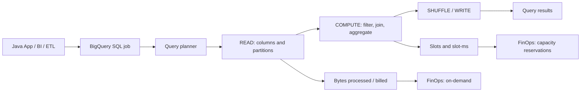

# Controlling BigQuery Bytes Scanned and Slot Utilization

BigQuery is Google Cloud's serverless data analytics service. Two key signal groups when optimizing performance and cost are **bytes scanned** (how much data a query reads/processes) and **slot utilization** (how much BigQuery compute capacity is consumed over time). They are related but do not replace each other: a query reading very few bytes can still burn huge numbers of slots on joins, sorts, or heavy functions; conversely, a query scanning massive data can be brief and computationally simple.

In the `CLOUD_PROVIDERS_GCP` module, learners explore Google Cloud from project organization, IAM, and VPCs to Compute Engine, GKE, Cloud Run, storage services, and databases. Through deployment scenarios, learners learn how to choose services, protect resources, automate releases, and monitor reliability alongside costs. This lesson connects that knowledge to **Performance Engineering and FinOps**: cutting unnecessary data reads, measuring consumed slot capacity, selecting the right pricing model, and putting guardrails in place for users, Java applications, dashboards, and batch ETL.

Examples use BigQuery project `ANALYTICS_PROJECT_ID`, dataset `mart`, table `fact_orders`, location `asia-southeast1`, and illustrative thresholds. Replace placeholders for your environment; never run queries or DDL against production without approval. Service pricing, quotas, edition features, and autoscaling mechanics may change; verify current Google Cloud pricing and documentation before budgeting.

## Learning Objectives

After this lesson, learners will be able to:

- Distinguish bytes processed, bytes billed, data scanned, slots, slot-ms, slot-hours, elapsed time, and reservation capacity.
- Explain the difference between **on-demand query pricing** and **capacity-based pricing** under BigQuery editions.
- Estimate how much data a query will process using the query validator or dry run, and set `maximum_bytes_billed` to cap risk.
- Reduce bytes scanned via column pruning, partition pruning, clustering, proper table design, and query tuning.
- Query `INFORMATION_SCHEMA.JOBS_BY_PROJECT`, `JOBS_TIMELINE_BY_PROJECT`, and `RESERVATIONS_TIMELINE_BY_PROJECT` to investigate usage.
- Calculate average slot usage and spot contention, autoscaling pressure, or overprovisioned reservations.
- Build dashboards, cost guardrails, IAM policies, and BigQuery optimization runbooks aligned with SLOs and budgets.

## 1. BigQuery Execution Model: Bytes and Slots

### Two Different Resource Dimensions

BigQuery executes SQL via a query plan composed of stages and steps. Data is read from storage, filtered, joined, aggregated, shuffled, and written as output. **Bytes scanned/processed** signals the volume of data read/processed; **slots** are virtual compute units dynamically allocated by BigQuery to execute the work.



| Metric | Meaning | How to Use |
|---|---|---|
| `total_bytes_processed` | Total bytes BigQuery reports as processed for the job per query stats. | Check data footprint and impact of column/partition pruning. |
| `total_bytes_billed` | Bytes used as the billing basis under on-demand, after minimums and rounding rules. | Estimate query cost **if** the job runs under on-demand. |
| `total_slot_ms` | Total **slot-milliseconds** BigQuery consumed for the job. | Measure compute consumption and calculate used slot-hours. |
| `start_time`, `end_time` | Execution interval; distinct from queue wait time before execution starts. | Calculate average slots or analyze latency. |
| `period_slot_ms` | Slot-ms consumed within a time slice of the job timeline. | Plot slot usage curves per second/minute. |
| `reservation_id` | Reservation assigned to the job, if any. | Group jobs by compute capacity pool. |
| `cache_hit` | Whether the query served results from the query result cache. | Separate real data reads from cached reruns. |

A slot is a BigQuery compute unit, not a fixed CPU core directly managed by the application. BigQuery dynamically decides how to allocate and reallocate slots across stages based on query complexity and available capacity.

### Two Examples to Avoid Confusion

- Query A reads 1 TiB while selecting one column and running a simple aggregation: **high bytes**, relatively efficient slot usage, yet still expensive in byte charges under on-demand.
- Query B reads 2 GiB then performs a many-to-many join and sorts huge intermediate rows: **lower bytes**, yet shuffle, CPU, slot-ms, and latency can be very high.

Thus, BigQuery optimization requires at least two axes—**data read** and **compute consumed**—plus latency/throughput SLOs.

## 2. How Does BigQuery Bill Compute?

### On-Demand Query Pricing

Under the on-demand model, query cost is based on **bytes billed** rather than slot-ms consumed by your application. No reservation setup is needed. Key characteristics:

- Billed by data processed; unit rates depend on location and current pricing tables.
- Minimum billing thresholds apply, typically a minimum of **10 MiB per query** and **10 MiB per referenced table**, per pricing rules.
- Query result caching can allow repeated queries to avoid re-reading data and incur no query charge when cache conditions are met.
- Free/trial allowances and special data types follow separate rules; never estimate bills as `bytes_processed × price` without checking `total_bytes_billed`, free tiers, and regional rates.
- Risk can be bounded via dry runs, `maximum_bytes_billed`, and custom on-demand query quotas.

### Capacity-Based Pricing Under BigQuery Editions

Under the capacity model, an organization creates **slot reservations** under an edition (e.g., Standard, Enterprise, Enterprise Plus depending on needs) and assigns projects/folders/organizations or workload groups via assignments. Compute billing is driven by **baseline slot capacity, autoscaled slots, commitments, and contract terms**, not per-query bytes billed.

| Characteristic | On-Demand | Capacity / Editions |
|---|---|---|
| Primary compute billing unit | Bytes billed per query. | Slot-hours/capacity and autoscale usage per edition. |
| Provisioning | No reservations needed. | Configure reservations, baselines, autoscaling/assignments. |
| Direct cost optimization | Reduce bytes billed. | Rightsize slots and active capacity duration. |
| Direct performance optimization | Improve SQL/stages, schedule on-demand loads. | Improve SQL, reduce contention, tune slots/concurrency. |
| Cost limits | `maximum_bytes_billed`, query usage quotas. | Reservation baseline/max autoscale, commitments, controls. |
| Risks | Broad byte scans, chatty dashboards. | Paying for idle capacity, frequent autoscaling, workload slot contention. |

**Key takeaway:** reducing bytes scanned under capacity pricing does not necessarily cut the compute bill the very same day if baseline slots stay unchanged. However, it reduces slot-ms, improves SLOs, lowers autoscaling demand, and creates room to shrink the baseline later. Conversely, `total_slot_ms` from an on-demand job cannot simply be multiplied by a slot-hour price to infer that job's bill.

### Example Reading Job Metrics

Suppose a job reports:

```text
total_bytes_processed = 500 GiB
total_bytes_billed    = 500 GiB (illustrative; actual billing applies rounding)
total_slot_ms         = 3_600_000 slot-ms
duration              = 120 seconds
```

Then:

- **Used slot-hours:** `3_600_000 / 3_600_000 = 1 slot-hour`.
- **Average slots during execution:** `3_600_000 / 120_000 = 30 slots`.
- **On-demand estimate:** `(total_bytes_billed / 2^40) × TiB unit rate`, subject to billing rules.
- **Capacity estimate:** inspect how many reservation slots were provisioned/autoscaled during that timeframe; never treat one used slot-hour directly as the billed cost.

## 3. Estimating Bytes Scanned Before Execution

### Console Query Validator and Dry Run

In BigQuery Studio, the query validator displays an estimate of bytes processed before running SQL. To check from the CLI:

```bash
bq query \
  --use_legacy_sql=false \
  --location=asia-southeast1 \
  --dry_run \
  'SELECT order_id, amount
   FROM `ANALYTICS_PROJECT_ID.mart.fact_orders`
   WHERE order_date >= DATE "2026-11-01"
     AND order_date < DATE "2026-11-08"'
```

`--dry_run` validates syntax, permissions, and computes estimates without executing data processing. The output reports estimated bytes. Run a dry run before editing dashboards, creating scheduled queries, or querying large tables.

**Dry run limitations:** estimates are upper bounds and can exceed actual bytes billed, especially on clustered tables (where block pruning happens at runtime). On tables with row-level access policies, dry run may report `0` to prevent side-channel leaks; never interpret that zero as a free query.

### Capping Bytes Billed Before Execution

For on-demand, set `maximum_bytes_billed`:

```bash
bq query \
  --use_legacy_sql=false \
  --location=asia-southeast1 \
  --maximum_bytes_billed=1073741824 \
  'SELECT order_id, amount
   FROM `ANALYTICS_PROJECT_ID.mart.fact_orders`
   WHERE order_date = DATE "2026-11-01"'
```

`1,073,741,824` bytes equals **1 GiB**. If the estimate exceeds this cap, BigQuery rejects the job prior to execution and charges nothing for that query. The API also supports `JobConfigurationQuery.maximumBytesBilled`. On clustered tables, the pre-run upper-bound estimate may exceed the cap even when runtime cluster pruning would shrink the scan; never blindly raise the cap without reviewing the query and budget.

`maximum_bytes_billed` is an on-demand guardrail; **it does not cap total reservation slot spend** under capacity-based pricing.

### Distinguishing Units

1 KiB = 1024 bytes, 1 MiB = 1024² bytes, 1 GiB = 1024³ bytes, 1 TiB = 1024⁴ bytes. BigQuery pricing typically quotes data in TiB; avoid confusing MB (10⁶) with MiB (2²⁰), or bytes processed with rows returned.

## 4. Reducing Bytes Scanned with Column Pruning

### Stop Using `SELECT *` Out of Habit

BigQuery stores data in columnar format. Select only required columns to reduce data read, I/O, and on-demand query charges.

```sql
-- Suboptimal: reads too many columns just to show 20 rows.
SELECT *
FROM `ANALYTICS_PROJECT_ID.mart.fact_orders`
WHERE order_date = DATE '2026-11-01'
LIMIT 20;

-- Better: select only the columns actually needed.
SELECT order_id, tenant_id, status, amount
FROM `ANALYTICS_PROJECT_ID.mart.fact_orders`
WHERE order_date = DATE '2026-11-01'
LIMIT 20;
```

`LIMIT` normally **does not reduce bytes scanned** on non-clustered tables: BigQuery still reads the columns needed to determine the output. On some clustered queries, `LIMIT` can allow early scan termination once enough blocks are read, though you should never rely on it as a general cost-control mechanism.

If a schema is very wide and only a few columns are unwanted:

```sql
SELECT * EXCEPT (raw_payload, debug_blob)
FROM `ANALYTICS_PROJECT_ID.mart.fact_orders`
WHERE order_date = DATE '2026-11-01';
```

`SELECT * EXCEPT` avoids reading excluded columns, though output shape remains coupled to evolving schemas; for stable dashboards/APIs, list columns explicitly.

### Do Not Run Query Scans Just to Preview a Table

Use **Preview** in the Console or `bq head` to inspect a sample of rows instead of running `SELECT * LIMIT 1000` on huge tables. Ensure viewing permissions align with IAM and data classification rules.

### Benefits on Nested/Repeated Tables

For `STRUCT`, `ARRAY`, or large JSON columns, project only the specific fields needed whenever possible. Use `UNNEST` carefully to avoid exploding row counts; inspect bytes processed and the query plan if `UNNEST`/joins inflate shuffles.

## 5. Partition Pruning and Clustering

### Partitioning: Skipping Unneeded Time Ranges

Example daily transaction table with `order_date DATE`:

```sql
CREATE TABLE `ANALYTICS_PROJECT_ID.mart.fact_orders` (
  order_id STRING,
  tenant_id STRING,
  order_date DATE,
  status STRING,
  amount NUMERIC,
  raw_payload STRING
)
PARTITION BY order_date
CLUSTER BY tenant_id, status
OPTIONS (require_partition_filter = TRUE);
```

`require_partition_filter = TRUE` prevents accidental full-table scans lacking an appropriate filter. The table above is empty; this is an illustrative DDL example and should not be run against existing production resources.

Filters enabling BigQuery partition pruning:

```sql
SELECT tenant_id, SUM(amount) AS revenue
FROM `ANALYTICS_PROJECT_ID.mart.fact_orders`
WHERE order_date >= DATE '2026-11-01'
  AND order_date < DATE '2026-11-08'
GROUP BY tenant_id;
```

For ingestion-time partitioned tables, use `_PARTITIONTIME` or `_PARTITIONDATE` pseudo-columns:

```sql
SELECT event_type
FROM `ANALYTICS_PROJECT_ID.raw.events_ingested`
WHERE _PARTITIONDATE BETWEEN DATE '2026-11-01' AND DATE '2026-11-07';
```

These two examples differ in schema: use `_PARTITIONDATE` only when the table actually uses ingestion-time partitioning or exposes that pseudo-column. On column-partitioned tables, filter directly on the partitioning column so the planner can prune partitions; avoid wrapping the column in functions or opaque join filters unnecessarily.

### Clustering: Skipping Blocks by Frequently Filtered Values

Clustering sorts storage blocks by clustering columns. On a table with `CLUSTER BY tenant_id, status`, the following query benefits from block pruning:

```sql
SELECT order_id, amount
FROM `ANALYTICS_PROJECT_ID.mart.fact_orders`
WHERE order_date BETWEEN DATE '2026-11-01' AND DATE '2026-11-07'
  AND tenant_id = 'tenant-a'
  AND status = 'PAID';
```

Effectiveness depends on table size, selectivity, data distribution, and how filters match clustering columns. **Distinguish partition pruning from cluster block pruning:** partition pruning is typically reflected in dry-run estimates; clustering reduces bytes read **at execution time**, so pre-run estimates can be higher than actual bytes billed.

### Date Sharding and Wildcards

If data lives across tables like `events_20261101`, `events_20261102`, ...:

```sql
SELECT event_type
FROM `ANALYTICS_PROJECT_ID.raw.events_202611*`
WHERE _TABLE_SUFFIX BETWEEN '01' AND '07';
```

Filter `_TABLE_SUFFIX` with constant expressions so BigQuery limits which tables are scanned. However, creating too many daily tables (oversharding) increases metadata overhead and management pain; a single time-partitioned table is usually preferable to thousands of sharded tables.

### Practical Optimization Sequence

1. Target the right dataset/table and avoid broad wildcards.
2. Project only required columns.
3. Filter time/partition columns using static values or clear parameters.
4. Filter clustering columns matching real workloads.
5. Compare dry run vs. **actual** `total_bytes_processed`/`total_bytes_billed` after test runs.
6. Inspect the query plan, shuffle, and slot-ms to confirm the change did not spike compute unexpectedly.

## 6. Reducing Compute Waste Beyond Bytes Alone

### Filter and Aggregate Before Joining

Joining large tables triggers costly shuffles; filter both sides and pre-aggregate appropriately before joining.

```sql
-- Sum weekly spend per tenant before joining the tenant dimension.
WITH weekly_sales AS (
  SELECT tenant_id, SUM(amount) AS revenue
  FROM `ANALYTICS_PROJECT_ID.mart.fact_orders`
  WHERE order_date >= DATE '2026-11-01'
    AND order_date < DATE '2026-11-08'
    AND status = 'PAID'
  GROUP BY tenant_id
)
SELECT t.tenant_name, s.revenue
FROM weekly_sales AS s
JOIN `ANALYTICS_PROJECT_ID.mart.dim_tenants` AS t
  USING (tenant_id);
```

Not every pre-aggregation helps; verify against execution plans and result correctness. Avoid unintended many-to-many joins (row explosions), unnecessary `CROSS JOIN`s, and re-evaluating heavy CTEs multiple times.

### Materialize Intermediate Results or Frequent Aggregates

If a dashboard reads a full year of transactions every minute to compute daily totals, build a compact aggregate table or suitable materialized view instead of scanning raw tables repeatedly. Weigh refresh costs, storage, incremental maintenance, freshness, and access permissions. Never assume BigQuery automatically rewrites every query using every materialized view.

```sql
-- Example physical aggregate table, buildable via scheduled ETL:
CREATE OR REPLACE TABLE `ANALYTICS_PROJECT_ID.mart.daily_sales_summary`
PARTITION BY order_date AS
SELECT order_date, tenant_id, SUM(amount) AS revenue
FROM `ANALYTICS_PROJECT_ID.mart.fact_orders`
WHERE order_date >= DATE '2026-11-01'
GROUP BY order_date, tenant_id;
```

This DDL replaces the entire summary table. Production pipelines should use incremental updates and bounded date windows to avoid rescanning full history on every refresh. For large fact tables, scheduled incremental `MERGE`/`INSERT` is usually far more efficient.

### Result Cache, BI Engine, and Approximate Functions

- Query result cache avoids re-reading data for eligible repeat queries; do not mistake cache hits for SQL optimization or rely on them alone for capacity planning.
- BI Engine can accelerate eligible dashboard/in-memory workloads; evaluate feature scope and requirements separately.
- Some aggregations allow `APPROX_COUNT_DISTINCT`/approximate functions to cut compute when small error tolerances are acceptable; never substitute approximations when exact counts are legally or functionally required.
- Avoid heavy regex/UDFs, repeated transforms, and excessive shuffles when simpler expressions or pre-processed tables work.

## 7. Measuring Bytes Billed and Slot-ms via INFORMATION_SCHEMA.JOBS

### Job Metadata

BigQuery exposes `INFORMATION_SCHEMA.JOBS_BY_PROJECT` to inspect jobs within authorized projects and locations. Key fields:

| Field | Purpose |
|---|---|
| `creation_time` | Job creation timestamp; used to filter view partitions. |
| `user_email` | Principal running the query; attributes usage by team/service account. |
| `job_id`, `job_type`, `statement_type` | Identifies jobs and distinguishes queries from parent scripts. |
| `total_bytes_processed`, `total_bytes_billed` | Data processed/billed by the query. |
| `total_slot_ms` | Compute consumed. |
| `start_time`, `end_time` | Used to calculate execution duration and average slots. |
| `reservation_id` | Assigned reservation, if any. |
| `cache_hit`, `error_result` | Separates cache hits and failed jobs. |
| `labels` | Groups jobs by `team`, `env`, `workload` when labeled. |

`INFORMATION_SCHEMA` views require a **region qualifier**; query execution location must match the view's location. Example for jobs in Singapore:

```sql
SELECT
  job_id,
  user_email,
  total_bytes_processed,
  total_bytes_billed,
  total_slot_ms,
  cache_hit,
  reservation_id
FROM `ANALYTICS_PROJECT_ID.region-asia-southeast1.INFORMATION_SCHEMA.JOBS_BY_PROJECT`
WHERE creation_time >= TIMESTAMP_SUB(CURRENT_TIMESTAMP(), INTERVAL 1 DAY)
  AND job_type = 'QUERY'
  AND (statement_type IS NULL OR statement_type != 'SCRIPT')
ORDER BY creation_time DESC
LIMIT 100;
```

Filtering `statement_type != 'SCRIPT'` excludes **parent script jobs** to avoid double-counting child job statistics. Because some jobs have NULL `statement_type`, use `(statement_type IS NULL OR statement_type != 'SCRIPT')` when you want to retain them.

### Top Users by Bytes and Slot-ms Over 7 Days

```sql
SELECT
  user_email,
  COUNT(*) AS query_jobs,
  COUNTIF(cache_hit) AS cache_hits,
  ROUND(SAFE_DIVIDE(SUM(total_bytes_billed), POW(1024, 4)), 3)
    AS total_billed_tib,
  ROUND(SAFE_DIVIDE(SUM(total_slot_ms), 3600000), 2)
    AS used_slot_hours
FROM `ANALYTICS_PROJECT_ID.region-asia-southeast1.INFORMATION_SCHEMA.JOBS_BY_PROJECT`
WHERE creation_time >= TIMESTAMP_SUB(CURRENT_TIMESTAMP(), INTERVAL 7 DAY)
  AND job_type = 'QUERY'
  AND state = 'DONE'
  AND (statement_type IS NULL OR statement_type != 'SCRIPT')
GROUP BY user_email
ORDER BY total_billed_tib DESC;
```

**Do not treat `total_billed_tib` as an invoice** when queries run under capacity reservations. Likewise, `used_slot_hours` reflects actual compute consumed by jobs, not total slot-hours purchased/provisioned. With row-level security or certain job types, byte metadata can be NULL or incomplete; account for those cases before drawing conclusions.

### Average Slots of a Query

```sql
SELECT
  job_id,
  TIMESTAMP_DIFF(end_time, start_time, SECOND) AS elapsed_seconds,
  total_slot_ms,
  ROUND(
    SAFE_DIVIDE(
      total_slot_ms,
      TIMESTAMP_DIFF(end_time, start_time, MILLISECOND)
    ), 2
  ) AS average_slots
FROM `ANALYTICS_PROJECT_ID.region-asia-southeast1.INFORMATION_SCHEMA.JOBS_BY_PROJECT`
WHERE creation_time >= TIMESTAMP_SUB(CURRENT_TIMESTAMP(), INTERVAL 1 DAY)
  AND job_type = 'QUERY'
  AND state = 'DONE'
  AND start_time IS NOT NULL
  AND end_time IS NOT NULL
  AND (statement_type IS NULL OR statement_type != 'SCRIPT')
ORDER BY total_slot_ms DESC
LIMIT 20;
```

Formula: **average slots = total_slot_ms / elapsed_milliseconds**. A query averaging 30 slots over 120 seconds consumes `30 × 120 × 1000 = 3,600,000 slot-ms`. Average slots averages across the entire duration and hides peaks; a query might consume hundreds of slots in one brief stage and wait during others.

## 8. Measuring Slot Utilization Over Time with JOBS_TIMELINE

### Why `total_slot_ms` Is Not Enough

Two workloads both consume 1,000 slot-hours/day yet have completely different shapes:

- Workload A runs steadily around 42 slots all day long.
- Workload B runs a concentrated ETL batch in one hour at roughly 1,000 slots and sits mostly idle otherwise.

Rightsizing a reservation from a daily average alone fails both: A may not need a large baseline, while B may need autoscaling, rescheduling, or batch pacing. Use **timeline** views to see peaks and contention.

### Per-Minute Query

Each row in `JOBS_TIMELINE_BY_PROJECT` represents one second of execution for a job. `period_slot_ms / 1000` equals that job's average slots during that second. Dividing a minute's total slot-ms by `60,000` gives average slots used per minute.

```sql
SELECT
  reservation_id,
  TIMESTAMP_TRUNC(period_start, MINUTE) AS minute,
  ROUND(SUM(period_slot_ms) / 60000.0, 2) AS avg_slots_used
FROM `ANALYTICS_PROJECT_ID.region-asia-southeast1.INFORMATION_SCHEMA.JOBS_TIMELINE_BY_PROJECT`
WHERE job_creation_time >= TIMESTAMP_SUB(CURRENT_TIMESTAMP(), INTERVAL 2 DAY)
  AND period_start >= TIMESTAMP_SUB(CURRENT_TIMESTAMP(), INTERVAL 1 DAY)
  AND period_start < TIMESTAMP_TRUNC(CURRENT_TIMESTAMP(), MINUTE)
  AND job_type = 'QUERY'
  AND (statement_type IS NULL OR statement_type != 'SCRIPT')
GROUP BY reservation_id, minute
ORDER BY minute DESC, reservation_id;
```

Compare only **complete minutes** so a partial minute is not divided by 60 seconds. Minutes with zero jobs emit no rows; if charts need explicit zeros, generate a time series and left-join. If a reservation serves multiple job projects, a single project's `BY_PROJECT` view does not capture the whole reservation's usage; aggregate at the right scope (`BY_ORGANIZATION` where authorized, or across all participating projects).

### Signs of Slot Contention

In query details, inspect execution stages, timelines, and performance insights. `JOBS_TIMELINE` includes `period_estimated_runnable_units`, indicating additional work ready to run if more slots were available; high values during peak slot consumption suggest compute starvation. Also check:

- Did queries wait long in scheduling queues before starting?
- Are multiple concurrent jobs competing for the same reservation?
- Do stages show shuffle/partition skew, spills, or abnormal repartitioning?
- Is autoscaling hitting max and is the reservation borrowing idle slots?
- Does the query plan show join explosions or heavy UDFs inflating slot-ms?

**Never conclude "100% slot utilization is always bad":** if SLOs are met with no queueing, full slot usage can indicate high efficiency. Conversely, prolonged low utilization against a high paid baseline signals overprovisioning.

## 9. Reservations, Baselines, Autoscale, and Slot Utilization

### Reservations Are Capacity Pools

BigQuery reservations allocate slot capacity to workload groups. Under capacity pricing, you configure baseline slots, autoscaling, assignments, and—depending on edition/region—idle slot sharing from other reservations. A project's queries only run inside a reservation when an assignment is active under the governance hierarchy; naming a reservation in SQL is not enough.

| Component | Meaning | Governance Guidance |
|---|---|---|
| Baseline slots | Continuously provisioned slot capacity for the reservation. | Size to steady baseline demand; avoid large idle cushions. |
| Autoscale slots | Extra capacity added as load rises, up to configured bounds. | Cap max and monitor how often the ceiling is hit. |
| Idle slot sharing | May borrow idle capacity from other reservations per edition/region/settings. | Never treat borrowed slots as guaranteed permanent capacity. |
| Assignments | Bind projects/folders/organizations/workloads to a reservation. | Separate ETL and interactive BI when SLOs differ. |
| Commitments | Time-bound capacity commitments lowering unit rates for steady loads. | Purchase only after analyzing historical usage and budgets. |

Consumption order is typically baseline, eligible idle slots, then autoscale. Specific rules vary by edition and region; consult current BigQuery documentation.

### Viewing Reservation Capacity History

`RESERVATIONS_TIMELINE_BY_PROJECT` in the **reservation administration project** provides per-minute metadata snapshots; `per_second_details` records per-second capacity/autoscale changes when transitions occur.

```sql
SELECT
  period_start,
  reservation_id,
  edition,
  slot_capacity AS baseline_slots,
  autoscale.max_slots AS autoscale_max_slots,
  autoscale.current_slots AS minute_snapshot_autoscale_slots,
  ignore_idle_slots
FROM `ADMIN_PROJECT_ID.region-asia-southeast1.INFORMATION_SCHEMA.RESERVATIONS_TIMELINE_BY_PROJECT`
WHERE period_start >= TIMESTAMP_SUB(CURRENT_TIMESTAMP(), INTERVAL 1 DAY)
ORDER BY period_start DESC, reservation_id;
```

`autoscale.current_slots` in the minute snapshot can miss intra-minute spikes; use `UNNEST(per_second_details)` to inspect seconds where capacity changed. Never assume that array always holds 60 rows: when nothing changes and autoscaling is inactive, it may be empty. `slot_capacity` is the baseline, not total maximum capacity including borrowed idle slots and autoscale.

### Calculating Utilization with the Right Denominator

A simple calculation:

```text
avg_slots_used = sum(period_slot_ms) / elapsed_milliseconds
approx_utilization = avg_slots_used / available_slots
```

However, **`available_slots` is dynamic**, not equal to baseline by default. It may include baseline, borrowed idle slots, and autoscaled slots; conversely, a reservation may lend idle capacity to other reservations. Computing accurate time-series utilization requires joining usage timelines with per-second capacity and sharing policies across the reservation.

For instance, averaging 80 slots on a 100-slot baseline is `80%` **relative to baseline**, not necessarily 80% **relative to truly available slots** if borrowed/autoscale capacity was active. Label dashboard metrics explicitly (`used / baseline`, `used / allocated`, `autoscale slot seconds`) and avoid equating one utilization ratio directly with billed spend.

### Reading Capacity Bills

Capacity costs depend on baseline/commitments/autoscale by **edition, region, billing duration, and contract**. Autoscaling has its own minimum billing increment rules; current BigQuery editions documentation describes per-minute minimums and fluid scaling options. Never use `SUM(total_slot_ms)` across jobs alone to project capacity bills: baseline slots may be billed even while idle, while borrowed idle slots follow separate sharing mechanics.

## 10. When to Increase or Decrease Slot Capacity

### Signs of Slot Shortage

- Query p95 latency breaches SLOs while `period_estimated_runnable_units` or queue wait times rise.
- Reservation repeatedly hits autoscale max, queuing interactive BI jobs during ETL runs.
- Throughput drops even when input bytes and SQL are virtually unchanged.
- Query plans show stages with ready work waiting for more slots to finish faster.

Follow this order: inspect SQL/query plans, cut scans and shuffles, stagger ETL schedules, separate workload pools, tune autoscaling, and only then consider raising baselines or commitments.

### Signs of Excess Slots

- Baseline stays high all day while timeline slots used remain low most of the time.
- No queueing/SLO issues; autoscaling rarely or never triggers.
- Workloads run a few hours per day while paid capacity sits active for many hours.

You can shift part of the baseline to autoscaling, adjust reservations, reschedule ETL, consolidate pools, or enable sharing where permitted by your edition. Never cut abruptly without testing peak load; slot cost savings must never cause production incidents.

### Separating Workloads

Reference governance layout:

- **Interactive BI/dashboards:** prioritize latency and predictable concurrency.
- **ETL/batch:** shiftable schedules, higher latency tolerance, autoscale when needed.
- **Sandbox/ad hoc:** bound large-scan risks, enforce per-project/user quotas, isolate permissions/resources.
- **Critical reporting:** dedicated SLOs, schedules, owners, and autoscaling policies.

Not every use case needs a separate reservation; too many tiny reservations fragment capacity and add management overhead.

## 11. BigQuery FinOps Dashboards and Alerts

### Metrics to Track

| KPI | How to Collect | Signal |
|---|---|---|
| Daily/weekly bytes billed | `JOBS_BY_PROJECT.total_bytes_billed` for on-demand. | Abnormal ad hoc/dashboard scans. |
| Bytes processed/query | `JOBS_BY_PROJECT.total_bytes_processed`. | SQL or schema changes reading more data. |
| Used slot-hours | `SUM(total_slot_ms)/3,600,000`. | Growing compute work. |
| Avg slots used per minute | `JOBS_TIMELINE.period_slot_ms`. | Peaks and ETL/BI overlap. |
| Autoscale max/current | `RESERVATIONS_TIMELINE`, Cloud Monitoring. | Load hitting caps or rising autoscale spend. |
| Query p95 latency, queueing | Jobs Explorer, query plans/timelines. | Degrading service quality. |
| Cache hit rate | `cache_hit` on query jobs. | Dashboards losing cache efficiency. |
| Slot contention / shuffle | Query performance insights, timelines. | Excessive shuffle, skew, or compute shortage. |
| Actual billed cost | Cloud Billing reports/exports. | Compare against budgets and allocations. |

In the Google Cloud Console, use BigQuery **Jobs explorer** and **Administrative resource charts** to inspect slot usage, bytes processed, running/queued jobs, and reservation utilization. For multi-project governance, verify account permissions and scope.

### Alerts and Priority Levels

1. **Byte anomalies:** daily billed TiB jumps unusually compared to the prior 7–28 days, grouped by team/principal.
2. **SLOs:** p95 query duration or job queue time breaches limits across multiple windows.
3. **Contention:** multiple queries peak simultaneously, autoscale hits max, and latency climbs.
4. **Waste:** baseline slots sit idle consistently over long windows.
5. **Security/operational:** new service accounts running full-table scans or queries lacking partition filters.

Budget alerts are notifications, **not automatic spend shutoffs**. For hard guardrails, use `maximum_bytes_billed`/on-demand quotas or reservation controls, and define clear on-call ownership when budgets or performance cross thresholds.

## 12. Access Control, Job Labels, and Cost Allocation

### IAM for Query Runners

A workload needs permission to create jobs in a project and read data from target datasets/tables, such as `roles/bigquery.jobUser` on the project and `roles/bigquery.dataViewer` on datasets. Never grant BigQuery Admin merely to run queries.

To view project-wide job metadata via `JOBS_BY_PROJECT` or `JOBS_TIMELINE_BY_PROJECT`, an account needs `bigquery.jobs.listAll`; monitoring reservations requires `bigquery.reservations.list` on the administration project via appropriate admin/viewer roles. Apply least privilege and audit sensitive metadata such as user emails, job labels, and SQL text.

### Job Labels

When Java apps, Cloud Run services, or Cloud Composer run queries, attach labels like `team`, `env`, `workload`, and `cost_center` where supported by APIs/clients. Labels let FinOps aggregate metadata:

```sql
SELECT
  COALESCE(
    (SELECT l.value FROM UNNEST(j.labels) AS l WHERE l.key = 'team' LIMIT 1),
    'unlabeled'
  ) AS team,
  ROUND(SUM(IFNULL(j.total_bytes_billed, 0))/POW(1024, 4), 3) AS billed_tib,
  ROUND(SUM(IFNULL(j.total_slot_ms, 0))/3600000, 2) AS used_slot_hours
FROM `ANALYTICS_PROJECT_ID.region-asia-southeast1.INFORMATION_SCHEMA.JOBS_BY_PROJECT` AS j
WHERE j.creation_time >= TIMESTAMP_SUB(CURRENT_TIMESTAMP(), INTERVAL 7 DAY)
  AND j.job_type = 'QUERY'
  AND (j.statement_type IS NULL OR j.statement_type != 'SCRIPT')
GROUP BY team
ORDER BY billed_tib DESC;
```

This is **usage allocation**, not an exact invoice if jobs run inside capacity reservations. Cloud Billing export remains the source of truth for actual charges; define clearly how baseline slot costs split across teams (by reservation, chargeback, or showback).

### Query Guardrails

- Enable `require_partition_filter` on large time-accessed tables where appropriate.
- Set `maximum_bytes_billed` in client/job configs for untrusted or ad hoc on-demand queries.
- Consider custom on-demand query quotas per user/project to curb runaway scans.
- For capacity, configure reservation autoscale caps and appropriate assignment/concurrency controls.
- Use separate service accounts for ETL, BI, and sandboxes for traceability.
- Run dry run or the query validator before executing modified SQL; after test runs, inspect execution/query plans in BigQuery Console or via `jobs.get` (do not assume a SQL `EXPLAIN` command like other databases).
- Schedule data aggregation/materialization and dashboard refreshes to cut redundant queries.

## 13. Sample Optimization Workflow: Orders Dashboard

### Current State

A dashboard runs SQL every minute, reading a daily transaction table with dozens of columns, joining a tenant table, and grouping by status. Example query:

```sql
SELECT *
FROM `ANALYTICS_PROJECT_ID.mart.fact_orders`
WHERE EXTRACT(MONTH FROM order_date) = 11
ORDER BY amount DESC
LIMIT 100;
```

Issues:

- `SELECT *` forces reading unnecessary columns like `raw_payload`.
- `EXTRACT(MONTH FROM order_date)` ignores the year and hinders effective partition pruning.
- `LIMIT` does not avoid scan costs on non-clustered tables.
- The dashboard may scan across multiple years every single minute.

If the table enforces `require_partition_filter = TRUE` from the earlier DDL, filters that fail to identify partitions are **rejected before execution** rather than running wide scans. The "current state" SQL above illustrates an anti-pattern, not a valid query for tables with that guardrail.

### Improved SQL

```sql
SELECT order_id, tenant_id, status, amount
FROM `ANALYTICS_PROJECT_ID.mart.fact_orders`
WHERE order_date >= DATE '2026-11-01'
  AND order_date < DATE '2026-12-01'
  AND tenant_id = 'tenant-a'
ORDER BY amount DESC
LIMIT 100;
```

On a table partitioned by `order_date` and clustered by `tenant_id`, this query leverages column pruning + partition pruning + cluster pruning. Dry run provides an upper-bound estimate; after running, compare actual bytes billed and slot-ms. If the dashboard mainly needs daily totals, querying a summary/mart table is even more efficient.

### Measuring Before and After

Record across identical workloads, datasets, and measurement windows:

| Metric | Before | After | Meaning |
|---|---|---|---|
| Dry-run estimated bytes | Value A | Value B | Expected data scan, may be an upper bound. |
| `total_bytes_billed` | Value A | Value B | Change in on-demand cost. |
| `total_slot_ms` | Value A | Value B | Change in compute effort. |
| p95 latency | Value A | Value B | User impact. |
| Result correctness | Baseline | Must match | Optimization must never alter business meaning. |
| Reservation autoscale | Baseline | Track multi-day | Evaluates long-term capacity savings. |

Never compare a query served from the result cache against one reading storage. Control `cache_hit`, concurrency, and measurement windows; on production workloads, roll out incrementally to reduce risk.

## 14. Case Study: ETL Competing for Slots with Interactive Reports

Suppose an organization has:

- End-of-day ETL running 30–60 minutes, joining and aggregating multiple tables.
- A Java/Spring Boot application and BI dashboards running small queries that require p95 under a few seconds.
- Both sharing one capacity reservation whose baseline slots are paid continuously.

### Analysis

1. Inspect Jobs Explorer and slot usage charts during ETL hours. Check `JOBS_TIMELINE` per project, `reservation_id`, and peak `period_slot_ms`.
2. Filter ETL jobs by principal/labels. Inspect bytes billed, total slot-ms, query plans, joins/shuffles, and partition pruning.
3. Correlate reservation timelines (baseline, autoscale, idle sharing) against dashboard queueing and SLOs.
4. Apply query governance: eliminate `SELECT *`, filter partitions, pre-aggregate or materialize intermediate tables; consider shifting ETL to off-peak hours.
5. If contention persists, evaluate separate reservations/assignments or tune autoscaling and max capacity. Raise baseline only when evidence shows sustained load requires permanent capacity.

### FinOps Conclusion

Cutting ETL duration from 60 to 20 minutes while reducing slot-ms may avoid autoscaling or allow shrinking baseline demand. However, you cannot claim reservation cost drops by two-thirds merely because ETL runtime fell by two-thirds: billing depends on provisioned/autoscaled slots, minimum billing durations, and commitments. Reconcile Cloud Billing exports over multiple cycles to confirm.

## 15. Common Pitfalls

| Symptom | Possible Cause | Investigation Path |
|---|---|---|
| Dry run reports huge bytes | `SELECT *`, missing partition filter, clustered table upper-bound estimate. | Project needed columns, filter partitions, compare actual bytes. |
| `maximum bytes billed` rejects query despite small actual data | High pre-run estimate prior to cluster pruning or too-tight cap. | Inspect dry run, plan, and adjust cap per risk policy; never raise blindly. |
| Query with `LIMIT 100` still scans huge bytes | `LIMIT` does not curb scans on non-clustered tables. | Use column/partition pruning or Preview. |
| BigQuery reports slow query despite low bytes | Join explosion, sort, skew, UDFs, slot contention. | Inspect query plan, stages, shuffle, timeline, and slot-ms. |
| `total_bytes_billed=0` | Query result cache or job type incurring zero billed bytes per metadata. | Check `cache_hit`, job type, pricing model, and billing. |
| Low average slot utilization all day | Overprovisioned reservation baseline or bursty short-lived workloads. | Check per-minute/per-second timelines and rightsize baseline. |
| Autoscale hits max and BI queries queue | ETL/BI competing in one reservation, insufficient slots, or inefficient SQL. | Check `period_estimated_runnable_units`, reservation timeline, assignments. |
| `INFORMATION_SCHEMA` query not found | Wrong `region-...`, job location mismatch, missing permissions. | Match region and IAM; view names are case-sensitive. |
| Total slot-ms double-counted | Summing both parent `SCRIPT` and child jobs. | Exclude parent `statement_type='SCRIPT'`. |
| Capacity bill mismatches used slot-hours | Baseline/commitments/autoscaling, idle periods, and billing minimums. | Use reservation timelines and Cloud Billing export. |
| Data scanned jumps suddenly | Broken partition filter, large column added to schema, or dashboard SQL edited. | Diff SQL/schema, dry run, job labels, and query metadata. |
| IAM denies project-wide job inspection | Missing `bigquery.jobs.listAll` or reservation list permission. | Grant appropriate viewer role at proper scope, not Owner. |

## 16. Bytes and Slots Control Checklist

- [ ] Project/dataset/location and active compute pricing model are known.
- [ ] Bytes processed, bytes billed, slot-ms, and baseline/autoscale slots are clearly distinguished.
- [ ] Dry run / query validator runs on new queries or major changes.
- [ ] On-demand queries set `maximum_bytes_billed`/usage quotas where hard guardrails are needed.
- [ ] `SELECT *` and `LIMIT` are never assumed to shrink scans automatically.
- [ ] Large tables have partitioning/clustering matching access patterns and `require_partition_filter` where sensible.
- [ ] SQL filters directly on partition columns and effective cluster conditions.
- [ ] Wildcard/sharded tables are bounded by suffix or migrated to partitioned tables.
- [ ] Joins/aggregations are checked for query plans, slot-ms, shuffles, and row explosions.
- [ ] High-frequency dashboards evaluate aggregates, materialized views, or caching.
- [ ] `JOBS_BY_PROJECT` tracks bytes, slot-ms, principals, and labels by region.
- [ ] `JOBS_TIMELINE` tracks peaks, contention, and slot usage per time slice.
- [ ] `RESERVATIONS_TIMELINE` tracks baseline, autoscale, and idle sharing in the administration project.
- [ ] Dashboards state denominators clearly for slot utilization; used slot-hours are not confused with billed slot-hours.
- [ ] Reservation assignments/baselines/max slots are sized from SLOs and multi-day data.
- [ ] Cloud Billing export validates real spend rather than multiplying used slot-hours directly.
- [ ] IAM and job labels enable auditing and team showback/chargeback.
- [ ] Alerts exist for byte anomalies, queueing/p95 SLOs, and autoscale peaks.
- [ ] Owners/runbooks exist and configurations are reviewed periodically as workloads evolve.

## 17. Conclusion

BigQuery performs best financially and operationally when you govern both **data scanned** and **compute utilization**. Under on-demand pricing, bytes billed drives most query compute spend, so column pruning, partition pruning, clustering, materialization, and dry-run guardrails yield immediate savings. Under BigQuery editions, reservation baselines, autoscaling, commitments, and active capacity duration drive compute bills; reducing bytes scanned still boosts performance and unlocks capacity downsizing later.

Fields like `total_bytes_processed`, `total_bytes_billed`, `total_slot_ms`, `period_slot_ms`, and reservation timelines give you hard measurements instead of guesses. Combine these metrics with query plans, SLOs, IAM, Cloud Billing exports, and BI/ETL workload characteristics. The FinOps goal is not keeping slot utilization artificially low or pinned at 100%, but **completing the right workloads on time at controllable cost and risk**.

## References

- [BigQuery: Optimize query computation](https://docs.cloud.google.com/bigquery/docs/best-practices-performance-compute)
- [BigQuery: Estimate and control costs](https://docs.cloud.google.com/bigquery/docs/best-practices-costs)
- [BigQuery: Query plan and timeline](https://docs.cloud.google.com/bigquery/docs/query-plan-explanation)
- [BigQuery: Troubleshoot query issues](https://docs.cloud.google.com/bigquery/docs/troubleshoot-queries)
- [BigQuery: Introduction to workload management and reservations](https://docs.cloud.google.com/bigquery/docs/reservations-intro)
- [BigQuery: Understand slots](https://docs.cloud.google.com/bigquery/docs/slots)
- [BigQuery: Introduction to editions](https://docs.cloud.google.com/bigquery/docs/editions-intro)
- [BigQuery: Monitor reservations](https://docs.cloud.google.com/bigquery/docs/reservations-monitoring)
- [BigQuery: Administrative resource charts](https://docs.cloud.google.com/bigquery/docs/admin-resource-charts)
- [BigQuery: INFORMATION_SCHEMA.JOBS](https://docs.cloud.google.com/bigquery/docs/information-schema-jobs)
- [BigQuery: INFORMATION_SCHEMA.JOBS_TIMELINE](https://docs.cloud.google.com/bigquery/docs/information-schema-jobs-timeline)
- [BigQuery: INFORMATION_SCHEMA.RESERVATIONS_TIMELINE](https://docs.cloud.google.com/bigquery/docs/information-schema-reservation-timeline)
- [BigQuery: Query pricing](https://cloud.google.com/bigquery/pricing)
- [BigQuery: Use partitioned tables](https://docs.cloud.google.com/bigquery/docs/partitioned-tables)
- [BigQuery: Introduction to clustered tables](https://docs.cloud.google.com/bigquery/docs/clustered-tables)
- [BigQuery: Introduction to materialized views](https://docs.cloud.google.com/bigquery/docs/materialized-views-intro)
