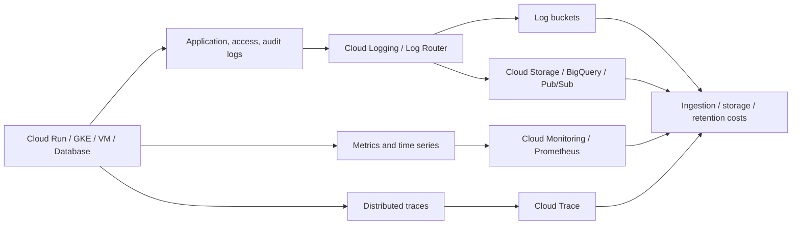
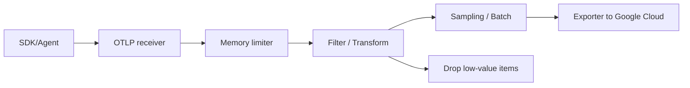

# Reducing Logs, Metrics, and Observability Data Costs

A Google Cloud system needs logs, metrics, and traces to detect errors, investigate incidents, meet audit requirements, and measure reliability. Yet telemetry volume typically grows with requests, pods, labels, and retention periods. As more Cloud Run, GKE, Compute Engine, Cloud SQL, or Pub/Sub services are deployed, an unchecked observability setup can generate substantial costs even when user traffic rises only modestly.

**FinOps for observability does not mean turning off logging or deleting all metrics.** The goal is to retain signals needed for SLOs, security, compliance, and incident response while reducing or rerouting duplicate, overly verbose, and unused data. In particular, distinguish **reducing emitted data**, **reducing ingested/stored data**, **shortening retention**, and **reducing actual billed cost**: each change acts on a different link in the telemetry chain.

This lesson belongs to the **Performance and FinOps** chapter of the **CLOUD_PROVIDERS_GCP** module. The principles apply to Google Cloud Logging, Cloud Monitoring, Managed Service for Prometheus, Cloud Trace, and OpenTelemetry collection across Cloud Run, GKE, and VMs. Service selection, IAM, cost control, and reliability principles carry throughout.

## 1. Learning Objectives

After this lesson, you will be able to:

- Identify cost drivers across log storage, metric ingestion/sampling, traces, and telemetry exports.
- Establish a baseline from Cloud Billing, dashboards, and traffic metadata before optimizing.
- Classify logs that must be kept, logs eligible for frequency reduction, and logs unsuitable for long-term analytics stores.
- Use structured logging, severities, sampling, Log Router sinks, and exclusion filters safely.
- Select different retention periods for security, application, debug, and access logs, and understand `_Required` bucket constraints.
- Control metric cardinality, histograms, scrape intervals, pod/tenant/request labels, and duplicate ingestion.
- Design trace sampling and OpenTelemetry Collector filters without hiding critical errors.
- Measure impacts on alerting, SLOs, incident response, and compliance before expanding cost-saving policies.
- Report FinOps outcomes based on actual total cost, not just GiB or metric sample counts.
- Execute safe rollouts with clear owners, dashboards, and signal recovery plans.

## 2. Cost Map in an Observability System

A single incoming request can generate multiple types of telemetry:



Not every path in the diagram incurs charges in every situation. Unit prices, free allotments, billing SKUs, billable fields, and retention vary by service, metric source, region, bucket type, and current pricing policies. When making financial decisions, inspect pricing pages and SKUs in your organization's Cloud Billing rather than relying on static numbers from a lesson.

| Source | Cost Drivers | Adjustable Levers |
|---|---|---|
| Cloud Logging | Billable ingested/stored log volume, retention, duplicate routing | Fewer repetitive logs, sink filters, valid retention reductions |
| Logs export | Data sent to BigQuery, Storage, Pub/Sub; destinations carry separate fees | Limit exports by use case, lifecycle rules, and partitioning |
| Cloud Monitoring custom metrics | Data points, volume, or units depending on metric type | Drop unneeded metrics, curb label cardinality and frequency |
| Managed Service for Prometheus | Time-series samples ingested, cardinality, scrape interval | Metric relabeling, drop noisy series, tested interval increases |
| Cloud Trace | Ingested span volume, metadata, sampling | Head/tail sampling, filter low-value endpoints, cap attributes |
| Dashboards and alerts | Query volume, series count/width; indirect ops overhead | Recording rules, sensible queries, SLO-driven alerts |
| Collector/agent | CPU, RAM, network, buffering | Proper processors, batching, eliminate duplicate pipelines |

**Important:** a cheap dashboard does not mean cheap telemetry, and excluding a log from one bucket does not mean it is excluded from every other destination.

## 3. Setting FinOps Targets Without Degrading Operations

Before changing the system, document:

- **Business/SRE owner** of the telemetry.
- SLIs/SLOs and alerts that must stay operational.
- Mandatory security/audit logs required by law, contracts, and internal policy.
- Incident investigation window requiring granular data queries.
- Legal, security investigation, or forensic retention windows.
- Target savings, implementation cost, and signal-loss risks.
- Rollout schedule, PASS criteria, and rollback procedure for prior configs.

A good target: "reduce storage costs for non-critical application logs by 25% in 30 days while keeping SLO alerts, error logs, error traces, and audit logs passing all verified checks." A bad target: "cut all telemetry by 50%" without knowing the impact.

### 3.1. Classifying Telemetry by Value

| Tier | Examples | Strategy |
|---|---|---|
| Mandatory security/compliance | Audit events, IAM changes, required sensitive data access logs | Retain per policy, protect integrity |
| Core operational signals | SLO metrics, errors, latency, saturation, failed jobs | Preserve necessary coverage and resolution |
| Helpful for investigation | Structured request summaries, sampled traces, query diagnostics | Sample/reroute based on risk |
| Temporary debug | Debug payloads, loop internals, test details | Off by default or enabled with TTL |
| Duplicate or useless | Repeated successful health checks, equivalent logs at two layers | Remove with verification |

Avoid putting "helpful for investigation" telemetry on permanent deletion lists. Many signals should remain re-enableable during incidents with clear cost caps.

## 4. Measuring Baseline Before Optimizing

### 4.1. Start with Cloud Billing

In the Google Cloud Console, open **Billing > Reports** or **Cost table**, filtering by billing account, project, time range, service, and SKU. For deep analysis and internal dashboards, use **Cloud Billing export to BigQuery**.

Separate:

- Cloud Logging, Cloud Monitoring, and Cloud Trace costs by SKU.
- BigQuery, Cloud Storage, and Pub/Sub costs created by telemetry exports.
- GKE node, Cloud Run, or VM compute costs running Collectors/agents.
- Applied credits, free tiers, contract discounts, or committed use discounts.
- Traffic and workload changes over the same period.

Do not classify your entire BigQuery bill as "observability cost." Use dedicated datasets, sinks, or labels to attribute telemetry export spend separately from business data.

### 4.2. Example BigQuery Billing Export Query

After enabling billing export, confirm the real table name for your billing account and export type. Example for standard export:

```sql
-- Replace project, dataset, and table per your Billing Export setup.
SELECT
  service.description AS service_name,
  sku.description AS sku_name,
  ROUND(SUM(cost), 2) AS gross_cost,
  ROUND(SUM(IFNULL(
    (SELECT SUM(c.amount) FROM UNNEST(credits) AS c), 0
  )), 2) AS credits_amount,
  ROUND(SUM(cost) + SUM(IFNULL(
    (SELECT SUM(c.amount) FROM UNNEST(credits) AS c), 0
  )), 2) AS net_cost
FROM
  `BILLING_PROJECT.BILLING_DATASET.gcp_billing_export_v1_ACCOUNT_ID`
WHERE usage_start_time >= TIMESTAMP('2026-11-01T00:00:00Z')
  AND usage_start_time < TIMESTAMP('2026-12-01T00:00:00Z')
GROUP BY 1, 2
ORDER BY net_cost DESC;
```

Filter observability-related SKUs **after** seeing real service and SKU names. Standard vs. detailed export tables differ in names, schemas, and update latency; credits may appear as negative values, and costs may exclude taxes/adjustments depending on export scope. Verify time bounds and timezones when comparing monthly reports.

### 4.3. Cloud Logging Baseline

Before changing sinks, gather:

- Log volume by project and log bucket.
- Top resource types: `cloud_run_revision`, `k8s_container`, `gce_instance`, etc.
- Top services/namespaces/containers generating the most bytes.
- Severity distribution: DEBUG, INFO, WARNING, ERROR, CRITICAL.
- Most repetitive loggers and event types.
- Duplicate copies routed to multiple buckets/destinations.
- Current retention and intended usage per bucket.
- Average log entries or bytes per request.

Running `COUNT(*)` in Logs Explorer alone is insufficient: a multi-KB JSON entry and a 50-byte entry carry very different storage costs.

### 4.4. Metrics and Traces Baseline

Record:

- Metric descriptor counts, active series, and sample rates.
- Series with the most labels and highest cardinality.
- Histograms with excessive buckets or dimensions.
- Scrape intervals and target/pod counts.
- Span volume by service, endpoint, status, and sampling policy.
- Large tracing attributes or attributes holding sensitive data.
- Error trace capture rate during incidents.
- Which dashboards/alerts depend on each signal.

Never delete a metric simply because few humans open it in Metrics Explorer. It may feed an alert, SLO, autoscaler, or another operational system.

## 5. Reducing Logs at the Source

Cutting data **before it is generated and shipped** saves CPU, network, and Collector resources too—while preserving errors and operational evidence.

### 5.1. Use Severities Properly

| Severity | What to Log | Optimization Direction |
|---|---|---|
| DEBUG | Internal details for deep troubleshooting | Off by default, enable temporarily when needed |
| INFO | Valuable lifecycle and business events | Keep concise, aggregate stats, sample when appropriate |
| WARNING | Unexpected but recoverable behavior | Keep per risk classification |
| ERROR | Failed requests or business operations | Keep essential investigative context |
| CRITICAL/ALERT | Major incidents, service/data loss risk | Retain and route alerts per runbook |

Never downgrade ERROR to INFO just so an exclusion filter drops it. If alerts key off log severity, changing severity silently breaks incident detection.

### 5.2. Structured Logging Instead of Repetitive Stack Traces

Example of a compact, meaningful JSON log:

```json
{
  "severity": "INFO",
  "event_type": "checkout_completed",
  "service": "checkout-api",
  "environment": "production",
  "http_route": "/api/orders/{id}",
  "duration_ms": 83,
  "result": "SUCCESS",
  "trace_id": "TRACE_ID"
}
```

This makes searching by event type and route easy, instead of printing full payloads, headers, JSON bodies, and verbose debug lines on every request. Fields like `trace_id` or request ID belong **inside logs**, never as labels on time-series metrics.

Well-designed structured logs need schemas, validation, and size caps. Never dump arbitrary request objects into `jsonPayload`. Scrub passwords, access tokens, cookies, PII, and secrets before emission.

### 5.3. Avoid Logging Inside Tight Loops

For instance, Java/Spring code should not log every 100 ms that a poller is still waiting:

```java
// Avoid inside hot loops:
while (poller.isRunning()) {
    log.info("waiting for messages");
    poller.poll();
}
```

Replace with a queue-age metric/gauge and an event-based summary log:

```java
long processed = 0;
long failed = 0;

for (Job job : batch) {
    try {
        handle(job);
        processed++;
    } catch (RuntimeException ex) {
        failed++;
        log.error("Batch item failed: itemId={}", job.id(), ex);
    }
}

log.info("Batch complete: processed={}, failed={}", processed, failed);
```

In loops over millions of items, even error logs can trigger an "error storm." Keep representative error examples, counter metrics, root-cause grouping, and log rate caps while preserving traceability needed for security and business auditing.

### 5.4. Time-Bounded Debug Toggles

Use per-service configs or feature flags to enable DEBUG for a bounded window with an owner, TTL, and automatic fallback to INFO. Never leave DEBUG enabled indefinitely because of an incident from last month.

## 6. Cloud Logging: Log Router, Sinks, and Exclusion Filters

Cloud Logging ingests entries from multiple sources and **Log Router** routes them to sinks. Sinks have inclusion filters; some sinks support exclusion filters to drop matching logs from that sink's path. Destinations include log buckets, BigQuery, Cloud Storage, and Pub/Sub.

### 6.1. Understanding Default Log Buckets

- `_Required`: holds mandatory audit logs; Google Cloud manages retention and ordinary exclusions cannot drop required entries here.
- `_Default`: stores standard logs per current routing configuration; routing/exclusions can be adjusted per policy and permissions.
- **User-defined buckets:** organizations can create buckets tailored by retention, region, owner, or data tier.

Do not confuse a **log view** with a **log bucket**: views control query scope and read permissions, not stored bytes. Similarly, editing an alert policy does not automatically reduce ingested metric data.

### 6.2. Inspecting Existing Sinks and Buckets

Read-only inspection commands:

```bash
gcloud logging sinks list --project=PROJECT_ID

gcloud logging sinks describe _Default \
  --project=PROJECT_ID

gcloud logging buckets list \
  --location=global \
  --project=PROJECT_ID
```

Bucket commands require the right location; do not assume every bucket lives in `global`. When inspecting sinks, review inclusion filters, exclusions, destinations, and destination write permissions. A single log entry can be stored in multiple places if multiple sinks match.

### 6.3. Controlled Exclusion Filter Example

Suppose a Cloud Run app emits structured INFO `request_summary` logs per request, while request count and latency metrics already cover monitoring. Sample filter:

```text
resource.type="cloud_run_revision"
severity=INFO
jsonPayload.event_type="request_summary"
```

This filter **only selects candidate entries**; it does not mean every request summary must be dropped. After reviewing incident use cases, you might exclude most entries using `sample` in the Logging filter:

```text
resource.type="cloud_run_revision"
severity=INFO
jsonPayload.event_type="request_summary"
sample(insertId, 0.90)
```

When configured as an **exclusion filter** on the target sink, it excludes roughly 90% of entries having an `insertId` from that sink's pipeline, aiming to retain ~10% in that sink. Actual behavior depends on having stable `insertId` fields and other sinks. **This is not a default change to apply blindly across every service**.

Check before deploying:

- Never apply similar exclusions to ERROR/CRITICAL or required audit logs.
- Confirm these are application logs, not the sole evidence for debugging failed requests.
- If the same entries route to BigQuery or another bucket, costs at other destinations continue accruing.
- Verify the objective is cutting log storage, not "stopping the app from emitting entries."
- Check whether alerts and project-/bucket-scoped logs-based metrics depend on those entries.
- Record the filter, owner, version, and rollout timestamp for rollback.

### 6.4. Optimization Sequence

Prioritize in order:

1. Trim verbose logs at the source.
2. Ensure logs carry accurate severity and event types.
3. Segment logs by retention and compliance tier.
4. Filter or sample low-value logs at the collector or routing layer.
5. Remove duplicate sinks with no active consumers.
6. Review BigQuery/Cloud Storage export lifecycles.
7. Re-measure billable usage and SLOs after at least one representative cycle.

Exclusion filters do not replace fixing code causing a log storm. Nor should you expect excluded logs to remain queryable in that same bucket.

## 7. Retention: Keeping Data for the Right Duration in the Right Place

### 7.1. Retention Tiering

Illustrative policy:

| Tier | Need | Approach |
|---|---|---|
| Mandatory security/audit | Regulatory and investigative compliance | Dedicated bucket/retention policy not arbitrarily shortenable |
| Application errors | Debugging and postmortems | Retention covering the incident investigation window |
| Request summaries | Sampled troubleshooting context | Shorter retention if SLO metrics suffice |
| Incident DEBUG logs | Temporary troubleshooting | Short TTL tied to a ticket |
| Log archival | Audits or rare analytics | Controlled exports with matching storage lifecycles |

Choices like 7, 30, 90, or 365 days should follow policy and pricing rules. For certain bucket types, Cloud Logging applies default retention and rules for custom retention charges. Changing retention does not refund past billing periods and can permanently expire historical entries once aged out.

### 7.2. Do Not Modify the `_Required` Bucket

`_Required` holds logs mandated by Google Cloud policy. Do not attempt to "save money" by dropping or shortening retention on this bucket. When calculating savings, separate controllable spend from mandatory logs and costs.

### 7.3. Exports Are Not Free

A sink exporting to BigQuery, Cloud Storage, or Pub/Sub can incur:

- BigQuery/Cloud Storage at-rest storage fees.
- Query/scan or processing charges.
- Message delivery, network traffic, and duplicate data charges.
- Destination lifecycle/retention costs.
- Processing pipeline fees such as Dataflow or Cloud Run.

Some teams keep logs in `_Default` while also exporting 100% into BigQuery indefinitely. Without a real use case, the organization pays for multiple copies. Before deleting an export, check all jobs, dashboards, alerts, audits, and downstream consumers relying on it.

## 8. Logs-Based Metrics and Alerting

Logs-based metrics convert matching log entries into metrics, such as failed login counts or failed import jobs.

- **System-defined logs-based metrics:** metrics provided by Google Cloud for standard log scopes.
- **User-defined logs-based metrics:** team-defined filters and labels; can generate significant metric volume or cardinality.
- **Log-based alerting:** alerts triggered directly on log filters depending on signal type and business needs.

Distinguish project-scoped logs-based metrics from bucket-scoped metrics, as evaluation paths differ. When modifying sinks/exclusions, verify exactly which entries each metric reads; never assume every metric shrinks or stays untouched automatically.

### 8.1. Avoid Overly Granular Labels

A common mistake is putting `user_id`, `request_id`, `trace_id`, or `session_id` into a logs-based metric label. Example:

```text
failed_login_total{
  service="auth",
  user_id="user-847392",
  request_id="req-934857..."
}
```

Every label combination creates a separate time series, exploding cardinality and hitting quotas before adding monitoring value. SLO metrics usually only need bounded labels like service, region, status class, or failure category.

Replace with:

```text
failed_login_total{
  service="auth",
  region="asia-southeast1",
  failure_category="invalid_credentials"
}
```

Keep `user_id`/`trace_id` inside logs or properly secured audit systems for investigation; never promote them to metric labels.

### 8.2. Prefer Metrics Over Logs When Appropriate

If the operational question is simply "checkout error rate over 5 minutes," a counter metric is usually far more efficient than storing and scanning every successful INFO log. Yet metrics only capture aggregates and cannot replace all forensic evidence. Combine:

- Counters/histograms for SLO tracking.
- ERROR logs with context and correlation IDs for debugging.
- Sampled success logs or traces to understand request flows.
- Audit logs for security/compliance.

## 9. Cardinality: What Causes Metrics to Explode

A time series is uniquely identified by **metric name + label value set**. With relatively independent labels, series count grows close to the product of each label's distinct values.

Example:

```text
http_requests_total labels:
  method: 4 values
  route: 30 values
  status_class: 5 values
  pod: 20 values

Approximate active series:
  4 × 30 × 5 × 20 = 12,000
```

Adding `user_id` with 100,000 values blows up possible combinations massively (even if not all are active simultaneously). That is why every metric label requires a **cardinality budget**.

### 9.1. Dangerous Labels

Avoid near-unique values:

- Email, customer ID, user ID, session ID.
- Request ID, transaction ID, trace/span ID.
- Raw URLs with query strings or paths containing UUIDs.
- Individual IP addresses.
- Full object names or raw SQL query text.
- Full exception messages or stack traces.

Normalize raw URL `/orders/10929382` to route template `/orders/{id}`. Collapse HTTP status codes 100–599 into `status_class` when sufficient for alerts; keep exact status codes only on owner-reviewed diagnostic metrics if needed.

### 9.2. Reviewing Kubernetes Labels

Pod UIDs, container IDs, and ephemeral instance IDs churn rapidly when workloads autoscale. In GKE:

- Keep `cluster`, `namespace`, `workload`, and `service` where needed.
- Consider dropping `pod_uid` or `container_id` from aggregated metrics.
- Keep per-pod metrics short-term for diagnostics only if needed.
- Distinguish collector-generated target labels from application labels.
- Track newly created series counts after deploys/canaries.

Never delete a label used by HPA, autoscalers, alerts, or dashboards without testing a replacement first.

## 10. Managed Service for Prometheus: Sample Volume

In Prometheus, sample volume generally scales as:

```text
samples_per_day ≈ active_series × (86,400 / scrape_interval_seconds)
```

Suppose 12,000 active series run continuously for 24 hours:

| Scrape Interval | Samples/Day | Relative to 15s |
|---|---:|---:|
| 15 seconds | 69,120,000 | 100% |
| 30 seconds | 34,560,000 | 50% |
| 60 seconds | 17,280,000 | 25% |

This is a hypothetical sample-count calculation, **not a direct invoice forecast**. If active durations, target counts, or retries shift, actual sample counts change too. Raising the scrape interval reduces temporal resolution for catching brief errors; evaluate burn-rate alerts and autoscaling needs first.

### 10.1. Cut Series Before Increasing Scrape Intervals

A standard sequence:

1. List metrics with the highest series counts.
2. Identify labels driving cardinality.
3. Confirm which dashboards/alerts consume those labels.
4. Drop or aggregate high-cardinality labels at the instrumentation/collection layer.
5. Verify alerts/SLOs and query outputs.
6. Only then consider lengthening scrape intervals.

Never slow latency and error-rate metrics down to 5 minutes just to save money if SLOs require fast error detection. Keep SLO signals at 15–30 seconds while moving slowly changing capacity gauges to 60 seconds or another suitable cadence.

### 10.2. Histograms and Bucket Counts

With classic Prometheus histograms, each label combination creates multiple `_bucket` series plus `_sum` and `_count`. Picking too many buckets alongside detailed pod/route/status labels multiplies total series exponentially.

Design buckets around real SLOs. For example, latency thresholds of 100/300/800 ms need buckets resolving those boundaries—not hundreds of buckets just for prettier charts. When altering buckets, verify quantile calculations, SLIs, and PromQL expressions do not shift unexpectedly.

### 10.3. Recording Rules

If dashboards repeatedly run heavy service-wide aggregations, recording rules can precompute aggregated results to cut query cost or compute load in some architectures. However, recording rules **also create new time series**, so they do not automatically cut ingestion spend. Audit which raw metrics remain ingested, which new series are created, and which queries were actually replaced.

## 11. OpenTelemetry Collector: Reducing Data Before Exporting

The OpenTelemetry Collector can run on GKE, VMs, or a dedicated deployment. Typical pipeline:



Helpful processors:

- **filter:** drops low-value telemetry such as successful health checks when covered by other metrics.
- **transform:** renames/normalizes routes, drops or folds high-cardinality attributes.
- **attributes/resource:** strips sensitive fields or unneeded labels.
- **batch:** lowers overhead and improves export efficiency.
- **memory_limiter:** protects the Collector from OOM pressure; not a primary cost-cutting tool.

**Illustrative** OTel Collector config example, to be adapted to your distribution, available processors, and exporters:

```yaml
receivers:
  otlp:
    protocols:
      grpc: {}

processors:
  memory_limiter:
    check_interval: 5s
    limit_mib: 512
    spike_limit_mib: 128
  filter/drop_noise:
    error_mode: ignore
    logs:
      log_record:
        - 'attributes["event.type"] == "healthcheck_ok"'
  batch: {}

exporters:
  otlp:
    endpoint: telemetry-gateway.example.internal:4317
    tls:
      insecure: false

service:
  pipelines:
    logs:
      receivers: [otlp]
      processors: [memory_limiter, filter/drop_noise, batch]
      exporters: [otlp]
```

This is not a direct configuration for Cloud Logging. Exporters/endpoints must belong to an approved telemetry gateway with proper TLS and authentication. Using Google Cloud exporters or Managed Service for Prometheus requires different exporter and auth configurations. Never apply filters across all pipelines without assessing scope.

### 11.1. Scrubbing Sensitive Data

Even when cost is the primary driver, the Collector is also a choke point to scrub PII attributes. Strip tokens, cookies, emails, or sensitive payloads before exporting. Still, processors do not replace application-level hygiene; avoiding emitting sensitive data at the source is always safer.

### 11.2. Avoiding Double Ingestion

On GKE, teams can accidentally enable both managed collection and a standalone collector scraping the same Prometheus targets, or apps export directly and via a gateway simultaneously. Audit topology for every metric and trace:

- Every signal has one owner and one default shipping path.
- Never run two scrapers against the same target unintentionally.
- Avoid Collector loops exporting back to an endpoint it scrapes.
- Isolate staging/production credentials and resource labels.
- Compare before/after sample/series counts to catch duplicates.

## 12. Cloud Trace: Sampling While Preserving Error Visibility

Traces record spans of a request across multiple services. Span volume depends on request rate, spans/request, sampling policy, and instrumentation. Avoid storing 100% of successful spans on high-traffic systems unless truly required.

### 12.1. Head Sampling vs. Tail Sampling

| Approach | Decision Point | Pros | Trade-Offs |
|---|---|---|---|
| Head sampling | When trace starts | Low overhead and predictable volume | Can miss errors only known at request end |
| Tail sampling | After buffering spans over a wait window | Can prioritize errors and slow traces | Needs memory/buffers, stateful routing, adds latency |
| Dynamic/adaptive | By service, endpoint, time, or risk | Allocates budget by value | Complex policies requiring separate monitoring |

10% head sampling **does not guarantee** keeping 100% of error traces. When prioritizing errors, use properly sized and scaled tail sampling in the Collector while always keeping essential error metrics/logs.

### 12.2. Sample Trace Selection Policy

An illustrative policy:

- Retain HTTP 5xx or ERROR-status span traces at a high rate.
- Retain slow traces exceeding the p99 target.
- Sample 5–10% of successful traces, or scale down as traffic climbs.
- Trim low-value health-check, readiness, and polling spans.
- Keep service metadata, route template, status class, and correlation IDs needed for debugging.
- Never ship request bodies, access tokens, or sensitive personal data.

Percentages above are examples. Real rates depend on traffic, billable spans, debugging precision, and statistical confidence. Trace sampling skews analytical queries; never use error counts inside sampled traces directly as your official error rate.

### 12.3. Do Not Let Tracing Drive SLOs

Compute request counts, error rates, and latency SLIs from full-coverage metrics rather than sampled traces alone. For low-traffic services or rare errors, keeping only 1% of traces can make debugging impossible. Tailor sampling per service and incident conditions.

## 13. Strategies for Cloud Run

Cloud Run generates **request logs**, **container logs**, and runtime system metadata. A single request can appear multiple times if the app logs both "request received" and "request done" while the platform also emits a request log.

### 13.1. Reducing Duplication

- Rely on platform request metadata when sufficient for latency/status/route.
- Have the app log business events only when meaningful.
- Never print full headers, cookies, and request bodies.
- Cut repetitive INFO logs on health checks and polling.
- Emit spans/metrics instead of logging step-by-step progress.
- Keep detailed ERROR logs with trace correlation.

When troubleshooting failed requests, ensure platform logs, application error logs, and traces correlate cleanly. Never delete all three paths just because they look "redundant."

### 13.2. Controlling Log Storms

When a downstream dependency fails at scale, a service can print thousands of identical stack traces per second. To prevent runaway bills:

- Aggregate/throttle duplicate log messages inside the application.
- Increment error counter metrics grouped by failure cause.
- Emit representative error examples at bounded intervals.
- Keep error correlation and necessary first/last occurrence context.
- Enforce controlled rate limiting in loggers/Collectors.

**Never let log suppression hide true error volume.** Even when throttling stack traces, counter metrics and alerts must still reflect total failures.

## 14. Strategies for GKE

GKE runs many short-lived containers/pods and scales quickly; logs and metric cardinality can surge rapidly.

### 14.1. Managing Container Log Collection

- Identify namespaces/workloads with the highest log rates.
- Separate system logs from application logs.
- Check whether both stdout and file logs are being collected redundantly.
- Turn down default debug verbosity in sidecars/service meshes.
- Enforce structured JSON schemas.
- Never attach every pod UID/instance ID as a label on aggregated metrics.
- Consider namespace-level or workload-level logging policies where supported and approved.

### 14.2. Sidecars and Service Meshes

A single request traversing an API gateway, ingress, sidecar, and application can emit multiple near-identical access logs. Each layer should answer a distinct question:

- Gateway: edge requests, WAF, client-facing status.
- Mesh: east-west service calls, policies, and mTLS diagnostics.
- Application: business events, exceptions, and context.

You do not need full payloads and identical retention across all three layers without a clear use case. However, security/audit and network forensics may require gateway or mesh logs; confirm with owners before trimming.

### 14.3. Cluster-Level Prometheus

A single pod's metrics endpoint can expose thousands of series. Audit scrape targets, service discovery, relabeling, and series caps. Trim unused debug metrics in instrumentation, normalize route templates, and drop high-cardinality labels before data enters Managed Service for Prometheus.

## 15. Compute Engine, Cloud SQL, and Data Services

### 15.1. VMs and Ops Agent

On Compute Engine, the Ops Agent or custom agents collect logs and metrics per configuration. Avoid configuring multiple agents to read the same file or export the same stream. For self-managed app logs:

- Specify exact file paths/patterns.
- Exclude rotated/compressed files that should not be re-ingested.
- Configure multiline stack-trace parsing per agent capabilities to avoid splitting one exception into dozens of entries.
- Parse severity from log content where possible.
- Verify local log rotation and disk retention.

### 15.2. Database Diagnostics

Cloud SQL, AlloyDB, and self-managed databases emit logs for slow queries, deadlocks, audits, and performance troubleshooting. Never disable slow query/error logs just because volume jumped during load testing. Instead:

- Set query duration thresholds aligned with business SLOs.
- Separate temporary debug diagnostics from mandatory audit logs.
- Retain performance telemetry needed for capacity planning.
- Control log payloads containing SQL parameters or PII.
- Monitor DB connections, latency, locks, and disk without logging every successful query.

### 15.3. Pub/Sub and Data Pipelines

Consumers/workers sometimes log every single processed message. At millions of messages/day, this produces massive log volume. Consider:

- Counters for processed/failed messages per subscription.
- Metrics for oldest unacked age, backlog, and retry rates.
- Representative error logs carrying event IDs.
- Required audit/security events.
- Batch summaries instead of "message processed" per message.

When business tracing by event ID is required, use deterministic key-based log sampling or log only critical milestone hops instead of dumping full payloads at every stage.

## 16. Quantifying Savings with Quantitative Models

### 16.1. Log Volume Example

Suppose a system generates 300 GiB of logs/day. Of that, 60% is low-value INFO request summaries; a new policy excludes 80% of that category from the billable bucket:

```text
Log baseline:       300 GiB/day
Candidate portion:   60%
Excluded portion:    80%

Reduction = 300 × 0.60 × 0.80
          = 144 GiB/day

Remaining volume ≈ 156 GiB/day
For 30 days: volume difference ≈ 4,320 GiB
```

This is only **volume reduction at the assumed bucket scope**. Actual dollar savings depend on SKU pricing, free allowances, volume in other sinks, retention, credits, billing cycles, and export costs. If those same logs still stream to BigQuery, BigQuery spend may not drop at all.

### 16.2. Metric Cardinality Example

A workload has 12,000 active series scraped every 15 seconds:

```text
Before: 12,000 × (86,400 / 15) = 69,120,000 samples/day

After removing unnecessary labels:
  3,000 × (86,400 / 15) = 17,280,000 samples/day

Difference = 51,840,000 samples/day (75% fewer)
```

Merely changing the interval from 15 to 60 seconds across 12,000 series also cuts hypothetical samples by 75%, yet degrades resolution. Cutting cardinality by dropping useless labels usually preserves measurement speed better. Both approaches must verify dashboards, alerts, and SLOs.

### 16.3. Net Savings

```text
Net savings
  = baseline billing cost (normalized)
  - new billing cost (normalized)
  - added destination/collector/query cost
  - operational cost of the new solution
```

When comparing two periods, normalize by RPS, workload count, days in period, and incident activity. A quiet month with zero incidents naturally emits fewer error logs even with zero engineering changes.

## 17. Designing an Observability FinOps Dashboard

An effective dashboard tracks both cost and safety:

| Group | KPI | Purpose |
|---|---|---|
| Total cost | Logging/Monitoring/Trace by service/SKU/project | Track real spend |
| Unit economics | Cost per 1M requests / per 1K jobs | Compare fairly as load shifts |
| Logs | GiB/day, bytes/request, severity mix | Spot costliest services and loggers |
| Metrics | Active series, samples/day, top labels | Catch cardinality explosions |
| Traces | Spans/second, sampling rate, error trace coverage | Control volume and debuggability |
| SLOs | Error rate, p95, burn rate, alert freshness | Safeguard signal quality |
| Governance | Telemetry owner, exception expiry, retention | Prevent forgotten policies |

When a cost spike appears, drill down first by service/SKU, then by project/workload, then by instrumentation cause. Never tweak retention or exclusions based purely on gut feel from total cost.

## 18. Allocating Costs to Teams and Workloads

Google Cloud billing provides projects, labels/tags, and service SKUs. Showback/chargeback workflow:

1. Separate projects by environment and ownership where feasible.
2. Apply organizational labels/tags to supported workloads and resources.
3. Use billing exports to aggregate by project/SKU/cost center.
4. Maintain a catalog of sinks/buckets and collectors to split shared costs fairly.
5. Track each optimization with an owner, PR/change ticket, baseline, and measurement window.
6. Revisit monthly or after releases increasing traffic or series counts.

Never assume every log byte comes pre-labeled for per-team chargeback. Centralized buckets and multi-project metric scopes mean some costs cannot be split directly by billing labels; allocate by usage share using an explicit, documented formula.

## 19. Controlled Optimization and Telemetry Policy Rollback

Cutting costs by deleting vital signals can prolong a production outage far beyond the money saved. Roll out telemetry policy changes like production code changes.

### 19.1. Phased Rollout

1. **Observe:** gather billing and usage baselines over a representative window.
2. **Classify:** categorize logs, metrics, and traces by value and compliance rules.
3. **Design:** specify new filters, metric label edits, retention, or sampling rules.
4. **Dry run:** run preview queries to estimate matched log volumes; audit dashboard/alert dependencies.
5. **Pilot:** apply to one service, namespace, or staging environment.
6. **Verify:** inject simulated errors and verify logs/metrics/traces and alerts still fire.
7. **Rollout:** expand in waves while tracking usage and incidents.
8. **Reconcile:** verify against actual Cloud Billing after a full billing cycle.
9. **Document:** update runbooks, owners, and conditions for re-enabling debug logs.

### 19.2. Verification Matrix

| Test Case | Signals That Must Remain |
|---|---|
| HTTP 500 from Cloud Run | Error-rate metric, ERROR log, and linked trace when sampled |
| Cloud SQL connection failure | Database error metric/log and alert |
| Rising Pub/Sub backlog | Oldest unacked age / undelivered count and alert |
| GKE pod crash loop | Restart signal, container errors, and dashboard visibility |
| Unauthorized IAM activity | Required regulatory audit trail and security alerts |
| Repeated successful health checks | Verbose logs may be trimmed if availability metrics remain |
| Incident DEBUG toggle | Time-bounded toggle works and expected logs appear |

If a major error cannot be detected or diagnosed after optimization, roll back the filter or sampling policy. Only trade off resolution when owners/SREs confirm monitoring still meets approved criteria.

### 19.3. Rollback Mechanisms

- Version-control Log Router exclusions and Collector configs via IaC.
- Prefer disabling an exclusion filter rather than deleting configuration untraceably.
- Snapshot dashboards and alert policies before making changes.
- Retain configuration backups and personnel authorized to restore them.
- After rollback, verify new logs route/ingest; **previously dropped data will not retroactively reappear**.
- If shortened retention already expired old data, restoring the policy cannot recover deleted history.

## 20. What Must Never Be Sacrificed for Cost

### 20.1. SLOs and Incident Detection

Preserve:

- Reliable request volume and error ratios.
- p95/p99 latency for critical services.
- Saturation, resource exhaustion, and dependency failures.
- Queue backlogs and job completions/failures.
- SLO burn-rate alerts or approved alerting rules.

Never use heavily sampled traces as the sole input for error budget calculations. SLOs must rely on metrics with well-understood coverage.

### 20.2. Security and Compliance

Never arbitrarily drop:

- Audit logs mandated by the organization or cloud provider.
- Alerts for unauthorized access or IAM permission changes.
- Forensic trails required by retention policies.
- Transaction evidence and contractually mandated records.
- Logs required to investigate user-impacting events.

At the same time, avoid over-logging sensitive data under the guise of "full forensics." Minimize PII at the source, enforce least-privilege access, encrypt data, and segregate buckets properly.

### 20.3. Quotas and Cardinality Limits

High cardinality inflates bills and can breach quotas, disrupting ingestion or queries. When trimming cardinality, measure alert latency and coverage alongside series counts. Dropping `route` from an error metric when an alert monitors a specific critical endpoint blinds you to localized failures.

## 21. Common Mistakes

| Mistake | Consequence | Better Approach |
|---|---|---|
| Disabling all production logging | Missing investigative and audit evidence | Trim noisy debug/INFO, preserve critical signals |
| Only shortening retention | New ingestion stays high; history may be lost | Fix emission at source and routing first |
| Excluding on one sink and booking 100% savings | Duplicate copies still stored in other sinks | Audit every destination and billing line |
| Using log views to save storage | Only changes access/query scope | Adjust routing, buckets, and retention |
| Deleting metrics without checking alerts | SLOs or autoscalers lose signals | Map dependencies and run alert tests |
| Putting `user_id`/`request_id` in metric labels | Cardinality explosion | Keep correlation in logs; bound metric labels |
| Raising scrape intervals aggressively | Misses brief outage spikes | Size to SLOs; cut series before frequency |
| Creating too many histogram buckets | Exponential series/sample growth | Place buckets around critical SLO thresholds |
| Head-sampling traces too aggressively | Misses rare errors and incidents | Use tail sampling or service-specific policies |
| Dropping error logs to save money | Error storms become undebuggable | Keep 100% counters; throttle stack traces safely |
| Running managed and custom scrapers on same targets | Duplicate ingestion and skewed queries | Assign one collection owner per target |
| Exporting all logs to BigQuery indefinitely | Growing storage and query bills | Filter by purpose, partition, and set lifecycles |
| Comparing costs across periods with different traffic | False savings conclusions | Normalize cost/request and workload volume |
| Rolling back a filter after logs were dropped | Dropped data is gone forever | Pilot and verify before dropping |

## 22. Hands-On Exercise: Optimizing a Checkout System

**Context:** a checkout application runs on Cloud Run; a GKE worker consumes Pub/Sub; Cloud SQL stores state; logs go to Cloud Logging, metrics to Cloud Monitoring/Prometheus, and traces to OpenTelemetry.

### 22.1. Sample Baseline

Pre-optimization assumptions:

- 300 GiB/day of application logs.
- 60% of bytes are INFO request summaries.
- 12,000 active Prometheus series scraped every 15 seconds.
- 100% of successful requests are traced.
- Two sinks write duplicate log subsets to a log bucket and BigQuery.

These are hypothetical figures for calculation practice, not measurements of a live production system.

### 22.2. Execution Steps

1. Build a Cloud Billing export breakdown by service, SKU, project, and month.
2. Identify top loggers/event types driving bytes, broken down by severity.
3. Spot INFO request summaries duplicating HTTP platform logs and metrics.
4. Design an exclusion filter scoped to that specific event type on the target sink; preview match rates.
5. Keep ERROR/CRITICAL, security/audit logs, and payment failures intact.
6. Simulate HTTP 500s, DB timeouts, and queue backlogs to confirm alerts still trigger.
7. Optimize metric labels: drop request IDs, use route templates, keep SLO dimensions.
8. Calculate theoretical sample counts before/after based on active series and scrape interval.
9. Configure trace sampling prioritizing errors and slow requests while preserving correlation.
10. Audit the BigQuery sink: check active consumers and tighten log scope and retention.
11. Pilot on one workload, comparing SLOs and incident debugging quality.
12. After a full billing cycle, report gross/net cost normalized per 1M requests.

### 22.3. Completion Criteria

- Report demonstrates savings against real billing SKUs or explicitly notes insufficient billing cycles elapsed.
- Telemetry dependency map, owners, and retention tiers are documented.
- Error-rate, p95, and Pub/Sub backlog alerts remain operational.
- A simulated incident retains enough error logs and traces for root-cause diagnosis.
- No metric label contains user IDs or request IDs.
- Zero audit/compliance violations.
- Rollback plan exists for filters, sampling, and Collector configs.

## 23. Pre-Production Checklist

- [ ] Collected 2–4 weeks of baseline data or a representative window.
- [ ] Reviewed current project pricing and billing SKUs.
- [ ] Separated Logging, Monitoring, Trace, export, and collector costs.
- [ ] Classified logs by security, SLO, forensic, debug, and noise tiers.
- [ ] `_Required` and mandatory audit retention remain untouched.
- [ ] Sinks/exclusions are narrowly scoped with previewed match volumes.
- [ ] No duplicate exports without active consumers.
- [ ] Bucket retention aligns with incident windows and compliance.
- [ ] Logs-based metrics/alerts underwent dependency review.
- [ ] Metric labels control cardinality and protect PII.
- [ ] Scrape intervals match SLOs and required resolution.
- [ ] Histogram buckets align with real use cases.
- [ ] Managed Prometheus/OTel has zero double ingestion.
- [ ] Trace sampling preserves visibility into errors and slow requests.
- [ ] Cloud Run/GKE/VM app logs are not unexpectedly duplicated.
- [ ] Tested HTTP errors, DB failures, pod crashes, and queue backlogs.
- [ ] SLI/SLO dashboards and alert policies remain functional.
- [ ] Filters and collector configs are version-controlled with rollback plans.
- [ ] Savings reconciled with Cloud Billing and normalized by traffic.
- [ ] Owners and policy review dates are documented.

## Conclusion

Reducing observability costs on Google Cloud starts with **the value of each signal**, not bulk data deletion. Application logs need clean structure and accurate severities; Log Router and buckets should reflect retention tiers; logs-based metrics and Prometheus need cardinality-bounded labels; and traces should be sampled according to risk.

A sound solution trims billable volume and downstream spend **without sacrificing** SLOs, audits, incident response, or traceability. Measure your baseline, optimize at the source, pilot changes, verify alerts and forensics stay intact, track real billing, and maintain rollback paths for telemetry policies. Effective FinOps means less wasted telemetry while keeping operational decisions sharp.

## References

- [Google Cloud Observability pricing](https://cloud.google.com/stackdriver/pricing)
- [Cloud Logging: Log Router overview](https://cloud.google.com/logging/docs/routing/overview)
- [Cloud Logging: Exclusions](https://cloud.google.com/logging/docs/routing/overview#exclusions)
- [Cloud Logging: Storage, buckets and retention](https://cloud.google.com/logging/docs/storage)
- [Cloud Logging: Retention configuration](https://cloud.google.com/logging/docs/storage/retention)
- [Cloud Logging: Structured logging](https://cloud.google.com/logging/docs/structured-logging)
- [Cloud Logging: Logs-based metrics overview](https://cloud.google.com/logging/docs/logs-based-metrics)
- [Cloud Logging: Cloud Audit Logs](https://cloud.google.com/logging/docs/audit)
- [Cloud Monitoring: Managed Service for Prometheus](https://cloud.google.com/stackdriver/docs/managed-prometheus)
- [Cloud Monitoring: Prometheus metric collection](https://cloud.google.com/monitoring/prometheus)
- [Cloud Trace documentation](https://cloud.google.com/trace/docs)
- [Google Cloud Billing: Export billing data to BigQuery](https://cloud.google.com/billing/docs/how-to/export-data-bigquery)
- [Google Cloud Run: View and configure logging](https://cloud.google.com/run/docs/logging)
- [Google Kubernetes Engine: Logging](https://cloud.google.com/kubernetes-engine/docs/how-to/logging)
- [OpenTelemetry Collector: Transforming telemetry](https://opentelemetry.io/docs/collector/transforming-telemetry/)
