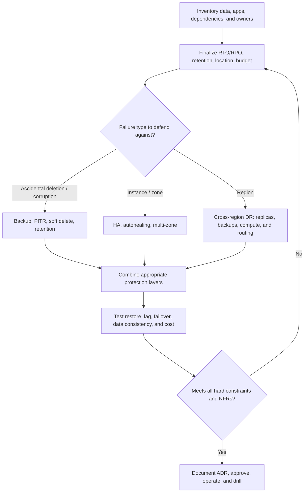
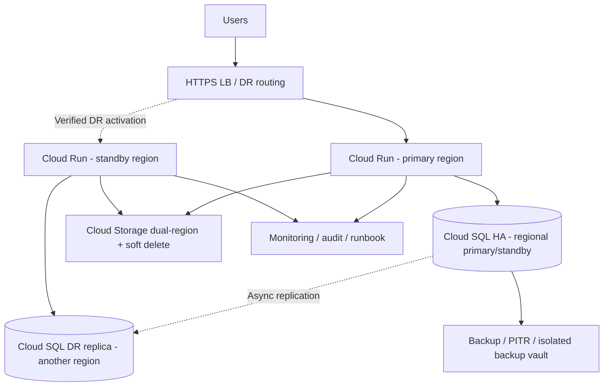

# Choosing Backup, Replication, and High Availability

## 1. The problem: three mechanisms protecting against three different risks

An ordering service on Google Cloud can run smoothly for months and then stop serving because a zone suffers an outage, an administrator accidentally drops a data table, or an entire region becomes unreachable. Those three situations call for different measures. **High availability (HA)** reduces disruption when an active serving component fails; **replication** creates or maintains copies of data/resources in another location; **backup** stores recovery points to revert to a prior state.

In the **Backup and Disaster Recovery** chapter of the `CLOUD_PROVIDERS_GCP` module, choices must start from business requirements, failure models, and actual data. Knowledge of projects, IAM, VPC, Compute Engine, GKE, Cloud Run, Cloud SQL, Cloud Storage, and reliability/cost monitoring helps design solutions that both protect resources and can be **recovered via tested procedures**.

After this lesson, learners will be able to:

1. Distinguish between backup, snapshot, point-in-time recovery (PITR), replication, HA, failover, and disaster recovery (DR).
2. Translate RTO, RPO, retention, data residency, and budget into verifiable selection criteria.
3. Choose appropriate mechanisms for Cloud SQL, Compute Engine disks, Cloud Storage, GKE, and distributed transactional data.
4. Explain why replication and HA **do not replace** backups against accidental deletion, logical errors, or ransomware.
5. Build multi-layered solutions, runbooks, restore tests, failover, and failback.

> **Principle:** Do not mark a system as "DR-ready" just because backups are enabled or a read replica was created. A solution meets requirements only when operators know **what to recover, where, how long it takes, how much data can be lost, and who is authorized to execute it**.

## 2. Definitions and protection scope

| Mechanism | Primary effect | Failure scope typically addressed | What it does not solve |
|---|---|---|---|
| **Backup** | Stores scheduled recovery points for later restoration | Accidental deletion, corruption, data loss, restoring from an older point | Requires restore time; does not keep the service running on its own |
| **Snapshot** | Point-in-time image of a disk/volume, a form of recovery point | Recreating volumes/VMs, rollback per product capabilities | Live snapshots may only be *crash-consistent* |
| **PITR** | Restores to a specific timestamp using backups and transaction logs | Data deletion, faulty batch jobs, logical errors | Bounded by log window, permissions, and supported restore paths |
| **Replication** | Synchronizes or copies updates to another replica | Hardware failure, zone outage, read scaling, or DR | Can replicate deleted/corrupted data; async replicas carry lag |
| **HA** | Keeps the service running when a component fails | Instance, node, or zone failure depending on topology | Does not inherently survive a full region outage or accidental deletion |
| **DR** | Restores business functionality after a disaster | Region loss, large-scale data corruption, prolonged outages | Requires architecture, runbooks, ownership, drills, and budget |

For example, if the `orders` table is accidentally dropped at 10:05: a read replica may receive the drop command almost immediately; HA continues serving **the deleted data**. You need a backup/PITR from before 10:05, or appropriate deletion-protection controls. Conversely, if the primary database suffers an infrastructure failure without data corruption, HA or a replica can recover **faster** than reloading a full backup.

### 2.1. Durability, availability, recoverability

- **Durability:** is written data kept safe against defined failures? Depends on copies, storage locations, and write acknowledgment semantics.
- **Availability:** can users access and complete operations when needed? Data safe in a backup still leaves the application unavailable during restoration.
- **Recoverability:** can the **exact version, data, permissions, configuration, and dependencies** be restored within the required timeframe?

Do not equate a single product's SLA with the entire system's SLO. An API also depends on DNS, identity, DB, queues, networking, quotas, application code, and external providers.

### 2.2. Synchronous and asynchronous replication

**Synchronous replication** confirms a write only after the required replicas receive the data per the service's protocol, limiting data loss for failures covered by that topology; in return, it can increase write latency. **Asynchronous replication** allows the primary to acknowledge before distant replicas receive all data, reducing write latency impact at the risk of losing **unreplicated** transactions if the primary fails.

Do not generalize conclusions from one product to another. Cloud SQL HA replicates synchronously across zones **within the same region**; cross-region Cloud SQL replicas can lag. Spanner uses a different topology and quorum; choosing regional, dual-region, or multi-region also depends on edition, location, and workload.

## 3. Translating business needs into RTO, RPO, and failure domains

**Recovery Time Objective (RTO):** the maximum duration of business function downtime an organization tolerates after an incident. **Recovery Point Objective (RPO):** the maximum amount of data that can be lost, typically expressed as the time elapsed from the last usable recovery point to the incident.

```text
09:00       09:45         10:00               10:50
  |-----------|-------------|-------------------|
  |        recovery       incident          business
  |        point                             operational again
  |
  +-- Measured RPO = 10:00 - 09:45 = 15 minutes
      Measured RTO = 10:50 - 10:00 = 50 minutes
```

You must measure from a **truly usable** recovery point, not merely when a job was scheduled. RTO ends when the **business function** works and data passes validation, not when a VM boots or a health endpoint returns HTTP 200. For transactions, identify which orders committed before the incident are missing after DR and avoid duplicate replay.

### 3.1. Failure domains to separate

| Scenario | Design scope | Example measures |
|---|---|---|
| Process, node, or VM failure | Single compute unit | Restart, multiple replicas, health checks, autohealing |
| Single zone outage | Resources in the same zone | HA/multi-zone, regional resources |
| Entire region outage | API, DB, secrets, storage in the same region | Cross-region DR, standby app, routing, and off-region data replicas/backups |
| Accidental table/object deletion | Logical data; infrastructure remains healthy | Backups, PITR, soft delete, versioning |
| Ransomware/compromised account | Both source and backups if sharing admin permissions | Isolated/immutable backups, separated permissions, auditing |
| Faulty deploy/schema | Multiple regions can fail simultaneously | Canary, rollback, compatible point-in-time restore |

**Multi-zone HA does not protect against region loss**; **multi-region DR does not replace restoring versions from before accidental deletion**; **frequent backups do not guarantee a short RTO** when data sizes are large.

### 3.2. Verifiable NFR contracts

Example of a Spring Boot application storing orders in PostgreSQL:

| ID | Illustrative NFR | Acceptance evidence |
|---|---|---|
| NFR-01 | Ordering API availability ≥ 99.95% via synthetic probe over 30 days | SLO, definition of successful request, and error budget |
| NFR-02 | Zone outage: order creation interrupted for at most a few minutes | Staging failover test; measured from the application side |
| NFR-03 | Region loss: RTO ≤ 60 minutes | Drill switching app, DB, routing; successful business transactions |
| NFR-04 | Region loss: RPO ≤ 15 minutes | Compare committed transactions before and after incident |
| NFR-05 | Accidental deletion: recoverable to a pre-error point within 7 days | PITR/restore verification and data correctness check |
| NFR-06 | PII and backups reside only in locations approved by data owner | Audit DB, backup vaults, replicas, logs, keys |
| NFR-07 | Immutable backups for at least 30 days if policy requires | Verify enforced retention and delete permissions |

Numbers are **learning assumptions**, not GCP SLAs or guarantees. Without an RPO for accidental deletion, you cannot finalize a backup schedule; if RTO is shorter than measured restore time, you must add a faster recovery option or renegotiate requirements.

## 4. Solution selection workflow



| Need | Primary mechanism | Supporting mechanisms | Commonly overlooked items |
|---|---|---|---|
| Dev recoverable within 24 hours | Scheduled backups/snapshots | IaC, configuration storage | DB snapshots may be inconsistent |
| Production API must survive zone failure | HA/multi-zone | Backups/PITR, proper retry/reconnect | HA does not prevent logical data errors |
| Transactions must recover from region loss | Cross-region DR replica or strategic restore | Primary HA, backup/PITR, secondary app, routing | Replication lag, split-brain, standby/egress fees |
| Deleted/overwritten objects | Soft delete and Object Versioning as needed | Retention/isolated copy | Versioning does not protect against deleting the entire bucket |
| Objects must remain readable during region outage | Cloud Storage dual-/multi-region or standby buckets | Soft delete, failover/read path | Replication does not preserve version history by itself |
| Traditional application VMs | MIG and regional resources where appropriate | Disk snapshots, Backup and DR, IaC | Snapshots may only be crash-consistent |
| Stateful GKE | Regional/multi-zone cluster | Backup for GKE, separate DB backups | Cluster backup does not cover external DBs |

**Never use scoring to justify violating data residency or legal retention rules.** If a DR region falls outside permitted regions, discard that option regardless of how fast its RTO is.

## 5. Cloud SQL: combining HA, backup, PITR, and DR

### 5.1. Zone-level HA within a single region

With Cloud SQL PostgreSQL configured for **HA (regional)**, the primary and standby reside in **two zones within the same region**. Cloud SQL synchronously replicates data across zones before acknowledging commits as documented. On an instance/zone failure, the service can automatically fail over the primary to standby; applications must handle connection drops and reconnect.

Trade-offs:

- Reduces downtime from zone/instance failures, but does **not** protect against full region loss.
- Incurs HA resource costs; check current edition and pricing.
- Failover still causes brief disruption; measure from the API side, not just Console status.
- Backups/PITR are still needed for accidental deletion, faulty schemas, or corruption.

[Cloud SQL PostgreSQL — HA](https://docs.cloud.google.com/sql/docs/postgres/high-availability) · [Configure HA](https://docs.cloud.google.com/sql/docs/postgres/configure-ha).

### 5.2. Backups and PITR to return to the right point in time

Cloud SQL supports automated or on-demand backups, offering **standard backups** and **enhanced backups** depending on edition/configuration. Enhanced backups are managed by Backup and DR, use a **backup vault**, and provide retention policies, backup schedules, and the ability to store backups in a different location from the instance in supported cases.

**PITR** uses backups and transaction logs to create an instance at a timestamp within the recovery window. For PostgreSQL, PITR creates a **new instance** rather than overwriting the old one. Default enablement depends on edition and instance creation method (Console/CLI/API): check the **actual** configuration.

| Protection method | When to choose | Limitations |
|---|---|---|
| Automated backup | Periodic recovery points | RPO depends on schedule/backup type; restore can take time |
| On-demand backup | Before upgrades or major data changes | Creates a single point, does not replace a schedule |
| PITR | Recovering before accidental deletes/faulty batches | Depends on transaction logs, retention, and supported restore paths |
| Enhanced backups + backup vault | Centralized management, retention, permission and location isolation | Permissions, vault costs, and compatibility/restore limits |
| Export to Cloud Storage | Migration, reconciliation, or selective logical data | Not equivalent to managed Cloud SQL backups; self-managed lifecycle |

**Critical CMEK limitation:** for **enhanced backups stored in a cross-region vault**, a Cloud SQL backup of a CMEK-enabled instance still depends on the instance's key residing in the **source region**. If the region holding the key is unavailable, the backup cannot be decrypted for restore until that region recovers. Current documentation also notes that **PITR from a cross-region backup vault** restores only to a **new instance in the same region as the source instance**. Therefore, a remote vault alone does not guarantee DR for a full region loss. Verify restore paths, key locations, and region-loss scenarios **before** signing off on an RTO.

[Cloud SQL backup options](https://docs.cloud.google.com/sql/docs/postgres/backup-recovery/backup-options) · [Backup overview](https://docs.cloud.google.com/sql/docs/postgres/backup-recovery/backups) · [PITR](https://docs.cloud.google.com/sql/docs/postgres/backup-recovery/pitr) · [Restore](https://docs.cloud.google.com/sql/docs/postgres/backup-recovery/restore).

### 5.3. Cross-region replicas for DR

A **cross-region read replica** maintains a near-current copy in another region. When writes flow asynchronously, the replica can lag behind the primary; before promoting/failing over, verify replicated data, update application endpoints, and prevent two primaries from accepting writes.

Options:

1. **Backup/restore in another region:** fewer always-on resources, but restoring large databases may miss RTO.
2. **Warm standby with a replica:** can lower RTO, in exchange for paying instance and replication costs, monitoring lag, and operating promote/failback.
3. **Engine/edition-specific advanced DR solutions:** evaluate supported switchover/replica failover mechanisms, regional limits, and actual versions.

Do not write **RPO=0** in an ADR merely because a replica exists. Measure replication lag under peak load, count missing transactions, and test split-brain prevention.

[Cloud SQL PostgreSQL — Disaster recovery](https://docs.cloud.google.com/sql/docs/postgres/intro-to-cloud-sql-disaster-recovery) · [Cross-region replicas](https://docs.cloud.google.com/sql/docs/postgres/replication/cross-region-replicas).

## 6. Cloud Storage: replication differs from recovering deleted objects

### 6.1. Location, replication, and data availability

- **Regional bucket:** data is placed regionally; well-suited when compute is close to data, but does not automatically provide an out-of-region access path if the entire region fails.
- **Dual-region/multi-region:** provides object redundancy across regions per topology; suitable when data must remain available during a region outage and data residency allows it.
- **Turbo replication:** an option for supported dual-regions, designed to replicate new objects between two regions within a **15-minute RPO** per product objective. This is an **object replication** target, not a 15-minute RPO guarantee for an application with databases and message queues.
- **Cross-bucket replication:** asynchronously copies new or updated objects to **another bucket**. Buckets have independent locations, encryption, IAM, and lifecycles, so permissions and recovery must be designed separately.

Replication can propagate **undesired** states or keep serving corrupted content. Never confuse redundancy with point-in-time version history.

[Cloud Storage — Availability and durability](https://docs.cloud.google.com/storage/docs/availability-durability) · [Turbo replication](https://docs.cloud.google.com/storage/docs/managing-turbo-replication) · [Cross-bucket replication](https://docs.cloud.google.com/storage-transfer/docs/cross-bucket-replication).

### 6.2. Soft delete, Object Versioning, and retention

| Mechanism | Value | Considerations |
|---|---|---|
| **Soft delete** | Retains deleted or overwritten objects/buckets within a retention window for restore | Soft-deleted objects cannot be read directly; requires restore permissions, incurs storage cost |
| **Object Versioning** | Keeps accessible noncurrent generations | Increases stored objects; **does not protect against deleting the entire bucket** |
| **Retention policy** | Prevents object deletion before the required duration | Costs and legal constraints; locking a policy can be hard/impossible to reverse |
| **Independent bucket** | Separates permissions, storage class/location, and recovery path | IAM, lag, lifecycle, and network costs require governance |

Cloud Storage generally enables a **default 7-day soft delete** on supported buckets per current documentation; check the actual bucket rather than assuming defaults are permanent. Google recommends soft delete for accidental deletion protection; Object Versioning fits when direct access to older generations is needed. For buckets storing temporary data, soft delete can significantly increase bills.

[Soft delete](https://docs.cloud.google.com/storage/docs/soft-delete) · [Object Versioning](https://docs.cloud.google.com/storage/docs/object-versioning).

For example, a product image library that must survive both region loss **and** accidental deletion: use dual-region or standby bucket architecture in an approved location **for availability**, paired with appropriate soft delete/versioning/retention **for recovery**. These are two protection layers addressing different risks.

## 7. Compute Engine, Backup and DR, and GKE

### 7.1. Compute Engine snapshots

Compute Engine supports disk snapshots and various replication/backup mechanisms depending on disk type. **Live disk snapshots may be only crash-consistent by default**: transactions still in memory or pending writes might not be captured in an application-consistent state.

For self-managed databases on VMs, design **application-consistent snapshots** using quiesce/flush procedures or DB-aware backup solutions. If snapshotting multiple disks, verify consistency group coordination per supported features. Do not forget boot images, VM metadata, firewall rules, networks, IAM, KMS keys, secrets, and IaC configs: restoring a disk does not mean the app runs.

**VM HA** typically requires multiple instances, health checks, Managed Instance Groups, and load balancing where the workload permits. A single volume snapshot does not create HA.

[Disk snapshot best practices](https://docs.cloud.google.com/compute/docs/disks/snapshot-best-practices) · [Snapshots](https://docs.cloud.google.com/compute/docs/disks/snapshots).

### 7.2. Backup and DR Service: isolated backup vaults

**Backup and DR Service** provides backup plans, rules, backup vaults, and restores for **supported workloads**. A backup vault holds isolated copies; enforced retention protects against premature deletion. Separating the backup management project from the workload project reduces blast radius if an application service account is compromised.

Verify:

- Are the specific resource type, edition, and location supported for backup/vault/restore?
- Which region or multi-region hosts the vault, and does it meet data residency and region-down scenarios?
- Is retention long enough against accidental deletion/ransomware while complying with legal data deletion requests?
- Who manages the vault, backup plans, restores, KMS keys, and backup project?
- When the source project/region is unavailable, can configuration inventories, keys, and identities still be retrieved to restore?

**Immutability creates cost:** backups under enforced retention cannot be arbitrarily deleted to cut bills. Test policies in a lab and review durations before locking.

[Backup and DR overview](https://docs.cloud.google.com/backup-disaster-recovery/docs/concepts/backup-dr) · [Backup vault](https://docs.cloud.google.com/backup-disaster-recovery/docs/concepts/backup-vault).

### 7.3. Backup for GKE

Backup for GKE can protect Kubernetes resources and supported PersistentVolumes per configuration. However, GKE workloads often use Cloud SQL, Cloud Storage, Secret Manager, and external services: **cluster backups do not replace database and object backups**. During restore, verify cluster version, CRDs, storage drivers, networking, IAM, application consistency, and dependencies.

Regional/multi-zone GKE helps workloads survive node/zone failures by design. Recovering an entire region requires clusters/compute, artifacts, secrets, quotas, connectivity, and data sources in another region. **Getting a Pod running is not enough to declare RTO met.**

[Backup for GKE](https://docs.cloud.google.com/kubernetes-engine/docs/add-on/backup-for-gke/concepts/backup-for-gke) · [Limits](https://docs.cloud.google.com/kubernetes-engine/docs/add-on/backup-for-gke/concepts/quotas-and-limits).

## 8. When to consider Spanner?

For SQL transactions requiring strong consistency and multi-region availability, **Spanner** can be a candidate over Cloud SQL + manual DR replication. Spanner offers regional, dual-region, and multi-region topologies and quorums, with differences in edition, location, cost, and write latency.

- Moving the DB to Spanner **does not automatically make the whole application multi-region**: compute, APIs, queues, secrets, IAM, load balancers, and failure handling still require design.
- Multi-region quorum can increase write latency; benchmark the workload from actual user regions.
- Appropriate backups/PITR/retention are still needed to guard against logical errors and data deletion.
- Migrating from PostgreSQL/MySQL incurs costs for schema, SQL, ORM, transaction semantics, and release process changes.

[Spanner instance configurations](https://docs.cloud.google.com/spanner/docs/instance-configurations) · [Spanner backup](https://docs.cloud.google.com/spanner/docs/backup).

## 9. Layered design: Spring Boot ordering application

### 9.1. Hypothetical requirements

A Spring Boot API on Cloud Run stores orders in Cloud SQL for PostgreSQL, stores product images in Cloud Storage, and sends emails via a queue system. The team requires:

| Criterion | Threshold/expectation |
|---|---|
| Availability | Ordering API SLO 99.95% over 30 days |
| Instance/zone failure | Self-recovery and reconnect mechanisms, zero confirmed order loss within HA scope |
| Region loss | RTO ≤ 60 minutes; RPO ≤ 15 minutes, measured on committed transactions |
| Logical data error | Recoverable to a pre-error point within a 7-day window |
| Product images | Readable when a region fails; deleted objects recoverable |
| Sensitive data | Stored only in locations, vaults, and keys approved by the data owner |
| Operations | Alerts, logs, periodic DR drills, and standby budget |

### 9.2. Combining three layers of protection

**Layer 1 — Surviving instance/zone failures:** Regional Cloud Run using health/startup checks and proper connection retry handling; Cloud SQL HA across two zones in the same region; monitoring 5xx, latency, DB CPU, memory, and connection pools. This is **zone-level HA**, which does not cover region loss.

**Layer 2 — Recovering from data errors:** Cloud SQL backups (appropriate standard/enhanced), sufficiently long PITR window, backup vault/retention, and isolated IAM; Cloud Storage soft delete or versioning. Periodically restore the database into a **separate instance**, verifying data and API functionality. Backups must include sufficient data, keys, and metadata to return the application to a valid state.

**Layer 3 — Region loss:** candidates include a Cloud SQL cross-region DR replica or backup restore to a target region, secondary Cloud Run deployment, artifact images, secrets/IAM, quotas, and appropriate global routing. Cloud Storage dual-region/replication serves images alongside deletion protection. Verify KMS key locations, backups, replicas, logs, and data residency rules.



The diagram above is a **candidate architecture**, not a proven failover outcome. The DB in the DR region may accept writes only after controlled promotion/failover; two primaries accepting concurrent writes (*split-brain*) must be prevented. The 15-minute RPO target is **not guaranteed** until replication lag is measured. A backup restore option must also prove it can decrypt and provision new resources when the primary region is down.

### 9.3. Comparing options

| Option | Survives zone failure | Accidental data deletion | Region loss | Trade-offs |
|---|---|---|---|---|
| **A:** Zonal Cloud SQL + same-region backup | Limited | Can restore if backup is valid | No reliable recovery path | Low cost, but fails DR requirements |
| **B:** Cloud SQL HA + backup/PITR | Better, HA-scoped failover | Can PITR/restore | No cross-region DR | HA resource cost, still lacks region recovery |
| **C:** HA + backup/PITR + cross-region DR replica/backup + standby app | Yes | Yes | Candidate if DR drill and lag pass | Added replica, egress, backup, IAM, cost, and ops effort |
| **D:** Multi-region app + suitable Spanner topology + data protection | Depends on compute and DB topology | Yes via supported backup/PITR | Can reduce DB DR steps | Higher cost/migration/latency/edition complexity |

Given the NFRs above, **A and B are insufficient** to survive region loss. **C and D are only candidates** until test evidence exists. If policy restricts data to a single region, explicitly document the conflict with the region-loss objective; never silently replicate data to an unapproved location.

### 9.4. Conditional decision

Suppose a PoC of C shows load tests pass; replication lag stays within acceptable bounds; a DR drill measures RTO **47 minutes** and RPO **8 minutes**; order reconciliation shows zero duplicates; and backup restore works in the target region. Then **approval of C can be proposed** with a risk register (higher latency at peak, standby region quotas, standby costs, KMS/IAM, and schema changes).

If the drill measures RTO **85 minutes** or RPO **20 minutes**, option C **fails**, even if all features are enabled. Either improve the runbook/capacity/data strategy or ask the owner to adjust the NFR.

## 10. Controlled recovery runbook

**Never drill by deleting real data in production.** Use a staging project, synthetic data, and separated permissions. A runbook includes:

1. **Incident declaration:** identify symptoms, scope (instance/zone/region/data corruption), start timestamp, incident commander, and impacted business systems.
2. **Containment:** if account compromise or mass deletion is suspected, restrict writes and preserve logs/evidence and backups; do not restore into an environment still controlled by an attacker.
3. **Select recovery point:** based on timestamp of last valid transaction, backup inventory, PITR window, and replication lag; record potential data loss.
4. **Select recovery path:** HA failover if a zone fails and data is intact; promote DR replica if a region is lost and replica is trustworthy; restore backup/PITR into a **separate instance** if data suffered logical corruption.
5. **Prepare target:** quotas, network, DNS, service accounts, KMS keys, secrets, images, cloud resources, and dependencies.
6. **Verify data:** order counts/IDs, monetary totals, foreign-key integrity, checksums/manifests; test idempotent event replay.
7. **Reopen application:** shift traffic in a controlled manner, monitor request success and business errors; run end-to-end sample transactions.
8. **Measure RTO/RPO:** record start/end timestamps, actual data loss, manual steps, and incurred costs.
9. **Failback:** return to the old region only after reconciliation; prevent split-brain; update postmortem lessons, alerts, and runbook.

### 10.1. Pre-drill inspection commands

The following commands **only read metadata**, except `gcloud config set project` which changes local CLI configuration. Run from an admin workstation against a **lab project** with a read-only identity:

```bash
export PROJECT_ID="my-lab-project"
export INSTANCE="orders-postgres"
export BUCKET="my-lab-product-images"

gcloud config set project "$PROJECT_ID"

# Cloud SQL: region, HA, and backup/PITR settings
gcloud sql instances describe "$INSTANCE" \
  --format="yaml(name,region,settings.availabilityType,settings.backupConfiguration)"

# Backup list (check source and corresponding backup/vault type)
gcloud sql backups list --instance="$INSTANCE"

# Bucket metadata: location, soft delete, versioning, retention
gcloud storage buckets describe "gs://$BUCKET" --format=json
```

This is **not an automated restore or failover script**. Enhanced backups involve objects/vaults managed via Backup and DR; listing backups does not replace testing vault access and restoration. If backups use CMEK, DR drills must also test the key access path. Never log secrets, tokens, or PII in command logs.

### 10.2. Recovery test matrix

| Test | How to test in lab | PASS evidence |
|---|---|---|
| Periodic backup restore | Restore to a separate database, run tests | Correct schema, row counts, foreign keys, business queries, recorded duration |
| PITR before logical error | Create test data, delete erroneously, PITR to pre-error timestamp | Selected timestamp within retention, does not overwrite production |
| HA failover | Test per Cloud SQL procedure in staging | Client reconnects, acceptable downtime, committed transactions intact |
| Cross-region DR | Simulate primary region outage, switch app/DB/routing | Measured RTO/RPO pass, new orders succeed, no split-brain |
| Cloud Storage object deletion | Delete a test object while soft delete is active, then restore | Restored exact object/generation and metadata |
| KMS/IAM issue | Simulate missing permissions on lab resources | Failure detected, alert reaches on-call, runbook resolves it |
| Isolated vault | Restore using a DR identity assuming workload account lost access | Restored required data and configs with audit trail |

## 11. Protecting backups against attacks and misconfiguration

Reliable backups need protection equivalent to the source data:

- **Separation of duties:** application service accounts must not delete backups or alter retention; backup operators hold separate permissions; restores require approval/auditing.
- **Isolation:** consider placing vaults in a separate project and DR-appropriate location so a single IAM principal cannot delete both production and backups simultaneously.
- **Retention/immutability:** apply enforced retention appropriate against ransomware, accounting for cost and legal data-deletion mandates.
- **Keys:** review CMEK key locations, service agents, decrypt permissions, usability when the source region is unavailable, and key rotation plans.
- **Detection:** alert on backup job failures, backup age exceeding thresholds, replication lag, IAM/retention changes, and abnormal spikes in soft-deleted objects.
- **Independent runbook:** keep monitored infrastructure inventories and break-glass credentials where the DR team can access them even if the primary project/SSO is down.

If only the application author holds restore permissions, on-call staff may be blocked in their absence. If keys are secure yet access permissions are revoked without a recovery mechanism, data remains unreadable. Both are **recoverability** risks.

## 12. Costs and trade-offs

```text
Monthly DR TCO (estimated)
  = standby/replica compute and DB
  + snapshot/backup/vault storage by retention
  + transaction logs/PITR and object replicas
  + request operations + inter-region egress
  + load balancer, logging, monitoring, and KMS
  + operational labor, restore drills, and licenses
```

**Backup storage** cost differs from **recovery** cost: during an incident, enough compute, disk, network, and staff must be available to rebuild the system. Long-term backups or immutable retention increase GB-month charges; warm/hot standby and active-active raise recurring fees and can add write latency.

Example **logical** capacity estimation model, not a Cloud SQL quote:

```text
Base data                  = 1 TiB
Daily change rate          = 3% = 0.03 TiB
14-day retention: 1 baseline + 13 incremental deltas
Illustrative total ~ 1 + 13 × 0.03 = 1.39 TiB
```

In practice, snapshots/incremental backups vary in billing, compression, deduplication, retention, and overhead; data churn rates fluctuate. Use the Google Cloud Pricing Calculator and Billing export calibrated with a pilot rather than treating 1.39 TiB as a firm cost figure.

| Goal | Side effect | How to verify |
|---|---|---|
| Lower RTO | Needs hotter standby, replicas, and DR capacity | Region-loss drill, measure until successful transaction |
| Lower RPO | Faster replication or synchronous protocol, higher latency/cost | Measure lag, compare committed transactions at peak |
| Longer protection against accidental deletion | Retention, versioning/soft delete increase storage cost | Cost breakdown and restore test |
| Stronger backup isolation | More IAM/project/vault/KMS and operational overhead | Restore using independent DR identity |
| Cut cost by removing replicas | Restore RTO may increase | Restore production-equivalent volume in lab |
| Multi-region | Egress, topology, consistency complexity | DR drill, compliance check, and total TCO |

When budget falls short, clearly report which NFRs remain at risk and request authorized owner adjustments; **never silently cut backups, audit logs, or mandatory retention**.

## 13. Common mistakes

| Misconception | Why it is wrong | Correction |
|---|---|---|
| "We have a read replica so we don't need backups" | Replicas receive accidental deletes/corruption and lack independent recovery points | Backup/PITR + retention + restore drills |
| "Cloud SQL HA survives region loss" | HA primary/standby live in zones within the same region | Cross-region DR or restore in another region |
| "A VM snapshot is a consistent DB copy" | Live snapshots can be crash-consistent only | Application-consistent backups, flush/quiesce, verification |
| "Backup job succeeded means restore works" | Keys, permissions, dependencies may be missing or backups faulty | Periodic restores into a clean environment, business testing |
| "A cross-region vault guarantees restore" | CMEK keys in the source region may become inaccessible | Test whole-region DR including key access |
| "A dual-region bucket prevents accidental deletion" | Replication/availability differs from retention and soft delete | Add object recovery points |
| "Object Versioning protects against bucket deletion" | Versioning does not protect against bucket-level deletion | Appropriate soft delete/retention |
| "App RPO equals a single bucket's RPO" | Data spans multiple stores and distributed transactions | Reconcile end-to-end business flows |
| "RTO ends once VM/Pod is restored" | Missing configs, DB, keys, network, DNS, endpoints | Measure until customer actions succeed |
| "More copies are always better" | Cost, attack surface, residency, and operational risk increase | Choose based on requirements, topology, and evidence |

## 14. Exercise: designing recovery for three workloads

Build a decision matrix for:

| Workload | Criticality | Incidents to defend against | Hypothetical RTO / RPO |
|---|---|---|---|
| Internal HR portal on VM, updated daily | Medium | VM loss or file deletion | RTO 8 hours, RPO 24 hours |
| Ordering API on Cloud Run + Cloud SQL PostgreSQL | High | Zone failure, region failure, accidental DB deletion | Region: RTO 60 minutes, RPO 15 minutes; 7-day PITR |
| Image library on Cloud Storage | Medium/High | Region loss and accidental image deletion | Readable during region outage; deleted objects recoverable within 7 days |

For each workload:

1. Select an HA layer if needed, a replica/DR mechanism if needed, and a point-in-time backup/restore mechanism. Explain why.
2. Specify locations, owners, IAM separation, key/retention policies, and failure domains.
3. Estimate standby, storage, vault, egress, observability, and operational effort.
4. Write RTO/RPO and data consistency tests. Only mark **PASS** once executed with logs and records.

**Solution guidance:** The VM can use scheduled snapshots/backups and IaC with restore drills; the ordering API needs Cloud SQL HA **and** PITR/backups, plus tested cross-region DR; images need appropriate replication/location **and** soft delete/versioning. A 15-minute RPO for orders must not be promised solely because a replica exists. If data residency policy forbids the DR region, explicitly document the conflict and escalate.

## 15. Acceptance checklist and official documentation

Before approving an architecture:

- [ ] Inventory of source data, dependencies, and sensitivity classification exists.
- [ ] Each incident type has an approved RTO, RPO, retention, and owner.
- [ ] Process/zone/region failures, logical data errors, and ransomware are distinguished.
- [ ] HA, replication, and backups are used for their **distinct** purposes.
- [ ] Backup/PITR/vault/soft delete capabilities are verified by engine, edition, and location.
- [ ] A single account cannot delete both source and backup copies; retention is controlled.
- [ ] Decrypt keys and permissions remain usable if the source region or project fails.
- [ ] Restores into a clean environment verify data/apps and measure actual duration.
- [ ] DR drills validate lag, failover, failback, split-brain prevention, and business transactions.
- [ ] IAM, quotas, secrets, images, networking, and routing are ready in the DR region.
- [ ] SLO alerts monitor backup jobs, backup age, replication lag, failed restores, and IAM changes.
- [ ] TCO includes retention, standby, egress, logging, and recurring drills.

### Google Cloud documentation

- [Disaster recovery planning guide](https://docs.cloud.google.com/architecture/dr-scenarios-planning-guide) — RTO/RPO and incident models.
- [Backup and DR Service](https://docs.cloud.google.com/backup-disaster-recovery/docs/concepts/backup-dr) — backup plans and workloads.
- [Backup vaults](https://docs.cloud.google.com/backup-disaster-recovery/docs/concepts/backup-vault) — isolation and enforced retention.
- [Cloud SQL HA](https://docs.cloud.google.com/sql/docs/postgres/high-availability) — primary/standby across zones.
- [Cloud SQL backup options](https://docs.cloud.google.com/sql/docs/postgres/backup-recovery/backup-options) — standard/enhanced backups and CMEK limitations.
- [Cloud SQL PITR](https://docs.cloud.google.com/sql/docs/postgres/backup-recovery/pitr) — recovery points and regional limits.
- [Cloud SQL DR](https://docs.cloud.google.com/sql/docs/postgres/intro-to-cloud-sql-disaster-recovery) — cross-region recovery.
- [Cloud Storage soft delete](https://docs.cloud.google.com/storage/docs/soft-delete) and [Object Versioning](https://docs.cloud.google.com/storage/docs/object-versioning) — protection against accidental deletion.
- [Cloud Storage availability](https://docs.cloud.google.com/storage/docs/availability-durability) — dual-region and replication.
- [Compute Engine snapshot best practices](https://docs.cloud.google.com/compute/docs/disks/snapshot-best-practices) — crash/application consistency.
- [Backup for GKE](https://docs.cloud.google.com/kubernetes-engine/docs/add-on/backup-for-gke/concepts/backup-for-gke) — Kubernetes backup/restore.
- [Spanner configurations](https://docs.cloud.google.com/spanner/docs/instance-configurations) — regional, dual/multi-region.
- [Google Cloud Pricing Calculator](https://cloud.google.com/products/calculator) — estimating cost by topology and actual load.

**Expected outcome:** learners can justify backup, replication, and HA choices with **failure scenarios, RTO/RPO, restore evidence, data permissions, residual risks, and total cost**, then update designs whenever workloads or policies change.
