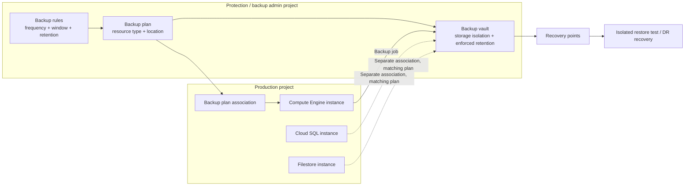

# Backup and DR Service and Protection Plan Organization

> **Chapter:** Backup and Disaster Recovery  
> **Module:** `CLOUD_PROVIDERS_GCP` — learning Google Cloud from project organization, IAM, and VPC to Compute Engine, GKE, Cloud Run, storage, and databases; through deployment scenarios, learners select services, protect resources, automate releases, and monitor reliability and cost.  
> **Scope:** Google Cloud **Backup and DR Service**, the backup model into a managed **backup vault**, **backup plan**, **backup rule**, and **backup plan association**; designing application protection, recovery testing, operational safety, and cost management. Examples are for test projects only and must not be run directly on production without approval.

## 1. Learning objectives

After this lesson, learners will be able to:

1. Distinguish **backup**, **replication**, **high availability (HA)**, and **disaster recovery (DR)**, as well as RPO and RTO.
2. Explain the roles of backup vault, backup plan, backup rule, backup plan association, backup job, and recovery point.
3. Design protection policies based on criticality, backup schedule, retention, storage location, application requirements, and cost.
4. Choose the **Google Cloud console-native** model for supported GCP resources and recognize the **appliance management console** branch currently on a deprecation roadmap.
5. Organize projects, IAM, backup vaults, backup plans, and associations to reduce the risk of backup deletion or tampering if production is compromised.
6. Execute an illustrative workflow to protect a Compute Engine VM, inspect jobs, and perform a controlled test restore.
7. Build a DR runbook with restore tests, a responsibility matrix, alerts, metrics, and incident response procedures.

### Opening scenario

An enterprise runs invoice-processing VMs on Compute Engine, Cloud SQL databases, Filestore file shares, and several services on GKE/Cloud Run. The system may face:

- An operator accidentally deleting data or deleting a VM.
- A compromised admin account intentionally deleting backups.
- Ransomware encrypting application data or writing corrupted data.
- A regional outage, dependency failure, or misconfiguration taking production down.
- An existing backup that cannot be restored due to missing permissions, missing keys, incompatible software versions, or missing runbooks.

The goal is not merely "having backups," but proving **recovery of the right data, at the right point in time, in the right place, and within the timeframe accepted by the business**.

## 2. Backup, HA, replication, and DR do not replace one another

| Concept | Purpose | Protects well against | Does not solve by itself |
|---|---|---|---|
| High availability (HA) | Maintain service when a component fails | Single VM/zone or node failure | Accidental data deletion, logical corruption |
| Replication | Copy changes to another location | Hardware failure, fast failover | Accidental deletion/ransomware may be replicated |
| Backup | Store time-bounded historical recovery points | Accidental deletion, corruption, restoring prior points | Instant app startup without a runbook |
| Disaster recovery (DR) | End-to-end service restoration after a disaster | Workload, region, or dependency loss | Worthless if never rehearsed |
| Retention/immutability | Retain backups and restrict premature deletion | Malicious or accidental backup deletion | Does not ensure application-consistent recovery |

**RPO (Recovery Point Objective)** is the maximum acceptable data loss. For example, RPO = 6 hours means when an incident occurs, the business accepts restoring to a point no older than 6 hours before the incident. A 6-hour backup schedule **does not automatically guarantee a 6-hour RPO**, because jobs can start late or fail.

**RTO (Recovery Time Objective)** is the maximum time from when an outage occurs until the service recovers per operational criteria. This duration includes incident detection, decision-making, resource provisioning, restoration, configuration, DNS, data verification, and reopening traffic.

**Example:** A VM backs up at 00:00 and 12:00, fails at 11:50, and the nearest backup is 00:00 ⇒ nearly 12 hours of data lost even though documentation says "daily backup." You must measure the **actual age of the latest successful recovery point**, not just the expected schedule.

## 3. Two architectures of Google Cloud Backup and DR

At the time of writing (19/11/2026), Google Cloud documentation distinguishes two management approaches:

| Criterion | Google Cloud Backup and DR — console-native | Backup and DR for the management console — legacy |
|---|---|---|
| Primary control plane | Google Cloud console, `gcloud backup-dr`, Backup and DR API, Terraform | Dedicated appliance management console and backup/recovery appliances |
| Architecture | Google-managed backup vault; no appliance deployment needed for supported workloads | Console + appliance in VPC + may require host agents |
| Policy model | Backup vault, backup plan, backup rule, association | Backup template, policy, resource profile, storage pool |
| Typical workloads | Compute Engine instance/disk, Cloud SQL, AlloyDB, Filestore | VMware/GCVE, Oracle, SQL Server, and other self-managed systems |
| Deletion protection | Enforced retention and optional vault lock | Depends on storage target / legacy mechanisms |
| New deployment guidance | **Preferred when workload is supported** | Evaluate only for legacy systems / migration roadmap transitions |

**Roadmap warning:** Google Cloud announced **deprecation** for the appliance management console branch effective **30/09/2026**; published documentation schedules stopping new backups via the legacy stack from **30/09/2027** and ending standard restore support on **31/03/2028**. Verify the *Feature deprecations* page before starting migration projects; do not design new systems dependent on the legacy branch without risk sign-off.

This lesson prioritizes **console-native Backup and DR**. When mentioning a "backup plan" in the lab sections, it refers to the `backupdr.googleapis.com` resource, **not** a backup template in the appliance management console.

### 3.1. Workload scope and limitations

For console-native backup vaults, documented workloads include:

- **Compute Engine instances and disks**: supported for protection via a backup plan into a vault; check disk/VM types, snapshot consistency, and configuration limits.
- **Cloud SQL instances**: protected by a plan; if point-in-time recovery (PITR) is needed, evaluate transaction log protection and engine conditions.
- **AlloyDB for PostgreSQL clusters**: backup vault and log/retention protection rules per dedicated documentation.
- **Filestore instances**: uses backup plans/vaults when source/location configurations are compatible.

For **GKE**, analyze the Kubernetes workload backup strategy (Kubernetes resources, PVCs, application/database consistency), potentially using **Backup for GKE** and dedicated mechanisms; **do not** assume a Compute Engine VM backup plan automatically protects applications inside the cluster. For **Cloud Run**, protect **external data and configuration** (Cloud SQL, Cloud Storage, secrets, IaC) and manage images/versions rather than looking to snapshot stateless containers.

## 4. Console-native architecture: vault → plan → association



**Dashed lines indicate logical relationships:** Cloud SQL and Filestore require their own plans/associations and valid resources; a plan built for Compute Engine cannot be shared across every resource type.

### 4.1. Backup vault

A **backup vault** is a Google-managed repository isolated from production resources, organizing:

- **Vault**: where location, access restrictions, encryption, minimum enforced retention, and lock controls are configured.
- **Data source**: represents the protected data source/resource, typically created upon the first backup.
- **Backup**: an individual recovery point with creation timestamp, expiration, and state.

A vault is not an ordinary Cloud Storage bucket where administrators can freely delete objects. **Minimum enforced retention** prevents premature backup deletion. Once retention/lock takes effect, backups may be **undeletable even by a project owner** until eligible; misconfiguration can lead to long-term, hard-to-reverse storage costs.

### 4.2. Backup plan

A **backup plan** defines the target resource type to protect, the plan location and destination vault, the set of backup rules (schedule, window, retention), and resource-type-specific options such as transaction log protection or on-demand support.

A backup plan must be created in the same project and at a location compatible with the vault. For console-native plans, **the plan's region must match the source workload's region**; the vault location can be the same region, a different region, or a multi-region **if supported by the workload**. Do not assume every resource supports every topology.

### 4.3. Backup rule

A **backup rule** defines:

1. Recurrence: `HOURLY`, `DAILY`, `WEEKLY`, `MONTHLY`, or `YEARLY`.
2. Backup window: the hour range when a job may start, **at least 6 hours** per current documentation.
3. Retention: how long a backup is kept until eligible for expiration.
4. Options: log retention/PITR or workload-specific settings.

A plan can include multiple rules to combine frequent operational backups with longer-term history. `HOURLY` recurrence supports a **minimum interval of 6 hours**; do not design for default 15-minute backups relying on this rule type alone.

### 4.4. Backup plan association

A **backup plan association** links **a specific source resource** to an appropriate plan. Creating a vault and plan is not enough: without attaching the plan to the right VM/disk/instance, the source may remain unprotected.

An association with the wrong resource ID/project/region or missing permissions can leave a deployment "having a plan" yet having **zero successful recovery points**.

## 5. Inventorying and classifying protection levels

The first step is not creating a vault; first you must establish an **inventory of services, data, and dependencies**.

| Information | Example | Design impact |
|---|---|---|
| Business owner | Finance / Billing | Who accepts RPO/RTO and approves restores |
| Technical owner | Platform SRE | Who configures plans and holds on-call responsibility |
| Workload | Billing VM, Cloud SQL, Filestore | Resource type and supportability |
| Data | Orders, attachments, logs | Consistency, sensitivity, compliance |
| Region/source project | `asia-southeast1`, `billing-prod` | Backup plan region and vault location |
| Size and churn rate | 2 TiB, 50 GiB/day change | Capacity, job duration, storage fees |
| RPO | 6 hours | Backup frequency and PITR |
| RTO | 4 hours | Restore approach, standby capacity |
| Retention | 30 days + regulatory long-term retention | Vault minimum, backup rules, and cost |
| Dependencies | DNS, IAM, KMS, VPC, images, secrets | Application recovery order |
| Tier | Critical / Important / Standard | Priority level and drill schedule |

Carefully distinguish **data backup** from **infrastructure recreation**. Terraform recreates VMs/networks/service accounts, but does not automatically restore database contents. Conversely, good database backups cannot run the application if KMS keys, IAM permissions, DNS, VPCs, or required container images are missing.

### 5.1. Example protection tiers

| Tier | Target RPO | Target RTO | Example approach |
|---|---|---|---|
| A — direct revenue | 1 hour | 2 hours | HA/replication and transaction-log/PITR if supported; long-term protected vault; frequent DR rehearsals |
| B — critical business | 6 hours | 8 hours | 6-hour backup plan if supported, restore runbook, and capacity reservation |
| C — supporting data | 24 hours | 48 hours | Daily backups, periodic restore tests |
| D — reconstructible data | Per business | Per business | IaC, images/artifacts, and minimal backups |

These numbers are **hypothetical design targets**, not SLAs guaranteed by Backup and DR Service. Very short RPOs or near-zero RTOs generally require additional HA/replication architectures and cannot be replaced by backup schedules alone.

## 6. Vault design: location, isolation, and retention

### 6.1. Centralized or decentralized

**Centralized:** backup vaults and plans live in a project managed by the protection team, while workloads live in service projects. The backup team retains control over vaults/retention; application teams can only attach plans or request restores per permissions.

**Decentralized:** each project/team owns its own vaults and plans. Simple for sandboxes, but if the same principal controls both production and backups, account compromise carries higher risk.

Recommendation for critical data: **separate the protection project from production projects** where organization policy permits, split admin permissions, isolate auditing, choose access restrictions, and consider perimeters/organization policies.

### 6.2. Choosing a location

| Vault location | Strengths | What to verify |
|---|---|---|
| Regional, same as source | Simpler data path and residency compliance | Protects against zone failure, but does not inherently recover the app if the entire region fails |
| Regional, different from source | Separates failure domain, explicit DR destination | Resource type support, data transfer cost, keys, restore target |
| Multi-region (if supported) | Data maintained across multiple regions within the multi-region | Valid region scope, workload type, fees, and compliance requirements |

Current Backup and DR documentation lists regional backup vaults such as `asia-southeast1` and several multi-regions such as `ASIA`, `EU`, and `US`. However, **not every** AlloyDB, Filestore, or legacy workload supports multi-region vaults. Choose locations using the official **workload–vault location compatibility matrix**, rather than just matching two codes starting with `asia`.

### 6.3. Enforced retention vs. expiration

- **Minimum enforced retention (vault)**: the minimum duration during which a backup cannot be manually deleted.
- **Backup rule retention**: retention duration for each backup per plan/rule; must not be lower than the compatible minimum.
- **Retention inheritance mode**: determines how backups inherit their enforced end date from the vault or from the backup rule duration; the choice at vault creation may be immutable.
- **Retention lock**: once effective, minimum retention cannot be lowered; it can only be increased.
- **Expiration**: when a backup becomes eligible for system deletion under policy, not the exact instant bytes immediately vanish.

**Illustrative example:** vault minimum = 7 days, rule retention = 30 days. With the appropriate mode, the backup is kept per the rule until around 30 days; do not assume a 7-day vault minimum causes automatic deletion after 7 days. For designs requiring deletion protection across the entire 30 days, consider `match-backup-expire-time` and verify semantics at creation time.

**November 2026 update note:** starting **01/11/2026**, official documentation notes that Backup and DR automatically applies a **project-level lien** to projects containing vaults with enforced-retention backups. Check impact on project teardown/migration; a project lien and a vault lock are **two distinct** protection layers.

### 6.4. Safety rules before locking

1. Confirm legal requirements and maximum deletion/retention rules.
2. Forecast total backup capacity across the full retention period.
3. Verify resource types and retention limits (e.g., Cloud SQL differs from Compute Engine).
4. Review vault admin permissions and break-glass procedures.
5. Test in a sandbox project; **do not** apply multi-year locks just to inspect the UI.
6. Approve lock level and effective date as a sensitive change.
7. Record IaC/runbook configurations, owner, re-evaluation date, and billing obligations.

Backups that cannot be deleted prematurely **still incur storage charges** for their entire retention period; deleting an application project or stopping jobs does not eliminate charges for backups remaining in a vault.

## 7. IAM and protection against compromised administrators

A sound DR architecture must assume an attacker could gain elevated privileges in the **production project**. Therefore, permissions to modify apps/VMs must not implicitly grant permission to delete vaults or alter retention.

### 7.1. Separation of roles

| Operational role | Primary permissions | What should not be allowed by default |
|---|---|---|
| Vault administrator | Create vaults, configure retention, access restrictions, and encryption | Delete production data or operate all applications |
| Backup plan administrator | Create/update plans and backup rules | Unilaterally alter all vault security settings |
| Backup operator | Attach plans, monitor jobs, handle failed backups | Reduce unapproved retention |
| Restore operator | Select recovery points and restore to approved targets | Overwrite production arbitrarily |
| Security reviewer/auditor | Read policies, job logs, sensitive changes | Delete or restore data out of scope |
| Application owner | Validate RPO/RTO, data, and consistency | Hold exclusive admin control over their own vault |

The predefined IAM role for managing vaults is `roles/backupdr.backupvaultAdmin`; other roles should be looked up in the **official IAM permissions/roles** documentation by task and resource scope. Never grant `roles/owner` or `roles/editor` just to bypass `PERMISSION_DENIED` errors.

### 7.2. Service agents and cross-project setup

In various configurations, Backup and DR uses **service agents** to access source/target resources and manage backups. Required permissions depend on the workload and project layout; do not grant broad org-wide permissions to every service agent.

Check:

- In which project are the backup vault/plan created?
- In which workload project/region is the backup plan association created?
- Which service agents does the system instruct you to grant permissions to on source/target projects?
- Do the plan creator and attacher have `actAs` or appropriate Backup and DR permissions?
- Do Org policies, VPC Service Controls, or CMEK policies block legitimate operations?

### 7.3. Advanced controls

- Separate backup IAM admins from production IAM admins.
- Enable auditing for vault, plan, association, and restore changes.
- Use Privileged Access Manager (PAM) and multi-party approval for highly sensitive operations, especially changing project liens or break-glass actions.
- Review backup vault access restrictions at org/project scope; some attributes **cannot be changed after creation**.
- Restrict security reviewers/restore operators accessing backup data that may contain PII; require approval when restoring to test projects.
- Enforce location-based KMS policies; if using CMEK, verify **supported workloads**, KMS permissions, and key-loss risks that would render backups unreadable.
- Integrate Cloud Logging, Cloud Monitoring, and SIEM, avoiding logging tokens/secrets/PII.

## 8. Scheduling backups to meet real RPO targets

### 8.1. Plan from RPO before picking rules

Suppose the business RPO is **6 hours**:

- An `HOURLY` rule with `hourly-frequency=6` aims to create a backup every 6 hours.
- Yet if the 06:00 job starts 90 minutes late or fails, the latest backup can be older than 6 hours.
- To verify the SLO, measure **age of last successful restorable backup**, not just "whether a job ran today."
- If data is too critical to lose 6 hours, you need logs/PITR or appropriate replication rather than relying solely on a 6-hour plan.

### 8.2. Choosing a backup window

A backup window is the **allowed start window** for a job, not necessarily a guarantee that the job finishes within the window. Current documentation requires a minimum 6-hour window.

- Avoid stacking every workload into the same peak hour.
- Evaluate CPU/disk/database impact during snapshots or quiescing.
- Verify local time and IANA timezones, especially DST transitions for international sources.
- Estimate data churn, write rates, quotas, and bandwidth.
- A successful job does not guarantee application-consistent data if the application is not designed appropriately.

### 8.3. Combining daily, weekly, and monthly rules

Example business-driven policy:

| Rule | Frequency | Retention | Purpose |
|---|---|---|---|
| Operational | Every 6 hours | 7 days | Short RPO, recent incidents |
| Daily | Daily | 30 days | Late detection of accidental deletion |
| Monthly | Monthly | 365 days | Medium-term investigation and compliance |

This is a **design template**, not directly applicable to every workload type. Check rule count limits, compatibility, storage cost, and consistency. Using one or multiple plans must follow resource capabilities rather than arbitrarily duplicating policies.

## 9. Lab: protecting a Compute Engine VM into a backup vault

### 9.1. Assumptions and prerequisites

The lab uses:

- Protection project: `dr-sandbox-admin`.
- VM project: `app-sandbox-dev`.
- Test VM: `invoice-vm-dev` in zone `asia-southeast1-b`, region `asia-southeast1`.
- Backup vault: `vault-invoice-dev` in `asia-southeast1`.
- Backup plan: `plan-invoice-6h`, 6-hour rule, 14-day retention.
- Vault minimum enforced retention: 7 days, mode `match-backup-expire-time` to keep backups until rule expiration; forecast costs before choosing.
- Use **synthetic sample data** only—never real invoices or personal data.

**Before executing:** ensure Billing is enabled, required documented APIs are enabled, and you hold IAM permissions to create vaults/plans and operate on the source to create associations. Distinguish a running VM from a recoverable VM; prepare a separate restore project.

### 9.2. Set variables and enable APIs

The following Bash commands are illustrative; **do not run blindly**:

```bash
export DR_PROJECT_ID="dr-sandbox-admin"
export WORKLOAD_PROJECT_ID="app-sandbox-dev"
export VM_NAME="invoice-vm-dev"
export VM_ZONE="asia-southeast1-b"
export VM_REGION="asia-southeast1"
export VAULT_NAME="vault-invoice-dev"
export PLAN_NAME="plan-invoice-6h"
export ASSOCIATION_NAME="assoc-invoice-vm-dev"

# Requires serviceusage.services.enable permission on the appropriate project.
gcloud services enable backupdr.googleapis.com \
  --project="$DR_PROJECT_ID"

# Per guidance for the workload/association type, enable the API in the source project.
gcloud services enable backupdr.googleapis.com \
  --project="$WORKLOAD_PROJECT_ID"
```

Companion resource APIs such as Compute Engine must be enabled in the VM project. If organization policies restrict enabling APIs, have the platform team handle it instead of granting Owner permissions for a lab.

### 9.3. Create a backup vault

```bash
gcloud backup-dr backup-vaults create "$VAULT_NAME" \
  --project="$DR_PROJECT_ID" \
  --location="$VM_REGION" \
  --backup-min-enforced-retention=7d \
  --backup-retention-inheritance=match-backup-expire-time \
  --access-restriction=within-org \
  --description="Sandbox vault for invoice VM recoverability"

gcloud backup-dr backup-vaults describe "$VAULT_NAME" \
  --project="$DR_PROJECT_ID" \
  --location="$VM_REGION"
```

**Parameter explanation:**

- `--backup-min-enforced-retention=7d`: blocks backup deletion before 7 days, subject to service/backup type constraints.
- `--backup-retention-inheritance=match-backup-expire-time`: backups inherit enforced retention aligned with the backup rule expiration; **choose only after review**, as the mode cannot be changed later.
- `--access-restriction=within-org`: restricts backup/restore sources within the current organization; may not suit cross-organization migration use cases.
- If CMEK is not needed in the lab, use Google-managed keys by default; if selecting CMEK, verify workload/location support.
- Do not enable **retention lock** in a lab; once locked, lowering retention may be impossible.

Creation may be asynchronous; if the CLI returns an operation ID, track it with:

```bash
gcloud backup-dr operations describe "projects/DR_PROJECT/locations/REGION/operations/OPERATION_ID"
```

The path in the example is a placeholder. Proceed only when the vault shows an active usable state and IAM is ready.

### 9.4. Create a backup plan with a six-hour rule

```bash
gcloud backup-dr backup-plans create "$PLAN_NAME" \
  --project="$DR_PROJECT_ID" \
  --location="$VM_REGION" \
  --resource-type="compute.googleapis.com/Instance" \
  --backup-vault="$VAULT_NAME" \
  --backup-rule="rule-id=every-6h,recurrence=HOURLY,hourly-frequency=6,backup-window-start=0,backup-window-end=24,retention-days=14"

gcloud backup-dr backup-plans describe "$PLAN_NAME" \
  --project="$DR_PROJECT_ID" \
  --location="$VM_REGION"
```

**Checks to perform:** the backup plan resides in the same project as the vault; the plan region matches the VM region; resource type uses the exact `compute.googleapis.com/Instance`. The 0–24 window allows jobs to start anytime within the day; it does not mean backups succeed at exact minutes or run continuously for 24 hours.

### 9.5. Attach the backup plan to the VM

The CLI requires the **numeric VM instance ID**, not the VM display name:

```bash
export VM_ID="$(gcloud compute instances describe "$VM_NAME" \
  --project="$WORKLOAD_PROJECT_ID" \
  --zone="$VM_ZONE" \
  --format="value(id)")"

export FULL_PLAN="projects/$DR_PROJECT_ID/locations/$VM_REGION/backupPlans/$PLAN_NAME"

gcloud backup-dr backup-plan-associations create "$ASSOCIATION_NAME" \
  --project="$WORKLOAD_PROJECT_ID" \
  --location="$VM_REGION" \
  --resource="projects/$WORKLOAD_PROJECT_ID/zones/$VM_ZONE/instances/$VM_ID" \
  --backup-plan="$FULL_PLAN"
```

**Do not skip IAM/service agents:** in cross-project setups, complete the permission-granting steps per Compute Engine and Backup and DR guidance. If the association is denied, **do not** fix it by granting Owner to all service agents; trace the exact missing permission.

### 9.6. Verify protection status

```bash
gcloud backup-dr backup-plan-associations list \
  --project="$WORKLOAD_PROJECT_ID" \
  --location="$VM_REGION"

gcloud backup-dr backup-plan-associations describe "$ASSOCIATION_NAME" \
  --project="$WORKLOAD_PROJECT_ID" \
  --location="$VM_REGION"
```

After the association succeeds:

1. Check **Jobs** in the Google Cloud console under Backup and DR.
2. Wait for the job in the first backup window or trigger an **on-demand** backup per supported operations (if early testing is needed).
3. Verify the backup appears under **Vaulted backups** with the right VM, vault, and timestamp.
4. Measure `last_successful_backup_age` at observation time.
5. Record the job ID, source, recovery point, creation time, size, and estimated cost.
6. Do not mark protection as compliant when only an association exists without a **successful recoverable backup**.

**Caution:** some on-demand operations cannot be queued while another job is running. Avoid tight retry loops on errors such as `Unable to queue the operation`; wait for the active job to finish and re-check.

## 10. Recovery: from backup to a usable system

### 10.1. Distinguish restore tests from DR cutover

- **Restore test**: select a recovery point, restore into an **isolated environment**, verify data and application, without altering production traffic.
- **Operational restore**: restore an object/volume/VM after a localized issue, potentially keeping current production intact.
- **Disaster recovery cutover**: restore all required dependencies, shift traffic, validate business flows, and declare service restoration; may require DNS, KMS, IAM, Secret Manager, VPC, databases, and configs outside the backup.

**Backup success ≠ Restore success ≠ Application recovery.** All three states must be measured and signed off separately.

### 10.2. Compute Engine VM restore runbook

1. **Incident commander** confirms scope and target recovery point; evaluates accidental deletion, ransomware, or region outage.
2. **Backup operator** lists recovery points in Vaulted backups, cross-checks timestamps/retention, and confirms backup success.
3. **Security** verifies the chosen recovery point is free of pre-existing malware or misconfigurations.
4. **Restore operator** initiates restore into a new VM in an approved test/DR project; reviews region/zone, machine type, disk, encryption, and permission options.
5. **Platform** provisions an isolated network, restrictive firewall rules, and accurate IAM without exposing public IPs or production routes.
6. **Application owner** verifies startup, data structure, Java services, dependencies, connectivity, and business read/write operations.
7. **SRE** measures actual recovery time (test RTO), data loss vs. target (test RPO), and restore quality.
8. **Security + Operations** confirm safety before approving cutover; preserve timeline logs and approval evidence.
9. **Cleanup owner** tears down test resources when permitted; never delete backups still under retention.
10. **Postmortem** updates runbooks, alerts, backup schedules, capacity, and budget.

Restore documentation and CLI commands vary by resource type (VM, disk, Cloud SQL, AlloyDB, Filestore). Do not use a VM restore command as a substitute for database recovery procedures, nor assume every workload supports direct cross-region restore.

### 10.3. Example restore test acceptance criteria

| Item | Criterion | Evidence |
|---|---|---|
| Recovery point | Newer than the defined RPO limit | Timestamp in backup catalog |
| Restore operation | Succeeds into a separate test project | Job details and new VM/disk |
| Integrity | File counts, checksums, or DB consistency valid | Test script PASS output |
| Application | Java app runs and reads/writes sample data properly | Smoke tests / business tests |
| Security | No unauthorized connection back to production | IAM, firewall, network inspection |
| RTO | Total duration <= target | Timeline from incident → service-ready |
| Cleanup | No leftover out-of-window test VMs/disks; backups retained per policy | Inventory and billing report |

For multi-component applications, tests must restore **time-consistent points across components**. For instance, restoring only an app VM from yesterday while Cloud SQL remains at today's state can cause business mismatches.

## 11. Consistency: disk snapshots and databases

### 11.1. Crash-consistent vs. application-consistent

- **Crash-consistent**: data appears as if the machine lost power at a point in time; applications may need log replay or self-recovery.
- **Application-consistent**: the application/database coordinates flush/quiesce/transactions to achieve a semantically clean recovery point.
- **Transaction-log/PITR**: combines base backups with logs to recover a database to a finer point in time within supported limits.

A successful VM backup does not automatically guarantee a database inside that VM has an application-consistent snapshot. For critical databases, use engine-supported backup mechanisms and run transaction restore tests.

### 11.2. Design by workload

| Workload | What to protect | What to verify |
|---|---|---|
| Compute Engine VM | Boot/data disks and recovery metadata | Supported disk types, filesystem state, app quiesce, service identity |
| Cloud SQL | Database data and PITR/log capability if needed | Engine/version, backup/log retention, restore target |
| AlloyDB | Cluster backups and transaction logs | Location compatibility, log retention, and restore workflow |
| Filestore | File share data | Dataset size, snapshot/restore semantics, permissions |
| GKE | Kubernetes objects, PVs, databases, and external dependencies | Backup for GKE / separate app backups, namespace, cluster recovery |
| Cloud Run | Configuration/IaC, images, databases, buckets, secrets | Image artifacts, env vars, secret versions, downstream state |

**Principle:** choose tools based on **data shape and consistency**, not just where the application runs.

## 12. Organizing protection plans across multiple projects

An organization with 30 projects should avoid letting each team invent vaults/plans ad hoc.

### 12.1. Example organizational layout

```text
Organization
├── Folder: security-and-platform
│   └── Project: dr-vaults-prod
│       ├── Vault: financial-prod
│       ├── Plan: financial-vm-6h
│       └── Plan: financial-sql-daily
├── Folder: production
│   ├── Project: billing-prod
│   │   ├── Compute Engine VM
│   │   └── Cloud SQL
│   └── Project: logistics-prod
│       └── Filestore
└── Folder: nonproduction
    └── Project: dr-restore-validation
```

This is a **logical** layout; vault and plan resources must still reside in compatible locations/projects and match workload types. Do not bundle resources of different resource types or regions into a single plan.

### 12.2. Responsibility matrix (condensed RACI)

| Activity | Business owner | Backup admin | SRE/App owner | Security |
|---|---|---|---|---|
| Define RPO/RTO and retention | Accountable | Consulted | Consulted | Consulted |
| Create vault/plan | Informed | Responsible | Consulted | Approves controls |
| Attach associations and monitor jobs | Informed | Responsible | Responsible | Informed |
| Test application restore | Accepts result | Supports | Responsible | Reviews |
| Modify retention lock | Approves cost/compliance | Implements | Consulted | Approves |
| Disaster cutover | Accountable | Supports | Responsible | Consulted |

RACI must map to real on-call rotations rather than generic group names without accountable individuals or shifts.

### 12.3. Separating production and backup projects

In a centralized model, the security team must control:

- Backup vault project and organization boundary.
- Service agent IAM permissions reading sources and writing backups.
- Restore permissions to target projects: **anyone with restore permission can access highly sensitive content**.
- Security logging with dedicated retention and permissions.
- Project liens, retention locks, and project closure workflows.
- When backups reside in a different region from the source, inter-region fees, KMS, and data residency plans.

If losing an entire region is a material risk, add **restore exercises in the target region** and identify dependencies that cannot be restored from the vault alone.

## 13. Operations: jobs, metrics, alerts, and compliance

### 13.1. Metrics to monitor

| Metric | Meaning | Action |
|---|---|---|
| Last successful backup age | Age of latest recovery point | Alert if exceeding internal RPO threshold |
| Backup job success rate | Percentage of successful jobs | Investigate recurring errors/quotas |
| Backup duration | How long it takes to produce a new point | Adjust window and capacity |
| Protected resources coverage | % of critical workloads with valid associations and points | Inventory reconciliation |
| Restore success rate | Probability/ability to restore | Re-drill and fix runbook |
| Measured restore time | Observed RTO | Increase automation and capacity |
| Retention compliance | Backups kept per term/tier without early deletion | Review vault/plan/lock |
| Backup storage growth | Growth in backup capacity | Budget, retention, data churn |
| Unusual admin action | Vault, association, or restore changes | Audit and incident response |

### 13.2. Monitoring jobs

In the Google Cloud console Backup and DR section:

1. Open **Jobs** or the corresponding jobs page.
2. Filter by project/location/workload and time range.
3. Review status, execution timeline, resource, and failure details.
4. Combine with Audit Logs for admin operations and restore events.
5. Verify actual recovery points in **Vaulted backups**; a completed job does not guarantee every workload received a fresh backup.

Never report compliance solely from association counts. A resource with an association that has never succeeded a backup must be treated as **unprotected in practice**.

### 13.3. Alerting and drills

- Alert by tier: Tier A is stricter than Tier C; set thresholds on **backup age** and restore SLOs.
- Drill VM/database restores into isolated environments periodically; testing once at setup is not enough to trust next month's RTO.
- Test at least accidental deletion, misconfiguration, revoked credentials, and region loss (where applicable).
- Record evidence: simulated incident timestamp, recovery point chosen, retry counts, restore steps, data check results, elapsed time, and test cost.
- Automate inventory and detection of new resources lacking a plan.

Cloud Logging/Monitoring and SIEM log exports incur charges; size dashboards and retention thoughtfully to avoid unnecessary operational costs.

## 14. Cost: calculate full lifecycle, not just backup job fees

Cost components to budget:

1. **Backup storage volume** retained in the backup vault, depending on resource type, data churn, and retention.
2. **Management / protected workload fees** per product unit and current pricing policy.
3. **Cross-region/multi-region data transfer fees** where applicable.
4. **Target API/resource fees** during restores: VMs, disks, databases, networking, KMS, logging.
5. **DR testing costs**: test VMs, temporary storage, traffic, operational labor.
6. **Non-deletable backup maintenance costs** caused by enforced retention and project liens.
7. **Additional costs** for application-aware backups, legacy appliances, or external tools if used.

### 14.1. Conceptual estimation formula

```text
Total monthly cost ≈
  Backup and DR fees per pricing model
+ backup storage (GiB-month / tier / location)
+ network transfer (if applicable)
+ cost of resources created during restore tests
+ KMS / Logging / Monitoring
+ operations and compliance
```

Do not assume:
  daily full backup = source size × days
because incremental/dedup/compression behavior depends on workload type.

Check [Official pricing](https://cloud.google.com/backup-disaster-recovery/pricing) and Cloud Billing reports for actual projects. Never apply a single flat rate across all workloads, regions, or service tiers.

### 14.2. Retention cost traps

- Locking retention too long can prevent deleting data after an application is decommissioned.
- Increasing backup frequency without tuning retention inflates recovery point counts.
- Cross-region backups improve region-loss resilience, but can add data transfer fees.
- Catalog entries existing does not mean underlying bytes are immediately reclaimed upon backup expiration.
- Repeated restore tests without cleaning up test VMs/disks quickly spike bills.

## 15. Common issues and layered troubleshooting

| Symptom | Suspected layer | Priority checks |
|---|---|---|
| Cannot create vault | API/IAM/location | `backupdr.googleapis.com`, vaultAdmin, supported location |
| Vault created but plan fails | Plan/vault compatibility | Same project, location, resource type, min retention |
| Association creation fails | Resource/region/IAM | VM numeric ID, plan region, service agent, VM source |
| Association shows but no backups | Job/schedule | Backup window, first job status, permissions, and quota |
| Backup job fails with permission error | Service agent/Org policy | Resource-level IAM, service enablement, policy constraints |
| Backup cannot be deleted | Enforced retention | Min retention, rule expiration, lock, lien, and backup age |
| Restore fails into test project | Restore IAM/compatibility | Restore permissions, target region/resource type, KMS, network |
| VM restored but app fails | Application consistency | Database logs, service configuration, IAM, dependencies |
| Still losing more data than RPO | Schedule/job failures | Last successful point age, backup run duration, PITR |
| Backups too expensive | Retention/location/workload | Storage growth, multi-region, test resources, locked retention |
| Missing logs | Logging permissions/config | Project logs, log class, filters, retention |
| Cannot tear down vault project | Project lien / retained backups | Enforced retention, expiry, backup deletion eligibility |

### Troubleshooting workflow without harming backups

1. Record project, location, vault, plan, association, source resource, and job ID.
2. Inspect errors at the **originating layer**: API, IAM, compatibility, schedule, storage, restore.
3. Check recent events in Cloud Audit Logs and IaC change timelines.
4. **Never** lower retention or disable security controls just to make a lab pass.
5. Avoid infinite retries, which can duplicate jobs, add load, or incur extra charges.
6. Fix the root cause via a change request, run a test job, and observe the new recovery point.
7. Close the ticket only when a restore test or protection check yields verified evidence.

## 16. Responding to ransomware and backup deletion attempts

When ransomware or a compromised privileged account is detected:

1. **Isolate affected systems** per the security playbook, stopping ongoing writes to source data.
2. Identify infection time and distinguish the "latest" backup from the **latest clean** backup.
3. Revoke/rotate credentials; audit IAM, service agents, tokens, and policy changes.
4. Check vault retention/lock and project lien status; do not grant vault deletion permissions to incident responders unnecessarily.
5. Select a clean recovery point and **restore into an isolated test network**.
6. Scan for malware and verify database/business transaction integrity and consistency.
7. Rebuild network/IAM/compute using reviewed IaC—do not blindly restore configurations that might contain backdoors.
8. Verify RPO/RTO, approve cutover, and monitor closely post-switch.
9. Preserve evidence for post-incident review and notify internal/compliance teams per organization policy.

**Immutable does not mean clean:** an immutable backup can contain maliciously encrypted data written before the backup ran. You need diverse recovery points, early ransomware detection, data validation, and security incident coordination.

## 17. Backing up multi-component applications

Suppose a Java invoicing service consists of:

- Cloud Run API receiving requests.
- Cloud SQL storing transactions.
- Compute Engine batch processing invoice exports.
- Cloud Storage holding PDFs and config files.
- Pub/Sub acting as an event queue.
- Secret Manager and KMS holding secrets/keys.
- GKE running auxiliary processing.

A single backup vault for Compute Engine does not protect the rest. Build a **dependency map** and component-specific strategy:

| Component | Protection/recovery | Test |
|---|---|---|
| Cloud Run | Terraform/manifests, image artifacts, revision config | Redeploy from approved commit and smoke test |
| Cloud SQL | Engine-appropriate backups/PITR and plan | Restore to chosen timestamp, reconcile transactions |
| Compute Engine batch | Backup vault + machine config via IaC | Restore VM, rerun test job |
| Cloud Storage objects | Versioning/retention/replication or compatible backup solution | Restore deleted object, verify checksum |
| Pub/Sub | Replay/idempotency design, event retention if needed | Reprocess without creating duplicate transactions |
| Secret Manager/KMS | Policy-compliant key/permission retention and recovery, avoiding key destruction | Verify decryption and access post-restore |
| GKE | Backup for GKE / manifest / PV / datastore strategy | Restore cluster/namespace and PVC |

**Recovery order:** IAM/KMS/VPC/DNS → foundational data → queues/dependent services → application → smoke tests → traffic cutover. Order can adapt to the architecture, but never skip data and secrets just because a VM booted.

## 18. Automation and policy-as-code

### 18.1. Using Terraform

The Google Cloud Terraform provider offers Backup and DR resources for backup vaults and backup plans; stable vs. beta provider support must be checked for your environment.

Reference structure example, using `google-beta` per Google Cloud documentation:

```hcl
# Illustrative for review; DO NOT apply directly to production.
resource "google_backup_dr_backup_vault" "invoice" {
  provider       = google-beta
  location       = "asia-southeast1"
  backup_vault_id = "vault-invoice-dev"

  # Duration format per API, e.g., 7 days = 604800 seconds.
  backup_minimum_enforced_retention_duration = "604800s"
}

resource "google_backup_dr_backup_plan" "invoice_vm" {
  provider       = google-beta
  location       = "asia-southeast1"
  backup_plan_id = "plan-invoice-6h"
  resource_type  = "compute.googleapis.com/Instance"
  backup_vault   = google_backup_dr_backup_vault.invoice.name

  backup_rules {
    rule_id               = "every-6h"
    backup_retention_days = 14

    standard_schedule {
      recurrence_type  = "HOURLY"
      hourly_frequency = 6
      time_zone        = "UTC"

      backup_window {
        start_hour_of_day = 0
        end_hour_of_day   = 24
      }
    }
  }
}
```

Before using this code in a pipeline:

- Pin the Terraform provider version and inspect official deletion/lock parameters and behaviors.
- Test in a sandbox environment without real data.
- Review `terraform plan` for location, IAM, retention, and immutable attributes.
- Independently review any change to vault access restrictions, minimum retention, or encryption.
- Never automatically `terraform destroy` a vault holding backups within retention.
- Bind workload associations by actual resource ID so associations are not lost if an instance is recreated with a new ID.
- Separate deployments/approvals for backup security controls and production resources.

### 18.2. Automating inventory checks

A compliance check is far more effective than "create a plan and forget":

```text
Inventory Compute Engine / Cloud SQL / AlloyDB / Filestore
   -> Filter resources requiring protection
   -> Compare against backup plan associations list
   -> Check backup jobs / last successful recovery point
   -> Compare against tier RPO/RTO/retention policy
   -> Generate alert or ticket for gaps
   -> Re-validate via restore test
```

Automation must never automatically widen permissions, reduce retention, or delete data just to make compliance reports green.

## 19. Case study exercises and acceptance criteria

### 19.1. Exercise A — Policy design

An enterprise has 12 Compute Engine VMs, 3 Cloud SQL instances, and 2 Filestore instances across two projects. The team needs a 6-hour RPO for financial apps and a 24-hour RPO for report files, 30-day retention, with backups stored in a separate project.

Create:

1. An inventory with owners, RPO/RTO, locations, types, sizes, and dependencies.
2. Plan grouping by resource type/region/tier, without sharing one plan across incompatible workloads.
3. A diagram of the vault project, access restrictions, retention, and IAM role separation.
4. Backup rules, backup windows, and recovery point age measurement method.
5. Cost estimate covering storage, transfers, restore tests, and enforced retention impact.
6. Restore test schedule and approvers.
7. Negative checklist: missing association, failed job, missing KMS, wrong region, insufficient IAM.

### 19.2. Exercise B — Compute Engine protection lab

- Create a sample-data VM in a sandbox project.
- Create a vault with 7-day minimum retention and a 6-hour plan with 14-day retention.
- Attach the association using the numeric instance ID.
- Verify the first job, timestamp, and Vaulted backups.
- Restore into a **different test project** or supported isolated environment.
- Run integrity/smoke tests and measure RTO.
- Test with a principal lacking restore permission to verify denial.
- Clean up test resources **when permitted**; do not delete backups before retention expires.

### 19.3. PASS criteria

| Item | PASS when |
|---|---|
| Coverage | Every required resource has a valid association and successful backups |
| RPO | Latest recovery point meets the internal threshold via actual observation |
| RTO | Restore test meets target recovery time, including app validation |
| Security | Production admins cannot arbitrarily lower retention or delete vaults |
| IAM | Backup/restore/service agents hold exact permissions, no Owner for labs |
| Residency | Backup vault location complies with workload and regulations |
| Observability | Jobs, alerts, logs, runbook, reports, and owners are clear |
| Cost | Retention/capacity/billing are approved |
| Recoverability | Application runs with verified data, not merely a new VM |

## 20. Production checklist

**Design**

- [ ] RPO/RTO approved by business owner with a measurement method.
- [ ] Complete source inventory; backup mechanisms matched to workload types.
- [ ] Vault/plan project, region, and resource types are compatible.
- [ ] Centralized vs. decentralized model and backup ownership decided.
- [ ] Minimum enforced retention, inheritance, lock, and project lien reviewed.
- [ ] Data residency, CMEK, and access restrictions comply with laws/regulations.

**Implementation**

- [ ] Backup and DR API and IAM/service agents configured on the right projects.
- [ ] Backup plan has tier-appropriate rules/windows/retention.
- [ ] Associations target exact resource IDs, regions, and plans.
- [ ] **Successful** recovery points exist, not just associations.
- [ ] Transaction consistency or application quiesce verified where needed.
- [ ] All backup policy changes go through change review/IaC.

**Operations**

- [ ] Alerts configured for backup age, job failures, coverage, restore failures, and security events.
- [ ] Restore tests have a schedule, evidence, and measured RTO/RPO targets.
- [ ] DR runbook covers dependency order, networking, IAM, KMS, and application verification.
- [ ] Budget covers retention/transfer/restore tests and cleanup.
- [ ] Migration plan exists away from legacy appliance management console if applicable.
- [ ] Ransomware response procedure protects the backup environment as well.

**Conclusion:** Backup and DR Service standardizes data protection using **isolated backup vaults, backup-plan schedules, and per-source associations**. Yet a successfully created configuration **does not mean** the application can recover within RPO/RTO. Only when permissions/retention layers are properly designed, **actual recovery points** are observed, and **full-application restore tests** are repeated can a protection plan be considered trustworthy.

## 21. Official Google Cloud documentation

The references below help verify feature versions, permissions, and limits before actual deployment:

1. [Backup and DR overview](https://docs.cloud.google.com/backup-disaster-recovery/docs/concepts/backup-dr) — components, storage types, and service direction.
2. [Backup vault concepts](https://docs.cloud.google.com/backup-disaster-recovery/docs/concepts/backup-vault) — immutability, retention, location compatibility, and project isolation.
3. [Create and manage backup vaults](https://docs.cloud.google.com/backup-disaster-recovery/docs/cloud-console/backup-vault-create) — CLI, Terraform, access restrictions, CMEK, retention lock, project lien.
4. [Backup plans overview](https://docs.cloud.google.com/backup-disaster-recovery/docs/cloud-console/backup-plan) — resource types, plan/vault compatibility.
5. [Create and manage backup plans](https://docs.cloud.google.com/backup-disaster-recovery/docs/cloud-console/backup-plan-create) — backup rules, windows, retention, gcloud, and Terraform.
6. [Overview of backup operations](https://docs.cloud.google.com/backup-disaster-recovery/docs/backup/overview-of-backup-operations) — schedules, on-demand, and backup operations.
7. [Compute Engine to backup vault quickstart](https://docs.cloud.google.com/backup-disaster-recovery/docs/quickstarts/gce-instances-backup-vault) — association example by VM ID.
8. [Back up Compute Engine instances](https://docs.cloud.google.com/backup-disaster-recovery/docs/cloud-console/compute/compute-instance-backup) — associations, rules, on-demand, and limitations.
9. [Cloud SQL quickstart](https://docs.cloud.google.com/backup-disaster-recovery/docs/quickstarts/csql-quickstart) — storing Cloud SQL backups into a vault.
10. [Backup and DR management console](https://docs.cloud.google.com/backup-disaster-recovery/docs/concepts/management-console) — legacy appliance model and deprecation impact.
11. [Backup and DR pricing](https://cloud.google.com/backup-disaster-recovery/pricing) — cost verification.
12. [Backup and DR documentation](https://docs.cloud.google.com/backup-disaster-recovery/docs) — IAM, release notes, limitations, and migration guidance.
