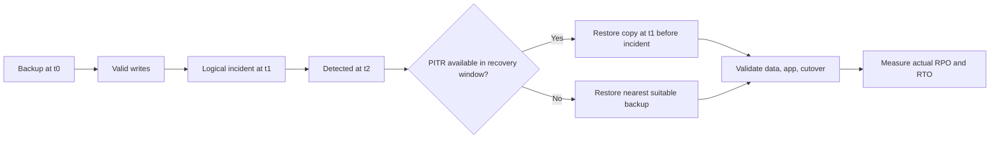
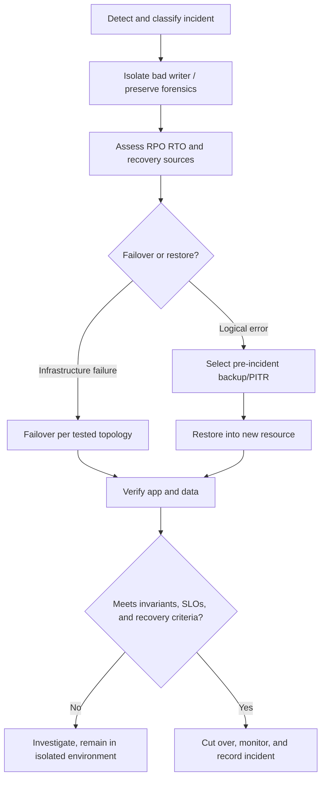

# Database Recovery Strategies Across GCP Services

A database can operate smoothly for years and then lose data because of a single bad `DELETE`, a deployment that breaks the schema, lost encryption key access, or a regional outage. **Having backups does not equal having recovery capability that meets business requirements.** A reliable strategy must answer: recover to **what point in time**, in **which location**, within **how long**, from **which copy**, who is authorized to execute it, and how correctness is verified.

This lesson belongs to the **Backup and Disaster Recovery** chapter of the **CLOUD_PROVIDERS_GCP** module. Across the journey from project organization, IAM, and VPC to Compute Engine, GKE, Cloud Run, storage, databases, release automation, and reliability/cost monitoring, we have learned how to run applications on Google Cloud. This lesson focuses on **recovering the data layer after an incident** and selecting the right mechanisms for each service.

Primary scope: **Cloud SQL (PostgreSQL/MySQL/SQL Server), AlloyDB for PostgreSQL, Spanner, Firestore, and Bigtable**. An extended section introduces **BigQuery** because many GCP architectures also include an analytics warehouse. Examples are illustrative scenarios; pricing, retention, edition options, and features vary by time, region, or version, so verify official documentation for your exact configuration before deploying.

**Expected outcome:** learners can classify risks, set measurable RPO/RTO targets, select appropriate backup/PITR/replication mechanisms, write a restore runbook with verification steps, and design controlled recovery drills.

## 1. Identifying losses to protect against: HA, DR, backups, and PITR

Distinguish the following mechanisms:

| Concept | Primary protection | What is not guaranteed |
|---|---|---|
| **High availability (HA)** | Reduces downtime from machine/zone failures via failover or replicas | Does not protect against erroneous delete commands being replicated |
| **Replication** | Creates copies for read scaling or continuity when part of infrastructure fails | Not an immutable archive; corrupted data can propagate to replicas |
| **Backup / snapshot** | Preserves a data state for later restoration | RPO depends on backup timestamp; RTO depends on restore speed and application recovery |
| **Point-in-time recovery (PITR)** | Restores near a historical timestamp within the **recovery window** | Cannot recover outside the window, when unenabled, or if logs/versions are missing |
| **Export / archive** | Stores data in an exported format for migration or long-term retention | May omit metadata, IAM, indexes, or transactional consistency |
| **Disaster recovery (DR)** | End-to-end procedure to restore the whole service after a major outage: data, compute, network, keys, DNS, app | Not completed simply by clicking "Restore backup" |

**RPO (Recovery Point Objective)**: how much data loss in time the organization tolerates, e.g., 15 minutes. **RTO (Recovery Time Objective)**: how long a service outage the organization tolerates, e.g., 2 hours. These are business objectives; actual results must be measured through drills.

For example: backed up at 10:00, data accidentally deleted at 10:52, detected at 11:05. Restoring the 10:00 backup risks losing changes between 10:00 and 10:52. With PITR and sufficient logs/versions, you can pick a timestamp right before the incident, such as 10:51:50, though **not every service supports the same time precision**.



**Never choose RPO solely from retention length.** Having 7-day PITR history does not mean maximum data loss is 7 days or that RPO automatically equals 0. Evaluate the latest recoverable point, log/replication lag, error onset time, and verified window. **Never choose RTO solely from resource creation time**: add detection, decision-making, permissioning, data restoration, service/network provisioning, testing, and traffic switching.

## 2. Building a risk matrix and recovery targets

### 2.1. Three incident levels

1. **Logical incident:** erroneous `UPDATE`/`DELETE`, faulty schema migration, ransomware, or bad application writes while the database stays online. Requires backup/PITR from **before the error began**; failing over to a replica holding the same bad data is usually futile.
2. **Single component or zone failure:** primary unavailable, node failure, localized infrastructure outage. HA or replica promotion can recover faster than restoring a backup; consistency and connectivity must still be checked.
3. **Region, project, or access loss:** backups in the same location/project may be unreachable. Requires copies outside the failure scope, independent recovery permissions, standby networking/compute, working encryption keys at the target, and a DNS/traffic runbook.

| Question | Example answer for the DR plan |
|---|---|
| Most critical data? | Order ledger; zero loss of confirmed transactions accepted |
| RPO and RTO per incident type? | Logical: RPO 5 min, RTO 60 min; region loss: RPO 15 min, RTO 4 hr |
| Recovery unit? | Instance/cluster, database, table, document, row subset |
| Actual recovery window? | Verified earliest recoverable date and timestamp |
| Where are backups stored? | Region, project, backup vault/cluster, edition, encryption key |
| Who holds permissions? | Break-glass principal, approval workflow, audit trail |
| Is the target ready? | VPC, DNS, instance/cluster, quotas, KMS, Secrets, application |
| How to verify? | Row counts, checksums, golden queries, transaction invariants |
| Who decides cutover/rollback? | Incident commander and database owner per runbook |

A system may set different RPO/RTO targets for a transactional table vs. a regenerable summary report. Not all data needs the same backup cadence if criticality and sources of truth differ.

### 2.2. Cross-service design rules

- **Keep copies outside the primary failure domain** when defending against region/project loss; verify whether cross-region backup/copy is genuinely supported.
- **Protect IAM and keys**: CMEK versions must remain active to decrypt copies; recoverability also depends on key location and access permissions.
- **Separate data deletion rights from backup deletion/retention rights** where edition/service allows; prefer retention locks, backup vaults, or segregated projects matching protection needs.
- **Measure restores** in a test environment: never treat a green backup job as proof of full system recoverability.
- **Record timestamps in UTC** and synchronize clocks for accurate PITR selection; timezone mistakes can lose more data than the original incident.
- **Do not overwrite production immediately** if you can restore to a new copy for reconciliation; overwrite only after protecting remaining live data and obtaining approval.

## 3. Quick recovery matrix by service

| Service | Notable recovery mechanisms | Restore target? | Key characteristics |
|---|---|---|---|
| **Cloud SQL** | Automated/on-demand backups; PITR via transaction logs; Standard/Enhanced backups | Backups can restore to an existing or new instance per support scope; **PITR always creates a new instance** | Enable/retain logs, backups, backup location, edition, and management model; backups differ from HA/read replicas |
| **AlloyDB** | Continuous backup/PITR, automatic/on-demand backups, Standard/Enhanced | **New cluster**; PITR must be in same region as source cluster; backup restore in same region as backup | Default 14-day continuous recovery, configurable 1–35 days; restored cluster needs a primary instance created |
| **Spanner** | PITR via version retention; full/incremental backups; backup copy | **New database**; for cross-region/project restore, copy backup to target instance first | PITR default 1 hour, max 7 days; backups retained up to 1 year; backups are transactionally consistent |
| **Firestore (Native)** | Document-version PITR; scheduled daily/weekly backups; export/import | Backups restore to a **new database in the same location**; PITR clones to a new database or partially restores by reading history and writing back | PITR up to 7 days at 1-minute granularity; backups exclude Security Rules and TTL policies |
| **Bigtable** | Standard/hot backups; automated daily backups; cross-region/project backup copies; replication | **New table** in an existing instance | No arbitrary-time PITR like RDBMS; backups are per table/cluster; replication between clusters is eventual |
| **BigQuery** (extended) | 2–7 day time travel, fail-safe, table snapshots/clones, replication/export | New table/dataset or restore via respective mechanism | Analytics data follows its own time travel rules; does not replace transactional DB DR |

This matrix is a summary, not a capability table for every edition/region. Check current documentation for Enhanced backups, hot backups, cross-region restore support, retention, and pricing for your exact configuration.

## 4. Cloud SQL: backup, PITR, HA, and cross-region recovery

Cloud SQL manages **PostgreSQL, MySQL, and SQL Server**. Strategies typically combine:

- **Automated backups** and on-demand backups for restore points.
- **PITR** using transaction logs when enabled, to return just before erroneous writes.
- **HA/failover** to reduce downtime from instance/zone failures; **read replicas** to scale reads and potentially support DR workflows per engine capabilities.
- **Cross-region backups** and/or cross-region replicas for region loss, subject to engine, edition, and backup tier limits.

### 4.1. Standard and Enhanced backups

Cloud SQL offers service-managed **Standard backups** and **Enhanced backups** integrated with Backup and DR, using backup vaults and backup plans for centralized governance and stronger protection/retention. Never assume every backup is "immutable" without checking tier and configuration; **enhanced backups provide backup vault/retention lock features** needed for certain anti-deletion models.

Cloud SQL for PostgreSQL documentation describes **cross-region backups** for both options; with enhanced backups you can pick a backup vault in another region. However, when using cross-region backups for **PITR**, recovery restores to a **new instance in the source instance's region** per current Backup and DR limits. **Restoring a regular backup to an instance in another region** is a different workflow and must not be confused with cross-region PITR.

**CMEK:** backups of an instance using a customer-managed encryption key may depend on the key located in the source region. If the key's region becomes unavailable, backups may be temporarily undecryptable/unrestorable even when backup data sits in another region. For cross-region restores, valid keys in the target region and understanding of source backup decryption are required.

### 4.2. Checking configuration and drilling recovery

**Read-only** commands to inspect before acting (replace placeholders, verify project and engine):

```bash
gcloud sql instances describe SOURCE_INSTANCE \
  --project=PROJECT_ID

gcloud sql backups list \
  --instance=SOURCE_INSTANCE \
  --project=PROJECT_ID
```

In the output, inspect **backup configuration**, `pointInTimeRecoveryEnabled`, log retention, historical backups, region, HA, edition, encryption key, backup vault/plan, and instance state. Per Cloud SQL documentation, **PITR always creates a new instance**; you cannot PITR directly into an existing instance.

**Cloud SQL runbook for data deletion at 10:52:**

1. Isolate the faulty writer, lock accounts, or pause the offending workload; identify the earliest timestamp of bad modifications.
2. Check if the source remains within the PITR window; if logs are gone, select the closest backup and assess the larger RPO.
3. Perform **PITR to a new instance** at a pre-incident timestamp; for backup restores, prefer restoring to a new instance for reconciliation where appropriate.
4. Wait for the operation to finish; verify schemas, engine roles/users, access/network/TLS settings, instance-level configs, version, and storage; verify client credentials.
5. Verify per-table `COUNT`, checksums, foreign keys, order balances, and critical transactions. If only a few records are needed, consider extracting and merging a subset from the restored instance in a controlled way.
6. When switching the entire workload, confirm how writes after the restore point are handled, update endpoints/traffic, and monitor errors/latency. Keep the old instance for forensics and rollback per approved retention.

Specifically, enabling PITR on an existing instance may require Cloud SQL to **restart the instance**; check maintenance plans and SLOs before changing settings. How PITR is enabled by default varies by **edition and creation path** (Console vs. CLI/API/Terraform), so always verify with `describe` instead of guessing. <https://cloud.google.com/sql/docs/postgres/backup-recovery/configure-pitr>

### 4.3. Engine-specific notes

| Engine | Special items to test |
|---|---|
| PostgreSQL | Transaction logs/PITR, extensions, roles, logical replication slots, apps using connection pools, sequences, and timezones |
| MySQL | Binlog/backup retention, schema/charset/collation, GTID/replication semantics, stored procedures, and SQL modes |
| SQL Server | Transaction log retention, SQL Server Agent jobs, SQL logins/users, T-SQL features, restoring from BAK where supported |

Do not assume Cloud SQL backups automatically restore external resources: jobs/schedulers, application secrets, DNS, firewalls, service accounts, Pub/Sub subscriptions, and Cloud Run/GKE configs must be recovered or declared separately.

## 5. AlloyDB: cluster-level continuous recovery

AlloyDB for PostgreSQL offers **continuous backup and recovery** and **automated/on-demand backups**. In current documentation, continuous backup defaults to a **14-day** window, configurable from **1 to 35 days**, with microsecond-level precision. This PITR window is a service capability, not an RTO guarantee.

### 5.1. Backup methods and locations

- **Continuous recovery**: uses history and logs to create a cluster copy at a recent timestamp; protects against erroneous data deletion/updates.
- **Automated backups**: scheduled incremental backups supporting retention via backup plans and management models.
- **On-demand backups**: taken before major changes or key milestones; stored per retention, and can be placed in another region under supported options.
- **Standard/Enhanced**: Standard is AlloyDB-managed; Enhanced integrates Backup and DR and backup vaults. Current documentation differs on **cross-regional backup support** between the two options; check the exact option in use. Never apply Cloud SQL rules blindly to AlloyDB.

**AlloyDB restores create a new cluster.** After restoring data, you must also create a **primary instance** inside the new cluster before apps can connect. PITR requires the **source cluster to still exist** and the new cluster to be in the **same region as the source** per current guidance. You cannot use PITR on a deleted cluster as if it were an independent backup.

**Cross-region restore from backup:** an on-demand backup can be placed in the target region per service capabilities, then restored into a new cluster in the **same region as that backup**. If backups exist only in the source region and that region fails completely, copying **after the incident** may be impossible; create target-region copies ahead of time.

### 5.2. AlloyDB runbook

1. Identify source cluster/region, backup tier, retention window, bad-write timestamp, whether source still exists, and IAM/KMS permissions.
2. If source still exists in the same region and PITR covers the timestamp: pick a pre-incident point to create a **new cluster**. If region is lost or source was deleted, select an **on-demand/cross-region backup** already stored in an available region.
3. Wait for cluster restore, create the primary instance, and configure networking/identities/roles, endpoints, and applications; verify connectivity.
4. Reconcile schemas, tables, transactions, extensions, query latency, indexes, and balances/aggregates. Record results to prove recovery to the exact timestamp.
5. Switch applications per plan, reconcile newer writes, and monitor recovery duration. Check read pool / cross-region replica needs once service resumes.

With AlloyDB, **cluster HA or cross-region replicas** reduce downtime on infrastructure failures, yet erroneous app deletes can replicate too. Always maintain an independently restorable backup source. <https://cloud.google.com/alloydb/docs/backup/overview>

## 6. Spanner: short-term version retention and transactionally consistent backups

Spanner provides strong consistency and distributed infrastructure, yet still needs protection against **logical errors** and **accidental database deletion**.

- **PITR** relies on data/schema version history. Per current docs, default retention is **1 hour**, configurable via `version_retention_period` up to **7 days**. Older history does not appear retroactively right after raising retention; history must accumulate over time.
- **Backups**: create full on-demand or full/incremental scheduled backups; retainable **up to one year**, depending on backup expiry.
- **Backup copy**: copy a backup to another instance/region/project **before a regional incident happens**, supporting DR and compliance.
- **Restore**: backups restore into a **new database**, never overwriting an existing database. Restoring to another region/project requires copying the backup to an appropriate target instance first.

Spanner backups are **transactionally/externally consistent** at `versionTime`, which helps verify invariants on restore. However, the new database needs sufficient compute/storage quota to serve data and queries. Edition, instance configuration, or CMEK issues can also affect restoration.

### 6.1. Spanner PITR and pre-action checks

In the database API response, check:

- `version_retention_period`: configured history window.
- `earliest_version_time`: earliest timestamp still supported by history; this value advances continuously.
- Error timestamp to recover, affected tables/keys, and whether **selective replay** or full-database restore is required.

If the error only deleted certain records, you can read history at a valid timestamp to rewrite required rows per Spanner guidance; newer rows with the same keys written after the incident must be reconciled to avoid overwriting valid data.

When restoring fully from backup:

1. Verify backup `versionTime` and expiry; if targeting another region, ensure backup copy finished on the target instance.
2. Create a **new database** from the backup; keep the live database intact for comparison.
3. Verify schema, IAM, compute capacity, CMEK, and SQL/application clients.
4. Reconcile data against distributed invariants, e.g., total balances, order counts, no oversold inventory.
5. Shift traffic only when acceptance criteria pass; rollback plans must account for new transactions written after the restore timestamp.

**Example:** a faulty application command deducts balances from 3,000 wallets over 10 minutes. Multi-region replication cannot save you from this logic bug. 7-day PITR or a pre-error backup restores valid data, though valid transactions arriving after the chosen timestamp must be reconciled.

## 7. Firestore: scheduled backups and document-level PITR

Firestore Native mode uses a **document/collection** structure, so recovery differs from relational databases. Distinguish:

- **PITR**: document versions over a window of **up to 7 days**, at **one-minute** granularity for reading/cloning/exporting beyond the most recent hour; must be enabled, and history accumulates only from enablement onward. Do not assume enabling at 10:00 lets you read history from seven days prior at 10:05.
- **Scheduled backups**: **daily or weekly** schedules with retention up to **14 weeks** per current docs. Backups are consistent snapshots containing documents and index configurations, stored in the **same location** as the source database.
- **Export/Import**: export Firestore data to Cloud Storage and re-import; when using a PITR snapshot timestamp, follow minute granularity formatting and ensure PITR is enabled.

### 7.1. Partial and full recovery

**Recovering a subset of erroneously written documents:**

1. Identify the document/collection list and pre-error timestamp.
2. Read historical data via valid `read_time` or export collections at a PITR timestamp; compare against live data.
3. Decide exactly which fields/documents to reapply. If a document received **valid updates after the error**, merge per business logic rather than blindly overwriting everything.
4. Write back using batches/transactions or an idempotent workflow within Firestore limits; check Security Rules/IAM and auditing.

**Recovering the entire database:**

- From PITR, **clone to a new database** in the same location at a valid minute timestamp; or export PITR data and import.
- From scheduled backups, **restore to a new database**. Firestore does not restore a scheduled backup directly over an existing database.
- After recovery, **restore/verify Firebase Security Rules and TTL policies**; Firestore scheduled backups **do not include** either of these two configuration types. Verify IAM, database ID, indexes, application SDKs, and paths.

This is a frequent operational pitfall: operators see all documents present in the new database and open client access, only for web/mobile clients to be rejected because the new database lacks the old database's Security Rules.

### 7.2. Example CLI to inspect and clone Firestore

These are **illustrative commands in a staging environment**. Cloning creates a new database and can incur charges; never run against production without a runbook and approval:

```bash
# Read-only: inspect configuration and PITR window
gcloud firestore databases describe \
  --database='(default)' \
  --project=PROJECT_ID

# Only after verifying snapshot timestamp and confirming destination ID is unused:
gcloud firestore databases clone \
  --source-database='projects/PROJECT_ID/databases/(default)' \
  --snapshot-time='2026-11-19T08:30:00Z' \
  --destination-database='restore-drill-20261119' \
  --project=PROJECT_ID
```

`snapshot-time` must fall **within the actual PITR window** at whole-minute granularity; the timestamp above merely illustrates syntax. Cloning preserves data/indexes within documented scope, yet never assume all policies or app-side connections are recreated automatically. <https://cloud.google.com/firestore/native/docs/use-pitr>

## 8. Bigtable: per-table/cluster backups, no arbitrary PITR

Bigtable excels at high-throughput time-series and key-value workloads. It can replicate data across multiple clusters, but **cross-cluster replication uses eventual consistency**, so it does not automatically protect against accidental deletion or bad writes.

### 8.1. Standard, hot, and backup copies

Bigtable offers two main backup types (plus automated/copy workflows):

| Type | When to use | Limits to remember |
|---|---|---|
| **Standard backup** | Longer-term table copies or less latency-sensitive restores | After restoring to SSD, an optimization phase may be needed to reach normal latency |
| **Hot backup** | Restored table must hit production-serving latency faster | Supported only on SSD under matching conditions; unsupported on tiered storage tables; copying a hot backup produces a standard backup |
| **Automated backup** | Daily policy-based backups; multi-cluster setups can back up per cluster | Retention varies by edition and policy; backup timestamps differ across clusters |
| **Backup copy** | Place a copy in another region/project/instance to reduce shared-failure risk | Copy becomes a standard backup; separate retention limits, and must be copied **before** disaster |

Per current docs, automated backups allow up to **90 days** retention; on-demand backups retain up to **90 days on Enterprise** or **365 days on Enterprise Plus**, and **backup copies up to 30 days**. Limits depend on edition/quotas and may change over time. Never set retention above 365 days thinking Cloud Storage buckets hold data longer: a Bigtable backup is not a bucket object export.

### 8.2. Limitations directly affecting DR

- A Bigtable backup captures **one table in one cluster**; it is **not** a database-wide transactional snapshot and cannot back up multiple tables in one operation. Related tables may have different backup timestamps.
- A backup taken on one cluster may **lack writes not yet replicated from another cluster**. When needed, use consistency tokens / Bigtable consistency verification procedures before backing up.
- **Restores always create a new table**; never overwrite an existing table directly. The **target instance must already exist** before restoring.
- You cannot query directly from a backup. For partial data recovery, restore to a new table, read needed rows, and write back to the source table via client libraries or Dataflow.
- Copying backups across regions/projects requires permissions, network/quota, and an accessible source cluster. Never wait until a region is lost to start copying.
- With CMEK, the **key version bound to the backup** must stay enabled for decryption. This belongs to the backup retention plan, not merely the key rotation plan.

### 8.3. Bigtable runbook

1. Identify impacted cluster/instance and table, read/write patterns, app profile routing, and latest backup timestamp; check whether backups are standard/hot and whether off-region copies exist.
2. Pre-create or verify the target instance/cluster exists; restore the backup into a **new table**.
3. If restoring a standard backup onto SSD, wait for optimization/latency checks before shifting full traffic to the new table.
4. Test row-key ranges, representative metrics, cell data versions, column family schemas, GC/retention rules, and client-library apps.
5. For partial recovery, selectively replay valid rows; for full-table cutover, switch routing at the app layer and ensure no writers still hit the old table.
6. Monitor replication lag and consistency. Record actual data loss against RPO, especially if the backup came from a cluster that did not receive all writes.

**IoT example:** sensors stream continuously into Bigtable in region A, replicating to region B. After an operator accidentally deletes a key range, failing over to B may not rescue the deleted data because deletes replicate. To recover that key range from yesterday, take a pre-deletion table backup, restore to a new table, and selectively copy rows; replaying telemetry after the backup may require an independent event log if RPO is very tight.

## 9. Extension: BigQuery time travel and protecting the analytics warehouse

BigQuery is a **data warehouse** rather than an OLTP database, yet analytics tables can also suffer from bad `CREATE OR REPLACE TABLE`, truncates, or deletes. BigQuery provides:

- **Time travel** with a configurable **2–7 day** window (default 7 days) to query history or restore tables/datasets within supported scope.
- **Fail-safe** retaining data for an extra 7 days after time travel in certain cases—**not a self-service query/restore window**; fail-safe recovery requires working with Cloud Customer Care and completing within the allowed window.
- **Table snapshots/clones** and exports when points must be kept beyond time travel; distinguish same-region snapshots from region-loss protection strategies.
- **Cross-region replication/managed DR** to recover analytics infrastructure in another location when configured.

Example querying a table version that **still exists** at an earlier timestamp:

```sql
SELECT COUNT(*) AS orders_before_error
FROM `PROJECT_ID.DATASET_ID.orders`
FOR SYSTEM_TIME AS OF TIMESTAMP_SUB(CURRENT_TIMESTAMP(), INTERVAL 1 HOUR);
```

In this query, the fully qualified table name is wrapped in backticks per BigQuery syntax; substitute your project/dataset names when running. If a table **has already been deleted**, it cannot be queried directly with `FOR SYSTEM_TIME AS OF`; use the deleted-table restore procedure within the time travel window. Verify metadata, partitioning, policy tags, and permissions after restore; never assume time travel automatically restores every table setting.

This section only adds an analytics recovery perspective; never use BigQuery to replace Cloud SQL/AlloyDB/Spanner PITR plans for transactional application state.

## 10. Standard recovery runbook and cutover criteria

Write a runbook executable by a newly onboarded on-call engineer, complete with exact resource names, roles, and dashboard links. A reference flow:



### 10.1. Verifiable step-by-step flow

**Step 1 — Triage and freeze state:** pinpoint incident start via logs, audit trails, deployment events, queries, and transaction traces. Restrict offending writers; preserve forensic logs/snapshots.

**Step 2 — Choose path:** evaluate HA/failover for pure infrastructure failures, or PITR/backup for logical errors. Document exact UTC restore timestamp, backup location, edition, project, quotas, encryption key, target resource, and IAM permissions.

**Step 3 — Prepare target:** ensure networking/VPC, private endpoints, peering, subnets, IPs, compute, storage, quotas, DNS, TLS, database credentials, IAM, and Cloud KMS keys/versions are ready. The target must be able to run the application post-restore, not merely create an empty database.

**Step 4 — Execute restore:** following the service-specific workflow, prefer creating a **new** instance/cluster/database/table; log operation ID, start/end times, snapshot/backup ID, and data timestamp.

**Step 5 — Verify data:** check row/document counts, PK/unique/FK constraints, balance totals, transaction tables, boundary dates, NULL values, edge cases, and audits of transactions committed prior to the incident; run golden queries.

**Step 6 — Verify application:** test connectivity from Cloud Run/GKE/Compute Engine, secrets and identities, query latency, transaction commit/rollback, queue consumers, background jobs, retries, and read-after-write.

**Step 7 — Cutover:** confirm accountable owner, freeze writes if needed, sync valid data after the restore point, update endpoints/routing, ramp traffic gradually, and watch p95/p99, error rates, dependency latency, and cost.

**Step 8 — Record actual RPO/RTO:** use the last successfully recovered data timestamp and the timestamp when service stabilized; if targets were missed, update runbooks, backup frequency, and topology.

### 10.2. Rollback decisions must precede cutover

Once the application writes to the new database after cutover, flipping DNS back to the old database **can lose new transactions or cause split-brain**. Runbooks must specify how post-cutover writes are handled, abort criteria, approval contacts, and keeping the old system read-only. Never assume bidirectional or reverse replication is supported automatically.

Logical errors often call for **selective** data recovery: rolling an entire instance back to T-1 can erase other valid transactions. Consider restoring to a parallel copy, extracting the exact affected records, running tested merges, and keeping an audit trail; execution plans must respect business transaction invariants.

## 11. Validating backups: periodic drills and observability

### 11.1. Metrics to report

| Metric | Meaning | Example measurement |
|---|---|---|
| Backup success rate | Successful backups / expected backups | Inspect backup jobs and failure alerts |
| Age of last recoverable point | Age of nearest recoverable data point | Latest PITR recovery timestamp or nearest backup timestamp |
| Restore duration | Time from restore initiation until DB can serve | Operation timestamps + app smoke tests |
| Effective RPO | Gap between last committed transaction and last restored/verified point | Verified query/audit event ID/timestamp |
| Effective RTO | Measured downtime until SLO is restored | Monitoring, incident timeline |
| Restore correctness | Accuracy of restored data | Checksums, invariants, golden queries, reconciliation |
| Backup isolation | Does backup survive region/project loss or source deletion? | Permission, copy, retention, and key-access drills |
| DR unit cost | Backup storage + copy transfer + restore compute + ops | Billing export, SKUs, and forecasts |

**Warning:** a successful backup with misconfigured PITR log retention, missing permissions, or a disabled CMEK key is an **unrecoverable** state. Do not alert solely on "backup job failed"—conduct periodic real restore tests.

### 11.2. Sample drill schedule

- **Weekly:** audit latest backup age, policies/retention, PITR enablement, replication lag, backup vaults/copies, and alerts.
- **Monthly:** restore a database/table into a test environment, run integrity checks, and measure RTO at representative scale.
- **Quarterly:** simulate logical errors, key issues, or regional outages in staging; verify break-glass permissions and network paths.
- **After major changes:** re-test after engine/edition upgrades, region changes, KMS updates, schema shifts, data volume jumps, or DR topology edits.

This schedule is a reference; operations teams tailor cadence to data criticality and audit requirements. Drills must use protected/anonymized data when production contains sensitive data; clean up test resources per policy after archiving results.

## 12. Security, compliance, and recovery cost

**IAM:** separate backup creators, restore operators, backup deleters, KMS admins, and incident commanders. Restore permissions can clone sensitive data into another project; restrict target projects/regions and log audit trails. Use authenticated break-glass accounts with rehearsed approval workflows.

**Retention and immutability:** longer retention improves historical recovery yet raises storage costs and risks keeping data past deletion mandates. For ransomware/unauthorized deletion protection, evaluate backup vaults and retention locks per supported service/edition. Never assume all backups are immutable indefinitely by default.

**CMEK:** maintain key and key-version dependency diagrams. Disabling/destroying a source key can make backups undecryptable; long-term backup retention requires retaining corresponding key versions. Some cross-region backups remain dependent on the source key's region. Verify this via recovery drills in standby projects/regions.

**Cost:** total DR cost includes more than backup capacity:

```text
Monthly DR cost =
  backup storage + PITR/history logs
  + cross-region copies / networking
  + compute / storage / network at DR site (if pre-provisioned)
  + restore drills, monitoring, operations
  + duplicate overlap costs during cutover
```

Trade-offs across strategies:

- Shorter RPO typically requires better log/version retention or replication.
- Shorter RTO may require warm standby, pre-provisioned target resources, hot backups, or multi-region topology.
- More frequent backups increase copy count/traffic/cost; yet many backups still fail recovery without IAM/KMS, runbooks, and restore tests.
- An analytics table rebuildable from pipelines can follow a different backup strategy than an exact transactional ledger.

Use Cloud Billing export to BigQuery, budgets/alerts, and current per-service pricing to estimate TCO. Alerts do not automatically cap spend; quotas, retention controls, and recovery resource limits must be designed explicitly.

## 13. Practical scenario: recovering a GCP ordering system

**Hypothetical context:** a Java/Spring app on Cloud Run manages orders in Cloud SQL for PostgreSQL; real-time cart state is cached/mirrored in Firestore; telemetry and user interactions reside in Bigtable, with reporting in BigQuery. A faulty migration script deleted `orders` for region A customers at **10:52 UTC**. Detected at **11:05 UTC**, while valid region B transactions continued arriving.

Product targets: **RPO ≤ 5 minutes**, **RTO ≤ 90 minutes** for orders. Firestore/Bigtable hold data partially syncable or reconstructible from events, with separate RPO/RTO targets.

### 13.1. Choosing the strategy

1. **Cloud SQL is the system of record for orders.** Isolate the faulty writer, check the PITR window/logs, and restore a new instance to just before 10:52 UTC. Do not immediately cut the entire app over to the past point if doing so wipes valid region B transactions; consider keyed extraction/merging.
2. **Firestore** is only a read model/cache of order progress. Do not restore all of Firestore if documents can be rebuilt from the source of truth; if standalone documents were lost, use PITR/backups to an appropriate point.
3. **Bigtable** stores telemetry replayable from the event stream if source events remain. Otherwise, restore the table backup to a new table and reconcile by row key; do not expect exact 10:51:59 PITR like Cloud SQL.
4. **BigQuery** analytics reports can be rebuilt or recovered using time travel within the supported window; never use reporting tables as a source of truth replacing the transactional store.
5. **Cloud Run app** still requires IAM permissions, database credentials, connection strings, VPC/networking, secrets, and routing; inspect audit logs and pin a known-good revision before cutover.

### 13.2. Incident decision matrix

| Verification question | Exercise threshold | Accountable owner |
|---|---|---|
| Does Cloud SQL PITR cover a point before 10:52? | Within earliest/latest recovery time | Database on-call |
| Are post-10:52 region B transactions intact? | 100% of valid transaction IDs preserved or reconciled | Domain owner |
| Balance/revenue invariants hold? | Total amount, order count, and unique keys match expected data | QA/Data owner |
| Does Cloud Run connect securely to the new instance? | Smoke tests and integration tests PASS | Platform on-call |
| Post-cutover SLO met? | p95/error rate within agreed product thresholds | SRE/Incident commander |
| Measured RPO/RTO? | RPO ≤ 5 minutes, RTO ≤ 90 minutes | Incident commander |

If PITR or logs cannot meet RPO, do not mark "PASS" just because an instance restored: document **actual data loss** and decide on reconciliation from event streams, backups, or secondary sources.

### 13.3. Learner exercises

Design recovery plans for three workloads:

- **A.** Cloud SQL PostgreSQL handling financial transactions hit by logical data deletion.
- **B.** Firestore holding user documents; a faulty rollout overwrote 10,000 documents by mistake.
- **C.** Bigtable holding IoT events across two clusters, requiring recovery when one region suffers an outage.

For each workload, fill in: incident type, RPO/RTO, selected mechanisms (HA, PITR, backup, copy, export), storage location, new vs. existing restore target, IAM/CMEK impacts, handling post-restore-point writes, cutover workflow, correctness verification, and DR cost.

**Passing criteria:** never confuse replication with backup; pick PITR only if the service supports it and the window holds data; prove recovery of the **entire application path** rather than just storage objects; include a timeline, UTC timestamps, accountable owners, and drill RPO/RTO results.

## Official documentation

- [Google Cloud Architecture Center — Architecting disaster recovery for cloud infrastructure outages](https://cloud.google.com/architecture/disaster-recovery)
- [Cloud SQL for PostgreSQL — Backup options](https://cloud.google.com/sql/docs/postgres/backup-recovery/backup-options)
- [Cloud SQL for PostgreSQL — Restore an instance overview](https://cloud.google.com/sql/docs/postgres/backup-recovery/restore)
- [Cloud SQL for PostgreSQL — Configure PITR](https://cloud.google.com/sql/docs/postgres/backup-recovery/configure-pitr)
- [Cloud SQL for PostgreSQL — Perform PITR](https://cloud.google.com/sql/docs/postgres/backup-recovery/pitr)
- [Cloud SQL for SQL Server — Configure PITR](https://cloud.google.com/sql/docs/sqlserver/backup-recovery/configure-pitr)
- [AlloyDB — Data backup and recovery overview](https://cloud.google.com/alloydb/docs/backup/overview)
- [AlloyDB — Restore a cluster from backup](https://cloud.google.com/alloydb/docs/backup/restore)
- [AlloyDB — Use PITR](https://cloud.google.com/alloydb/docs/backup/restore-pitr)
- [Spanner — Backups overview](https://cloud.google.com/spanner/docs/backup)
- [Spanner — Point-in-time recovery](https://cloud.google.com/spanner/docs/pitr)
- [Spanner — Recover data using PITR](https://cloud.google.com/spanner/docs/use-pitr)
- [Spanner — Restore backup overview](https://cloud.google.com/spanner/docs/backup/restore-backup-overview)
- [Firestore Native — Back up and restore data](https://cloud.google.com/firestore/native/docs/backups)
- [Firestore Native — PITR overview](https://cloud.google.com/firestore/native/docs/pitr)
- [Firestore Native — Work with PITR](https://cloud.google.com/firestore/native/docs/use-pitr)
- [Bigtable — Backups overview](https://cloud.google.com/bigtable/docs/backups)
- [Bigtable — Manage backups](https://cloud.google.com/bigtable/docs/managing-backups)
- [BigQuery — Data retention, time travel and fail-safe](https://cloud.google.com/bigquery/docs/time-travel)
- [BigQuery — Restore deleted tables](https://cloud.google.com/bigquery/docs/restore-deleted-tables)
- [BigQuery — Reliability introduction](https://cloud.google.com/bigquery/docs/reliability-intro)

**Final note:** Google Cloud documentation updates continuously. Before every production run, confirm exact retention limits, API permissions, editions, cross-region support, pricing, and restore semantics for your deployed services. This lesson provides workflows and examples, while a real DR plan must be **drilled and measured**.
