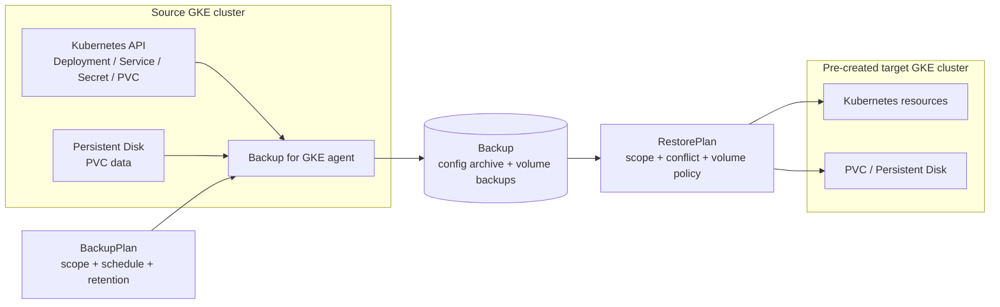

# Recovering GKE Applications with Configuration and Data

## Objectives and context

In the **Backup and Disaster Recovery** chapter, this lesson guides **recovering an application running on Google Kubernetes Engine (GKE)** so that it retains full Kubernetes configuration, persistent data, and dependencies needed to keep serving business traffic. The focus is **Backup for GKE** and controlled recovery drill procedures, not merely restarting Pods.

This lesson belongs to the **CLOUD_PROVIDERS_GCP** module, tying together projects, IAM, VPC, GKE, Cloud Run, storage, databases, deployment automation, reliability monitoring, and cost. After this lesson, learners will be able to:

1. Distinguish Kubernetes configuration backups, PersistentVolume data backups, and backups of out-of-cluster services.
2. Define **Recovery Point Objective (RPO)**, **Recovery Time Objective (RTO)**, and application-appropriate data consistency points.
3. Configure `BackupPlan`, inspect `Backup`, create `RestorePlan`, and launch `Restore` via the Google Cloud CLI.
4. Choose conflict-handling policies, protect PVC data, and verify the application post-restore.
5. Build a DR drill runbook, configure safe permissions, and recognize Backup for GKE limitations.

**Principle:** A restore task reporting completion means Kubernetes resources were restored within the selected scope. It **does not automatically prove the application is Ready, connects to its database cleanly, or holds consistent business data**. Operators must verify the whole system before shifting traffic.

## 1. Which components must be recovered?

A GKE application typically spans multiple state layers. Missing even one layer in backups can leave Pods running while the application remains broken.

| Layer | Examples | Appropriate recovery source |
|---|---|---|
| **Cluster infrastructure** | GKE Standard/Autopilot, node pools, VPC, subnets, firewalls, Workload Identity Federation, Gateway/Ingress controllers, add-ons | Terraform/IaC, project configuration, and cluster creation runbook; **not included in Backup for GKE workload backups** |
| **Kubernetes configuration** | Namespaces, Deployments/StatefulSets, Services, ConfigMaps, Secrets, ServiceAccounts, PVCs, Roles/RoleBindings, custom resources | Backup for GKE **config backup**, GitOps/Helm/IaC; included resources depend on backup scope |
| **Volume data** | Data inside Persistent Disks bound to PVCs | Backup for GKE **volume backup** if the volume type is supported and the plan enables `include-volume-data` |
| **Images and packages** | Container images, Helm charts, binaries | Artifact Registry/repositories and build pipelines; Backup for GKE **does not copy image layers** |
| **Services outside GKE** | Cloud SQL, Cloud Storage, Memorystore, Secret Manager, external DNS/load balancers | Per-service backups/replication and IaC; Backup for GKE **does not back up external service state** |
| **Operations** | Monitoring, alerts, SLOs, DNS/failover policies, contact info | Monitoring/IaC, runbooks, and drill reports |

For example, a web Deployment references `asia-southeast1-docker.pkg.dev/demo/apps/web@sha256:...`. If the restore succeeds yet the registry or image-pull permissions are gone, Pods stay in `ImagePullBackOff`. Similarly, if the application reads from Cloud SQL, snapshotting a Pod's PVC **does not** back up Cloud SQL.

In GKE, **restarting a Pod**, **rolling back a Deployment**, and **restoring from a backup** are distinct actions:

- Restarting a Pod merely asks the controller to create a fresh container from the current configuration.
- Rolling back a Deployment/Helm release/GitOps commit restores an earlier deployment config, usually without reverting application data.
- Restoring combines recovering Kubernetes resources from backup time and, with the right policy, volume data. Reconnecting out-of-cluster systems must still be handled separately.

Source: [Backup for GKE overview and limitations](https://docs.cloud.google.com/kubernetes-engine/docs/add-on/backup-for-gke/concepts/backup-for-gke).

## 2. Backup for GKE model

Backup for GKE is a managed service combining a **control plane API** and an **in-cluster GKE agent**. The agent is installed when enabling the add-on or creating a compatible backup/restore plan. Key objects include:

| Object | Function |
|---|---|
| `BackupPlan` | Specifies **source cluster**, namespace/`ProtectedApplication` scope, whether to include Secrets/volumes, storage location, backup schedule, retention duration, and delete lock |
| `Backup` | A concrete backup produced by a `BackupPlan`, containing Kubernetes configuration and (if enabled and supported) volume data |
| `RestorePlan` | Template specifying **target cluster**, scope to restore, conflict policy, volume data policy, and transformation rules |
| `Restore` | A single restore execution from a `Backup` using a `RestorePlan` |
| `VolumeBackup`/`VolumeRestore` | Objects tracking individual volume snapshots and corresponding volume restores |
| `ProtectedApplication` | Optional custom resource grouping part of a workload and defining pre/post snapshot hooks, suited for stateful applications |



During backup, the agent reads resource definitions from the Kubernetes API and orchestrates snapshots of supported PersistentVolumes. During restore, the agent applies manifests per rules and creates/binds matching data volumes. **Backup for GKE does not create the target cluster for you.**

The service can restore to another cluster, including across regions, within current documented limits; protecting source data alone is insufficient if your DR plan still depends solely on a VPC, key, or registry in the failed region. Additionally, if the target runs a GitOps controller (Argo CD/Flux/Config Sync), the controller might rapidly overwrite or prune newly restored resources; coordinate restore order and reconciliation.

Source: [Backup for GKE concepts](https://docs.cloud.google.com/kubernetes-engine/docs/add-on/backup-for-gke/concepts/backup-for-gke), [Restore a backup](https://docs.cloud.google.com/kubernetes-engine/docs/add-on/backup-for-gke/how-to/restore).

## 3. Finalize DR requirements before picking a backup schedule

### RPO, RTO, and consistency

- **RPO:** the time-equivalent amount of data that can be lost after an incident. If the latest backup precedes the incident by 4 hours, potential data loss reaches 4 hours, excluding writes sent elsewhere.
- **RTO:** maximum duration from incident onset until the **application serves business logic properly again**, including cluster creation (if needed), config/volume restoration, validation, and traffic cutover.
- **Consistency point:** a point in time where data across one or more components forms a recoverable state. Disk snapshots generally provide **crash consistency**; multi-disk or transactional databases may need application quiescing, transaction logs, native backups, or hooks.
- **Retention:** how long backups are kept; distinct from backup frequency and does not guarantee RPO by itself.

Example: an ordering system allows **1-hour RPO**, **2-hour RTO**. A backup running every 24 hours fails the RPO requirement. Even smart scheduling with `target-rpo-minutes=60` **does not replace drills**: failed backups, skipped volumes, network issues, or slow restores can cause actual RPO/RTO to miss targets.

| Component | Example RPO | Example RTO | Strategy |
|---|---:|---:|---|
| Stateless web | Reconstructible from Git/images | 30 minutes | GitOps + image registry + baseline cluster |
| Stateful service using PVC | 1 hour | 2 hours | Backup for GKE with volumes, consistency checks, and restore |
| Cloud SQL transactional DB | 5 minutes (illustrative) | 1 hour | Separate Cloud SQL backups/PITR/replication, coordinated cutover |
| Cloud Storage data | Per business policy | Per business policy | Versioning/retention/replication or dedicated backup |
| Secrets/keys/identities | Securely managed | Before workload starts | Secret Manager/IAM/KMS/IaC and credential lifecycle governance |

Numbers are illustrative: RPO and RTO must be approved by the business owner. Define **blast radius** (single namespace, full cluster, or region), **failure mode** (accidental delete, data corruption, region outage), and **clean recovery point** (backup free of bugs/malware) before drilling.

### Scenario matrix

| Incident | Appropriate approach | Warning |
|---|---|---|
| Accidental ConfigMap/Deployment delete | GitOps or selective restore | Avoid overwriting valid newer configs |
| Corrupted PVC data | Restore volume data to isolated environment, reconcile, then switch | Changes after the snapshot may be lost |
| Entire namespace broken | Restore namespace into a fresh cluster or controlled rollback | `delete-and-restore` destroys existing target resources |
| Cluster failure | Recreate cluster via IaC, then restore | Network, quotas, CRDs, registry, and IAM must exist first |
| Region outage | Target cluster in another region + suitable backup location + DNS plan | Verify versions, data, storage, keys, and network egress |
| Compromise/ransomware | Select clean point, isolate permissions, rotate secrets, verified restore | Never restore compromised credentials and configs straight back |

## 4. Assessment and checklist prior to recovery

Know precisely **which resources make up the application**. For a hypothetical `shop` app containing `Deployment/web`, `StatefulSet/cart-db`, `Service`, `ConfigMap`, `Secret`, and `PVC/cart-data`, assess:

1. Which namespaces and apps fall in backup scope? Does a `ProtectedApplication` exist? Are there custom resources/CRDs or admission webhooks requiring ordered restoration?
2. Which PVCs hold real data? What are the storage driver and reclaim policy? Are volumes among types supported by Backup for GKE?
3. Which required configurations sit outside the cluster: Cloud SQL, Artifact Registry, Secret Manager, Cloud DNS, Cloud Armor, VPC, external load balancers?
4. Are Kubernetes ServiceAccounts and workload IAM recreated in the target project/cluster? Has Workload Identity Federation for GKE been verified?
5. Does the target cluster have sufficient CPU/memory/disk quotas, StorageClasses, Kubernetes version, networking, and policies for the workload?
6. Must GitOps be paused or reconciled in a specific sequence to stop controllers from overwriting the restore?
7. What are the post-restore business verification criteria: order counts, checksums, API health, scheduled jobs, synthetic checkout flows, latency, and error rates?

**Version constraint:** Per RestorePlan documentation, the target cluster version must fall within **the backup's source cluster version up to 3 minor versions newer**, inclusive. For example, a backup from GKE `1.28` restores within this bound up to `1.31`; never assume restoring from a newer version back to an older version is supported. Also check supported versions/regions/features at drill time.

**GKE-managed system namespaces** such as `kube-system`, `kube-public`, and `kube-node-lease` are not restored; the service skips them or errors if selected explicitly. Certain GKE-managed cluster-scoped resources cannot be included in restore scope either; `Node` and `PersistentVolume` are handled by GKE/Backup for GKE mechanisms.

Source: [RestorePlan prerequisites, version limits and managed namespaces](https://docs.cloud.google.com/kubernetes-engine/docs/add-on/backup-for-gke/how-to/restore-plan).

## 5. Preparing environment, APIs, IAM, and connectivity

### 5.1. Permissions and APIs

Backup for GKE supports GKE Standard and Autopilot per current documentation. The `gkebackup.googleapis.com` API is typically enabled automatically alongside the GKE API; if disabled, re-enable it. Enabling the API **does not create backups** or incur Backup for GKE charges until backups are created/stored.

Example on a workstation with Google Cloud CLI installed, assuming Service Usage Admin permission:

```bash
gcloud config set project PROJECT_ID
gcloud services enable gkebackup.googleapis.com \
  --project=PROJECT_ID

gcloud container clusters describe SOURCE_CLUSTER \
  --location=SOURCE_CLUSTER_LOCATION \
  --project=PROJECT_ID
```

Replace all uppercase placeholders with real values. Illustrative commands target a **lab** project/cluster; do not assume permission to modify production environments.

| Role | Relevant permissions or IAM role | Scope |
|---|---|---|
| Backup configurator and orchestrator | `roles/gkebackup.backupAdmin` | BackupPlan, Backup in project |
| Restore plan and restore operator | `roles/gkebackup.restoreAdmin` | RestorePlan, Restore in project |
| Backup for GKE administrator | `roles/gkebackup.admin` | Broader privileges, grant only when needed |
| Backup status viewer | `roles/gkebackup.viewer` (verify scope per need) | Read status, no mutations |
| Target environment admin | Appropriate GKE/IAM/Compute, VPC, and storage roles | Create cluster, namespaces, networking, and auth |
| Workload runtime identity | Minimal application IAM roles | Access databases, KMS, Artifact Registry, Secret Manager, etc. |

Add required permissions for Google-managed **service agents** when using separate projects, regions, or keys. Never grant full-project admin rights to every application service account just to make a restore work.

**Project separation:** If backups live in another project or restore into another project, documentation requires configuring supported **backup channels / restore channels** and matching IAM; simply swapping project IDs in commands is not enough. With CMEK, KMS keys and usage permissions in compatible locations must also be ready, accounting for key revocation or destruction scenarios.

### 5.2. Target cluster must be ready before restore

The target GKE cluster must be pre-provisioned via IaC or platform workflows. Check:

- Cluster mode (Standard/Autopilot), version, region/zone, private cluster endpoint, networking, and DNS.
- Quotas, node provisioning capacity, node pools or Autopilot scheduling, CPU/memory types, and matching StorageClasses.
- CRDs, operators, CSI drivers, and admission/network policies needed by custom resources.
- Artifact Registry contains the **exact image digests** referenced by manifests; workload identity and image-pull permissions.
- Secret Manager and IAM; APIs/routes from workloads to Cloud SQL/Storage/Redis/external endpoints.
- Ingress/Gateway/Load Balancer and planned traffic cutover path.
- GitOps controllers know this is a **drill**, avoiding unwanted immediate sync from the production branch.

**Keep test clusters isolated:** configure networking, service accounts, schedulers, and notifications so restored workloads do not send emails, trigger jobs, or write to production DBs. With StatefulSets, running source and restored instances concurrently can cause **split-brain** if both point to writable data stores.

## 6. Creating a BackupPlan for both configuration and data

### 6.1. Scope and backup schedule

A BackupPlan can cover the entire cluster, selected namespaces, namespace labels, or `ProtectedApplication`. In the `shop` lab, select a single namespace for easier verification. The command below uses a **cron schedule** with 30-day retention and a 7-day delete lock (illustrative values; check org policy):

```bash
gcloud beta container backup-restore backup-plans create shop-daily \
  --project=PROJECT_ID \
  --location=BACKUP_REGION \
  --cluster=projects/PROJECT_ID/locations/SOURCE_CLUSTER_LOCATION/clusters/SOURCE_CLUSTER \
  --selected-namespaces=shop \
  --include-secrets \
  --include-volume-data \
  --cron-schedule="0 2 * * *" \
  --backup-retain-days=30 \
  --backup-delete-lock-days=7
```

Key flags:

- `--selected-namespaces=shop` protects the specified namespace. For full scope, use `--all-namespaces` instead (do not combine both). Choose `ProtectedApplication` when grouping workloads narrower than a namespace.
- `--include-secrets` includes Kubernetes `Secret` objects in scope within the backup. Convenient for recovery, but carries sensitivity, IAM, and rotation considerations; if your org uses Secret Manager, design separate secret re-provisioning.
- `--include-volume-data` requests backing up supported PersistentVolume data. Without it, restoring PVCs may yield empty volumes or bind existing volumes per policy.
- `--cron-schedule` creates periodic backups; cron timestamps follow service documentation (UTC). You can use **smart scheduling** with `--target-rpo-minutes` instead of cron; do not specify both scheduling modes together.
- `--backup-retain-days` bounds retention duration; `--backup-delete-lock-days` protects backups from deletion during the lock period, increasing safety while reducing flexibility and potentially raising costs.
- Specify CMEK with `--encryption-key` when required, after configuring proper key location and roles.

Creating a backup plan may automatically install the agent into the cluster if absent; wait for the agent to become ready. **Scheduling does not guarantee the first backup has completed**; verify actual status.

### 6.2. Creating a manual backup and verifying

Before a major change or for a drill, trigger an immediate backup from the plan:

```bash
gcloud beta container backup-restore backups create shop-before-upgrade \
  --project=PROJECT_ID \
  --location=BACKUP_REGION \
  --backup-plan=shop-daily \
  --wait-for-completion

gcloud beta container backup-restore backups list \
  --project=PROJECT_ID \
  --location=BACKUP_REGION \
  --backup-plan=shop-daily

gcloud beta container backup-restore backups describe shop-before-upgrade \
  --project=PROJECT_ID \
  --location=BACKUP_REGION \
  --backup-plan=shop-daily
```

Verify successful completion state, creation time, retention, source cluster version, and scope. In the Console, **Backups → Storage contents** shows each PVC/volume backup. Download the **backup index** to confirm expected resource Group/Version/Kinds exist in the backup:

```bash
gcloud beta container backup-restore backups get-backup-index-download-url \
  shop-before-upgrade \
  --project=PROJECT_ID \
  --location=BACKUP_REGION \
  --backup-plan=shop-daily
```

The download URL is short-lived; never share it publicly if the index contains sensitive metadata. **A completed backup missing a critical PVC still cannot satisfy committed RPO.** Record workload list, volume counts, timestamps, and verification outputs in the runbook.

Source: [Plan a set of backups](https://docs.cloud.google.com/kubernetes-engine/docs/add-on/backup-for-gke/how-to/backup-plan), [Back up your workloads](https://docs.cloud.google.com/kubernetes-engine/docs/add-on/backup-for-gke/how-to/backup).

## 7. Data recovery must match application consistency

### 7.1. Crash-consistent vs. application-consistent

By default, Backup for GKE snapshots supported volume data in a **crash-consistent** manner. This resembles sudden power loss on a server: flushed blocks appear in the snapshot, while in-memory state or transactions spanning multiple volumes or services may not align consistently.

If an application runs **PostgreSQL, MySQL, or stateful queues inside GKE**, determine:

- Can the database self-recover from transaction logs on a crash-consistent snapshot?
- Are data files and WAL/transaction logs on separate volumes, and are they snapshotted synchronously?
- Are write quiescing/flushing or database-native dumps/backups required?
- Could backing up different replicas produce an inconsistent point?
- Must RPO align with out-of-cluster databases (Cloud SQL/AlloyDB)?

### 7.2. `ProtectedApplication` and hooks

Backup for GKE provides the `gkebackup.gke.io/v1` CRD `ProtectedApplication` to group selected resources and declare stateful applications. Supported strategies include:

- **BackupAllRestoreAll:** backs up and restores volumes for every component.
- **BackupOneRestoreAll:** captures data from one chosen component and uses it to restore multiple replicas when topology permits.
- **DumpAndLoad:** the application exports/imports data itself via hooks and an intermediate volume within supported scope.

Pre- and post-snapshot hooks can quiesce/flush and then resume writes. Test each hook with `kubectl exec` in a test environment; set explicit timeouts and `onError` behavior. A hook that hangs writes too long or fails silently can yield a backup that **violates consistency**.

Illustrative logic flow (not a complete `ProtectedApplication` manifest):

```text
Before snapshot:
  application enters quiesce state, flushes buffered writes to disk
Capture data:
  Backup for GKE takes volume snapshots via supported mechanism
After snapshot:
  resume write streams, return application to normal state

During restore:
  apply Kubernetes resources within scope
  restore volume data, execute load hook if strategy uses DumpAndLoad
  run schema / transaction / business record checks
```

For production databases, consider **native backups/PITR** alongside Backup for GKE rather than relying solely on volume snapshots. **Rehearsed recoverability** is the final standard.

Source: [ProtectedApplication custom backup and restore logic](https://docs.cloud.google.com/kubernetes-engine/docs/add-on/backup-for-gke/how-to/protected-application).

## 8. Choosing RestorePlan policies before clicking Restore

A RestorePlan does more than select a backup; it determines **which resources are overwritten** in the target cluster and **what happens to PVC data**.

### 8.1. Kubernetes resource conflicts

| `namespaced-resource-restore-mode` | Behavior | Risk level |
|---|---|---|
| `fail-on-conflict` | Aborts rather than overwriting if namespace/ProtectedApplication group already exists | **Safe for testing a clean target cluster** |
| `merge-skip-on-conflict` | Keeps existing resources, only adds missing resources | Preserves existing config; may yield partial component recovery |
| `merge-replace-volume-on-conflict` | Keeps existing namespaced resources, but can replace PVC-bound volume data | **Can lose active written data** |
| `merge-replace-on-conflict` | Replaces conflicting resources with backup versions, including volumes | **Can destroy newer data/configuration** |
| `delete-and-restore` | Deletes target namespace/ProtectedApplication group, then restores from backup | **Destructive**; use only under an approved rollback runbook |

Cluster-scoped resources have separate policies: `use-existing-version` preserves existing resources; `use-backup-version` replaces existing versions with backup versions and can have wide consequences—for example, replacing a CRD can drop associated CRs. On clusters running pre-installed operators, usually keep existing versions and provision CRDs via IaC beforehand.

**Pay special attention to PersistentVolume reclaim policies:** in replace modes, old volumes may become orphaned (`Retain`) or deleted (`Delete`). Never pick a destructive mode just to overwrite a single ConfigMap.

### 8.2. Volume policies

| `volume-data-restore-policy` | Result | When to use |
|---|---|---|
| `restore-volume-data-from-backup` | Creates new PVs from backed-up supported volume data | Drills or restoring into an independent target cluster |
| `reuse-volume-handle-from-backup` | Reuses original volume handle, reattaching original disk | Only when topology fits, disk still exists, and no conflict with source workload |
| `no-volume-data-restoration` | Restores PVC config, letting storage driver create blank disks or bind existing PVs | Stateless apps, or data restored by another method |

If a PVC has no volume backup, even `restore-volume-data-from-backup` **cannot conjure lost data**. You can use **volume-specific overrides** or **volume-type policy bindings** when apps mix disk types, verifying each PVC in the plan.

Source: [Handle resource conflicts during restore](https://docs.cloud.google.com/kubernetes-engine/docs/add-on/backup-for-gke/how-to/resource-conflict), [Volume data restore policies](https://docs.cloud.google.com/kubernetes-engine/docs/add-on/backup-for-gke/how-to/volume-data-restore-policy).

## 9. Example: restoring the `shop` application to a test cluster

### 9.1. Scenario

- Source and backup project: `PROJECT_ID`.
- Source GKE cluster: `SOURCE_CLUSTER` in `SOURCE_CLUSTER_LOCATION`.
- Test target cluster: `TARGET_CLUSTER` in `TARGET_CLUSTER_LOCATION`.
- Backup storage region: `BACKUP_REGION`.
- Restore plan / target cluster region: `RESTORE_REGION`, matching the target cluster.
- Business namespace: `shop`.
- BackupPlan: `shop-daily`.
- Specific backup: `shop-before-upgrade`.

**Target cluster already exists** with networking, CRDs, StorageClasses, IAM, images, and Secret Manager prepared per Section 5. This lab scope **contains no live production data on the target**.

### 9.2. Create a safe RestorePlan for a clean target cluster

```bash
gcloud beta container backup-restore restore-plans create shop-dr-restore \
  --project=PROJECT_ID \
  --location=RESTORE_REGION \
  --backup-plan=projects/PROJECT_ID/locations/BACKUP_REGION/backupPlans/shop-daily \
  --cluster=projects/PROJECT_ID/locations/TARGET_CLUSTER_LOCATION/clusters/TARGET_CLUSTER \
  --selected-namespaces=shop \
  --namespaced-resource-restore-mode=fail-on-conflict \
  --cluster-resource-conflict-policy=use-existing-version \
  --cluster-resource-scope-no-group-kinds \
  --volume-data-restore-policy=restore-volume-data-from-backup

gcloud beta container backup-restore restore-plans describe shop-dr-restore \
  --project=PROJECT_ID \
  --location=RESTORE_REGION
```

Using `--cluster-resource-scope-no-group-kinds` **avoids overwriting cluster-scoped resources** in the lab. This means CRDs, StorageClasses, and required cluster-scoped components must be provisioned via IaC/operators before restoring; if the app uses CRs whose CRDs are absent on target, restore will fail. Restoring full cluster-scoped resources must be evaluated separately for permissions, versions, and risk.

`fail-on-conflict` protects against accidentally wiping an existing namespace. If namespace `shop` already exists, the operation flags a conflict; clean the **lab environment** through approved procedures or target a clean cluster/namespace. Never blindly delete a production namespace just to "make the command succeed."

**Cross-project:** if the backup plan lives in a different project from the target, first configure Google Cloud-supported backup/restore channels and align resource paths and IAM across both projects. Do not merely swap `PROJECT_ID` and skip channel setup.

### 9.3. Execute a Restore

```bash
gcloud beta container backup-restore restores create shop-dr-test-001 \
  --project=PROJECT_ID \
  --location=RESTORE_REGION \
  --restore-plan=shop-dr-restore \
  --backup=projects/PROJECT_ID/locations/BACKUP_REGION/backupPlans/shop-daily/backups/shop-before-upgrade

gcloud beta container backup-restore restores describe shop-dr-test-001 \
  --project=PROJECT_ID \
  --location=RESTORE_REGION \
  --restore-plan=shop-dr-restore

gcloud beta container backup-restore volume-restores list \
  --project=PROJECT_ID \
  --location=RESTORE_REGION \
  --restore-plan=shop-dr-restore \
  --restore=shop-dr-test-001
```

Wait for **Restore** and every **VolumeRestore** to succeed in Console/CLI. The restore creates Kubernetes resources, after which controllers schedule Pods; the application **may not be Ready yet when Restore transitions to succeeded**.

### 9.4. Connect to the right cluster and inspect Kubernetes

Run these commands only after confirming `kubectl` points to the **target cluster**:

```bash
gcloud container clusters get-credentials TARGET_CLUSTER \
  --location=TARGET_CLUSTER_LOCATION \
  --project=PROJECT_ID

kubectl config current-context
kubectl get namespace shop
kubectl get deploy,sts,svc,ingress,pods,pvc -n shop
kubectl get events -n shop --sort-by=.metadata.creationTimestamp
kubectl rollout status deployment/web -n shop --timeout=10m
kubectl describe pvc cart-data -n shop
```

For StatefulSets, you can also run `kubectl rollout status statefulset/cart-db -n shop --timeout=10m` if the sample app includes StatefulSet `cart-db` with proper health probes defined.

Additional checks:

- `PVC` objects are `Bound` to expected volumes; size, access mode, StorageClass/zone are valid.
- Deployments/StatefulSets show expected `Ready` replicas; no `CrashLoopBackOff`, `ImagePullBackOff`, or mount failures.
- ConfigMaps, Secrets, RBAC, Workload Identity Federation, and ServiceAccounts reference the right project/namespace; never log secret payloads.
- Pods have DNS/routes/firewalls to reach external dependencies, while write paths to production remain blocked until authorized.
- Business figures after restore match the **backup point**, e.g., verifying record/cart IDs or sample document checksums rather than just volume byte sizes.
- Application health, logs, metrics, TLS, service discovery, and synthetic transactions all meet acceptance criteria.

Example checking sample data metrics in a Pod (actual commands depend on your app; do not assume every app uses PostgreSQL):

```bash
kubectl logs deployment/web -n shop --tail=100
kubectl get pvc -n shop -o wide

# For databases, use dedicated DB tooling and a read-only DB account.
# Reconcile record/transaction counts against the backup checkpoint saved in the runbook.
```

Only after data passes validation should traffic switch via DNS/load balancer/Gateway per the change plan. **Restoring a backup does not perform DNS failover automatically.**

Source: [Create RestorePlan](https://docs.cloud.google.com/kubernetes-engine/docs/add-on/backup-for-gke/how-to/restore-plan), [Restore a backup](https://docs.cloud.google.com/kubernetes-engine/docs/add-on/backup-for-gke/how-to/restore).

## 10. Production recovery runbook and rollback plan

During a real incident, follow a runbook with clear owners, decision deadlines, and communication channels.

### Phase 1 — Triage and select recovery point

1. Incident commander confirms fault scope: Pod only, namespace, storage, or entire cluster/region.
2. Halt or restrict writes on the broken system if continued writes risk inconsistency; mark the incident start timestamp.
3. Confirm RPO/RTO, committed business events, and the latest **clean** backup containing full volumes/configs.
4. If out-of-cluster DBs exist, select a **cross-service consistent recovery point** using DB backup/PITR strategies; never treat a single GKE backup as the full picture.
5. Verify permissions and readiness of target cluster, networking, registry, keys, IAM, quotas, and versions.

### Phase 2 — Restore in a safe zone

1. Prepare the target cluster via IaC, CRDs/operators, and security baseline.
2. Isolate the restored app from production writers, workers/crons/queues if they could trigger side effects.
3. Create/verify a RestorePlan with approved namespace scope, conflict policy, and volume policy; prefer `fail-on-conflict` on a clean target cluster.
4. Launch Restore; monitor logs, `VolumeRestore`, PVC/PV binding, and controller events.
5. Run smoke tests, data reconciliation, and security checks; record the duration of each phase.

### Phase 3 — Cutover and confirmation

1. Stop write flows on the source cluster if still active to prevent **split-brain**.
2. Update Ingress/Gateway, DNS, load balancers, or traffic routing per organizational mechanisms.
3. Open controlled writes on the target cluster; monitor SLIs/SLOs, errors, p95/p99 latency, transaction counts, queue lag, and DB replication/health.
4. Confirm status, notify stakeholders of completion, and update CMDB/runbooks.

### Phase 4 — Rollback if recovery fails

Rollback **is not always simply flipping DNS back**. Once the target app accepts new writes, source data may be stale. Returning to source requires:

- Stopping writes on target, capturing the list of new transactions, and reconciling or reverse-replicating via appropriate business tools.
- Verifying source is clean and schema-compatible; assessing whether any data loss remains within approved RPO.
- Routing traffic back to source only with business owner / incident commander sign-off.
- Preserving evidence of root cause, backups, timestamps, metrics, and decisions for postmortem.

**High-risk point:** running `delete-and-restore` or `merge-replace-on-conflict` on a live production namespace can wipe newer configs and data and trigger disk reclaim policies. Approve the plan and back up current state before running any destructive replacement operation.

## 11. Observability, troubleshooting, and post-restore verification

### 11.1. Operational status and evidence

| Check | Evidence | Meaning |
|---|---|---|
| BackupPlan | Schedule, scope, retention, latest run | Is the right namespace/app actually protected? |
| Backup | Succeeded `state`, timestamps, backup index, and volume backups | Does a real, complete recovery point exist? |
| RestorePlan | Target cluster, namespace, conflict and volume policies | Could it accidentally overwrite existing resources? |
| Restore/VolumeRestore | `state`, `stateMessage`, per-volume errors | Did snapshot/provisioning/attach errors occur? |
| GKE/Kubernetes | Pod readiness, PVC Bound, events, controller/operator status | Did the app reconcile successfully? |
| Business logic | Sample transactions, checksums/row counts, SLOs, and external integrations | Is it safe to cut over traffic? |
| DR exercise | Actual operation time and data lag | Do RTO/RPO meet targets? |

Additional inspection commands:

```bash
gcloud beta container backup-restore restore-plans list \
  --project=PROJECT_ID \
  --location=RESTORE_REGION

gcloud beta container backup-restore restores list \
  --project=PROJECT_ID \
  --location=RESTORE_REGION \
  --restore-plan=shop-dr-restore

kubectl get pods -n shop -o wide
kubectl describe pod POD_NAME -n shop
kubectl get events -n shop --sort-by=.lastTimestamp
```

To troubleshoot VolumeRestore errors, run `gcloud beta container backup-restore volume-restores list/describe` and inspect `stateMessage`, PVC/StorageClass, disk quota/zone, and permissions. If Restore finished yet Pods are not Ready, debug via `kubectl describe`, events, logs, and controller status; **do not immediately trigger another restore** if the issue is merely insufficient nodes or blocked image pulls.

### 11.2. Troubleshooting table

| Symptom | Likely cause | Remediation |
|---|---|---|
| RestorePlan creation fails | Wrong cluster path/region, missing IAM, target cluster missing | Verify full resource names, locations, and roles |
| Restore reports conflict | Namespace/app already exists, `fail-on-conflict` policy | Do not delete blindly; prepare a clean target or approve another policy |
| PVC Pending | Missing StorageClass/CSI driver, quota or zone mismatch, PV restore failed | Inspect `VolumeRestore`, describe PVC, storage quotas, and StorageClass |
| Pod `ImagePullBackOff` | Image digest deleted, different registry/IAM | Restore image in Artifact Registry, grant proper pull permissions |
| Pod `CrashLoopBackOff` | Missing Secret/ConfigMap, DB not ready, schema mismatch | Check logs and dependency readiness |
| CR fails to restore | Missing CRD/operator or version mismatch | Install matching CRDs via GitOps/IaC before restore |
| GitOps deletes restored resources | Controller reconciling against repo | Coordinate freeze/reconcile per runbook, align desired state |
| API runs but data missing | Snapshot omitted PVC, consistency bug, external DB not restored | Check backup index, VolumeBackup, DB-native backups |
| Recovery slower than RTO | Cluster/node/PV creation time, DNS TTL, image pull, network | Break down phase timings, drill, optimize warm standby and workflow |

Source: [Troubleshoot restore errors](https://docs.cloud.google.com/kubernetes-engine/docs/add-on/backup-for-gke/troubleshoot/restore-errors).

## 12. Cost, security, and backup retention policy

### Full cost accounting

Backup for GKE incurs backup management fees, backup storage fees, and cross-region network egress per service pricing. Per Google Cloud documentation updated in **2026**, backup management pricing shifted to **protected namespaces** (replacing the earlier pod-based model); storage charges scale with backed-up data volume. Regional prices vary; never hardcode USD/GB rates in designs.

Beyond Backup for GKE fees, budget for target clusters, Compute Engine/Autopilot nodes, post-restore Persistent Disks, Artifact Registry, cross-region networking, Cloud Logging/Monitoring, and parallel run overlap during drills. For cross-project backup/restore, cost dimensions follow rules attached to the **backup project** per pricing docs.

To control costs while meeting DR:

- Scope backups precisely instead of blindly selecting all namespaces.
- Balance `cron-schedule`/smart scheduling, retention, and cleanup schedules while preserving enough recovery points for RPO.
- Account for PVC/snapshot growth, secondary-region backup storage, and frequent drills.
- Set Cloud Billing budgets, cost labels, and spend alerts, but never delete backups still within retention policy just to save money.
- Watch for runaway backup creation or misconfigured retention; never delete backups serving as incident forensic evidence.

### Securing backup data

- **Backups containing Secrets**: a config backup can hold sensitive credentials. Restrict `roles/gkebackup.*` and backup access, separate protection and recovery duties, and audit operations.
- **Encryption keys**: if using CMEK, ensure KMS keys, access permissions, and availability hold during region/project-loss scenarios, avoiding lost keys that render backups useless.
- **Retention/delete lock**: retain at least enough days for business goals and consider anti-accidental-deletion locks.
- **Clean-room restore**: when intrusion is suspected, choose a clean backup, rotate secrets, restore in an isolated network, scan images, and verify policies before opening traffic.
- **Least privilege and separation of duties**: separate rights to create/delete backups, alter RestorePlans, run restores, and shift traffic rather than bundling into one unchecked token.

Source: [Backup for GKE pricing](https://docs.cloud.google.com/kubernetes-engine/docs/add-on/backup-for-gke/concepts/about-pricing), [Backup for GKE enablement and IAM](https://docs.cloud.google.com/kubernetes-engine/docs/add-on/backup-for-gke/how-to/install).

## 13. Sample DR drill for operations teams

Suppose `shop` runs a stateless web tier and a service storing carts on Persistent Disk in namespace `shop`. The team sets RPO ≤ 1 hour, RTO ≤ 2 hours (illustrative targets) with a standby cluster in a different region from source.

**Pre-drill:** capture a logical baseline snapshot of carts (e.g., 100 test cart IDs), workload states, backup plan, and target backup. Generate a consistent test dataset; verify image digests remain in the registry and target identities can read secrets and out-of-cluster DBs if applicable. Configure isolated networking so the restored copy cannot send notifications to production.

**Execution:** provision or select the prepared target cluster, apply RestorePlan with `fail-on-conflict` and `restore-volume-data-from-backup`, and run Restore per Section 9. Watch `VolumeRestore` and PVCs, wait for Pods Ready, verify cart IDs, run smoke tests via internal endpoints, and time each phase.

**Acceptance:** if the latest backup before the simulated incident was 45 minutes old, time-based data loss meets the 1-hour RPO; still verify **actual** durably persisted data. If spinning up the cluster, restoring volumes, pulling images, and switching DNS took 2 hours and 20 minutes, **the 2-hour RTO failed**, even though gcloud reported Restore succeeded.

**Improvement:** if RTO missed due to cluster creation, evaluate warm standby or pre-staged IaC and CRDs; if RPO missed due to failed backups, improve schedules, alerting, and quiescing; if data was inconsistent, add hooks or native DB backups. Assign findings and owners before the next drill.

## 14. Checklist before declaring "recovery succeeded"

- [ ] Application owner, incident commander, target RPO/RTO, and recovery point are approved.
- [ ] BackupPlan has accurate scope, including Secrets and volume data as required by policy.
- [ ] Selected Backup is completed, backup index is intact, and expected VolumeBackups exist.
- [ ] Target cluster is provisioned with matching version/location/quotas/StorageClass/CRDs/operators/network/IAM.
- [ ] Cloud SQL, Cloud Storage, Secret Manager, image registries, and external dependencies have matching recovery plans.
- [ ] RestorePlan specifies namespace scope, conflict policy, and volume restore policy; delete/overwrite impacts reviewed.
- [ ] Drill environment isolates writers/crons/jobs and prevents unintended production interactions.
- [ ] `Restore` and `VolumeRestore` completed; PVCs are Bound and Pods/Controllers are Ready as expected.
- [ ] Smoke tests, data reconciliation, and post-restore SLO/monitoring pass.
- [ ] Traffic cutover/failback tested cleanly with split-brain prevention understood.
- [ ] **Actual RPO/RTO** measured; lessons learned, logs, decisions, and improvement items recorded.
- [ ] Backup/restore artifacts retained or cleaned up per approved policy; sensitive data protected.

## 15. Self-check questions

1. Why might a backup created with `--include-volume-data` still fail to recover all business data of an application?
2. Does Backup for GKE store cluster infrastructure config (node pools, VPC, machine types) or only workload config? Which tool recreates the cluster?
3. Compare `fail-on-conflict`, `merge-replace-volume-on-conflict`, and `delete-and-restore` in terms of data-loss risk.
4. When is `ProtectedApplication` with quiesce/dump hooks needed, and why does a crash-consistent snapshot not guarantee an application-consistent database?
5. A RestorePlan targets a cluster that already has the same namespace as the backup. What should you do before changing the mode to continue restoring?
6. When Restore reports succeeded yet a PVC is `Pending` and a Pod is `ImagePullBackOff`, what should you inspect first?
7. An app uses PVCs on Persistent Disk alongside an out-of-cluster Cloud SQL DB: describe how to pick a consistent recovery point and avoid split-brain.
8. Why is timing only `gcloud restores create` insufficient to claim RTO was met in a drill?
9. For cross-region recovery, what must be checked regarding versions, keys, images, networking, and backup location?
10. Draft a one-page DR runbook for the `shop` app with 1-hour RPO, 2-hour RTO, and two interdependent services.

## Official Google Cloud documentation

- [Backup for GKE: overview, scope and limitations](https://docs.cloud.google.com/kubernetes-engine/docs/add-on/backup-for-gke/concepts/backup-for-gke)
- [Enable Backup for GKE API](https://docs.cloud.google.com/kubernetes-engine/docs/add-on/backup-for-gke/how-to/install)
- [Enable Backup for GKE in a cluster](https://docs.cloud.google.com/kubernetes-engine/docs/add-on/backup-for-gke/how-to/enable-gke-cluster)
- [Create and manage BackupPlans](https://docs.cloud.google.com/kubernetes-engine/docs/add-on/backup-for-gke/how-to/backup-plan)
- [Back up workloads, inspect backups and volume backups](https://docs.cloud.google.com/kubernetes-engine/docs/add-on/backup-for-gke/how-to/backup)
- [Create and manage RestorePlans](https://docs.cloud.google.com/kubernetes-engine/docs/add-on/backup-for-gke/how-to/restore-plan)
- [Restore a Backup](https://docs.cloud.google.com/kubernetes-engine/docs/add-on/backup-for-gke/how-to/restore)
- [Define volume data restore behavior](https://docs.cloud.google.com/kubernetes-engine/docs/add-on/backup-for-gke/how-to/volume-data-restore-policy)
- [Handle resource conflicts during restore](https://docs.cloud.google.com/kubernetes-engine/docs/add-on/backup-for-gke/how-to/resource-conflict)
- [ProtectedApplication, hooks and consistency](https://docs.cloud.google.com/kubernetes-engine/docs/add-on/backup-for-gke/how-to/protected-application)
- [Restore troubleshooting](https://docs.cloud.google.com/kubernetes-engine/docs/add-on/backup-for-gke/troubleshoot/restore-errors)
- [Backup for GKE pricing](https://docs.cloud.google.com/kubernetes-engine/docs/add-on/backup-for-gke/concepts/about-pricing)

*Documentation cross-checked November 19, 2026. Commands use the `gcloud beta container backup-restore` command group per current documentation; flag names, features, IAM scopes, and pricing may change. Before production rollout, verify current docs and live environments, change approvals, and approved runbooks.*
