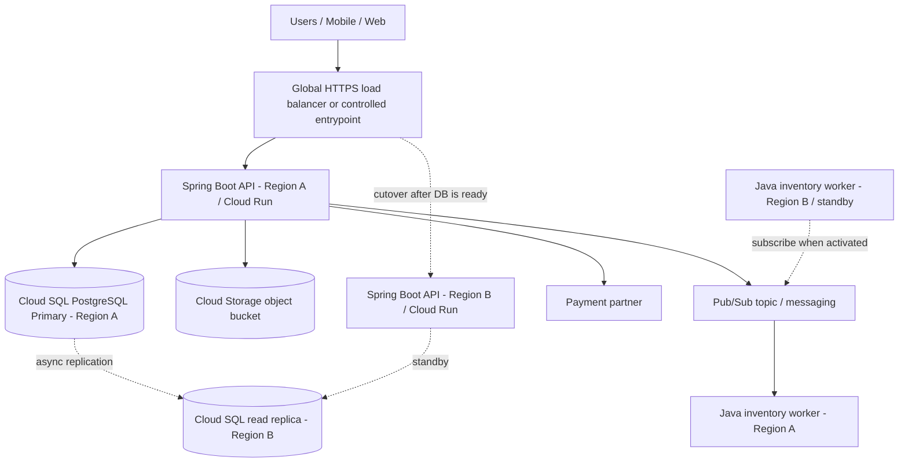

# Hands-On DR Planning for a Multi-Tier Java Application

> **Chapter:** Backup and Disaster Recovery  
> **Module:** CLOUD_PROVIDERS_GCP — Exploring Google Cloud from project organization, IAM, and VPC to Compute Engine, GKE, Cloud Run, storage services, and databases. Through deployment scenarios, learners select services, protect resources, automate releases, and monitor reliability and cost.
>
> **Exercise context:** A Spring Boot (Java) ordering system comprising a web frontend, REST API, PostgreSQL, object storage, an event queue, and external integrations. Learners design a recovery plan for a full Google Cloud region outage, run a drill **in a test DR environment**, and evaluate RTO/RPO, data, and operational readiness.

## 1. Exercise objectives and evaluation

After this lesson, you will be able to:

1. Decompose a multi-tier Java application and classify each data type to determine appropriate recovery methods.
2. Design **cross-region DR** for Cloud Run + Cloud SQL PostgreSQL + Cloud Storage and dependent services without confusing zonal HA with full-region DR.
3. Set business-driven **RTO** (recovery time) and **RPO** (acceptable data loss) targets and measure actual figures during drills.
4. Write and execute a **declare → fence writes → restore/promote → update app/network → validate → handover** runbook with clear owners and deadlines.
5. Distinguish **failover**, **backup/PITR restore**, **application rollback**, and **failback**; recognize *split-brain* and duplicate-write risks.
6. Compile acceptance evidence, a periodic drill schedule, and post-drill improvement items.

**Lesson safety rule:** Illustrative status-check commands are read-only. Operations that mutate data, promote replicas, or shift traffic must only be run inside an **approved lab/project** with a plan and approvers. Never trigger an outage in production to "test DR."

## 2. Sample scenario: Java API, database, and shared resources

A company operates an e-commerce system. Users hit the web frontend, the Spring Boot application creates orders in PostgreSQL, emits events so workers update inventory, stores invoice PDFs in Cloud Storage, and calls an external payment service.



**Practice assumptions:**

- **Region A:** `asia-southeast1`, serving normal traffic. **Region B:** `asia-southeast2`, holding standby capacity; replaceable with any region pair permitted by data policy and supported by services.
- **Compute/application:** Spring Boot runs on Cloud Run in both regions using the **exact same image digest** and version-controlled app configuration. Region B runs in *warm standby* or activates per runbook.
- **Database:** Cloud SQL for PostgreSQL primary with **HA in Region A**; an **asynchronous cross-region read replica** in Region B. The DR target needs sufficient CPU/memory/storage, networking, and IAM to become primary.
- **File/object:** Cloud Storage has durability/geo-redundancy meeting requirements; if choosing dual-region, use supported region pairs and features rather than assuming any arbitrary pair works.
- **Messaging:** Independently verify data durability, subscription backlogs, message retention, permissions, and strategies preventing consumers from processing the same event twice.
- **Config/secrets:** Artifact Registry images, Secret Manager, KMS, IAM, VPC, Cloud DNS/LB, certificates, quotas, Terraform pipelines, and configuration data must remain accessible when Region A is unavailable.

Cloud Run itself is a **regional** service. Deploying to Region B does not solve the database problem; if the endpoint cuts over to Region B before PostgreSQL is promoted, the app may be read-only or fail writes. For stateful apps, design **conditional traffic cutover** only after the database and critical dependencies are ready.

## 3. Locking business requirements: RTO, RPO, and minimum service levels

RTO and RPO are **targets**, not default guarantees from Google Cloud or from having created backups.

- **Recovery Time Objective (RTO):** maximum time from when an incident breaks service capability until the defined service level is restored.
- **Recovery Point Objective (RPO):** maximum time-based data loss tolerated by the business upon recovery.
- **Actual RTO:** elapsed time from business disruption until recovery criteria pass verification on a consistent clock.
- **Actual RPO:** gap between the last committed record/transaction on source before the incident and the last recovered data point on target; if source is unreachable and full state is unknown, state **unknown** or **measurable bound**, never report 0 automatically.

Example **hypothetical** lab requirements:

| Business flow / data | Target RTO | Target RPO | Output considered recovered |
| --- | --- | --- | --- |
| Browse product catalog | 30 minutes | 60 minutes for reconstructible cache | HTTP 2xx, catalog readable, p95 within threshold. |
| Create and look up orders | 60 minutes | 15 minutes (for risk measurement practice only) | Order create/read succeeds, zero duplicates, reconciled. |
| Invoice PDFs in bucket | 90 minutes | Per measured replication/backup design | Files downloadable, checksums match, zero issued invoices lost. |
| Inventory worker | 120 minutes | Per message retention + checkpoint design | Zero critical records lost; duplicate processing handled idempotently. |

**Critical:** If business contracts mandate **zero loss of any confirmed order**, a 15-minute RPO **is insufficient**. You need a write architecture, transaction controls, and reconciliation matching RPO = 0; **asynchronous cross-region replicas do not guarantee RPO = 0** if Region A drops abruptly. The 15-minute lab goal is purely an exercise benchmark requiring measurement to verify.

Each RTO/RPO must be broken down by failure cause:

| Scenario | Nature | Primary technique |
| --- | --- | --- |
| Single zone fails while region stays up | Component outage | Regional Cloud SQL HA, Cloud Run self-recovery per design. |
| Prolonged loss of Region A | Cross-region infrastructure outage | Deploy/activate Region B, promote cross-region replica, conditional traffic cutover. |
| App writes/deletes erroneous data | **Logical corruption** that can replicate | Backup/PITR to a pre-error good timestamp, verify data; replicas do not replace backups. |
| Secrets/keys/identities disabled | Security/configuration incident | Policy-compliant emergency access channel, config recovery, and auditing. |
| Worker processes duplicate events | Business correctness | Idempotency/deduplication, outbox/checkpoints, and reconciliation. |

## 4. Architectural decisions: HA, backup, warm standby, and failback

| Option | Recovery approach | Characteristics | Best suited when |
| --- | --- | --- | --- |
| **Backup/restore** (*cold*) | Provision fresh and restore DB/data | Lower standby cost, RTO scales with data size/quotas; RPO depends on backup/PITR schedule. | Less critical workloads tolerating long downtime. |
| **Pilot light** | Keep data and core foundations alive; spin up compute on incident | Saves continuous compute spend, yet requires fast provisioning and verification. | Moderate RTO with tested IaC. |
| **Warm standby** | APIs, networking, and DB replica ready; route traffic on incident | Lower RTO when promote/routing steps are rehearsed; dual-region running cost. | Critical apps tolerating a brief cutover window. |
| **Active-active** | Regions serve concurrently in a multi-region design | Far harder for stateful writes, data sharding, consistency, and idempotency; costly. | Business and data model genuinely support it. |

**Zonal Cloud SQL HA is insufficient for full-region loss.** Cross-region read replicas use asynchronous replication and normally require **deliberate promotion**; do not treat a replica as an automatically self-promoting regional primary the instant an API drops. Certain **Advanced DR** features on Cloud SQL Enterprise Plus support designated DR replicas, replica failover/switchover, and DNS write endpoints under specific conditions. Never apply Advanced DR commands or assumptions to unsupported instances/editions.

**PITR** restores Cloud SQL to a timestamp within retained logs, creating a **new instance**. It is a tool for data corruption, not a default substitute for cross-region failover. Backup location, retention, log window, and **CMEK accessibility when the key region fails** must all be verified; an off-region backup may still be unrestorable if its decryption key sits inside an unreachable region.

## 5. Dependency inventory and Region B readiness conditions

Before drilling, complete this table and have App Lead, DBA, Platform, Security, and Business Owner sign off:

| Layer | Protection / recovery path | Required evidence before drill | Owner |
| --- | --- | --- | --- |
| DNS / global LB / TLS | Route config to Region B, health checks, certs, and quotas | Traffic shift and return scenarios tested | Platform |
| Java API (Cloud Run) | Image digest available in Region B; planned env/secrets, service account, min instances | Deploy success, target URL, probes, logs, and config diff | App + SRE |
| PostgreSQL (Cloud SQL) | Region A HA primary + cross-region replica, backups/PITR | Replication Running, lag measured, restore drill succeeded | DBA |
| Object storage | Selected bucket location/replication, retention, lifecycle, and Region B permissions | Sample object retrieved, checksum verified, real replication lag measured | Platform |
| Messaging | Topics/subscriptions, dead-letter queues, retention, consumer IAM, idempotent handlers | Clean publish/consume; replay creates zero duplicate orders | App |
| Networking | VPC, private access, DB DNS, firewalls, egress, NAT/connector/PSC per chosen model | Region B API → Region B DB connectivity and partner webhooks succeed | Network |
| Identity/secrets | Least-privilege IAM; Secret Manager, KMS/CMEK, and principals ready | Least privilege and secret reads verified in lab | Security |
| Monitoring / incident | Cloud Monitoring, Logging, alerts, dashboards, runbook, on-call | Alert tests, log/audit trails, incident channels active | SRE |
| IaC infrastructure | Terraform modules/state, artifact repos, CI/CD, Region B quotas | `plan` and drift checks clean, repeatable deployment | Platform |
| Business and partners | Write-freeze process, test accounts, payment/SSO/webhook allowlists | UAT and end-to-end test scenarios approved | Business + QA |

**Common trap:** Cloud Run exists in Region B yet fails to pull images, read secrets, reach Cloud SQL private IP, call payment gateways, or scale due to quotas. Test the **entire end-to-end transaction path**, not merely deployment status.

## 6. Preparing the lab and baseline state

### 6.1. Scope and permissions

The lab uses **two projects or two environments isolated** from production; all IDs are placeholders:

```text
LAB_PROJECT     = "gcp-dr-lab"
PRIMARY_REGION  = "asia-southeast1"
DR_REGION       = "asia-southeast2"
SERVICE         = "orders-api"
PRIMARY_DB      = "orders-primary-lab"
DR_DB_REPLICA   = "orders-dr-replica-lab"
RUNBOOK_ID      = "DR-JAVA-MULTITIER-01"
TEST_REQUEST_ID = "dr-test-20261119-001"
```

Prerequisites: sufficient DR quotas, separate cost budget, admin-approved IAM permissions, required APIs (Cloud SQL Admin API/Cloud Run/Artifact Registry/Secret Manager) enabled, proper backup/PITR retention, and an incident channel. Never use long-lived Owner accounts across the entire runbook.

Choose a lab method that **does not require simulating a real full-region outage**: simulate logical failover by **disconnecting routing in a test environment**, updating a test LB route, or switching an endpoint accessed solely by test clients. Never delete or stop a production DB, nor block shared networks to manufacture an outage.

### 6.2. Collecting baseline metrics

Before drilling, record:

1. Measurement timestamps in UTC and report timezone; synchronize clocks on test drivers.
2. Deployed container image digests in both regions; Spring Boot configs, DB endpoints, schema/Flyway versions, and secret access.
3. DB size, latest backup timestamp, available PITR window, replica state, and lag.
4. A test dataset with **10–20 unique request IDs**, sample file hashes/checksums, and processed event counts.
5. Baseline p95 latency, 5xx rate, transaction success rate, connection pool usage, and backlog under normal load.
6. Observer roster: Commander, DBA, App, Platform, QA/Business; deadlines agreed before the drill.

### 6.3. **Read-only** pre-drill inspection commands

Run these after replacing placeholders with your approved environment:

```bash
gcloud run services describe orders-api \
  --project=gcp-dr-lab \
  --region=asia-southeast1 \
  --format="value(status.url)"

gcloud run services describe orders-api \
  --project=gcp-dr-lab \
  --region=asia-southeast2 \
  --format="value(status.url)"

gcloud sql instances describe orders-primary-lab \
  --project=gcp-dr-lab \
  --format="value(state,region)"

gcloud sql instances describe orders-dr-replica-lab \
  --project=gcp-dr-lab \
  --format="value(state,region)"
```

`RUNNABLE` status or an existing URL **does not prove** the full business flow is ready. Verify replication status and lag in Cloud SQL Console/Cloud Monitoring, private networking, IAM, app DB access in the right mode, and end-to-end tests.

## 7. Preparing the Java application for cross-region failover

### 7.1. Externalizing configuration per environment

The exact same container image should run in both regions without hard-coded hostnames or database passwords. Sample Spring Boot `application.yaml`:

```yaml
spring:
  datasource:
    url: jdbc:postgresql://${DB_HOST}:${DB_PORT:5432}/${DB_NAME}
    username: ${DB_USER}
    password: ${DB_PASSWORD}
    hikari:
      maximum-pool-size: 10
      connection-timeout: 5000
management:
  endpoint:
    health:
      probes:
        enabled: true
  endpoints:
    web:
      exposure:
        include: health,info
```

Values above are **lab examples**; `DB_PASSWORD` must be injected via Secret Manager or an approved security mechanism—never committed to Git or printed in logs. For private Cloud SQL connectivity, verify **private networking** in each region; for Cloud SQL Auth Proxy / Java Connector, use appropriate service account identities. Never expose databases to the public internet just to speed up failover.

Spring Boot Actuator probes expose endpoints such as `/actuator/health/liveness` and `/actuator/health/readiness`. **Liveness should not depend directly on the database**, because a DB blip can trigger mass container restarts without fixing the root cause. Readiness should reflect the **application instance's** ability to handle traffic, and in DR standby mode must avoid reporting "ready for writes" before the database is promoted. LB/Cloud Run probe settings must match actual app behavior; merely exposing an endpoint does not mean the routing layer uses it.

### 7.2. Keeping transactions consistent and preventing duplicate writes

During a region outage, a client may retry a request after timing out even though the database committed it. Practices to enforce:

- Every order-creation call carries a client-generated **idempotency key / request ID** persisted alongside the transaction; PostgreSQL enforces a unique constraint on that key.
- Database updates and business messages should use the **outbox pattern** or an approved consistency design. Never assume "published to Pub/Sub" implies the database committed too.
- Workers must handle messages safely on retry; consumers reconcile business state before issuing invoices or deducting stock. Never assume end-to-end exactly-once delivery.
- The application must be schema-version-aware with backward-compatible migrations so recovered instances do not hit incompatible schemas.
- During DR, enforce **a single authoritative writer**. If Region A unexpectedly comes back online, never let old app instances keep writing to the old primary.

Illustrative SQL constraint preventing duplicate order requests:

```sql
CREATE TABLE order_requests (
    request_id VARCHAR(120) PRIMARY KEY,
    order_id UUID NOT NULL UNIQUE,
    accepted_at TIMESTAMPTZ NOT NULL DEFAULT CURRENT_TIMESTAMP
);
```

This is only part of idempotency design: repeated calls with the same `request_id` must also return the saved response, and workers must deduplicate at the message/side-effect layer. Never run `CREATE TABLE` on production to test DR.

### 7.3. Maintaining reproducible configs and builds

Prepare beforehand:

- Container images in an **Artifact Registry location independent of Region A** or replicated for pulling in Region B; deploy by digest to avoid "same tag, different code."
- Cloud Run/DB/network/secret references rebuildable from IaC, ensuring **Terraform state and backend access** remain available when Region A is impacted.
- Secrets, certificates, keys, webhook allowlists, and external system configs have recovery paths; automation requires **confirmation gates** before production-impacting changes.
- Records of app versions, schema migrations, feature flags, config files, and build artifact provenance for auditing.

## 8. Preparing data: replicas, backups, PITR, and objects

### 8.1. Cloud SQL PostgreSQL

Combine multiple layers because each mitigates a different risk:

1. **Cloud SQL HA in Region A:** improves zonal fault tolerance; does not protect against full-region loss.
2. **Cross-region read replica in Region B:** supports DR if the primary region fails; replication is **asynchronous**, carrying lag and risk of losing committed transactions not yet shipped to the replica.
3. **Backups and PITR:** recover from deleted/corrupted data within retention; promoting a replica **cannot undo logical corruption that already replicated**.
4. **Restore drills to a separate instance:** verify restore duration, data, permissions, networking, extensions, versions, and app execution.

Before drilling, verify these signals:

| Parameter | Required state before drill | How to capture evidence |
| --- | --- | --- |
| Replication state | `Running` during normal operations | Timestamped Cloud SQL Console/Monitoring screenshot. |
| Replication lag | Below approved threshold at test time | Lag charts, LSN/checkpoint if needed. |
| Backups | Valid backups within retention | Backup IDs, timestamps, location, and state. |
| PITR | Enabled with policy-compliant recovery window | Earliest/latest recovery time and restore drill logs. |
| DR replica capacity | Able to handle load once promoted to primary | CPU/memory/storage, benchmarks, or load tests. |
| Keys / IAM | Operators authorized; CMEK accessible in region-outage scenarios | Policy evidence and scoped decrypt/restore tests. |

**During a planned switchover/rehearsal**, you can **halt source writes and wait for the replica to catch up** before promotion to avoid data loss. **When Region A fails abruptly**, you cannot know for certain which final transactions failed to sync; record the uncertainty window and reconcile once source data becomes available. Never claim RPO = 0 based on an old lag reading.

After standard replica promotion, the replica becomes a **standalone writable primary** and does not automatically reverse-replicate with the old primary. Additional steps are required to re-establish HA, backups/PITR, and cross-region replication per policy.

### 8.2. Cloud Storage and PDF records

Cross-region Cloud Storage bucket locations (dual-region or multi-region, depending on regions/policy) replicate automatically, yet **new-object replication latency** still matters for recently uploaded files. For dual-regions, Google Cloud offers **turbo replication** to shrink the window before newly written objects replicate to the second region. Object storage recovery metrics **do not automatically determine** the entire application's RPO/RTO.

Test with synthetic PDF files:

1. Upload a test file with a fixed ID; record metadata: object name, generation, size, hash.
2. Verify the file exists and downloads cleanly via the DR application path.
3. Compare checksums, object read IAM, metadata, and paths stored in the database.
4. Test what happens if a file has not replicated yet and verify replay/regeneration logic—not just HTTP 200.
5. Check retention/soft delete/object versioning if accidental deletion protection is required; avoid lifecycle rules accidentally purging required evidence.

**Note:** If the enterprise uses a single-region bucket or a region pair outside supported dual-region configurations, design cross-bucket replication with explicit backlog/latency metrics. Never assume toggling one setting grants multi-region fault tolerance to every bucket.

## 9. DR runbook: from detection to recovery confirmation

A runbook must carry **version number, timestamps, owners, steps, verification checks, failure conditions, and next actions**. The sample timeline below measures from service outage onset with a 60-minute lab target for the order-creation flow. **Milestones are illustrative for drills**; real durations must be measured.

| Milestone | Owner | Actions | Evidence / decision |
| --- | --- | --- | --- |
| **T+0–5 min — Detect** | SRE on-call | Receive alert (5xx spike, synthetic failure); check both network path and DB dependency; mark outage start. | Incident ID, SLI charts, and impacted customers. |
| **T+5–10 — Classify** | Commander + Platform + DBA | Distinguish app bug, zone outage, region outage, DB corruption; assess recovery options in Region A vs. Region B. | Incident diagnosis, scope, and proposed path. |
| **T+10–15 — Go/No-go** | Commander + Business | **Declare DR** when impact and conditions warrant; freeze concurrent changes and notify stakeholders. | Decision log with approver and timestamp. |
| **T+15–25 — Protect data** | DBA + App | Block or isolate source writers if reachable; record checkpoint and last known lag; prepare Region B. | Evidence of **single writer**, estimated or unknown RPO noted. |
| **T+25–35 — Promote/restore** | DBA | Execute controlled replica promotion when appropriate; if logical corruption occurred, choose backup/PITR instead of promoting corrupted replicas. | New primary DB in Region B, read/write verified, restore/promote audit. |
| **T+35–45 — Activate Java** | App/Platform | Point Cloud Run Region B to new DB endpoint/secrets; verify image digest, schema, workers, and dependencies; allow writes only after DB stabilizes. | Readiness, health, connectivity, and internal smoke tests. |
| **T+45–50 — Route traffic** | Platform/Network | Shift routing conditionally via LB/DNS/endpoints per design; verify TLS/SSO/webhooks and incoming traffic. | Regional traffic dashboard, real client tests. |
| **T+50–60 — Validate** | QA + Business + SRE | Test order create/read, PDF files, message processing, 5xx errors, latency, consistency, and measured RPO. | **Accept / Continue incident / Fail** per Section 10 table. |
| **After T+60** | Commander + Operations | If RTO missed, keep incident open and escalate—never falsify results; if met, monitor closely and sign off. | Incident summary and stakeholder update schedule. |

### Concrete Go/No-go gates

**Declare DR / Go** when: impact is verified sufficient and DR strategy applies; Region B holds capacity/credentials; DBA accepts known or unmeasurable RPO risk; split-brain controls exist; and staffing covers operations and reconciliation.

**No-go for promote** when: target DB is unstable or untrustworthy, logical corruption replicated, single-writer cannot be guaranteed, or data risk exceeds Business Owner tolerance. In that case, pivot to **backup/PITR restore** or keep the service in an announced degraded mode; never bypass controls just to hit RTO on paper.

**Point of no simple return:** Once Region B accepts new transactions, merely pointing DNS back to Region A will lose those transactions unless the old primary was synchronized backward. Failback requires its own data plan.

## 10. Running a DR drill in a non-production environment

### 10.1. Test design

Use a lab project with synthetic data; never induce real Google Cloud infrastructure outages. A safe method is **simulating Region A rejecting test-client traffic** or switching test endpoints to Region B per scenario. Pre-stage the DB replica and app revision with identical images.

**Step A — Initialize:** Create 10 test orders with fixed request IDs through Region A; record IDs, values, UTC timestamps, and event states. Upload two sample PDFs and record hashes; establish baseline p95 latency, error rate, and replication lag.

**Step B — Simulate Region A loss:** Commander declares the simulated incident and starts `T0` on synthetic SLO breach. Never touch production. Engineers re-verify Region B, check data, and lock writes on the lab source before promoting.

**Step C — Recover:** In a **planned drill**, wait for the replica to catch up and run approved promotion; configure/activate Java in Region B and shift test-client traffic. In a simulated **unplanned loss**, never pretend data is fully synced: record last lag, apply simulated data-loss handling, and document discrepancies.

**Step D — Test:** Send 10 requests with new keys to the DR endpoint; resend one request to verify idempotency, inspect workers and files, and compare orders committed before, during, and after the incident.

**Step E — Close:** Record actual RTO/RPO or `unknown` when evidence is missing; assess risks and costs; execute failback per Section 11 in the lab, restore original topology, and verify backups on the new primary.

### 10.2. Sample test cases

| Test ID | Action | Example expectation / threshold | Recorded data |
| --- | --- | --- | --- |
| DR-01 | GET `/actuator/health/readiness` in Region B with authorized client | Succeeds once DB serves its role and app is activated | HTTP status, UTC timestamp, app version |
| DR-02 | POST a new test order with a fresh idempotency key | Exactly one order created with a valid identifier | Request ID, DB row, response |
| DR-03 | Repeat POST with the **same** idempotency key | No second order created or double inventory deduction | Row count, worker logs, business ledger |
| DR-04 | Read orders committed in Region A before checkpoint | Replicated orders exist; any missing data accurately reported | Reconciliation report |
| DR-05 | Read sample PDF via Region B | Downloadable; hash matches source at published checkpoint | Object path, generation, hash |
| DR-06 | Inspect events and order processing | No messages lost within retention; zero duplicate side effects | Topic/subscription backlog, event IDs |
| DR-07 | Apply baseline-equivalent load | p95, throughput, and 5xx within approved SLOs | Cloud Monitoring dashboard |
| DR-08 | Measure actual RTO | ≤ 60 min per sample exercise, measured from SLO breach to passing gate | T0/Taccept, dashboards, and report |
| DR-09 | Measure actual RPO | ≤ 15 min per sample exercise **if measurable**; else FAIL/INCONCLUSIVE per team rules | Last commit and last recovered ID/UTC |
| DR-10 | Verify single writer | Old primary fenced; source apps/workers cannot write concurrently | Policies, connection tests, DB logs |

**Accept** only when all **mandatory** criteria pass, owners sign off, and no Sev 1/2 bugs remain open. Finishing in 50 minutes while dropping an order beyond approved limits is **not a PASS**. If the source is completely gone and RPO cannot be measured, record **INCONCLUSIVE** with a follow-up plan—never write 0.

### 10.3. Collecting auditable evidence

Record template per drill:

```yaml
exercise_id: "DR-JAVA-MULTITIER-01"
environment: "non-production"
incident_scenario: "simulated region outage"
primary_region: "asia-southeast1"
recovery_region: "asia-southeast2"
t0_utc: "YYYY-MM-DDTHH:mm:ssZ"
acceptance_utc: "YYYY-MM-DDTHH:mm:ssZ"
rto_target_minutes: 60
rto_actual_minutes: null
rpo_target_minutes: 15
rpo_actual_minutes: null
rpo_status: "PENDING | VERIFIED | INCONCLUSIVE"
last_primary_commit_id: "lab-order-010"
last_recovered_commit_id: null
approved_by: "Business Owner"
commander: "SRE Lead"
db_owner: "DBA Lead"
app_owner: "Java Lead"
rollback_or_failback_plan: "DR-JAVA-MULTITIER-01-failback"
evidence:
  - "timeline-and-decision-log"
  - "synthetic-test-results"
  - "replication-and-backup-report"
  - "order-reconciliation"
  - "cloud-monitoring-dashboard"
status: "PENDING"
```

Store measurements in a properly access-controlled repository. Never paste secrets, database passwords, tokens, real customer PII, or sensitive data dumps into drill reports.

## 11. Failback: returning the system to Region A after an incident

**Never fail back simply by switching URLs back to the old primary.** Once Region B becomes primary and accepts writes, Region A holds stale data. The process requires formal approval, like a managed migration:

1. **Close the incident at stability**, designating Region B as the current source of truth; record known RPO bounds from the past incident.
2. **Rebuild standby topology:** once Region A recovers, provision a new replica from Region B's primary or apply an appropriate sync/backup mechanism; verify data replication, schemas, and permissions.
3. **Monitor replication lag and reconcile:** for a planned failback, pause writes to Region B and wait until Region A reaches a verified checkpoint.
4. **Transfer primary role under control** per your service features/edition; block all write paths to the retiring primary and prevent split-brain.
5. **Update Java/configs, workers, and routing** in strict order: DB ready, app readiness passing, traffic shifted, clients verified.
6. **Smoke test and sign off** on the failback's own RTO, before/after data, and SLOs; re-establish backups/replicas so DR capability is restored.
7. **Review:** document transactions needing compensation or reconciliation, permission/config changes, and lessons to feed back into IaC/runbooks.

Cloud SQL **Advanced DR** on supported editions uses designated DR replicas and switchover/failover procedures that differ from standard replica promotion. Read the official docs for your exact instance type; never apply one-size-fits-all commands across editions.

## 12. Recovering from source data corruption: a dedicated test

**Logical corruption** (e.g., an SQL migration dropping the wrong column, mass delete, or corrupt records) can replicate to the DR replica very rapidly. Failing over regions then will not restore clean data.

Run a **lab PITR drill**:

1. Record a clean UTC checkpoint and save a set of reference records.
2. Inject erroneous data **into an approved test database**.
3. In Cloud SQL, trigger **PITR to a known-good timestamp**; this creates a **new instance**, requiring verification of the recovery window and permissions.
4. Verify schemas, migration/version state, record counts, monetary/order totals, and connectivity—not merely `RUNNABLE` status.
5. Point test clients to the restored instance; measure RTO of **restore + config + testing** and RPO from the checkpoint.
6. Clean up/reclaim drill resources per approved schedule, archive results, and verify backups on the restored instance.

If using enhanced backups / cross-region backup vaults, verify regional and CMEK restore/PITR rules: **PITR from an off-region vault still has target-instance location constraints**. Thus, a "faraway" backup alone does not guarantee flexible recovery if every service and key in the origin region is lost.

## 13. Observability, alerting, and coordination authority

### 13.1. Full-stack monitoring

| Signal group | Metrics / events | Purpose |
| --- | --- | --- |
| Java API | HTTP 5xx, success rate, p95/p99 latency, request count, readiness | Detect user impact and confirm service restoration. |
| Cloud Run | Revisions, traffic shares, instance counts, startup/restart failures, concurrency | Verify Region B activated and holds capacity. |
| PostgreSQL | Primary/replica state, replication lag, CPU/storage, connections, backup/PITR status | Estimate data risk and recovery readiness. |
| Pub/Sub / workers | Unacked messages, oldest outstanding age, errors/DLQ, duplicate handling | Detect post-DR backlog or duplicate processing. |
| Cloud Storage | Object presence, checksums and read IAM, replication time (if applicable), errors | Verify document recovery. |
| IAM/networking | 401/403 errors, TLS, DNS, egress, Cloud Audit Logs | Catch missing permissions or broken routes at target. |
| DR process | Declare/decision/promote/switch/accept timestamps, tickets, escalations | Measure actual RTO and learn from drills. |

Maintain at least two **independent detection paths** for critical systems: external synthetic probes and service metrics. Never rely on a dashboard hosted solely inside Region A as your only source of truth when Region A fails.

### 13.2. Role assignments

| Role | Decision / execution authority |
| --- | --- |
| **Incident Commander** | Declares DR, chooses recovery branch, directs comms, and halts if criteria fail. |
| **Business Owner** | Approves impact/RPO thresholds, accepts critical flows, decides on degraded mode. |
| **DBA Lead** | Provides replication evidence, executes promote/restore, controls writers, reconciles data. |
| **Java/App Lead** | Manages images/configs/schemas, health endpoints, idempotency, smoke tests, and workers. |
| **Platform/Network** | Manages LB/DNS/IAM/VPC/quotas, traffic steering, DR IaC, and artifact availability. |
| **SRE/Operations** | Runs synthetic tests, dashboards, incident logs, on-call, and post-cutover monitoring. |
| **Security** | Verifies permissions, audits, secrets/KMS, and security exceptions during recovery. |

Processes must designate **backups/deputies** for critical roles and out-of-band communication channels outside the failed infrastructure.

## 14. Cost, security, and drill cadence

Cross-region DR increases spending: database replicas, backups, storage replication, inter-region traffic, Cloud Run min instances, load balancers, logging, and drill costs. Evaluate `cold`, `pilot light`, `warm`, and `active-active` options across **monthly cost + measured RTO/RPO + business risk**.

- Protect backups with least-privilege IAM, policy-based retention, and verified recovery keys/permissions. Never let routine operators both delete primaries and wipe all backups unchecked.
- Ensure quotas/limits are ready in Region B; running full production load during DR can cost more than standby. Include a dedicated DR budget in FinOps planning.
- Drill at least **per organizational policy**, e.g., quarterly for critical systems and immediately after major data architecture changes; these numbers are operational suggestions, not universal Google Cloud mandates.
- Every drill must **publish scope, results, actual RTO/RPO, issues, owners, fix deadlines, and re-test dates**. Never just confirm "the script ran."

### Example verification schedule

| Cadence | Action | Evidence |
| --- | --- | --- |
| Daily | Check backup jobs, replica lag, read replica errors, standby region synthetic health. | Dashboard/alert triage. |
| Weekly | Check artifacts/images, IAM/secret references, IaC drift, Region B quotas. | Readiness checklist. |
| Monthly | Restore a lab backup to a new instance; compare checksums and business data. | Restore test report. |
| Quarterly | End-to-end DR drill in lab with Commander and Business Owner. | Decision log, RTO/RPO, SLOs, retrospective. |
| Post-incident / major change | Update runbooks, architecture, and test cases; re-test affected failure modes. | Change record and acceptance results. |

## 15. Capstone exercise and completion criteria

**Prompt:** A Spring Boot app has two APIs `GET /orders/{id}` and `POST /orders`, PostgreSQL, Cloud Storage for invoices, Pub/Sub for events, and a payment partner. Region A goes down while 100 transactions are in flight. Region B has standby Cloud Run and an async Cloud SQL replica; the replica was last observed **3 minutes behind** before the outage.

Learners must:

1. Draw a dependency graph noting which components hold state and need backups, replicas, or source-of-truth rebuilds.
2. Define RTO/RPO for **order creation**, **lookup**, **invoices**, and **workers**; flag any targets that asynchronous replication cannot guarantee.
3. Write a runbook from T0 to T+60 with at least 8 steps, owners, completion signals, and abort thresholds.
4. Propose how to **fence the old primary**, enforce a single writer, and handle requests that returned timeouts yet may have committed.
5. Show how to identify/reconcile orders at risk of loss due to replication lag; never conclude RPO = 3 minutes if the lag reading is stale.
6. Prepare tests for idempotency, file checksums, Pub/Sub backlogs, p95/5xx, and Cloud SQL restore/PITR evidence.
7. Compute actual RTO from two evidenced timestamps; for unmeasured actual RPO, mark INCONCLUSIVE and explain next investigative steps.
8. Draft a failback plan once Region A returns, ensuring Region B's data becomes the authoritative source.
9. Write the end-of-session DR report: `PASS / FAIL / INCONCLUSIVE`, residual risks, costs, and remediation owners.

**Self-assessment rubric:**

| Criterion | Passed when |
| --- | --- |
| DR architecture | Protects all layers, including IAM/secrets/networking/artifacts/messaging; never confuses HA with DR. |
| Data | Single writer enforced; reconciliation, RPO evidence, deduplication, and backup/PITR covered. |
| Timing | Clear timeline, owners, decision gates, and actual RTO measured from user impact. |
| Functionality | APIs, files, workers, mock payments, and end-to-end connectivity pass. |
| Operations | Runbook, monitoring, escalation, failback plan, and post-drill review complete. |
| Outcome | Business Owner/Commander sign off on accurate status; failures documented transparently with remediation actions. |

## 16. Official documentation

1. Google Cloud Architecture Center — [Architecting disaster recovery for cloud infrastructure outages](https://docs.cloud.google.com/architecture/disaster-recovery): RTO/RPO concepts, failure modes, protection strategies.
2. Cloud Run — [Serve traffic from multiple regions](https://docs.cloud.google.com/run/docs/multiple-regions): multi-region deployment and global load balancing configuration.
3. Cloud Run — [Automate cross-region failover with service health](https://docs.cloud.google.com/run/docs/configuring/configure-service-health): health-based routing, prerequisites, and limits. **Suitable only when database/write paths are also coordinated.**
4. Cloud SQL PostgreSQL — [About disaster recovery](https://docs.cloud.google.com/sql/docs/postgres/intro-to-cloud-sql-disaster-recovery): cross-region replica role, async replication data loss, split-brain prevention.
5. Cloud SQL PostgreSQL — [Promote replicas for regional migration or disaster recovery](https://docs.cloud.google.com/sql/docs/postgres/replication/cross-region-replicas): lag preflight, promotion, and rebuilding topology.
6. Cloud SQL PostgreSQL — [Use advanced disaster recovery](https://docs.cloud.google.com/sql/docs/postgres/use-advanced-disaster-recovery): designated DR replicas, editions, and switchover specifics.
7. Cloud SQL PostgreSQL — [Backups overview](https://docs.cloud.google.com/sql/docs/postgres/backup-recovery/backups), [PITR](https://docs.cloud.google.com/sql/docs/postgres/backup-recovery/pitr), and [Backup options](https://docs.cloud.google.com/sql/docs/postgres/backup-recovery/backup-options): data retention and recovery.
8. Cloud Storage — [Data availability and durability](https://docs.cloud.google.com/storage/docs/availability-durability): redundancy, replication, turbo replication, and limits.
9. Backup for GKE — [Plan a set of restores](https://docs.cloud.google.com/kubernetes-engine/docs/add-on/backup-for-gke/how-to/restore-plan): alternative option if the Java tier runs on GKE instead of Cloud Run.

> **Note:** Parameters, addresses, project names, thresholds, and commands in this lesson are illustrative data. When deploying in an enterprise, verify service versions, regional limits, editions, access permissions, data protection mandates, and current change processes; most importantly, **test in practice and save evidence**, never treating DR configuration alone as proof of timely recovery.
