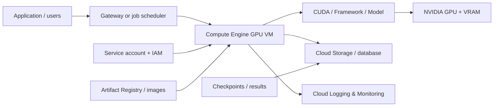
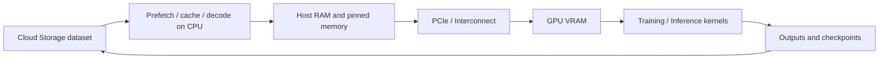

# GPUs on Compute Engine and Accelerator Configuration Selection

GPUs (Graphics Processing Units) contain thousands of parallel compute cores and dedicated memory bandwidth, making them well-suited for AI inference, training, image/video processing, 3D graphics, and certain HPC workloads. On Google Cloud, **Compute Engine** lets you run GPU-enabled VMs using dedicated accelerator-optimized machine series or by attaching supported GPUs to N1 VMs.

Choosing a GPU is not just about picking the card with the highest TFLOPS. A workload can be constrained by **VRAM**, model size, memory bandwidth, CPU/RAM, network, disk throughput, zonal availability, drivers/CUDA, and budget. A powerful GPU stalled waiting for data from Cloud Storage or running out of memory can deliver worse performance-per-dollar than a smaller, properly tuned configuration.

This lesson is part of the **Specialized Infrastructure** chapter in the **CLOUD_PROVIDERS_GCP** module. It builds on project organization, IAM, VPC, Compute Engine, GKE, Cloud Run, storage/data services, and reliability and cost monitoring. The examples only create or install resources when you actively run them in an **approved sandbox project**; GPU VMs can incur significant charges immediately upon provisioning.

## 1. Learning Objectives

After this lesson, you will be able to:

- Explain GPUs, VRAM, tensor cores, memory bandwidth, and how they affect workloads.
- Distinguish N1 Compute Engine VMs with attached GPUs from accelerator-optimized machine series G2, G4, A2, A3, A4, and newer generations.
- Select GPUs based on inference, fine-tuning, distributed training, video/visualization, or HPC needs.
- Check regions/zones, quotas, capacity, reservations, and machine type limitations before creating VMs.
- Create a test GPU VM using the Google Cloud CLI and understand scheduling, boot disk, and IAM parameters.
- Install/verify NVIDIA drivers, the CUDA runtime, and GPU access from containers.
- Benchmark utilization, throughput, latency, and cost per unit of work.
- Apply Spot VMs, reservations, checkpointing, autoscaling, and appropriate FinOps practices.
- Diagnose `nvidia-smi` errors, driver mismatches, OOMs, quota/capacity issues, and data bottlenecks.
- Design secure, reliable, and reproducible operations.

## 2. Where Do GPUs Fit in GCP Architecture?



A GPU VM still has vCPUs, RAM, NICs, a boot disk, an operating system, firewall rules, and a service account. The GPU is an accelerator, not a CPU replacement. If a data pipeline decodes images or tokenizes text too slowly on the CPU, the GPU can sit idle.

### 2.1. When Do GPUs Actually Help?

| Workload | GPU Benefit | What to Measure |
|---|---|---|
| LLM inference, embeddings, computer vision | Parallelization of tensor/matrix operations | Tokens/s, requests/s, p95 latency, VRAM |
| Model fine-tuning | Backpropagation and tensor math | Samples/s, time/epoch, GPU utilization |
| Distributed training | Multiple GPUs processing batches/models | Step time, all-reduce, interconnect, checkpoint time |
| Video transcoding | Hardware encoder/decoder support | Frames/s, codec, latency, stream count |
| Rendering / virtual workstation | Graphics pipeline/RTX, display | Frame rate, resolution, vWS license |
| HPC/Scientific computing | Offloading math to GPU when supported by libraries | FP64/FP32 precision, memory bandwidth, scaling |
| Standard CRUD web API | Usually no benefit | Benchmark CPU before buying a GPU |

**Do not choose a GPU just because a workload is "AI-related."** An API calling a model via a managed service may not need its own GPU VM. You must also evaluate driver operations, patching, scale-to-zero capability, availability, and budget.

## 3. How Do GPUs Differ from CPUs?

- **CPU:** optimized for control flow, sequential threads, low latency, and diverse tasks.
- **GPU:** many parallel processing units, effective when computation volume is high and batchable.
- **VRAM:** memory directly on the GPU holding weights, activations, KV cache, and intermediate tensors.
- **Host RAM:** VM memory, not the same as VRAM. Copying over PCIe/NVLink/NVSwitch incurs transfer overhead.
- **Memory bandwidth:** the speed of data transfer between GPU cores and VRAM, critical for memory-bound workloads.
- **Tensor cores:** hardware accelerating matrix operations at specific precisions (FP16/BF16/FP8/INT8 depending on GPU/framework).
- **Interconnect:** data exchange pathways between GPUs on the same host or across hosts; can determine distributed training performance.

Having 8 × 80 GB of total GPU VRAM does not mean any single process can treat the full 640 GB as one unified GPU. Model parallelism and the framework must distribute tensors, communication, and memory across each device.

### 3.1. Memory Budget for Inference

A simple estimate for model weights without overhead:

```text
weights_bytes ≈ parameter_count × bytes_per_parameter

Example 7-billion-parameter model:
  FP16: 7e9 × 2 bytes ≈ 14 GB for weights
  INT8: 7e9 × 1 byte  ≈ 7 GB for weights
  INT4: 7e9 × 0.5 byte ≈ 3.5 GB for weights
```

That is **only the weights**, excluding activation buffers, KV cache, tokenizer, runtime, CUDA kernels, temporary workspace, fragmentation, quantization metadata, batching, and model architecture specifics. Therefore, you should not conclude that "a 14 GB FP16 model will run fine on a 16 GB GPU" without measuring it in practice.

### 3.2. Choosing Batch Size and Context Length

- Larger batches can increase throughput but increase VRAM usage and sometimes per-request latency.
- Longer context lengths increase the KV cache size.
- Dynamic batching helps maximize GPU utilization under fluctuating traffic.
- Quantization can reduce VRAM and cost, but accuracy degradation must be tested.
- CPU offloading or model sharding can allow larger models to run, at the cost of higher latency and complexity.
- Training requires VRAM for gradients, optimizer states, and activations in addition to weights—typically much more than inference.

## 4. Ways to Use GPUs on Compute Engine

There are two main configuration groups:

1. **Accelerator-optimized VMs:** GPUs are pre-attached by machine type; includes the G and A series.
2. **N1 general-purpose VMs with attached GPUs:** choose a supported N1 machine type and attach GPUs of a valid type and count.

Not every GPU can be attached to N1, and not every GPU is available in every zone. With accelerator-optimized series, vCPU/RAM/network specifications are tied to the machine type and have constraints that cannot be arbitrarily modified.

### 4.1. Overview of GPU Families

| Machine family | Typical GPU | Target Workload |
|---|---|---|
| N1 + supported GPUs | T4, P4, V100 | Legacy inference, graphics, and maintaining legacy workloads |
| G2 | NVIDIA L4 | Cost-optimized inference, media, graphics, small fine-tuning |
| G4 | NVIDIA RTX PRO 6000 Blackwell | Inference, visualization, rendering, video, small training |
| A2 Standard / Ultra | NVIDIA A100 40 GB / 80 GB | Training, fine-tuning, HPC, and inference requiring HBM |
| A3 High/Mega/Edge | NVIDIA H100 | Large-scale, network-intensive training/serving |
| A3 Ultra | NVIDIA H200 | Large models, high throughput, and high-capacity HBM |
| A4 | NVIDIA B200 | Large-scale foundation model training/serving |
| A4X / A4X Max | NVIDIA GB200/GB300 superchips | Supercomputer-class AI workloads |
| A5X | NVIDIA Vera Rubin superchips | Next-generation distributed AI workloads requiring specialized infrastructure |

The list above reflects GPU families in current Compute Engine documentation; commercial availability, specific machine types, zones, quotas, and provisioning methods are subject to change. **Do not treat this table as a guarantee of capacity or pricing in any region.** Check the GPU machine types, accelerator-optimized machine family, and GPU locations pages before designing.

### 4.2. G2: NVIDIA L4

G2 comes with pre-attached L4 GPUs, suitable for inference, graphics/video, and workloads needing a price/performance balance. Examples:

| Machine type | vCPU | Default RAM | GPU | Total VRAM |
|---|---:|---:|---:|---:|
| `g2-standard-4` | 4 | 16 GB | 1 × L4 | 24 GB |
| `g2-standard-24` | 24 | 96 GB | 2 × L4 | 48 GB |
| `g2-standard-48` | 48 | 192 GB | 4 × L4 | 96 GB |
| `g2-standard-96` | 96 | 384 GB | 8 × L4 | 192 GB |

These specifications represent default/limit configurations in Compute Engine documentation; G2 has customizable RAM options depending on the machine type. Increasing the GPU count does not create unified VRAM, and throughput does not scale linearly if CPU, network, or batch size is too small.

### 4.3. G4: NVIDIA RTX PRO 6000

G4 uses the NVIDIA RTX PRO 6000 Blackwell Server Edition, well-suited for visualization/RTX, transcoding, inference, and some training workloads. Some smaller machine types use **fractional GPUs**:

| Machine type | Specification | Exposed VRAM |
|---|---|---:|
| `g4-standard-6` | 1/8 GPU | 12 GB |
| `g4-standard-12` | 1/4 GPU | 24 GB |
| `g4-standard-24` | 1/2 GPU | 48 GB |
| `g4-standard-48` | 1 GPU | 96 GB |
| `g4-standard-96` | 2 GPU | 192 GB |

**Note:** G4 fractional GPUs have very specific zone/availability restrictions; per the current GPU locations page, types with less than one full GPU are only available in select zones. Do not choose a fractional GPU and assume it can be deployed in every G4 zone.

For graphics/remote workstation applications, also check NVIDIA RTX Virtual Workstation (vWS) license support and cost. Licensing is a separate sizing and cost-model component when that feature is used.

### 4.4. A2: NVIDIA A100

A2 is suited for larger model fine-tuning/training or inference requiring high memory bandwidth/HBM:

- A2 Standard: A100 40 GB per GPU; machine types with one or more GPUs.
- A2 Ultra: A100 80 GB per GPU; larger configurations come with attached Local SSDs.
- Certain multi-GPU machine types support high-speed interconnects; verify the topology of the specific machine type.

If an inference model already runs efficiently on L4 and meets latency/SLOs, a more expensive A100 will not automatically yield better cost efficiency. Benchmark tokens/s or samples/s on each type.

### 4.5. A3/A4 and Newer Generations

A3 offers H100 (High, Mega, and Edge variants) and H200 (Ultra); A4 offers B200. Newer series provide massive GPU, memory, and network scale targeted at training and serving foundation models.

These high-end configurations typically feature:

- Fixed GPU counts per machine type.
- High-speed GPU/host interconnects and prescribed network infrastructure.
- Specific Local SSD, network interface, or design requirements and limitations.
- Limited capacity or requirements for reservations, Spot/Flex-start, or special provisioning methods.
- Dependencies on launchers, distributed frameworks, and communication libraries such as NCCL.

For example, A4 and A3 Ultra in Compute Engine documentation require selecting an appropriate provisioning model such as reservations, Spot, Flex-start, or resize requests; do not assume a standard on-demand VM creation command will succeed for all machine types.

## 5. Workload Decision Matrix

| Use Case | Starting Point to Benchmark | Decision Criteria |
|---|---|---|
| Medium vision/embedding inference | G2 L4 or G4 | QPS, p95, GPU memory, cost/request |
| Small quantized LLM | G2/G4, depending on model/context | Tokens/s, VRAM, TTFT, batch |
| Large single-host LLM | A2/A3/G4 based on memory and precision | Model fit, tokens/s, p95, cost/output-token |
| Medium model fine-tuning | A2 A100, A3 H100/H200 | Samples/s, time-to-train, VRAM |
| Foundation model distributed training | A3/A4/A4X/A5X based on availability | Interconnect, scaling efficiency, cost-to-target-loss |
| Video transcoding | G2/G4 | Frames/s, codec support, cost/video-minute |
| CAD, RTX workstation | G-series with valid vWS | Frame rate, latency, license, region |
| FP64 HPC | GPU with suitable FP64 throughput, typically datacenter class | FP64 benchmark, bandwidth, CPU/GPU ratio |
| Low traffic and high idle time | Managed API or CPU may be better | Total cost, scale-to-zero, SLO |

**Choose based on measured workload performance**, not marketing benchmarks or peak TFLOPS. Software must actually use hardware-supported kernels/functions, and inference configurations can differ completely from training.

## 6. Reproducible Sizing Process

### Step 1 — Define Objectives

For inference:

- Requests/second or tokens/second at peak.
- Time to first token (TTFT), time per output token, p95 latency.
- Input/output context length; concurrent users.
- Acceptable accuracy and precision/quantization.
- SLA/availability and ability to stop when idle.

For training:

- Total dataset size, tokens/samples, and batch size.
- Optimizer, mixed precision, sequence length.
- Target loss/accuracy and completion deadline.
- Checkpoint interval, restartability, and multi-node constraints.
- Network all-reduce, storage throughput, and total budget.

### Step 2 — Determine Memory Budget

Calculate VRAM needed for weights, activations, optimizer, and caches. Reserve measured headroom for runtime, fragmentation, and batch bursts. Do not just see "1 GB free in `nvidia-smi`" and assume it is safe for higher traffic.

### Step 3 — Select 2–3 Candidate Configurations

Example for small model inference:

- G2 L4, single GPU.
- G4 fractional or full GPU if supported by the zone and framework.
- A2 A100 if the model/throughput demands HBM.

Benchmark with the same batch size, context, precision, dataset, runtime, and metrics. Do not compare an FP16 model on one machine type against INT4 on another and claim the result reflects only the GPU.

### Step 4 — Check GPU Utilization and Bottlenecks

If GPU utilization is < 30% while CPU is high or disk/network is slow, upgrading the GPU may not help at all. If VRAM is near capacity, reduce batch size, quantize, or choose a GPU with more VRAM. If multi-GPU scaling is poor, check interconnect/NCCL and data distribution.

### Step 5 — Evaluate Unit Economics

Calculate cost per unit of output: per request, per 1 million tokens, per video-minute, per training epoch, or per model checkpoint reaching target quality. Account for idle time, disk, network, licenses, support, and operational overhead.

## 7. Regions, Zones, Quotas, and Capacity

GPUs are location- and capacity-specific resources. Having a machine type listed in the product catalog does not guarantee immediate provisioning in your chosen region or zone.

### 7.1. Checking GPU Locations

Official documentation:

- [GPU locations](https://docs.cloud.google.com/compute/docs/regions-zones/gpu-regions-zones)
- [GPU machine types](https://docs.cloud.google.com/compute/docs/gpus/)

Lookup commands:

```bash
gcloud compute accelerator-types list \
  --filter="zone:us-central1-a"

gcloud compute machine-types list \
  --filter="name~'^(g2-|g4-|a2-|a3-)'" \
  --format="table(name,zone,guestCpus,memoryMb)"
```

These commands only list the catalog; **they do not guarantee available capacity**. Newer accelerator-optimized series may not appear as N1-attachable GPUs in `accelerator-types list`; check both machine types and GPU locations.

### 7.2. Quota Is Not a Reservation

- **Quota:** the limit on resources/GPUs per project/region you are allowed to use.
- **Capacity:** the actual physical machines available to provision.
- **Reservation:** a mechanism to reserve capacity ahead of time under Compute Engine terms.
- **Spot/Flex-start:** provisioning modes with specific preemption and availability characteristics.

Having sufficient quota can still result in insufficient capacity errors. Having capacity in another zone does not mean identical network characteristics, data locality, or SLO compliance. Some machine types require special provisioning policies.

### 7.3. Checking Quotas

In the Console, go to **IAM & Admin > Quotas & System Limits** and filter by the Compute Engine service, the relevant GPU family quota, region, and project. You can inspect regional quota totals via CLI:

```bash
gcloud compute regions describe REGION \
  --project=PROJECT_ID \
  --format="yaml(quotas)"
```

Specific quota names and groupings by accelerator family vary by GPU type. Do not submit quota increase requests without sizing, budget, region, and justification. Before large training runs, discuss reservation/capacity planning with your Google Cloud team.

### 7.4. Data Locality and Network

If a dataset resides in a different Cloud Storage region than the GPU VM, frequent data transfers can increase latency and network costs. Choose a region balancing:

- GPU availability.
- Data residency and regulatory requirements.
- Location of buckets, Cloud SQL, and Artifact Registry.
- Latency to users or upstream sources.
- Egress/cross-region charges.
- HA requirements, backup quotas, or multi-zone training needs.

A cheaper GPU in a distant region may not result in lower total job cost if every epoch downloads terabytes from elsewhere.

## 8. Creating a Test GPU VM on Compute Engine

The examples below are for a sandbox with existing quota/capacity. Replace `PROJECT_ID`, `ZONE`, and `VM_NAME` with approved real resource names.

### 8.1. Example: N1 + NVIDIA T4

```bash
gcloud compute instances create gpu-lab-n1 \
  --project=PROJECT_ID \
  --zone=ZONE \
  --machine-type=n1-standard-8 \
  --accelerator=type=nvidia-tesla-t4,count=1 \
  --maintenance-policy=TERMINATE \
  --restart-on-failure \
  --image-family=debian-12 \
  --image-project=debian-cloud \
  --boot-disk-size=100GB
```

Prerequisites: the zone supports T4, sufficient quota is available, the project has the Compute Engine API enabled, and IAM permits VM creation. Running this command incurs costs immediately; N1/T4 is used here to illustrate accelerator attachment syntax, not as a recommendation for legacy GPUs in new projects.

### 8.2. Example: G2 with Pre-attached NVIDIA L4

```bash
gcloud compute instances create gpu-lab-g2 \
  --project=PROJECT_ID \
  --zone=ZONE \
  --machine-type=g2-standard-4 \
  --maintenance-policy=TERMINATE \
  --restart-on-failure \
  --image-family=debian-12 \
  --image-project=debian-cloud \
  --boot-disk-size=100GB
```

With G2, the L4 GPU is already defined by the machine type; **do not add an N1-style `--accelerator` flag**. Some machine types/zones have restrictions on disk counts, disk types, capacity models, and scheduling; check documentation before production use.

### 8.3. Inspecting the Created VM

```bash
gcloud compute instances describe gpu-lab-g2 \
  --project=PROJECT_ID \
  --zone=ZONE \
  --format="yaml(name,machineType,guestAccelerators,scheduling,status)"

gcloud compute ssh gpu-lab-g2 \
  --project=PROJECT_ID \
  --zone=ZONE
```

SSH login depends on OS Login/IAM and network configuration; a VM without an external IP may require IAP TCP forwarding or an organization-approved private access path. Do not open SSH to the entire Internet just to test a GPU.

## 9. Installing NVIDIA Drivers and CUDA Properly

Having GPU hardware attached to a VM **does not mean** the OS already has the NVIDIA driver installed. Kernel drivers, CUDA runtime, CUDA toolkit, and framework libraries are distinct layers.

### 9.1. OS Image Choices

- **Supported pre-installed NVIDIA driver or deep learning images:** reduce setup work; still verify patches, CUDA, and driver versions.
- **Standard Linux images:** install drivers manually following Compute Engine instructions.
- **CUDA container images:** provide user-space runtime/frameworks, but the host still needs a compatible driver and NVIDIA Container Toolkit when running Docker GPU containers.
- **NVIDIA RTX Virtual Workstation:** use vWS-compatible drivers/licenses when graphics acceleration is required.

Choose a boot disk large enough for the OS, drivers, CUDA, frameworks, and model caches; Google Cloud recommends at least around 40 GB when installing GPU drivers. For large training/models, add an appropriate data disk/storage layer rather than putting the entire dataset on the boot disk.

### 9.2. Installing Drivers with the Official Tool

Per Google Cloud documentation, the Linux NVIDIA installer tool can be downloaded via:

```bash
curl -fSsL \
  https://storage.googleapis.com/compute-gpu-installation-us/installer/latest/cuda_installer.pyz \
  --output cuda_installer.pyz

# Inspect the script/source and options before executing.
python3 cuda_installer.pyz list_driver_versions

# Only run on an authorized sandbox VM and per your OS runbook:
sudo python3 cuda_installer.pyz install_driver \
  --installation-mode=repo \
  --installation-branch=prod
```

The `repo` mode works well with patch management and DKMS to rebuild modules on kernel updates. If using `binary`, kernel holds and compatibility must be managed carefully. The installer may require a reboot or resume after rebooting.

**Secure Boot:** the standard script does not apply to Linux VMs with Secure Boot enabled in documented configurations. Use the dedicated signed-driver procedure for Secure Boot; do not disable Secure Boot in production just to make the install command faster.

**Driver branch:** newer GPU generations have higher minimum driver/CUDA requirements. Consult the compatibility matrix on the Compute Engine page at deployment time rather than hard-coding one driver branch for all GPUs/OSes.

### 9.3. Verifying the Driver

```bash
nvidia-smi

# If CUDA Toolkit is installed:
nvcc --version

# View the loaded kernel driver version:
cat /proc/driver/nvidia/version
```

- `nvidia-smi` shows the GPU and driver version: the host driver recognizes the device.
- `nvcc --version` shows the CUDA compiler: only proves the toolkit is installed, not that frameworks can use the GPU.
- The CUDA Version displayed by `nvidia-smi` is the **CUDA API level supported by the driver**, not necessarily the installed toolkit version.
- Final validation must run a real kernel in PyTorch/TensorFlow or your target software.

### 9.4. PyTorch Validation Example

```bash
python3 - <<'PY'
import torch

print("PyTorch:", torch.__version__)
print("CUDA available:", torch.cuda.is_available())

if not torch.cuda.is_available():
    raise SystemExit("GPU runtime unavailable")

print("Device:", torch.cuda.get_device_name(0))
a = torch.randn((2048, 2048), device="cuda")
b = torch.randn((2048, 2048), device="cuda")
c = a @ b
torch.cuda.synchronize()
print("Result shape:", tuple(c.shape))
PY
```

This command requires a CUDA-enabled PyTorch build installed in the Python environment. Do not use this small matrix multiplication to draw conclusions about real training/inference performance; it is strictly a GPU framework smoke test.

## 10. GPUs in Docker Containers

When packaging an application with Docker on a GPU VM:

1. The host must recognize the NVIDIA driver.
2. The NVIDIA Container Toolkit/runtime must be installed and configured.
3. The image must include a compatible CUDA/framework version.
4. The container must be granted GPU access.
5. Container security policies must be reviewed.

Example **only after** configuring the NVIDIA Container Toolkit:

```bash
docker run --rm --gpus all \
  nvidia/cuda:12.4.1-base-ubuntu22.04 \
  nvidia-smi
```

The CUDA image tag in this example illustrates syntax, not an image guaranteed to suit every newer GPU generation. Pin supported image digests/drivers and verify against official registries. Do not install duplicate kernel drivers inside the application container as a substitute for the host driver.

### 10.1. Driver, Runtime, and Framework Compatibility

A classic failure mode:

- The host driver is too old.
- The container uses a CUDA runtime newer than the host driver supports.
- The PyTorch/TensorFlow wheel was built for a different CUDA version.
- `nvidia-smi` works on the host, but `torch.cuda.is_available()` inside the container returns `False`.

Resolution: maintain a version matrix of **GPU model → OS/kernel → NVIDIA driver → CUDA runtime → cuDNN/NCCL → framework/container**. Pin critical components in image builds and test after patching.

## 11. Data: Preventing GPUs from Waiting on CPU and I/O

Even a VM with a powerful GPU will be slow if the data pipeline cannot keep up.

### 11.1. Data Pipeline



Best practices:

- Prefetch and batch data sufficiently.
- Parallelize decoding/tokenization according to CPU capacity.
- Use pinned memory when supported by the framework and driver.
- Consider local scratch disk/Local SSD when reading data repeatedly.
- Write durable checkpoints and artifacts back to Cloud Storage.
- Keep datasets in the same region as the GPU when possible.
- Monitor storage API rates, object sizes, shard distribution, and network egress.

**Local SSD is ephemeral** and data can be lost when the VM stops, is deleted, or experiences certain hardware events; never store your sole checkpoint on Local SSD. For long training jobs, push completed checkpoints to Cloud Storage or durable storage before accepting VM interruptions.

### 11.2. Identifying Bottlenecks

| Symptom | Likely Cause | Action |
|---|---|---|
| Low GPU util, high CPU | Preprocessing/tokenization bottleneck | Add CPU workers, vectorize, cache |
| Low GPU util, saturated network/disk | Data loading | Prefetch, regional data, sharding |
| High GPU util, ample free VRAM | Compute-bound | Benchmark kernels/precision or faster GPU |
| VRAM near cap, OOM | Model/batch/context too large | Quantize, reduce batch, pick larger VRAM |
| Poor multi-GPU scaling | Communication/all-reduce | Check topology/NCCL and batch size |
| High p95 but low GPU util | Queueing, synchronization, or batch policy | Optimize scheduler and latency path |

## 12. Multi-GPU and Distributed Execution

Running across multiple GPUs takes two forms:

- **Data parallelism:** each GPU processes part of the batch; gradients are synchronized.
- **Model/tensor/pipeline parallelism:** splits the model or layers across GPUs; requires passing tensors over interconnects.

In distributed training, throughput depends on interconnect speed, topology, network bandwidth, latency, and libraries like NCCL. GPU count alone does not tell you scaling efficiency.

### 12.1. Estimating Scaling Efficiency

```text
speedup = throughput_N_GPUs / throughput_1_GPU
parallel_efficiency = speedup / N

Example:
  1 GPU: 100 samples/s
  4 GPUs: 320 samples/s
  speedup = 3.2×
  efficiency = 3.2 / 4 = 80%
```

Four GPUs producing 3.2x throughput is not automatically wasteful: a training run meeting a tight deadline may still justify that setup. For cost efficiency, compare cost/sample alongside completion time.

### 12.2. Single Multi-GPU VM vs. Multiple VMs

- A single multi-GPU VM has simpler networking and suits many small-to-medium workloads.
- Multi-node training requires high-performance networking, placement policies, distributed launchers, and restart handling.
- High-end A-series machines have specific networking and interconnect requirements; review per-machine-type limitation docs.
- On large clusters, GKE or a Slurm scheduler can manage resources, priorities, jobs, and checkpoints better than manually operated VM groups.

Do not build custom multi-node VM orchestration when GKE/Slurm or a managed AI service already meets your needs, unless there is a clear operational requirement.

## 13. Proper Benchmarking

### 13.1. Avoiding Unrepresentative Benchmarks

A 2048 × 2048 matmul shows the GPU works, but does not reflect:

- Model load time.
- Tokenization and preprocessing.
- Context length distribution.
- Dynamic batching and queueing.
- Warm/cold caches.
- Network/storage I/O.
- Retry, out-of-memory, and restart behavior.

For LLM inference, measure **TTFT, output tokens/s, end-to-end p50/p95/p99, requests/s, error ratio, VRAM, and GPU utilization**. For training, measure **samples/tokens per second, step duration, GPU memory, convergence, and checkpoint overhead**.

### 13.2. Minimum Benchmark Suite

1. Pin model revision, framework, container digest, driver, and precision.
2. Fix the workload input distribution and concurrency.
3. Warm up adequately to exclude JIT or initial load overhead.
4. Run multiple iterations at steady state.
5. Record GPU/CPU/RAM, disk/network, and application metrics simultaneously.
6. Test varying batch sizes/contexts or input sizes.
7. Collect p95/p99 instead of averages alone.
8. Measure load/unload times and idle time between jobs.
9. Compare total job cost across at least 2 candidate configurations.
10. Keep benchmark scripts and results reproducible.

### 13.3. Monitoring GPUs

```bash
# GPU and driver info:
nvidia-smi

# Capture periodic status during benchmarks:
nvidia-smi --query-gpu=timestamp,name,index,utilization.gpu,\
memory.used,memory.total,power.draw,temperature.gpu \
  --format=csv -l 5
```

Available GPU fields/metrics may vary by model or driver; some GPUs/vGPUs do not expose all power/temperature counters. Cloud Monitoring/Ops Agent can collect supported GPU signals; verify Ops Agent version, configuration, and cardinality before scaling.

An inference dashboard should include:

- GPU compute utilization and memory utilization.
- VRAM used/free, GPU power/temperature if available.
- CPU utilization, host RAM, disk read throughput.
- Requests/s, tokens/s, TTFT, p95 latency.
- Error/OOM rate and queue depth.
- Cost per million output tokens or cost/request.

## 14. Optimizing GPU Costs

GPU pricing varies by GPU type, machine series, region, provisioning mode, and contract commitments. **Do not hard-code unit prices** in lessons; refer to [Compute Engine GPU pricing](https://cloud.google.com/compute/gpus-pricing) or the relevant pricing page before provisioning environments.

### 14.1. Total Job Cost

```text
total_job_cost
  = VM/GPU runtime cost
  + boot and data disk cost
  + data transfer/egress cost
  + image, logging, metrics, storage cost
  + licenses if required
  + operations and failed/restarted work
```

Hypothetical example:

| Configuration | Hypothetical Total Hourly Cost | Hypothetical Throughput | Cost per 1M outputs |
|---|---:|---:|---:|
| Configuration A | $2/hour | 100 outputs/s | $5.56 |
| Configuration B | $5/hour | 350 outputs/s | $3.97 |

Calculation: outputs/hour = outputs/s × 3600; cost/1M = hourly cost ÷ outputs/hour × 1,000,000. **These numbers are purely hypothetical**, not Google Cloud product prices. GPU B has a higher hourly rate but lower unit cost in this example; p95 latency and error rates must also be factored in.

### 14.2. On-Demand

Suited for workloads needing flexible capacity, availability, and irregular run schedules. However, desired GPU types/zones may lack capacity during peak hours. Critical production workloads require a capacity and fallback plan.

### 14.3. Spot VMs

Spot suits batch processing, checkpointed training, replayable rendering, or horizontally scalable worker workloads. Spot VMs can be preempted by Google Cloud at any time per policy, so:

- Design idempotent tasks.
- Checkpoint frequently to durable storage.
- Handle job restarts, retry/backoff, and data integrity.
- Do not use Spot as the sole serving tier when SLOs disallow interruptions.
- Check availability/quotas for supported GPU types.

Calculate **effective cost per completed job**, not just hourly price, because preemptions can force work to be redone.

### 14.4. Reservations and Capacity Planning

For large training runs or inference requiring specific GPUs at fixed times, reservations and Compute Engine-supported provisioning modes may be required. Reservations address capacity but come with scope, matching criteria, and billing rules; do not assume reservations are free. For A4/A3 Ultra and similar series, read the dedicated provisioning guides.

### 14.5. Stopping or Deleting VMs on Time

An idle GPU VM still incurs compute charges while running. After an experiment:

- Save checkpoints and artifacts.
- Log configurations and benchmark results.
- Stop or delete the VM per policy.
- Clean up unused disks, static IPs, and reservations.
- Review boot disk and Local SSD charges across the lifecycle.
- Apply cost center/owner/expiration labels to avoid orphaned resources.

Stopping a VM typically halts compute billing, but disks, IP addresses, and related resources may still incur charges. On some machine series, stop/restart or Local SSDs have restrictions; verify before designing stop/start workflows.

## 15. Security and IAM for GPU Workloads

GPU VMs may read datasets, model weights, and hold sensitive data in RAM/VRAM. Apply these controls:

- Use dedicated service accounts with least-privilege IAM for Cloud Storage, Artifact Registry, and required APIs.
- Prefer OS Login, IAP, or private networking over public SSH.
- Never embed credentials or service account JSON keys in startup scripts, images, or containers.
- Disable public IPs when unnecessary; use NAT or appropriate endpoints to pull packages/models.
- Verify driver/CUDA sources and container images, pinning digests where appropriate.
- Encrypt boot/data disks; consider CMEK where policy requires.
- Log administrative access, firewall changes, and workload activity.
- Protect model weights/licensed artifacts and enforce data residency.
- Wipe scratch disks and artifacts containing sensitive data per policy.

**Do not disable Secure Boot or grant Owner permissions just to install drivers.** If a driver requires signed modules, use the vendor-supported Secure Boot workflow.

### 15.1. IaC and Reproducible Configuration

Production resources should be managed via Terraform or an appropriate IaC tool. Explicitly define:

- Machine type, zone/region, boot image version.
- Scheduling, restart policy, and capacity provisioning.
- VPC/subnet, firewall, service account.
- Disk type/size, encryption, and retention.
- Driver installation/machine image and container digest.
- Monitoring, labels, budgets, and cleanup policies.

Manual VMs should only be used for labs or short experiments; once benchmarks stabilize, move the configuration into a reviewed VM provisioning pipeline.

## 16. Reliability and GPU VM Lifecycle

### 16.1. Maintenance and Preemption

GPU VMs generally lack the same live migration capabilities as non-GPU VMs. For GPU configurations, Compute Engine may need to stop/terminate the instance during host maintenance; specific machine types also have dedicated maintenance rules. Therefore:

- Verify `on-host-maintenance` and the machine type's restart policy.
- Design recovery from checkpoints.
- Keep model/data sources and startup setups reproducible.
- Use health checks and restart policies where appropriate.
- For production serving, maintain multiple replicas/zones or a fallback model when capacity permits.

### 16.2. GPU Inference Availability

A single GPU VM is a single point of failure. When p95 latency or availability matters:

- Use a load balancer and multiple serving replicas/instances if capacity/budget allows.
- Prepare a CPU fallback or managed endpoint for a portion of requests if acceptable.
- Implement canary deployments, startup probes, readiness checks, and model warm-up.
- Account for cold-start and artifact download times.
- Maintain spare capacity or reservations aligned with SLAs.
- Include standby costs in total FinOps calculations.

### 16.3. Training Checkpoints

A solid checkpoint should capture:

- Model weights and optimizer state.
- Scheduler state and global step.
- RNG state and data loader position when reproducibility is needed.
- Dataset/config/model revision.
- Checksums/manifests and environment metadata.
- Durable Cloud Storage location with IAM/retention policies.

If a VM is preempted after 6 hours and the latest checkpoint is 5 hours old, most of the paid GPU compute is lost. Balance checkpoint overhead against acceptable work-loss duration.

## 17. Troubleshooting GPUs on Compute Engine

| Symptom | Likely Cause | Check/Resolution |
|---|---|---|
| VM creation fails with quota exceeded | Insufficient GPU/CPU quota per region/project | Quotas & System Limits, project, zone |
| VM creation fails with resource unavailable | Zone lacks capacity | Try supported zones, reservations, Spot/Flex-start if applicable |
| Machine type does not exist | Wrong zone, API, or machine family | GPU locations and machine-types list |
| `nvidia-smi` sees no GPU | Driver not installed, module not loaded, OS/kernel mismatch | Driver install logs, `dmesg`, Secure Boot |
| `nvidia-smi` reports driver/library mismatch | Userspace/kernel driver version mismatch | Check packages, reboot properly |
| `nvcc` missing but `nvidia-smi` works | CUDA Toolkit not installed | Only install toolkit if software requires it |
| PyTorch does not use GPU | Wheel/runtime lacks CUDA, missing container toolkit | `torch.cuda.is_available()` and version matrix |
| CUDA out of memory | Model/batch/context exceeds VRAM | Reduce batch, quantize, pick higher VRAM |
| Low utilization | CPU preprocessing or network/storage bottleneck | Profiling and measuring data pipeline |
| Multiple GPUs but poor speedup | Wrong communication/parallel strategy | Check NCCL, interconnect, batch size |
| Container cannot see GPU | NVIDIA Container Toolkit/runtime unconfigured | Docker runtime `--gpus all` and host driver |
| Cost rises while job is idle | Unstopped VM, idle replicas, excess storage | Billing labels, lifecycle, and cleanup |
| VM restarts, training loses progress | No checkpoints or saved on ephemeral disk | Durable checkpoints on Cloud Storage |

### 17.1. Investigation Workflow

1. Verify VM is `RUNNING`, along with zone and machine type.
2. Confirm the attached GPU model in the instance description.
3. Read `nvidia-smi` and driver logs.
4. Check CUDA runtime/framework, not just the driver.
5. Run a small CUDA smoke test.
6. Run a real workload benchmark.
7. Analyze GPU/CPU/VRAM/network/storage metrics.
8. Check quotas/capacity if failures occur during scaling or restarts.
9. Document root cause and version matrix to prevent recurrence.

## 18. Lab: Choosing a GPU Configuration for Inference

**Scenario:** A team wants to run an embedding or vision inference service on Compute Engine with data in Cloud Storage and model containers in Artifact Registry. They need to decide between G2 L4 and another GPU option available in the sandbox.

### 18.1. Problem Criteria

Assumptions:

- 100 requests/s at peak.
- p95 latency must stay under 300 ms.
- Model fits in the candidate configuration's VRAM.
- Do not store sensitive user content in logs.
- Fixed total GPU budget for experimentation.
- All resources deleted or stopped after the lab.

These numbers are examples; learners should substitute actual project requirements.

### 18.2. Execution

1. Define model revision, precision, batch size, and input dimensions.
2. Estimate VRAM (weights + cache + overhead) and CPU RAM.
3. Check machine types/regions/quotas and select a sandbox zone with capacity.
4. Estimate hourly cost and set a budget alert before creating VMs.
5. Create a G2 VM with an L4 via CLI or Terraform.
6. Install the appropriate driver or use a supported pre-installed driver image; verify `nvidia-smi`.
7. Run a framework smoke test using the real model or a kernel test.
8. Run a fixed workload matching concurrency and traffic mix.
9. Measure QPS, p95, error ratio, GPU util, VRAM, CPU, and network.
10. Repeat under identical conditions on a second GPU configuration if quota/capacity allows.
11. Calculate cost/request, warm-up, idle cost, and redundancy options.
12. Save the report and delete/stop resources per plan.

### 18.3. Sample Result Report

```yaml
workload: embedding-inference
model_revision: MODEL_REVISION
precision: fp16
input_profile: fixed-representative-distribution
candidate:
  machine_type: g2-standard-4
  gpu_model: NVIDIA_L4
  zone: ZONE
  driver_branch: VERIFIED_BRANCH
observations:
  requests_per_second: MEASURED_VALUE
  p95_latency_ms: MEASURED_VALUE
  gpu_utilization_percent: MEASURED_VALUE
  peak_vram_gb: MEASURED_VALUE
  error_ratio: MEASURED_VALUE
finops:
  hourly_cost: VERIFIED_BILLING_RATE
  cost_per_million_requests: COMPUTED_VALUE
conclusion: ACCEPT_OR_REJECT_WITH_EVIDENCE
```

Do not write "use L4 because it is cheapest" without comparing performance, capacity, latency, and billable costs. A stronger configuration can sometimes be cheaper per output despite a higher hourly price.

## 19. Decision and Operations Checklist

- [ ] Determined whether the workload needs a GPU or if CPU/managed services suffice.
- [ ] Defined inference/training/HPC baseline and target SLOs.
- [ ] Estimated VRAM across weights, batch, context, optimizer, and overhead.
- [ ] Understood that GPU memory does not automatically combine into one contiguous pool.
- [ ] Checked GPU machine types and availability by region/zone.
- [ ] Verified GPU quota and appropriate capacity/reservation strategy.
- [ ] Calculated VM/GPU, disk, network, license, idle, and restart costs.
- [ ] Confirmed valid machine type and scheduling/maintenance policies.
- [ ] Verified driver/CUDA/framework compatibility with a tested version matrix.
- [ ] Established proper runbooks for Secure Boot and kernel patching.
- [ ] Configured Docker GPU runtime when using containers.
- [ ] Placed datasets near workloads and eliminated CPU/I/O data bottlenecks.
- [ ] Benchmarked throughput, p95/p99, GPU/VRAM, and unit cost.
- [ ] Implemented durable storage checkpoints for long training runs.
- [ ] Restricted Spot usage to interruption-tolerant workloads.
- [ ] Enforced least privilege for IAM, VPC, SSH/IAP, and secrets.
- [ ] Pinned versions and restricted access for artifacts, images, and model weights.
- [ ] Activated monitoring, alerts, and budget controls.
- [ ] Established cleanup/expiration policies for sandbox VMs and disks.
- [ ] Backed GPU selection decisions with benchmark evidence, not theoretical TFLOPS alone.

## Conclusion

GPUs on Compute Engine unlock accelerated computing options for inference, training, graphics, and HPC. Yet the right choice starts with **workload, VRAM, throughput, latency, data locality, and cost per result**, not with the newest GPU name.

G2/L4 and G4/RTX PRO 6000 are strong benchmark candidates for inference/graphics; A2/A3/A4 and newer generations suit workloads needing HBM, interconnects, or distributed training; N1 with attached GPUs supports legacy options. Before provisioning, check quotas, capacity, and availability; during deployment, verify drivers/CUDA/containers; in operations, track utilization, checkpoints, and idle costs. Meeting these requirements allows organizations to deploy GPUs where they matter, protect data, and maintain reliability within approved budgets.

## References

- [Google Cloud Compute Engine — GPU machine types](https://docs.cloud.google.com/compute/docs/gpus/)
- [Google Cloud Compute Engine — Accelerator-optimized machine family](https://docs.cloud.google.com/compute/docs/accelerator-optimized-machines)
- [Google Cloud Compute Engine — GPU regions and zones](https://docs.cloud.google.com/compute/docs/regions-zones/gpu-regions-zones)
- [Google Cloud Compute Engine — About GPUs](https://docs.cloud.google.com/compute/docs/gpus/about-gpus)
- [Google Cloud Compute Engine — Install NVIDIA GPU drivers](https://docs.cloud.google.com/compute/docs/gpus/install-drivers-gpu)
- [Google Cloud Compute Engine — Create an N1 VM with attached GPU](https://docs.cloud.google.com/compute/docs/gpus/create-gpu-vm-general-purpose)
- [Google Cloud Compute Engine — Create a G2 instance](https://docs.cloud.google.com/compute/docs/gpus/create-gpu-vm-accelerator-optimized)
- [Google Cloud Compute Engine — GPU pricing](https://cloud.google.com/compute/gpus-pricing)
- [Google Cloud Compute Engine — Spot VMs](https://docs.cloud.google.com/compute/docs/instances/spot)
- [Google Cloud Compute Engine — Reservations](https://docs.cloud.google.com/compute/docs/instances/reservations-overview)
- [Google Cloud — Monitor GPU usage](https://docs.cloud.google.com/compute/docs/gpus/monitor-gpus)
- [NVIDIA — CUDA compatibility documentation](https://docs.nvidia.com/deploy/cuda-compatibility/)
