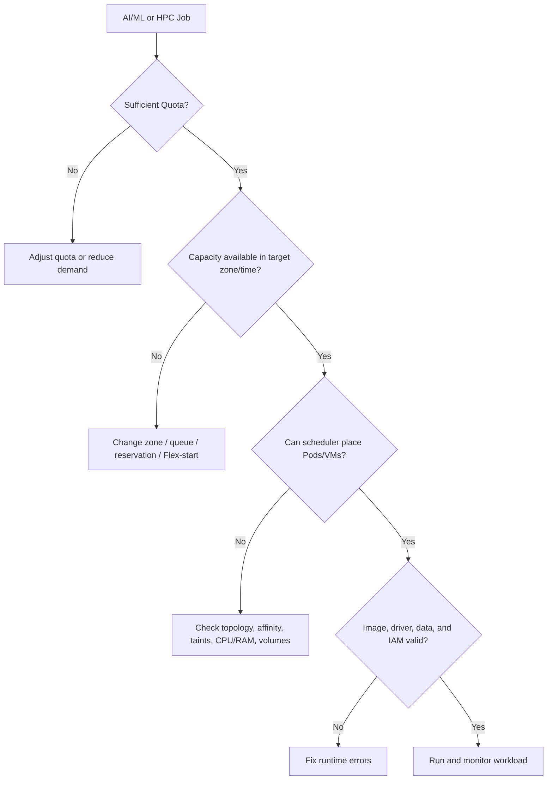
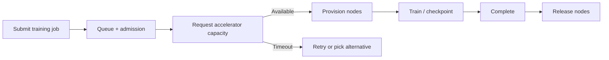
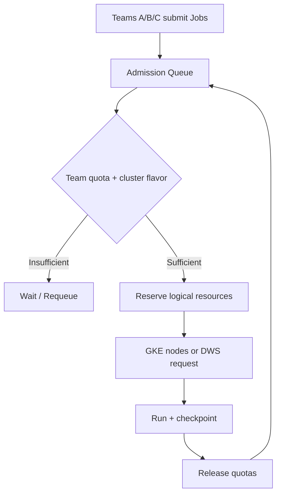

# Accelerator Quotas, Capacity, and Scheduling

Accelerators such as **GPUs** and **TPUs** are essential for model training, AI inference, image processing, scientific simulations, and parallel compute workloads. However, having "permission to create a VM" does not mean "having physical hardware ready to run immediately." When deploying on Google Cloud, a workload must pass through multiple control layers: **quotas**, **available capacity**, **provisioning model**, **scheduling capability**, and **budget**.

In the `CLOUD_PROVIDERS_GCP` module, learners explore Google Cloud from project organization, IAM, and VPCs to Compute Engine, GKE, Cloud Run, storage services, and databases. Through deployment scenarios, learners practice selecting services, securing resources, automating releases, and tracking reliability and costs. This lesson focuses on specialized infrastructure: forecasting accelerator demand, distinguishing quota errors from capacity stockouts, choosing reservations or Dynamic Workload Scheduler (DWS), and managing job queues on GKE or Compute Engine.

**Scope:** these principles apply primarily to Compute Engine, GKE, and select AI/ML workloads. GPUs, TPUs, H4D/HPC, and services like Vertex AI have distinct quotas, pricing models, regions, and constraints. Examples use `PROJECT_ID`, `REGION`, `ZONE`, `CLUSTER_NAME`, and `GPU_TYPE` as placeholders. Only provision billable resources after checking quotas, locations, IAM, pricing, and project policies.

## Learning Objectives

After this lesson, learners will be able to:

- Distinguish **quota**, **capacity**, **reservation**, **placement**, **scheduling/admission**, and **cost budget**.
- Assess GPU/TPU demand by model, count, memory, topology, duration, and workload deadline.
- Verify global/regional GPU quotas, VM/CPU/disk quotas, and zonal GPU availability.
- Choose appropriately among on-demand, Spot, on-demand reservations, future reservations, or Flex-start.
- Explain Dynamic Workload Scheduler, queued provisioning, and all-at-once requirements for distributed training.
- Design GKE GPU node pools, `nvidia.com/gpu` requests, node selectors, taints/tolerations, and autoscaling.
- Analyze TPU slice topologies, multi-host scheduling, and resource requests on GKE.
- Use queues, priorities, checkpoints, retries, fairness, and cost guardrails to operate multi-team workloads.
- Build dashboards for pending jobs, accelerator utilization, reserved/used capacity, latency, and budgets.

## 1. Quota Is Not Capacity

### Four Layers Before a Job Can Run



| Concept | Practical Question | What Not to Assume |
|---|---|---|
| **Quota** | What is the maximum resource limit allowed for this project? | Available quota does **not** guarantee physical GPUs exist in a zone. |
| **Capacity** | Can actual infrastructure allocate the selected hardware right now? | A model appearing on a pricing page does not guarantee stock in a zone. |
| **Reservation** | Is capacity set aside for the project/workload during a time window? | Reservations do not deploy Pods or fix image/driver errors. |
| **Scheduling** | Which nodes/VMs do Kubernetes, GKE, Compute Engine, or batch schedulers place work on? | A `Pending` Pod does not always mean an exhausted quota. |
| **Budget** | How much can be spent to finish the job before its deadline? | Budget alerts do not automatically block creating new GPUs. |

**Example:** A project has a quota of 16 L4 GPUs in `REGION`, yet `ZONE_A` currently has zero G2 capacity. Creating another VM can fail with a resource-exhausted error even while the quota dashboard shows 16 available. You must verify the model, region, **zone**, provisioning mode, and timing—not merely request a quota increase.

### Units to Distinguish

- GPU quotas can be tracked by **GPU model and region**, alongside a global **GPUs (all regions)** quota; some models, machine series, or provisioning modes use separate quota types.
- TPU capacity is typically described by **TPU chip, slice topology, TPU version, zone**, or VM configuration; never mechanically convert "GPU count" to "TPU count."
- VMs require vCPU, RAM, disk, IPs, and network resources; ample GPU quota can still be blocked by secondary quotas.
- Reservations reserve/consume capacity per configuration and incur charges even when partially unused (depending on type).
- `nvidia.com/gpu` counts in a Pod represent a **Kubernetes resource request**, not a project-wide Google Cloud quota.

## 2. Classifying Workloads Before Requesting Resources

### Workload Types

| Workload | Common Needs | Recommended Strategy |
|---|---|---|
| Multi-node distributed training | Simultaneous GPUs/TPUs, RDMA/interconnects, tight placement, checkpoints. | All-at-once capacity, reservations, or queued provisioning. |
| 1–8 GPU fine-tuning | Can wait and restart, flexible deadline. | Spot or Flex-start where supported; frequent checkpoints. |
| Batch inference | Many non-realtime requests, batch throughput. | Queues, Spot/Flex-start, autoscale on backlog. |
| Realtime inference with SLOs | Predictable latency, immediate capacity, HA, and warm-up. | Stable capacity, redundancy, potentially reservations. |
| Notebooks/experimentation | Intermittent GPU usage, prone to idling. | Per-team quotas, auto-stop, GPU sharing if suitable. |
| HPC simulation | Tightly coupled multi-node communication, simultaneous launch, bandwidth. | Evaluate H4D, placement, future reservations, and job schedulers. |

### Standard Demand Specification

An accelerator request should specify:

1. **Business deadline:** does it need to run immediately, within hours, or during a window next week?
2. **Hardware:** GPU/TPU version, VRAM/HBM, chip count, CPU/RAM, local SSD, disk IOPS.
3. **Topology:** single-node or multi-host, chips per host, network fabric, locality.
4. **Duration:** single run time, duration distribution, and early-completion potential.
5. **Interruptibility:** can it tolerate preemption, and how long does checkpointing take?
6. **Data:** dataset volume, location, egress, permissions, caching, and data locality.
7. **SLO/cost:** max queue wait time, max runtime, budget, and owner.
8. **Portability:** can GPU model, batch size, zone, or region be changed?

Do not provision high-end A-series GPUs for every notebook when a smaller model or GPU sharing suffices. Conversely, avoid under-sizing VRAM such that training repeatedly hits out-of-memory errors despite a lower hourly rate.

### Capacity Selection Matrix

| Characteristic | Preferred Option |
|---|---|
| Must start immediately, steady load | On-demand if capacity exists; reservations for high assurance needs. |
| Can wait, runs up to a few days | Flex-start/DWS or queuing. |
| Tolerates preemption and checkpoints | Spot VMs / Spot GKE node pools if the model is supported. |
| Multi-host training needing all nodes | Queued provisioning/gang scheduling and matching reservations/topology. |
| Fixed deadline in the future | Future reservation or calendar-mode request when eligible. |
| Lightweight inference, many users | GPU MIG/time-sharing/MPS after measuring isolation and latency. |

## 3. Checking GPU Quotas and Related Limits

### Global and Regional Quotas

Compute Engine uses **allocation quotas** to protect projects and shared resources. For many GPU types, check:

- **GPUs (all regions)**: total accelerators permitted across all regions, especially on newer projects.
- **Per-GPU-model and regional quotas**: e.g., resources per model across N1/G2/A-series/G-series.
- **Quotas by provisioning type**: regular, Spot/preemptible, reservation/commitment depending on the product.
- **CPU/vCPU, disk, and external IP quotas**, plus concurrent operation limits.
- For GKE: node counts, cluster resource limits, and related quotas; Flex-start/DWS also has quotas on pending resize requests.

Compute Engine documentation notes that running VMs and reservations can consume GPU quota. Meanwhile, **calendar-mode** future reservations follow separate rules: when placing that type of GPU/TPU reservation, GPU/TPU quota is generally not required at reservation creation time, though quotas for non-reserved resources like disks/IPs are still needed when creating VMs. Do not apply that exception to all reservation types.

### Viewing in Google Cloud Console

Go to **IAM & Admin → Quotas & System Limits**, select the relevant service (Compute Engine API, GKE, or TPU API depending on workload), and filter by quota metric and region. Record:

```text
project:       PROJECT_ID
gpu model:     GPU_TYPE
region:        REGION
quota limit:   ...
current usage: ...
free headroom: ...
target demand: ...
provisioning:  standard / Spot / reservation / Flex-start
```

**Headroom = quota limit − current usage** is necessary but insufficient: also check global quotas, secondary limits, and zonal capacity. When sharing reservations across multiple projects, track owner and consumer projects separately.

### Quota Inspection Commands

```bash
# Project-level quotas, including relevant global quotas.
gcloud compute project-info describe \
  --project=PROJECT_ID

# Quotas within a specific region.
gcloud compute regions describe REGION \
  --project=PROJECT_ID

# Check published GPU types by zone.
gcloud compute accelerator-types list \
  --project=PROJECT_ID
```

The output of `accelerator-types list` shows which accelerator types are supported in a region/zone; it **does not** prove immediate capacity exists. Check official GPU availability or test provisioning in an appropriate staging project. Never spam probe VMs in production, as that creates cost and quota pressure.

### Requesting Quota Increases

A strong quota adjustment request includes: project ID, GPU model, region, additional quantity needed, workload, deadline, estimated duration, and prior usage context. Quota requests require review and are not automatically approved. Even after approval, physical capacity must still be available. Free Trial/new accounts have stricter GPU quota policies and increase restrictions; ensure valid billing and permissions first.

**Do not request GPU quotas in regions that do not support your required model** merely because the region is close to users. Check GPU locations and model availability lists before designing.

## 4. Physical Capacity: Model, Zone, and Timing

### Capacity Is Zonal

Quotas are largely scoped to project/region, whereas GPUs/TPUs are provisioned in a specific **zone**. A region has multiple zones, yet a model may exist only in select zones; even a supported zone can run out of stock when creating a VM. For multi-node training, all machines/nodes are needed simultaneously with matching network topology, not scattered total GPUs.

Example requiring 4 VMs with 8 GPUs each:

```text
Target GPU VMs      = 4
GPUs per VM         = 8
Requested GPUs      = 4 × 8 = 32 GPUs
Required zone       = a single zone supporting a compatible model
Quota constraints   = global + regional + related limits
Capacity constraint = 4 compatible VMs, simultaneously with valid placement
```

Having 32 GPUs of quota spread across 3 zones does not enable running a distributed job that requires all nodes in one zone. Always verify placement policies, networking capabilities, storage throughput, and accelerator topologies.

### Avoid Hardcoding Regions Without Verification

For region-portable batch workloads, maintain a fallback list of regions/zones aligned with data and residency policies. Only fail over to another region after evaluating egress costs, data replication, compliance, and latency. In GKE, a regional control plane does not imply GPU node pools have capacity across every zone in that region.

## 5. Choosing a Provisioning Model

| Model | Characteristics | Suitable Workloads | Risks / Costs |
|---|---|---|---|
| **Standard on-demand** | Request VMs on demand; no capacity reserved ahead. | Interactive, flexible workloads capable of retrying. | Stockouts can occur even with sufficient quota. |
| **Spot VM** | Lower cost; resources can be preempted anytime. | Checkpointable batch/training/inference. | No continuity SLA; subject to reclamation. |
| **On-demand reservation** | Reserves VM capacity with a specific config in a zone. | Steady demand or cutovers requiring guaranteed machines. | Billed for reserved capacity even while idle. |
| **Future reservation** | Requests capacity for a future window, subject to approval. | Planned events with multi-day/week lead times. | Not supported across all machine series. |
| **Calendar-mode future reservation** | Pick a suggested capacity window and reserve up to 90 days when eligible. | Scheduled GPU/TPU/H4D training/HPC. | Subject to eligibility, model limits, duration, and specific terms. |
| **Flex-start / DWS** | Accepts waiting; scheduler provisions when available; max 7-day runtime in relevant mode. | Fine-tuning, batch, short HPC able to wait. | No fixed start time; bounded max runtime. |

Do not lump all reservation types into a single mechanism. **Regular on-demand reservations** and **calendar-mode** differ in quota rules, when capacity becomes available, modification/deletion rules, supported models, and pricing.

### On-Demand Reservations

Compute Engine creates a reservation only if the requested configuration is available in the zone at creation time. Once created, the reservation holds the capacity and bills according to reserved resource rules, **even before any VM consumes it**. VMs consuming the reservation are not double-billed for the compute resources already paid by the reservation.

Reservations can be **automatically consumed** by matching VMs or **specifically targeted**. For specific reservations, VMs must match machine properties and explicitly declare reservation affinity/target. Zone, GPU model/count, machine type, and local SSD requirements must all align.

```bash
# List existing reservations; read-only command.
gcloud compute reservations list \
  --project=PROJECT_ID

# Describe a zonal reservation without creating or modifying resources.
gcloud compute reservations describe RESERVATION_NAME \
  --zone=ZONE \
  --project=PROJECT_ID
```

Leaving a reservation empty for hours still incurs charges; track reserved instances, consumed instances, and idle time.

### Future Reservations in Calendar Mode

For eligible configurations, Google Cloud lets you view **future availability** and submit reservation requests for **GPUs, TPUs, or H4D**. Once approved, capacity is provisioned at the selected **start time**, not when the request is submitted. Durations typically span **24 hours to 90 days**. Machine/TPU types, quantities, lead times, region/zone limits, and VM termination behavior must adhere to current documentation.

For example, GPU/H4D future availability can be viewed up to roughly 60 days ahead; TPUs have different windows. Current docs set minimum lead times for certain requests (e.g., multiple days ahead for GPU/H4D), though rules evolve by model and feature. Never commit timelines to users until a request reaches **APPROVED/FULFILLED** status.

**Key caveat:** calendar-mode requests may require consuming VMs to use a **reservation-bound provisioning model** and stop/delete at the reservation end time. They are not equivalent to standard VMs running indefinitely.

## 6. Flex-start and Dynamic Workload Scheduler (DWS)

### Concept

Dynamic Workload Scheduler (DWS) manages scarce accelerator capacity. Rather than demanding GPUs immediately, jobs can **wait** until matching capacity becomes available. With **Flex-start VMs**, Compute Engine attempts provisioning within a configured wait window. Once provisioned, the VM runs for **up to 7 days**, after which it is stopped/deleted based on the termination action. If the wait window expires without capacity, the request can fail.

Well-suited for:

- Fine-tuning or small-to-medium training with flexible deadlines.
- Queued batch inference with throughput targets.
- HPC runs that can wait but need most machines simultaneously.
- Checkpointed workloads tolerant of bounded lifecycles.

Unsuitable as the default tier for 24/7 inference services with strict real-time SLOs, unless another serving tier absorbs downtime.

### Flex-start on GKE

GKE supports Flex-start and **Flex-start with queued provisioning** for supported accelerators/machine series. With queued provisioning, the scheduler waits until sufficient capacity exists in a zone and provisions nodes together so the entire workload starts simultaneously. Components can include:

- A node pool configured for Flex-start/queued provisioning.
- `ProvisioningRequest` objects requesting simultaneous capacity.
- **Kueue** or a job controller managing admission before starting jobs.
- GKE cluster autoscaler/node auto-provisioning in supported setups.

Do not blindly add Flex-start flags to a pool already using Spot or reservations when that combination is unsupported. GKE documentation lists specific constraints: Spot VMs cannot combine with DWS in the same model, plus rules for reservations, auto-repair, resource locality, minimum GKE versions, and quotas on active resize requests.

### Configuration and Constraints

| Aspect | Decision Required |
|---|---|
| Wait time | How long can the job wait before timing out as failed? |
| Maximum run duration | Do job runtime + startup + checkpoints fit within the 7-day max? |
| All-at-once | Are all nodes/replicas needed together, or can work run incrementally? |
| Retrying | If capacity isn't found, how many retries and can it move regions? |
| Storage | Store checkpoints in Cloud Storage/Persistent Disk, independent of local ephemeral data. |
| Monitoring | Track queued time, provisioning attempts, and end-to-end job start-to-finish latency. |

Example lifecycle:



**Flex-start does not guarantee receiving resources within a specific timeframe.** If a workload cannot wait long or must run on an exact schedule, consider reservations/future reservations or multi-region capacity designs.

## 7. GKE GPU Scheduling: Resources, Node Selectors, and Taints

### How Kubernetes Sees GPUs

GPUs are exposed as an **extended resource**, typically named `nvidia.com/gpu`. By default, the scheduler allocates **integer** GPUs to containers. If a container requests 1 GPU, Kubernetes treats it as 1 whole unit; it will not automatically allocate 0.3 GPU like CPU requests. To share GPUs, you must enable a supported GKE GPU sharing feature.

GKE Standard typically manages GPUs via **GPU node pools**; GKE Autopilot requests accelerators directly via workload specs. Scheduling controls include:

- **GPU requests/limits:** number of accelerators the container needs.
- **Node selector/affinity:** specifies GPU model/labels, zone, or target pool.
- **Taints/tolerations:** prevents non-GPU Pods from occupying expensive GPU nodes.
- **Cluster autoscaler:** provisions new nodes for `Pending` Pods within pool/quota/capacity limits.
- **Pod priority/preemption:** prioritizes critical work inside the cluster, though it cannot conjure physical capacity during a stockout.

### Creating a GKE Standard GPU Pool (Example)

Verify regional model support, machine types, and quotas first. Example using 1 NVIDIA L4 per G2 node:

```bash
gcloud container node-pools create gpu-l4 \
  --project=PROJECT_ID \
  --cluster=CLUSTER_NAME \
  --location=CLUSTER_REGION \
  --node-locations=COMPUTE_ZONE \
  --machine-type=g2-standard-12 \
  --accelerator=type=nvidia-l4,count=1,gpu-driver-version=default \
  --enable-autoscaling \
  --min-nodes=0 \
  --max-nodes=4
```

This command creates billable resources. Choose a `COMPUTE_ZONE` inside `CLUSTER_REGION` that supports G2/L4. Some machine series have fixed attached GPUs whose count must match the machine type. The GPU driver version must be compatible with the container's CUDA/runtime; GKE can auto-install drivers depending on version/node OS.

### GPU Inference or Training Pod

```yaml
apiVersion: batch/v1
kind: Job
metadata:
  name: gpu-batch-demo
spec:
  backoffLimit: 2
  template:
    spec:
      restartPolicy: Never
      containers:
        - name: worker
          image: REGION-docker.pkg.dev/PROJECT_ID/ml/train:RELEASE_TAG
          command: ["python", "train.py"]
          resources:
            requests:
              cpu: "2"
              memory: 8Gi
              nvidia.com/gpu: "1"
            limits:
              memory: 8Gi
              nvidia.com/gpu: "1"
      nodeSelector:
        cloud.google.com/gke-accelerator: nvidia-l4
```

This is a Job template; image, dataset, runtime libraries, CUDA/driver, and service account must be prepared separately. GKE typically applies GPU taints/tolerations or an admission controller for Pods requesting GPUs; if your node pool uses custom taints, add matching tolerations. Do not omit `resources.limits.nvidia.com/gpu` expecting the scheduler to grant a GPU anyway; in many setups GPU resources must be explicitly declared in limits.

### Taints, Tolerations, and Affinity

Example taint on a GPU node:

```text
nvidia.com/gpu=present:NoSchedule
```

For Pods permitted to run on GPU nodes with this taint, a toleration may be needed:

```yaml
tolerations:
  - key: nvidia.com/gpu
    operator: Equal
    value: present
    effect: NoSchedule
```

Some GKE configurations automatically inject tolerations for GPU-requesting Pods; verify actual cluster behavior before adding manually. **A toleration does not replace a GPU resource request**: a Pod with only a toleration can still consume CPU/RAM on a GPU node without using any GPU. Use taints, affinity, and admission policies to protect costly hardware.

### Autoscaling Does Not Guarantee Capacity

When the GKE cluster autoscaler sees a Pending Pod, it tries to scale the node pool within `min-nodes`/`max-nodes`. If the zone is out of GPUs or the project lacks quota, the Pod stays `Pending`. If a Pod requests 1 GPU and 200 GiB RAM while the node pool lacks sufficient RAM, raising GPU quota will not help.

Inspect `kubectl describe pod`, GKE events, cluster autoscaler logs, and `kubectl describe node` to separate **scheduling mismatches** from **capacity stockouts**.

## 8. TPU Scheduling: Slice Topology and Multi-Host

### TPUs Are Not Just "Chip Counts"

TPUs in GKE are organized as **slices** with topologies and chip counts matching the TPU version. Some workloads fit on a single-host slice; distributed training requires multi-host slices with consistent layouts and appropriate network interconnects. Model/data parallelism determines chip count, memory, HBM, bandwidth, and topology.

Verify:

1. Which TPU generations/versions are supported in which regions/zones?
2. Which slice topologies are valid for that version?
3. How many chips per node, and how should Pods request `google.com/tpu`?
4. GKE Standard or Autopilot? How do node selectors/taints/machine types differ?
5. Are the XLA/JAX/PyTorch or TensorFlow versions compatible?
6. Does the distributed job require all workers to start simultaneously?

### Illustrative Manifest Snippet

```yaml
# Container snippet inside a TPU Pod; NOT a complete deployable manifest.
containers:
  - name: trainer
    image: REGION-docker.pkg.dev/PROJECT_ID/ml/tpu-train:RELEASE_TAG
    resources:
      requests:
        cpu: "4"
        memory: 16Gi
        google.com/tpu: "4"
      limits:
        google.com/tpu: "4"
```

`google.com/tpu: "4"` is **purely illustrative**; the TPU chip count, Pod/node counts, and topology must match the chosen machine type/slice—never assume every TPU node exposes four chips. TPU slice nodes typically carry a `google.com/tpu` taint, and GKE node selectors (for accelerator/topology) vary by generation and mode. Consult GKE *Plan TPUs* before using YAML in production.

### Gang Scheduling and Quotas

In multi-host training, if 7 of 8 replicas launch while the eighth lacks a TPU, the whole job can hold capacity hostage without making progress. Use **all-or-nothing admission**, Kueue/JobSet, or an appropriate controller; allocate TPU slices by topology to avoid scattering parts of a workload across incompatible nodes.

Quota/capacity rules for TPUs differ from standard GPU VMs: TPU models, slice types, provisioning modes, and services (Cloud TPU VM/GKE/Vertex AI) have separate limits. Never apply the "GPUs (all regions)" quota to TPUs.

## 9. Job Queues, Priorities, and Fairness

### Why Queuing Matters

If 10 teams submit 100 GPU jobs simultaneously while the platform only has 8 GPUs, letting every job spin up nodes blindly triggers quota errors, retry storms, and orchestration overhead. Enforce **admission control** before provisioning GPUs:



**Kueue** is a Kubernetes-native queueing system deciding when workloads qualify for cluster admission, using `LocalQueue`, `ClusterQueue`, `ResourceFlavor`, nominal quotas, cohorts, and borrowing. It **does not provision physical GPUs by itself**; nodes, autoscalers, Compute Engine capacity, and IAM are still required. Paired with DWS queued provisioning, Kueue coordinates admission, `ProvisioningRequest` lifecycles, and resource claims.

### Fairness Policies

- Partition quotas by team/project so one group cannot monopolize accelerators.
- Allow **capacity borrowing** when other teams are idle, with clear limits and preemption policies.
- Separate wait-tolerant batch jobs from strict-SLO production inference.
- Assign job priorities and time limits; never let un-TTL'd experimental jobs run for days.
- When preempting low-priority work, enforce checkpointing and bounded retries.
- Measure queue wait times and start latency, not just GPU utilization.

Kubernetes PriorityClasses or Kueue preemption must be governed carefully. High priority does not fix missing zonal capacity, exhausted global quotas, or topology mismatches; unchecked preemption can starve other teams.

### JobSet/MPI/Slurm

For distributed training or HPC, frameworks like **JobSet**, MPI operators, or Slurm manage worker groups, gang scheduling, and recovery. Standardize on a single job controller suited to your framework and topology; avoid layering conflicting schedulers making simultaneous placement decisions without clear ownership.

## 10. Spot, Preemption, and Checkpointing

### Spot Trade-offs

Spot VMs offer lower pricing than standard instances when supported, yet can be reclaimed anytime without guaranteed availability SLAs. GPUs attached to a Spot VM disappear upon preemption. Do not use Spot for non-restartable workloads or production inference lacking redundancy.

### Checkpoint Design

A training worker should:

- Save model weights, optimizer state, epoch/step, random seed, and data cursor periodically.
- Write checkpoints to durable storage like Cloud Storage using run/step identifiers and atomic/manifest files where needed.
- Support idempotent resumption after restarts and validate checkpoint integrity.
- Trap SIGTERM/termination events when possible, but **never** rely on graceful shutdown windows to finish writing checkpoints.
- Clean up temporary files and preserve run metadata for auditing/FinOps.

**Checkpoint cost:** checkpointing too often increases I/O and latency; too rarely wastes many GPU-hours upon preemption. Measure write/restore duration and observed preemption distributions to tune the interval.

### Efficiency Estimation Formula

```text
useful_gpu_hours = completed_training_compute
wasted_gpu_hours = lost_work_after_interruptions + restart_overhead
effective_cost_per_useful_gpu_hour
  = total_spend / useful_gpu_hours
```

Spot can look cheaper per hour yet cost more **per completed job** if frequent preemptions, slow model startups, or uncached data force constant restarts. Compare costs based on completed checkpoints and deadlines, not raw hourly VM prices.

## 11. GPU Sharing: MIG, Time-Sharing, and NVIDIA MPS

### Why Share GPUs?

Standard Kubernetes allocates whole GPUs; a notebook using 5% of a GPU still locks the entire card. GKE offers sharing modes for supported GPUs:

| Option | Mechanism | Best For | Limitations |
|---|---|---|---|
| **Multi-instance GPU (MIG)** | Partitions a supported GPU into isolated hardware instances. | Small inference, multi-tenant workloads needing steady QoS. | Only supported on specific models/MIG profiles; requires right partition sizing. |
| **GPU time-sharing** | Multiple containers time-slice a single GPU. | Notebooks and bursty workloads. | Weaker performance/memory isolation than MIG; contention affects latency. |
| **NVIDIA MPS** | Allows multiple CUDA processes to share GPU execution concurrently. | Small batch jobs with many kernels. | Isolation, memory, and fault blast radius need evaluation; not a trust boundary. |

When sharing is enabled, `nvidia.com/gpu: "1"` may represent a **GPU share** or MIG slice per node pool config rather than an exclusive physical GPU. Quota, utilization, and chargeback dashboards must separate **physical GPU count** from logical requests. Never rely on GPU sharing as a hard security isolation boundary for untrusted tenants.

### When Not to Share

- Training requiring full VRAM or peak GPU memory bandwidth.
- Multi-GPU collective communication requiring exclusive GPUs.
- Ultra-sensitive inference latency or strict regulatory isolation.
- Frameworks/drivers that do not support the chosen sharing mode.

## 12. Quantitative Capacity Planning

### Example: 4 Nodes × 8 GPUs

Suppose a team needs 18 hours of training starting within the next 3 days:

```text
nodes_requested           = 4
gpus_per_node             = 8
gpu_count                 = 4 × 8 = 32
target_runtime            = 18 hours
nominal_gpu_hours         = 32 × 18 = 576 GPU-hours
checkpoint + warmup       = 2 hours (example)
capacity_window           = 20 hours
retry headroom            = defined by team
```

`576 GPU-hours` is strictly a **usage unit**, not the bill: VMs carry CPU/RAM/SSD/network costs, reservations may bill while idle, and unit rates vary by model, region, and provisioning mode. If **all-at-once** execution in one zone is required, all 4 compatible VMs must exist simultaneously. You cannot sum 32 GPUs scattered across zones and expect distributed training to connect them automatically.

### Setting Capacity Targets

1. Determine concurrent job counts and runtime/queue-delay distributions.
2. Calculate GPU-hours/TPU chip-hours and peak simultaneous nodes.
3. Size vCPU/RAM/disk/IOPS/network and image/data startup overhead.
4. Select on-demand/Spot/Flex-start/reservations by deadline and interruptibility.
5. Add pragmatic operational headroom for retries/maintenance without over-reserving indefinitely.
6. Estimate idle reservation costs, autoscaling lag, storage, egress, and data movement.
7. Define thresholds to switch models or modes if capacity falls short.

### "Pre-Purchasing Capacity" vs. "Waiting for Capacity"

| Scenario | Sensible Choice |
|---|---|
| Daily training, continuous inference | Reservations or steady capacity to minimize stockouts. |
| Monthly fine-tuning, relaxed deadline | Flex-start/queued provisioning instead of idling GPUs for weeks. |
| Preemptible batch with fast checkpoints | Spot if overall completion rate and total cost are favorable. |
| Hard-deadline multi-node distributed job | Future/calendar reservation when feature/model is supported and approved. |

Model decisions using **cost per completed job**, **p95 queue wait**, and **failure rate** as KPIs—not GPU utilization alone.

## 13. Monitoring Quotas, Capacity, and Schedulers

### Metrics to Track

| Category | Metric | Purpose |
|---|---|---|
| Quota | Quota limit, usage, utilization, denied requests | Catch global/regional quota exhaustion early. |
| Capacity | Allocation failures by model/zone, pending provisioning requests | Separate stockouts from quota failures. |
| Scheduling | Pending Pods, unschedulable reasons, p50/p95 queued time | Spot node selector/affinity/taint/queue blockers. |
| GPU/TPU | Accelerator utilization, memory used, HBM pressure, power/thermal if supported | Right-size requests and sharing modes. |
| Node | NodeReady, GPU driver/device plugin health, CPU/RAM/disk pressure | Catch missing drivers and unhealthy nodes. |
| Training | Steps/s, epoch time, checkpoint latency, retries, loss progression | Measure actual efficiency and waste. |
| FinOps | Running GPU-hours, reserved idle hours, cost per job/team, storage/egress | Prevent paying for unused capacity. |

Cloud Monitoring provides GPU utilization metrics in supported environments; collection depends on GKE/Compute Engine, drivers, Ops Agent/DCGM, and accelerator types. Inferring GPU idleness from Kubernetes requests alone is misleading: a Pod can reserve a GPU while actual GPU utilization sits at 0%.

### Tracing an Unscheduled Job

```bash
# Inspect Pending Pods and scheduling reasons in a namespace.
kubectl get pods -n ML_NAMESPACE
kubectl describe pod POD_NAME -n ML_NAMESPACE

# Inspect nodes and allocatable GPU resources.
kubectl get nodes
kubectl describe node NODE_NAME

# View recent Kubernetes events (read-only command).
kubectl get events -n ML_NAMESPACE --sort-by=.lastTimestamp
```

When a Pod is `Pending`:

- `Insufficient nvidia.com/gpu` → nodes lack allocatable GPUs; check autoscaling, quotas, and capacity.
- `node(s) didn't match Pod's node affinity/selector` → mismatched GPU model, zone, or node labels.
- `had untolerated taint` → missing toleration or pool dedicated to another workload.
- Volume/CSI/topology error → PVC cannot attach in the required zone.
- Node not Ready → driver, device plugin, runtime, or node bootstrap failure.
- `ProvisioningRequest` waiting → DWS has not yet secured enough capacity within the wait window.

Separate **scheduler pending** from **post-scheduling application failure**: if a container enters `CrashLoopBackOff`, inspect images, CUDA runtimes, permissions, OOMs, and logs instead of requesting more GPU quota.

## 14. IAM, Security, and Least Privilege

### Separating Operational Roles

| Principal | Responsibility | Required Permissions |
|---|---|---|
| Platform admin | Manages quotas, zones, reservations, node pools, policies. | Project-scoped Compute/GKE/Quota admin roles. |
| Job submitter | Submits Jobs/Pods to namespaces/queues, reads own outputs. | Minimal Kubernetes RBAC and workload IAM. |
| Runtime identity | Reads datasets/models, writes checkpoints, pulls from Artifact Registry. | Workload Identity Federation for GKE / Compute SA scoped to buckets/repos. |
| FinOps/auditor | Reviews usage, billing exports, dashboards, reservations. | Read-only roles at management scope. |

Never grant project `Owner` to fix quota/capacity issues. Quota adjustments have dedicated admin roles; GKE scheduling uses Kubernetes RBAC, service accounts, and admission policies—separate from VM provisioning IAM. **Taints/tolerations** are scheduling tools, not security walls against untrusted users.

### AI/ML Data Security

- Keep sensitive datasets in approved locations; cross-region egress incurs costs and residency risks.
- Scope service accounts strictly to required Cloud Storage buckets.
- Never store access keys, model credentials, or private tokens in images/manifests.
- Checkpoints holding model weights may constitute intellectual property or sensitive data; apply encryption, IAM, and retention controls.
- Restrict who can access nodes, debug containers, GPU memory, and logs.

## 15. FinOps: Managing Costs and Avoiding Idle Accelerators

### Costs Go Beyond GPU-Hours

Beyond GPU/TPU unit rates, bills can include:

- vCPU, memory, Local SSD, Persistent Disk, and node/VM overhead.
- Unconsumed reservations, startup/queue overhead, termination, and billing minimums.
- Cloud Storage checkpoints, image pulls, and cross-zone/cross-region network egress.
- DWS/Flex-start pricing, Spot pricing, and retry overhead.
- Logging, Monitoring, orchestration, checkpoint/restore, and operational overhead.

### Showback Model

```text
allocated_gpu_hours = physical_GPU_count × VM_hours
productive_gpu_hours = GPU_count × useful_compute_hours
idle_gpu_hours = allocated_gpu_hours − productive_gpu_hours
cost_per_completed_job = full_job_cost / successful_jobs
```

These formulas form an internal accounting model; `physical_GPU_count` differs from logical `nvidia.com/gpu` when GPUs are shared. Reservation idle costs can be charged back to the reserving team, consuming teams, or a shared platform per chargeback policy. Use Cloud Billing exports for actual dollars and job metrics for usage attribution.

### Guardrails

- Label VMs/node pools, jobs, cost centers, environments, accelerator types, and owners.
- Configure project budgets and alerts alongside quotas, resource limits, and approvals to prevent runaway spend.
- Scale GPU node pools to 0 when idle; auto-stop notebook/dev VMs.
- Enforce TTLs/time limits on batch jobs and alert on prolonged low GPU utilization.
- Audit unused reservations regularly; release or resize when demand drops.
- Use GPU sharing only when QoS, isolation, and actual utilization justify it.
- Track cost per trained epoch / inference request / completed job rather than raw GPU hourly rates.

**Budget alerts are not hard stops:** Google Cloud budgets notify on thresholds rather than automatically terminating VMs. Implement separate automation/approvals if hard spend caps are required.

## 16. Sample Scheduling Workflow for a Multi-Project ML Team

### Scenario

Three teams share GPU infrastructure:

- Team A: distributed training across 4 nodes × 8 GPUs, requiring simultaneous execution.
- Team B: single-GPU fine-tuning jobs, tolerant of waiting up to 12 hours.
- Team C: real-time customer-facing inference that cannot tolerate extended outages.

### Design

1. **Availability assessment:** identify GPU models, supported zones, global/regional quotas, and network/data locality.
2. **Isolate pools by SLO:** production inference uses stable capacity with rollout/HA; batch training uses queues.
3. **Team A:** prioritize future/calendar reservations or all-at-once queued provisioning, paired with checkpoints and placement policies.
4. **Team B:** use Flex-start or Spot as needed with job-level retries, checkpoints, and staged data.
5. **Team C:** use on-demand/reserved capacity, alerting on p95 latency, GPU utilization, and scaling headroom.
6. **Queuing:** use Kueue to enforce team quotas, priority classes, and bounded borrowing.
7. **FinOps:** dashboard GPU-hours, idle reservations, p95 queue wait, success rates, and cost per completed run.

### Example Admission Policy

| Queue | Nominal Capacity (Illustrative) | Borrowing | Priority |
|---|---|---|---|
| `production-inference` | Dedicated capacity with HA | Independent of batch quotas | Highest per SLO |
| `distributed-train` | 32 simultaneous GPUs when capacity exists | Can wait for future reservation | Medium |
| `fine-tuning` | 4 GPUs from flexible node pools | Borrows idle capacity per policy | Low |

This table expresses **operational policy**, not a complete Kueue manifest. Logical quotas in Kueue must map to real resource flavors and node provisioning capabilities; setting 32 logical GPUs does not create 32 physical GPUs.

### Acceptance Criteria

- Zero SLO-breaching production inference interruptions while batch jobs run.
- Batch p95 queue wait stays within agreed bounds.
- Training completes with the intended topology; checkpoint/restore works reliably.
- GPU quotas and capacity plans cover peak demand, with documented stockout fallbacks.
- Cost per completed job and idle reservation hours are reviewed weekly.
- Operations teams maintain runbooks, owners, IAM/labels, and regular capacity reviews.

## 17. Troubleshooting: Quotas, Capacity, and Pending Pods

| Symptom | Possible Cause | Resolution |
|---|---|---|
| `QUOTA_EXCEEDED` on GPU VM creation | Model/regional GPU quota, global GPUs, or CPU/disk quota exhausted. | Inspect project/region quotas; reduce demand or request an increase. |
| `ZONE_RESOURCE_POOL_EXHAUSTED` | Zone lacks GPU/machine type stock despite remaining quota. | Switch to a supported zone, wait, or use Flex-start/reservations. |
| GKE autoscaler won't add nodes | Quota/stockout, pool max reached, affinity/taint mismatch, incompatible machine type. | Check cluster autoscaler logs, Pod events, and pool config. |
| Pod `Pending: Insufficient nvidia.com/gpu` | Nodes lack allocatable GPUs or Pod requests exceed node size. | Check node capacity, drivers, requests, and autoscaling. |
| Pod `Pending: node affinity mismatch` | Requested GPU model/zone node selector matches no nodes. | Verify labels, zones, and topology requirements. |
| TPU job partially runs without progress | Missing slice topology or gang scheduling. | Use all-at-once admission with matching topology nodes. |
| DWS request waits too long | Insufficient capacity in wait window or oversized topology request. | Monitor queue; shrink size, shift zone/time, or use bounded retries. |
| Flex-start node stops after days | Runtime hit the provisioning mode's duration cap. | Checkpoint before the cap and split jobs into stages. |
| Training OOM on GPU | Insufficient VRAM, excessive batch size, or framework memory leak. | Reduce batch size, precision, or model size; use higher-VRAM GPUs. |
| Low GPU utilization | Data loader/CPU/storage bottleneck, tiny batch, or idle GPU. | Profile data pipeline, batching, I/O, and framework; consider sharing. |
| Reservation bills with zero jobs | Capacity reserved but unconsumed. | Check reservation utilization, schedules, and release options. |
| `nvidia-smi`/CUDA errors | Incompatible driver/CUDA image or unready device plugin. | Verify GKE driver version, container CUDA, and node GPU health. |
| Spot job restarts endlessly | Frequent preemption, broken checkpoints, or missing retry budget. | Test checkpoint/restore and evaluate total cost per completed job. |

Never treat every failure by blindly requesting more quota. **Quota failures**, **capacity stockouts**, **scheduler mismatches**, and **runtime failures** are four distinct classes—gather evidence before acting.

## 18. Controlled Lab Exercise

### Objective

Design an execution plan for two workloads: a small 1-GPU inference service and a 4-GPU batch training job with distinct deadlines and budget caps. Quota discovery is read-only; creating node pools/VMs requires a test project and spend approval.

**Step 1 — Discovery:** inspect GPU model locations, `gcloud compute project-info describe`, `gcloud compute regions describe`, global/regional quotas, secondary CPU/disk limits, and IAM policies.

**Step 2 — Planning:** calculate peak GPUs, GPU-hours, CPU/RAM, storage, batch checkpoint duration, and maximum acceptable queue wait.

**Step 3 — Provisioning selection:** choose stable capacity for inference; choose on-demand/Spot/Flex-start or reservations for batch based on deadline. Document why GPU hourly price alone cannot drive the choice.

**Step 4 — Staging deployment:** once approved, create a GPU node pool in a supported zone; run a Job requesting `nvidia.com/gpu: "1"` and verify the driver/model.

**Step 5 — Failure testing:** simulate a Pod requesting more GPUs than a pool offers, a mismatched node selector, and an over-budget logical team queue. Observe `kubectl describe pod` and note how error messages differ.

**Step 6 — Measurement:** record queue wait, GPU utilization, job runtime, retry count, image pull time, checkpoint duration, and usage cost.

**Step 7 — Cleanup:** delete unneeded test jobs, node pools, VMs, and reservations, and verify persistent disks, buckets, and logs have appropriate retention policies. Deleting compute does not automatically delete every disk or image.

### Results Summary Table

| Item | Recorded Value |
|---|---|
| Project / region / zone | `PROJECT_ID`, `REGION`, `ZONE` |
| Accelerator model | e.g., L4 or approved type |
| Global + regional quota/headroom | Measured |
| Peak requested GPU / TPU chips | Measured per workload |
| Provisioning model | Standard / Spot / Reservation / Flex-start |
| Max queue wait / observed wait | Per SLO and test |
| Successful GPU-hours / wasted GPU-hours | Per run metadata |
| Total cost per completed job | From Billing export and job usage |
| Failure & recovery path | Rehearsed runbook |

## 19. Accelerator Infrastructure Governance Checklist

- [ ] Workload spec covers model, VRAM/HBM, topology, node count, deadline, runtime, SLO, and data locality.
- [ ] GPU/TPU availability verified by zone and actually supported machine series.
- [ ] Global GPU quota, regional model quota, and secondary CPU/disk/IP quotas checked where applicable.
- [ ] Remaining quota clearly distinguished from immediately available zonal capacity.
- [ ] Appropriate provisioning chosen: standard, Spot, reservation, future/calendar reservation, or Flex-start/DWS.
- [ ] For reservations: idle charges, billing owner, lifecycle, and consumption rules evaluated.
- [ ] For Flex-start: wait times, 7-day runtime limit, and retry/checkpointing accounted for.
- [ ] GKE node pools placed in supported zones with compatible GPU drivers and container CUDA versions.
- [ ] Pod GPU/TPU requests/limits, node affinity, taints/tolerations, and CPU/RAM properly configured.
- [ ] TPU jobs specify slice topology and all-at-once scheduling when multi-host is required.
- [ ] Cluster autoscaler/node auto-provisioning bounded by quota, capacity, and budget guardrails.
- [ ] Queues enforce policies for admission, priority, fairness, borrowing, and job TTLs.
- [ ] Spot or preemptible workloads implement checkpoint/restore and retry budgets.
- [ ] GPU sharing/MIG/MPS chosen based on QoS and reliability, not just Pod density.
- [ ] IAM properly separated for admins, job submitters, runtime identities, auditors, and data/models.
- [ ] Dashboards track quota usage, Pending Pods, queue wait, GPU utilization, and reservation idleness.
- [ ] Cost per completed job and idle GPU-hours reconciled against Cloud Billing exports.
- [ ] Fallback zones/regions and runbooks distinguish quota, capacity, scheduling, and runtime errors.
- [ ] Cleanup steps cover VMs/node pools/disks/reservations alongside periodic budget reviews.

## 20. Conclusion

Managing GPUs/TPUs on Google Cloud is a multi-layered discipline: **quota** caps maximum allowed allocation, **capacity** governs hardware availability in the right place and time, **provisioning models** dictate how resources are reserved or waited for, and **schedulers** control when workloads actually start. Never equate ample GPU quota with guaranteed GPU availability, nor assume every Kubernetes Pending Pod indicates quota exhaustion.

For wait-tolerant batch and fine-tuning workloads, Spot or Flex-start/DWS optimizes cost and hardware access when paired with solid checkpointing. For multi-node distributed training requiring simultaneous machines, queued provisioning, topology-aware scheduling, and reservations take priority. For strict-SLO real-time inference, stable capacity, HA, and observability come first.

Well-run accelerator infrastructure aligns **admission policies, quota/capacity planning, runtime compatibility, checkpointing, metrics, and FinOps**. The ultimate yardstick is on-time job completion, output performance and quality, disruption rates, and **cost per useful outcome**.

## References

- [Compute Engine — Allocation quotas](https://docs.cloud.google.com/compute/resource-usage)
- [Compute Engine — Quotas and limits](https://docs.cloud.google.com/compute/quotas-limits)
- [Compute Engine — About GPU instances](https://docs.cloud.google.com/compute/docs/gpus/about-gpus)
- [Compute Engine — GPU locations and availability](https://docs.cloud.google.com/compute/docs/gpus/gpu-regions-zones)
- [Compute Engine — Choose a reservation type](https://docs.cloud.google.com/compute/docs/instances/choose-reservation-type)
- [Compute Engine — Reservations overview](https://docs.cloud.google.com/compute/docs/instances/reservations-overview)
- [Compute Engine — Future reservation requests in calendar mode](https://docs.cloud.google.com/compute/docs/instances/future-reservations-calendar-mode-overview)
- [Compute Engine — Flex-start VMs](https://docs.cloud.google.com/compute/docs/instances/about-flex-start-vms)
- [Compute Engine — Spot VMs](https://docs.cloud.google.com/compute/docs/instances/spot)
- [GKE — About GPUs](https://docs.cloud.google.com/kubernetes-engine/docs/concepts/gpus)
- [GKE — Run GPUs in GKE Standard node pools](https://docs.cloud.google.com/kubernetes-engine/docs/how-to/gpus)
- [GKE — GPU sharing strategies](https://docs.cloud.google.com/kubernetes-engine/docs/concepts/timesharing-gpus)
- [GKE — Plan TPUs](https://docs.cloud.google.com/kubernetes-engine/docs/concepts/plan-tpus)
- [GKE — About TPUs](https://docs.cloud.google.com/kubernetes-engine/docs/concepts/tpus)
- [GKE — Accelerator consumption options](https://docs.cloud.google.com/kubernetes-engine/docs/concepts/consumption-option)
- [GKE — Flex-start and Dynamic Workload Scheduler](https://docs.cloud.google.com/kubernetes-engine/docs/concepts/dws)
- [GKE — Queued provisioning](https://docs.cloud.google.com/kubernetes-engine/docs/how-to/provisioningrequest)
- [GKE — Consume reservations](https://docs.cloud.google.com/kubernetes-engine/docs/how-to/consuming-reservations)
- [GKE — Cluster autoscaler](https://docs.cloud.google.com/kubernetes-engine/docs/concepts/cluster-autoscaler)
- [Kueue — Concepts](https://kueue.sigs.k8s.io/docs/concepts/)
