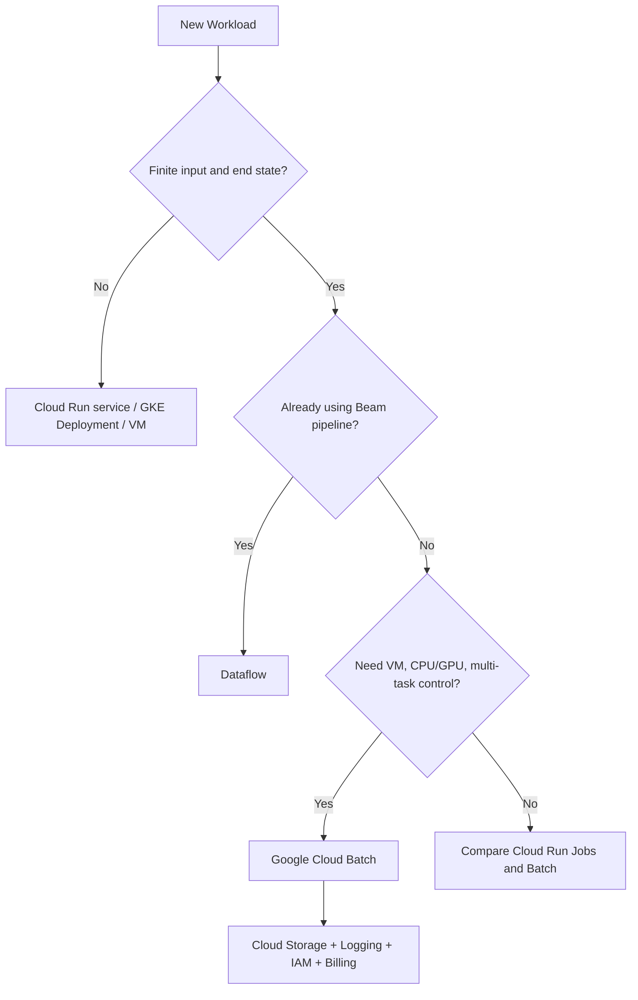
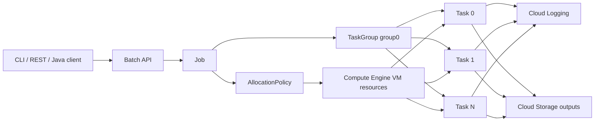
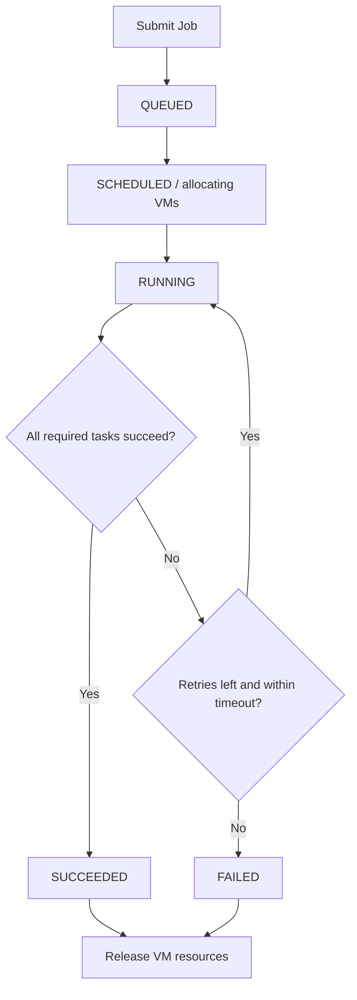
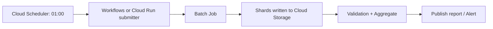

# Google Cloud Batch for Batch Workloads

**Google Cloud Batch** is a managed batch computing orchestration service on Google Cloud. Instead of maintaining an always-on cluster of virtual machines to process periodic data, development teams submit a **job** describing the tasks, CPU/RAM/GPU/TPU resources, network configuration, access permissions, and error-handling policies. Batch schedules the work, provisions Compute Engine VMs, executes the **tasks**, records status, and releases resources once the job finishes.

In the `CLOUD_PROVIDERS_GCP` module, learners explore Google Cloud from project organization, IAM, and VPCs to Compute Engine, GKE, Cloud Run, storage services, and databases. Through deployment scenarios, learners practice selecting services, securing resources, automating releases, and tracking reliability and costs. Batch ties these concepts into one workflow: building container images via CI/CD, storing them in Artifact Registry, reading/writing Cloud Storage, applying least-privilege service accounts, monitoring Cloud Logging, and managing Compute Engine quotas and costs.

Examples in this lesson assume project `PROJECT_ID`, region `REGION`, VM machine type `e2-standard-4`, bucket `BUCKET_NAME`, and Java image `REGION-docker.pkg.dev/PROJECT_ID/batch-images/report-worker:RELEASE_TAG`. These are placeholders. Do not run job creation commands in a production project without spend approval and permissions, and verify region and machine type support in Batch.

## Learning Objectives

After this lesson, learners will be able to:

- Identify workloads suited for Batch and distinguish Batch from Cloud Run Jobs, GKE Jobs, Dataflow, Cloud Composer, and self-managed Compute Engine VMs.
- Describe `Job`, `TaskGroup`, `TaskSpec`, `Runnable`, `AllocationPolicy`, `LogsPolicy`, and the job lifecycle.
- Create a Batch script job using JSON and `gcloud batch jobs submit`, and inspect status, tasks, and logs.
- Containerize a Java task and partition data across multiple tasks via `BATCH_TASK_INDEX`/`BATCH_TASK_COUNT`.
- Configure CPU/RAM, parallelism, retries, timeouts, Spot/Flex-start, and scheduling constraints.
- Apply least-privilege IAM, dedicated service accounts, Secret Manager, Artifact Registry, Cloud Storage, and VPCs.
- Design idempotent tasks with checkpoints, partial failure handling, and durable output storage.
- Monitor throughput, queue wait time, errors, quotas, and cost per completed job.

## 1. When Should You Use Google Cloud Batch?

### Characteristics of Batch Computing

Batch workloads typically have **finite inputs**, can be partitioned, do not require sub-second HTTP responses, and terminate upon completion. Resource demand may spike sharply during a processing window and then drop back to zero.

Examples:

- Running a Java CLI to aggregate end-of-day transactions, generate reports, or render invoices.
- Using Python/Java to process thousands of images, CSV/Parquet files, video frames, or scientific datasets.
- Running simulations, hyperparameter sweeps, rendering, or large computational test suites.
- GPU-accelerated training/fine-tuning or batch inference when the hardware and provisioning mode are supported.
- One-time data migrations with many independent shards requiring progress tracking.

### Comparison with Related Services

| Service | Execution Unit | When to Consider |
|---|---|---|
| **Cloud Batch** | Jobs with task(s) on VMs provisioned and reclaimed by Batch. | Batch/HTC/HPC requiring Compute Engine VM, CPU/GPU, resource, and task parallelism control. |
| **Cloud Run Jobs** | Tasks in a serverless container environment. | Containerized jobs with minimal VM ops; resource/hardware needs supported by Cloud Run. |
| **GKE Jobs / CronJobs** | Kubernetes Pods running to completion. | Existing GKE footprint needing Kubernetes scheduling, operators, or custom cluster policies. |
| **Dataflow** | Beam pipelines executed by a managed runtime. | Streaming/batch ETL modeled with Apache Beam, windows, and joins. |
| **Cloud Composer / Workflows** | Orchestrates multiple jobs and dependencies. | Coordinating DAGs, approvals, and multi-service chains; can **invoke Batch** at individual steps. |
| **Self-managed Compute Engine** | VMs or MIGs created/maintained by the team. | Specialized OS/kernel control, 24/7 processes, or workloads incompatible with Batch. |

Batch is **not a database, message broker, cron scheduler, or API service**. It executes work after receiving a job creation request. To run daily at 01:00, pair it with a scheduling layer like Cloud Scheduler + Workflows/Cloud Run rather than assuming Batch includes a built-in Linux-style cron.

### Decision Framework



## 2. Batch Architecture and Components

### From Job to VM



| Component | Role | Example Fields |
|---|---|---|
| **Job** | Top-level unit scheduled, tracked, and completed by Batch. | `taskGroups`, `allocationPolicy`, `logsPolicy`, `labels`. |
| **TaskGroup** | Groups tasks sharing one configuration. Batch currently supports **one** task group per job, typically named `group0`. | `taskCount`, `parallelism`, `taskSpec`, `taskCountPerNode`. |
| **Task** | Single indexed execution unit, retryable. | `BATCH_TASK_INDEX`, state, and exit code. |
| **TaskSpec** | Defines what to run, required resources, and retry/timeout policies. | `runnables`, `computeResource`, `maxRetryCount`, `maxRunDuration`. |
| **Runnable** | Script command or container image executed inside a task. | `script.text` or `container.imageUri`. |
| **AllocationPolicy** | Specifies VM instances, machine type, provisioning model, network, and service account. | `instances[].policy.machineType`, `serviceAccount.email`, `network`. |
| **LogsPolicy** | Configures where Batch sends task logs. | `destination: CLOUD_LOGGING`. |

Batch provisions Compute Engine VM resources to run the job and automatically deletes them upon completion. Which VMs, how many, and in which zone depend on task resource requests, `parallelism`, VM type, quotas/capacity, and scheduling constraints.

### A Task Can Contain Multiple Runnables

Example three-step task:

1. Stage input data.
2. Run a Java container for computation.
3. Write outputs and metadata.

Runnables execute sequentially within a task (barring special configurations like background runnables). To enforce strict sequential dependencies, ensure earlier runnables return proper exit codes. Do not treat a runnable as a continuously running microservice; tasks should exit cleanly with an explicit status.

### Only One Task Group per Batch Job

This is an important distinction from general workflow/DAG engines: a standard Batch job has one `TaskGroup` named `group0`. If an ETL pipeline needs ingest → transform → aggregate → notify with dependencies across **multiple jobs**, use Workflows, Cloud Composer, dsub, or an API-level orchestrator rather than adding multiple `taskGroups` expecting sequential execution.

## 3. Preparing the Project, APIs, and IAM

### Prerequisites

You need a Google Cloud project with billing enabled along with the Batch API, Compute Engine API, and Cloud Logging API. Private containers also require the Artifact Registry API; data access requires the Cloud Storage API and appropriate permissions.

```bash
gcloud config set project PROJECT_ID

gcloud services enable \
  batch.googleapis.com \
  compute.googleapis.com \
  logging.googleapis.com \
  --project=PROJECT_ID
```

Enabling APIs modifies project configuration; execute only with proper authorization and approval. The Batch service agent is typically created automatically on first use:

```text
service-PROJECT_NUMBER@gcp-sa-cloudbatch.iam.gserviceaccount.com
```

This service agent holds `roles/batch.serviceAgent`; **never revoke** this role because Batch uses it to orchestrate VMs. Do not confuse this service agent with the **job runtime service account** attached to task-executing VMs.

### Separating Three Identities

| Principal | Responsibility | Reference Permissions |
|---|---|---|
| **Job submitter** | Creates, inspects, or cancels Batch jobs. | `roles/batch.jobsEditor` on the project and `roles/iam.serviceAccountUser` on the target job SA. |
| **Batch service agent** | Creates/manages VMs and resources on behalf of Batch. | Google-managed `roles/batch.serviceAgent`; Shared VPC scenarios may need extra configuration. |
| **Job runtime service account** | Used by containers/scripts to access Cloud Storage, Secret Manager, Artifact Registry, and Cloud Logging. | `roles/batch.agentReporter`, `roles/logging.logWriter`, plus narrow resource-level roles. |

Submitter IAM permissions do not automatically transfer to job runtime IAM; runtime tasks only possess permissions granted to their attached service account. When `allocationPolicy.serviceAccount` is omitted, Batch falls back to the Compute Engine default service account; **never rely on default Editor permissions** (if present) in production.

### Creating a Dedicated Service Account for Batch

```bash
gcloud iam service-accounts create batch-report-runtime \
  --project=PROJECT_ID \
  --display-name="Batch report task runtime"

gcloud projects add-iam-policy-binding PROJECT_ID \
  --member="serviceAccount:batch-report-runtime@PROJECT_ID.iam.gserviceaccount.com" \
  --role="roles/batch.agentReporter"

gcloud projects add-iam-policy-binding PROJECT_ID \
  --member="serviceAccount:batch-report-runtime@PROJECT_ID.iam.gserviceaccount.com" \
  --role="roles/logging.logWriter"
```

The two bindings above only cover Batch agent reporting and Cloud Logging. If tasks read input data and write outputs, grant Cloud Storage IAM on **specific buckets** rather than project-wide `roles/storage.admin`. Job submitters also need `iam.serviceAccounts.actAs` on this service account, typically granted narrowly via `roles/iam.serviceAccountUser`.

## 4. Creating Your First Batch Script Job

### File `batch-hello.json`

The example below defines 6 tasks with up to 3 running concurrently, each requesting 1 vCPU and 512 MiB RAM:

```json
{
  "taskGroups": [
    {
      "taskCount": 6,
      "parallelism": 3,
      "taskSpec": {
        "runnables": [
          {
            "script": {
              "text": "echo \"Task ${BATCH_TASK_INDEX}/${BATCH_TASK_COUNT} started\"; sleep 2; echo finished"
            }
          }
        ],
        "computeResource": {
          "cpuMilli": 1000,
          "memoryMib": 512
        },
        "maxRetryCount": 1,
        "maxRunDuration": "600s"
      }
    }
  ],
  "allocationPolicy": {
    "instances": [
      {
        "policy": {
          "machineType": "e2-standard-4",
          "provisioningModel": "STANDARD"
        }
      }
    ],
    "serviceAccount": {
      "email": "batch-report-runtime@PROJECT_ID.iam.gserviceaccount.com"
    }
  },
  "logsPolicy": {
    "destination": "CLOUD_LOGGING"
  },
  "labels": {
    "team": "training",
    "env": "dev"
  }
}
```

`cpuMilli=1000` requests the equivalent of 1 vCPU per task; `memoryMib=512` requests 512 MiB. The machine type must have enough capacity for all tasks co-located on a single VM. `taskCount` is the total number of logical tasks; `parallelism` caps **concurrent tasks for the job**, not the exact number of VMs created.

`maxRetryCount=1` permits up to one automatic retry after the initial attempt per policy. `maxRunDuration=600s` sets a per-task timeout; overall job duration remains subject to Batch quotas/limits and the provisioning mode.

### Submitting the Job

```bash
gcloud batch jobs submit batch-hello-001 \
  --project=PROJECT_ID \
  --location=REGION \
  --config=batch-hello.json
```

**This command creates billable resources.** Here, `REGION` must be supported by Batch, and the project needs Compute Engine quota/capacity. Job IDs must be unique within the region at creation time; CI pipelines should generate IDs from trusted run IDs or timestamps.

The Batch CLI supports JSON or YAML configs. In production, store configurations in Git, review changes, and submit via pipelines rather than retyping ad-hoc flags.

### Inspecting Status and Tasks

```bash
gcloud batch jobs describe batch-hello-001 \
  --project=PROJECT_ID \
  --location=REGION

gcloud batch tasks list \
  --job=batch-hello-001 \
  --location=REGION \
  --project=PROJECT_ID
```

The Google Cloud Console Batch view also displays job details and tasks grouped by state. To inspect an individual task:

```bash
gcloud batch tasks describe 0 \
  --job=batch-hello-001 \
  --task_group=group0 \
  --location=REGION \
  --project=PROJECT_ID
```

Expected outcome: all 6 tasks finish, printing indices 0–5. Check both **job status** and successful task counts: a job can fail overall if a subset of tasks fail to complete within retry limits.

## 5. Task Count, Parallelism, and VM Allocation

### Do Not Confuse 100 Tasks with 100 VMs

Suppose `taskCount=100`, `parallelism=20`, each task requests 1 vCPU, and the machine type `e2-standard-4` has 4 vCPUs. CPU-wise, one VM can host multiple tasks concurrently. Batch determines VM count based on `computeResource`, `taskCountPerNode`, per-VM task limits, and available capacity.

| Parameter | What Does It Constrain? |
|---|---|
| `taskCount` | Total logical tasks in the task group. |
| `parallelism` | Maximum tasks executing concurrently in the job. |
| `taskCountPerNode` | Maximum tasks placed simultaneously on a single VM, if specified. |
| `computeResource.cpuMilli` | CPU equivalent allocated per task. |
| `computeResource.memoryMib` | Memory requested per task. |
| `instances[].policy.machineType` | VM CPU/RAM/accelerator capacity. |

Setting `parallelism=1000` does not mean 1,000 tasks will start immediately. Compute quotas, capacity, location, max VMs, VM startup times, and system limits can all restrict concurrency below that target.

### Illustrative Sizing Calculation

Suppose 240 files must be processed, each taking roughly 2 CPU minutes and 1 GiB RAM, with at most 12 tasks running in parallel.

```text
tasks                      = 240
estimated task CPU time    = 2 minutes
parallelism                = 12
ideal processing waves     = 240 / 12 = 20
ideal processing time      = 20 × 2 = 40 minutes
total logical CPU time     = 240 × 2 = 480 CPU-minutes
```

40 minutes is an **ideal estimate**, excluding VM startup, image pulls, data downloads, retries, resource contention, disk I/O, and straggler tasks. Load-test on a representative dataset before finalizing CPU/memory and parallelism for production.

### Task Skew

If 10% of input files are 100× larger than the rest, tail tasks can drag out total runtime even after 90% finish early. Mitigate by:

- Splitting inputs into balanced shards.
- Using manifests containing file sizes/record counts to pre-size work.
- Avoiding too few tasks, which leaves VMs idle waiting on one long straggler.
- Avoiding too many tiny tasks, where scheduling and setup overhead exceeds useful compute.
- Monitoring p50/p95 task durations and inter-task variance.

## 6. Packaging a Java Batch Worker as a Container

### Why Java CLIs Suit Batch

A Spring Boot REST service stays alive to serve HTTP traffic. A Batch Java worker should be a **program with a clear start and end**, such as `public static void main(...)` reading input, processing, and exiting with an explicit exit code. Spring Boot `CommandLineRunner` works well, provided you disable unnecessary embedded web servers.

A clean application layout:

```text
report-worker/
├── pom.xml
├── src/main/java/com/example/batch/ReportWorker.java
├── src/test/
├── Dockerfile
└── batch-java-job.json
```

### Worker Reading the Task Index

Example partitioning an input manifest into `BATCH_TASK_COUNT` shards. The snippet below illustrates shard selection and input validation; **Cloud Storage I/O is omitted**:

```java
package com.example.batch;

public final class ReportWorker {
    public static void main(String[] args) {
        int index = Integer.parseInt(
            System.getenv().getOrDefault("BATCH_TASK_INDEX", "0"));
        int count = Integer.parseInt(
            System.getenv().getOrDefault("BATCH_TASK_COUNT", "1"));

        if (count <= 0 || index < 0 || index >= count) {
            throw new IllegalArgumentException("Invalid Batch shard context");
        }

        String inputBucket = System.getenv("INPUT_BUCKET");
        String outputBucket = System.getenv("OUTPUT_BUCKET");
        if (inputBucket == null || outputBucket == null) {
            throw new IllegalStateException("Missing input/output bucket");
        }

        System.out.printf("Processing shard %d of %d%n", index, count);
        // 1. Download the versioned manifest from Cloud Storage.
        // 2. Select records r where (stableHash(r.id) mod count) == index.
        // 3. Process and write the output object keyed deterministically by run + shard.
        // 4. Exit successfully only after confirming the output exists.
    }
}
```

To make this runnable, add actual processing logic, dependencies, and unit/integration tests. In production, the manifest must remain **immutable** across retries; if task count or inputs change mid-run, modulo shard mapping shifts, causing missing or duplicated data.

### Simple Dockerfile for Java 21

```dockerfile
FROM maven:3.9-eclipse-temurin-21 AS build
WORKDIR /workspace
COPY pom.xml ./
COPY src ./src
RUN mvn -B package

FROM eclipse-temurin:21-jre-jammy
WORKDIR /app
COPY --from=build /workspace/target/report-worker.jar /app/worker.jar
USER 10001:10001
ENTRYPOINT ["java", "-jar", "/app/worker.jar"]
```

This assumes `pom.xml` produces an executable JAR named `report-worker.jar` with a `Main-Class`. Real Maven builds should configure the appropriate packaging plugin. Pin base image digests, scan for CVEs, run as non-root, and never bake JSON credentials or `.env` files into images.

### Building and Pushing to Artifact Registry

```bash
gcloud services enable artifactregistry.googleapis.com \
  --project=PROJECT_ID

gcloud artifacts repositories create batch-images \
  --repository-format=docker \
  --location=REGION \
  --project=PROJECT_ID

gcloud auth configure-docker REGION-docker.pkg.dev

docker build \
  -t REGION-docker.pkg.dev/PROJECT_ID/batch-images/report-worker:RELEASE_TAG .

docker push \
  REGION-docker.pkg.dev/PROJECT_ID/batch-images/report-worker:RELEASE_TAG
```

Run these commands only in an authorized test project; the repository only needs to be created once. The build identity needs `roles/artifactregistry.writer`, while runtime needs read access per your pull method and project/repository setup. Use immutable image digests in production releases so tags cannot drift between review and submission.

## 7. Running a Java Container with Google Cloud Batch

### Container Job JSON Configuration

```json
{
  "taskGroups": [
    {
      "taskCount": 24,
      "parallelism": 6,
      "taskSpec": {
        "runnables": [
          {
            "container": {
              "imageUri": "REGION-docker.pkg.dev/PROJECT_ID/batch-images/report-worker:RELEASE_TAG"
            }
          }
        ],
        "computeResource": {
          "cpuMilli": 2000,
          "memoryMib": 2048
        },
        "environment": {
          "variables": {
            "INPUT_BUCKET": "INPUT_BUCKET_NAME",
            "OUTPUT_BUCKET": "OUTPUT_BUCKET_NAME",
            "RUN_ID": "report-20261119"
          }
        },
        "maxRetryCount": 2,
        "maxRunDuration": "3600s"
      }
    }
  ],
  "allocationPolicy": {
    "instances": [
      {
        "policy": {
          "machineType": "e2-standard-4",
          "provisioningModel": "STANDARD"
        }
      }
    ],
    "serviceAccount": {
      "email": "batch-report-runtime@PROJECT_ID.iam.gserviceaccount.com"
    }
  },
  "logsPolicy": {
    "destination": "CLOUD_LOGGING"
  },
  "labels": {
    "app": "report-worker",
    "env": "staging",
    "team": "data"
  }
}
```

If the image defines `ENTRYPOINT` as in the Dockerfile above, the container runnable does not need to repeat `entrypoint`/`commands`. If the image relies on `CMD` or needs extra CLI arguments, check how Batch's `container.commands` overrides arguments. `RUN_ID` should stay fixed per processing run so shard retries never generate duplicate records.

Submit:

```bash
gcloud batch jobs submit report-20261119 \
  --project=PROJECT_ID \
  --location=REGION \
  --config=batch-java-job.json
```

Production Java pipelines should reference an image digest and record the Batch job ID, release version, manifest checksum, input identifiers, and start time in an external audit/metadata table.

### Useful Batch Environment Variables

| Variable | Meaning |
|---|---|
| `BATCH_TASK_INDEX` | Zero-based index of the task within the group. |
| `BATCH_TASK_COUNT` | Total task count in the task group. |
| `BATCH_TASK_RETRY_ATTEMPT` | Number of times the task has been retried (0 on first attempt). |
| `BATCH_HOSTS_FILE` | File listing hostnames when `requireHostsFile` is enabled; useful for multi-node workloads. |

Never partition shards using `retry_attempt`: when a task retries, its index remains the original shard; `retry_attempt` is strictly for logging/telemetry and retry logic.

## 8. Job Lifecycle, Retries, and Timeouts

### Job States

A Batch job transitions through states such as `QUEUED`, `SCHEDULED`, `RUNNING`, `SUCCEEDED`, `FAILED`, or deletion-related states per the API. Detailed state names and timestamps appear in status event logs; do not assume every job stays in every intermediate state long enough to observe interactively.



### Limits to Keep in Mind

Current Google Cloud documentation specifies representative limits that should be re-verified at deployment time:

| Limit | Reference Value |
|---|---|
| Tasks per task group | Up to 100,000 |
| Concurrent tasks per job | Up to 5,000 |
| Job definition size | 1 MB |
| `QUEUED` duration before auto-fail | 2 days |
| `RUNNING` duration before auto-fail | 14 days, with exceptions |
| Flex-start provisioning model | Up to 7 days job runtime |

Per-machine/zone, machine series, and API rate limits also depend on separate quotas. Never design a single job to run indefinitely; break work into independent stages or checkpoints controlled by a higher-level orchestrator.

### Retries Do Not Replace Idempotency

`maxRetryCount` sets automatic retry attempts, and `lifecyclePolicies` can trigger retries or failures based on exit codes in supported configs. However:

- A task may write partial output before failing.
- A retry may run on a different VM or after a delay.
- If output was already committed, retries must not corrupt it or double-charge downstream systems.
- Network/object-storage API timeouts can occur after the remote server actually processed the write.

Use deterministic output keys like `runs/RUN_ID/shards/000017/result.parquet`. When writing to Cloud Storage, use object generation preconditions or commit/manifest patterns so each shard has exactly one authoritative output.

### Partial Failures

A job with 99 succeeded tasks and 1 failed task is **not** a complete report. Never trigger downstream aggregation unless the job succeeded and all expected output objects are verified. Downstream workflows should distinguish `job succeeded`, `all shards exist`, `checksums valid`, and `data committed`.

## 9. Spot, Flex-start, and Cost Optimization

### Standard VMs

`provisioningModel: STANDARD` fits workloads needing regular capacity and predictable runtimes. Even with sufficient quota, VMs can fail to allocate if a zone lacks stock or the machine type is unsupported.

### Spot VMs

Spot VMs cost less but can be preempted at any time without availability guarantees. Batch supports specifying:

```json
{
  "allocationPolicy": {
    "instances": [
      {
        "policy": {
          "machineType": "e2-standard-4",
          "provisioningModel": "SPOT"
        }
      }
    ]
  }
}
```

This JSON snippet illustrates only **part** of `allocationPolicy`, not a complete submittable Batch job. Spot works well when:

- Tasks are short, cheap to retry, and lack strict deadlines.
- Inputs are immutable and outputs are idempotent.
- Long training/simulation jobs checkpoint periodically.
- The pipeline handles retries or switching machine types/zones upon stockouts.

Never choose Spot based solely on hourly VM rates; evaluate **cost per successfully completed job**, accounting for preempted time, restarts, checkpoints, and deadline penalties.

### Flex-start

For supported hardware/machine series, `FLEX_START` lets Batch wait for Compute Engine capacity instead of demanding immediate provisioning. Workloads must tolerate an unbounded wait within configured limits, and jobs are typically capped at **7 days** of runtime. Do not assume Flex-start guarantees starting within a specific hour. Reservation and machine-type constraints differ from STANDARD/SPOT.

For long GPU training or strict deadlines, consider reservations/future reservations, data co-location, smaller jobs, or checkpoint splits. Never default to Flex-start for real-time inference services.

### Capacity and Quotas

GPU/TPU and VM resources are governed by global/regional/model quotas, disk/CPU/IP quotas, and **zonal physical capacity**. Batch can queue/retry provisioning during transient shortages, yet cannot guarantee stock in a given zone. Diagnose specific failures via job status events and Compute Engine quota/capacity metrics.

## 10. Batch with GPUs and TPUs

### GPU Batch

GPUs require a supported model in the target location and machine type. For accelerator-optimized series, GPUs are tied to the machine type (e.g., G2/L4) and require matching configurations. Batch can also install drivers:

```json
{
  "allocationPolicy": {
    "instances": [
      {
        "installGpuDrivers": true,
        "policy": {
          "machineType": "g2-standard-12",
          "provisioningModel": "STANDARD"
        }
      }
    ]
  }
}
```

This JSON is a **config snippet**; add task groups, runnables, and region before submitting. The container image must have CUDA/frameworks compatible with the driver and GPU architecture. CUDA out-of-memory errors cannot be fixed by increasing `cpuMilli`; adjust VRAM, batch size, model size, and GPU topology.

### TPU Batch

Batch supports certain TPU configurations, primarily **single-host TPU slices** within currently supported machine types and features. TPU topology, chip count, zone, and provisioning model must match documentation; do not extrapolate from GPU quotas or expect multi-slice GKE-style multi-host orchestration automatically.

For large multi-host distributed TPU training requiring complex topologies, evaluate Cloud TPU, GKE/JobSet/Kueue, or dedicated ML platforms rather than assuming Batch covers every topology.

### Accelerator Placement

GPU/TPU jobs must simultaneously satisfy CPU/RAM, GPU/TPU model, zone, and storage/network needs. Compact placement policies can keep VMs physically close where supported, though strict placement can increase provisioning difficulty in constrained zones. Measure queue wait times and actual schedulability before inflating resource requests.

## 11. Cloud Storage, Working Directories, and Durable Data

### Separating Input, Output, and Scratch

Recommended layout:

```text
gs://INPUT_BUCKET_NAME/
  manifests/run-20261119.json
  datasets/2026-11-19/...

gs://OUTPUT_BUCKET_NAME/
  runs/report-20261119/
    shards/000000/result.parquet
    shards/000001/result.parquet
    ...
    manifest.json
```

- **Input**: read-only, versioned/immutable for the lifetime of a job.
- **Scratch**: temporary files on VM local or attached disks, subject to loss on failure.
- **Output**: Cloud Storage objects written durably with deterministic names/metadata.
- **Completion manifest**: written after verifying all shards and checksums to publish an atomic snapshot.

Compute Engine boot disks and local VM files are **not** durable storage once Batch reclaims VMs. If a workload needs shared scratch space, Persistent Disks, Filestore, or mounted Cloud Storage, design volumes and I/O semantics carefully—object storage mounts do not behave identically to POSIX filesystems in every edge case.

### Data Locality and Cost

Co-locate data buckets and Batch regions whenever residency and business rules allow. Reading multiple TiBs cross-region incurs network egress charges and slows runtimes. If processing relies on random reads or thousands of tiny files, consider consolidating shards, caching, or switching to more efficient formats.

### Idempotent Commits

Pseudo-workflow:

```text
load immutable manifest(RUN_ID)
choose shard using BATCH_TASK_INDEX
download or stream input
process records
write temporary object path (RUN_ID, shard, attempt)
validate count/checksum
publish committed shard with precondition: destination must not exist
exit 0 only after commit has been confirmed
```

Never build output paths solely from the current timestamp: retries will write to multiple locations and cause downstream aggregators to double-count.

## 12. Networking: Private Subnets and Outbound Access

### When External IPs Are Unnecessary

In production, jobs processing internal data rarely need public IPs on every VM. Configure `allocationPolicy.network.networkInterfaces`:

```json
{
  "allocationPolicy": {
    "network": {
      "networkInterfaces": [
        {
          "network": "projects/PROJECT_ID/global/networks/batch-vpc",
          "subnetwork": "projects/PROJECT_ID/regions/REGION/subnetworks/batch-subnet",
          "noExternalIpAddress": true
        }
      ]
    }
  }
}
```

This is a **snippet**, not a complete job config. `noExternalIpAddress: true` strips public IPs from VMs. To pull container images or reach Google APIs, enable **Private Google Access** and/or Cloud NAT/egress routes per your endpoints, Artifact Registry domains, and VPC policies; enabling `noExternalIpAddress` without configuring routes will prevent tasks from starting.

### Shared VPC

If the subnet lives in a Shared VPC host project while the Batch job runs in a service project, grant network/subnet permissions and ensure the Batch service agent is configured with the proper scope. Do not assume using a project's default network grants access to private databases. Check firewall rules, DNS, service accounts, VPC Service Controls, and NAT quotas.

### Restricted Public Endpoints

If jobs must call external vendor APIs protected by IP allowlists, use Cloud NAT with static outbound IPs or controlled egress proxies; Batch VMs with ephemeral external IPs are poorly suited for fixed allowlists.

## 13. Secret Manager and Sensitive Data

### Never Embed Literal Secrets in Job JSON

Job configs often end up in Git, CI logs, change reviews, and Batch metadata. Avoid:

```json
{
  "environment": {
    "variables": {
      "DATABASE_PASSWORD": "literal-production-password"
    }
  }
}
```

Instead, Batch supports `secretVariables` referencing Secret Manager versions:

```json
{
  "taskSpec": {
    "environment": {
      "secretVariables": {
        "DATABASE_PASSWORD": "projects/PROJECT_ID/secrets/report-db-password/versions/3"
      }
    }
  }
}
```

This snippet goes **inside** `taskGroups[].taskSpec`, and is not a standalone job JSON. The job runtime service account needs `roles/secretmanager.secretAccessor` on the specific secret. Secrets are injected into the runnable environment at the declared scope; never dump `env`, `printenv`, `set -x`, or the full Spring Environment to logs.

### Data Plane IAM

Example permissions a runtime service account might require:

| Action | Suggested Role | Scope |
|---|---|---|
| Read input objects | `roles/storage.objectViewer` | Input bucket. |
| Write new outputs | `roles/storage.objectCreator` | Output bucket, if non-overwriting. |
| Access secrets | `roles/secretmanager.secretAccessor` | Specific secret. |
| Write logs | `roles/logging.logWriter` | Batch execution project. |
| Publish reports/metadata | Appropriate API role | Target topic/dataset/resource. |

Keep the runtime service account distinct from the Batch service agent. Any user allowed to submit Batch jobs and granted `actAs` on a privileged service account can execute code under that identity. Restrict who can submit jobs using production runtime identities.

## 14. Logs, Metrics, and Troubleshooting

### Cloud Logging

`logsPolicy.destination=CLOUD_LOGGING` captures task stdout/stderr per job. Emit structured logs:

```json
{
  "severity": "INFO",
  "job": "report-20261119",
  "task_index": 17,
  "attempt": 1,
  "event": "shard_committed",
  "rows_processed": 125000,
  "duration_ms": 40211
}
```

Never log passwords, tokens, signed URLs, customer PII, or raw file payloads. Excessive log volume across tens of thousands of tasks inflates ingestion and retention costs. Keep logs focused: job ID, task index, retry attempt, input shard, output URI, error codes, and duration.

### Metrics to Track

| Category | Metrics |
|---|---|
| Job | Submitted/queued/running/succeeded/failed counts, time-to-start, wall time. |
| Task | Success/failure/retry counts, p50/p95 duration, throughput. |
| Infrastructure | VM CPU/RAM, disk I/O, GPU utilization, node startup/image pull time. |
| Capacity | Compute Engine quota usage, resource unavailability, allocation retries. |
| Data | Input bytes, output objects, row counts, duplicate shard detection. |
| FinOps | Compute VM-hours, accelerator-hours, storage/egress, cost per completed job. |

Batch job status is vital, yet applications should also record a **business completion marker** in Cloud Storage/Firestore/BigQuery once data is committed. A `SUCCEEDED` job does not guarantee valid data if code swallowed exceptions or skipped validation.

### Layered Error Triage

1. **Submission API**: `PERMISSION_DENIED`, invalid JSON, API quotas, or invalid region.
2. **Provisioning**: insufficient vCPU/GPU quota, unsupported machine type, or exhausted zonal resource pool.
3. **Startup**: `403` image pull, missing Private Google Access/NAT, insufficient boot disk, or driver init failure.
4. **Runtime**: Java `OutOfMemoryError`, non-zero exit code, DB connection failure, or unreachable secret.
5. **Data correctness**: missing output shard, retry duplication, or manifest mismatch.
6. **Operations**: job timeout, cancellation, expired logs, or mid-run IAM changes.

Never respond to every error by requesting quota increases or granting `Editor` to runtime identities. Pinpoint the exact layer where failure occurred.

## 15. Periodic Scheduling and Multi-Job Orchestration

### Nightly Runs

The Batch API executes submitted job requests. To run on a recurring schedule, such as 01:00 daily:



Cloud Scheduler triggers Workflows/Cloud Run under an authorized identity. The orchestrator derives a deterministic job ID from the logical run date, submits to the Batch API, monitors terminal status, and runs aggregation only after all outputs pass validation. If Scheduler retries an event, the submitter must handle **duplicate submissions** via idempotency keys/job IDs and inspect existing jobs before creating a new one.

### Never Use `sleep` Inside a Container as Cron

Batch job containers are not meant to idle indefinitely waiting for the next scheduled run. Leaving jobs sleeping all day wastes VM charges and risks hitting max duration limits; handle scheduling in Cloud Scheduler or the workflow layer.

### Cross-Job Dependencies

Pipelines like ETL → scoring → report generation can be orchestrated by Workflows/Cloud Composer or the Batch dependent jobs API subject to feature limits and release status. At the time of writing, dependent Batch jobs are documented as **Preview/alpha**; never build production pipelines on preview APIs without verifying features, quotas, and SLAs.

## 16. FinOps: Understanding Batch Costs

### No Extra Orchestration Fee

In its standard model, Google Cloud Batch adds no separate orchestration surcharge; you pay for the underlying resources consumed by the job, such as Compute Engine VMs, GPUs/TPUs, disks, Cloud Storage, network egress, and Cloud Logging. Consequently, a **queued job without VMs** costs differently from a **running job across many VMs**, though storage and auxiliary service charges may still accrue.

Cost estimation model:

```text
compute_cost ≈ Σ(VM_running_hours × VM_price_per_hour)
accelerator_cost ≈ Σ(GPU/TPU_hours × applicable_price)
total_job_cost = compute + accelerator + disks + storage + network + logs + other services
cost_per_succeeded_task = total_job_cost / number_of_successful_unique_tasks
```

Do not multiply `taskCount × VM hourly rate`: a single VM may run multiple tasks concurrently, or a task may hold a VM longer than active compute due to startup, I/O, or retries. Pull actual figures from Cloud Billing exports; use labels to attribute spend by team, environment, and workflow.

### Verified Optimizations

- Size VM machine types to actual CPU/RAM needs rather than defaulting to the largest VM.
- Tune task granularity/parallelism to lower wall time without introducing excessive overhead.
- Use Spot for jobs with solid checkpointing/idempotency; compare by **cost per completed run**.
- Use Flex-start when jobs tolerate waiting and hardware modes support it.
- Keep data close to the Batch region to minimize cross-region egress.
- Trim image sizes and startup latency; evaluate image streaming where appropriate.
- Standardize labels: `team`, `env`, `workflow`, `cost_center`, `run_id`.
- Enforce `maxRunDuration`, retry caps, and schedule windows to prevent runaway jobs.
- Post-run, audit resource cleanup, output retention, and orphaned disks.

### Budget Guardrails

Cloud Billing Budget Alerts notify at thresholds rather than automatically shutting down Batch jobs or VMs. If hard caps are required, combine quotas, IAM controls, approvals, submitter admission logic, and controlled automation. Running jobs continue accruing charges even after an alert fires.

## 17. Case Study: Nightly Java Reporting

### Problem Statement

Every night, an e-commerce platform must process 480 CSV files, generate per-tenant sales reports, and save them to Cloud Storage. Each file takes 1–4 CPU minutes, with several files far larger than average. Requirements:

- Complete before 06:00.
- Never produce duplicate reports if Batch retries automatically.
- Only the `batch-report-runtime` service account may read inputs and write outputs.
- Maintain auditability of who ran the job, image version, and processed record counts.

### Design

1. **Ingestion** writes an immutable manifest listing the 480 files, sizes, checksums, and run ID.
2. **Cloud Scheduler** triggers Workflows at 01:00.
3. **Workflows** submits a Batch job with `taskCount` sized to balanced workload shards; `parallelism` is capped per CPU quotas and SLOs.
4. **Java tasks** use `BATCH_TASK_INDEX` to claim a shard and read from Cloud Storage.
5. **Outputs** write to `gs://OUTPUT_BUCKET/runs/RUN_ID/shards/N/` using generation preconditions.
6. **Validation job** confirms all expected shards exist with valid checksums and row counts.
7. **Publisher** writes a completion manifest and updates a BigQuery results table or sends a Pub/Sub notification.
8. **Observability** records labels, Batch job ID, task statuses, and Cloud Billing metrics.

### Why Not Set `taskCount=480` and `parallelism=480`?

Launching 480 concurrent tasks at once can cause:

- Sudden spikes in CPU/VM quota demand and provisioning latency.
- 480 simultaneous file downloads and DB connections.
- Elevated network/I/O contention and downstream pressure.
- Severe runtime skew when a few oversized files lag behind.

Grouping the manifest into 40–80 balanced shards—or 480 tasks with bounded `parallelism`—can both work; benchmark on real data to decide. Optimize for **completion time, error rate, cost per run, and data correctness**, not raw concurrency.

### Acceptance Criteria

| Dimension | Criterion |
|---|---|
| Functional | All input shards accurately processed with zero missing or duplicated data. |
| Timeliness | Finishes before deadline, with alerts if queuing/startup stalls. |
| Reliability | Task retries/resumption never produce duplicate outputs. |
| Security | Runtime SA holds narrow IAM; secrets never appear in logs or images. |
| Operations | Cloud Logging/job status, runbooks, and owners clearly established. |
| Cost | Billing attributed by `run_id`/team; parallelism and timeouts bounded. |

## 18. Troubleshooting

| Symptom | Possible Cause | Checks |
|---|---|---|
| Submission returns `PERMISSION_DENIED` | Submitter lacks Batch Job Editor or `iam.serviceAccounts.actAs`. | Check caller IAM and job runtime SA. |
| Job stuck in `QUEUED` | Quota/capacity shortage, invalid config, or resource stockout. | Check Batch status events, Compute Engine quotas, zone/machine type. |
| `INVALID_ARGUMENT` on creation | Bad JSON fields, task resources exceed machine type, invalid location. | Validate against Batch REST schema and gcloud checks. |
| Task fails to pull image | Missing Artifact Registry reader role or no outbound access. | Check image URI/digest, IAM, NAT/Private Google Access. |
| Secret unreadable | Job SA lacks Secret Accessor or wrong secret version. | Inspect `allocationPolicy.serviceAccount`, Secret Manager IAM, audit logs. |
| Task `FAILED` while job retries | `maxRetryCount` or lifecyclePolicies allow retries. | Inspect task exit code, retry attempt, timeouts, and logs. |
| Duplicate CSV/Parquet outputs | Non-idempotent writes across retries. | Fix RUN_ID/shard keys and enforce preconditions/manifests. |
| Batch job `SUCCEEDED` but data missing | App caught exceptions and exited 0, or validation skipped. | Verify business completion markers, shard counts/checksums. |
| Java `OutOfMemoryError` | Mismatched `memoryMib`, JVM heap, and native buffers. | Tune JVM heap/RSS, `-XX:MaxRAMPercentage`, and task sizing. |
| GPU job lacks capacity | Missing model/region quota or zonal GPU stockout. | Check quotas, accelerator locations, reservations/Spot/Flex-start. |
| Private VM cannot reach services | Missing VPC route, DNS, Private Google Access, or NAT. | Check `networkInterfaces`, subnet, firewall, Cloud NAT. |
| Unexpectedly high costs | Oversized parallelism/VMs, excessive retries, slow I/O, high log volume. | Audit Billing export, task throughput, and resource metrics. |
| Old completed job missing | Job metadata expires after retention limits. | Export metadata/Cloud Logging/billing before retention expires. |

Never fix quota errors by granting Owner/Editor or blindly enlarging VM sizes. Separate **API permissions**, **quotas**, **capacity**, **scheduling**, and **runtime/data failures**.

## 19. Controlled Lab Exercise

### Objective

Deploy a small six-task script job, observe task indices, test a retry on transient task failure, and measure cost/latency. Run only in a budget-approved dev project.

**Step 1 — Preparation:** confirm billing, enable Batch/Compute/Logging APIs, create a runtime SA with Batch Agent Reporter and Logs Writer, and verify submitter permissions.

**Step 2 — Submission:** create `batch-hello.json` as shown in Section 4 and submit with `gcloud batch jobs submit` in a supported region.

**Step 3 — Observation:** inspect `gcloud batch jobs describe`, `gcloud batch tasks list`, and Cloud Logging; record queue wait time and task durations.

**Step 4 — Retry testing:** adjust the test script so one task exits non-zero on its first attempt and succeeds on retry (`BATCH_TASK_RETRY_ATTEMPT`). Observe the effect on job status and logs. Never leave simulated failure logic in production code without alerts.

**Step 5 — Resource tuning:** raise `parallelism` from 1 to 3 in a **new job**; compare wall time and VM count. Do not assume VM charges drop proportionally with parallelism; verify against Billing.

**Step 6 — Data correctness:** write outputs keyed by shard ID and rerun to confirm zero duplicate results. Enforce manifests and Cloud Storage generation preconditions per design.

**Step 7 — Cleanup:** delete unneeded jobs/resources and audit leftover disks, logs, Cloud Storage outputs, and Artifact Registry images. Deleting a Batch job does not automatically purge external outputs.

### Lab Results Table

| Metric | Value to Record |
|---|---|
| Job ID / region | Actual values |
| Task count / parallelism | 6 / 1, then 6 / 3 |
| Machine type / service account | Deployed values |
| Task succeeded/retried/failed | Per task |
| Queue wait / VM startup / run time | Measured from job events/logs |
| CPU/RAM utilization | From Monitoring/guest metrics if enabled |
| Cost per completed run | From Cloud Billing |
| Resource cleanup | Confirmed yes/no |

## 20. Production Batch Checklist

- [ ] Workload fits a finite batch model with deterministic inputs, outputs, and exit codes.
- [ ] Batch selected over Cloud Run Jobs/GKE/Dataflow based on VM, accelerator, and ops needs.
- [ ] Project/region supports Batch; quotas, capacity, and billing verified.
- [ ] Batch, Compute Engine, Logging, and required service APIs enabled.
- [ ] Submitter holds `roles/batch.jobsEditor` and `actAs` on the target service account.
- [ ] Batch service agent retains Google-managed permissions; runtime SA kept separate.
- [ ] Runtime SA holds `roles/batch.agentReporter`, Logs Writer, and scoped bucket/secret IAM.
- [ ] Job JSON reviewed, version-controlled, and validated across `taskGroups`/`taskSpec`/`allocationPolicy`.
- [ ] Artifact Registry images scanned, digest-pinned, and free of embedded secrets.
- [ ] Task indices/manifests immutable; no unsynchronized cross-task mutable state.
- [ ] `parallelism`, `computeResource`, `taskCountPerNode`, and VM sizing load-tested.
- [ ] Retries/timeouts bounded; business logic idempotent with output completeness checks.
- [ ] Durable data stored in Cloud Storage/databases; scratch assumed ephemeral upon VM release.
- [ ] Private networking, DNS, NAT/Private Google Access, and Artifact Registry pulls tested.
- [ ] Spot/Flex-start restricted to interruption/wait-tolerant jobs with checkpoints and retry budgets.
- [ ] GPU/TPU jobs align model/zone/driver/framework compatibility with sufficient quotas and capacity.
- [ ] Scheduled workflows use idempotent job IDs to prevent duplicate runs on Scheduler retries.
- [ ] Logs, metrics, and alerts cover queued/running/failed/retries/throughput/SLOs.
- [ ] Labels, cost centers, and Cloud Billing exports feed FinOps and incident audits.
- [ ] Runbooks exist for `PERMISSION_DENIED`, quotas, image pulls, OOMs, and data correctness.
- [ ] Cleanup and retention policies cover outputs, images, and metadata/logs.

## 21. Conclusion

Google Cloud Batch turns finite compute work into **schedulable, retryable, observable jobs that automatically reclaim resources**. Users specify task groups, runnables, CPU/RAM, VM allocation, and IAM; Batch orchestrates Compute Engine VMs to execute them. It excels at ETL, rendering, batch inference, scientific computing, and Java command-line workloads that do not need persistent HTTP servers.

Running Batch reliably requires going beyond `gcloud batch jobs submit`. You must properly separate submitter/service-agent/runtime IAM, keep inputs immutable and outputs idempotent, manage quotas and zonal capacity, configure retries/timeouts, secure private networking, wire logging/alerts, and measure cost per completed job. For multi-step dependencies, pair Batch with Cloud Scheduler, Workflows/Composer, or an appropriate orchestrator rather than forcing Batch to act as a cron/DAG engine.

Operationally, a Batch job succeeds only when it **produces accurate data before its deadline, retries safely, protects sensitive data, and runs at predictable cost**.

## References

- [Google Cloud Batch — Get started](https://docs.cloud.google.com/batch/docs/get-started)
- [Google Cloud Batch — Job creation and execution overview](https://docs.cloud.google.com/batch/docs/create-run-job)
- [Google Cloud Batch — Create and run a basic job](https://docs.cloud.google.com/batch/docs/create-run-basic-job)
- [Google Cloud Batch — Create and run container jobs](https://docs.cloud.google.com/batch/docs/create-run-job-container)
- [Google Cloud Batch — REST Job resource reference](https://docs.cloud.google.com/batch/docs/reference/rest/v1/projects.locations.jobs)
- [Google Cloud Batch — Quotas and limits](https://docs.cloud.google.com/batch/quotas)
- [Google Cloud Batch — View jobs and tasks](https://docs.cloud.google.com/batch/docs/view-jobs-tasks)
- [Google Cloud Batch — Retry tasks](https://docs.cloud.google.com/batch/docs/automate-task-retries)
- [Google Cloud Batch — Custom service account](https://docs.cloud.google.com/batch/docs/create-run-job-custom-service-account)
- [Google Cloud Batch — Use Secret Manager](https://docs.cloud.google.com/batch/docs/create-run-job-secret-manager)
- [Google Cloud Batch — Specify a job network](https://docs.cloud.google.com/batch/docs/specify-job-network)
- [Google Cloud Batch — GPU jobs](https://docs.cloud.google.com/batch/docs/create-run-job-gpus)
- [Google Cloud Batch — TPU jobs](https://docs.cloud.google.com/batch/docs/create-run-job-tpus)
- [Google Cloud Batch — Spot VMs](https://docs.cloud.google.com/batch/docs/create-run-job-spot-vms)
- [Google Cloud Batch — Instance flexibility](https://docs.cloud.google.com/batch/docs/create-run-job-instance-flexibility)
- [Google Cloud Batch — Use image streaming](https://docs.cloud.google.com/batch/docs/use-image-streaming)
- [Google Cloud Batch — Organize resources with labels](https://docs.cloud.google.com/batch/docs/organize-resources-using-labels)
- [Google Cloud — Batch IAM roles](https://docs.cloud.google.com/iam/docs/roles-permissions/batch)
