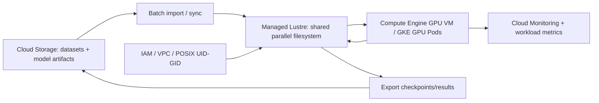
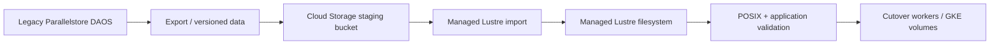

# Parallelstore and Data for High-Performance Computing

High Performance Computing (HPC) and AI training systems must read and write massive volumes of data across hundreds to thousands of parallel processes. A GPU can compute tensors rapidly yet sit idle waiting for data to arrive slowly over disks, networks, or object storage. When many nodes share checkpoints, models, images, simulation inputs, or analysis results, storage architecture directly dictates the speed and cost of the entire cluster.

**Parallelstore** was the name of the parallel file system service Google Cloud previously offered on **DAOS (Distributed Asynchronous Object Storage)**. Current Google Cloud documentation has transitioned from Parallelstore to **Google Cloud Managed Lustre**, a managed parallel file system built on Lustre/DDN EXAScaler technology. **The two products are not merely renamed**: they have different architectures, clients, APIs, drivers, and deployment workflows.

> **Product Lifecycle Note (November 2026):** Google Cloud previously announced a deprecation date of **October 31, 2026** for legacy Parallelstore; legacy Parallelstore documentation URLs now redirect to Managed Lustre. For new architectures, evaluate **Managed Lustre** using official documentation. If you currently operate legacy Parallelstore, verify support status, migration timelines, and instance accessibility with Google Cloud Support; do not interpret "deprecated" as meaning every existing instance has automatically been deleted or shut down.

This lesson belongs to the **Specialized Infrastructure** chapter in the **CLOUD_PROVIDERS_GCP** module. It connects Compute Engine, GKE, IAM, VPC, Cloud Storage, GPUs/TPUs, reliability observability, and FinOps to design performant and resilient HPC/AI data pipelines.

## 1. Learning Objectives

After this lesson, you will be able to:

- Explain why HPC and AI require a parallel file system.
- Distinguish historical DAOS-based Parallelstore from current Google Cloud Managed Lustre.
- Compare parallel file systems, Cloud Storage object stores, Filestore, and Local SSDs.
- Design data tiering across Cloud Storage, high-speed scratch workspaces, and durable repositories.
- Architect topologies spanning Compute Engine, GKE, GPUs/TPUs, VPCs, and filesystem clients.
- Understand POSIX semantics, metadata operations, IOPS, throughput, latency, and the small-files problem.
- Size Managed Lustre capacity and performance tiers for real workloads.
- Verify quotas, regions/zones, IAM, service agents, and file permissions.
- Execute safe import/export workflows between Cloud Storage and Managed Lustre.
- Configure CSI PersistentVolumes/PersistentVolumeClaims on GKE and mounts on VMs.
- Benchmark performance with IOR, mdtest, and real application workloads.
- Plan data protection, recovery, cutovers from legacy Parallelstore, and cost optimization.

## 2. Why Does HPC Need a Parallel File System?

A typical app processes a handful of files at once. HPC workloads look very different:

- 1,000 MPI processes simultaneously reading input shards.
- Hundreds of GPUs streaming training data at high rates.
- Thousands of workers writing simulation output files.
- A job writing a terabyte-scale model checkpoint within a narrow window.
- Nodes needing a unified shared namespace and consistent file permissions.
- Many processes concurrently creating, renaming, and stat'ing files.

A traditional single-server NFS share can quickly bottleneck on metadata or bandwidth as client counts climb. A parallel file system distributes data and/or metadata operations across multiple servers to deliver far higher aggregate throughput and IOPS.

### 2.1. Performance Concepts

| Concept | Meaning | Example |
|---|---|---|
| Sequential throughput | GiB/s of continuous reads or writes | Streaming large shards for AI training |
| IOPS | I/O operations per second | Small random block reads |
| Metadata operations | Creating, opening, `stat`ing, listing, renaming files | Dataset of millions of tiny images |
| Latency | Response time for a single operation | Opening a file and reading bytes |
| Concurrency | Number of processes/clients sharing the filesystem | Thousands of GPU workers |
| Data locality | Network/physical proximity between compute and storage | GPU VMs in the same zone as the filesystem |
| Cache hit ratio | Share of reads served from cache | Repeated training epochs |
| Effective goodput | Portion of I/O translating into useful work | Samples/second rather than raw GiB/s |

A filesystem's published throughput is a **conditional aggregate ceiling**, not a guaranteed rate for a single VM. NIC bandwidth, client count, I/O sizes, parallelism, and access patterns constrain real-world results.

### 2.2. POSIX and a Shared Namespace

Scientific code routinely uses patterns like:

```python
from pathlib import Path

dataset = Path("/mnt/hpc/datasets/train")
for sample in dataset.glob("*.bin"):
    with sample.open("rb") as handle:
        payload = handle.read()
        process(payload)
```

This assumes standard filesystem semantics with directories and paths. Object stores like Cloud Storage are normally accessed via object APIs; slashes `/` in object names do not turn a bucket into a POSIX filesystem. FUSE mounts offer a file-like interface, yet their semantics, caching, throughput, and limits differ from dedicated parallel file systems.

A parallel file system fits when code, frameworks, or workflows rely on shared file access across machines and heavy concurrent reads/writes. Still, validate the exact POSIX compliance of any product and version against the syscalls your application needs.

## 3. Legacy Parallelstore vs. Current Managed Lustre

| Feature | Legacy Parallelstore | Google Cloud Managed Lustre |
|---|---|---|
| Core technology | DAOS | Lustre / DDN EXAScaler |
| Documentation | Old Parallelstore paths now redirect | `/managed-lustre/docs` |
| Control plane / API | `parallelstore.googleapis.com` | `lustre.googleapis.com` |
| CLI | `gcloud parallelstore` (legacy) | `gcloud lustre` |
| Client | DAOS/dfuse mechanisms and supported envs | Lustre client and `mount -t lustre` |
| GKE CSI | Legacy Parallelstore driver, now marked deprecated | `lustre.csi.storage.gke.io` |
| Data model | Verify export formats and tools | POSIX filesystem and Cloud Storage transfers |
| New architecture choice | Do not select for new deployments | Current product to evaluate |

**Do not simply swap API names, Terraform resources, or StorageClasses** and expect a seamless migration. You must provision a Managed Lustre instance, VPC connectivity, clients, mounts, data, and permissions, then validate applications on the new filesystem.

Google Cloud Cluster Toolkit issued a deprecation notice for Parallelstore modules in January 2026; the GKE API also marks `ParallelstoreCsiDriverConfig` as unsupported going forward. For legacy environments, verify exact running versions and account-specific support plans.

### 3.1. Historical Context on Parallelstore

Parallelstore reached GA in 2024 to deliver high throughput, IOPS, and metadata access for AI/HPC. DAOS focused on distributed metadata and a key-value architecture backed by NVMe and specialized consistency handling.

Key Parallelstore concepts included:

- **Instance:** parallel filesystem provisioned in a project/location.
- **Client:** compute node accessing the namespace and data via compatible tools/clients.
- **Access point/network:** connection endpoints reachable inside the VPC.
- **Cloud Storage import/export:** staging datasets into compute workspaces and exporting outputs.
- **Capacity/throughput:** provisioned resource tiers and limits.
- **Lifecycle:** create, access, import/export, backup/export, and delete instances.

These concepts still help build intuition for parallel storage, **but all new deployment examples in this lesson use Managed Lustre** to avoid guiding new setups onto a deprecated product.

## 4. When Should You Choose a Parallel File System?

| Requirement | Typical Options | What to Check |
|---|---|---|
| Durable raw storage, archives, data lakes | Cloud Storage | Storage class, lifecycle, throughput, APIs |
| Multi-node POSIX with high throughput/IOPS | Managed Lustre | Capacity/tier, VPC, same-zone clients |
| General NFS file shares, moderate load | Filestore | NFS semantics, tier, networking, pricing |
| Ultra-fast scratch on a single VM | Local SSD | Ephemeral nature, instance lifecycle, backups |
| Transactional databases | Cloud SQL, AlloyDB, Spanner | Transactions, queries, HA, RPO/RTO |
| Inference models needing minimal shared files | Local cache or direct Cloud Storage | Cold start, local disk, object reads |

Not every GPU needs Managed Lustre. A GPU VM loading model weights once at startup works fine with Cloud Storage and local caching. A parallel file system pays off when **many nodes read/write concurrently**, POSIX semantics are needed, or data I/O is a proven bottleneck.

### 4.1. Common Data Patterns

- **Large sequential files:** large shards or checkpoints; throughput dominates.
- **Many small files:** millions of images and labels; metadata/IOPS dominate.
- **Random I/O:** indices, genomics, HPC checkpoints; latency and IOPS matter.
- **Read-heavy repeated epochs:** caching and prefetching reduce backend I/O.
- **Write-heavy checkpoints:** requires write throughput, durability, and reliable export flows.
- **Mixed workloads:** prevent a metadata-heavy job from starving another job's throughput.

A strong pattern uses three tiers: **Durable Cloud Storage → High-speed parallel filesystem during compute → Cloud Storage for results/archives**.

## 5. Reference Architecture for AI Training



Flow:

1. Validated training data resides in Cloud Storage.
2. A workflow imports a dataset snapshot or version into the filesystem.
3. Multiple workers read from the shared namespace under scheduler orchestration.
4. CPUs decode/tokenize while GPUs/TPUs execute compute kernels.
5. Checkpoints are written as files, validated, and exported to Cloud Storage.
6. Once the job finishes and the data owner signs off, delete the instance when no longer needed.

**Consistency note:** batch import/export is not automatic bidirectional live sync. Modifying files on the filesystem during an export can produce inconsistent snapshots unless coordinated with a checkpoint barrier or write freeze. Always define the authoritative source of truth for every dataset.

### 5.1. Three Data Layers

| Layer | Role | Requirements |
|---|---|---|
| Cloud Storage | Source of truth, archive, backup, lifecycle | IAM, versioning/retention, checksums |
| Managed Lustre | High-performance active working set | POSIX, throughput/IOPS, compute co-location |
| Local RAM/SSD cache | Hot cache or ephemeral scratch | Never the sole copy; subject to loss |

Never treat a high-performance scratch filesystem as the sole copy of critical checkpoints without a verified recovery workflow.

## 6. Sizing Managed Lustre: Capacity and Tiers

Managed Lustre offers throughput tiers scaled by provisioned capacity:

- 125 MB/s per TiB.
- 250 MB/s per TiB.
- 500 MB/s per TiB.
- 1,000 MB/s per TiB.
- **Dynamic tier:** an alternative focused on hot/cold data and caching, with different semantics and limits from numbered tiers; evaluate per dedicated documentation.

Valid capacities, step increments, minimums/maximums, and quotas depend on the tier. 2026 documentation describes capacities starting from **9,000 GiB** up to tens of PiB with tier-specific limits. Never assume arbitrary GiB values are valid.

### 6.1. Estimating Theoretical Throughput

For numbered tiers:

```text
theoretical_MBps = (capacity_GiB / 1024) × tier_MBps_per_TiB

Example:
capacity = 18,000 GiB
tier = 500 MB/s/TiB

theoretical_MBps ≈ 18,000 / 1024 × 500
                 ≈ 8,789 MB/s
```

This figure is a **tier-level theoretical ceiling**, not a guarantee that one client sees 8,789 MB/s. VM/NIC bandwidth, TCP overhead, block sizes, process counts, I/O patterns, caches, and server load govern observed speeds.

### 6.2. Selecting a Tier by Workload

| Workload | Selection Approach | Deciding Metric |
|---|---|---|
| Large sequential HPC reads | Numbered tier matching target aggregate GB/s | Read throughput, cost/TiB |
| Many small images & metadata | Config with sufficient IOPS/metadata capacity | Opens/stats/s, files/s, GPU stalls |
| Multi-epoch repeated training | Consider Dynamic if working set/cache fits | Cache hit ratio, training step time |
| Bursty checkpoint writes | Write throughput and checkpoint window | GiB/s, time to durable export |
| Infrequently run workloads | Compare against direct Cloud Storage/local cache | Total cost/job, idle duration |

**Performance tier is chosen at creation and cannot be arbitrarily changed afterward**; Managed Lustre supports scaling capacity within documented tier rules, though not every resize path is supported. Plan capacity headroom upfront and maintain a runbook to spin up a new instance if a tier change is needed.

### 6.3. Sizing from Workload Demand

Example cluster of 64 GPU workers, each requiring 120 MiB/s sustained reads:

```text
estimated_aggregate_demand = 64 × 120 MiB/s
                            = 7,680 MiB/s
                            ≈ 7.5 GiB/s
```

Add headroom for overhead, bursts, and checkpoint writes. Then pick a tier/capacity whose theoretical throughput covers the target, verify aggregate client NIC capacity, and benchmark. GPU workers rarely maintain flat I/O rates; build models from real profiling data.

## 7. Quotas, Regions, Zones, and VPCs

### 7.1. Co-Locating Compute and Storage

With Managed Lustre, place VM/GKE clients in the **same zone** as the filesystem for lowest latency and peak throughput. Place Cloud Storage buckets in alignment with data residency and cost rules. Cross-region transfers add latency and egress fees.

Illustrative layout:

```text
Project: hpc-sandbox
Region: us-central1
Zone: us-central1-a
VPC: hpc-vpc

Compute Engine GPU VMs / GKE nodes: us-central1-a
Managed Lustre instance:          us-central1-a
Cloud Storage data lake:          compatible regional location
```

Do not assume every GPU machine type and Managed Lustre are available in the same zone. Verify **GPU quotas/capacity, Lustre quotas, and VPC subnets** together before picking a location.

### 7.2. Throughput and Capacity Quotas

By 2026, Managed Lustre replaced older per-tier quotas with shared **capacity and throughput** quotas across numbered tiers; Dynamic tier quotas follow separate rules. Documentation scopes quotas by VPC and region/zone with regional pools: consuming capacity in one zone reduces available regional quota.

Before creating an instance, verify:

- Project and enabled APIs.
- Remaining GiB capacity quota.
- Corresponding GB/s throughput quota.
- Client GPU/VM quotas.
- Zone supports Managed Lustre.
- Available VPC network and IP ranges.
- Physical capacity, maintenance windows, and availability.

Having quota **does not mean** immediate capacity exists to provision.

### 7.3. Networking

Managed Lustre requires proper VPC configuration; client VMs/GKE nodes must reach it via configured VPC paths, firewalls, and routes. Review current guidance for Shared VPC, VPC Service Controls, peering, and IP allocations.

Never open all inbound traffic from the Internet to "fix mounting." A parallel filesystem is internal compute infrastructure. Enforce least privilege both at the IAM control-plane layer and at the POSIX file-permission layer.

## 8. Creating a Managed Lustre Instance in a Sandbox

> **Cost Warning:** Provisioning an instance with thousands of GiB incurs significant charges immediately upon creation. Only run commands in a sandbox project with an approved budget, quotas, owner, and teardown schedule. Examples below are for learning syntax—do not run blindly.

### 8.1. Prerequisites

- Enable the Managed Lustre API: `lustre.googleapis.com`.
- Hold instance management permissions, e.g., `roles/lustre.admin` at the proper scope.
- Configure VPC/networking and verify quotas.
- Confirm the location is a supported **zone**.
- Select tier and capacity per service sizing rules.
- Define an import/export and cleanup plan.

### 8.2. Instance Creation Example

```bash
gcloud services enable lustre.googleapis.com \
  --project=PROJECT_ID

gcloud lustre instances create hpc-lustre-lab \
  --project=PROJECT_ID \
  --location=us-central1-a \
  --network=projects/PROJECT_ID/global/networks/hpc-vpc \
  --filesystem=hpcdata \
  --capacity-gib=18000 \
  --per-unit-storage-throughput=1000
```

`hpcdata` is the client-side Lustre filesystem name (up to 8 alphanumeric characters). The `18,000 GiB` size is a valid CLI documentation example for the 1000 tier, not a blanket recommendation for all workloads.

Inspect the instance:

```bash
gcloud lustre instances describe hpc-lustre-lab \
  --project=PROJECT_ID \
  --location=us-central1-a \
  --format="yaml(name,state,capacityGib,filesystem,mountPoint,network)"
```

Instance creation is a long-running operation; only attempt mounting once `state` reaches `ACTIVE`. If the command returns an operation ID, wait for completion rather than assuming the filesystem is ready immediately.

### 8.3. IaC Model

For reproducible environments, use Cluster Toolkit or the official Terraform provider supporting Managed Lustre to manage:

- Instance name, capacity, throughput tier, and zone.
- VPC, subnetwork, IP ranges, routes, and firewalls.
- Service accounts, IAM, and Cloud Storage bucket permissions.
- GKE CSI add-on or VM image/client setup.
- Logging/Monitoring, labels, and budgets.
- Lifecycle, maintenance, and decommissioning plans.

Never copy legacy `parallelstore` Terraform modules into new projects. `google_lustre_instance` and `lustre.googleapis.com` follow a different resource/API schema.

## 9. Mounting on Compute Engine

### 9.1. Supported Clients

Compute Engine VMs need a Lustre-compatible OS, kernel, and client. Current Managed Lustre guides list supported OS images (e.g., specific Rocky Linux, RHEL, or Ubuntu releases). Never pick an arbitrary kernel expecting the Lustre module to load cleanly.

VM connection documentation also notes that **Managed Lustre cannot be mounted on Shielded VMs** within documented support bounds. Confirm organizational security policies before choosing VM images or boot options; never weaken production security postures without formal review.

### 9.2. Inspecting the Mount Point

```bash
gcloud lustre instances describe hpc-lustre-lab \
  --project=PROJECT_ID \
  --location=us-central1-a \
  --format="value(mountPoint)"
```

The output contains the endpoint and filesystem name, such as `10.115.0.3@tcp:/hpcdata`. Always use your instance's **actual** output; never hardcode sample IPs.

### 9.3. Mounting from a VM with the Lustre Client

Example on a VM with a supported client installed and connected to the right VPC:

```bash
sudo mkdir -p /mnt/hpc

# Replace IP_ADDRESS and FILESYSTEM_NAME with your actual mountPoint:
sudo mount -t lustre IP_ADDRESS@tcp:/FILESYSTEM_NAME /mnt/hpc

mount | grep /mnt/hpc
df -h /mnt/hpc
```

Exact mount syntax and network parameters should follow the `mountPoint` output. `/etc/fstab` with `_netdev` can mount after networking initializes, though you need a runbook for unreachable filesystems so VMs do not hang during boot.

### 9.4. Verifying POSIX and Permissions

```bash
# Run against the mount in a lab environment.
mkdir -p /mnt/hpc/labs/input

printf 'hpc-ready\n' > /mnt/hpc/labs/input/hello.txt

ls -l /mnt/hpc/labs/input
cat /mnt/hpc/labs/input/hello.txt

# After finishing the lab:
rm -f /mnt/hpc/labs/input/hello.txt
```

If file creation/writing fails:

- Check mount status, network connectivity, POSIX UID/GID, and file modes.
- Check filesystem quotas, free capacity, and free inodes.
- Check client/kernel logs and server status.
- Never blindly delete other users' data to "free up space."

Clients across a cluster must maintain consistent UID/GID mappings; if the same username has different UIDs across two VMs, file permissions will behave unexpectedly.

## 10. Managed Lustre on GKE with CSI

Managed Lustre provides a dedicated GKE CSI driver: `lustre.csi.storage.gke.io`. This driver is **distinct** from the legacy Parallelstore CSI driver. It can dynamically provision new volumes or mount pre-existing filesystems depending on configuration.

### 10.1. Dynamic Provisioning

When the Managed Lustre CSI add-on is enabled, GKE can create default StorageClasses corresponding to the numbered performance tiers:

- `lustre-rwx-125mbps-per-tib`
- `lustre-rwx-250mbps-per-tib`
- `lustre-rwx-500mbps-per-tib`
- `lustre-rwx-1000mbps-per-tib`

These provide `ReadWriteMany` (RWX) access across multiple Pods/workloads. Provisioning a PVC can spin up a **real Managed Lustre instance**, carrying major resource and cost impacts; enforce policies preventing unbounded creation and set appropriate reclaim policies.

### 10.2. Example PVC Using a Built-In StorageClass

```yaml
apiVersion: v1
kind: PersistentVolumeClaim
metadata:
  name: hpc-datasets-pvc
spec:
  accessModes:
    - ReadWriteMany
  storageClassName: lustre-rwx-500mbps-per-tib
  resources:
    requests:
      storage: 18Ti
```

The `18Ti` request is illustrative; real requests must satisfy tier minimums/increments, quotas, and cluster configuration. Kubernetes storage requests do not eliminate the need to monitor Billing and provisioned Managed Lustre instances.

### 10.3. Mounting a PVC in a Pod

```yaml
apiVersion: v1
kind: Pod
metadata:
  name: hpc-data-reader
spec:
  restartPolicy: Never
  containers:
    - name: worker
      image: ubuntu:22.04
      command: ["/bin/sh", "-c"]
      args:
        - "ls -lah /mnt/hpc && sleep 60"
      volumeMounts:
        - name: shared-datasets
          mountPath: /mnt/hpc
  volumes:
    - name: shared-datasets
      persistentVolumeClaim:
        claimName: hpc-datasets-pvc
```

This illustrates Kubernetes structure only; the image lacks a real application. Deploy this Pod/PVC only in a GKE environment with the CSI driver, service accounts, quotas, and matching zone.

### 10.4. Reclaim Policies and Data Safety

If a StorageClass sets `reclaimPolicy: Delete`, deleting a PVC/PV can delete the underlying backend instance per lifecycle rules. For valuable data, use pre-provisioned PVs with `Retain` where appropriate and export/back up before deleting. Never alter reclaim policies without understanding which resources they control.

In regional GKE clusters, the filesystem remains zonal, so scheduling must place Pods where they can mount it. Verify node affinity, GPU capacity, and CSI driver topology constraints.

## 11. Cloud Storage Data Integration

### 11.1. Batch Import

Managed Lustre supports importing data from Cloud Storage:

```bash
gcloud lustre instances import-data hpc-lustre-lab \
  --project=PROJECT_ID \
  --location=us-central1-a \
  --gcs-path-uri=gs://DATA_BUCKET/training/ \
  --lustre-path=/datasets/
```

This is an **on-demand copy operation**, not a live bidirectional link. Per documentation, destination paths other than `/` must already exist on the filesystem. Transfers may operate incrementally, copying missing or modified files per service behavior. Monitor the operation and verify manifests afterward.

### 11.2. Exporting Results

```bash
gcloud lustre instances export-data hpc-lustre-lab \
  --project=PROJECT_ID \
  --location=us-central1-a \
  --gcs-path-uri=gs://RESULT_BUCKET/checkpoints/ \
  --lustre-path=/checkpoints/
```

Only export completed checkpoints—after training processes have closed files and written a manifest. For multi-shard checkpoints, use commit markers or checkpoint barriers so half-written checkpoints are never exported.

### 11.3. IAM for Data Transfers

Permissions span two layers:

1. **The identity calling the import/export API** needs `lustre.instances.importData` or `lustre.instances.exportData`.
2. **The Managed Lustre service agent** needs Cloud Storage bucket permissions. Per documentation, the service agent takes the form `service-PROJECT_NUMBER@gcp-sa-lustre.iam.gserviceaccount.com`; read-only imports can use `roles/storage.objectViewer`, while bidirectional import/export may require `roles/storage.objectUser`.

Avoid project-wide `roles/storage.admin` when only one bucket is needed. For cross-project buckets, grant IAM on the project/bucket holding the data, not merely the project hosting the filesystem.

### 11.4. Metadata Synchronization and Limits

When moving between object storage and POSIX:

- Establish mapping rules for UID, GID, mode, and mtime.
- Objects from Cloud Storage may lack full POSIX attributes.
- Symlinks, empty directories, and specific striping layouts may not survive exports intact.
- Never treat Cloud Storage object names/metadata as a drop-in substitute for filesystem metadata.
- Reconcile manifests post-transfer by key/path, file size, checksum, and operation error logs.
- Prevent imports/exports from overwriting active workload files without consistency locks.

### 11.5. Cloud Storage Mirror

Starting in 2026, Managed Lustre introduced **Cloud Storage mirror** under limited availability/allowlisted GA in release notes. It provides an event-driven mechanism to propagate changes from a bucket/prefix into the filesystem under product terms.

Mirror is **not equivalent to bidirectional sync** and should not replace checkpoint exports or conflict resolution logic. Before designing around mirror, verify account allowlisting, operation limits, freshness guarantees, quotas, and failure modes.

## 12. Small Files, Metadata, and Layout Optimization

### 12.1. The Many-Small-Files Problem

A dataset of 50 million images sized 5–50 KiB can cause metadata operations to dominate runtime:

- `open()`, `stat()`, `close()` calls for every file.
- Directory enumeration across massive directories.
- Metadata lock contention across concurrent workers.
- CPU decoding and context-switching overhead.
- Network inefficiency from tiny per-request payloads.

A strong parallel filesystem handles metadata better than standard NFS, yet application data layout still dictates end-to-end performance.

### 12.2. Data Sharding Strategies

- Bundle files into framework-friendly shards/containers such as tar shards, TFRecord, or Parquet.
- Avoid placing millions of files into a single flat directory.
- Name files/partitions deterministically to simplify work distribution.
- Separate read-only datasets from output/checkpoint directories.
- Use prefetching, asynchronous data loaders, and pinned memory as supported by the framework.
- Maintain manifests recording shards, file counts, checksums, and versions.
- Benchmark both file-per-sample and sharded layouts.

**Do not blindly bundle files merely because file count is high** if random-access patterns, update granularity, or format conversion create worse overhead. Benchmark representative samples and measure training goodput.

### 12.3. Safe Concurrent Writes Across Workers

- Write each worker's output to its own namespace/path or partitioned filename.
- Write to a temporary file, flush/close, and publish via atomic rename where supported and tested.
- Never let two writers update the same file concurrently without a locking protocol.
- For multi-shard checkpoints, write the manifest/commit marker last.
- Never run `ls` on open files to infer completion.
- Verify consistency semantics before relying on `mmap` or file locking.

## 13. Benchmarking Filesystem Performance

Running `dd` on a single VM proves almost nothing. HPC requires measuring aggregate throughput, random IOPS, metadata rates, and real application performance.

### 13.1. Tools

- **IOR:** benchmarks parallel throughput/IOPS, typically launched over MPI.
- **mdtest:** benchmarks metadata operations like create, stat, and remove.
- **fio:** models low-level I/O patterns when appropriate.
- **Real applications:** samples/s, model load times, checkpoint durations, and GPU stalls.

Google Cloud publishes performance testing guides for Managed Lustre on Compute Engine and GKE. Benchmarks can write massive volumes and generate billing charges; run only in approved environments.

### 13.2. Benchmark Plan

1. Lock filesystem instance capacity, tier, and zone.
2. Lock client node count, vCPUs, GPUs, and NIC bandwidth.
3. Keep datasets, batch sizes, and I/O patterns identical across candidates.
4. Warm up properly or measure cold-cache and warm-cache runs separately.
5. Measure sequential read and write throughput.
6. Measure random small-block IOPS.
7. Measure creates/stats/deletes per second per directory layout.
8. Measure GPU utilization, samples/s, and checkpoint duration.
9. Capture p95/p99 file-open latency when relevant.
10. Verify free space, inodes, network links, and client CPUs are not silently bottlenecking.
11. Run multiple iterations to distinguish variance from systemic bottlenecks.
12. Archive reports and clean up test files safely.

### 13.3. Estimating Network-Bound Ceilings

```text
max_observed_throughput
  <= min(filesystem_provisioned_throughput,
         combined_client_network_capacity,
         application_I/O_demand)
```

If a filesystem offers 8.8 GB/s theoretical throughput while your client fleet tops out at 4 GB/s aggregate due to NIC or thread limits, upgrading the storage tier will not help. Pinpoint bottlenecks with telemetry.

### 13.4. Sample Benchmark Report

```yaml
benchmark:
  workload: multi-gpu-training
  filesystem: managed-lustre
  zone: us-central1-a
  tier_mbps_per_tib: 500
  capacity_gib: 36000
  clients: 16
  data_pattern: random-read-small-files
results:
  aggregate_read_gib_per_s: MEASURED
  random_read_iops: MEASURED
  metadata_stats_per_s: MEASURED
  gpu_utilization_percent: MEASURED
  training_samples_per_s: MEASURED
  checkpoint_time_seconds: MEASURED
cost:
  storage_cost_per_job: CALCULATED
  compute_cost_per_job: CALCULATED
conclusion: ACCEPT_OR_REJECT
```

Never populate `MEASURED` fields with theoretical datasheet figures. Valid conclusions require real measurements and total cost comparisons.

## 14. Monitoring and SLOs for HPC Data

### 14.1. Metrics to Track

| Layer | Metrics |
|---|---|
| Filesystem | Used/free capacity, read/write throughput, IOPS |
| Metadata | Inode usage, create/stat/remove rates, metadata latency |
| Clients | Mount health, connection errors, timeouts, retransmits |
| Compute | GPU utilization, GPU idle time, CPU, host RAM, NIC |
| Data transfers | Bytes transferred, operation duration, failures, backlog |
| Jobs | Samples/s, training step time, checkpoint latency, retries |
| Cost | Cost/GPU-hour, cost/job, provisioned-vs-used filesystem capacity |

If Cloud Monitoring lacks a specific metric you need, add application/client instrumentation. Never infer actual storage throughput from CPU utilization alone.

### 14.2. Actionable Alert Examples

- Filesystem free space drops below approved headroom.
- Inodes near exhaustion despite ample remaining GiB capacity.
- Import/export operation fails or exceeds duration thresholds.
- Spike in client mount errors or I/O timeouts.
- Sharp drop in training throughput paired with low GPU utilization.
- Checkpoints taking too long or missing the job's RPO window.
- High budget burn rate while the filesystem has zero active workloads.

Tie AI/HPC SLOs to work efficiency—epoch duration, sample throughput, and checkpoint completion time—not merely "instance is ACTIVE."

## 15. Security and Access Control

### 15.1. API Governance vs. File Permissions

**IAM** governs who can create, modify, or delete instances, trigger transfers, and access Cloud Storage. **POSIX UID/GID/modes and filesystem ACLs** govern who reads and writes files once mounted.

A service account holding `lustre.instances.get` does not automatically gain read access to every file inside the namespace. Conversely, a process with POSIX mount access still needs valid network/client connectivity and can affect data well beyond its IAM API footprint.

### 15.2. Least Privilege

- Separate infrastructure admins creating filesystems from job runners accessing mounts.
- Grant `lustre.instances.importData`/`exportData` strictly to transfer workflows.
- Scope Cloud Storage bucket IAM narrowly for the Managed Lustre service agent.
- Use dedicated service accounts for training jobs, preferring Workload Identity Federation for GKE.
- Synchronize UIDs/GIDs across all clients and avoid running processes as root unnecessarily.
- Enforce network segmentation, firewalls, and VPC controls.
- Restrict SSH via OS Login/IAP and prohibit static JSON keys.
- Capture Cloud Audit Logs for administrative operations.

### 15.3. Encryption and Sensitive Data

Managed Lustre encrypts data at rest and supports CMEK under product terms. When using CMEK, properly manage Cloud KMS keys, service agent permissions, and key lifecycles; disabling or destroying keys renders data inaccessible.

Never put PII, secrets, or model keys into logs or filenames. For regulated data, validate data residency, retention, networking, backups, and organizational security controls before staging data into HPC regions.

## 16. Reliability and Resilience

### 16.1. Setting Durability Expectations

A high-performance shared filesystem accelerates active jobs—it does not replace backups or offsite copies. Even on a managed service, the application team owns defining:

- Checkpoint cadence and training RPO.
- Storage location for completed checkpoints.
- Export mechanisms to Cloud Storage.
- Recovery procedures if the filesystem or network experiences an outage.
- Procedures to recreate the instance and restore datasets.
- Data consistency guards during import/export.

If your latest critical checkpoint lives only on the active filesystem and gets deleted with the instance, training cannot safely resume from that step.

### 16.2. Immutable Checkpoints

A resilient checkpoint workflow:

1. Each worker writes its shard to a staging directory keyed by checkpoint ID.
2. All workers finish, flush, and close file handles.
3. A leader verifies the manifest, file counts, and checksums.
4. Export the checkpoint set to Cloud Storage.
5. Confirm the transfer operation succeeded and reconcile objects.
6. Write a `READY` marker or final manifest in durable storage.
7. Delete older checkpoints only after the new version is verified.

If export fails, never mark the checkpoint `READY`. For recovery, import a verified complete checkpoint and reload model/optimizer states.

### 16.3. Maintenance and Planned Downtime

Managed Lustre has maintenance policies and service updates. Long-running workloads may need pause/resume, retry, remount, checkpointing, and incident notification mechanisms. Never assume a mount can never experience interruptions just because it is managed.

User-facing AI inference may need multiple replicas, standby capacity, local caching, or fallbacks if the filesystem is unavailable. Batch training typically values clean scheduling and restartability over 100% single-node uptime.

## 17. FinOps and GPU Efficiency

### 17.1. Cost Model

```text
total_hpc_job_cost
  = filesystem_provisioned_capacity_cost
  + Cloud Storage transfer/import/export cost
  + Cloud Storage storage/operations cost
  + GPU/CPU VM runtime cost
  + network costs
  + monitoring/logging and operations cost
```

Because parallel filesystems bill on **provisioned** capacity, storing only 2 TiB on an 18 TiB instance does not reduce provisioned storage cost. Conversely, faster storage that cuts GPU wait times can lower **total job cost**.

### 17.2. Job Economics Example

Hypothetical comparison of two architectures completing one epoch:

| Option | GPU + Compute | File Storage | Total / Job | Duration |
|---|---:|---:|---:|---:|
| A: Slow data loading | 100 cost units | 5 | 105 | 10 hours |
| B: Fast parallel filesystem | 70 cost units | 20 | 90 | 7 hours |

These figures are illustrative, **not Google Cloud pricing**. Option B wins by eliminating GPU wait time—but only when benchmarks confirm improved throughput and checkpoint speeds.

### 17.3. Optimization Levers

- Track cost/job rather than raw cost/GiB.
- Right-size capacity and tiers to measured I/O needs.
- Keep long-term datasets in Cloud Storage and stage only active working sets.
- Export checkpoints/results before deleting filesystems.
- Delete sandbox instances and idle clusters promptly after runs.
- Use job scheduling to keep GPU utilization high.
- Apply owner/cost-center labels and set budget alerts.
- Minimize cross-region transfers and redundant imports.
- Apply Cloud Storage lifecycle policies to aging data per policy.
- Verify billing SKUs and regional rates before deploying.

### 17.4. Never Reuse Legacy Parallelstore Pricing

Historical Parallelstore pricing pages used a different capacity and import/export billing model. **Never apply legacy pricing tables to Managed Lustre.** Managed Lustre has distinct throughput tiers, pricing, and terms; check [Managed Lustre pricing](https://cloud.google.com/products/managed-lustre) for current details.

## 18. Migration Plan from Legacy Parallelstore to Managed Lustre

Teams still running DAOS-based Parallelstore should treat this as a **cross-filesystem migration**, not an API rename.

### 18.1. Preflight

1. Confirm legacy instance support/accessibility and engage Google Cloud Support.
2. Inventory datasets, sizes, file counts, POSIX permissions, symlinks, and hard links.
3. Catalog mounted clients, applications, job schedulers, and CSI volumes.
4. Capture baseline throughput, IOPS, metadata latency, and GPU utilization.
5. Select Managed Lustre tier/zone/network and plan quotas.
6. Define the source of truth and write-freeze cutover window.
7. Verify export paths from legacy Parallelstore remain operational.
8. Design data validation and rollback plans before cutover.

### 18.2. Data Migration

A standard pattern while legacy export remains available:



Ensure data is exported in a consistent state. Active legacy instances receiving writes may require delta transfers and a write freeze before final cutover.

Reconcile:

- Total files and total bytes per partition.
- Content checksums.
- File types, ownership, modes, and timestamps per mapping rules.
- Symlinks/empty directories that Cloud Storage exports may omit.
- Application-level invariants and checkpoint readability.
- IOR/mdtest metrics against baseline.
- Confirmation that all clients switched to the new mount/CSI driver.

### 18.3. Go/No-Go Decision

**GO** only when data reconciles cleanly, quotas/networking/mounts work, benchmarks meet SLAs, and critical jobs run reliably on Lustre. **NO-GO** if critical files are missing, permissions break, severe performance regressions appear, or no recovery plan exists.

Once jobs move to the new filesystem and write new data, falling back to the legacy instance without reverse syncing causes split-brain divergence. Keep cutover one-directional using verified checkpoints/exports or an explicit fail-forward plan.

### 18.4. Decommissioning

After a stabilization period:

1. Confirm exports/checkpoints are safely stored in Cloud Storage.
2. Verify zero clients remain mounted to the legacy instance.
3. Update Terraform/Cluster Toolkit configs and GKE StorageClasses.
4. Remove unused service accounts and IAM bindings.
5. Verify billing and retention compliance.
6. Delete legacy resources on an approved schedule.
7. Archive the migration report and audit trail.

Never delete the legacy filesystem immediately after the very first successful mount on the new one.

## 19. Common Errors and Diagnostics

| Symptom | Possible Cause | Resolution |
|---|---|---|
| `gcloud parallelstore` fails for new creates | Legacy/deprecated API | Follow Managed Lustre docs and `gcloud lustre` |
| GKE rejects old driver | Parallelstore CSI deprecated | Switch to `lustre.csi.storage.gke.io` |
| Create fails with quota error | Capacity/throughput/VPC quota shortfall | Inspect quotas and request valid increases |
| Create succeeds but mount fails | Wrong VPC/routes/firewall/client OS | Check `mountPoint`, networking, and Lustre client |
| POSIX permission denied | Mismatched UID/GID/mode across nodes | Sync identities and adjust ACLs/modes |
| Files missing after import | Transfer incomplete or wrong prefix | Check operation status, paths, IAM, and manifests |
| Transfer permission denied | Service agent lacks bucket permissions | Grant required IAM on the bucket |
| Slow I/O on a single VM | NIC/client throughput ceiling | Run multi-client benchmarks and profile |
| Slow performance on many small files | Metadata bottleneck | Shard datasets, benchmark with mdtest, tune layout |
| Low GPU utilization | Slow data loaders, preprocessing, or I/O | Prefetch, scale workers, improve caching |
| No space left on device | Capacity, inodes, OST imbalance, or grants | Inspect free space, inodes, and target metrics |
| Import/export won't queue | Another operation of the same type is running | Wait for completion before launching the next |
| Deleting PVC wipes data | `reclaimPolicy: Delete` | Review lifecycle/`Retain` before creating PVCs |
| High bills while cluster is idle | Filesystem remains provisioned | Export, delete safely when idle, set budgets |
| Missing data post-cutover | Concurrent writes without checkpoint barrier | Freeze writes, reconcile, run delta transfer |
| Tier picked from datasheet misses SLA | Real I/O pattern differs from assumptions | Benchmark actual throughput and metadata ops |

### 19.1. Troubleshooting Workflow

1. Confirm which service and API are involved: legacy Parallelstore vs. Managed Lustre.
2. Check instance state and zone.
3. Verify VPC, subnets, routes, client network reachability, and filesystem mount.
4. Verify kernel/driver/client compatibility.
5. Inspect Cloud Monitoring, client logs, and I/O errors.
6. Check quotas, free capacity, inode usage, and permissions.
7. Reconcile Cloud Storage import/export logs and manifests.
8. Profile CPU/GPU, data-loader workers, and aggregate NIC throughput.
9. Distinguish IOPS/metadata bottlenecks from application bottlenecks.
10. Document root cause, remediation, and regression tests.

## 20. Lab: GPU Training Data on Managed Lustre

**Scenario:** A Compute Engine GPU or GKE GPU cluster must read 5 TiB of images and write per-epoch checkpoints. The team needs to pick a filesystem, evaluate cost/performance, and guarantee checkpoints survive job teardown.

### 20.1. Preparation

- Approved sandbox project, budget, and IAM.
- Cloud Storage bucket containing an anonymized dataset.
- Zone supporting both target GPUs and Managed Lustre.
- Capacity/quotas matching the chosen performance tier.
- Supported Lustre client VM image or GKE CSI driver.
- IOR/mdtest benchmarks and a small AI training workload.
- Export and cleanup plan with zero real customer data.

### 20.2. Steps

1. Measure baseline training throughput reading directly from Cloud Storage.
2. Calculate aggregate read demand across GPU workers.
3. Select two capacity/tier candidates and estimate cost/job.
4. Create a test Managed Lustre instance in an authorized sandbox.
5. Mount on VMs or attach via PVC/PV on GKE.
6. Import the dataset from Cloud Storage and monitor the operation to completion.
7. Reconcile file counts, byte sizes, and checksums against the manifest.
8. Run IOR for multi-client throughput and mdtest for metadata performance.
9. Run one training epoch; measure GPU utilization, samples/s, and CPU bottlenecks.
10. Write a multi-shard checkpoint and verify completion.
11. Export the checkpoint to Cloud Storage and reconcile objects.
12. Test restoring the checkpoint into a clean namespace.
13. Compare cost/job before and after introducing the parallel filesystem.
14. Clean up compute and filesystem resources per policy once results are archived.

### 20.3. Submission Template

```yaml
experiment_id: hpc-storage-lab-01
project: PROJECT_ID
zone: ZONE
filesystem:
  product: managed-lustre
  tier_mbps_per_tib: SELECTED
  provisioned_capacity_gib: SELECTED
  access_method: compute-engine-or-gke
dataset:
  source: gs://DATA_BUCKET/training/
  files_expected: MEASURED
  bytes_expected: MEASURED
verification:
  import_operation: SUCCESS_OR_FAILURE
  file_count_match: true_or_false
  checksum_match: true_or_false
performance:
  aggregate_gib_per_s: MEASURED
  metadata_ops_per_s: MEASURED
  gpu_utilization_pct: MEASURED
  samples_per_second: MEASURED
recovery:
  checkpoint_exported: true_or_false
  restore_validated: true_or_false
finops:
  cost_per_epoch: CALCULATED
decision: GO_OR_NO_GO
```

Never fill `MEASURED` fields with theoretical ceilings or marketing numbers. Valid conclusions require real measurements and total cost comparisons.

## 21. Pre-Production Checklist

- [ ] Recognized legacy DAOS Parallelstore and current Managed Lustre are distinct products.
- [ ] Avoided legacy Parallelstore APIs, CSI drivers, or Terraform modules for new projects.
- [ ] Verified workload genuinely requires POSIX, multi-client access, and high-performance shared storage.
- [ ] Captured baseline throughput/IOPS, file counts, metadata rates, and GPU utilization.
- [ ] Sized tier/capacity from performance targets and working set size.
- [ ] Confirmed target zone supports both the filesystem and required GPUs/TPUs.
- [ ] Verified capacity/throughput quotas and VPC networking.
- [ ] Co-located Compute/GKE nodes in the same zone with sufficient NIC/client bandwidth.
- [ ] Confirmed OS/kernel and Lustre client/CSI driver compatibility.
- [ ] Separated admin/transfer IAM from runtime job permissions.
- [ ] Granted the Managed Lustre service agent exact required Cloud Storage bucket roles.
- [ ] Synchronized POSIX UID/GID/modes across all clients.
- [ ] Prevented secrets, PII, or model keys from leaking into logs or filenames.
- [ ] Enforced manifests and checksums for Cloud Storage imports/exports.
- [ ] Accounted for symlinks, empty directories, and metadata differences.
- [ ] Closed and verified checkpoints before exporting to durable storage.
- [ ] Tested restores and prepared runbooks for mount errors, timeouts, and maintenance.
- [ ] Configured dashboards/alerts for inodes, free space, throughput, IOPS, and job goodput.
- [ ] Passed IOR/mdtest and real application benchmarks against acceptance criteria.
- [ ] Defined cost/job, GPU idle-time tracking, transfer budgets, and deletion policies.
- [ ] Reviewed CSI reclaim policies before allowing apps to create PVCs.
- [ ] Rehearsed cutover, rollback, and decommissioning if migrating from legacy Parallelstore.
- [ ] Deleted filesystems only after confirming all critical data has durable copies.

## Conclusion

Parallelstore was an important milestone for parallel storage on Google Cloud, leveraging DAOS to deliver high I/O and metadata throughput for AI/HPC. At the time of this lesson, however, legacy Parallelstore has entered deprecation and official documentation has transitioned to **Google Cloud Managed Lustre**, a distinct service powered by the Lustre filesystem.

For new designs, focus on **Managed Lustre**: co-locate it in the same zone as Compute Engine/GKE, pick capacity and performance tiers from benchmarks, manage VPC/IAM/POSIX permissions carefully, use Cloud Storage as durable backing storage, and import/export via verified checkpoints. A parallel file system delivers true value only when it raises **GPU/CPU goodput, shortens time-to-solution, and lowers total job cost**—not merely by hitting datasheet GB/s numbers.

## References

- [Google Cloud — Managed Lustre overview](https://docs.cloud.google.com/managed-lustre/docs/overview)
- [Google Cloud — Create Managed Lustre instance](https://docs.cloud.google.com/managed-lustre/docs/create-instance)
- [Google Cloud — Connect from Compute Engine](https://docs.cloud.google.com/managed-lustre/docs/connect-from-compute-engine)
- [Google Cloud — Transfer data to or from Cloud Storage](https://docs.cloud.google.com/managed-lustre/docs/transfer-data)
- [Google Cloud — Managed Lustre quotas and limits](https://docs.cloud.google.com/managed-lustre/docs/quotas)
- [Google Cloud — GKE Managed Lustre CSI driver](https://docs.cloud.google.com/kubernetes-engine/docs/how-to/persistent-volumes/lustre-csi-driver-new-volume)
- [Google Cloud — Managed Lustre CSI reference](https://docs.cloud.google.com/managed-lustre/docs/lustre-csi-driver-reference)
- [Google Cloud — Monitor Managed Lustre](https://docs.cloud.google.com/managed-lustre/docs/monitoring)
- [Google Cloud — Performance testing on GKE](https://docs.cloud.google.com/managed-lustre/docs/performance-testing-gke)
- [Google Cloud — File system quotas](https://docs.cloud.google.com/managed-lustre/docs/file-system-quotas)
- [Google Cloud — Managed Lustre release notes](https://docs.cloud.google.com/managed-lustre/docs/release-notes)
- [Google Cloud — Managed Lustre pricing](https://cloud.google.com/products/managed-lustre)
- [Google Cloud — Parallelstore 2024 announcement (historical)](https://cloud.google.com/blog/products/storage-data-transfer/parallelstore-high-performance-file-service-for-hpc-and-ai-is-ga)
- [Google Cloud — Cluster Toolkit release notes (Parallelstore deprecation notice)](https://docs.cloud.google.com/cluster-toolkit/docs/release-notes)
- [Google Cloud — GKE REST API (deprecated Parallelstore CSI config)](https://docs.cloud.google.com/kubernetes-engine/docs/reference/rest/v1/projects.locations.clusters)
