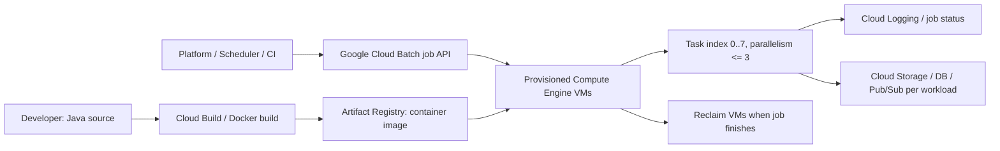
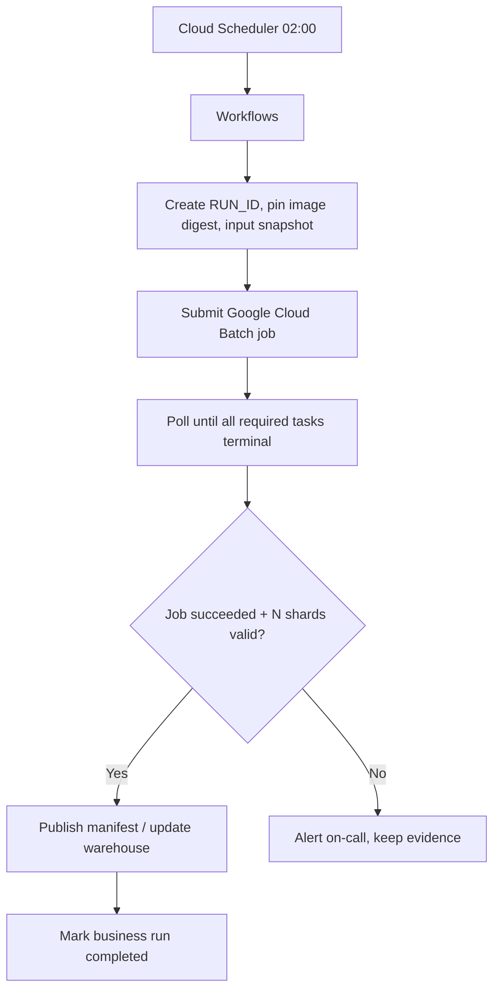
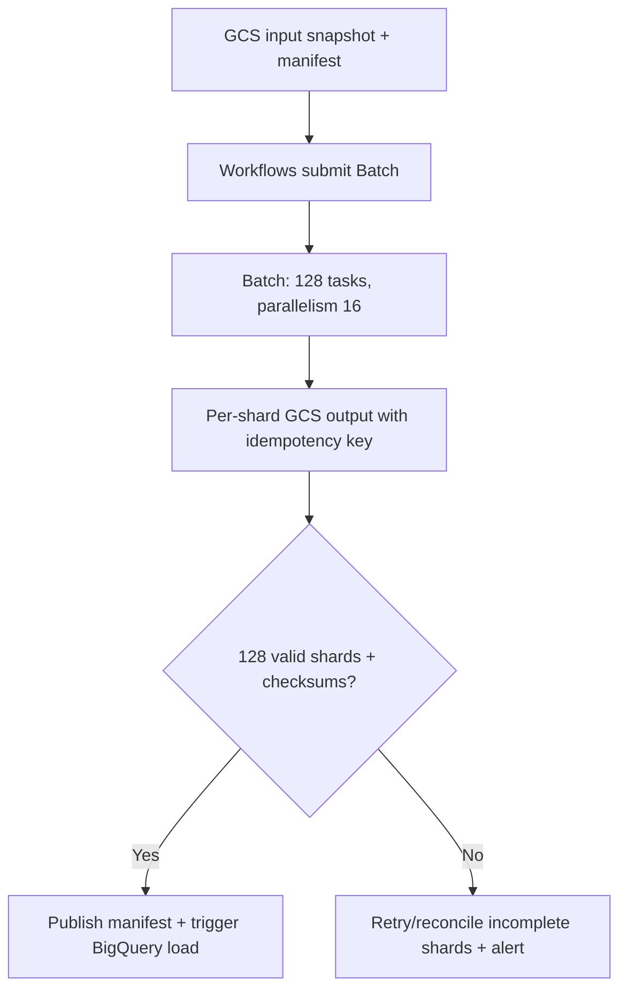

# Lab: Running Java Batch Jobs on Elastic Compute Resources

> **Chapter:** Specialized Infrastructure  
> **Module:** `CLOUD_PROVIDERS_GCP` — Explores Google Cloud from project organization, IAM, and VPCs to Compute Engine, GKE, Cloud Run, storage services, and databases. Through deployment scenarios, learners practice selecting services, securing resources, automating releases, and monitoring reliability and cost.  
> **Lab Objective:** Package a **Java 21** program as a container, partition data into multiple independent tasks, submit to **Google Cloud Batch** so Compute Engine VMs are provisioned on demand and reclaimed after execution, and observe job states, errors, parallelism, IAM permissions, and costs.  
> **Note:** Project IDs, service accounts, registry names, and job names below are examples. Execute only in an authorized sandbox with approved billing, quotas, and permissions; this lesson does not automatically provision infrastructure.

## 1. Expected Outcomes

Upon completion, learners will be able to:

1. Distinguish **batch processing** from HTTP request/response services, background tasks, and streaming.
2. Select appropriately among **Cloud Batch**, **Cloud Run Jobs**, **GKE Jobs/CronJobs**, **Dataflow**, and self-managed Compute Engine VMs.
3. Write **deterministic** Java tasks that partition shards without overlap, return clear exit codes, and handle retries safely.
4. Build a Java container image, push it to **Artifact Registry**, and define a Batch job in JSON.
5. Configure `taskCount`, `parallelism`, `computeResource`, `allocationPolicy`, retries, timeouts, logging, and runtime service accounts.
6. Monitor jobs/tasks/logs, inject controlled failures, and diagnose quota issues or Spot VM preemptions.
7. Design durable outputs, checkpoints, least-privilege IAM, and troubleshooting runbooks.
8. Estimate relationships among runtime, Compute Engine costs, concurrency, and downstream system limits.

**Lab acceptance criteria:** Java program runs locally; container image builds cleanly; Batch accepts an 8-task job with max parallelism 3; all tasks succeed; total processed records equal `TOTAL_ITEMS`; logs include `taskIndex` and `taskCount`; no VMs remain running incurring charges after job completion; zero service account JSON keys used.

## 2. What Is a Batch Job and Why Use Elastic Resources?

A **batch job** processes a finite set of work without holding open user HTTP connections. Examples:

- Aggregating 100 million end-of-day Java transactions into reporting tables.
- Generating PDFs or exporting invoice files in bulk.
- Running Java ETL/validation across partitioned datasets.
- Scoring ML models or running thousands of independent simulations.
- Batch processing images or video, potentially with GPUs.
- Verifying checksum integrity across a Cloud Storage file collection.

A batch job has a **defined start and end**; CPU, RAM, disk, and sometimes GPU resources are needed only during active processing. Keeping VMs always on wastes idle spend and forces teams to manage provisioning, scaling, and cleanup manually.

Google Cloud Batch is an **orchestration service**: upon job submission, Batch manages provisioning Compute Engine VMs matching task configurations and schedules; upon completion, job-created VMs are reclaimed per service lifecycle. Batch is neither an always-on Java server nor a magic tool turning sequential code into parallel code: **the application itself must partition data or process per-task inputs**.

### 2.1. Elasticity Does Not Mean Infinite Resources

Actual concurrent task execution depends simultaneously on:

- `taskCount`: total number of logical tasks.
- `parallelism`: ceiling on concurrently running tasks.
- `computeResource`: CPU/RAM requested per task.
- Machine type, task packing per VM, and available host resources.
- vCPU/instance quotas, regional/zonal VM capacity, and networking.
- Spot/Standard policies, image pulls, IAM permissions, and readiness.

Thus `parallelism=100` is solely an **upper bound**; it does not guarantee 100 tasks run immediately. One VM can host multiple tasks when configured capacity allows, so **task count does not equal VM count**.

### 2.2. Deployment Diagram



In this baseline lab, results print to **Cloud Logging** for easy verification without creating a data bucket. Later sections cover writing durable outputs to Cloud Storage; **never** treat logs as a business data store.

## 3. Choosing a Java Batch Execution Engine

| Option | Execution Model | Strengths | Constraints to Account For |
|---|---|---|---|
| **Google Cloud Batch** | Tasks run on Batch-managed Compute Engine VMs | Pick machine series, disks, Spot, GPU/TPU; task groups; strong for VM-centric/HPC | Requires managing VM quotas, networking, images, lifecycles, and task/VM ratios |
| **Cloud Run Jobs** | Container tasks run to completion without serving HTTP | Minimal infra ops, simple containers, built-in tasks/parallelism/retries | Bounded by Cloud Run CPU/RAM/GPU/timeout and networking limits |
| **GKE Job/CronJob** | Kubernetes Pods with completions/parallelism | Reuses existing clusters, RBAC, and scheduling policies | Requires operating clusters, quotas, node pools, and Pod lifecycles |
| **Dataflow (Apache Beam Java)** | Distributed data processing engine | Strong at ETL, shuffles, windowing, batch/streaming | Requires Beam programming model; overkill for arbitrary Java CLIs |
| **Self-managed Compute Engine** | Java processes on self-managed VMs | Full customization of OS and runtime | Must build auto-provisioning, retries, cleanup, locking, and logging |

**Quick rule of thumb:**

- Java CLI splitting work into N independent shards needing VM/Spot/GPU control → **Batch**.
- Short/medium Java containers aiming for minimal infra overhead → **Cloud Run Jobs**.
- Existing Kubernetes platform needing CronJobs/PVCs/admission policies → **GKE Jobs**.
- Large-scale map/groupBy/window pipelines in Java Beam → **Dataflow**.

Do not choose GPUs merely because this chapter covers "specialized infrastructure": most CPU-bound or I/O-bound Java ETL, file auditing, and reporting jobs run far more cost-effectively on CPUs.

## 4. Lab Problem: Splitting a Record Set into Eight Shards

We simulate aggregating `TOTAL_ITEMS=100000` records with IDs `0` through `99999`. Each task reads Batch-injected environment variables:

- `BATCH_TASK_INDEX`: current task index from `0` to `taskCount - 1`.
- `BATCH_TASK_COUNT`: total tasks in the task group.
- `TOTAL_ITEMS`: business input configured by the deployer.

Task `i` processes only records `r` satisfying:

```text
r % BATCH_TASK_COUNT == BATCH_TASK_INDEX

Example with 8 tasks:
task 0: 0, 8, 16, ...
task 1: 1, 9, 17, ...
...
task 7: 7, 15, 23, ...

Every record belongs to exactly one shard when taskCount=8 is consistent.
```

The app computes a deterministic `count` and `checksum` and prints one JSON line for reconciliation. This checksum is **not a cryptographic hash**, but illustrates repeatability: retrying a task with the same input and task index must yield identical results.

Modulo sharding is simple and coordinator-free, though it can cause **data skew** when per-record processing costs vary wildly. Production jobs should partition by partition ID, time range, or file manifest, or pull from a dynamic work queue with leases/visibility timeouts and idempotency.

## 5. Sample Project Structure

These paths are an **illustrative layout**, not extra files to create outside the assigned lesson files:

```text
java-batch-lab/
├── src/
│   └── ShardWorker.java
├── Dockerfile
└── job.template.json
```

The lab uses Java 21 with only the Java standard library, skipping Maven/Gradle for quick initial testing. When integrating Cloud Storage, Pub/Sub, or databases, use Maven/Gradle with the Google Cloud libraries BOM and CI-tested dependency versions.

## 6. Writing a Repeatable Java Program

Sample `src/ShardWorker.java`:

```java
import java.time.Instant;
import java.util.Locale;

public final class ShardWorker {
    private static final long MOD = 1_000_000_007L;
    private static final long MAX_ITEMS = 100_000_000L;

    public static void main(String[] args) {
        try {
            int index = intEnv("BATCH_TASK_INDEX", "CLOUD_RUN_TASK_INDEX", 0);
            int count = intEnv("BATCH_TASK_COUNT", "CLOUD_RUN_TASK_COUNT", 1);
            long total = longEnv("TOTAL_ITEMS", 100_000L);

            if (count < 1 || index < 0 || index >= count) {
                throw new IllegalArgumentException("Invalid task index/count");
            }
            if (total < 0 || total > MAX_ITEMS) {
                throw new IllegalArgumentException("TOTAL_ITEMS out of lab range");
            }

            long started = System.nanoTime();
            long records = 0;
            long checksum = 0;

            // Partition by record ID modulo taskCount.
            for (long recordId = index; recordId < total; recordId += count) {
                long contribution = ((recordId + 1) * 31) % 1_000_003L;
                checksum = (checksum + contribution) % MOD;
                records++;
            }

            long elapsedMs = (System.nanoTime() - started) / 1_000_000L;

            // One JSON line per task. Never log tokens, credentials, or PII.
            System.out.printf(Locale.ROOT,
                "{\"event\":\"task_succeeded\",\"taskIndex\":%d,"
                + "\"taskCount\":%d,\"totalItems\":%d,"
                + "\"processed\":%d,\"checksum\":%d,"
                + "\"elapsedMs\":%d,\"time\":\"%s\"}%n",
                index, count, total, records, checksum, elapsedMs, Instant.now());
        } catch (Exception ex) {
            System.err.println("Task failed: " + ex.getMessage());
            System.exit(2); // Batch detects task failure and can retry.
        }
    }

    private static int intEnv(String primary, String fallback, int defaultVal) {
        String value = System.getenv(primary);
        if (value == null || value.isBlank()) value = System.getenv(fallback);
        return value == null || value.isBlank()
            ? defaultVal : Integer.parseInt(value);
    }

    private static long longEnv(String name, long defaultVal) {
        String value = System.getenv(name);
        return value == null || value.isBlank()
            ? defaultVal : Long.parseLong(value);
    }
}
```

**Why this design works:**

1. **Deterministic:** re-running a task produces identical `processed` and `checksum` values, aside from `elapsedMs`/`time`.
2. **Clean partitioning:** valid indices span `0` to `count - 1`; every record is processed exactly once **at the logical partition level**.
3. **No local state dependency:** VMs can be replaced or tasks restarted without losing committed off-VM progress (this lab logs only, with no external business commits yet).
4. **Failure signaling:** invalid inputs exit non-zero instead of emitting fake "success" logs.
5. **Cloud Run-compatible:** `intEnv` reads both `BATCH_*` and `CLOUD_RUN_*` variables for side-by-side comparison later.

The program does **not** throttle CPU if `TOTAL_ITEMS` is raised hugely; `MAX_ITEMS` is a lab guardrail, not a Batch service limit.

### 6.1. Compiling and Testing Locally

```bash
mkdir -p out
javac --release 21 -d out src/ShardWorker.java

# Simulate shard 0 out of 8 tasks
BATCH_TASK_INDEX=0 \
BATCH_TASK_COUNT=8 \
TOTAL_ITEMS=100000 \
java -cp out ShardWorker

# Simulate shard 7: expected processed=12500
BATCH_TASK_INDEX=7 \
BATCH_TASK_COUNT=8 \
TOTAL_ITEMS=100000 \
java -cp out ShardWorker
```

Each shard should process **12,500 records**, totaling 100,000 across all eight shards. If `TOTAL_ITEMS` is not divisible by 8, shard counts differ by at most 1 under this uniform distribution.

Negative test:

```bash
BATCH_TASK_INDEX=9 BATCH_TASK_COUNT=8 \
  java -cp out ShardWorker

# Expected: exit code 2, no task_succeeded event emitted.
```

Never paste logs containing real IDs or PII into tickets when handling production data.

## 7. Packaging Java into a Container

Sample `Dockerfile`:

```dockerfile
# Pin the builder image digest in production CI.
FROM eclipse-temurin:21-jdk AS build
WORKDIR /build
COPY src/ShardWorker.java .
RUN javac --release 21 -encoding UTF-8 ShardWorker.java

FROM eclipse-temurin:21-jre
WORKDIR /app
COPY --from=build /build/ShardWorker.class /app/
USER 65532
ENTRYPOINT ["java", "-XX:MaxRAMPercentage=70.0", "-cp", "/app", "ShardWorker"]
```

**Explanation:**

- **Multi-stage build:** keeps JDK/compilers and source code out of the runtime image.
- **Java 21:** uses an organization-approved Java LTS image; in production, pin digests, scan for CVEs, and generate SBOMs.
- **Non-root:** limits blast radius if runtime is compromised; verify file/mount read permissions.
- **MaxRAMPercentage:** leaves headroom for metaspace, native memory, and agents rather than setting `-Xmx` to 100% of the memory limit.
- **ENTRYPOINT:** lets Batch specify only `imageUri` without duplicating `java -jar` commands in JSON.

Test build locally with Docker:

```bash
docker build -t java-shard-worker:local .
docker run --rm \
  -e BATCH_TASK_INDEX=1 \
  -e BATCH_TASK_COUNT=8 \
  -e TOTAL_ITEMS=100000 \
  java-shard-worker:local
```

Verify architecture compatibility, scan the image, and run on matching Linux/CPU architectures. The Java image does not "autoscale itself"; elasticity comes from the Batch scheduler and Compute Engine.

## 8. Preparing the Google Cloud Sandbox and APIs

Assumptions:

| Component | Example Value |
|---|---|
| Project | `java-batch-sandbox` |
| Batch location | `asia-southeast1`, **if** supported by Batch and the chosen VM type |
| Registry location | `asia-southeast1` |
| Artifact Registry repository | `java-batch` |
| Container image | `java-shard-worker:v1` |
| Execution service account | `batch-worker@java-batch-sandbox.iam.gserviceaccount.com` |
| Machine type | `e2-standard-4` |
| Total tasks | 8 |
| Max concurrent tasks | 3 |

**Illustrative procedure only:** verify Batch region support, E2 capacity, billing, Compute Engine quotas, and organizational permissions before executing.

### 8.1. Setting Variables and Enabling Services

```bash
export PROJECT_ID="java-batch-sandbox"
export REGION="asia-southeast1"
export REPO="java-batch"
export IMAGE_NAME="java-shard-worker"
export TAG="v1"
export SA_NAME="batch-worker"
export SA_EMAIL="$SA_NAME@$PROJECT_ID.iam.gserviceaccount.com"

gcloud config set project "$PROJECT_ID"

# Requires active billing and appropriate Service Usage Admin permissions.
gcloud services enable \
  batch.googleapis.com \
  compute.googleapis.com \
  logging.googleapis.com \
  artifactregistry.googleapis.com \
  cloudbuild.googleapis.com \
  --project="$PROJECT_ID"
```

Cloud Batch manages VMs automatically but requires the **Compute Engine API** and proper execution permissions. Cloud Build is only needed for remote builds; if building and pushing locally, you can omit enabling the Cloud Build API.

### 8.2. Creating an Artifact Registry Docker Repository

```bash
gcloud artifacts repositories create "$REPO" \
  --project="$PROJECT_ID" \
  --location="$REGION" \
  --repository-format=docker \
  --description="Container images for Java batch lab"

export IMAGE_URI="$REGION-docker.pkg.dev/$PROJECT_ID/$REPO/$IMAGE_NAME:$TAG"
```

Create the repository before pushing images. Production repositories should enable vulnerability scanning, retention policies, restricted publishers, and digest pinning or immutable tags.

### 8.3. Building and Pushing the Container Image

**Option A — Cloud Build:** builds from the directory containing `Dockerfile`; requires **Artifact Registry Writer** on the repository for the build service account.

```bash
gcloud builds submit \
  --project="$PROJECT_ID" \
  --tag="$IMAGE_URI" \
  .
```

**Option B — Local Docker:** if permitted and registry authentication is configured:

```bash
gcloud auth configure-docker "$REGION-docker.pkg.dev"

docker build -t "$IMAGE_URI" .
docker push "$IMAGE_URI"
```

**Pick one option**, not both. Build identities and Batch runtime identities have separate roles: permission to **push** does not grant runtime VMs permission to pull images or access data.

## 9. Least-Privilege IAM Design

### 9.1. Three Identities to Distinguish

| Identity | Role | Permissions to Review |
|---|---|---|
| Submitter user or CI | Calls Batch API to create/view jobs | `roles/batch.jobsEditor` on project; `roles/iam.serviceAccountUser` on execution SA |
| Job execution SA | Attached to VMs, runs code, ships task logs | `roles/batch.agentReporter` and `roles/logging.logWriter` on project; `roles/artifactregistry.reader` on repo if pulling images |
| **Batch service agent** | Google-managed identity provisioning/controlling Batch infra | Google-granted `roles/batch.serviceAgent` by default; never revoke casually |

Create a dedicated service account:

```bash
gcloud iam service-accounts create "$SA_NAME" \
  --project="$PROJECT_ID" \
  --display-name="Java Batch lab execution identity"

gcloud projects add-iam-policy-binding "$PROJECT_ID" \
  --member="serviceAccount:$SA_EMAIL" \
  --role="roles/batch.agentReporter"

gcloud projects add-iam-policy-binding "$PROJECT_ID" \
  --member="serviceAccount:$SA_EMAIL" \
  --role="roles/logging.logWriter"

gcloud artifacts repositories add-iam-policy-binding "$REPO" \
  --project="$PROJECT_ID" \
  --location="$REGION" \
  --member="serviceAccount:$SA_EMAIL" \
  --role="roles/artifactregistry.reader"
```

IAM admins must also grant submitters/CI the permissions listed in the table above. Never grant `roles/editor` or `roles/owner` to the execution SA merely to silence `PERMISSION_DENIED`. Never create or download service account JSON keys for Batch.

### 9.2. Additional Workload-Specific Permissions

When Java calls Cloud Storage, BigQuery, Pub/Sub, or Secret Manager, grant **resource-scoped roles** to the execution SA—such as Storage Object Creator on the output bucket or Secret Accessor on a specific secret. Never grant project-wide Storage Admin just to write outputs to one bucket.

In Shared VPCs or projects without a default network, the Batch service agent and VMs also need proper network, subnet, routing, and firewall/NAT permissions. Private registry pulls, dependency fetches, and Google API calls require valid network connectivity—a separate **network/IAM layer** beyond Batch Job Editor.

## 10. Defining the Batch Job in JSON

The sample `job.template.json` below uses placeholder image and SA values. **Before submitting, replace every** `PROJECT_ID` and `REGION` with real values; plain JSON performs no automatic shell variable interpolation.

```json
{
  "taskGroups": [
    {
      "taskSpec": {
        "runnables": [
          {
            "container": {
              "imageUri": "REGION-docker.pkg.dev/PROJECT_ID/java-batch/java-shard-worker:v1"
            },
            "environment": {
              "variables": {
                "TOTAL_ITEMS": "100000"
              }
            }
          }
        ],
        "computeResource": {
          "cpuMilli": 1000,
          "memoryMib": 1024
        },
        "maxRetryCount": 2,
        "maxRunDuration": "1800s"
      },
      "taskCount": 8,
      "parallelism": 3
    }
  ],
  "allocationPolicy": {
    "instances": [
      {
        "policy": {
          "machineType": "e2-standard-4",
          "provisioningModel": "STANDARD"
        }
      }
    ],
    "serviceAccount": {
      "email": "batch-worker@PROJECT_ID.iam.gserviceaccount.com"
    }
  },
  "labels": {
    "app": "java-shard",
    "env": "sandbox"
  },
  "logsPolicy": {
    "destination": "CLOUD_LOGGING"
  }
}
```

### 10.1. Field-by-Field Explanation

| Property | Example | Meaning |
|---|---|---|
| `taskGroups[0]` | Single group | Batch v1 currently supports one task group (`group0`) per job |
| `taskSpec.runnables` | Single container | Every task runs the same image and Java logic |
| `container.imageUri` | Artifact Registry URI | Runtime pulls the built/pushed image |
| `environment.variables` | `TOTAL_ITEMS=100000` | Shared inputs; never store plaintext secrets in job specs |
| `computeResource.cpuMilli` | 1000 | Each task requests roughly 1 vCPU |
| `computeResource.memoryMib` | 1024 | Memory reserved per task; must fit the machine type |
| `maxRetryCount` | 2 | Task may retry up to 2 times after failure beyond the initial attempt |
| `maxRunDuration` | `1800s` | Timeout per single task execution |
| `taskCount` | 8 | Total 8 logical work shards |
| `parallelism` | 3 | Up to 3 tasks concurrently; does not guarantee 3 VMs |
| `allocationPolicy.instances` | E2 Standard | Backing VM provisioned by Batch |
| `allocationPolicy.serviceAccount` | User-managed SA | Short-lived credentials from VM metadata; zero JSON keys |
| `logsPolicy` | Cloud Logging | Captures container stdout/stderr as task logs |

**Do not equate** `cpuMilli=1000` with `machineType=e2-standard-4`. CPU per task is a scheduling request; a single VM can pack multiple tasks depending on resources and Batch placement. An 8-task job with parallelism 3 may run across waves independent of exact VM creation counts.

### 10.2. Generating the Concrete Config from the Template

Bash example (safe placeholder substitution in a sandbox):

```bash
sed \
  -e "s/REGION/$REGION/g" \
  -e "s/PROJECT_ID/$PROJECT_ID/g" \
  job.template.json > job.json

# Only inspect substituted output; never print real secrets.
cat job.json
```

In production, use tested templating/IaC, **pin images by digest** instead of mutable tags, and validate JSON schemas before submission. Never commit secrets or tokens to job specs.

## 11. Submitting the Job and Tracking Its Lifecycle

### 11.1. Submit

```bash
export JOB_ID="java-shard-lab-001"

gcloud batch jobs submit "$JOB_ID" \
  --project="$PROJECT_ID" \
  --location="$REGION" \
  --config=job.json
```

After submission, Batch creates a **job resource** and schedules execution. A job does not re-run daily on its own; each run needs a new job ID or a workflow/scheduler calling the API with unique IDs.

### 11.2. Inspecting Status

```bash
gcloud batch jobs describe "$JOB_ID" \
  --project="$PROJECT_ID" \
  --location="$REGION"

gcloud batch jobs list \
  --project="$PROJECT_ID" \
  --location="$REGION"

gcloud batch tasks list \
  --project="$PROJECT_ID" \
  --job="$JOB_ID" \
  --location="$REGION"
```

Common states include **QUEUED**, **SCHEDULED**, **RUNNING**, **SUCCEEDED**, and **FAILED**, accompanied by events explaining VM allocation delays, task errors, or preemptions.

**Key takeaway:** a job is complete only when all required tasks succeed per job policy. If tasks retry, logs may hold lines from multiple attempts; never count raw log lines as unique record counts.

### 11.3. Reading Cloud Logging

Google Cloud Console path: **Batch → Jobs → select job → Logs**. Or use Logs Explorer filtered by job resource and actual labels. With `logsPolicy.destination=CLOUD_LOGGING`, `System.out` and `System.err` stream into task logs.

```text
# Conceptual Logs Explorer filter; verify actual label names:
resource.type="batch_job"
labels."batch.googleapis.com/job_id"="java-shard-lab-001"
```

Resource/label names can vary by log stream and environment, so opening the job directly in the Batch console and clicking Logs is most reliable. `System.out.printf` should log only non-sensitive operational telemetry.

### 11.4. Reconciling Results

With `TOTAL_ITEMS=100000` and `taskCount=8`:

- There are **8 logical tasks**, indices 0..7.
- Each task processes **12,500** records, since 100,000 divides evenly by 8.
- Summing `processed` across the **8 final successful tasks** equals **100,000**.
- Each task emits its own `checksum` for cross-run comparison.
- `taskCount` must stay fixed if outputs are keyed by task index; changing shard counts requires a new run/result prefix.

To verify acceptance, filter for the **final successful attempt of each task**—never sum log lines across retries. For durable outputs, maintain a manifest listing shards and commit status.

## 12. Elastic Resources: Measuring Runtime and VM Counts

### 12.1. Three Comparison Runs

| Run | taskCount | parallelism | cpuMilli/task | Purpose |
|---|---:|---:|---:|---|
| A | 8 | 1 | 1000 | Sequential per-task baseline |
| B | 8 | 3 | 1000 | Measure moderate parallelism gains |
| C | 8 | 8 | 1000 | Test full scaling efficiency and quotas |

**Never edit a completed job by overwriting its ID**; each Batch job is an immutable single execution with a unique ID. Submit new jobs like `java-shard-lab-002` and `003` with updated configs.

Expect Run B to finish faster than A, though **rarely three times faster**: VM provisioning, image pulls, JVM startup, input downloads, and contention often dominate short runs.

### 12.2. Total Elapsed Runtime

```text
Elapsed time = queue time
             + VM provisioning / image pull
             + task waves execution
             + output commit / verification
             + cleanup / orchestration overhead

Ideal waves ≈ ceil(taskCount / effective parallelism).

Never treat taskCount / parallelism as VM count.
```

When a Java task executes in milliseconds like this lab, VM provisioning overhead dwarfs compute time. Real workloads bundle more work per task so useful compute outweighs startup overhead.

### 12.3. Quotas and Capacity

Verify:

- Regional vCPU quotas for the chosen machine series.
- VM instance, disk, and IP quotas.
- Artifact Registry image pull and network bandwidth.
- Batch concurrent jobs/tasks and per-project job limits.
- Downstream quotas on Cloud Storage, BigQuery, databases, and Pub/Sub.
- Cloud Logging ingestion quotas and budgets.

During capacity shortages, raising `parallelism` can **lengthen queue waits or fail jobs** rather than conjuring resources past quotas.

## 13. Cost Optimization with Standard and Spot VMs

`allocationPolicy.instances[0].policy.provisioningModel` supports `STANDARD` or `SPOT` for eligible machine types and regions.

**Standard VMs:** fit critical jobs with low interruption tolerance; still require retries for transient network, host, or app faults.

**Spot VMs:** cost less yet **can be preempted anytime** with zero capacity guarantee. Ideal for independent, short, checkpointed, and idempotent compute.

Variant overriding only the policy block:

```json
"allocationPolicy": {
  "instances": [
    {
      "policy": {
        "machineType": "e2-standard-4",
        "provisioningModel": "SPOT"
      }
    }
  ],
  "serviceAccount": {
    "email": "batch-worker@PROJECT_ID.iam.gserviceaccount.com"
  }
}
```

In a valid job config, this block sits alongside `taskGroups` and `logsPolicy`—do **not** overwrite the whole JSON file with it. Keep `maxRetryCount` sensible; endless retries on persistent config/permission bugs only waste money.

**Conceptual cost formula:**

```text
Total batch cost ≈
    Compute Engine VM vCPU + RAM for active duration
  + boot/data disks and snapshots if any
  + Artifact Registry storage + related image transfers
  + Cloud Logging / Monitoring
  + Cloud Storage / BigQuery / database APIs and data transfer
  + VM startup/wait overhead and retry durations
```

Per official documentation, **Google Cloud Batch charges no orchestration markup**, while underlying VMs, disks, networking, and logs remain billable. Never interpret "Batch has no extra fee" as "running jobs is free."

### 13.1. When Does Higher Parallelism Increase Cost?

Consider 8 tasks each saturating 100% CPU for 10 minutes:

- Parallelism 1: longer wall time with fewer concurrent VMs.
- Parallelism 8: cuts latency if capacity exists; same ideal total CPU-time, yet real bills vary with minimum VM billing, startup overhead, bin packing, Spot rates, egress, and retries.
- If a downstream DB accepts only 2 concurrent connections, parallelism 8 triggers timeouts and retries—both slower and pricier.

Tune concurrency to the **system-wide bottleneck**, not CPU quota alone.

## 14. From stdout to Durable Cloud Storage Outputs

Logs are for observability, not final data storage. In real apps, each task writes its result to a dedicated object:

```text
gs://reports-batch-output/
  job-runs/
    RUN_ID/
      part-0000.json
      part-0001.json
      ...
      part-0007.json
      manifest.json
```

### 14.1. Naming and Commit Rules

- Use a unique `RUN_ID` per run; avoid shared names like `latest` that invite races.
- Name `part-i` after task index `i`, never VM hostnames which change across retries.
- Mark a run **COMPLETED** only after all N shards exist and pass checksum/count validation.
- Retries can re-execute the same shard; writes must be idempotent or detect existing versions safely.
- GCS is object storage, not a shared filesystem with multi-object atomic transactions. Have a coordinator emit a manifest/commit marker post-validation.

### 14.2. Extending Java with the Cloud Storage Client

Production apps can use `com.google.cloud:google-cloud-storage` with **Application Default Credentials (ADC)** via the Batch VM's execution service account:

```java
// EXTENSION snippet, omitted from the Java standard-library lab.
// Requires declaring the Google Cloud Storage client in Maven/Gradle.
import com.google.cloud.storage.BlobId;
import com.google.cloud.storage.BlobInfo;
import com.google.cloud.storage.Storage;
import com.google.cloud.storage.StorageOptions;
import java.nio.charset.StandardCharsets;

Storage storage = StorageOptions.getDefaultInstance().getService();
String bucket = "reports-batch-output";
String runId = "approved-run-id"; // Pass via config; never hardcode prod IDs.
String name = "job-runs/" + runId + "/part-" + taskIndex + ".json";

byte[] data = resultJson.getBytes(StandardCharsets.UTF_8);
BlobInfo blob = BlobInfo.newBuilder(BlobId.of(bucket, name))
    .setContentType("application/json")
    .build();

// Precondition: create only if the object does not already exist.
// If a retry gets a precondition-failed error, verify content/hash/manifest
// before treating the task as done; NEVER silently ignore.
storage.create(blob, data, Storage.BlobTargetOption.doesNotExist());
```

Place this snippet inside a method providing `taskIndex` and `resultJson`; it is an **extension design**, not a standalone compilable Java file.

Bucket IAM: grant the Batch execution SA minimal write rights like `roles/storage.objectCreator` on the output bucket. If tasks verify checksums or read manifests, grant narrow read roles accordingly. Never grant project-wide Storage Admin to a writer task.

**Note:** `doesNotExist()` prevents overwriting an already-committed object, yet does not magically solve exactly-once semantics across databases or multiple objects. Correctness depends on transaction/manifest design, idempotency keys, and retry handling.

## 15. Retries, Checkpoints, and At-Least-Once Execution

Batch retries failed tasks; **any task may execute multiple times**. Side effects must never assume "executed exactly once."

### 15.1. Failure Classification

| Failure | Retry? | Action |
|---|---|---|
| Transient network timeout | Usually yes, with backoff | Bounded retries without duplicate outputs |
| Spot VM preemption | Yes if task is restart-safe | Use checkpoints or smaller partitions |
| Permanent permission denied | No, unless policy changes | Fix IAM or Org Policies |
| Image not found / pull denied | No until image/role fixed | Check Artifact Registry and networking |
| OOM | Never retry endlessly | Tune memory, heap, or batch size |
| Malformed input schema | Depends on workflow | Quarantine bad records, alert owners, never swallow errors |
| DB connection limit | Controlled retries | Lower parallelism or add pooling/throttling |

### 15.2. Checkpointing and Idempotency

- **Checkpoints** record durable progress off-VM; never rely solely on local `/tmp`.
- **Idempotency keys** should combine `runId + shardId + business key` to detect duplicate work.
- **Transactional writes** where supported: commit outputs only after finishing a shard to prevent torn files or partial DB updates.
- **At-least-once:** the scheduler may retry, so application logic must prevent duplicate business transactions.
- **Job cancellation** does not roll back already-committed side effects.

For huge inputs, creating more shards than `parallelism` keeps each task short and cheap to retry—though overly tiny tasks inflate provisioning, logging, and scheduling overhead. Benchmark to tune shard size.

## 16. Scheduling and Multi-Step Orchestration

Newly submitted Batch jobs run immediately rather than on a recurring cron. To build a "nightly report," use:

- **Cloud Scheduler** invoking a secured HTTP endpoint, Cloud Run service, or Workflows execution to submit the Batch job.
- **Workflows** orchestrating submission, polling completion, validating outputs, and publishing manifests.
- **Cloud Build / CI** when jobs trigger on code releases or dataset version updates.
- **Pub/Sub** for event-driven triggers, with deduplication on the submitter.

Conceptual orchestration flow:



Generate a unique `job ID` per date and data source rather than reusing a fixed ID that collides with past jobs. Schedulers can retry on timeouts; submitters must enforce idempotency so two jobs never write to the same output prefix.

## 17. Cloud Run Jobs: A Lightweight Alternative

If you do not need specific VM machine types, Spot VMs, or custom OS kernels, Cloud Run Jobs can be simpler. The exact Java image built earlier works seamlessly because `ShardWorker` checks `CLOUD_RUN_TASK_INDEX` and `CLOUD_RUN_TASK_COUNT`.

```bash
gcloud run jobs create java-shard-cloud-run \
  --project="$PROJECT_ID" \
  --region="$REGION" \
  --image="$IMAGE_URI" \
  --tasks=8 \
  --parallelism=3 \
  --task-timeout=30m \
  --max-retries=2 \
  --service-account="$SA_EMAIL"

# A Cloud Run Job runs only when executed.
gcloud run jobs execute java-shard-cloud-run \
  --project="$PROJECT_ID" \
  --region="$REGION" \
  --wait
```

Cloud Run Jobs enforce **Cloud Run task, parallelism, and timeout limits**, which differ from Batch. Per docs, jobs support up to **10,000 tasks**, each receiving `CLOUD_RUN_TASK_INDEX`, with task timeouts up to **168 hours** for non-GPU jobs (separate rules apply to GPUs). Check current quotas and pricing before switching.

**Important:** both Batch and Cloud Run Jobs support retries, yet billing models, quotas, networking, CPU/memory, GPUs, and startup overhead differ. Never claim one is always cheaper without benchmarking your real workload.

## 18. Specialized Resources: Memory-Intensive, GPU, and HPC

Java batch workloads typically fall into one of five profiles:

1. **CPU-bound:** data transforms, PDF rendering, serialization, compression; favor general or compute-optimized VMs.
2. **Memory-bound:** large joins, in-memory graph analytics; evaluate memory-optimized VMs and heap/GC tuning.
3. **I/O-bound:** Cloud Storage reads, database writes; tune batch sizes, TCP pools, egress, and concurrency.
4. **GPU-accelerated:** only when Java calls native libraries/cuDNN/ML backends with benchmarked GPU gains; GPUs do not automatically speed up standard JVM bytecode.
5. **HPC:** multi-VM CPU/GPU clusters with tight networking and data locality, combining Batch with appropriate schedulers/models.

### 18.1. Changing the Machine Type Example

In `job.json`, update:

```json
"allocationPolicy": {
  "instances": [
    {
      "policy": {
        "machineType": "n2-standard-8",
        "provisioningModel": "STANDARD"
      }
    }
  ],
  "serviceAccount": {
    "email": "batch-worker@PROJECT_ID.iam.gserviceaccount.com"
  }
}
```

Larger machines can pack more tasks per VM, yet will not accelerate tasks bottlenecked by a database or Cloud Storage I/O. For GPUs, configure Batch-supported accelerators, images, and drivers—never change `machineType` alone expecting Java to use GPUs.

### 18.2. JVM Sizing

- Separate **CPU per task** from VM vCPU count.
- Monitor heap, GC pauses, metaspace, native memory, disk spills, and container OOMs.
- Tune `-XX:MaxRAMPercentage` appropriately; consider `-XX:ActiveProcessorCount` if container CPU limits confuse JVM ergonomics.
- Size DB connection pools to total `parallelism`, not a single task in isolation.
- Use JFR, metrics, or sampling profilers in testing; avoid verbose debug logging in production.
- For short tasks, JVM startup and bloated images dominate runtime; trim image layers and optimize warm-up.

## 19. Security: Networking, IAM, Secrets, and Supply Chain

### 19.1. Least-Privilege Principles

- **Never** embed service account JSON keys in Docker images, Git, or environment variables.
- Use a user-managed execution SA with `roles/batch.agentReporter`, `roles/logging.logWriter`, and resource-scoped permissions.
- Grant job submitters/CI `roles/batch.jobsEditor` and `roles/iam.serviceAccountUser` strictly on the target SA.
- Pin container image digests in production; enable vulnerability scanning, SBOMs, and provenance.
- Never put API keys or passwords in `runnables.environment.variables`; use Secret Manager integration.
- When a project lacks a default VPC, configure networks, subnets, and Private Google Access or Cloud NAT so VMs can pull images and reach APIs.
- Restrict outbound egress to required targets; disable public ingress on batch VMs.
- Enforce Cloud Audit Logs and org policies; isolate production projects from sandboxes.

### 19.2. Warning on Shared Service Accounts

If two unrelated jobs share one SA with write access to both buckets, compromising one job exposes the other's data. Isolate SAs by **application + environment + resource**, and audit `actAs` permissions so no user can submit jobs under an overly privileged identity.

### 19.3. Untrusted Inputs

Batch tasks often ingest external CSVs, Pub/Sub payloads, JSON, or Cloud Storage objects. Validate schemas, sizes, encodings, checksums, path traversal, zip bombs, and memory/time bounds. Never interpolate untrusted input into shell commands.

## 20. Testing, Measurement, and Acceptance

### 20.1. Mandatory Test Cases

| Test | Setup | Expected Outcome |
|---|---|---|
| Happy path | 8 tasks, parallelism 3, TOTAL_ITEMS 100000 | 8 tasks SUCCEEDED, total processed = 100000 |
| Invalid index | INDEX 9, COUNT 8 locally | Exit code 2, no success event |
| Small data | TOTAL_ITEMS 3, COUNT 8 | 3 tasks process 1 record each, 5 process 0 |
| Non-divisible | TOTAL_ITEMS 100003, COUNT 8 | Total count 100003, max shard skew of 1 |
| Retry | Inject transient error on one shard | Bounded retries, zero duplicate outputs |
| Permission denied | Remove Artifact Registry Reader from test SA | Job fails cleanly; never grant Owner as a "quick fix" |
| Insufficient quota | Lower sandbox quota or oversized request | Observe queue/allocation failure and retry behavior |
| Spot interruption | Use Spot in sandbox | Verify task retry/checkpointing with zero lost commits |
| Cancellation | Cancel sandbox job mid-run | No new tasks start; prior side effects reconciled |
| Cleanup | Delete job after archiving evidence | Zero unexpected leftover VMs or disks |

**Safe retry testing:** never disrupt production or inject faults into shared networks. Use sandbox-only feature flags and synthetic data.

### 20.2. Measuring KPIs

| KPI | Meaning |
|---|---|
| Queue latency | Time waiting for resource allocation |
| Provisioning latency | Time to boot VMs, pull images, and bootstrap |
| Wall-clock duration | End-to-end time from submit to terminal job state |
| Task CPU/memory utilization | Efficiency of VM sizing, heap, and task packing |
| Effective parallelism | Observed concurrent tasks, not just config ceiling |
| Successful records/sec | Real business throughput |
| Retry rate | Fault resilience and rework cost |
| Cost per million records | Unit economics from real run data |
| Duplicate output attempts | Indicator of idempotency gaps |
| Data correctness | Total counts, checksums, and business reconciliation |

### 20.3. Production Readiness Checklist

- [ ] Input manifests/partitions immutable, versioned, and checksummed.
- [ ] Java code idempotent and exits non-zero on failure without swallowing exceptions.
- [ ] Durable off-VM outputs with manifests/commit markers and safe retry handling.
- [ ] Zero service account keys; execution SA follows least privilege.
- [ ] Image digests pinned, CVEs scanned, SBOMs and artifact lifecycles configured.
- [ ] Task CPU/RAM tuned; parallelism bounded by benchmarks, quotas, and downstream capacity.
- [ ] Retries, timeouts, and checkpoints tested against real faults in a sandbox.
- [ ] Clear logs, metrics, and alerts free of PII and credentials.
- [ ] Budgets, quotas, labels, and runbooks ready for failures, long queues, and Spot preemptions.
- [ ] Procedures exist for cancellation, single-shard replay, partial outputs, and cleanup.
- [ ] Orchestrator generates unique job IDs and prevents duplicate submissions.
- [ ] Business data correctness validated post-run, beyond `SUCCEEDED` job status alone.

## 21. Common Troubleshooting

| Symptom | Layer | Diagnosis |
|---|---|---|
| `PERMISSION_DENIED` on submit | Caller IAM | `roles/batch.jobsEditor` and `roles/iam.serviceAccountUser` on target SA |
| Job queued indefinitely | Scheduling / quotas | Quotas, region, machine type, Spot availability, concurrency limits |
| Image pull failure | Artifact Registry / network | Image URI, digest/tag, `artifactregistry.reader`, subnet egress |
| VM boots then task fails | Java / runtime | Classpath, ENTRYPOINT, JDK/JRE, env vars, memory, exit code |
| OOM / exit code 137 | Memory | Heap + native memory, `memoryMib`, worker memory leaks |
| Continuous task retries | Failure classification | Permissions, data schema, timeouts, checkpoints, preemptions |
| Job `SUCCEEDED` but data missing | Business logic | Partition boundaries, manifest/counts, output commits |
| Downstream DB overloaded | Downstream | Lower parallelism/connection pools, throttle, batch writes |
| Unexpected cost spike | Resources / limits | Boot disks, retries, overprovisioning, logging, Spot vs. Standard |
| Empty logs | Observability / IAM | `logsPolicy`, `logging.logWriter`, verify project/job filters |
| Duplicate results after retry | Idempotency | Output keys, generation preconditions, transactions/manifests |
| VM cannot reach private APIs | Networking | Routes, firewalls, Cloud NAT/Private Google Access, DNS |

**Investigation workflow:** record project, location, job ID, task index, attempt, timestamp, image digest, and input version; trace job status → task status/events → Cloud Logging → Compute Engine quotas/network → resource IAM → business outputs. Never change multiple permissions and VM types simultaneously, or you lose root-cause visibility.

## 22. Safe Sandbox Cleanup

Batch cleans up job-allocated VMs, while **Artifact Registry images, repositories, Cloud Logging, and auxiliary resources** carry separate lifecycles and costs.

```bash
# Inspect status before deleting.
gcloud batch jobs describe "$JOB_ID" \
  --project="$PROJECT_ID" \
  --location="$REGION"

# Delete only completed jobs after capturing evidence.
gcloud batch jobs delete "$JOB_ID" \
  --project="$PROJECT_ID" \
  --location="$REGION"
```

After confirming no other project shares the resources:

- Prune unneeded images/tags per Artifact Registry retention policies.
- Review Cloud Logging/Monitoring records and retention periods.
- Delete lab SAs/role bindings if no workloads still depend on them.
- If a bucket was created, purge data **only after** confirming retention, backup, and legal-hold rules and getting approval.
- Never delete shared projects or shared repositories just to finish an exercise.
- Cross-check Billing and VM/disk inventories to verify cleanup, rather than relying solely on Batch job status.

Batch documentation notes that job metadata may be automatically purged **60 days after completion**. Export required audit evidence to your enterprise observability platform rather than treating Batch job listings as long-term archives.

## 23. Capstone Scenario: End-of-Day Java Invoice Processing

An enterprise runs a daily Java batch at 01:00:

- Cloud Storage receives 2 million invoice records per day.
- The Java app splits processing into 128 partitions with 16 concurrent tasks.
- Outputs are 128 independent objects, each tagged with a checksum and run ID.
- Workflows submits a Batch job using a CI-approved image digest.
- If a Spot task is preempted, it retries and commits outputs conditionally via preconditions.
- Once all 128 shards finish, Workflows runs validation and publishes a manifest.
- BigQuery ingestion runs only after the manifest confirms complete data.



**Discussion questions:**

1. If one shard runs 10× slower than the rest, should you increase `parallelism` or re-partition the data?
2. If Cloud Storage throughput caps out on the current dataset, will adding CPUs help?
3. If output from task 37 already exists upon retry, under what conditions should you accept it vs. overwrite?
4. Should Spot be used for all shards, or should deadline-critical and best-effort paths be separated?
5. If a job is submitted twice on the same day, how do you prevent two runs from both publishing manifests?
6. If report RTO must drop sharply, is replacing batch entirely with streaming always the right answer?

## 24. Conclusion and References

**Conclusion:** Running Java batch jobs on elastic resources is far more than wrapping `java -jar` on a VM. Sound design requires **data partitioning, least-privilege runtime permissions, downstream-aware concurrency caps, retry/checkpoint/idempotency logic, per-task observability, and verifiable outputs**. Google Cloud Batch excels when you need VM-level control, distributed VM compute, Spot pricing, or accelerators; Cloud Run Jobs fit lighter containerized workloads cleanly. Elastic infrastructure eliminates idle VM waste, yet throughput and cost only become optimal when validated against benchmarks and real data.

### Official Google Cloud Documentation

1. [Get started with Batch](https://docs.cloud.google.com/batch/docs/get-started) — APIs, service accounts, locations, pricing, and quotas.
2. [Create and run a basic job](https://docs.cloud.google.com/batch/docs/create-run-basic-job) — `taskGroups`, `runnables`, `taskCount`, `parallelism`, job JSON.
3. [Control access for a job using a custom service account](https://docs.cloud.google.com/batch/docs/create-run-job-custom-service-account) — `allocationPolicy.serviceAccount` and IAM.
4. [View jobs and tasks](https://docs.cloud.google.com/batch/docs/view-jobs-tasks) — `gcloud batch jobs` and `gcloud batch tasks`.
5. [Analyze a job using logs](https://docs.cloud.google.com/batch/docs/analyze-job-using-logs) — Cloud Logging and task logs.
6. [Automate task retries](https://docs.cloud.google.com/batch/docs/automate-task-retries) — per-task retry policies.
7. [Improve resource obtainability](https://docs.cloud.google.com/batch/docs/improve-obtainability-overview) — Spot and VM capacity.
8. [Batch troubleshooting](https://docs.cloud.google.com/batch/docs/troubleshooting) — states, preemptions, error codes.
9. [Batch REST Job resource](https://docs.cloud.google.com/batch/docs/reference/rest/v1/projects.locations.jobs) — JSON schema.
10. [Create Cloud Run jobs](https://docs.cloud.google.com/run/docs/create-jobs) — tasks, parallelism, and limits.
11. [Cloud Run jobs retries best practices](https://docs.cloud.google.com/run/docs/jobs-retries) — idempotency and checkpoints.
12. [Compute Engine Spot VMs](https://docs.cloud.google.com/compute/docs/instances/spot) — preemptions and pricing.

> Quotas, supported locations, pricing, and platform limits are subject to change. When applying to real environments, check official documentation and organizational policies at deployment time.
