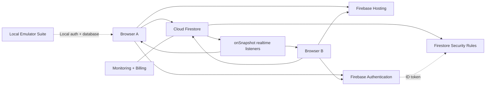
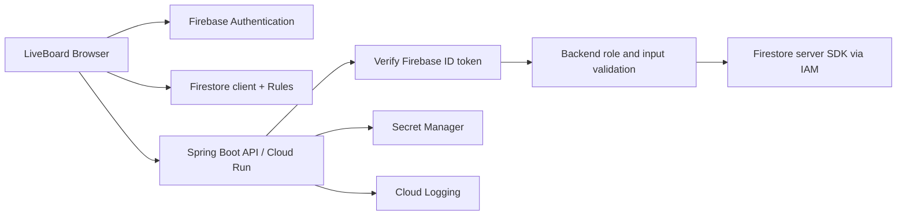

# Realtime Application Project with Firestore and Firebase

In this hands-on project, we build **LiveBoard** — a task board application where two or more members can view and update tasks together in real time. A board owner creates a board and invites members by their Firebase Authentication UID; members add tasks and mark them done. Browsers receive updates via **Cloud Firestore realtime listeners**, without building a custom WebSocket server.

This exercise belongs to the `CLOUD_PROVIDERS_GCP` module: learners explore Google Cloud from project organization, IAM, and VPC to Compute Engine, GKE, Cloud Run, storage services, and databases. Through deployment scenarios, learners practice selecting services, securing resources, automating releases, and monitoring reliability and cost. LiveBoard combines Firebase Authentication, Cloud Firestore, Security Rules, Local Emulator Suite, Firebase Hosting, access-control testing, and FinOps into a demonstrable and extensible application.

The MVP uses the **modular JavaScript Firebase SDK, Vite, Firebase Authentication Email/Password, Firestore, and Firebase Hosting**. No Java backend is required for realtime updates, though the end of the lesson explains how to extend the system with Java/Spring Boot on Cloud Run. All code and paths are examples for learners to create in their own project, not edits to this module's lesson files.

**Safety note:** Start with the emulator project `demo-liveboard`. Only create a real project, enable billing, and deploy Hosting/Rules once authorized. Firebase Web config is public client metadata; never place service account keys or server secrets in frontend JavaScript.

## Learning Objectives

After this lesson, learners will be able to:

- Design a realtime architecture: client → Firebase Authentication → Cloud Firestore → Hosting.
- Distinguish collections, documents, subcollections, listeners, and Security Rules.
- Set up Vite, Firebase CLI, Firebase Emulator Suite, and the modular Firebase SDK.
- Build a UI for sign-up/sign-in, creating boards, inviting members, and creating/updating tasks.
- Use `onSnapshot()`, `unsubscribe()`, and error callbacks to synchronize UI state.
- Write Firestore Security Rules enforcing owner/member boundaries, field validation, and unauthorized access denial.
- Test Rules with `@firebase/rules-unit-testing` and run them in CI.
- Deploy staging to Firebase Hosting and observe indexes, offline state, and realtime listener costs.
- Explain when Cloud Functions, Pub/Sub, or a separate Java/Spring Boot backend are needed.

## 1. Problem Statement and Acceptance Criteria

### MVP Features

| Role | Allowed Actions | Restrictions |
|---|---|---|
| Unauthenticated | View sign-in/sign-up form. | Cannot read or write boards/tasks. |
| Board member | View tasks in real time, create tasks, and toggle `done`. | Cannot invite other members. |
| Board owner | All member actions, plus adding user UIDs to `memberUids`. | Cannot change `ownerUid`; MVP does not support deleting boards. |
| Non-member | Cannot read board/tasks even if they know the document ID. | Cannot write or invite themselves. |

**Completion criteria:** A creates `Sprint Demo`; B signs in on another browser and gives their UID to A; A invites B; B sees the new board without refreshing; B creates a task, A sees it appear; A toggles the task status, B sees it sync. Non-member User C receives `permission-denied` from Firestore. Rules tests pass and the staging build works.

The MVP **does not** include email invitations, file attachments, board deletion, presence/typing indicators, multi-role workflows, or detailed audit logs. Production requires an invite–accept flow with recipient verification rather than the owner entering UIDs manually.

## 2. Overall Architecture



Runtime flow: Hosting serves the static bundle; users sign in via Auth; the Firebase Client SDK sends requests to Firestore under the user's identity; Firestore evaluates Rules and returns document/query snapshots; listeners emit the initial snapshot and subsequent updates; the UI re-renders. When switching boards or signing out, listeners must be unsubscribed.

**Firestore is not a message queue:** listeners track document/query state, not an exactly-once event delivery channel for payment workflows. Each read/write/reconnect can incur usage and charges depending on edition, so keep queries narrow and listener lifecycles explicit.

### Firestore or Realtime Database?

| Aspect | Firestore | Realtime Database |
|---|---|---|
| Data model | Collections, documents, and subcollections. | JSON tree. |
| Queries | Field filters, sorting, and indexes. | Queries based on JSON tree structure. |
| Realtime | `onSnapshot()` on documents/queries. | Listeners on paths. |
| Rules | Firestore Security Rules. | Realtime Database Rules, different syntax. |
| Best fit | Task boards, document metadata, feeds. | Presence, online status, JSON-tree apps. |

Firestore is chosen because LiveBoard needs membership-based board queries and subcollection task queries. If reliable presence is added later, consider Realtime Database `onDisconnect` paired with Cloud Functions syncing state as needed.

## 3. Data Design and Query Rules

### Data Model

```text
boards/
  {boardId}/
    name: "Sprint Demo"
    ownerUid: "alice-uid"
    memberUids: ["alice-uid", "bob-uid"]
    createdAt: timestamp
    updatedAt: timestamp
    tasks/
      {taskId}/
        title: "Review pull request"
        done: false
        createdBy: "bob-uid"
        createdAt: timestamp
        updatedAt: timestamp
```

`boards` holds workspace documents; each board has a `tasks` subcollection. Task IDs are auto-generated by Firestore. Firebase Security Rules on a parent document **do not automatically** apply to subcollections, so `match /tasks/{taskId}` must be declared separately.

| Field | Type | Validation |
|---|---|---|
| `name` | string | 1–80 characters. |
| `ownerUid` | string | Equals UID on board creation and immutable. |
| `memberUids` | list | Includes owner; max 20 items for demo. |
| `createdAt`, `updatedAt` | timestamp | Set from `serverTimestamp()`; `createdAt` immutable. |
| Task `title` | string | 1–120 characters. |
| Task `done` | bool | `false` on creation; members may update. |
| Task `createdBy` | string | Equals UID on creation and immutable. |

A `memberUids` array fits small groups. For thousands of members, design a membership subcollection or separate index to avoid oversized documents, update contention, and Rules access costs. Never use email addresses as access-control keys because emails can change.

### Two Primary Queries

```javascript
// Return only boards where the user is a member.
query(collection(db, 'boards'), where('memberUids', 'array-contains', uid));

// Fetch the 50 most recent tasks of the active board.
query(
  collection(db, 'boards', boardId, 'tasks'),
  orderBy('createdAt', 'desc'),
  limit(50)
);
```

These queries are typically served by single-field indexes in Firestore Standard edition. If you later add a `done == false` filter alongside `orderBy(createdAt)`, a composite index may be required. **Security Rules are not a data filter**: a query reading all `boards` will be rejected unless Firestore can prove every returned document belongs to the user.

## 4. Tooling and Project Structure

### Preparation

You need a Node.js version compatible with Vite/Firebase SDK, npm, Firebase CLI, and a browser. The Firestore emulator has a roadmap requiring Java 21 in recent CLI versions, so check emulator docs and `java -version` if you hit Java runtime errors.

Create the frontend source in a separate practice directory:

```bash
npm create vite@latest liveboard -- --template vanilla
cd liveboard
npm install
npm install firebase
npm install --save-dev firebase-tools @firebase/rules-unit-testing
```

Keep `package-lock.json` in the repository and use `npm ci` in CI to guarantee consistent dependencies.

```text
liveboard/
├── index.html
├── package.json
├── package-lock.json
├── .env.example
├── .env.local
├── firebase.json
├── firestore.rules
├── src/
│   ├── firebase.js
│   └── main.js
├── tests/
│   └── firestore.rules.test.mjs
└── dist/                   # Generated by Vite during build
```

### Demo Project vs. Real Project

- **Local:** uses `demo-liveboard`, Auth emulator, and Firestore emulator. Demo projects have no production resources to modify accidentally.
- **Staging:** create a real Firebase project, register a Web app, and enable Email/Password provider and Firestore in an appropriate region; use synthetic data.
- **Production:** dedicated project with budgets, IAM, backup/retention, Rules/index deployment approvals, and monitoring.

Never configure a production project in `.env.local` for this demo. When deploying, pass `--project STAGING_PROJECT_ID` explicitly rather than relying on an unchecked CLI default project.

## 5. Configuring Emulator Suite and Firebase SDK

### `firebase.json`

```json
{
  "firestore": {
    "rules": "firestore.rules"
  },
  "hosting": {
    "public": "dist",
    "ignore": ["firebase.json"],
    "rewrites": [
      { "source": "**", "destination": "/index.html" }
    ]
  },
  "emulators": {
    "auth": { "host": "127.0.0.1", "port": 9099 },
    "firestore": { "host": "127.0.0.1", "port": 8080 },
    "ui": { "enabled": true, "port": 4000 }
  }
}
```

**Important:** `firestore.rules` must actually be loaded. The emulator may fall back to open rules when Rules configuration is incomplete, causing access-allowing tests to pass falsely. Once the project needs composite indexes, add `firestore.indexes.json` under the `firestore` section.

Start Firebase Emulator Suite:

```bash
npx firebase emulators:start --only auth,firestore --project demo-liveboard
```

The Emulator UI typically runs at `http://127.0.0.1:4000`. On Windows PowerShell, put the command on a single line; POSIX `\` line continuations do not work the same way as in Bash.

### `.env.example` for Local Demo

```dotenv
VITE_USE_EMULATORS=true
VITE_FIREBASE_API_KEY=demo-api-key
VITE_FIREBASE_AUTH_DOMAIN=demo-liveboard.firebaseapp.com
VITE_FIREBASE_PROJECT_ID=demo-liveboard
VITE_FIREBASE_APP_ID=demo-web-app
```

Copy to `.env.local` and start Vite. For a real project, obtain the Firebase Web App config from the Console and set `VITE_USE_EMULATORS=false` when building staging/production. `VITE_` variables are bundled into client code and **must never contain private keys, tokens, or service account JSON**. A Web App API key/config is public client metadata; data protection relies on Auth, Rules, and measures like App Check.

### `src/firebase.js`

```javascript
import { initializeApp } from 'firebase/app';
import { getAuth, connectAuthEmulator } from 'firebase/auth';
import { getFirestore, connectFirestoreEmulator } from 'firebase/firestore';

const app = initializeApp({
  apiKey: import.meta.env.VITE_FIREBASE_API_KEY,
  authDomain: import.meta.env.VITE_FIREBASE_AUTH_DOMAIN,
  projectId: import.meta.env.VITE_FIREBASE_PROJECT_ID,
  appId: import.meta.env.VITE_FIREBASE_APP_ID
});

export const auth = getAuth(app);
export const db = getFirestore(app);

if (import.meta.env.DEV && import.meta.env.VITE_USE_EMULATORS === 'true') {
  connectAuthEmulator(auth, 'http://127.0.0.1:9099');
  connectFirestoreEmulator(db, '127.0.0.1', 8080);
}
```

Call `connectAuthEmulator`/`connectFirestoreEmulator` **before** sending any Firebase requests. If the app runs on another device, Android emulator, or container, update `127.0.0.1` to the appropriate test host/DNS. Never enable emulators in production releases.

## 6. HTML Interface

To keep focus on realtime sync and Rules, the MVP uses plain DOM APIs. Create `index.html`:

```html
<!doctype html>
<html lang="en">
  <head>
    <meta charset="UTF-8" />
    <meta name="viewport" content="width=device-width, initial-scale=1.0" />
    <title>LiveBoard — Firestore Realtime</title>
    <style>
      body { font: 16px system-ui; max-width: 860px; margin: 2rem auto; padding: 1rem; }
      form, section { margin: 1rem 0; padding: 1rem; border: 1px solid #ddd; }
      input, button { padding: .6rem; margin: .25rem; }
      li { margin: .6rem 0; }
      #message { min-height: 1.5em; }
      [hidden] { display: none !important; }
    </style>
  </head>
  <body>
    <h1>LiveBoard</h1>
    <p id="message" role="status" aria-live="polite"></p>

    <section id="auth-panel">
      <h2>Sign in / Sign up</h2>
      <form id="auth-form">
        <input id="auth-email" type="email" placeholder="Email" required />
        <input id="auth-password" type="password" placeholder="Password" minlength="6" required />
        <button type="submit">Sign in</button>
        <button id="signup" type="button">Create account</button>
      </form>
    </section>

    <section id="app-panel" hidden>
      <p>Your UID: <code id="my-uid"></code></p>
      <button id="logout" type="button">Sign out</button>
      <form id="board-form">
        <h2>Create board</h2>
        <input id="board-name" maxlength="80" placeholder="Board name" required />
        <button type="submit">Create</button>
      </form>
      <h2>My boards</h2>
      <ul id="board-list"></ul>
      <section id="active-board" hidden>
        <h2 id="board-title"></h2>
        <form id="invite-form" hidden>
          <input id="invite-uid" placeholder="Invitee UID" required />
          <button type="submit">Invite</button>
        </form>
        <form id="task-form">
          <input id="task-title" maxlength="120" placeholder="Task title" required />
          <button type="submit">Add task</button>
        </form>
        <ul id="task-list"></ul>
      </section>
    </section>
    <script type="module" src="/src/main.js"></script>
  </body>
</html>
```

The MVP omits loading skeletons and detailed accessible input labels; production builds require complete UX, accessibility, responsiveness, and validation. Always use DOM `textContent` rather than rendering raw `innerHTML` from task titles to prevent DOM-based XSS.

## 7. Realtime Frontend with Firestore

### `src/main.js`

```javascript
import { auth, db } from './firebase.js';
import {
  createUserWithEmailAndPassword, signInWithEmailAndPassword,
  signOut, onAuthStateChanged
} from 'firebase/auth';
import {
  addDoc, arrayUnion, collection, doc, limit, onSnapshot,
  orderBy, query, serverTimestamp, updateDoc, where
} from 'firebase/firestore';

const $ = (id) => document.getElementById(id);
const message = (text) => { $('message').textContent = text; };

let user = null;
let boardId = null;
let stopBoards = () => {};
let stopBoard = () => {};
let stopTasks = () => {};

function clearSelection() {
  stopBoard();
  stopTasks();
  stopBoard = () => {};
  stopTasks = () => {};
  boardId = null;
  $('active-board').hidden = true;
  $('board-title').textContent = '';
  $('task-list').replaceChildren();
}

function clearAllListeners() {
  stopBoards();
  stopBoards = () => {};
  clearSelection();
  $('board-list').replaceChildren();
}

async function run(action) {
  try {
    await action();
    message('');
  } catch (error) {
    message(`Action failed: ${error.message}`);
  }
}

$('auth-form').addEventListener('submit', (event) => {
  event.preventDefault();
  run(() => signInWithEmailAndPassword(
    auth, $('auth-email').value.trim(), $('auth-password').value
  ));
});

$('signup').addEventListener('click', () => run(() =>
  createUserWithEmailAndPassword(
    auth, $('auth-email').value.trim(), $('auth-password').value
  )
));

$('logout').addEventListener('click', () => run(() => signOut(auth)));

function watchBoards(uid) {
  const boardsQuery = query(
    collection(db, 'boards'),
    where('memberUids', 'array-contains', uid)
  );
  stopBoards = onSnapshot(boardsQuery, (snapshot) => {
    const list = $('board-list');
    list.replaceChildren();
    for (const board of snapshot.docs) {
      const item = document.createElement('li');
      const button = document.createElement('button');
      button.type = 'button';
      button.textContent = board.data().name;
      button.addEventListener('click', () => selectBoard(board.id));
      item.append(button);
      list.append(item);
    }
  }, (error) => message(`Unable to listen to boards: ${error.message}`));
}

function selectBoard(id) {
  clearSelection();
  boardId = id;
  $('active-board').hidden = false;

  stopBoard = onSnapshot(doc(db, 'boards', id), (snapshot) => {
    if (!snapshot.exists()) {
      message('Board no longer exists or is inaccessible.');
      clearSelection();
      return;
    }
    const board = snapshot.data();
    $('board-title').textContent = board.name;
    $('invite-form').hidden = board.ownerUid !== user?.uid;
  }, (error) => {
    message(`Unable to listen to board: ${error.message}`);
    clearSelection();
  });

  const tasksQuery = query(
    collection(db, 'boards', id, 'tasks'),
    orderBy('createdAt', 'desc'),
    limit(50)
  );
  stopTasks = onSnapshot(tasksQuery, (snapshot) => {
    const list = $('task-list');
    list.replaceChildren();
    for (const taskSnap of snapshot.docs) {
      const task = taskSnap.data();
      const item = document.createElement('li');
      const button = document.createElement('button');
      button.type = 'button';
      button.textContent = task.done ? 'Done ✓' : 'Todo';
      button.addEventListener('click', () => run(() =>
        updateDoc(doc(db, 'boards', id, 'tasks', taskSnap.id), {
          done: !task.done,
          updatedAt: serverTimestamp()
        })
      ));
      const title = document.createElement('span');
      title.textContent = ` ${task.title}`;
      item.append(button, title);
      list.append(item);
    }
  }, (error) => message(`Unable to listen to tasks: ${error.message}`));
}

$('board-form').addEventListener('submit', (event) => {
  event.preventDefault();
  if (!user) return;
  const name = $('board-name').value.trim();
  if (!name) return;
  run(async () => {
    const result = await addDoc(collection(db, 'boards'), {
      name,
      ownerUid: user.uid,
      memberUids: [user.uid],
      createdAt: serverTimestamp(),
      updatedAt: serverTimestamp()
    });
    $('board-name').value = '';
    selectBoard(result.id);
  });
});

$('invite-form').addEventListener('submit', (event) => {
  event.preventDefault();
  if (!boardId) return;
  const inviteUid = $('invite-uid').value.trim();
  if (!inviteUid) return;
  run(async () => {
    await updateDoc(doc(db, 'boards', boardId), {
      memberUids: arrayUnion(inviteUid),
      updatedAt: serverTimestamp()
    });
    $('invite-uid').value = '';
  });
});

$('task-form').addEventListener('submit', (event) => {
  event.preventDefault();
  if (!boardId || !user) return;
  const title = $('task-title').value.trim();
  if (!title) return;
  run(async () => {
    await addDoc(collection(db, 'boards', boardId, 'tasks'), {
      title,
      done: false,
      createdBy: user.uid,
      createdAt: serverTimestamp(),
      updatedAt: serverTimestamp()
    });
    $('task-title').value = '';
  });
});

onAuthStateChanged(auth, (nextUser) => {
  clearAllListeners();
  user = nextUser;
  $('auth-panel').hidden = Boolean(user);
  $('app-panel').hidden = !user;
  $('my-uid').textContent = user?.uid ?? '';
  if (user) watchBoards(user.uid);
});
```

This code uses `textContent`, try/catch around Promise writes, and error callbacks on listeners. For production apps, add loading/disabled button states, debouncing, pagination, cancellation of pending work, and race tests when switching boards while a query is in flight.

### Why Is Unsubscribe Needed?

`onSnapshot()` returns an **unsubscribe** function. When a user switches boards, failing to cancel old listeners can cause the UI to receive updates from the previous board, hold onto resources, and increase document reads and memory usage. On sign-out, every listener reading user data must be cleaned up. In React, subscribe inside `useEffect` and return the unsubscribe callback in the cleanup function.

### Local Events vs. Server Events

Firestore supports latency compensation: the UI may receive a snapshot immediately when a local write starts, before server confirmation. `snapshot.metadata.hasPendingWrites` indicates local unconfirmed mutations; listeners with `{ includeMetadataChanges: true }` fire when metadata shifts from pending to confirmed. If Rules reject the write, the write Promise rejects and the client must display the error rather than treating the local snapshot as a final commit.

## 8. Security Rules for Owners and Members

### Purpose

Client JavaScript can be edited by users via DevTools or bypassed by calling the SDK directly. **Hiding the "Invite" button is not security**; the server must evaluate rules to stop users from impersonating an owner. LiveBoard policy:

1. Anonymous users cannot read or write.
2. Only users listed in `memberUids` can read a board or its tasks.
3. Only the owner can add/remove member UIDs.
4. When creating a board, `ownerUid == request.auth.uid` and the initial member list contains only the owner.
5. When creating a task, `createdBy == request.auth.uid`; `createdBy` and `createdAt` cannot be modified.
6. Fields and types must be valid; all other paths deny by default.

### `firestore.rules` File

```javascript
rules_version = '2';
service cloud.firestore {
  match /databases/{database}/documents {
    function signedIn() {
      return request.auth != null;
    }
    function boardPath(boardId) {
      return /databases/$(database)/documents/boards/$(boardId);
    }
    function isMember(boardId) {
      return signedIn()
        && exists(boardPath(boardId))
        && request.auth.uid in get(boardPath(boardId)).data.memberUids;
    }
    function isOwner(boardId) {
      return signedIn()
        && exists(boardPath(boardId))
        && get(boardPath(boardId)).data.ownerUid == request.auth.uid;
    }
    function validBoard() {
      return request.resource.data.keys().hasAll([
          'name', 'ownerUid', 'memberUids', 'createdAt', 'updatedAt'
        ])
        && request.resource.data.keys().hasOnly([
          'name', 'ownerUid', 'memberUids', 'createdAt', 'updatedAt'
        ])
        && request.resource.data.name is string
        && request.resource.data.name.size() > 0
        && request.resource.data.name.size() <= 80
        && request.resource.data.ownerUid is string
        && request.resource.data.memberUids is list
        && request.resource.data.memberUids.size() > 0
        && request.resource.data.memberUids.size() <= 20
        && request.resource.data.ownerUid in request.resource.data.memberUids
        && request.resource.data.createdAt is timestamp
        && request.resource.data.updatedAt is timestamp;
    }
    function validTask() {
      return request.resource.data.keys().hasAll([
          'title', 'done', 'createdBy', 'createdAt', 'updatedAt'
        ])
        && request.resource.data.keys().hasOnly([
          'title', 'done', 'createdBy', 'createdAt', 'updatedAt'
        ])
        && request.resource.data.title is string
        && request.resource.data.title.size() > 0
        && request.resource.data.title.size() <= 120
        && request.resource.data.done is bool
        && request.resource.data.createdBy is string
        && request.resource.data.createdAt is timestamp
        && request.resource.data.updatedAt is timestamp;
    }

    match /boards/{boardId} {
      allow get, list: if signedIn()
        && request.auth.uid in resource.data.memberUids;

      allow create: if signedIn()
        && validBoard()
        && request.resource.data.ownerUid == request.auth.uid
        && request.resource.data.memberUids.size() == 1
        && request.resource.data.memberUids[0] == request.auth.uid
        && request.resource.data.createdAt == request.time
        && request.resource.data.updatedAt == request.time;

      allow update: if signedIn()
        && resource.data.ownerUid == request.auth.uid
        && validBoard()
        && request.resource.data.ownerUid == resource.data.ownerUid
        && request.resource.data.createdAt == resource.data.createdAt
        && request.resource.data.updatedAt == request.time;

      allow delete: if false;

      match /tasks/{taskId} {
        allow get, list: if isMember(boardId);
        allow create: if isMember(boardId)
          && validTask()
          && request.resource.data.createdBy == request.auth.uid
          && request.resource.data.createdAt == request.time
          && request.resource.data.updatedAt == request.time;
        allow update: if isMember(boardId)
          && validTask()
          && request.resource.data.createdBy == resource.data.createdBy
          && request.resource.data.createdAt == resource.data.createdAt
          && request.resource.data.updatedAt == request.time;
        allow delete: if isOwner(boardId);
      }
    }
  }
}
```

With `serverTimestamp()`, Firestore Rules sees the transformed timestamp matching `request.time`, so the create/update conditions above can enforce server-determined timestamps.

### Permissions and Queries

| Action | Permission |
|---|---|
| Read boards | UID must be in `resource.data.memberUids`. |
| Create board | Signed-in, valid `ownerUid`, first member is owner. |
| Update board | Owner only; `ownerUid` and `createdAt` unchanged; valid schema. |
| Read tasks | UID must be a member of the parent board. |
| Create task | Member; `createdBy` equals UID; valid schema. |
| Update task | Member; author/`createdAt` unchanged. |
| Delete task | Owner only; demo UI does not expose a button yet. |
| Delete board | Disallowed from client in MVP. |

**Rules do not filter data:** a `getDocs(collection(db,'boards'))` query will be rejected because it could return other users' boards. Filtering with `array-contains` in the frontend lets Firestore prove the result set is valid.

### Rules Limits and Costs

`isMember()` calls `exists()`/`get()` to read the parent board. These document access calls have per-request limits and can be billed, even on certain denied requests. Do not scale this pattern to millions of boards/tasks without evaluating query patterns and read costs.

MVP Rules do not check whether an invited UID accepted, do not distinguish viewer/editor roles, do not maintain audit/history, and do not support deletion. In production, use a trusted backend for the invitation workflow and test negative cases thoroughly. Never fix permission errors by adding `allow read, write: if true`.

## 9. Unit Testing Security Rules with Emulator Suite

### Why Test Both Directions?

A test checking "owner can read board" still passes if Rules allow all data. A test checking "anonymous is blocked" still passes if Rules deny everything. You must test both **allowed** and **denied** actions across actors and operations.

The `@firebase/rules-unit-testing` package creates mock Firebase Auth contexts without real sign-ins and allows seeding data via `withSecurityRulesDisabled`. However, assertions must call the SDK through normal authenticated/unauthenticated contexts so Rules are actually enforced.

### `tests/firestore.rules.test.mjs`

```javascript
import { readFileSync } from 'node:fs';
import { before, after, beforeEach, test } from 'node:test';
import {
  initializeTestEnvironment, assertSucceeds, assertFails
} from '@firebase/rules-unit-testing';
import {
  Timestamp, doc, collection, getDoc, setDoc, addDoc,
  updateDoc, arrayUnion, serverTimestamp
} from 'firebase/firestore';

let env;

before(async () => {
  env = await initializeTestEnvironment({
    projectId: 'demo-liveboard',
    firestore: {
      host: '127.0.0.1',
      port: 8080,
      rules: readFileSync('firestore.rules', 'utf8')
    }
  });
});

beforeEach(async () => {
  await env.clearFirestore();
});

after(async () => {
  if (env) await env.cleanup();
});

async function seedBoard(memberUids = ['alice', 'bob']) {
  const now = Timestamp.now();
  await env.withSecurityRulesDisabled(async (ctx) => {
    await setDoc(doc(ctx.firestore(), 'boards', 'board-test'), {
      name: 'Sprint Demo',
      ownerUid: 'alice',
      memberUids,
      createdAt: now,
      updatedAt: now
    });
  });
}

test('alice can read board, carol cannot', async () => {
  await seedBoard();
  const alice = env.authenticatedContext('alice').firestore();
  const carol = env.authenticatedContext('carol').firestore();
  await assertSucceeds(getDoc(doc(alice, 'boards', 'board-test')));
  await assertFails(getDoc(doc(carol, 'boards', 'board-test')));
});

test('bob can create task, carol cannot', async () => {
  await seedBoard();
  const bob = env.authenticatedContext('bob').firestore();
  const carol = env.authenticatedContext('carol').firestore();
  const task = (uid) => ({
    title: 'Task demo',
    done: false,
    createdBy: uid,
    createdAt: serverTimestamp(),
    updatedAt: serverTimestamp()
  });

  await assertSucceeds(addDoc(
    collection(bob, 'boards', 'board-test', 'tasks'),
    task('bob')
  ));
  await assertFails(addDoc(
    collection(carol, 'boards', 'board-test', 'tasks'),
    task('carol')
  ));
});

test('only owner can add members', async () => {
  await seedBoard();
  const alice = env.authenticatedContext('alice').firestore();
  const bob = env.authenticatedContext('bob').firestore();
  await assertSucceeds(updateDoc(doc(alice, 'boards', 'board-test'), {
    memberUids: arrayUnion('charlie'),
    updatedAt: serverTimestamp()
  }));
  await assertFails(updateDoc(doc(bob, 'boards', 'board-test'), {
    memberUids: arrayUnion('mallory'),
    updatedAt: serverTimestamp()
  }));
});

test('anonymous cannot read board', async () => {
  await seedBoard();
  const guest = env.unauthenticatedContext().firestore();
  await assertFails(getDoc(doc(guest, 'boards', 'board-test')));
});
```

**Limitations of the illustrative test suite:** add cases for modifying `ownerUid`, modifying `createdAt`, creating a board with a spoofed UID, empty or oversized titles, altering `createdBy`, querying boards without membership filters, removing a member and retrying reads, and disabled users. Use `withSecurityRulesDisabled` strictly in fixture setup—never wrap assertions inside a Rules-bypassing callback.

### `package.json` scripts

Add or merge these scripts into Vite's `package.json`:

```json
{
  "scripts": {
    "dev": "vite",
    "build": "vite build",
    "preview": "vite preview",
    "test:rules": "node --test tests/*.test.mjs",
    "test:rules:emulator": "firebase emulators:exec --only auth,firestore --project demo-liveboard \"npm run test:rules\""
  }
}
```

The snippet above describes the `scripts` section, not a full replacement for `package.json` containing dependencies and metadata. In CI:

```bash
npm ci
npm run test:rules:emulator
npm run build
```

`emulators:exec` starts the emulators, runs tests, and shuts down the emulators. If another terminal already occupies ports 8080/9099, stop that process before running.

### Viewing Rule Coverage

While the Firestore emulator is running:

```text
http://127.0.0.1:8080/emulator/v1/projects/demo-liveboard:ruleCoverage.html
```

Rule coverage shows which expressions were evaluated and their outcomes, yet **high coverage does not prove Rules are secure**. Test cases must stem from permission boundaries and anticipated abuse scenarios.

## 10. Running LiveBoard and Verifying Realtime Sync

### Startup

Terminal 1:

```bash
npx firebase emulators:start --only auth,firestore --project demo-liveboard
```

Terminal 2:

```bash
npm run dev
```

Open the URL printed by Vite (typically `http://localhost:5173`) in two independent browser profiles or two incognito windows with separate sign-in sessions. Register User A and User B using test-only email/passwords.

### Two-User Scenario

| Step | User A | User B | Result |
|---|---|---|---|
| 1 | Register A. | Register B. | Two distinct Firebase Auth UIDs. |
| 2 | Create `Sprint Demo`. | Watch board list. | Board appears only for A. |
| 3 | Enter B's UID to invite. | Keep page open. | B sees the new board via realtime listener. |
| 4 | Open board. | Open board and add a task. | Task appears for A without refreshing. |
| 5 | Toggle `done`. | Watch task list. | B sees status update. |
| 6 | Sign out. | Continue working. | A's listeners unsubscribe; B continues normally. |
| 7 | User C guesses `boardId`. | — | C's Firestore request fails with `permission-denied`. |

Use the Emulator Suite UI to inspect data and rule evaluations. On `permission-denied` errors, inspect payloads, user UIDs, Auth state, document paths, and queries. Never fix errors by opening Rules to all users.

### Realtime Listener Events

`onSnapshot(query, onNext, onError)` receives the initial snapshot and subsequent updates as data changes. `snapshot.docs` is convenient for rendering small lists; `snapshot.docChanges()` helps perform targeted DOM updates. `snapshot.metadata.hasPendingWrites` distinguishes unconfirmed local writes; pass `{ includeMetadataChanges: true }` if the listener should fire on metadata-only transitions.

If a listener fails (e.g., missing permissions or missing index), `onError` runs; after a terminal error, that listener stops receiving events. Surface clear UX and retry/re-subscribe only under a controlled policy. Never create unbounded listeners in a retry loop.

## 11. Offline Mode, Write Conflicts, and Consistency

### Offline on the Web

The Firestore SDK supports an offline cache and can retain copies of documents accessed by the app. On the Web, persistent caching must be configured intentionally; default in-memory caching does not persist across page reloads. On shared computers, offline persistence can leave user data on disk after sign-out; weigh privacy alongside UX.

A write can appear in the UI from local cache before the server accepts it. If a user loses permissions while offline, the write will be rejected upon reconnection. Never treat a local pending state as a committed transaction.

### Two Users Updating the Same Task

If A and B toggle `done` concurrently based on different snapshots, the last request reaching the server decides the final value (**last write wins** for ordinary updates). For workflows with strict invariants—such as deducting stock or reserving seats—use Firestore transactions or a backend enforcing validation and idempotency.

| Scenario | Approach |
|---|---|
| Simple task status toggle | `updateDoc`, accepting last-write-wins. |
| Increment/decrement counter | `increment()` when appropriate, or server-side aggregation. |
| Update depending on current value | Transaction with retries and condition checks. |
| Payments or authorization changes | Trusted backend with audit/idempotency and authorization. |

Firestore listeners model **state observation**, not an exactly-once event queue for business processing. For background jobs, use Cloud Functions, Cloud Tasks, or Pub/Sub as appropriate.

## 12. Indexing and Query Planning

Firestore creates single-field indexes automatically. Combining multiple filter/sort fields can require a composite index.

```javascript
query(
  collection(db, 'boards', boardId, 'tasks'),
  where('done', '==', false),
  orderBy('createdAt', 'desc'),
  limit(50)
);
```

This query may need a composite index on `done` and `createdAt`. If the Console/SDK prints an index creation link, review it, store the definition in `firestore.indexes.json`, and version-control it. `firebase.json` then includes:

```json
{
  "firestore": {
    "rules": "firestore.rules",
    "indexes": "firestore.indexes.json"
  }
}
```

This is the `firestore` config block, **not** a full replacement for `firebase.json` in section 5. Index builds take time and add storage/write overhead. In staging, verify indexes reach `Ready` state before releasing code that issues the new query.

## 13. Firebase Authentication, App Check, and Access Control

### Authentication Verifies Identity

In a real project, enable the Firebase Authentication Email/Password provider and configure account policies, password resets, and email verification as needed. `request.auth.uid` in Rules comes from Firebase Auth, never from an untrusted UID field sent by the browser.

### App Check Helps Curb Abuse

When configured, Firebase App Check attests that requests originate from an approved app/client environment. App Check **does not** replace Authentication, Firestore Security Rules, or rate limiting. Before enabling enforcement in production, test thoroughly in staging to avoid blocking legitimate clients.

### Client SDK and Server SDK Are Different

| Access Type | Security Mechanism |
|---|---|
| Firebase Web/Android/iOS client | Auth + Firestore Security Rules. |
| Firebase Admin SDK on server | Google Cloud IAM and backend-enforced business authorization. |
| Google Cloud Firestore Java server client | Application Default Credentials/IAM, bypassing Firestore Security Rules. |
| Firebase Console/CLI admin | Administrator or deployment service account IAM. |

If a Java backend later writes to Firestore directly, it must re-implement authorization checks at the REST/API layer. Testing browser Security Rules alone is **not enough** to protect endpoints holding server credentials.

## 14. Extending with Java/Spring Boot on Cloud Run

### When Is a Backend Needed?

The MVP needs no Java server. Add Spring Boot when you need:

- Email-verified invitations and an invitation workflow.
- `viewer/editor/owner` role management with audit trails and approvals.
- Scheduled reporting aggregations or synchronization with ERP/Jira systems.
- Sending notifications via Pub/Sub/Cloud Tasks or calling partner APIs with secrets.
- Enforcing business invariants and multi-document transactions.

### Suggested Architecture



Pseudo-code for an authenticated request:

```java
// Pseudo-code: add controller, error handling, and auth middleware.
String token = extractBearerToken(request);
FirebaseToken decoded = FirebaseAuth.getInstance().verifyIdToken(token);
String requesterUid = decoded.getUid();

// Server reads board via Cloud Run runtime service account ADC.
// Verify board.ownerUid.equals(requesterUid).
// Validate invitee, input, rate limits, audit, and idempotency.
// Update Firestore via server SDK only after all checks pass.
```

Never trust a browser-supplied JSON UID as proof of identity. The Cloud Run runtime uses service identity/ADC with least-privilege IAM for Firestore/Secret Manager; never bundle JSON service account keys into source or images. API design must govern CORS, ingress, authentication, rate limits, logging, and data validation errors.

## 15. Controlled Build and Firebase Hosting Deployment

### Pre-Deploy Checks

```bash
npm ci
npm run test:rules:emulator
npm run build
```

Vite outputs `dist/`. Verify the frontend build contains no `.env.local` secrets, service account JSON, or emulator URLs. `VITE_FIREBASE_*` variables are intentionally bundled into client code and treated as public metadata.

### Preparing a Real Staging Project

1. Create a staging Firebase project, register the Web app, and copy the web config.
2. Enable the Email/Password provider in Authentication.
3. Create the Firestore database in a location meeting data residency and latency needs.
4. Select a hosting site/region per capabilities and plan.
5. Configure the staging build with `VITE_USE_EMULATORS=false`.
6. Review `firebase.json`, `firestore.rules`, and indexes (if any).
7. Grant least-privilege deployer permissions and designate reviewers for Rules changes.

### Deploying to Staging

```bash
# This command modifies cloud resources; run only in an approved project.
npm run build
npx firebase deploy \
  --only hosting,firestore:rules \
  --project STAGING_PROJECT_ID
```

In PowerShell, write the deploy command on one line or use PowerShell's line continuation character. After deploying, re-test E2E with two distinct accounts and one unauthorized user. Hosting release history and Firestore Rules deployment history are **separate**; rolling back Hosting does not automatically roll back Rules or data.

### Production Workflow

Pull request → Security Rules tests → build → deploy staging → smoke/security tests → approval → deploy production → monitor logs/usage → runbook rollback if needed. Never auto-deploy to production from an unreviewed or untested commit.

## 16. Realtime Usage and FinOps

### Document Reads/Writes

Firestore Standard edition typically bills for document reads/writes/deletes plus index reads, storage, and network under applicable terms. Listeners can incur reads when:

- A query receives its initial result set.
- A document is added or updated within the result set.
- A document leaves the result set due to a field change (unlike deletion).
- A listener reconnects depending on disconnect duration and offline persistence settings.

Firestore Enterprise edition uses different pricing units; do not apply the Standard billing model uniformly to all databases.

### Illustrative Cost Example

If 100 users simultaneously open a board containing 40 tasks, initial load returns 40 documents per user:

```text
100 active users × 40 task documents = 4,000 initial document reads
```

This figure **illustrates only** a single initial load, excluding board listeners, Rules `get()` calls, updates, reconnects, index reads, and free tier allowances. Never equate displayed task counts with an exact invoice.

### Cost-Reduction Practices

- Listen only to the currently open board; never listen to all boards/tasks at once.
- Use `limit(50)` and pagination for history.
- Unsubscribe on route changes, sign-out, or component unmount.
- Never update `updatedAt` on a one-second timer.
- `docChanges()` cuts DOM work, though it does not reduce query read charges on its own.
- Watch Security Rules access calls to parent board documents.
- Use aggregate documents or backend summaries when dashboards do not need every individual task.
- Set budget alerts, usage dashboards, owner/chargeback tags, and track reads/user.

Cloud Billing Budget Alerts are **notifications only** and do not automatically halt spend; if hard limits are required, implement appropriate policies, quotas, or rate controls.

## 17. Monitoring and Troubleshooting

| Symptom | Possible Cause | Resolution |
|---|---|---|
| `auth/invalid-credential` | Wrong password or provider disabled in real project. | Check Authentication config and sign-in flow. |
| `permission-denied` reading board | User is not a member or query omits `array-contains`. | Compare UID, Rules, and query. |
| `permission-denied` creating task | Wrong `createdBy` UID, invalid title/schema, or removed member. | Inspect payload and Rules evaluation trace. |
| A/B do not see realtime updates | Tabs hit different projects/emulators, different `boardId`, or failed listener. | Check config, state, and error callbacks. |
| Query missing index | Filter + sort requires a composite index. | Create index in staging and wait until Ready. |
| Listener fires multiple callbacks | Local optimistic writes, metadata changes, or duplicate subscriptions. | Check `hasPendingWrites` and unsubscribe logic. |
| Offline sync mismatch | Last-write-wins or write rejected after reconnect. | Design conflict UX or transactions. |
| Rules tests pass but production fails | Tests used a different Rules file or missing provider/index. | Align `firebase.json` and staging smoke tests. |
| Usage/cost spikes | Overly broad listeners, frequent reconnects, or write loops. | Check usage dashboard, Billing export, and audit listeners. |
| Spring backend reads Rules-forbidden data | Admin/server SDK bypasses client Rules. | Verify IAM and backend authorization checks. |

### Metrics to Monitor

- Latency from A writing a task to B observing the change (p50/p95).
- Create/update success rate and `permission-denied` error counts.
- Frontend sign-in success rate, listener errors, and reconnects.
- Document reads/writes per active user per day and network egress.
- Query/index efficiency and daily Firestore usage.
- Billing alerts, security incidents, and anomalous invitation spikes.

Never log Firebase ID tokens, passwords, or sensitive task content into analytics/logs. Monitor user-facing SLOs, not raw read counts alone.

## 18. Upgrade Roadmap

### Verified Invitations

1. Owner calls a Spring/Cloud Functions backend to create a TTL-bound invitation.
2. Backend verifies the ID token and owner membership.
3. Send email/link to the recipient.
4. Recipient signs in and accepts the invitation.
5. Backend writes membership with audit trail, idempotency, and validation.

### Notifications and Event Processing

A Cloud Functions trigger on task creation can send notifications or publish to Pub/Sub. Design consumers to be idempotent since events can be redelivered. Never rely on a client snapshot listener to execute mandatory business logic when clients can go offline.

### Pagination

Large boards should listen only to the latest tasks and load older tasks via query cursors (`startAfter`, `limit`). Never attach a listener pulling tens of thousands of tasks just to render a few rows on screen.

### Attachments and Presence

To support attachments, use Cloud Storage for Firebase with Storage Rules checking ownership, path, size, and metadata; client-supplied `contentType` does not prove file safety, so backend scanning may be required. For presence, consider Realtime Database `onDisconnect` + Cloud Functions sync rather than writing heartbeats every second to Firestore.

## 19. Acceptance Test Matrix

| ID | Test Case | Expected |
|---|---|---|
| A01 | A registers with Email/Password. | Receives UID and lands on board list. |
| A02 | A creates a board. | Owner and sole member is A. |
| A03 | B signs in. | B does not see A's board yet. |
| A04 | A invites B by UID. | Board appears for B in real time. |
| A05 | B creates a task. | A sees the new task without refreshing. |
| A06 | A toggles `done`. | B sees the updated status. |
| S01 | Anonymous reads board. | Denied. |
| S02 | Signed-in C is not a board member. | Denied. |
| S03 | B tries adding C to members. | Denied. |
| S04 | A tries changing `ownerUid` to B. | Denied. |
| S05 | B creates task with `createdBy=A`. | Denied. |
| S06 | B modifies task `createdAt`. | Denied. |
| R01 | Switch boards repeatedly. | No leaked/duplicate listeners remain. |
| R02 | Sign out. | UI clears data and listeners unsubscribe. |
| R03 | Disconnect network then reconnect. | Pending state / failed writes handled clearly. |
| F01 | `test:rules:emulator`. | Positive and negative cases pass. |
| F02 | Deploy staging Hosting/Rules. | Two staging users collaborate smoothly. |
| F03 | Inspect usage. | No full-collection queries or abnormal write loops. |

Learners should document results and discovered defects. Never upload real personal data into exercise repositories or public demo projects.

## 20. Pre-Production Checklist

- [ ] Independent staging/production projects with right regions and Auth providers.
- [ ] Source code, Rules, and index definitions tracked in version control.
- [ ] Realtime listeners attached only to narrow queries with unsubscribe and error handling.
- [ ] UI handles pending writes, offline/reconnect, and conflicts cleanly.
- [ ] Rules deny by default, checking owner/member and schema/data types.
- [ ] Security Rules unit tests cover both positive and negative cases.
- [ ] Admin SDK is not used to test client Rules or bypass backend authorization.
- [ ] Production invitation flow verifies recipients and maintains audit trails.
- [ ] Public Firebase client config contains no private keys/tokens.
- [ ] App Check evaluated without replacing Auth/Rules.
- [ ] Production Firebase Hosting build never points at local emulators.
- [ ] XSS mitigation enforced; never render raw user HTML.
- [ ] Indexes for complex queries created and Ready in staging.
- [ ] Deployment IAM and backend service identity scoped to least privilege.
- [ ] Backups/exports/retention and data deletion procedures in place.
- [ ] Billing alerts, usage dashboard, and cost owner assigned.
- [ ] **Separate** rollback plans for Hosting and Security Rules.
- [ ] Two-browser E2E and `permission-denied` tests pass in staging.

## 21. Conclusion

LiveBoard demonstrates that Firebase Authentication, Cloud Firestore, and `onSnapshot()` can power a multi-user realtime application without managing a custom WebSocket server. Firestore pushes live document/query updates, while Security Rules enforce owner/member boundaries and data constraints.

Real success goes beyond UI sync: it requires least-privilege queries, clean listener unsubscription, Rules tests blocking unauthorized actors, proper handling of pending offline writes, index management, and understanding read/FinOps dynamics. For multi-role workflows or trusted transactional rules, you can add Java/Spring Boot on Cloud Run—remembering that the backend must verify Firebase ID tokens and enforce its own authorization and IAM because server SDKs bypass Firestore client Rules.

The project meets its goals when **A and B see realtime updates together, C is denied, Rules tests pass, the staging build runs cleanly, and usage/costs are monitored**.

## References

- [Firebase — Add Firebase to a web app](https://firebase.google.com/docs/web/setup)
- [Firebase Authentication — Password-based accounts](https://firebase.google.com/docs/auth/web/password-auth)
- [Cloud Firestore — Get started](https://firebase.google.com/docs/firestore/quickstart)
- [Cloud Firestore — Get realtime updates](https://firebase.google.com/docs/firestore/query-data/listen)
- [Cloud Firestore — Add data](https://firebase.google.com/docs/firestore/manage-data/add-data)
- [Cloud Firestore — Data model](https://firebase.google.com/docs/firestore/data-model)
- [Cloud Firestore — Security Rules](https://firebase.google.com/docs/firestore/security/get-started)
- [Cloud Firestore — Security Rule conditions](https://firebase.google.com/docs/firestore/security/rules-conditions)
- [Cloud Firestore — Secure queries](https://firebase.google.com/docs/firestore/security/rules-query)
- [Firebase — Local Emulator Suite](https://firebase.google.com/docs/emulator-suite)
- [Firebase — Connect to Firestore Emulator](https://firebase.google.com/docs/emulator-suite/connect_firestore)
- [Firebase — Test Security Rules](https://firebase.google.com/docs/firestore/security/test-rules-emulator)
- [Firebase — Rules unit testing API](https://firebase.google.com/docs/reference/emulator-suite/rules-unit-testing/rules-unit-testing)
- [Cloud Firestore — Indexing](https://firebase.google.com/docs/firestore/query-data/indexing)
- [Cloud Firestore — Offline data](https://firebase.google.com/docs/firestore/manage-data/enable-offline)
- [Cloud Firestore — Billing and realtime listeners](https://firebase.google.com/docs/firestore/pricing)
- [Firebase Hosting — Quickstart](https://firebase.google.com/docs/hosting/quickstart)
- [Firebase App Check — Overview](https://firebase.google.com/docs/app-check)
- [Google Cloud — IAM overview](https://docs.cloud.google.com/iam/docs/overview)
