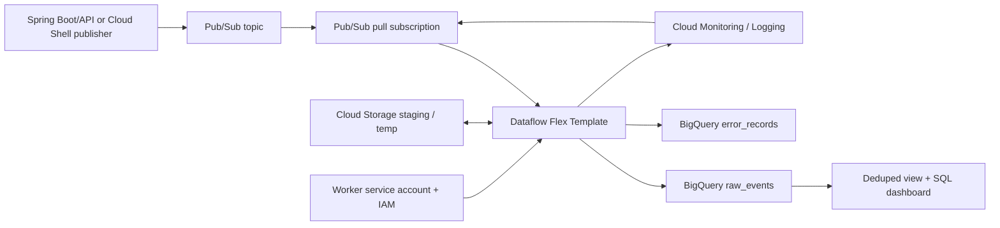

# Event Ingestion Project with Pub/Sub, Dataflow, and BigQuery

A Java/Spring application on Google Cloud can emit thousands of events per second: users viewing products, placing orders, paying, cancelling transactions, or completing tasks. If every HTTP request writes synchronously to both the transactional database and the analytics warehouse, latency and failures in the analytics system can directly impact end users.

The **Pub/Sub → Dataflow → BigQuery** architecture solves this by decoupling event emission from data processing. **Cloud Pub/Sub** ingests and distributes messages; **Dataflow** runs a streaming pipeline that transforms JSON into schema-typed rows and routes failures to a dead-letter destination; **BigQuery** stores the data for reconciliation and analytics. Cloud Storage hosts Dataflow staging/temporary files, while Cloud Monitoring and Logging provide telemetry.

This lesson belongs to the **GCP Hands-On Projects** chapter of the **CLOUD_PROVIDERS_GCP** module. It brings together project governance, IAM/VPC, storage and data services, release automation, reliability observability, and cost control. The project uses a **Google-provided Dataflow Flex Template**, which can be completed from Cloud Shell without writing custom Apache Beam code first; an extension section provides a Java publisher example and Beam pointers.

> **Cost and Access Note:** These hands-on commands can create billable resources, especially a **continuously running Dataflow streaming job**. Execute only in an approved sandbox project with billing, budget alerts, and an assigned owner. This is an instructional guide, not a live deployment already executed by a worker.

## 1. Learning Objectives and Deliverables

After completing this lesson, you will be able to:

- Design an event contract with `event_id`, `event_type`, `event_ts`, `source`, and `schema_version`.
- Create a Pub/Sub topic and pull subscription dedicated to Dataflow.
- Create a BigQuery dataset and raw events table with schema, time partitioning, and clustering.
- Grant IAM permissions to the Dataflow launcher and worker service account by role.
- Run the **Pub/Sub to BigQuery Flex Template** using a fixed subscription.
- Publish sample JSON messages and verify rows written to BigQuery.
- Inject schema errors to test the dead-letter table, inspect failures, and replay.
- Distinguish duplicate Pub/Sub messages from duplicate business events.
- Use SQL to deduplicate, analyze, and reconcile events.
- Measure backlog, latency/freshness, write errors, and worker health.
- Understand when to choose a Pub/Sub BigQuery subscription instead of Dataflow.
- Stop the Dataflow job, clean up resources, and verify no lingering charges remain.

**Deliverables to submit:** architecture diagram, resource inventory, table schema, at least three valid events, one invalid event, BigQuery queries, duplicate test results, monitoring report, and cleanup checklist.

## 2. Business Scenario

Suppose an e-commerce system emits the following events:

| Event | Producer | Analytics Purpose |
|---|---|---|
| `order_created` | Spring Boot checkout API | New order count, orders per hour |
| `payment_authorized` | Payment worker | Authorized payment value |
| `order_cancelled` | Checkout API | Cancellation rate and behavioral analysis |
| `product_viewed` | Web/app tracking service | Product browsing activity |

BigQuery is **not** a transactional order-processing database; Cloud SQL, AlloyDB, or Spanner remains the transactional source of truth. An asynchronous analytics event pipeline accepts ingestion latency within a defined SLO.

### 2.1. Reference Architecture



| Component | Role | Risks to Control |
|---|---|---|
| Publisher | Emits events with stable IDs | Retries creating duplicate events |
| Topic | Ingests messages and fans out | Missing publish permission; invalid schema |
| Subscription | Tracks delivery/ack state, backlog, retention | Competing consumers stealing messages |
| Dataflow | Transforms messages into BigQuery rows | IAM, quotas, transform failures |
| BigQuery raw | Stores and queries ingested events | Schema drift, duplicates, scan cost |
| BigQuery error | Captures failed event records | Unprocessed or un-replayed errors |
| Cloud Storage | Staging/temp and optional UDFs | Cost, IAM, retention |
| Monitoring | Tracks freshness, backlog, and errors | Job running while data fails to arrive |

### 2.2. Why Use a Fixed Subscription?

The Dataflow Pub/Sub connector can read from either a **topic** or a **subscription**. Passing only a topic causes the connector to auto-create an ephemeral subscription. In this project, we create a **pull subscription before publishing** because:

1. Messages can be published before the Dataflow job starts while the subscription buffers the backlog.
2. You have a stable resource to configure retention, IAM, and monitoring.
3. It is easy to inspect a single logical consumer and clean up resources afterward.
4. It avoids the misconception that creating a topic alone retains messages indefinitely for any consumer.

Never point two Dataflow pipelines at the same subscription: they will unpredictably split messages between them. Never run `subscriptions pull` to "peek at messages" while the pipeline is running; `pull` is also a consumer.

## 3. Event Contract and Event Timestamps

Sample JSON:

```json
{
  "event_id": "evt-001",
  "event_type": "order_created",
  "event_ts": "2026-11-19T08:00:00Z",
  "source": "checkout-api",
  "actor_id": "demo-user-01",
  "amount_minor_units": 129900,
  "currency": "VND",
  "trace_id": "trace-demo-001",
  "schema_version": 1
}
```

| Field | BigQuery type | Rule |
|---|---|---|
| `event_id` | STRING | Business event ID stable across retries |
| `event_type` | STRING | Standardized, cataloged event name |
| `event_ts` | TIMESTAMP | Time event occurred, ISO 8601 with timezone |
| `source` | STRING | Name of the emitting service |
| `actor_id` | STRING | Synthetic/pseudonymous ID; never log emails/PII |
| `amount_minor_units` | INTEGER | Currency amount in smallest units; never use floats |
| `currency` | STRING | Currency code; never sum across different currencies |
| `trace_id` | STRING | Correlates events with logs/traces |
| `schema_version` | INTEGER | Version of the event contract |

**Three timestamps to distinguish:**

- **Event time:** `event_ts` emitted by the application; may be older if a device was offline.
- **Publish time:** when Pub/Sub received the message.
- **Processing/ingestion time:** when Dataflow processed and BigQuery ingested the row.

For example, an offline device creates an event at 08:00, publishes at 08:10, and Dataflow processes it at 08:11. Business reports by event time group it into 08:00; operational data freshness should measure against publish/ingestion timestamps when instrumented.

### 3.1. Versioning and Validation Rules

Publishers should verify:

- `event_id` is non-empty and unchanged across retries of the same business operation.
- `event_type` belongs to the published allowlist.
- `event_ts` is valid and includes a timezone.
- Monetary amounts are not converted to floating-point.
- Optional fields may be omitted, but present fields must match expected types.
- Payloads contain no credentials, payment tokens, raw card numbers, or personal emails.
- `schema_version` increments on breaking changes.

The Dataflow template reads JSON and writes to BigQuery per schema; it does not replace producer contract validation or curated data layer checks.

## 4. Choosing Dataflow vs. BigQuery Subscriptions

| Option | Best When | Trade-off |
|---|---|---|
| Pub/Sub BigQuery subscription | Direct ingestion with minimal transforms | No worker to manage; at-least-once |
| Dataflow Pub/Sub → BigQuery Flex Template | Managed streaming pipeline, UDFs, and dead-letter handling | Worker runtime, IAM, and lifecycle |
| Custom Apache Beam Dataflow pipeline | Joins, enrichment, event-time windows, stateful dedup, multiple sinks | Custom code development and testing |

**This lab selects Dataflow** to practice streaming pipelines. For production designs that merely copy JSON into BigQuery, evaluate BigQuery subscriptions first because they are simpler. Pub/Sub BigQuery subscriptions deliver at-least-once, so business-level deduplication is still required.

### 4.1. Flex Template

Google-provided template:

```text
gs://dataflow-templates/latest/flex/PubSub_to_BigQuery_Flex
```

Key parameters:

- `inputTopic` **or** `inputSubscription` (one only).
- `outputTableSpec` in `PROJECT_ID:DATASET.TABLE` format.
- `outputDeadletterTable` to store failed records.
- `javascriptTextTransformGcsPath` and `javascriptTextTransformFunctionName` when using a UDF.
- Storage Write API / streaming mode options as needed.

`latest` is convenient in a **sandbox**, yet can change over time. For production deployments, pin the template build to a specific tested version/date.

## 5. Prerequisites and Budget

You need a billing-enabled GCP project, `gcloud`/`bq` (Cloud Shell), permissions for Pub/Sub, Dataflow, Cloud Storage, BigQuery, and IAM, and a compatible region. Create a budget alert on the project before running.

### 5.1. Bash Environment Variables

```bash
export PROJECT_ID="YOUR_SANDBOX_PROJECT_ID"
export REGION="us-central1"
export TOPIC="orders-events-lab"
export SUBSCRIPTION="orders-events-sub-lab"
export DATASET="events_lab"
export TABLE="raw_events"

# Bucket must be globally unique and used exclusively for this lab.
export STAGING_BUCKET="$PROJECT_ID-events-df-lab"
export WORKER_SA_NAME="df-events-worker"
export WORKER_SA="$WORKER_SA_NAME@$PROJECT_ID.iam.gserviceaccount.com"

gcloud config set project "$PROJECT_ID"
gcloud config get-value project
```

If bucket/topic/dataset names collide with existing resources, choose different names—**never overwrite or delete existing resources**. Examples assume these names belong solely to your lab.

### 5.2. Enabling APIs

```bash
gcloud services enable \
  compute.googleapis.com \
  dataflow.googleapis.com \
  pubsub.googleapis.com \
  bigquery.googleapis.com \
  storage.googleapis.com \
  iam.googleapis.com \
  logging.googleapis.com \
  monitoring.googleapis.com \
  --project="$PROJECT_ID"
```

This command requires `serviceusage.services.enable`. In organizations with API governance policies, request access through approved channels rather than escalating your own privileges.

### 5.3. Dataflow Identities

There are at least two identities:

1. **Dataflow service agent** (Google-managed): orchestrates service resources.
2. **Worker service account**: runs the pipeline on VMs, reads the subscription, writes to BigQuery, and uses the staging bucket.

The job launcher needs appropriate Dataflow permissions and `iam.serviceAccounts.actAs` on the worker SA. Never embed service account JSON keys inside containers or YAML files.

### 5.4. Creating the Worker SA

```bash
gcloud iam service-accounts create "$WORKER_SA_NAME" \
  --display-name="Dataflow event lab worker" \
  --project="$PROJECT_ID"
```

Illustrative bindings **for a sandbox project**:

```bash
for ROLE in \
  roles/dataflow.worker \
  roles/pubsub.subscriber \
  roles/bigquery.dataEditor \
  roles/logging.logWriter
do
  gcloud projects add-iam-policy-binding "$PROJECT_ID" \
    --member="serviceAccount:$WORKER_SA" \
    --role="$ROLE"
done
```

Project-level bindings for the lab are fairly broad. In production, scope `pubsub.subscriber` to the specific subscription and `bigquery.dataEditor` to the target dataset; verify roles/permissions for the Dataflow service agent, launcher, and worker. The job launcher also needs `actAs` on the SA; never grant Owner/Editor just to silence 403 errors.

## 6. Creating the Cloud Storage Staging Bucket

The Dataflow Flex Template requires writable staging/temp paths:

```bash
gcloud storage buckets create "gs://$STAGING_BUCKET" \
  --location="$REGION" \
  --uniform-bucket-level-access \
  --project="$PROJECT_ID"

gcloud storage buckets add-iam-policy-binding "gs://$STAGING_BUCKET" \
  --member="serviceAccount:$WORKER_SA" \
  --role="roles/storage.objectAdmin"
```

The bucket name must be globally unique. You do not need to pre-create a `staging/` directory before Dataflow writes objects. The bucket belongs solely to the lab; never use a production bucket holding user data. When using CMEK, org policies, or private networking, grant the corresponding permissions and configuration.

## 7. Creating the Pub/Sub Topic and Subscription

### 7.1. Topic

```bash
gcloud pubsub topics create "$TOPIC" \
  --project="$PROJECT_ID"

gcloud pubsub topics describe "$TOPIC" \
  --project="$PROJECT_ID"
```

A topic is a message ingress point, not a BigQuery table. Actual publishers need `pubsub.topics.publish`, typically via `roles/pubsub.publisher`.

### 7.2. Fixed Subscription

```bash
gcloud pubsub subscriptions create "$SUBSCRIPTION" \
  --topic="$TOPIC" \
  --message-retention-duration=1d \
  --project="$PROJECT_ID"

gcloud pubsub subscriptions describe "$SUBSCRIPTION" \
  --project="$PROJECT_ID"
```

Create the subscription **before** publishing messages. One-day retention is a sandbox example; production should size retention based on downtime/recovery targets and RPO. Never treat a subscription as permanent historical storage.

**Two types of dead-lettering:** a Pub/Sub dead-letter topic handles delivery/ack failures; a **Dataflow BigQuery dead-letter table** records JSON transform or write errors. They are not the same component.

## 8. Creating the BigQuery Dataset and Raw Table

### 8.1. Dataset

```bash
bq --location="$REGION" mk \
  --dataset "$PROJECT_ID:$DATASET"

bq show "$PROJECT_ID:$DATASET"
```

Choose a dataset location compatible with the Dataflow region and data residency rules. Never assume a job in one region can freely write to datasets in any region without restrictions.

### 8.2. Table Schema, Partitioning, and Clustering

```bash
bq mk \
  --table \
  --time_partitioning_type=DAY \
  --time_partitioning_field=event_ts \
  --clustering_fields=event_type,source \
  "$PROJECT_ID:$DATASET.$TABLE" \
  "event_id:STRING,event_type:STRING,event_ts:TIMESTAMP,source:STRING,actor_id:STRING,amount_minor_units:INTEGER,currency:STRING,trace_id:STRING,schema_version:INTEGER"
```

`event_ts` is a TIMESTAMP partition field; date-bounded queries should filter on it to avoid full-table scans. Clustering by `event_type`, `source` helps matching queries, though effectiveness depends on volume and distribution.

Columns default to NULLABLE in the CLI schema sample. Production should enforce validation and `REQUIRED` constraints where appropriate—especially `event_id` and `event_ts`—alongside schema evolution rules.

### 8.3. Inspecting the Schema

```bash
bq show --schema "$PROJECT_ID:$DATASET.$TABLE"
bq show "$PROJECT_ID:$DATASET.$TABLE"
```

The destination table must exist before running the template. Published JSON must match the schema; unexpected fields, wrong types, or malformed JSON can route records to the dead-letter table.

## 9. Publishing Before Dataflow Starts

Once the subscription exists, publish a message:

```bash
gcloud pubsub topics publish "$TOPIC" \
  --project="$PROJECT_ID" \
  --message='{"event_id":"evt-001","event_type":"order_created","event_ts":"2026-11-19T08:00:00Z","source":"checkout-api","actor_id":"demo-user-01","amount_minor_units":129900,"currency":"VND","trace_id":"trace-demo-001","schema_version":1}'
```

Pub/Sub returns a **message ID** upon acceptance. Pub/Sub's `message_id` is not the business `event_id`. If a publisher retries by issuing a new publish call, the two messages may carry different message IDs even with the same `event_id`.

Never run `gcloud pubsub subscriptions pull` to peek at messages while the pipeline is authorized to read; `pull` is also a consumer and can steal messages intended for Dataflow. Use backlog metrics and BigQuery results to verify delivery.

## 10. Running the Dataflow Flex Template

### 10.1. Identifiers

- Input subscription: `projects/PROJECT_ID/subscriptions/orders-events-sub-lab`
- Output table: `PROJECT_ID:events_lab.raw_events`
- Dead-letter table: `PROJECT_ID:events_lab.raw_events_error_records`

### 10.2. Launch Command

```bash
export JOB_NAME="events-to-bq-$(date +%Y%m%d-%H%M%S)"

gcloud dataflow flex-template run "$JOB_NAME" \
  --project="$PROJECT_ID" \
  --region="$REGION" \
  --template-file-gcs-location="gs://dataflow-templates/latest/flex/PubSub_to_BigQuery_Flex" \
  --staging-location="gs://$STAGING_BUCKET/staging" \
  --temp-location="gs://$STAGING_BUCKET/temp" \
  --service-account-email="$WORKER_SA" \
  --num-workers=1 \
  --max-workers=3 \
  --parameters="inputSubscription=projects/$PROJECT_ID/subscriptions/$SUBSCRIPTION,outputTableSpec=$PROJECT_ID:$DATASET.$TABLE,outputDeadletterTable=$PROJECT_ID:$DATASET.raw_events_error_records"
```

**Important notes:**

- Pass only `inputSubscription`, **not** `inputTopic`.
- `latest` is for learning; production must pin a dated, tested template version.
- Streaming jobs **do not stop automatically** once current events are processed.
- Launcher permissions, worker SA, and Dataflow service agent permissions must all be complete; if missing, inspect IAM errors instead of granting Owner.
- Zone, CPU/IP quotas, org policies, or VPC configuration can prevent workers from starting.
- For private workers, configure VPC/subnetwork, Private Google Access, and appropriate egress.
- Small worker counts illustrate sandbox settings, not production sizing.

### 10.3. Checking Job Status

```bash
gcloud dataflow jobs list \
  --project="$PROJECT_ID" \
  --region="$REGION"

# Replace JOB_ID with the actual ID of the newly created job.
gcloud dataflow jobs describe JOB_ID \
  --project="$PROJECT_ID" \
  --region="$REGION"
```

Possible states include `JOB_STATE_PENDING`, `JOB_STATE_RUNNING`, `JOB_STATE_DRAINING`, `JOB_STATE_DONE`, and `JOB_STATE_FAILED`. Only begin evaluating data once the pipeline is running and shows evidence of consuming messages.

## 11. Publishing Additional Events

```bash
gcloud pubsub topics publish "$TOPIC" \
  --project="$PROJECT_ID" \
  --message='{"event_id":"evt-002","event_type":"payment_authorized","event_ts":"2026-11-19T08:01:00Z","source":"payment-worker","actor_id":"demo-user-01","amount_minor_units":129900,"currency":"VND","trace_id":"trace-demo-002","schema_version":1}'

gcloud pubsub topics publish "$TOPIC" \
  --project="$PROJECT_ID" \
  --message='{"event_id":"evt-003","event_type":"order_cancelled","event_ts":"2026-11-19T08:02:00Z","source":"checkout-api","actor_id":"demo-user-02","amount_minor_units":69000,"currency":"VND","trace_id":"trace-demo-003","schema_version":1}'
```

Dataflow has startup, checkpointing, write, and autoscaling latency. Do not assume rows appear instantaneously when `gcloud publish` returns; check pipeline status/metrics and query BigQuery with a reasonable timeout.

### 11.1. Querying BigQuery

```bash
bq query --use_legacy_sql=false "
SELECT
  event_id, event_type, event_ts, source, amount_minor_units
FROM \`$PROJECT_ID.$DATASET.$TABLE\`
WHERE event_ts >= TIMESTAMP('2026-11-19T00:00:00Z')
  AND event_ts < TIMESTAMP('2026-11-20T00:00:00Z')
ORDER BY event_ts, event_id
LIMIT 100
"
```

Expected result when only the three valid events were published into an empty table:

| event_id | event_type | source | amount_minor_units |
|---|---|---|---:|
| evt-001 | order_created | checkout-api | 129900 |
| evt-002 | payment_authorized | payment-worker | 129900 |
| evt-003 | order_cancelled | checkout-api | 69000 |

### 11.2. Counting Rows

```bash
bq query --use_legacy_sql=false "
SELECT
  COUNT(*) AS raw_rows,
  COUNT(DISTINCT event_id) AS unique_event_ids
FROM \`$PROJECT_ID.$DATASET.$TABLE\`
WHERE event_ts >= TIMESTAMP('2026-11-19T00:00:00Z')
  AND event_ts < TIMESTAMP('2026-11-20T00:00:00Z')
"
```

Before sending duplicates, and assuming only the lab events above exist, expect `raw_rows = 3` and `unique_event_ids = 3`. A reused table or subscription may contain older rows; isolate by lab ID in shared projects.

## 12. Input/Output Reconciliation

Reconciliation means more than seeing three rows:

1. Verify `event_id`, `event_type`, and `source` match.
2. Verify `event_ts` lands in the expected partition.
3. Verify amounts are integers and currency codes are valid.
4. Verify `schema_version` and optional fields.
5. Verify Dataflow processed element counts align with published Pub/Sub message counts.
6. Verify the dead-letter table contains no valid events.
7. Record publish time and appearance time to measure latency.

In production, maintain a publisher manifest or counters—especially alongside publish retries, replays, duplicates, and Pub/Sub retention. A "Running" pipeline alone does not prove data correctness.

## 13. Testing Errors with the BigQuery Dead-Letter Table

### 13.1. Sending a Type-Mismatched Message

```bash
gcloud pubsub topics publish "$TOPIC" \
  --project="$PROJECT_ID" \
  --message='{"event_id":"evt-bad-001","event_type":"order_created","event_ts":"not-a-timestamp","source":"checkout-api","actor_id":"demo-user-03","amount_minor_units":12000,"currency":"VND","trace_id":"trace-demo-bad","schema_version":1}'
```

The `event_ts` field cannot be parsed as a TIMESTAMP; the Dataflow template routes the record to the dead-letter table instead of the raw table.

### 13.2. Inspecting the Dead-Letter Table

```bash
bq ls "$PROJECT_ID:$DATASET"

bq show --schema "$PROJECT_ID:$DATASET.raw_events_error_records"
```

The template may auto-create the dead-letter table with its own schema. **Do not assume the error table shares columns with `raw_events`**; inspect its actual schema before querying. Error payloads can contain sensitive data and must follow IAM/retention policies.

If no error table appears:

- Is the job RUNNING and is the worker reading from the subscription?
- Do worker logs show parse/type errors or BigQuery permission errors?
- Is `outputDeadletterTable` formatted as `PROJECT_ID:DATASET.TABLE`?
- Does the worker have permission to create/write the error table?
- Did the destination schema actually reject the input value?
- Is the pipeline stalled by a system error rather than a per-record error?

### 13.3. Replaying After Fixing

For failed events:

1. Extract the failed payload under authorized access.
2. Identify root cause: JSON syntax, type mismatch, extra field, schema version, or permissions.
3. Fix the message/producer or update the schema through change control.
4. Preserve the business `event_id`, while recording replay/audit metadata.
5. Re-publish with rate limiting and idempotency controls.
6. Reconcile BigQuery and mark the error ticket resolved.

Do not delete the dead-letter table immediately after re-publishing; first verify the events reached the destination cleanly without creating business duplicates.

## 14. Exactly-Once vs. Duplicate Business Events

Dataflow streaming defaults to **exactly-once processing** for supported pipeline segments; **at-least-once** can reduce latency/cost while permitting duplicates. However, a single business event may be published twice by a producer as **two distinct Pub/Sub message IDs**, so the pipeline has no way to know both payloads represent the same business event.

### 14.1. Re-Publishing `evt-002`

```bash
gcloud pubsub topics publish "$TOPIC" \
  --project="$PROJECT_ID" \
  --message='{"event_id":"evt-002","event_type":"payment_authorized","event_ts":"2026-11-19T08:01:00Z","source":"payment-worker","actor_id":"demo-user-01","amount_minor_units":129900,"currency":"VND","trace_id":"trace-demo-002-retry","schema_version":1}'
```

Once the pipeline processes it, run:

```bash
bq query --use_legacy_sql=false "
SELECT event_id, COUNT(*) AS copies
FROM \`$PROJECT_ID.$DATASET.$TABLE\`
WHERE event_id = 'evt-002'
GROUP BY event_id
"
```

You may see `copies = 2`. That is a duplicate **by business key**, not necessarily a violation of Dataflow's **per-Pub/Sub-message** exactly-once guarantee.

### 14.2. Illustrative Deduplicating View

```bash
bq query --use_legacy_sql=false "
CREATE OR REPLACE VIEW \`$PROJECT_ID.$DATASET.events_deduped\` AS
SELECT *
FROM \`$PROJECT_ID.$DATASET.$TABLE\`
QUALIFY ROW_NUMBER() OVER (
  PARTITION BY event_id
  ORDER BY event_ts DESC, trace_id DESC
) = 1
"
```

Note: when two versions share `event_id` with different content, the `ORDER BY` rule must rely on business version or controlled ingestion time. Picking an arbitrary "latest copy" is unsuitable for ledgers/payments. In production, consider a curated `MERGE` table, idempotency store, or stateful deduplication in Beam.

### 14.3. Avoiding Delivery Mode Misconceptions

- Dataflow exactly-once does not automatically make external side effects outside the pipeline exactly-once.
- Pub/Sub BigQuery subscriptions are at-least-once; business dedup is still necessary.
- Do not enable Pub/Sub's separate exactly-once delivery feature merely because the Dataflow job uses exactly-once; follow Dataflow documentation recommendations.
- If producers retry without a stable event ID, raw rows will accumulate duplicates.
- Financially critical data must rely on a transactional outbox, business key uniqueness, and reconciliation.

## 15. BigQuery SQL for Reporting

### 15.1. Hourly Events

```bash
bq query --use_legacy_sql=false "
SELECT
  TIMESTAMP_TRUNC(event_ts, HOUR) AS event_hour,
  event_type,
  COUNT(*) AS event_count
FROM \`$PROJECT_ID.$DATASET.events_deduped\`
WHERE event_ts >= TIMESTAMP('2026-11-19T00:00:00Z')
  AND event_ts < TIMESTAMP('2026-11-20T00:00:00Z')
GROUP BY event_hour, event_type
ORDER BY event_hour, event_type
"
```

### 15.2. Total Authorized Payment Value

```bash
bq query --use_legacy_sql=false "
SELECT
  currency,
  COUNT(*) AS authorized_payments,
  SUM(amount_minor_units) AS total_minor_units
FROM \`$PROJECT_ID.$DATASET.events_deduped\`
WHERE event_type = 'payment_authorized'
  AND event_ts >= TIMESTAMP('2026-11-19T00:00:00Z')
  AND event_ts < TIMESTAMP('2026-11-20T00:00:00Z')
GROUP BY currency
ORDER BY currency
"
```

Never sum different currencies without explicit conversion rules. `payment_authorized` also does not always equal settled revenue; financial reporting must reconcile against the settlement source.

### 15.3. Data Quality Checks

```bash
bq query --use_legacy_sql=false "
SELECT
  COUNTIF(event_id IS NULL OR event_id = '') AS missing_id,
  COUNTIF(schema_version IS NULL) AS missing_version,
  COUNTIF(event_type NOT IN (
    'order_created',
    'payment_authorized',
    'order_cancelled',
    'product_viewed'
  )) AS unknown_event_types
FROM \`$PROJECT_ID.$DATASET.$TABLE\`
WHERE event_ts >= TIMESTAMP('2026-11-19T00:00:00Z')
  AND event_ts < TIMESTAMP('2026-11-20T00:00:00Z')
"
```

The table is partitioned by `event_ts`; records with non-timestamp `event_ts` land in the dead-letter table. Checking for missing timestamps across the entire dataset requires dedicated partition/storage queries while watching scan costs.

## 16. Transforming Data with a JavaScript UDF

The Dataflow Flex Template supports a JavaScript UDF to validate/normalize events before writing to BigQuery. Example:

```javascript
function normalizeEvent(inJson) {
  const event = JSON.parse(inJson);

  if (!event.event_id || !event.event_type || !event.event_ts) {
    throw new Error("Required event fields are missing");
  }

  const eventType = String(event.event_type).toLowerCase();
  const supported = [
    "order_created",
    "payment_authorized",
    "order_cancelled",
    "product_viewed"
  ];

  if (!supported.includes(eventType)) {
    throw new Error("Unsupported event_type");
  }

  return JSON.stringify({
    event_id: String(event.event_id),
    event_type: eventType,
    event_ts: event.event_ts,
    source: String(event.source || "unknown"),
    actor_id: event.actor_id || null,
    amount_minor_units: event.amount_minor_units ?? null,
    currency: event.currency || null,
    trace_id: event.trace_id || null,
    schema_version: Number(event.schema_version || 1)
  });
}
```

Save as `normalize.js` in the lab environment, then upload:

```bash
gcloud storage cp normalize.js \
  "gs://$STAGING_BUCKET/udf/normalize.js"
```

When launching the template, add two parameters:

```text
javascriptTextTransformGcsPath=gs://YOUR_BUCKET/udf/normalize.js
javascriptTextTransformFunctionName=normalizeEvent
```

**Do not run a second concurrent job on the same subscription.** Drain/cancel the old job before launching a new one, or create a separate subscription. In production, use Dataflow's supported streaming pipeline update workflow; UDF, schema, input, or state changes may require compatibility checks.

UDFs suit lightweight transforms. For multi-source joins, windowing, complex enrichment, and stateful deduplication, write a custom Apache Beam pipeline with unit/integration tests.

## 17. Java/Spring Boot Publisher

In real environments, a Spring Boot service publishes events when business logic needs to broadcast committed changes. Use the Google Cloud Pub/Sub Java client with workload Application Default Credentials (ADC); never put JSON service account keys in images or repositories.

### 17.1. Maven Dependencies

```xml
<dependencyManagement>
  <dependencies>
    <dependency>
      <groupId>com.google.cloud</groupId>
      <artifactId>libraries-bom</artifactId>
      <version>REVIEWED_BOM_VERSION</version>
      <type>pom</type>
      <scope>import</scope>
    </dependency>
  </dependencies>
</dependencyManagement>

<dependencies>
  <dependency>
    <groupId>com.google.cloud</groupId>
    <artifactId>google-cloud-pubsub</artifactId>
  </dependency>
</dependencies>
```

Replace `REVIEWED_BOM_VERSION` with an actual project-vetted version. This is an illustrative dependency snippet, not a complete buildable POM while placeholders remain.

### 17.2. Java Publisher Example

```java
import com.google.api.core.ApiFuture;
import com.google.cloud.pubsub.v1.Publisher;
import com.google.protobuf.ByteString;
import com.google.pubsub.v1.PubsubMessage;
import com.google.pubsub.v1.TopicName;

import java.nio.charset.StandardCharsets;
import java.util.concurrent.TimeUnit;

public final class EventPublisherExample {
    public static String publish(
            String projectId, String topicId, String json) throws Exception {

        Publisher publisher = Publisher.newBuilder(
            TopicName.of(projectId, topicId)).build();

        try {
            PubsubMessage message = PubsubMessage.newBuilder()
                .setData(ByteString.copyFrom(
                    json, StandardCharsets.UTF_8))
                .putAttributes("schema_version", "1")
                .build();

            ApiFuture<String> result = publisher.publish(message);
            return result.get(30, TimeUnit.SECONDS);
        } finally {
            publisher.shutdown();
            publisher.awaitTermination(30, TimeUnit.SECONDS);
        }
    }
}
```

In a server application, **reuse `Publisher` as a singleton/bean** rather than creating and shutting down a client per HTTP request. Handle timeouts, batching, backpressure, retries, graceful shutdown, and JSON validation.

### 17.3. Transactional Outbox

If the API writes an order to Cloud SQL and then publishes an event, the two operations do not share a single transaction:

- DB commits but Pub/Sub publish fails → missing event.
- Publish succeeds, client misses ack and retries → duplicate event.
- Service crashes between the two steps → ambiguous state.

A **transactional outbox** writes the order and an outbox row in the same DB transaction; a worker reads the outbox and publishes with a stable `event_id`, updating delivery state with retries. The BigQuery curated layer must still enforce idempotency.

Never use "publish first, commit DB second" as a shortcut for consistency if business logic requires transactional guarantees.

## 18. Monitoring the Streaming Pipeline

A `RUNNING` job can still fail to produce rows due to backlog, quotas, permissions, or sink errors. Monitor at minimum:

| Component | Metric / Signal | Meaning |
|---|---|---|
| Pub/Sub subscription | Undelivered messages | Unprocessed backlog |
| Pub/Sub subscription | Oldest unacked message age | Messages delayed too long |
| Dataflow | Input/output element count | Elements flowing through stages |
| Dataflow | System lag / processing latency | Pipeline lag |
| Dataflow | Worker CPU/memory, autoscaling | Capacity and bottlenecks |
| Dataflow | Job state, exceptions | Job/step failures |
| BigQuery | Write errors, error table records | Data quality or sink errors |
| Billing | Dataflow, Pub/Sub, BigQuery, Storage | Pipeline operating cost |

### 18.1. Verification Steps

1. Open the Dataflow job graph and inspect the Pub/Sub read and BigQuery write steps.
2. Check worker logs if input rises while output stays flat.
3. Inspect backlog and message age in Pub/Sub Metrics Explorer.
4. Check the dead-letter table during error spikes.
5. Publish a synthetic event with a dedicated event ID and measure arrival time in BigQuery.
6. Monitor Dataflow workers and Pub/Sub retention; configure alerts with owners.
7. Watch error rates/duplicates by `schema_version` after deployments.

Exact metric names and labels can differ by runtime/collector. Confirm them in your project's Cloud Monitoring rather than copying non-existent metric names.

### 18.2. Illustrative SLOs

| Indicator | Sample Target |
|---|---|
| Valid events reaching BigQuery | ≥ 99.9% over measurement window |
| p95 publish-to-query freshness | ≤ 120 seconds |
| Dead-letter ratio | ≤ 0.1% when producers follow contract |
| Oldest unacked age | Does not exceed 300 seconds continuously |
| Pipeline failures | Alert fires if job becomes STOP/FAILED |

These are examples, not default service SLAs. **Event time can be old** if devices go offline; measure operational freshness using dedicated publish and ingestion timestamps rather than `now - event_ts` alone.

## 19. IAM, Security, and Sensitive Data

- Publishers only hold `roles/pubsub.publisher` on the target topic.
- Dataflow workers only read the subscription and write to the relevant BigQuery dataset/staging bucket.
- Launchers hold job-execution permissions and `iam.serviceAccounts.actAs` on the worker SA.
- Analysts only read needed tables/views and cannot alter the ingestion pipeline.
- Logs, error tables, attributes, and raw BigQuery tables must omit unnecessary secrets/PII.
- For sensitive data, apply column-level access controls, policy tags, and compliant retention.
- With CMEK, VPC Service Controls, or private networking, grant service-agent/key permissions per documentation.
- Enable IAM audit logs and separate permissions across dev/staging/production.
- Never share one service account across publishers, Dataflow, analysts, and application runtimes.

**Data residency:** select Dataflow regions, BigQuery dataset locations, Cloud Storage buckets, and Pub/Sub settings according to organizational policy. When workers lack public IPs, configure Private Google Access or designed egress rather than disabling network protections just to make the lab run.

## 20. Retries, Schema Evolution, and Replay

### 20.1. Retention and Backlog

When Dataflow stops or lacks capacity, the subscription accumulates backlog. If downtime exceeds retention without a replay source, data can be lost. Size retention to RPO and rehearsed recovery times, not just defaults.

### 20.2. Error Types to Distinguish

| Error | Handling |
|---|---|
| Malformed JSON or type mismatch | Dead-letter + fix producer/schema + replay |
| BigQuery IAM denied | Fix SA permissions, inspect unwritten data |
| Quota or throttling | Backoff, autoscale, optimize batch/rate |
| Job worker crash | Dataflow recovery, inspect logs and backlog |
| Producer retry creates duplicates | Business key/dedup |
| Unsupported new schema version | Versioned rollout and compatibility tests |

### 20.3. Adding a New Field

For example, adding `device_type`:

1. Evaluate optional/required semantics and downstream consumers.
2. Update the BigQuery schema/views and UDF in a backward-compatible way.
3. Test both old and new payload versions.
4. Canary-deploy the publisher.
5. Monitor dead-letter records and unknown fields.
6. Remove legacy support only after the transition window.

Never change production schema and publishers in a single un-rollbackable step if the pipeline must accept both versions concurrently.

### 20.4. Controlled Replay

Replay sources can be Pub/Sub retained messages, the dead-letter table, or a dedicated Cloud Storage archive. During replay:

- Scope by exact time range/IDs with owner approval.
- Reconcile expected event counts.
- Preserve stable business event IDs.
- Rate-limit replay to avoid overload.
- Deduplicate in the curated layer and check side effects.
- Log replay reason, failure counts, and outcomes.

Pub/Sub subscriptions do not guarantee indefinite message retention; if long-term archival is needed, build an independent durable archive.

## 21. Cost Optimization (FinOps)

The pipeline incurs costs from Pub/Sub publish/delivery, Dataflow streaming worker runtime/Streaming Engine, Cloud Storage staging, BigQuery ingestion/storage/queries, and Cloud Logging/Monitoring.

### 21.1. Volume Estimation

Example at 1,000 events/sec with 1 KiB average payload:

```text
events/day = 1,000 × 86,400
           = 86,400,000 events

payload/day = 86,400,000 × 1 KiB
            ≈ 82.4 GiB/day
```

This is raw payload size, not exact billed bytes across every SKU. Actual bills depend on framing overhead, delivery retries, worker count, BigQuery ingestion and queries, storage retention, credits, contracts, networking, and region.

### 21.2. Strategies

- If you only need raw data copying, evaluate a BigQuery subscription.
- Right-size workers, autoscaling, and network configuration.
- Do not duplicate multiple pipelines consuming the same stream unnecessarily.
- Partition tables, enforce partition filters in queries, and avoid `SELECT *`.
- Curb duplicate/corrupt events to avoid paying for wasted storage and processing.
- Use appropriate log levels; do not print full payloads on every worker.
- Configure budget alerts and owner/environment labels.
- Set retention policies on datasets and error records.
- **Drain/cancel the streaming job immediately when the lab ends** to avoid ongoing charges.

## 22. Test Matrix and Acceptance

| Test Case | Action | Expected Result |
|---|---|---|
| Resource setup | Provision APIs, topic/sub, dataset/table | Correct project, region, IAM |
| Valid events | Publish `evt-001`, `evt-002`, `evt-003` | All three rows appear in BigQuery |
| Invalid event | Publish `evt-bad-001` | Error row appears in dead-letter table |
| Business duplicate | Re-publish `evt-002` | Raw may duplicate; curated deduplicates |
| Monitoring | Inspect job, Pub/Sub backlog | No sustained backlog growth |
| Queries/reports | Query hourly counts, payments by currency | Accurate grouping, no double-counting |
| Failure mode | Test permission/schema failure in sandbox | Clear logs/alerts and runbook |
| Cleanup | Drain/cancel, delete lab resources | No streaming job still running |

### 22.1. Illustrative Lab Report

```yaml
lab_id: gcp-event-streaming-lab
project: YOUR_SANDBOX_PROJECT_ID
region: us-central1
topic: orders-events-lab
subscription: orders-events-sub-lab
dataflow_job: JOB_ID
bigquery_raw: events_lab.raw_events
bigquery_deadletter: events_lab.raw_events_error_records
valid_events_sent: [evt-001, evt-002, evt-003]
valid_events_seen: MEASURED
invalid_event_sent: evt-bad-001
deadletter_rows: MEASURED
duplicate_test: PASS_OR_FAIL
freshness_p95_seconds: MEASURED
cleanup_verified: true_or_false
```

Fill in measured values; never equate a successful publish with confirmed destination storage. Once duplicates are tested, total rows and unique business IDs will differ.

## 23. Troubleshooting

| Symptom | Common Cause | How to Verify |
|---|---|---|
| Dataflow launch returns 403 | Caller lacks IAM/`actAs` or invalid worker SA | IAM bindings and service-agent logs |
| Worker does not read messages | Wrong subscription or missing subscriber role | Input parameter, IAM, backlog |
| Job RUNNING but table empty | No input data or write step failing | Dataflow graph, BigQuery errors |
| Events go to dead-letter | Malformed JSON, timestamp/type mismatch | Payload and table schema |
| Dead-letter table not created | Missing BigQuery create-table permission | Dataset IAM, worker logs |
| Duplicate rows | Producer retried with new message ID | Query business `event_id` |
| High latency | Backlog, autoscaling, quotas | Oldest age, system lag, worker CPU |
| Dataset location error | Incompatible region/location | Job region and BQ dataset location |
| Worker start failure | IP/quota/org policy/VPC config | Compute Engine and Dataflow logs |
| Expensive queries | Missing partition filter, full-table scan | Partitioning and query plan |
| Costs keep rising | Forgot to stop streaming job | Dataflow state and Billing |
| Production differs from lab | Using `latest`, differing IAM or quotas | Pin versions and run staging canaries |

## 24. Stopping the Job and Cleaning Up Resources

**Order:** stop the Dataflow job first, wait for confirmation that it stopped, and only then delete Pub/Sub, BigQuery, the staging bucket, and the service account. Deleting sources/sinks while workers are still running can trigger continuous retries and error floods.

### 24.1. Finding the Job ID

```bash
gcloud dataflow jobs list \
  --project="$PROJECT_ID" \
  --region="$REGION"
```

Pick the exact `JOB_ID` of the lab job, not an ID from another project.

### 24.2. Drain or Cancel

Prefer **drain** for streaming pipelines when in-flight data must be processed and the job supports it:

```bash
gcloud dataflow jobs drain JOB_ID \
  --project="$PROJECT_ID" \
  --region="$REGION"
```

Wait until it reaches a terminal state. If drain is unsuitable, **cancel** per runbook and accept that incomplete data may need replay:

```bash
gcloud dataflow jobs cancel JOB_ID \
  --project="$PROJECT_ID" \
  --region="$REGION"
```

Never stop a job by manually deleting Dataflow worker VMs.

### 24.3. Deleting Lab-Only Resources

After confirming the job has stopped:

```bash
# Run only when these resources belong exclusively to this lab.
gcloud pubsub subscriptions delete "$SUBSCRIPTION" \
  --project="$PROJECT_ID"

gcloud pubsub topics delete "$TOPIC" \
  --project="$PROJECT_ID"

# Deleting this dataset deletes all tables/views inside it.
# Run only if this is a dedicated lab dataset:
bq rm -r -f -d "$PROJECT_ID:$DATASET"
```

Check which objects exist in the bucket and delete **only** the `staging/`, `temp/`, and `udf/` objects created by the job. Delete the bucket/service account only after confirming no other workloads depend on them. Never delete pre-existing buckets, shared projects, or other people's resources.

### 24.4. Post-Cleanup Verification

- No Dataflow streaming job belonging to the lab remains `RUNNING`.
- Topic/subscription deleted or handed over to the right owner.
- Dataset and error table deleted or retained under approved policy.
- Staging bucket holds no leftover unneeded objects.
- Worker service account and temporary bindings revoked when no longer needed.
- Billing shows no forgotten worker runtime charges.
- Lab report captures evidence without credentials or PII.

## 25. Scaling to Production with IaC and Apache Beam

### 25.1. Custom Beam Pipeline

When the app needs more than JSON copying:

```text
Pub/Sub subscription
  -> parse + validate JSON/schema
  -> extract event-time and watermark
  -> deduplicate by stable business event_id
  -> optional join / window / aggregation
  -> BigQuery curated tables
  -> dead-letter sink for failures
```

With Apache Beam, design allowed lateness, triggers, state/TTL, and replay semantics. Write unit/integration tests using an appropriate runner before deploying to Dataflow. **Using Beam alone does not guarantee business-level exactly-once semantics.**

### 25.2. Separating Raw and Curated Layers

- `raw_events` retains parsed events and required metadata.
- `events_deduped` is a view or table applying business ID policies.
- `event_metrics_hourly` holds aggregates for fast dashboard queries.
- `error_records` stores failed events and remediation status.
- `event_archive` stores long-term Cloud Storage archives for replay if needed.

Data retention, IAM, and owners differ across layers. Raw layers often hold more sensitive attributes than curated layers.

### 25.3. CI/CD and Infrastructure as Code

- Use Terraform to manage Pub/Sub, BQ datasets/tables, IAM, and Cloud Storage.
- Version-control event schemas, UDF/Beam code, and template versions.
- Isolate Development, Staging, and Production by project/SA.
- Enforce policy checks, security scans, unit/integration tests, and data quality tests.
- Promote tested releases/configs with approvals where required.
- Establish SLOs/alerts, budgets, and rollback plans before accepting live traffic.

## 26. Final Checklist

- [ ] Correct sandbox project and approved budget used.
- [ ] Pub/Sub topic and subscription exist with no competing consumers.
- [ ] BigQuery dataset/table have proper schema, partitioning, and clustering.
- [ ] Worker SA has least-privilege IAM, with no JSON keys.
- [ ] Dedicated staging bucket with proper permissions and retention.
- [ ] Dataflow Flex Template specifies `inputSubscription`, `outputTableSpec`, and dead-letter table.
- [ ] `latest` template used only for lab; production pins versions.
- [ ] Three valid events appear in BigQuery after worker starts.
- [ ] One type-invalid event appears in dead-letter or logs clearly.
- [ ] Duplicate event ID observed and explained accurately.
- [ ] Hourly and currency SQL aggregations avoid double-counting.
- [ ] Metrics cover backlog, system lag, Dataflow errors, and freshness.
- [ ] Retention/replay plan and data quality policy defined.
- [ ] Publisher uses stable business event IDs and transactional outbox where needed.
- [ ] No unnecessary tokens/PII logged in payloads or logs.
- [ ] Costs accounted for across Pub/Sub, Dataflow, BigQuery, Cloud Storage, and Logging.
- [ ] Test results and reconciliation report documented.
- [ ] Dataflow streaming job drained/cancelled upon completion.
- [ ] Only lab-owned resources deleted and verified post-cleanup.

## Conclusion

The **Pub/Sub → Dataflow → BigQuery** project builds an asynchronous data ingestion pipeline from Java/Spring or a test publisher to an analytics warehouse. Pub/Sub decouples producers from consumers; Dataflow handles streaming processing and error routing; BigQuery provides partitioned queries and reporting. The hardest parts go beyond creating resources—they encompass **schema contracts, idempotency, dead-lettering, IAM, data quality, monitoring, and cost control**.

In production, weigh BigQuery subscriptions for simple copy use cases, write custom Beam for windowing/stateful logic, use a transactional outbox at the source, and separate raw and curated events with sensible retention. A pipeline is truly reliable when data reconciles cleanly, errors can be replayed, dashboards reflect business reality, and resources operate within budget.

## References

- [Google Cloud Dataflow — Pub/Sub to BigQuery Flex Template](https://docs.cloud.google.com/dataflow/docs/guides/templates/provided/pubsub-to-bigquery)
- [Google Cloud Dataflow — Stream from Pub/Sub to BigQuery](https://docs.cloud.google.com/dataflow/docs/tutorials/dataflow-stream-to-bigquery)
- [Google Cloud Dataflow — Streaming template quickstart](https://docs.cloud.google.com/dataflow/docs/quickstarts/create-streaming-pipeline-template)
- [Google Cloud Dataflow — Run Flex Templates](https://docs.cloud.google.com/dataflow/docs/guides/templates/run-flex-templates)
- [Google Cloud Dataflow — Read from Pub/Sub](https://docs.cloud.google.com/dataflow/docs/concepts/streaming-with-cloud-pubsub)
- [Google Cloud Dataflow — Streaming modes](https://docs.cloud.google.com/dataflow/docs/guides/streaming-modes)
- [Google Cloud Pub/Sub — BigQuery subscriptions](https://docs.cloud.google.com/pubsub/docs/bigquery)
- [Google Cloud Pub/Sub — Publish messages](https://docs.cloud.google.com/pubsub/docs/publisher)
- [Google Cloud Dataflow — Security and permissions](https://docs.cloud.google.com/dataflow/docs/concepts/security-and-permissions)
- [Google Cloud BigQuery — Partitioned tables](https://docs.cloud.google.com/bigquery/docs/partitioned-tables)
- [Google Cloud BigQuery — Clustered tables](https://docs.cloud.google.com/bigquery/docs/clustered-tables)
- [Google Cloud — Monitoring Dataflow pipelines](https://docs.cloud.google.com/dataflow/docs/guides/using-monitoring-intf)
- [Google Cloud Pub/Sub — Monitoring](https://docs.cloud.google.com/pubsub/docs/monitoring)
- [Google Cloud — Pricing calculator](https://cloud.google.com/products/calculator)
