# CI/CD Project with Controlled Artifacts and Automated Deployment

> **Chapter:** GCP Hands-On Projects  
> **Module:** `CLOUD_PROVIDERS_GCP` — Explore Google Cloud from project organization, IAM, and VPC to Compute Engine, GKE, Cloud Run, storage services, and databases. Through deployment scenarios, learners practice choosing services, protecting resources, automating releases, and monitoring reliability and cost.  
> **Final Deliverable:** A **Java 21** HTTP service automatically tested by **Cloud Build**, packaged into a container and stored in **Artifact Registry**, tagged with an **SHA-256 image digest**, packaged into a **Cloud Deploy release**, automatically deployed to **Cloud Run staging**, and then promoted with the exact same artifact to **production with approval**.  
> **Scope Limit:** This document is a reference lab; it does not automatically create or delete real resources. All project names, service accounts, and commands must be replaced with sandbox values owned by the learner. The guide does not use long-lived JSON service account keys.

## 1. Objectives and Acceptance Conditions

After completing this lesson, learners will be able to:

1. Diagram and implement the flow **commit → test → build → scan/provenance → publish artifact → deploy staging → approve → deploy production → verify**.
2. Write a Java application with unit tests, a health endpoint, and a non-root container image.
3. Configure Artifact Registry to manage images by **immutable digest**, push/pull permissions, and lifecycle policies.
4. Create Cloud Build pipelines triggered by reviewed Git pushes, separating PR validation from release publishing.
5. Create a Cloud Deploy delivery pipeline with two Cloud Run targets using Skaffold profiles.
6. Prove that production runs the **exact same digest** tested in staging, without rebuilding.
7. Separate permissions across code authors, Cloud Build executor, Cloud Deploy deployer, runtime service accounts, and approvers.
8. Handle test/build/image-pull/rollout failures, perform rollbacks, inspect Cloud Logging/Monitoring, and estimate costs.

### Project PASS Criteria

| Check | Evidence to Retain |
|---|---|
| Invalid pull requests cannot merge | PR CI fails; branch protection blocks merge |
| Push to `main` after review triggers build | Cloud Build history shows commit SHA and build ID |
| Unit tests pass | Maven/JUnit test report and build success |
| Image published to right registry | Artifact Registry shows build ID tag and `sha256:...` digest |
| Release points strictly to digest | Cloud Deploy release specifies image URI `@sha256:...` |
| Staging deploys automatically | Staging rollout `SUCCEEDED`; smoke test passes |
| Production cannot be bypassed | Requires promotion and `requireApproval: true` |
| Production runs the exact image | Cloud Run prod digest matches release/staging digest |
| No JSON keys or default Owner/Editor roles | IAM review and secret scanning checks |
| Recovery path and observability exist | Rollback drill, Cloud Audit Logs, latency/error metrics |

A green pipeline is **not enough** to declare a safe deployment if the image is unverified, permissions are overly broad, or production deploys a different build from what was tested.

## 2. How Do CI, CD, Artifacts, and Deployments Differ?

| Term | Role | Input | Output |
|---|---|---|---|
| **CI — Continuous Integration** | Continuously validates code changes | Pull request / commit | Test, scan, and build reports |
| **Artifact build** | Produces a packaged executable unit | Reviewed source + dependencies | Container image + metadata |
| **Artifact Registry** | Stores and governs artifacts | Image upload | Tagged/digested image, scan/provenance |
| **CD — Continuous Delivery** | Prepares releases ready for production | Immutable artifact + release manifest | Staging rollout, promotion, and approval |
| **Continuous Deployment** | Deploys automatically without manual per-release approval | Automated policy | Conditional production rollout |
| **Release** | Record binding an artifact and intended deployment configuration | Digest + manifest + pipeline | Per-target rollouts |
| **Rollout** | An execution deploying a release into a specific environment | Release + target | Cloud Run revision and status |
| **Promotion** | Advances the **same release** to the next target | Verified release | Rollout in the next environment |
| **Rollback** | Returns to a safe version | Previously succeeded release/revision | New rollout or traffic shift |

In this lab, staging is **automatically deployed** after build; production follows a **continuous delivery model with an approval step**. This fits learning artifact governance and separation of duties, and does not imply every production deployment must stay manual forever.

### 2.1. Why Govern Artifacts?

Suppose a team tests `invoice-api:latest` at 10:00 and rebuilds `:latest` before deploying to production at 13:00. During those three hours, dependencies, base images, or source changed. Even though the tag name matches, the **actual binary may differ**.

- A **tag** such as `v1.2` or `latest` is a mutable pointer; depending on repo policy, it can be reassigned to a different digest.
- An **SHA-256 digest** such as `image@sha256:abc...` uniquely identifies a specific OCI image manifest.
- **Build provenance** traces which builder built the image and from which source revision.
- An **SBOM** lists components and dependencies; vulnerability analysis assesses risk.
- **Signatures/attestations + admission policies** can require valid proof before running an image in protected environments.

**Mandatory rule:** *Build once, promote the same digest.* Never run `docker build` again when promoting from staging to production.

## 3. End-to-End Architecture

```mermaid
flowchart LR
  Dev["Developer"] --> PR["Git pull request"]
  PR --> PRCI["PR CI: Maven tests, lint, secret checks"]
  PRCI --> Review{"Review + branch protection"}
  Review -->|Pass| Main["main commit"]
  Review -->|Fail| Dev
  Main --> Build["Cloud Build release trigger"]
  Build --> AR["Artifact Registry: image + digest"]
  AR --> Meta["Digest / scan / provenance"]
  Meta --> Release["Cloud Deploy release by digest"]
  Release --> Stage["Cloud Run staging auto rollout"]
  Stage --> Smoke{"Smoke test / error budget"}
  Smoke -->|PASS| Promote["Promote existing release"]
  Smoke -->|FAIL| Dev
  Promote --> Approve{"Production approval"}
  Approve -->|Approved| Prod["Cloud Run production"]
  Approve -->|Rejected| Stop["No production rollout"]
  Prod --> Obs["Logging / Monitoring / Rollback"]
```



**Components used:**

- **Git host:** GitHub or a Git repository supported by and connected to Cloud Build.
- **Cloud Build:** runs controlled CI, builds/pushes the OCI image, and creates the Cloud Deploy release.
- **Artifact Registry:** stores images, digests, metadata, vulnerability scans, and retention policies.
- **Cloud Deploy:** manages the delivery pipeline, renders manifests via Skaffold, and handles rollouts, promotions, and approvals.
- **Cloud Run:** executes containers with per-environment configuration and IAM.
- **IAM / Cloud Audit Logs / Monitoring:** enforces permissions, records changes, and tracks health.

**Operational separation of duties:** someone who can edit source code does not automatically get production approval rights; CI does not need Cloud Run Admin; the runtime service account needs neither release permissions nor source repository read access.

## 4. Project Structure and Conventions

Illustrative structure **for learning**—do not create these files in the current workspace:

```text
invoice-ci-cd/
├── pom.xml
├── Dockerfile
├── .dockerignore
├── cloudbuild-pr.yaml
├── cloudbuild.yaml
├── src/
│   ├── main/java/com/example/InvoiceServer.java
│   └── test/java/com/example/InvoiceServerTest.java
└── deploy/
    ├── clouddeploy.yaml
    ├── skaffold.yaml
    ├── run-service-staging.yaml
    └── run-service-prod.yaml
```

Lab identifiers:

| Variable | Illustrative Value |
|---|---|
| Project | `java-cicd-sandbox` |
| Region | `asia-southeast1` (verify service availability) |
| Artifact Registry repository | `java-apps` |
| Image | `invoice-api` |
| Delivery pipeline | `invoice-api` |
| Stage target | `staging` |
| Prod target | `production` |
| Cloud Run staging service | `invoice-staging` |
| Cloud Run production service | `invoice-prod` |
| CI build service account | `cloudbuild-ci@java-cicd-sandbox.iam.gserviceaccount.com` |
| Cloud Run runtime SAs | `invoice-runtime-staging` and `invoice-runtime-prod` |

For ease of practice, both Cloud Run services share one sandbox project under distinct names. **Real production designs typically isolate staging and production into separate projects** with distinct org policies, service accounts, VPCs, and billing; Cloud Deploy targets can point across projects.

## 5. Writing a Minimal Java HTTP Application

This lesson uses **Java 21** and the JDK `HttpServer` to stay focused on the pipeline without requiring a web framework. Production Java apps may use Spring Boot/Quarkus/Micronaut; artifact and release governance stays the same.

### 5.1. `pom.xml`

```xml
<project xmlns="http://maven.apache.org/POM/4.0.0"
         xmlns:xsi="http://www.w3.org/2001/XMLSchema-instance"
         xsi:schemaLocation="http://maven.apache.org/POM/4.0.0
                             https://maven.apache.org/xsd/maven-4.0.0.xsd">
  <modelVersion>4.0.0</modelVersion>
  <groupId>com.example</groupId>
  <artifactId>invoice-api</artifactId>
  <version>1.0.0</version>
  <properties>
    <maven.compiler.release>21</maven.compiler.release>
    <project.build.sourceEncoding>UTF-8</project.build.sourceEncoding>
  </properties>
  <dependencies>
    <dependency>
      <groupId>org.junit.jupiter</groupId>
      <artifactId>junit-jupiter</artifactId>
      <version>5.11.4</version>
      <scope>test</scope>
    </dependency>
  </dependencies>
  <build>
    <plugins>
      <plugin>
        <groupId>org.apache.maven.plugins</groupId>
        <artifactId>maven-compiler-plugin</artifactId>
        <version>3.13.0</version>
      </plugin>
      <plugin>
        <groupId>org.apache.maven.plugins</groupId>
        <artifactId>maven-surefire-plugin</artifactId>
        <version>3.5.2</version>
      </plugin>
      <plugin>
        <groupId>org.apache.maven.plugins</groupId>
        <artifactId>maven-jar-plugin</artifactId>
        <version>3.4.2</version>
        <configuration>
          <archive>
            <manifest>
              <mainClass>com.example.InvoiceServer</mainClass>
            </manifest>
          </archive>
        </configuration>
      </plugin>
    </plugins>
  </build>
</project>
```

Plugin and dependency versions here are **explicitly pinned examples**, not auto-updated at deploy time. In real projects, use dependency management, scan for CVEs, and follow a reviewed update policy. Maven Central is a dependency source; passing CI does not prove every dependency is completely safe.

### 5.2. `src/main/java/com/example/InvoiceServer.java`

```java
package com.example;

import com.sun.net.httpserver.HttpExchange;
import com.sun.net.httpserver.HttpServer;
import java.io.IOException;
import java.io.OutputStream;
import java.net.InetSocketAddress;
import java.nio.charset.StandardCharsets;
import java.util.concurrent.Executors;

public final class InvoiceServer {
    private InvoiceServer() {}

    static String responseBody(String rawEnvironment) {
        String environment = switch (rawEnvironment) {
            case "staging" -> "staging";
            case "production" -> "production";
            default -> "unknown";
        };
        return "{\"service\":\"invoice-api\","
            + "\"environment\":\"" + environment + "\","
            + "\"status\":\"ok\"}";
    }

    public static void main(String[] args) throws IOException {
        int port = Integer.parseInt(
            System.getenv().getOrDefault("PORT", "8080"));
        String environment =
            System.getenv().getOrDefault("APP_ENV", "unknown");

        HttpServer server = HttpServer.create(
            new InetSocketAddress("0.0.0.0", port), 0);
        server.createContext("/healthz",
            exchange -> respond(exchange, 200, "{\"status\":\"ok\"}"));
        server.createContext("/", exchange -> {
            if (!"GET".equals(exchange.getRequestMethod())) {
                respond(exchange, 405, "{\"error\":\"method_not_allowed\"}");
                return;
            }
            respond(exchange, 200, responseBody(environment));
        });
        server.setExecutor(Executors.newFixedThreadPool(4));
        server.start();
        System.out.println("invoice-api started on port " + port);
    }

    private static void respond(
        HttpExchange exchange, int status, String body) throws IOException {
        byte[] bytes = body.getBytes(StandardCharsets.UTF_8);
        exchange.getResponseHeaders().set(
            "Content-Type", "application/json; charset=utf-8");
        exchange.sendResponseHeaders(status, bytes.length);
        try (OutputStream output = exchange.getResponseBody()) {
            output.write(bytes);
        }
    }
}
```

**Safety note:** the program only demonstrates non-sensitive health/metadata endpoints. Real projects must handle graceful shutdown, deadlines, errors, thread pools, tracing, authentication/authorization, and never leave business endpoints public merely because a service has a URL.

### 5.3. Unit Test `src/test/java/com/example/InvoiceServerTest.java`

```java
package com.example;

import org.junit.jupiter.api.Test;
import static org.junit.jupiter.api.Assertions.assertEquals;

final class InvoiceServerTest {
    @Test
    void stagingPayloadIsStable() {
        assertEquals(
            "{\"service\":\"invoice-api\","
                + "\"environment\":\"staging\",\"status\":\"ok\"}",
            InvoiceServer.responseBody("staging"));
    }

    @Test
    void unknownEnvironmentCannotInjectJson() {
        assertEquals(
            "{\"service\":\"invoice-api\","
                + "\"environment\":\"unknown\",\"status\":\"ok\"}",
            InvoiceServer.responseBody("bad\"value"));
    }
}
```

Run locally inside the sample project directory:

```bash
mvn -B -ntp clean verify
java -jar target/invoice-api-1.0.0.jar
# In another terminal:
curl -fsS http://127.0.0.1:8080/healthz
```

**Distinction:** unit tests on payload helpers do not replace integration tests that actually start the HTTP server. Production should add HTTP smoke tests, auth tests, and datastore interaction tests.

## 6. Creating a Reproducible Container Image

### 6.1. `Dockerfile`

```dockerfile
# Build environment; production should pin an approved image digest.
FROM maven:3.9.9-eclipse-temurin-21 AS build
WORKDIR /src
COPY pom.xml .
COPY src ./src
RUN mvn -B -ntp clean verify

# Smaller runtime without Maven/JDK compiler.
FROM eclipse-temurin:21-jre
WORKDIR /app
COPY --from=build /src/target/invoice-api-1.0.0.jar /app/app.jar
USER 10001
ENV PORT=8080
EXPOSE 8080
ENTRYPOINT ["java", "-XX:MaxRAMPercentage=70.0", "-jar", "/app/app.jar"]
```

### 6.2. `.dockerignore`

```text
.git
target
.idea
.vscode
*.log
*.env
.env*
**/credentials*.json
**/*-key.json
```

**Critical controls:**

- Never copy `~/.config/gcloud`, `.m2/settings.xml` containing tokens, or private keys into the build context.
- Multi-stage builds isolate build tools from runtime; run as a non-root user.
- Docker base tags can mutate over time. Pipelines requiring strong reproducibility should **pin base image digests**.
- Install dependencies in the build stage; track provenance and scan both base OS packages and Java dependencies.
- Running `mvn verify` in CI and the Dockerfile makes Docker builds fail if tests fail; cache layers can be optimized once security requirements are established.

Local smoke test:

```bash
docker build -t invoice-api:dev .
docker run --rm -p 8080:8080 \
  -e APP_ENV=staging invoice-api:dev

# Another terminal:
curl -fsS http://127.0.0.1:8080/
```

Never run `docker run --privileged` or mount the Docker socket inside an application runtime.

## 7. Artifact Registry: Repositories, Tags, and Digests

### 7.1. Preparing the Project and APIs

```bash
export PROJECT_ID="java-cicd-sandbox"
export REGION="asia-southeast1"
export REPO="java-apps"
export IMAGE="invoice-api"
export PIPELINE="invoice-api"

gcloud config set project "$PROJECT_ID"

# Run once in a sandbox with billing and API enablement permissions.
gcloud services enable \
  cloudbuild.googleapis.com \
  artifactregistry.googleapis.com \
  clouddeploy.googleapis.com \
  run.googleapis.com \
  iam.googleapis.com \
  logging.googleapis.com \
  --project="$PROJECT_ID"
```

Before executing, verify quotas/region, billing, repository management permissions, and Cloud Deploy access. Do not grant `roles/owner` to everyone just to rush the lab.

### 7.2. Creating the Docker Repository

```bash
gcloud artifacts repositories create "$REPO" \
  --project="$PROJECT_ID" \
  --location="$REGION" \
  --repository-format=docker \
  --description="Versioned images for Java CI/CD lab"

export IMAGE_BASE="$REGION-docker.pkg.dev/$PROJECT_ID/$REPO/$IMAGE"
```

For production, evaluate enabling **immutable tags** on the repository per Artifact Registry capabilities, cleanup rules, upload/delete restrictions, and vulnerability scanning. **Never** delete a digest currently used by an active Cloud Run revision/release merely because newer image tags exist.

### 7.3. Tags vs. Digests

```text
Tag (lookup label):
  asia-southeast1-docker.pkg.dev/PROJECT/java-apps/invoice-api:BUILD_ID

Digest (content identifier):
  asia-southeast1-docker.pkg.dev/PROJECT/java-apps/invoice-api@sha256:<HASH>

Staging deploy image@sha256:<HASH>
Production deploy image@sha256:<SAME HASH>
```

`BUILD_ID` is Cloud Build's unique ID, useful for avoiding tag overwrites. `COMMIT_SHA` ties to source and should be recorded in metadata, yet a single commit can be built multiple times with different base images or dependencies. **Only the digest** proves the exact pushed image content.

Inspect image:

```bash
gcloud artifacts docker images describe \
  "$IMAGE_BASE:BUILD_ID" \
  --format="value(image_summary.digest)"

# Once a specific digest is available:
gcloud artifacts docker images describe \
  "$IMAGE_BASE@sha256:FULL_DIGEST_HASH" \
  --show-provenance \
  --show-package-vulnerability
```

Provenance/vulnerability flags require appropriate features and permissions. **Missing scan data does not mean the image has zero vulnerabilities**; if scanning is incomplete, production policies should reject or wait per SLA.

## 8. IAM: Separating Builders, Deployers, and Runtime Apps

### 8.1. Least-Privilege Permission Matrix

| Principal | Responsibility | Roles to Consider | Should Not Have |
|---|---|---|---|
| Developer | PRs and viewing CI | Repo permissions, build viewer | Direct Cloud Run prod deploy permissions |
| Cloud Build CI SA | Test, push image, create Cloud Deploy release | `roles/artifactregistry.writer` on repo, `roles/clouddeploy.releaser` on pipeline/project; appropriate log permissions | `roles/run.admin`, `roles/owner` |
| Cloud Deploy execution SA | Render/deploy Cloud Run manifests | `roles/clouddeploy.jobRunner`, `roles/run.developer`, and `roles/iam.serviceAccountUser` on the specific runtime SA | Organization IAM administration |
| Runtime staging SA | Run staging application | Needed staging resource roles | Build/release permissions, production data access |
| Runtime production SA | Run production application | Specific production resource roles | Permission to create/delete pipelines or artifacts |
| Promoter | Promote approved release to next target | `roles/clouddeploy.releaser` plus `actAs` if required | Self-approval if policy requires independence |
| Production approver | Approve prod rollout | `roles/clouddeploy.approver` | Permission to push source or alter digests outside approval |
| Security auditor | Inspect logs, policies, provenance | Appropriate read roles | Permission to edit pipelines or bypass policy gates |

Distinguish the **Cloud Deploy service agent** (Google-managed) from the **execution service account** used to render/deploy; never casually grant `roles/clouddeploy.serviceAgent` to a user-managed CI SA. When using a custom execution SA, configure all `actAs` and service agent relationships per official documentation.

### 8.2. Creating Service Accounts

```bash
gcloud iam service-accounts create cloudbuild-ci \
  --project="$PROJECT_ID" \
  --display-name="Cloud Build release creator"

gcloud iam service-accounts create invoice-runtime-staging \
  --project="$PROJECT_ID" \
  --display-name="Invoice API staging runtime"

gcloud iam service-accounts create invoice-runtime-prod \
  --project="$PROJECT_ID" \
  --display-name="Invoice API production runtime"

export CI_SA="cloudbuild-ci@$PROJECT_ID.iam.gserviceaccount.com"
export STAGING_SA="invoice-runtime-staging@$PROJECT_ID.iam.gserviceaccount.com"
export PROD_SA="invoice-runtime-prod@$PROJECT_ID.iam.gserviceaccount.com"
```

### 8.3. Example CI Permissions

```bash
gcloud artifacts repositories add-iam-policy-binding "$REPO" \
  --project="$PROJECT_ID" \
  --location="$REGION" \
  --member="serviceAccount:$CI_SA" \
  --role="roles/artifactregistry.writer"

gcloud projects add-iam-policy-binding "$PROJECT_ID" \
  --member="serviceAccount:$CI_SA" \
  --role="roles/clouddeploy.releaser"

gcloud projects add-iam-policy-binding "$PROJECT_ID" \
  --member="serviceAccount:$CI_SA" \
  --role="roles/logging.logWriter"
```

**These are baseline permissions only.** When creating a release, the caller also needs `iam.serviceAccounts.actAs` on the execution SA used for rendering, plus source/artifact read permissions. The CI trigger must be configured to run as `CI_SA`; creating an SA without selecting it on the trigger will not use that identity.

### 8.4. Deployer and Invoker Permissions

- The Cloud Deploy execution identity needs Cloud Run deployment access at the target (e.g., `roles/run.developer`), `roles/clouddeploy.jobRunner`, and `iam.serviceAccountUser` on the target's **runtime service account**.
- `run.invoker` governs **who can call** the Cloud Run service; never grant `allUsers` access just because a deploy succeeded.
- Production approvers must be independent of CI and managed via IAM; approval groups provide an audit trail.
- Runtime service accounts do not need permissions to push images, create releases, or administer registries.
- Cloud Deploy and Cloud Run can reside in different projects; grant IAM **on the target project/resources** and configure cross-project access properly.

In a single-project lab, admins apply scoped permissions deliberately. Never put `roles/owner` commands into documentation as a default troubleshooting fix.

## 9. Designing the Cloud Deploy Delivery Pipeline

### 9.1. `deploy/clouddeploy.yaml`

This lab places two targets in the **same project** deploying two differently named Cloud Run services:

```yaml
apiVersion: deploy.cloud.google.com/v1
kind: DeliveryPipeline
metadata:
  name: invoice-api
description: Java invoice API, promote one immutable image digest
serialPipeline:
  stages:
    - targetId: staging
      profiles: [staging]
    - targetId: production
      profiles: [production]
---
apiVersion: deploy.cloud.google.com/v1
kind: Target
metadata:
  name: staging
description: Auto rollout after release creation
run:
  location: projects/PROJECT_ID/locations/REGION
---
apiVersion: deploy.cloud.google.com/v1
kind: Target
metadata:
  name: production
description: Promotion plus independent approval
requireApproval: true
run:
  location: projects/PROJECT_ID/locations/REGION
```

Replace `PROJECT_ID` and `REGION` **before registering**. `requireApproval: true` is a **target** attribute, not a mock shell step. When a release is created, Cloud Deploy automatically initiates a rollout to the **first target**; the production target receives a rollout only after **promotion**, and that rollout requires approval.

### 9.2. Registering the Pipeline

```bash
# After replacing placeholders in deploy/clouddeploy.yaml:
gcloud deploy apply \
  --file=deploy/clouddeploy.yaml \
  --region="$REGION" \
  --project="$PROJECT_ID"

gcloud deploy delivery-pipelines describe "$PIPELINE" \
  --region="$REGION" \
  --project="$PROJECT_ID"
```

Verify the Cloud Deploy console displays `staging` and `production`. Never apply an unreviewed pipeline to a production project when intending only to demo.

### 9.3. Why Choose Cloud Deploy Over Direct `gcloud run deploy`?

Deploying directly from Cloud Build is quick for simple setups, yet multi-environment promotion, approvals, rollout history, and release identity then depend on custom pipeline scripting.

Cloud Deploy adds first-class **delivery pipeline, target, release, rollout, and approval** resources, deploying the exact same digest across declared targets. Note that it **does not replace CI build/test**; Cloud Build or another CI system produces the artifact.

## 10. Skaffold: Per-Environment Manifests

Cloud Deploy uses Skaffold to render and deploy configurations. This lab uses Skaffold profiles to deploy **two distinct Cloud Run services in the same project**.

### 10.1. `deploy/skaffold.yaml`

```yaml
apiVersion: skaffold/v4beta7
kind: Config
metadata:
  name: invoice-api
profiles:
  - name: staging
    manifests:
      rawYaml:
        - run-service-staging.yaml
  - name: production
    manifests:
      rawYaml:
        - run-service-prod.yaml
deploy:
  cloudrun: {}
```

Verify the Skaffold version supported by Cloud Deploy at deployment time. Even in multi-project topologies, profiles remain helpful whenever service accounts, scaling, or networking differ.

### 10.2. `deploy/run-service-staging.yaml`

```yaml
apiVersion: serving.knative.dev/v1
kind: Service
metadata:
  name: invoice-staging
spec:
  template:
    spec:
      serviceAccountName: invoice-runtime-staging@PROJECT_ID.iam.gserviceaccount.com
      containers:
        - image: invoice-api
          ports:
            - containerPort: 8080
          env:
            - name: APP_ENV
              value: staging
```

### 10.3. `deploy/run-service-prod.yaml`

```yaml
apiVersion: serving.knative.dev/v1
kind: Service
metadata:
  name: invoice-prod
spec:
  template:
    spec:
      serviceAccountName: invoice-runtime-prod@PROJECT_ID.iam.gserviceaccount.com
      containers:
        - image: invoice-api
          ports:
            - containerPort: 8080
          env:
            - name: APP_ENV
              value: production
```

In both files, `image: invoice-api` is a **placeholder** replaced by Cloud Deploy via `--images=invoice-api=IMAGE@sha256:DIGEST` at release creation time. Never set `image: invoice-api:latest` to "auto-pull latest".

**Security:** by default Cloud Run services require authentication unless `allUsers` is granted access. This lab adds no public invoker policy. If internal ingress is required, configure Cloud Run annotations/policies and networking accordingly while still testing private invocations.

## 11. Validating Pull Requests Before Allowing Merge

Place `cloudbuild-pr.yaml` at the root of the **demo repository**:

```yaml
steps:
  - id: unit-tests
    name: maven:3.9.9-eclipse-temurin-21
    entrypoint: mvn
    args: ["-B", "-ntp", "clean", "verify"]
timeout: 900s
```

Create a **dedicated Cloud Build trigger for Pull Requests** pointing to `cloudbuild-pr.yaml`. This trigger:

- Only validates code; it neither pushes images to Artifact Registry nor creates releases.
- Can be extended with SAST, dependency audits, license scans, IaC policy scans, and secret scanning.
- Must be configured safely for PRs from forks/untrusted contributors; never expose tokens/secrets or run untrusted code under a privileged service account.
- Reports build status back to the Git host so branch protection blocks merges on failure.

**Never attach the release trigger (authorized to push images and create releases) to untrusted PRs.** Release triggers must run only on protected branches after code review. Restrict who can edit Cloud Build triggers, `cloudbuild.yaml`, and Cloud Deploy policies.

## 12. Cloud Build Pipeline: test → build → push → release

### 12.1. `cloudbuild.yaml` — Main Branch Trigger

Assuming a Git push trigger on `main` runs under service account `cloudbuild-ci` and the Cloud Deploy pipeline is already registered:

```yaml
substitutions:
  _REGION: asia-southeast1
  _REPO: java-apps
  _IMAGE: invoice-api
  _PIPELINE: invoice-api

steps:
  - id: unit-tests
    name: maven:3.9.9-eclipse-temurin-21
    entrypoint: mvn
    args: ["-B", "-ntp", "clean", "verify"]

  - id: build-image
    name: gcr.io/cloud-builders/docker
    args:
      - build
      - -t
      - "${_REGION}-docker.pkg.dev/${PROJECT_ID}/${_REPO}/${_IMAGE}:${BUILD_ID}"
      - "."

  - id: push-image
    name: gcr.io/cloud-builders/docker
    args:
      - push
      - "${_REGION}-docker.pkg.dev/${PROJECT_ID}/${_REPO}/${_IMAGE}:${BUILD_ID}"

  - id: release-to-staging
    name: gcr.io/google.com/cloudsdktool/google-cloud-cli:stable
    entrypoint: bash
    args:
      - -ceu
      - |
        IMAGE="${_REGION}-docker.pkg.dev/${PROJECT_ID}/${_REPO}/${_IMAGE}"
        DIGEST="$$(gcloud artifacts docker images describe \
          "$$IMAGE:${BUILD_ID}" \
          --format='value(image_summary.digest)')"

        case "$$DIGEST" in
          sha256:*) ;;
          *) echo "Image digest unavailable; block release" >&2; exit 1 ;;
        esac

        gcloud deploy releases create "rel-${BUILD_ID}" \
          --project="${PROJECT_ID}" \
          --region="${_REGION}" \
          --delivery-pipeline="${_PIPELINE}" \
          --images="invoice-api=$$IMAGE@$$DIGEST" \
          --source=deploy

images:
  - "${_REGION}-docker.pkg.dev/${PROJECT_ID}/${_REPO}/${_IMAGE}:${BUILD_ID}"

options:
  logging: CLOUD_LOGGING_ONLY

timeout: 1200s
```

**Cloud Build substitution convention:** The `cloudbuild.yaml` block above already uses valid syntax: `${PROJECT_ID}` and `${BUILD_ID}` are **built-in substitutions**; `${_REGION}`, `${_REPO}`, `${_IMAGE}`, and `${_PIPELINE}` are **user-defined substitutions**. Do not add extra `$` signs to these expressions when copying. Inside the Bash script of the build step only, `$$IMAGE` and `$$DIGEST` use double `$` so Cloud Build passes a **single `$`** through to Bash; `$$(` similarly preserves command substitution until shell execution time.

> **Copy note:** Keep the `cloudbuild.yaml` structure above intact, adjusting only `_REGION`, `_REPO`, `_IMAGE`, and `_PIPELINE` for your sandbox. `PROJECT_ID` and `BUILD_ID` are supplied by Cloud Build. Verify syntax and trigger permissions before running; do not replace `$$` with `$` inside the Bash block or Cloud Build will misinterpret shell variables as build substitutions.

Explanation:

1. `unit-tests` must PASS before building.
2. `build-image` tags the image **with the Build ID**, giving each build a unique tag.
3. `push-image` pushes the image to Artifact Registry.
4. `release-to-staging` fetches the digest from the registry; if absent, it **fails closed**.
5. `--images=invoice-api=...@sha256:...` creates the release pinned to an immutable digest.
6. Cloud Deploy automatically creates the **staging** rollout without bypassing production approval.
7. `images` records image metadata in Cloud Build results using the exact pushed image.
8. `CLOUD_LOGGING_ONLY` requires the build service account to hold the corresponding Logging Writer permission.

**Production note:** this pipeline demonstrates a **unit test + digest** gate, not yet a vulnerability gate. Before production adoption, add policy gates after push and before release: scan completion, severity thresholds, provenance, signatures/attestations, and dependency allowlists; **never** auto-pass if scan results are missing.

### 12.2. Triggers and Branch Protection

In the Cloud Build console, connect your Git repository via a supported mechanism and configure:

1. **PR trigger** → `cloudbuild-pr.yaml`, least-privilege permissions, no production secrets.
2. **Push trigger** on branch `^main$` → `cloudbuild.yaml`, running as `CI_SA`.
3. **Git protection**: at least one reviewer, mandatory PR CI pass, merge only via review, restrict force-pushes and pipeline edits.
4. **Logging and artifacts config**: logs contain no credentials; retain build ID, commit SHA, and image digest metadata.
5. **Source control**: branch/ref filters must be exact; avoid overly broad regexes that let PR branches trigger releases.

Cloud Build triggers require Git host access; connecting repositories may require an organization owner to approve GitHub App/Developer Connect. Never require permanent personal accounts or store private access tokens in YAML.

### 12.3. Verifying Release Creation

```bash
gcloud builds list --project="$PROJECT_ID" --limit=5

gcloud deploy releases list \
  --project="$PROJECT_ID" \
  --region="$REGION" \
  --delivery-pipeline="$PIPELINE"

gcloud deploy rollouts list \
  --project="$PROJECT_ID" \
  --region="$REGION" \
  --delivery-pipeline="$PIPELINE" \
  --release="rel-BUILD_ID"
```

If the image pushed successfully yet no release appears, **do not immediately rebuild**. Inspect the digest resolution step, release creator IAM, Skaffold rendering, pipeline status, and Cloud Deploy execution SA.

## 13. Artifact Governance Gates: More Than Just a Passing Build

### 13.1. Four Control Layers

| Layer | Verification Question | Evidence / Gate |
|---|---|---|
| Source | Was the commit reviewed? | PR approvals, branch protection, commit SHA |
| Build | Was the image built by a trusted system? | Cloud Build ID, build provenance, identity |
| Package | Does the image exceed vulnerability/license thresholds? | Vulnerability report, SBOM, policy |
| Deploy | Does the target run the exact approved digest? | Cloud Deploy release, Cloud Run revision digest, audit |

**An image digest alone does not prove a trusted source.** An attacker can still upload a malicious image that produces a valid digest. Digests pin exact content; provenance, attestations, signatures, and policies verify **whether that content is permitted to run**.

### 13.2. Using Vulnerability Reports

Example inspecting existing metadata:

```bash
gcloud artifacts docker images describe \
  "$IMAGE_BASE@sha256:FULL_DIGEST_HASH" \
  --show-package-vulnerability \
  --show-provenance \
  --format=json
```

Before creating a production release:

- Confirm scanning completed for the **exact digest**, not just the current tag.
- Enforce severity policies, e.g., blocking fixable Critical CVEs and requiring formal exception approval.
- Evaluate both base OS packages and transitive Java dependencies.
- Fail closed whenever the scanner/service returns no result.
- Store policy versions and scan results in a controlled audit location.

Cloud Build supports provenance for certain build types/conditions; inspect the generated format and your organization's verification path. Never claim every image has high-level SLSA or valid signatures merely because it was pushed to Artifact Registry.

### 13.3. Artifact Retention Policy

Ensure:

- **Immutable tag policy** or pipeline rules prohibiting overwriting published tags.
- **Digest pinning** at deployment time—never `latest`.
- **Retention** exceeding required rollback/audit windows; never delete images still referenced by active Cloud Run revisions.
- **Repository IAM** separating writers, readers, and administrators.
- **SBOM/provenance/signatures** attached to digests.
- **Audited break-glass** procedures if production must roll back to a flagged digest during an incident.

## 14. Automated Deployment to Staging

Upon release creation, Cloud Deploy:

1. Fetches the `deploy/` source and image mappings.
2. Renders `run-service-staging.yaml` using the `staging` profile.
3. Replaces the `invoice-api` placeholder with the digest-pinned URI.
4. Uses the execution identity to deploy a new Cloud Run revision for `invoice-staging`.
5. Records rollout status and events, feeding Cloud Logging for diagnostics.

### 14.1. Verification

```bash
gcloud run services describe invoice-staging \
  --project="$PROJECT_ID" \
  --region="$REGION" \
  --format="value(status.url)"

gcloud run revisions list \
  --service=invoice-staging \
  --project="$PROJECT_ID" \
  --region="$REGION"
```

To call a private Cloud Run service without granting `allUsers`, an authorized invoker can use the Cloud Run proxy via `gcloud`:

```bash
gcloud run services proxy invoice-staging \
  --project="$PROJECT_ID" \
  --region="$REGION" \
  --port=8080

# Another terminal:
curl -fsS http://127.0.0.1:8080/healthz
curl -fsS http://127.0.0.1:8080/
```

If the proxy lacks access, grant `roles/run.invoker` on the **staging service** to the test identity; never make IAM public just to "fix" a check.

### 14.2. Pre-Promote Gate

Ensure:

- Staging rollout reached `SUCCEEDED`.
- Deployed image digest matches the release digest.
- Health endpoint, contract/integration tests, and critical business flows PASS.
- Logs show no error bursts; latency and memory stay within acceptable bounds.
- Scan/provenance policies pass and no new blocking vulnerabilities appeared.
- Database migrations are backward/forward compatible and safe if rollback occurs.
- Reviewers confirm the production window/impact and notify relevant teams.

An HTTP 200 from `/healthz` **does not prove** the app connected to its database, persisted data accurately, or enforced security controls; dedicated integration and smoke tests are still required.

## 15. Promoting the Same Release to Production with Approval

### 15.1. Promoting Without Rebuilding

```bash
gcloud deploy releases promote \
  --release="rel-BUILD_ID" \
  --delivery-pipeline="$PIPELINE" \
  --to-target=production \
  --region="$REGION" \
  --project="$PROJECT_ID"
```

Cloud Deploy creates a new production rollout from the **existing release**. Because the release already pins `image@sha256:...`, promotion does not build another Docker image. Changing source/tags and rebuilding here would break the build-once rule.

### 15.2. Approving the Rollout

Because the production target configures:

```yaml
requireApproval: true
```

the rollout enters a pending-approval state. A principal with `roles/clouddeploy.approver` opens Cloud Deploy **Delivery pipelines → Releases → Rollouts → Approve/Reject** or runs `gcloud deploy rollouts approve` with the corresponding release/rollout ID.

**Separation of duties principle:** the CI/release creator should not be able to self-approve production when compliance requires independence. Who can edit pipeline target policies is equally sensitive; protect via Git reviews/IAM so nobody can quietly drop `requireApproval`.

### 15.3. Post-Approval Verification

```bash
gcloud run services describe invoice-prod \
  --project="$PROJECT_ID" \
  --region="$REGION"

gcloud run revisions list \
  --service=invoice-prod \
  --project="$PROJECT_ID" \
  --region="$REGION"
```

Acceptance evidence:

- Cloud Deploy production rollout `SUCCEEDED`.
- Cloud Run production revision uses the **exact same artifact digest** that ran in staging.
- Production runtime SA is `invoice-runtime-prod@...`, not the CI SA.
- Only authorized principals can invoke the service.
- Error/latency/CPU/memory metrics remain within thresholds; traffic routes properly.
- Zero incompatible schema migrations or data loss occurred.

## 16. Environment Management and Sensitive Configuration

### 16.1. What Stays Identical vs. What Must Be Separated?

| Component | Staging | Production |
|---|---|---|
| Container image digest | **Identical to production** | **Identical to staging** |
| Runtime service account | Staging SA | Production SA |
| Cloud Run service name | `invoice-staging` | `invoice-prod` |
| Database | Synthetic/anonymized data | Production DB |
| Secrets | Staging secret/version | Production secret/version |
| IAM access | Staging-scoped | Production-scoped |
| Scaling/traffic | Tuned for testing | Production SLO/cost constraints |
| Release approval | Auto after CI gate | Promote + approval |

Never bake database URLs, passwords, keys, or environment-specific config into the container image if you want to promote the **same digest** across environments. Use per-environment Cloud Run config, Secret Manager, and IAM managed via controlled manifests/IaC.

### 16.2. Secrets

- Store secrets in **Secret Manager**, never directly in `cloudbuild.yaml`, Dockerfiles, or `RUN curl -H Authorization`.
- Grant the Cloud Run runtime SA `roles/secretmanager.secretAccessor` solely on the specific secrets it needs.
- CI should not hold read access to production secrets if builds do not require them.
- Never print secret values in Maven logs, Docker build logs, Cloud Build steps, or crash dumps.
- Secret rotation and rollbacks must consider version compatibility; rolling back an image does not automatically roll back secrets.

### 16.3. Migrations

If a new release adds a DB column, use **expand-and-contract migrations**; avoid dropping columns while older revisions are still serving requests. Some data/schema errors cannot be fixed by rolling back the container image. Migrations need dedicated pipelines/permissions, snapshots/backups, and clear recovery plans.

## 17. Rollback and Incident Response

### 17.1. Two Recovery Paths

**Cloud Deploy rollback:** creates a new rollout pointing back to a previously successful release, preserving Cloud Deploy history and audit trails.

**Cloud Run traffic rollback:** shifts traffic to a known-good revision when rapid recovery is needed. Afterward, reconcile Cloud Deploy and desired-state source to prevent drift between live revisions and the pipeline.

A Cloud Run service can retain multiple revisions; older revisions may still fail to start if their images were purged from the registry or if secrets/schemas changed.

### 17.2. Production Failure Scenario

Suppose a new version spikes HTTP 5xx rates:

1. Monitoring alerts on `5xx rate > 2% for 5 minutes` (illustrative threshold).
2. The incident commander identifies the latest change via Cloud Deploy rollouts and Cloud Run revisions.
3. With sufficient evidence, roll back the release/traffic per the approved runbook.
4. Confirm traffic returns to the healthy revision and error rates/latency recover.
5. If a database migration ran, verify data compatibility; never assume an image rollback restores the database.
6. Preserve build IDs, digests, rollout IDs, logs, and timelines for the postmortem.
7. Fix the bug via a new PR; build a **new** artifact and release through the standard process.

**Practice:** in the sandbox, create a commit intentionally returning HTTP 500 after a dedicated review, deploy to staging, and show that tests/gates catch it; never inject artificial faults into a production project.

### 17.3. Canary and Traffic Splitting

At a more advanced stage, Cloud Deploy/Cloud Run supports percentage-based rollout strategies where configuration is compatible—for example, conditional 5% → 25% → 100%. Canaries do not replace integration tests or alerts; they require reliable metrics, sufficient traffic volume, and clear rollback thresholds.

This minimal lab skips canaries to prioritize mastering **digests + approvals + audits** first. Production can add deployment verification, canaries, and automated halts on SLO violations.

## 18. End-to-End Pipeline Observability and Auditing

### 18.1. Correlation Chain

```text
Git commit SHA
  └── Cloud Build ID / trigger ID
      └── Artifact Registry image digest
          └── Cloud Deploy release ID
              ├── Staging rollout ID
              │   └── Cloud Run staging revision ID
              └── Production rollout ID + approver
                  └── Cloud Run production revision ID
```

You can attach commit/build metadata to release annotations, image labels, and service labels **after checking format and length limits**. Never record tags alone, since tags do not prove artifact immutability.

### 18.2. Log Sources

| Source | What to Investigate |
|---|---|
| Git host | Who opened the PR, who reviewed, who merged |
| Cloud Build | Which test/build/push/release step failed |
| Artifact Registry / Container Analysis | Digest, vulnerabilities, provenance, uploads |
| Cloud Deploy | Pipeline version, release, rollout, approval, promotion |
| Cloud Run | Revisions, request errors, startup/health failures |
| IAM / Audit Logs | Who altered permissions, triggers, pipelines, or services |
| Cloud Monitoring | Error rate, latency, traffic, instance count, CPU/memory |

Cloud Build logs can write to Cloud Logging or a configured bucket. Cloud Deploy also emits logs for render/deploy jobs. IAM Data Access logs may need explicit enablement depending on need and cost policy; **absence of logs does not prove absence of actions**.

### 18.3. Minimum Alerts

- PR CI or main release builds fail repeatedly.
- Image vulnerabilities hit Critical per policy.
- Release created, yet staging rollout fails.
- Production rollout awaits approval too long or is approved by an unexpected principal.
- Cloud Run 5xx/latency/instance startup errors cross thresholds.
- Artifact Registry cleanup threatens or deletes an active digest.
- Cloud Run service suddenly gains `allUsers` invoker or the runtime SA receives new roles.
- Cloud Deploy target `requireApproval` is modified or removed.

## 19. Failure Modes by Layer

| Symptom | Layer | Check |
|---|---|---|
| PR does not trigger tests | Git ↔ Cloud Build | Git connection, trigger event, branch filter, permissions |
| Maven tests fail | Code/dependencies | JDK 21, test reports, Maven Central reachability |
| Docker build fails | Build context | Dockerfile, jar path, base image, missing sources |
| Push returns 403 | Artifact Registry IAM | Does CI SA hold Writer on the right repo/region? |
| Empty digest | Registry/CLI | Image tag exists, API enabled, format, and permissions |
| Cloud Deploy release fails | Release IAM/config | `roles/clouddeploy.releaser`, `actAs`, Skaffold source |
| Render fails | Skaffold/manifest | Profile name, YAML syntax, placeholder image, source path |
| Deploy fails | Deploy execution SA | `roles/run.developer`, `clouddeploy.jobRunner`, `actAs` runtime SA |
| Staging runs but returns 503 | Cloud Run runtime | `PORT`, process listening, memory, startup logs |
| Production does not deploy | Promotion/approval | Not promoted yet, pending approval, Approver IAM |
| Prod runs wrong image | Artifact promotion | Digest mapping, manifest substitution, unintended rebuild |
| 5xx rises after deploy | Application/data | Correlate revision, logs, rollback, schema changes |
| Cannot invoke service | Cloud Run IAM | `roles/run.invoker` on service and ingress policy |
| Rising costs | Scaling/logging | Min instances, CPU/memory, Cloud Build minutes, retention |

### 19.1. Structured Debugging

1. Identify the **build ID** and commit SHA.
2. Confirm the image has a **digest** in Artifact Registry.
3. Confirm the Cloud Deploy **release ID** references that exact digest.
4. Check whether the staging rollout is `PENDING`, `SUCCEEDED`, or `FAILED`.
5. For deploy errors, inspect render logs, deploy logs, and the execution SA.
6. For runtime errors, inspect Cloud Run revision/`PORT`/health without blindly widening IAM.
7. For business errors, check dependencies, schemas, secrets, and traffic.
8. Capture fixes as a PR and replay in the test environment.

Never grant `roles/owner`, turn on `allUsers`, switch images to `latest`, or disable approvals just to work around an undiagnosed error.

## 20. Costs and Quotas

| Service | Cost Drivers | Controls |
|---|---|---|
| Cloud Build | Duration and worker/pool tier | Controlled caching, build limits, timeouts, CI repo rules |
| Artifact Registry | Storage, egress, and optional scanning features | Cleanup rules exempting deployed digests, region choice |
| Cloud Deploy | Service pricing model, active targets/usage per current rates | Create only needed targets, manage release lifecycle |
| Cloud Run | CPU/RAM, requests, instance scaling, network | Concurrency and min/max instance caps, budgets |
| Logging/Monitoring | Log ingestion/retention, metrics, and alerts | Avoid logging secrets; apply sampling and retention |
| Networking/Secrets | Egress, Secret Manager/KMS | Data locality, least privilege, sensible caching |

There is no single flat "CI/CD price". Check current pricing, region rates, free tiers, and billing terms before running demos.

**Cost trap:** Cloud Run can scale to zero when configured, yet image storage, build logs, min instances, Cloud Deploy targets, and networking can still incur charges. Repeated PR-bot-triggered builds also consume build minutes.

## 21. Step-by-Step Lab Execution

### Phase A — Preparation

- [ ] Select sandbox project and verify Billing/quotas.
- [ ] Enable relevant APIs.
- [ ] Create Artifact Registry repo, both runtime SAs, and the CI SA.
- [ ] Apply IAM bindings per matrix, avoiding unnecessary Owner/Editor roles.
- [ ] Connect Git repo; configure branch protection and PR trigger.

### Phase B — Code and Testing

- [ ] Write Java `InvoiceServer` and JUnit tests.
- [ ] Run `mvn clean verify` locally.
- [ ] Build Docker image locally; test `/healthz` and JSON responses.
- [ ] Verify non-root runtime and ensure Docker context contains no credentials.
- [ ] Add `cloudbuild-pr.yaml`; intentionally fail a test in a PR and confirm merge is blocked.

### Phase C — Registry and Pipeline

- [ ] Create `deploy/clouddeploy.yaml`, `skaffold.yaml`, and both Cloud Run manifests.
- [ ] Replace `PROJECT_ID`/`REGION` and runtime SA emails accurately.
- [ ] Apply Cloud Deploy pipeline and verify targets.
- [ ] Create main branch Cloud Build trigger using `CI_SA`.
- [ ] Merge the approved PR and observe Cloud Build test/build/push/release.

### Phase D — Proving Artifact Governance

- [ ] Retrieve digest from Artifact Registry.
- [ ] Confirm image build ID corresponds to the exact commit SHA.
- [ ] Inspect vulnerability/provenance metadata (if enabled).
- [ ] Confirm release references `@sha256`, not solely `:tag`.
- [ ] Confirm staging revision uses the exact same digest.

### Phase E — Promotion and Rollback

- [ ] Smoke-test staging using a principal holding `run.invoker`.
- [ ] Promote the release to the production target.
- [ ] Verify the rollout enters pending-approval state.
- [ ] Have an approver distinct from CI approve and observe the production rollout.
- [ ] Verify the production digest **equals** the staging/release digest.
- [ ] Rehearse rollback in the sandbox and record recovery time.

### Phase F — Cleanup

- [ ] Save evidence and cost summary.
- [ ] Clean up Cloud Run services/unused revisions per approved runbook.
- [ ] Clean up releases/pipelines/repos/images per retention; never delete actively used digests.
- [ ] Revoke lab IAM bindings and delete unused build triggers/connections.
- [ ] Inspect Billing and Audit Logs after cleanup.

## 22. Negative Testing and Incident Drills

### 22.1. Negative Tests

| Test | Sandbox Change | PASS Condition |
|---|---|---|
| Unit test fails | Intentionally break expected JSON | PR/main pipeline halts before push/release |
| Image pull denied | Remove needed permission on test runtime/deployer | Rollout fails and logs identify IAM; never grant Owner |
| Invalid digest | Point to non-existent sha256 | Release/render/deploy fails safely |
| Wrong Skaffold profile | Mismatched profile name for stage | Render fails; does not deploy to wrong target |
| Missing production approval | Do not approve | Production rollout never executes |
| Unauthorized approver | Use an account with Viewer only | Cannot approve rollout |
| Runtime invoker denied | Call private service without `run.invoker` | HTTP 401/403 per identity/ingress |
| Vulnerability policy fails | Simulate scan report blocked at gate | Release blocked per policy |
| Mutable tag moved | Attempt to overwrite a published tag | Production digest unaffected by tag change |
| Rollback drill | Publish a faulty version solely in sandbox | Restores safe release and reconciles logs |

Never run tests that expose endpoints publicly or alter real production permissions.

### 22.2. Discussion Questions

1. If the same commit SHA is built twice and yields two different digests, which artifact is allowed into production, and what evidence decides?
2. Why shouldn't CI hold both release creation and production approval permissions?
3. If a scanner discovers a Critical CVE **after** production is already running, what is the block/rollback/patch procedure?
4. When production keeps an older digest for rollback, what happens if a retention policy deletes that older digest?
5. Why is an HTTP 200 from `/healthz` insufficient to declare a deployment successful?
6. When Cloud Run rolls back across an incompatible database migration, what step must happen first?
7. Which strategy is better for three environments: three separate projects or one project with three services? Why?
8. If someone opens a PR editing `clouddeploy.yaml` to remove `requireApproval`, what controls must block it?

## 23. Final Acceptance Matrix

| Requirement | Proof Method | Condition |
|---|---|---|
| Reproducibility | Git commit + pinned dependencies/base image + build ID | Source and build inputs are traceable |
| CI quality | Maven tests and PR branch checks | Test failures block merge/release |
| Artifact integrity | Digest from registry and release | One release maps to one exact digest |
| Supply-chain control | Vulnerability/provenance/SBOM gate | Policy and results exist for the exact digest |
| Automatic staging | Release → staging rollout | No manual click required after build |
| Controlled production | Promotion + `requireApproval` + independent approver | No bypass under normal permissions |
| IAM minimization | IAM matrix and denial tests | Runtime/CI/deploy/approver separated |
| Runtime health | Cloud Run logs/metrics, smoke tests | No abnormal startup or 5xx errors |
| Rollback readiness | Rollback drill | Restores healthy release with compatible data |
| Observability | Commit → build → digest → release → rollout → revision | Complete audit chain |
| Cost control | Billing estimate, budgets, retention | No forgotten sandbox resources left running |

Learners should hand over a **deployment evidence bundle** (containing no secrets) with: commit ID, PR links, Cloud Build ID, image URI + digest, scan/provenance summary, release/rollout IDs, approval event, Cloud Run revisions, smoke test results, IAM matrix, and rollback runbook.

## 24. Production Readiness Checklist

**Source and Build**

- [ ] Branch protection requires PR review and mandatory CI.
- [ ] Release trigger fires only on trusted refs, never untrusted PRs.
- [ ] Dedicated build service account without Owner/Editor.
- [ ] Build/test toolchain managed; dependency versions pinned and reviewed.
- [ ] Container image runs non-root and contains no credentials.
- [ ] Vulnerability/secret/license scans, fail-closed policy, and SBOM/provenance enabled if required.

**Artifacts and Releases**

- [ ] Artifact Registry enforces narrow push/pull IAM and retention rules.
- [ ] Tags are not the source of truth; deployments pin image digests.
- [ ] Build once, promote the exact same digest across all environments.
- [ ] Digests needed for rollback are protected from premature cleanup.
- [ ] Cloud Deploy releases and rollouts maintain traceable source/approval records.

**Deployment and Operations**

- [ ] Staging smoke/integration tests pass.
- [ ] Production target enforces `requireApproval: true` or equivalent verified policy.
- [ ] Approvers are independent from CI with an audit trail.
- [ ] Cloud Deploy execution identity and Cloud Run runtime SA are distinct.
- [ ] Production Cloud Run is not accidentally public; IAM and ingress verified.
- [ ] Secrets live outside images in Secret Manager.
- [ ] Strategies exist for migrations, canary/traffic splitting, and rollback.
- [ ] 5xx/latency alerts, Cloud Logging, Monitoring, and budgets are active.
- [ ] Real rollback rehearsed in staging/sandbox.

## 25. Conclusion and References

**Conclusion:** A strong CI/CD project is more than "automatically running `gcloud run deploy` on every commit." It builds an **unbroken chain of evidence from source to runtime** while enforcing clear permission boundaries. On Google Cloud, Cloud Build tests and builds; Artifact Registry stores digest-identified images; Cloud Deploy manages releases, rollouts, and approvals; Cloud Run provides runtime execution; and IAM, provenance, vulnerability scanning, and Logging/Monitoring complete the control plane. The single most important takeaway of this lab is that **production runs the exact artifact verified in staging and receives it only through an approved workflow**.

### Official Google Cloud Documentation

1. [Build container images with Cloud Build](https://docs.cloud.google.com/build/docs/building/build-containers) — build, push, and images metadata.
2. [Cloud Build triggers](https://docs.cloud.google.com/build/docs/automating-builds/create-manage-triggers) — Git integration and trigger policies.
3. [Configure user-specified Cloud Build service accounts](https://docs.cloud.google.com/build/docs/securing-builds/configure-user-specified-service-accounts) — execution identity and log permissions.
4. [Artifact Registry Docker image management](https://docs.cloud.google.com/artifact-registry/docs/docker/manage-images) — tags, digests, and retention.
5. [Describe container images](https://docs.cloud.google.com/sdk/gcloud/reference/artifacts/docker/images/describe) — digest, provenance, and vulnerability metadata.
6. [Build provenance](https://docs.cloud.google.com/build/docs/securing-builds/generate-validate-build-provenance) — generating and validating provenance.
7. [Cloud Deploy overview](https://docs.cloud.google.com/deploy/docs/overview) — pipelines, releases, rollouts, and approvals.
8. [Deploy Cloud Run using Cloud Deploy](https://docs.cloud.google.com/deploy/docs/deploy-app-run) — Skaffold profiles and service manifests.
9. [Create pipelines and targets](https://docs.cloud.google.com/deploy/docs/create-pipeline-targets) — `requireApproval` and target configuration.
10. [Cloud Deploy on Cloud Run targets](https://docs.cloud.google.com/deploy/docs/run-targets) — locations and Cloud Run service/job support.
11. [Promote releases and manage approvals](https://docs.cloud.google.com/deploy/docs/promote-release) — promotion, approval, and audits.
12. [Cloud Deploy IAM service accounts](https://docs.cloud.google.com/deploy/docs/cloud-deploy-service-account) — execution identity, job runner, and `actAs`.
13. [Cloud Run revisions and traffic](https://docs.cloud.google.com/run/docs/rollouts-rollbacks-traffic-migration) — rollbacks, revisions, and traffic control.
14. [Cloud Run IAM](https://docs.cloud.google.com/run/docs/securing/managing-access) — invoke and deploy permissions.
15. [Cloud Deploy pricing](https://cloud.google.com/deploy/pricing), [Cloud Build pricing](https://cloud.google.com/build/pricing), [Artifact Registry pricing](https://cloud.google.com/artifact-registry/pricing), [Cloud Run pricing](https://cloud.google.com/run/pricing).

> Service limits, Skaffold versions, Cloud Build builders, IAM roles, and pricing are subject to change. Before applying to a real product, cross-check current documentation, enforce internal policies, and validate in a sandbox first.
