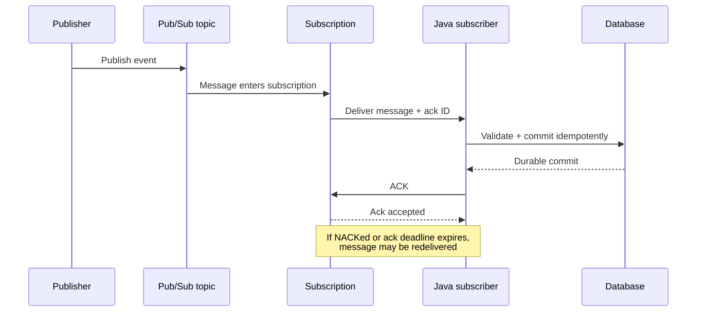
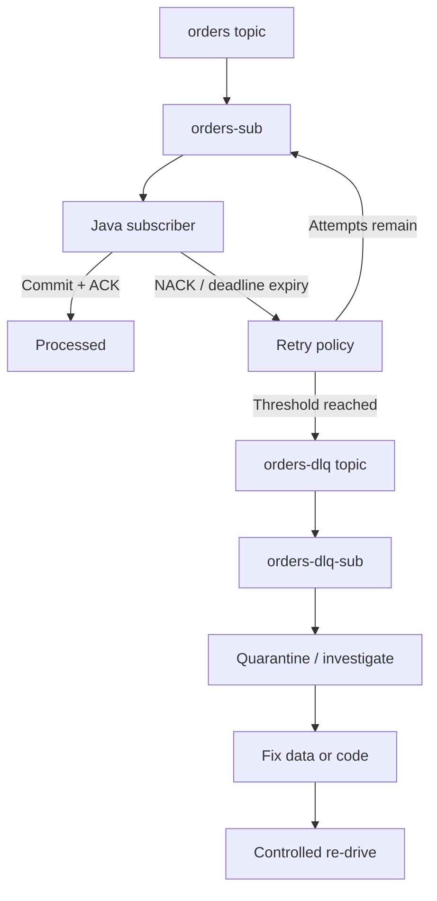
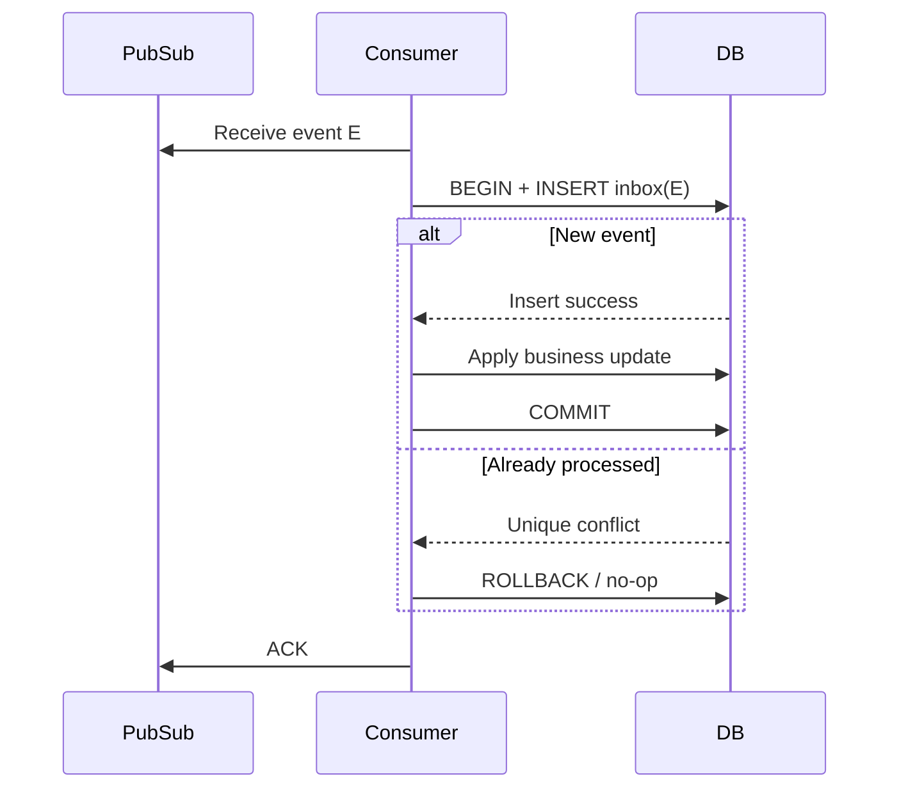
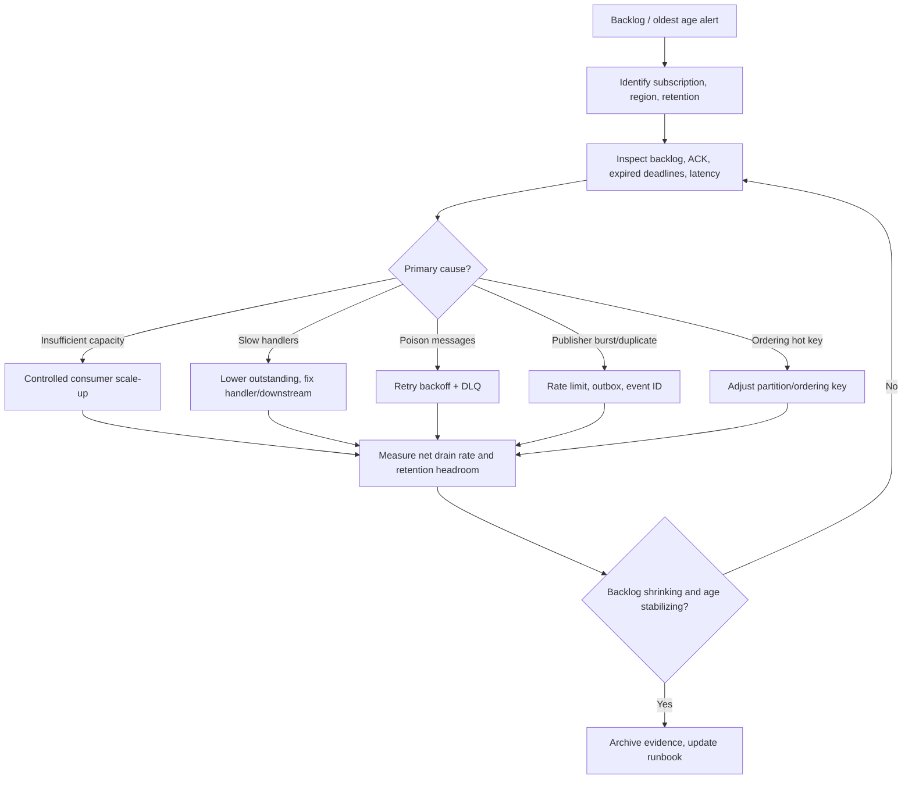

# Handling Pub/Sub Backlogs and Duplicate Message Delivery

> **Chapter:** Operations and Troubleshooting  
> **Module:** `CLOUD_PROVIDERS_GCP` — Exploring Google Cloud from project organization, IAM, and VPC to Compute Engine, GKE, Cloud Run, storage services, and databases. Through deployment scenarios, learners know how to select services, protect resources, automate releases, and monitor reliability and costs.  
> **Scope:** Diagnosing Google Cloud Pub/Sub backlogs, distinguishing redeliveries from duplicates, managing acknowledgment deadlines, flow control, retries, dead-letter topics, exactly-once delivery, and ordering keys. Commands are for sandboxes only; never use production data or subscriptions to induce errors.

## 1. Learning Objectives

After this lesson, learners will be able to:

1. Explain **outstanding**, **acknowledged**, and **NACK** message states and why Pub/Sub redelivers messages.
2. Distinguish **redelivery of the same message ID** from **duplicate event publishing with different message IDs**.
3. Use Cloud Monitoring to evaluate backlogs, oldest unacked message age, expired ack deadlines, and delivery latency.
4. Estimate backlog drain time from incoming message rates and consumer processing throughput.
5. Tune subscriber concurrency, flow control, ack deadlines, and retry policies to avoid overloading consumers.
6. Design Java applications with **idempotency**, durable commits before ACK, and separation of transient vs. permanent errors.
7. Configure dead-letter topics (DLQs), service agent permissions, and investigation/replay workflows.
8. Evaluate the limits of exactly-once delivery and message ordering, and decide when to use them.
9. Write a runbook to drain a massive subscription backlog without losing data or creating duplicate side effects.

**Scenario:** A Java service receives orders through Pub/Sub. During peak hours, unacknowledged messages climb from a few thousand to millions. Operators notice the same order appearing repeatedly in logs, duplicate writes hitting the database, and dashboards showing steadily rising oldest unacked message age. Your task is to isolate whether the root cause sits in the publisher, subscriber, ack deadline, downstream database, or subscription configuration, then restore throughput while protecting business correctness.

## 2. Pub/Sub Delivery Lifecycle and Backlog Concepts

Pub/Sub decouples a **topic** (where publishers send messages) from a **subscription** (per-consumer-group delivery state). A topic can feed multiple subscriptions; each subscription maintains its own backlog and ACK progress.

With pull or StreamingPull:

1. The subscriber receives a message along with an acknowledgment ID.
2. The message enters the **outstanding** state for that subscriber.
3. The application processes it and sends an ACK before the acknowledgment deadline expires.
4. Once Pub/Sub receives a valid ACK, the message is acknowledged for that subscription.
5. If the client NACKs or the deadline expires, the message can be redelivered to the same or another subscriber.



### 2.1. Key States

| State / Term | Meaning | Operational Impact |
|---|---|---|
| Outstanding | Delivered to subscriber but not yet ACKed/NACKed | Consumes flow-control capacity |
| Acknowledged (ACK) | Subscriber confirms processing succeeded | Message is removed from subscription backlog |
| Negative acknowledgment (NACK) | Subscriber signals processing failed | Pub/Sub may redeliver per retry policy |
| Ack deadline expired | ACK deadline elapsed while message stayed outstanding | Can trigger redelivery |
| Backlog | Unacknowledged messages in a subscription | Can grow even while publishers operate normally |
| Redelivery | Same message delivered again after NACK/deadline expiry | Code must tolerate repeated processing |
| Duplicate delivery | Same message delivered again under duplicate delivery conditions | Exactly-once can prevent this class within supported scope |
| Duplicate publish | Publisher emits the same business event multiple times | Pub/Sub treats separate publishes as distinct messages if IDs differ |

**A backlog does not mean messages are lost.** However, unacknowledged messages are retained only for the configured subscription/topic retention duration. If backlog age exceeds retention, messages can expire, causing data loss that scaling subscribers afterward cannot recover.

### 2.2. Acknowledgment Deadline

The ack deadline is how long a subscriber has to confirm a message was processed. Subscriptions default to 10 seconds and can be configured within service limits. High-level client libraries automatically extend deadlines for in-flight messages, subject to maximum bounds and library settings.

Principles:

- Only ACK after results are durably persisted.
- Never ACK immediately on receipt and hand work off to untracked background threads.
- Never hold messages outstanding while waiting on a downstream call with no timeout.
- Set database/HTTP client timeouts shorter than your planned message processing budget.
- Rely on client library lease management/ack deadline extension; do not write a competing renewal loop when the library already handles it.
- On shutdown, stop pulling new messages, finish in-flight work, or let deadlines expire cleanly.

## 3. Redelivery vs. Duplicate: Separate Before Fixing

Not every message seen twice is a Pub/Sub bug.

| Observation | Typical Cause | How to Identify |
|---|---|---|
| Same Pub/Sub message ID reappears | NACK, ack deadline expiry, subscriber restart, or duplicate delivery | Compare `messageId` |
| Different message IDs yet same `order_id`/`event_id` | Publisher re-sent the same event via retries or duplicate emission logic | Compare business keys in payload/attributes |
| One message processed on two instances | ACK not recorded or lease expired during slow processing | Correlate subscriber instance, attempt, and ack deadline |
| Multiple messages with the same ordering key redelivered | Redelivery of an earlier message in an ordered stream | Compare ordering key and sequence |
| Duplicates appear after Seek | Subscription was sought to a timestamp/snapshot and replayed | Inspect seek operations/audit logs |

### 3.1. Common Causes of Redelivery

- Application explicitly calls `nack()` on processing failure.
- Subscriber takes longer than the ack deadline and fails to extend the lease.
- Application crashes, Pods terminate, VMs lose connectivity, or deploys/restarts occur with messages outstanding.
- ACK request is sent to Pub/Sub, yet the response drops or the client misses confirmation.
- Flow control pulls more messages than active workers can finish in time.
- Database lock contention or exhausted connection pools slow handlers down.
- Poison messages or bad schemas repeatedly crash handlers.
- Seek replays historical messages; this redelivery behavior still happens even when exactly-once is enabled.

### 3.2. Publisher-Side Duplicates

If a producer publishes the same order twice, Pub/Sub can assign **two distinct message IDs**. Subscription-level exactly-once delivery does not merge two separate publishes into one business event.

Producers should generate a stable business-layer event ID—such as `order-created:ORD-2026-000123`—and persist publish/outbox state so retries do not spawn unintended new business events. Consumers still need idempotency because publishers, networks, and downstream systems can all retry.

## 4. Measuring Backlogs with Cloud Monitoring

Start from subscription dashboards, preferring per-region metrics so an observability gap in one region does not blank out a global chart.

### 4.1. Core Metrics

| Pub/Sub Metric | Meaning | Signal to Investigate |
|---|---|---|
| `subscription/num_unacked_messages_by_region` | Unacknowledged messages by region | Steady growth means consumers cannot keep up |
| `subscription/oldest_unacked_message_age_by_region` | Age of oldest unacked message by region | Approaching SLO or retention risks data loss |
| `subscription/expired_ack_deadlines_count` | Count of expired ack deadlines | Rapid spikes point to slow handlers or oversized flow control |
| `subscription/ack_message_count` | Recorded ACKs | Dropping while publish rate rises indicates a stalled subscriber |
| `subscription/dead_letter_message_count` | Messages forwarded to DLQ | Sudden jump points to recurring errors or tight policies |
| `subscription/delivery_latency_health_score` | Composite delivery latency health score | Low scores indicate latency bottlenecks |
| `subscription/open_streaming_pulls` | Open StreamingPull streams | Too few streams can bottleneck delivery throughput |
| `topic/message_sizes` | Message sizes per topic | Unusually large messages slow transfer and processing |

Full metric names carry the `pubsub.googleapis.com/` prefix. For backlogs, Google recommends `_by_region` metrics over global metrics when building single-region fault-tolerant dashboards and alerts.

### 4.2. Reading Metrics Together

| `num_unacked` | `oldest_unacked_age` | Likely Interpretation |
|---|---|---|
| Rising | Rising | Consumers cannot keep up with publish rate |
| Steady, low | Rising | A few stuck/poison messages |
| Rising | Steady | Likely a fresh burst; watch ACK throughput |
| Falling | Falling | Backlog drain is progressing |
| Falling | Rising | Likely one old stuck message while newer ones clear |
| Low | Low yet business errors climb | Consumers may be ACKing prematurely or publishers write elsewhere |

**Never evaluate a single metric in isolation.** The same backlog pattern can stem from CPU starvation, downstream IAM failures, overloaded DBs, oversized messages, hot ordering keys, or subscription filters dropping messages.

### 4.3. Health Score Metric

`delivery_latency_health_score` is a composite indicator where 1 represents healthy and 0 represents unhealthy per metric evaluation. Factors lowering the score include NACKs, expired ack deadlines, recent seeks, and high ack latency (e.g., p99.9 exceeding 30 seconds in the documented evaluation window).

Use the score for early detection, then drill into component metrics to isolate root cause. Never rely solely on a score alert while ignoring backlog age and retention.

### 4.4. Retention Alerts

Alert when `oldest_unacked_message_age_by_region` approaches the subscription's retention limit. For instance, with 7-day retention, you might set a warning alert at 50% and a critical alert at 75–80%; these are illustrative operational thresholds that should be tuned to your RPO/SLO.

Once message age exceeds retention, data may have expired. Scaling subscribers afterward cannot recover messages purged past retention.

## 5. Estimating Backlog Drain Time

To decide how much subscriber capacity to add, measure three quantities:

- `B`: current backlog message count at start.
- `λ`: incoming message rate into the subscription (messages/second).
- `μ`: aggregate successful processing rate across all subscribers (messages/second).

If `μ <= λ`, the backlog cannot sustainably shrink. If `μ > λ`, ideal drain time is:

```text
Drain time ≈ B / (μ - λ)

Example:
  Backlog B = 1,200,000 messages
  Incoming λ = 800 messages/second
  Subscriber capacity μ = 1,300 messages/second

Net drain rate = 1,300 - 800 = 500 messages/second
Drain time ≈ 1,200,000 / 500 = 2,400 seconds
           ≈ 40 minutes
```

This is a simplified estimate ignoring message sizes, retries, ordering, bursts, downstream latency, and scale-up lag. Measure **actual ACK throughput**, never raw pull rate, as effective capacity.

### 5.1. Example of an Unbounded Backlog

```text
B = 500,000
λ = 1,000 msg/s
μ =   900 msg/s

Net drain rate = -100 msg/s
The backlog keeps growing by roughly 100 msg/s.
```

In this situation, adding workers or fixing the bottleneck is mandatory. Simply extending retention buys time before expiration without fixing the capacity deficit.

## 6. Diagnosing Subscriber Overload

### 6.1. Consumer-Side Checks

- High CPU, throttling, or prolonged GC pauses.
- Growing heap/native memory or exhausted thread pools.
- More concurrent handlers running than database/HTTP dependencies can handle.
- Specific messages causing unusually slow parsing or validation.
- Exhausted database connection pools or lock contention.
- A single hot ordering key dominating traffic.
- `maxOutstandingElementCount` or byte limits set too high.
- Only a single StreamingPull connection active as load grows.
- Consumer autoscaling lagging behind publish bursts.

### 6.2. Downstream-Side Checks

If Pub/Sub delivers fast yet the database only commits 200 transactions/second, scaling subscribers from 10 to 100 will overwhelm the database further. Measure:

- Connection utilization and checkout wait time.
- Query p95/p99 latency.
- Lock waits, deadlocks, and transaction retries.
- API rate limits/429s and 5xx errors.
- Network latency/egress limits.
- Database connection and throughput ceilings.
- Messages queued inside internal application queues.

**Flow control protects downstreams.** Never disable flow control to "drain the backlog faster"; doing so merely moves the backlog from Pub/Sub into application RAM.

## 7. Flow Control and Concurrency

Flow control caps how many unacknowledged/un-NACKed messages a subscriber pulls at once. In the Java client library, two key parameters govern this:

- `setMaxOutstandingElementCount`: max outstanding messages.
- `setMaxOutstandingRequestBytes`: max total bytes across outstanding messages.

When either limit is reached, the client pauses pulling new messages until outstanding counts drop.

### 7.1. Java Configuration Example

```java
import com.google.api.gax.batching.FlowControlSettings;
import com.google.cloud.pubsub.v1.AckReplyConsumer;
import com.google.cloud.pubsub.v1.MessageReceiver;
import com.google.cloud.pubsub.v1.Subscriber;
import com.google.pubsub.v1.ProjectSubscriptionName;
import com.google.pubsub.v1.PubsubMessage;

import java.util.concurrent.TimeUnit;

public final class OrdersSubscriber {
    public static void main(String[] args) throws Exception {
        String projectId = System.getenv("PROJECT_ID");
        String subscriptionId = System.getenv("SUBSCRIPTION_ID");

        ProjectSubscriptionName subscription =
            ProjectSubscriptionName.of(projectId, subscriptionId);

        MessageReceiver receiver = (PubsubMessage message,
                                   AckReplyConsumer consumer) -> {
            String eventId = message.getAttributesMap()
                .getOrDefault("event_id", message.getMessageId());

            try {
                String payload = message.getData().toStringUtf8();

                // Must commit business results durably and idempotently.
                processAndCommitOnce(eventId, payload);

                // ACK only after commit succeeds.
                consumer.ack();
            } catch (TransientProcessingException ex) {
                System.err.printf("Temporary failure eventId=%s: %s%n",
                    eventId, ex.getMessage());
                consumer.nack();
            } catch (Exception ex) {
                System.err.printf("Processing failure eventId=%s: %s%n",
                    eventId, ex.getMessage());
                consumer.nack();
            }
        };

        FlowControlSettings flowControl =
            FlowControlSettings.newBuilder()
                .setMaxOutstandingElementCount(100L)
                .setMaxOutstandingRequestBytes(32L * 1024L * 1024L)
                .build();

        Subscriber subscriber = Subscriber.newBuilder(subscription, receiver)
            .setFlowControlSettings(flowControl)
            .build();

        Runtime.getRuntime().addShutdownHook(new Thread(() -> {
            subscriber.stopAsync();
            try {
                subscriber.awaitTerminated(30, TimeUnit.SECONDS);
            } catch (Exception ignored) {
                // Log shutdown timeout in a real application.
            }
        }));

        subscriber.startAsync().awaitRunning();
        System.out.println("Subscriber is running");
        subscriber.awaitTerminated();
    }

    private static void processAndCommitOnce(
        String eventId, String payload) throws Exception {
        // Implement via a database transaction:
        // 1. Insert eventId into processed_events with a UNIQUE constraint.
        // 2. If eventId already exists, skip re-applying the business update.
        // 3. If new, update business data within the same transaction.
        // 4. Commit the transaction before returning.
        throw new UnsupportedOperationException(
            "Connect a transactional repository before running");
    }

    private static final class TransientProcessingException
        extends Exception {
        TransientProcessingException(String message, Throwable cause) {
            super(message, cause);
        }
    }
}
```

This is an illustrative skeleton. Implement `processAndCommitOnce` against a real database/repository and wire proper shutdown/logging before running. Never ship `UnsupportedOperationException` in production logic.

### 7.2. Choosing Flow-Control Limits

Suppose messages average 64 KiB and a consumer safely handles 50 concurrent messages:

- Starting element count limit: 50–100 messages.
- Starting byte limit: 16–32 MiB depending on heap and message sizes.
- Monitor heap, GC, handler latency, ack deadline expirations, and downstream connections.
- Increase in small increments, observe, and iterate.

These are starting points only. Very large payloads hit the byte cap before the element cap; tiny CPU-heavy messages hit the element cap first.

### 7.3. Controlled Subscriber Scaling

When backlogs climb steadily and downstreams still have headroom:

1. Add instances/Pods or increase handler threads.
2. Size per-instance flow control to RAM and CPU limits.
3. Scale gradually while watching `ack_message_count`, backlog age, and DB latency.
4. Keep aggregate connection pools within database limits.
5. Check Compute Engine/GKE/Cloud Run and Pub/Sub quotas.
6. Stop scaling if ACK throughput plateaus or downstream latency degrades.

**Never scale purely on backlog count.** If the backlog consists of a few stuck messages, adding 100 consumers will not clear a poison message.

## 8. Ack Deadlines and Lease Management

### 8.1. When Do Deadlines Expire?

Example:

- Subscription ack deadline: 30 seconds.
- Java handler needs 45 seconds to call the database and process payloads.
- Client fails to extend the deadline.
- Pub/Sub can redeliver the message before the first handler finishes.
- Two handlers execute the same business event concurrently, causing duplicate writes or contention.

High-level client libraries automatically renew ack deadlines for outstanding messages. However, extensions have upper bounds and can still fail if the client disconnects, gets overloaded, or shuts down.

### 8.2. Remediation

- Shorten per-message processing time or split large work units.
- Use a supported, up-to-date client library and check lease extension settings.
- Set flow control so handlers never pull more messages than they can finish in time.
- Set timeouts on DB/HTTP calls so handlers never hang indefinitely.
- Monitor p95/p99 handler duration and `expired_ack_deadlines_count`.
- If legitimate messages always require long processing, redesign around async jobs or task decomposition.

**Do not set huge ack deadlines to mask slow handlers.** Long deadlines delay dead-subscriber detection and prolong message redelivery recovery.

### 8.3. Handling Shutdown

During deployments or scale-ins:

1. Mark the instance to stop accepting new work if supported.
2. Gracefully stop the subscriber/StreamingPull client.
3. Wait for in-flight handlers within the shutdown budget.
4. ACK only committed messages.
5. Let incomplete messages redeliver cleanly after deadline/lease expiry.
6. Ensure new instances share the same idempotency store and compatible schemas.

Never routinely SIGKILL consumers during rollouts; doing so triggers massive redelivery waves.

## 9. Retry Policy: Immediate vs. Exponential Backoff?

When a message is NACKed or its ack deadline expires, Pub/Sub retries delivery. The default is **immediate retry**. If the underlying fault persists, the message bounces back instantly, creating tight failure loops and extra load.

### 9.1. Exponential Backoff

A subscription retry policy adds growing delays **per message**:

- Minimum backoff: shortest wait before the next attempt.
- Maximum backoff: upper cap; service docs allow up to 600 seconds.
- Configuring only one bound applies defaults (10 seconds min or 600 seconds max).

Example:

```bash
export PROJECT_ID="pubsub-ops-sandbox"
export TOPIC_ID="orders"
export SUBSCRIPTION_ID="orders-sub"

gcloud pubsub subscriptions create "$SUBSCRIPTION_ID" \
  --project="$PROJECT_ID" \
  --topic="$TOPIC_ID" \
  --ack-deadline=60 \
  --min-retry-delay=10s \
  --max-retry-delay=300s
```

This creates a pull subscription with exponential backoff retries. For an existing subscription, use `gcloud pubsub subscriptions update` and inspect current state first.

### 9.2. When to NACK vs. When to ACK?

| Case | Appropriate Action | Reason |
|---|---|---|
| Database temporarily unavailable | NACK or let deadline retry per policy | Message can succeed later |
| Downstream rate limit | Retry with backoff and lower concurrency | Prevent retry storms |
| Invalid payload durably quarantined | ACK after quarantine commit | Stop infinite redeliveries |
| Previously processed event (idempotency hit) | ACK | Avoid re-applying business logic |
| Permanent config/IAM error | Pause/scale down consumers; fix root cause | Mass NACKs will not fix permissions |
| Message requires manual intervention | Route to DLQ/quarantine per policy | Preserve evidence and unblock subscription |

NACK is not a message filter or arbitrary delay queue. When you need scheduled future execution, use Cloud Tasks instead of looping NACKs.

## 10. Dead-Letter Topics: Isolating Unprocessable Messages

A dead-letter topic receives messages that fail processing after a configured number of delivery attempts. This is a **property of the source subscription**, not the source topic.

### 10.1. DLQ Flow



### 10.2. Creating a DLQ Topic and Subscription

```bash
gcloud pubsub topics create orders-dlq \
  --project="$PROJECT_ID"

gcloud pubsub subscriptions create orders-dlq-sub \
  --project="$PROJECT_ID" \
  --topic="orders-dlq"

gcloud pubsub subscriptions create orders-sub-with-dlq \
  --project="$PROJECT_ID" \
  --topic="$TOPIC_ID" \
  --dead-letter-topic="orders-dlq" \
  --max-delivery-attempts=10 \
  --min-retry-delay=10s \
  --max-retry-delay=300s
```

Configured delivery attempts for a dead-letter topic must be between **5 and 100**. Actual delivery counts are best-effort rather than exact guarantees—especially when subscribers go offline, delivery attempt counters can shift or reset.

### 10.3. Granting Permissions to the Pub/Sub Service Agent

To forward messages, the Pub/Sub service agent needs permission to publish to the DLQ topic and ACK/remove messages from the source subscription. Principal format:

```text
service-PROJECT_NUMBER@gcp-sa-pubsub.iam.gserviceaccount.com
```

Example least-privilege grants:

```bash
export PROJECT_NUMBER="$(gcloud projects describe "$PROJECT_ID" \
  --format='value(projectNumber)')"
export PUBSUB_AGENT="service-$PROJECT_NUMBER@gcp-sa-pubsub.iam.gserviceaccount.com"

gcloud pubsub topics add-iam-policy-binding orders-dlq \
  --project="$PROJECT_ID" \
  --member="serviceAccount:$PUBSUB_AGENT" \
  --role="roles/pubsub.publisher"

gcloud pubsub subscriptions add-iam-policy-binding orders-sub-with-dlq \
  --project="$PROJECT_ID" \
  --member="serviceAccount:$PUBSUB_AGENT" \
  --role="roles/pubsub.subscriber"
```

Grant permissions after creating the topics and once the service identity exists. Open the subscription's **Dead lettering** tab to inspect action items and verify the service agent has full required permissions. Never grant Project Editor/Owner to the service agent.

### 10.4. Safe DLQ Handling

- Maintain a dedicated subscription to inspect messages in the DLQ.
- Record original message ID, business event ID, source subscription, delivery count, and publish time.
- Categorize failures: schema, code bug, business data, IAM, or downstream outage.
- Fix the root cause before re-driving.
- Preserve the original event ID so consumers stay idempotent.
- Re-drive in small batches with rate limits and monitoring.
- Never blindly loop the entire DLQ back into the main topic every minute; that recreates an infinite loop.
- Set DLQ retention and IAM access controls based on payload sensitivity.

Java client libraries can expose delivery attempts via the `googclient_deliveryattempt` attribute; do not assume identical fields across pull, push, and every client language.

## 11. Exactly-Once Delivery: Use Within Its Exact Scope

By default, Pub/Sub provides **at-least-once delivery**. Exactly-once delivery is an option on supported subscriptions that lets subscribers confirm ACKs were accepted by Pub/Sub and prevents redelivery after a successful ACK within guaranteed bounds.

### 11.1. Important Limitations

- Exactly-once supports **pull subscriptions** (including StreamingPull) only; it does not support push or export subscriptions.
- The exactly-once guarantee is scoped to **a single region**. Multi-region subscribers require locational endpoints and matching connection design.
- Enabling it can raise latency and carries dedicated quotas.
- Publishers can still emit the same business event multiple times with distinct message IDs.
- Seek/replay still redelivers messages by design.
- Exactly-once delivery does not merge external database transactions with Pub/Sub into a single atomic transaction.

### 11.2. Creating an Exactly-Once Subscription

```bash
gcloud pubsub subscriptions create orders-sub-exactly-once \
  --project="$PROJECT_ID" \
  --topic="$TOPIC_ID" \
  --enable-exactly-once-delivery \
  --ack-deadline=60
```

This creates a separate test subscription. Exactly-once is configured on subscription creation/settings; never assume you can toggle it arbitrarily on every existing subscription without checking current API/CLI rules.

### 11.3. When Should You Enable It?

| Requirement | Recommendation |
|---|---|
| Duplicates are already handled cleanly by idempotency | At-least-once is simpler with higher throughput/lower latency |
| Need to minimize duplicate deliveries on pull subscribers | Evaluate exactly-once |
| Push endpoints or export subscriptions | Exactly-once does not apply |
| Publishers may emit duplicate events | Business-ID deduplication is still required |
| Side effects span multiple external systems | Transactional outbox/inbox or sagas are still needed; exactly-once is insufficient |

Even with exactly-once enabled, keep consumer idempotency in place since duplicate publisher events and external side effects can still occur.

## 12. Idempotency: Mandatory Business Protection

**Idempotent processing** ensures handling the same business event multiple times never corrupts business state.

### 12.1. Using a Business Event ID

Payload example:

```json
{
  "event_id": "order-created:ORD-2026-000123",
  "order_id": "ORD-2026-000123",
  "event_type": "ORDER_CREATED",
  "schema_version": 2,
  "created_at": "2026-11-19T08:00:00Z"
}
```

Never rely solely on Pub/Sub's `messageId` as a business key if publisher retries can generate fresh messages. Generate `event_id` at the source business system and preserve it across all publishes and retries.

### 12.2. Transactional Inbox Pattern

In your database, create a `processed_events` table with a unique constraint on `event_id`:

```sql
CREATE TABLE processed_events (
    event_id VARCHAR(200) PRIMARY KEY,
    processed_at TIMESTAMP NOT NULL DEFAULT CURRENT_TIMESTAMP
);
```

Processing flow:

1. Begin database transaction.
2. Insert `event_id` into `processed_events`.
3. On unique conflict, the event was already processed; skip re-applying the business update.
4. On fresh insert, apply business updates within the **same transaction**.
5. Commit the transaction.
6. Only after commit succeeds, call Pub/Sub ACK.



If the database commit succeeds yet the ACK is lost, Pub/Sub may redeliver. On the next attempt, the unique constraint prevents duplicate business writes and allows a safe ACK.

### 12.3. Publisher-Side Outbox

If a business transaction both updates a database and publishes an event, a crash between the two leaves data and messages out of sync. A **transactional outbox** writes the event inside the same transaction as the business update; a relay worker reads the outbox, publishes, and marks it sent. Publishers can still retry and emit duplicates, so consumers still require idempotency.

### 12.4. External Side Effects Beyond the Database

For emails, payments, HTTP calls, or provisioning external resources:

- Pass an idempotency key when downstream APIs support it.
- Persist request/response state keyed by `event_id`.
- If a downstream lacks idempotency support, design reconciliation or compensation workflows.
- Never ACK before durable evidence confirms the side effect succeeded.
- Never assume distributed atomic transactions exist across Pub/Sub, databases, and HTTP services.

## 13. Message Ordering and Hot Ordering Keys

Ordering keys tell Pub/Sub to preserve publish order for messages sharing the same key under service conditions. For example, `customer_id=123` keeps events for the same customer ordered.

### 13.1. Benefits and Trade-offs

| Benefit | Trade-off |
|---|---|
| Simplifies order-dependent event handling | Messages sharing a key are serialized |
| Fits per-entity state machines | One hot key bottlenecks throughput |
| Reduces out-of-order update bugs | Redelivering one message can cascade subsequent messages on that key |
| Easier entity audit trails | ACKs must complete in order when combined with exactly-once |

If a message with an ordering key is redelivered, Pub/Sub may redeliver subsequent messages with the same key to preserve ordering. One poison message on a hot key stalls progress for that entire key.

### 13.2. Diagnosing Hot Keys

- Break down throughput and latency by ordering key or entity ID.
- Identify keys with unusually high message rates.
- Check whether consumer concurrency is serialized by a single key.
- Inspect NACKs/deadline expirations on the head-of-line message.
- Re-evaluate whether entity-wide ordering is truly required; if finer partitioning works, pick a more granular key.
- Never drop ordering keys or crank up parallelism without validating business invariants.

### 13.3. When Not to Enable Ordering?

If messages are independent, safe to process in parallel, and guarded by version/sequence checks, ordering only adds latency. Enable ordering only when business correctness truly depends on sequential delivery.

## 14. Ordered Backlog Recovery Workflow



### 14.1. 10-Step Runbook

1. Identify project, topic, subscription, region, subscription type, and owner.
2. Check message retention and oldest backlog age; assess expiration risk.
3. Read `num_unacked_messages_by_region`, `oldest_unacked_message_age_by_region`, `expired_ack_deadlines_count`, and `ack_message_count`.
4. Compare publish rate against successful ACK rate to compute net drain rate.
5. Inspect subscriber CPU/RAM, instance counts, open StreamingPull streams, handler latency, and flow control.
6. Check database/HTTP dependencies, IAM, quotas, networking, and message sizes.
7. Classify redeliveries vs. duplicates using Pub/Sub message IDs and business event IDs.
8. Tune concurrency/backoff or enable DLQ according to root cause; avoid changing many knobs at once.
9. Watch backlog drop, oldest age fall, and retention headroom grow; verify business data integrity.
10. Document root cause, changes, data impact, cost, and preventive actions.

### 14.2. Scaling Consumers During an Incident

Before scaling:

- Confirm subscribers are healthy and capable of processing new messages.
- Verify downstreams have spare capacity.
- Verify idempotency is active so scaling does not amplify duplicate side effects.
- Confirm regional quotas allow adding instances.
- Cap concurrency and flow control per instance.
- Scale incrementally while watching ACK throughput and downstream latency.

If the backlog drops slowly while oldest age keeps climbing, a handful of old messages are likely stuck. Inspect logs by event/message ID and check the DLQ rather than just adding instances.

## 15. Detailed Observability and Alert Design

### 15.1. Recommended Dashboard

| Group | Chart | Labels / Aggregation |
|---|---|---|
| Backlog | Unacked messages | By subscription and region |
| Backlog age | Oldest unacked age | By subscription and region |
| Processing | ACK count/rate | By subscription |
| Retry | Expired ack deadlines | By subscription |
| Delivery | Delivery latency health score | By subscription |
| StreamingPull | Open streaming pulls | By subscription |
| DLQ | Dead-letter message count | By source subscription |
| Publisher | Publish request count/errors | By topic |
| Application | Handler p50/p95/p99 | By subscriber version |
| Downstream | DB latency, pool saturation, 429/5xx | By dependency |

Use exact metric labels from Cloud Monitoring; UI display names can differ from API metric paths. Avoid grouping by ultra-high-cardinality labels such as `message_id`.

### 15.2. Example Alert Policies

- **Warning:** oldest unacked age exceeds 50% of retention or processing SLO.
- **Critical:** oldest unacked age exceeds 75–80% of retention; escalate immediately.
- **Capacity:** `num_unacked_messages_by_region` rises continuously for 10–15 minutes while ACK rate trails publish rate.
- **Ack deadline:** expired deadline rate exceeds baseline while handler p99 rises.
- **DLQ:** dead-letter message count > 0 on critical subscriptions or spikes abnormally.
- **Delivery health:** health score stays depressed, paired with component-specific alerts.
- **Subscriber availability:** open StreamingPull streams drop to 0 while messages arrive.

Thresholds are illustrative; tune them to actual SLOs and traffic patterns. Never alert purely on raw backlog count, since millions of messages can be normal for ultra-high-throughput subscriptions.

### 15.3. Essential Log Fields

Each processing attempt should log:

- `subscription`, `subscriber_instance`, `subscriber_version`.
- `message_id`, `business_event_id`, `ordering_key` (if used).
- `delivery_attempt` when provided by the client.
- `handler_duration_ms`, `database_duration_ms`.
- `result=ACK|NACK|QUARANTINED`.
- `error_class`, `retryable`, `trace_id`.
- Never log full payloads containing PII, access tokens, payment details, or secrets.

Logs must link an event across multiple deliveries without storing unnecessary sensitive data.

## 16. IAM and Subscription Security

### 16.1. Separating Publisher, Subscriber, and Operator

| Principal | Illustrative Role | Scope |
|---|---|---|
| Publisher service account | `roles/pubsub.publisher` | Specific topic |
| Java subscriber service account | `roles/pubsub.subscriber` | Specific subscription |
| Operator | `roles/pubsub.viewer` or narrow ops permissions | Target project/resources |
| Subscription administrator | `roles/pubsub.editor` or custom role | Configuration owners only |
| DLQ consumer | `roles/pubsub.subscriber` | DLQ subscription |
| Pub/Sub service agent | `roles/pubsub.publisher` on DLQ topic and `roles/pubsub.subscriber` on source subscription | Only when dead-letter forwarding is enabled |

Never grant `roles/pubsub.admin` or `roles/editor` to a runtime just to read a subscription. Keep publisher and subscriber service accounts separate when applications have distinct lifecycles and trust levels.

### 16.2. Using Runtime Service Accounts

- Bind service accounts via Cloud Run, GKE Workload Identity, or Compute Engine VM config.
- Use Application Default Credentials from the runtime.
- Never download service account JSON keys into containers or developer laptops.
- Reserve Secret Manager for genuine secrets; Pub/Sub IAM does not require JSON keys.
- Isolate staging and production projects/subscriptions so test consumers never read live production messages.

### 16.3. Auditing and Retention

- Enable/review Cloud Audit Logs for IAM, topic, subscription, and admin changes.
- Restrict who can seek, modify retention, enable DLQs, or change ordering/exactly-once settings.
- Restrict read access to DLQs because payloads may hold sensitive data.
- Retain logs per compliance policy without logging unnecessary message bodies.
- Test negative authorization using a service account without Subscriber permissions; never test runtime access with an admin principal.

## 17. Replay, Seek, and Recovery After Bad Processing

Pub/Sub supports seeking a subscription to a snapshot or timestamp to replay messages. This is a wide-blast-radius operation: messages in the seek window are redelivered and can create downstream duplicates even with exactly-once enabled.

### 17.1. Before Seeking

1. Identify the exact subscription, timestamp/snapshot, and message window to replay.
2. Check retention: target messages must still reside within the retention period.
3. Confirm subscribers are idempotent and databases enforce deduplication keys.
4. Estimate replay message volume and required drain capacity.
5. Notify business owners; verify side effects (emails, payments, webhooks).
6. Capture a snapshot or archive evidence if required by change control.
7. Execute the seek inside a change window while monitoring backlog and duplicate rates.

### 17.2. Re-Driving from a DLQ

Never blindly republish DLQ messages with all original attributes untouched:

- Preserve the original `business_event_id`.
- Add metadata such as `replay_run_id`, `replayed_at`, and `source_subscription`.
- Re-drive in small batches with publish rate caps.
- Never push schema-broken messages back onto the main topic before fixing or transforming them.
- Verify consumers still handle older schema versions.
- Reconcile outcomes to avoid duplicate transactions.

### 17.3. When Backlog Age Exceeds Retention

If oldest unacked age exceeded message retention, determine the exact expiration window. Recover from alternate sources: publisher outbox tables, source databases, object archives, audit logs, or backups. Never promise to recover expired messages simply by bumping retention after the fact.

## 18. Sandbox Practice Lab

### 18.1. Setup

Use an isolated sandbox project and synthetic data. Example:

```bash
export PROJECT_ID="pubsub-ops-sandbox"
export TOPIC_ID="orders"
export SUBSCRIPTION_ID="orders-sub"
export DLQ_TOPIC_ID="orders-dlq"
export DLQ_SUBSCRIPTION_ID="orders-dlq-sub"

gcloud services enable pubsub.googleapis.com \
  --project="$PROJECT_ID"

gcloud pubsub topics create "$TOPIC_ID" \
  --project="$PROJECT_ID"

gcloud pubsub topics create "$DLQ_TOPIC_ID" \
  --project="$PROJECT_ID"
```

### 18.2. Create a Pull Subscription with Retries

```bash
gcloud pubsub subscriptions create "$SUBSCRIPTION_ID" \
  --project="$PROJECT_ID" \
  --topic="$TOPIC_ID" \
  --ack-deadline=60 \
  --min-retry-delay=10s \
  --max-retry-delay=300s

gcloud pubsub subscriptions describe "$SUBSCRIPTION_ID" \
  --project="$PROJECT_ID"
```

Then create the DLQ subscription:

```bash
gcloud pubsub subscriptions create "$DLQ_SUBSCRIPTION_ID" \
  --project="$PROJECT_ID" \
  --topic="$DLQ_TOPIC_ID"
```

To enable DLQ forwarding, create another test source subscription or update the current one after verifying permissions and policies:

```bash
gcloud pubsub subscriptions update "$SUBSCRIPTION_ID" \
  --project="$PROJECT_ID" \
  --dead-letter-topic="$DLQ_TOPIC_ID" \
  --max-delivery-attempts=10
```

Grant the service agent roles from section 10.3 before concluding forwarding works. Check the **Dead lettering** tab in the Console to confirm all action items are resolved.

### 18.3. Publish Synthetic Messages

```bash
gcloud pubsub topics publish "$TOPIC_ID" \
  --project="$PROJECT_ID" \
  --message='{"event_id":"order-created:1001","order_id":"1001"}' \
  --attribute=event_id=order-created:1001

gcloud pubsub topics publish "$TOPIC_ID" \
  --project="$PROJECT_ID" \
  --message='{"event_id":"order-created:1002","order_id":"1002"}' \
  --attribute=event_id=order-created:1002
```

Publish the same `event_id` twice to simulate a publisher retry. Observe that Pub/Sub `messageId` differs and prove deduplication must key off the business key.

### 18.4. Testing Backlogs and Duplicates

1. Run the subscriber normally and record baseline ACK rate.
2. Pause the subscriber in the sandbox, publish a batch of messages, and watch `num_unacked_messages_by_region`.
3. Restart the subscriber and measure oldest age and drain time.
4. Configure a test handler to exceed the ack deadline or intentionally NACK a synthetic event to observe redelivery.
5. Lower `maxOutstandingElementCount` and compare expired ack deadlines.
6. Force a fixed business event to fail repeatedly; confirm the DLQ receives it after best-effort delivery attempts.
7. Fix the payload/handler and replay a small batch from the DLQ.
8. Publish a duplicate business event with a new message ID; confirm the unique `event_id` blocks duplicate side effects.
9. If needed, create a separate exactly-once pull subscription and compare ACK/redelivery behavior; do not compare against push subscriptions.
10. Archive dashboards, logs, message IDs, business IDs, and recovery times.

**Never** perform mass NACKs or publish floods in shared projects. All exercises must obey quotas, budgets, and cleanup rules.

## 19. Practical Incident Matrix

| Symptom | Priority Cause | First Action |
|---|---|---|
| Backlog and oldest age both rise | Subscriber throughput trails publish rate | Compare `λ`/`μ`, CPU, downstreams; scale carefully |
| Small backlog yet rising oldest age | Poison/stuck message | Filter by message/event ID, inspect handler errors, check DLQ |
| Rising expired ack deadlines | Slow handlers, broken lease extension, or excessive flow control | Measure handler p99, lower outstanding, check client library |
| Duplicates with the same message ID | Redelivery / unconfirmed ACK | Check NACKs, deadlines, restarts, ACK responses |
| Duplicate business ID with different message IDs | Publisher re-emitted event | Check outbox, producer retries, consumer idempotency |
| Sharp jump in NACKs | Downstream outage or invalid payloads | Apply retry backoff, classify errors, avoid infinite NACKs |
| Rising DLQ count | Unprocessable messages | Check schema, service agent IAM, policies, and source logs |
| High delivery latency despite small backlog | Too few StreamingPull streams, huge messages, or ordering/exactly-once overhead | Check open streams, message sizes, and feature trade-offs |
| One ordering key lags | Hot key or poison message | Inspect key distribution, partitioning, and head-of-line redelivery |
| High ACK rate yet missing business data | ACKed before commit or silent write failures | Reconcile DB and enforce commit → ACK order |
| Backlog exceeds retention | Prolonged consumer outage or insufficient capacity | Identify expired window and recover from source/archive |
| Subscriber pulls zero messages | IAM, network, quota, or stream errors | Check Subscriber role, endpoints, logs, and quotas |

## 20. Capstone Scenario: Duplicate Order Writes and Climbing Backlog

A Java application ingests 5,000 messages/second. Dashboards show:

- `num_unacked_messages_by_region` jumped from 20,000 to 800,000.
- `oldest_unacked_message_age_by_region` jumped from 10 seconds to 12 minutes.
- `expired_ack_deadlines_count` spiked sharply.
- DB p99 latency rose from 80 ms to 2 seconds.
- Logs show repeated `order_id` entries—some sharing `messageId`, others with different `messageId`s.

### Analysis

1. Same `messageId`: subscriber NACKed or ack deadline expired; inspect handler duration, lease extensions, and restarts.
2. Different `messageId` yet same order ID: publisher retried and created fresh events; inspect outbox and `event_id` generation.
3. DB p99 spike: subscriber concurrency likely exceeded connection capacity, slowing handlers and tripping ack deadlines.
4. Rising backlog age: successful ACK throughput fell below incoming publish rate.
5. Rising DLQ: a subset of broken payloads/handlers may be cycling repeatedly.

### Remediation Plan

- Lower per-instance `maxOutstandingElementCount` to what the DB can sustain.
- Lower worker concurrency or cap connection pools.
- Optimize queries, indexes, transactions, and batching where appropriate.
- Apply exponential backoff for transient errors and DLQ for unprocessable messages.
- Fix the producer to preserve a deterministic `event_id` across retries.
- Add an inbox table with a unique constraint for consumer idempotency.
- Scale subscribers gradually once the DB stabilizes and track net drain rate.
- Monitor oldest age dropping below SLO and verify unique order counts in the database.

### Incident Closure Criteria

- Backlog shrinks steadily and oldest age stays below threshold.
- Ack deadline expirations return to baseline.
- DLQ entries are triaged and handled in a controlled manner.
- Database contains zero duplicate business updates.
- Unintended publisher duplicates are eliminated.
- RPO/retention was not breached; if any window expired, alternate recovery sources are identified.
- Runbooks, alerts, and capacity limits are updated.

## 21. Production Readiness Checklist

**Subscriber correctness**

- [ ] Durable commit precedes ACK.
- [ ] Consumer is idempotent on business `event_id`.
- [ ] Distinguishes redelivery from duplicate publishes.
- [ ] Handles exceptions, timeouts, and graceful shutdown cleanly.
- [ ] Client library handles lease management; flow control is configured.
- [ ] Exactly-once enabled only when subscription type and requirements justify it.

**Backlog capacity**

- [ ] Dashboards track `num_unacked_messages_by_region` and `oldest_unacked_message_age_by_region`.
- [ ] Alerts align with RPO/retention headroom.
- [ ] Publish/ACK throughput benchmarked and drain times modeled.
- [ ] Flow control caps outstanding messages and bytes.
- [ ] Downstream DBs/APIs have quotas, timeouts, pool budgets, and backpressure.
- [ ] Regional subscriber scaling and quota plans exist.

**Retry and DLQ**

- [ ] Retry policy fits transient failures.
- [ ] DLQ topic/subscription have retention, IAM, and an owner.
- [ ] Pub/Sub service agent has scoped publisher/subscriber permissions.
- [ ] DLQ triage and controlled re-drive procedures exist.
- [ ] NACK is never abused as a scheduler or message filter.

**Operations and security**

- [ ] Publisher, subscriber, and operator IAM roles are separated.
- [ ] No service account JSON keys are used.
- [ ] Logs include message ID, business ID, attempt, duration, and error class without secrets/PII.
- [ ] Seek/replay requires change approval and duplicate side-effect checks.
- [ ] Rehearsed backlog drains, subscriber outages, poison messages, and DLQ handling.
- [ ] Billing, retention, egress, and compute costs are monitored.

## 22. Conclusion

A Pub/Sub backlog reflects an imbalance between incoming message rate and successful processing/ACK throughput. To troubleshoot effectively, read **backlog count + oldest age + ack deadlines + subscriber/downstream metrics** together, and isolate the root cause before cranking up concurrency. Redelivery is expected behavior under at-least-once delivery; consumers must enforce **idempotency and commit-before-ACK** to protect business correctness. Retry backoff and DLQs isolate failing messages; flow control shields consumers and downstreams; and exactly-once or ordering should be enabled only when business requirements justify their latency, quota, and throughput trade-offs.

## 23. Official Google Cloud References

1. [Pub/Sub basics](https://docs.cloud.google.com/pubsub/docs/pubsub-basics) — lifecycle, ack deadlines, and delivery semantics.
2. [Troubleshooting a pull subscription](https://docs.cloud.google.com/pubsub/docs/pull-troubleshooting) — backlogs, duplicates, ack deadlines, and ordering.
3. [Monitor Pub/Sub in Cloud Monitoring](https://docs.cloud.google.com/pubsub/docs/monitoring) — regional backlog metrics, health scores, and alerts.
4. [Flow control](https://docs.cloud.google.com/pubsub/docs/flow-control) — capping outstanding messages and bytes.
5. [Subscription retry policy](https://docs.cloud.google.com/pubsub/docs/subscription-retry-policy) — immediate retry and exponential backoff.
6. [Dead-letter topics](https://docs.cloud.google.com/pubsub/docs/dead-letter-topics) — delivery attempts, service agent IAM, and forwarding.
7. [Exactly-once delivery](https://docs.cloud.google.com/pubsub/docs/exactly-once-delivery) — pull-only, regional scope, and acknowledgment behavior.
8. [Best practices to subscribe to a topic](https://docs.cloud.google.com/pubsub/docs/subscribe-best-practices) — subscriber performance and duplicate handling.
9. [Subscription properties](https://docs.cloud.google.com/pubsub/docs/subscription-properties) — ack deadlines, retention, ordering, and retries.
10. [Create pull subscriptions](https://docs.cloud.google.com/pubsub/docs/create-subscription) — configuring subscriptions via console, CLI, and API.
11. [Java client library for Pub/Sub](https://cloud.google.com/java/docs/reference/google-cloud-pubsub/latest/overview) — Java API, subscriber, and flow control.

> Limits, metrics, and client-library APIs are subject to change. Before deploying to production, verify against current official documentation, pin tested library versions, and validate changes in a sandbox.
