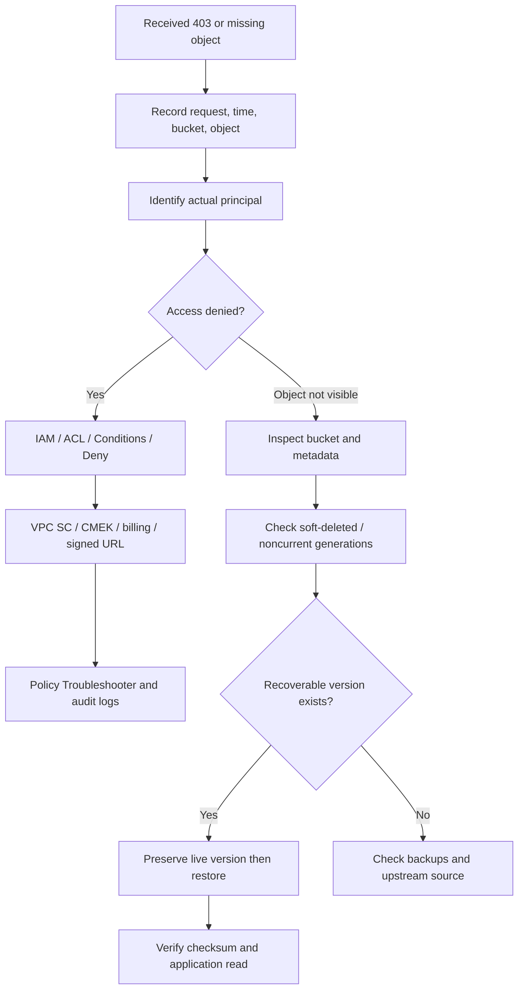

# Investigating Cloud Storage Access Denied and Deleted Data

When a Java application on Google Cloud receives a 403 reading a Cloud Storage object, or an important file vanishes from a bucket, operations must identify the request identity, required permission, and data state. Granting overly broad permissions to a service account can mask the root cause; rushing a restore can overwrite a live version.

This lesson walks through investigating IAM/ACLs, blocking policies, audit logs, Soft Delete, Object Versioning, retention, and holds. It belongs to the **Operations and Troubleshooting** chapter of the **CLOUD_PROVIDERS_GCP** module.

> Only run commands that modify permissions, restore objects, or change bucket configurations inside an approved sandbox project. Preserve evidence before editing policies or restoring data.

## 1. Learning Objectives

- Analyze 403/404 responses and identify the principal, resource, and permission.
- Distinguish IAM allow/deny, PAB, IAM Conditions, and ACLs.
- Inspect UBLA, Public Access Prevention, VPC Service Controls, and CMEK.
- Use Policy Troubleshooter and Cloud Audit Logs.
- Distinguish live, noncurrent, soft-deleted, and permanently deleted objects.
- Restore the exact generation and verify checksums.
- Write runbooks for incident response, backups, retention, and least privilege.

## 2. Two Distinct Scenarios

### 2.1. Application Receives 403

Example:

```text
service-account@project.iam.gserviceaccount.com
does not have storage.objects.get access to the
Google Cloud Storage object.
```

The error states the request was denied by permissions or policy. It does not prove the object was deleted. The active principal may differ from expectations, the role may be bound to the wrong bucket, an IAM condition may have expired, a deny policy may block it, or the request may violate VPC Service Controls.

### 2.2. Object Is Missing from Listings

Causes may include deletion, overwrite, becoming noncurrent, soft deletion, automatic lifecycle deletion, wrong project/prefix, or the caller lacking `storage.objects.list`. The bucket itself could also have been deleted. Not seeing an object in a default listing is insufficient to conclude permanent data loss.

### 2.3. Investigation Flow



## 3. Gathering Information

Record project, bucket, object path, failing action (`GET`/`LIST`/`CREATE`/`DELETE`/`RESTORE`), UTC timestamp, HTTP status, permission named in error, principal, runtime, request ID, and generation if available. Never paste access tokens, active signed URLs, or sensitive data into tickets.

### 3.1. Confirm Project and Account

```bash
gcloud config get-value project
gcloud auth list
gcloud config get-value account
```

This shows the `gcloud` CLI identity, which does not guarantee a Cloud Run/GKE/VM application uses the same account. Inspect the runtime-attached service account, ADC, and Workload Identity Federation where applicable.

### 3.2. Inspect Bucket and Object

```bash
gcloud storage buckets describe gs://BUCKET_NAME
gcloud storage objects describe gs://BUCKET_NAME/OBJECT_NAME
gcloud storage ls gs://BUCKET_NAME/
```

These commands require matching permissions. If metadata queries also return 403, record the exact denied permission; never treat an inability to read metadata as proof the object does not exist. Object names are case-sensitive; verify case, prefix, slashes, and URL encoding.

## 4. Permissions by Operation

| Operation | Permission |
|---|---|
| Read object data/metadata | `storage.objects.get` |
| List objects | `storage.objects.list` |
| View bucket metadata | `storage.buckets.get` |
| List buckets | `storage.buckets.list` |
| Create object | `storage.objects.create` |
| Delete object | `storage.objects.delete` |
| Restore soft-deleted object | `storage.objects.restore` and `storage.objects.create`; plus list/get as needed |
| Bulk restore | May require `storage.buckets.restore` |

Overwriting a live object generally requires both create and delete permissions. Some CLI commands perform multiple API calls; for example, bulk delete may require list before delete.

### 4.1. Common Roles

| Role | Usage |
|---|---|
| `roles/storage.objectViewer` | Read and list objects |
| `roles/storage.objectCreator` | Create new objects |
| `roles/storage.objectUser` | Operate on objects per role permissions |
| `roles/storage.objectAdmin` | Manage objects, including deletion |
| `roles/storage.admin` | Manage buckets and objects; very broad |

Prefer narrow roles scoped to the target bucket. Never grant project-wide Storage Admin just to fix a download error.

## 5. Wrong Principal

Errors may cite an unexpected service account due to a new Cloud Run revision, GKE service account mapping, VM identity, CI impersonation, or ADC. If the error says `Anonymous caller`, the request may be missing the credentials you expected. Inspect client configuration and runtime identity; never print access tokens.
## 6. IAM Allow, Deny, PAB, and Conditions

An allow binding does not guarantee access. Access can be blocked by an IAM Deny policy, a Principal Access Boundary (PAB), an unsatisfied IAM Condition, or mismatched group membership. Inspect policies on the bucket and parent levels: project, folder, and organization.

Example condition allowing only the `public/` prefix:

```text
resource.name.startsWith("projects/_/buckets/reports-bucket/objects/public/")
&& request.time < timestamp("2026-12-01T00:00:00Z")
```

If the app reads `private/summary.csv`, the condition does not match. Verify resource names, request times, tags, and group memberships. Never add an allow binding and assume the error will disappear when Deny or PAB policies are active.

## 7. IAM and ACLs: Uniform Bucket-Level Access

Cloud Storage has two permission systems: IAM and ACLs. When Uniform Bucket-Level Access (UBLA) is off, both operate in parallel and a grant from either allows access. When UBLA is enabled, ACLs are disabled and access relies exclusively on IAM.

### 7.1. Check UBLA

```bash
gcloud storage buckets describe gs://BUCKET_NAME --format="yaml(iamConfiguration)"
```

Inspect `uniformBucketLevelAccess.enabled`. Legacy applications may depend on object ACLs for per-file sharing. Once UBLA is enabled, ACL-only grants are revoked and APIs reading/writing ACLs may return `400 Bad Request`.

**Never turn on UBLA mid-incident to "fix IAM."** Before migrating an existing bucket, audit ACL usage, inspect object/default ACLs, map essential grants to IAM, test consumers, and follow a rollout plan. UBLA becomes irreversible after 90 continuous days enabled.

### 7.2. Policy Troubleshooter Limitations

Policy Troubleshooter evaluates IAM allow, deny, and PAB policies; it does not evaluate ACL permissions and does not diagnose VPC Service Controls. For fine-grained buckets, inspect ACLs separately. For perimeter violations, use the VPC Service Controls violation analyzer.
## 8. Policies and Configurations Outside IAM

### 8.1. Public Access Prevention

Public Access Prevention blocks public grants via `allUsers` or `allAuthenticatedUsers`. If legacy websites/clients rely on public objects, this policy can block public reads.

```bash
gcloud storage buckets describe gs://BUCKET_NAME --format="yaml(publicAccessPrevention)"
```

Never disable Public Access Prevention to troubleshoot private access. For applications, use IAM service identities or properly scoped signed URLs.

### 8.2. Organization Policies

Organization, folder, or project constraints can restrict public access, bucket locations, encryption mechanisms, domain-restricted sharing, or service usage. Even a user with bucket admin rights can be blocked by higher-level constraints. Check Policy Denied logs and ask an administrator to inspect parent-level policies.

### 8.3. VPC Service Controls

VPC SC can block requests crossing a service perimeter even when IAM allows them. Verify whether the bucket's project and caller's project belong to the expected perimeter, whether ingress/egress policies permit the principal, service, and source, and whether access levels, IPs, and endpoints match.

If the error cites organizational blocking or a perimeter violation, use the VPC Service Controls violation analyzer. Adding Storage Object Viewer will not resolve a perimeter violation.

### 8.4. Requester Pays

Buckets with Requester Pays enabled require requests to specify a billing project. Check whether the client passed a user/billing project and whether the principal holds `serviceusage.services.use` on that billing project. This is a billing context failure, distinct from lacking `storage.objects.get`.

### 8.5. CMEK and Cloud KMS

If objects use a customer-managed encryption key (CMEK), Cloud Storage needs permission to use the key version. Check whether the key version is `ENABLED` or `DISABLED`/`DESTROYED`, whether the Cloud Storage service agent holds `roles/cloudkms.cryptoKeyEncrypterDecrypter` on the key, whether key and bucket locations are compatible, and whether rotations or policies changed near the incident.

Never delete or disable a KMS key during an investigation. Objects can remain intact yet become unreadable.

### 8.6. Signed URLs

For signed URLs, check expiration, matching HTTP method, unmodified path/query/signed headers, matching `Content-Type`, and whether the signing identity still holds permissions. A signed URL is a bearer credential; never paste full URLs into logs or tickets.

## 9. Policy Troubleshooter

Policy Troubleshooter requires three inputs: principal, resource, and permission. In the Console, open **IAM & Admin → Policy Troubleshooter**. If the error message includes an Error ID and troubleshooting link, prefer using the Error ID to preserve exact request context.

Example checking whether a service account can read objects in a bucket:

```bash
gcloud beta policy-intelligence troubleshoot-policy iam //storage.googleapis.com/projects/_/buckets/BUCKET_NAME --principal-email="APP_SA@PROJECT_ID.iam.gserviceaccount.com" --permission="storage.objects.get"
```

Replace principal, bucket, and permission with actual values. The command requires policy-read permissions at relevant hierarchy levels plus the Policy Troubleshooter API.

Outcomes can be `Granted`, `Not granted`, `Denied`, or `Unknown`. For `Not granted`, inspect bindings, conditions, and group memberships. For `Denied`, locate the deny or PAB policy. For `Unknown`, ask an administrator with policy-read permissions to check. Results do not replace checking ACLs, VPC SC, Requester Pays, CMEK, or signed URLs.

## 10. Cloud Audit Logs: Who Deleted the Object?

Cloud Audit Logs answer "who did what, when, and where?":

- **Admin Activity:** bucket configuration and metadata changes.
- **Data Access `ADMIN_READ`:** reading configuration/metadata.
- **Data Access `DATA_READ`:** reading object data, listing objects.
- **Data Access `DATA_WRITE`:** creating, modifying, deleting, restoring objects.
- **System Event:** actions performed by Google Cloud systems.

### 10.1. Default Data Access Logging

Admin Activity logs are enabled by default. **Data Access logs are typically disabled by default** and must be explicitly enabled. Object reads/writes—including deletes—are recorded in Data Access logs, not Admin Activity. If logging was disabled at incident time, no audit record may exist for a deletion.

Actions triggered by Object Lifecycle Management or Autoclass are not recorded as user-initiated requests. Not seeing a principal in audit logs does not prove an object was not deleted.

### 10.2. Enabling Data Access Audit Logs

In **IAM & Admin → Audit Logs**, select Cloud Storage and enable `DATA_READ`/`DATA_WRITE` per policy. Enabling them can increase log volume and cost. Apply at the organization/project scope approved by your security owner. Enabling logs today does not backfill last week's history.

### 10.3. Logs Explorer: Finding Delete Events

```text
logName="projects/PROJECT_ID/logs/cloudaudit.googleapis.com%2Fdata_access"
protoPayload.serviceName="storage.googleapis.com"
protoPayload.methodName="storage.objects.delete"
resource.type="gcs_bucket"
resource.labels.bucket_name="BUCKET_NAME"
```

Expand the log entry and inspect `timestamp`, `protoPayload.authenticationInfo.principalEmail`, `protoPayload.methodName`, `protoPayload.resourceName`, `protoPayload.status`, `protoPayload.requestMetadata.callerIp`, and user agent if present. Some fields may be redacted or omitted depending on request type.

### 10.4. Finding Policy Denied Events

```text
logName="projects/PROJECT_ID/logs/cloudaudit.googleapis.com%2Fpolicy"
protoPayload.serviceName="storage.googleapis.com"
protoPayload.status.code=7
resource.labels.bucket_name="BUCKET_NAME"
```

Policy Denied logs indicate requests blocked by policies. If none appear, still check client errors, IAM, VPC SC, and audit configuration.

### 10.5. Lifecycle Deletions Without a Principal

If an object was deleted by a lifecycle rule, audit logs will not necessarily show a user calling `storage.objects.delete`. Inspect the lifecycle configuration, age/prefix/storage class/version conditions, soft-deleted/noncurrent generations, inventory reports, IaC change history, and scheduler logs. Update rules via change management and record before/after configs.
## 11. Inspecting Data Protection Configuration

```bash
gcloud storage buckets describe gs://BUCKET_NAME --format="yaml(name,location,versioning,softDeletePolicy,retentionPolicy,iamConfiguration,publicAccessPrevention)"
```

Check Soft Delete, Versioning, retention policy, locks, holds, lifecycle rules, UBLA/ACL, Public Access Prevention, IP filtering, CMEK, and network policies. Snapshot configuration before making changes as incident evidence.

## 12. Classifying Object State

| State | Meaning | How to Locate / Recover |
|---|---|---|
| Live generation | Current active version | Read metadata, download, and verify |
| Noncurrent generation | Older version left after overwrite/delete with versioning on | List all versions; copy/promote per runbook |
| Soft-deleted object | Deleted yet still within retention window | `--soft-deleted`, restore generation |
| Overwritten live object | Object name exists yet contents are wrong | Check generations/versioning |
| Held/retained object | Cannot be deleted/replaced before expiry or while hold persists | Check retention/holds |
| Soft-deleted bucket | Bucket deleted within recovery window | Restore bucket first, then objects if using CLI/API |
| Permanently deleted | Past protection window with no other copy | Check backups, archives, or source |
| Inaccessible | Object exists yet principal lacks read access | Check IAM, policies, networking, KMS keys |

A 403 does not mean the object was deleted; a 404 is not complete proof the object never existed. Verify using an authorized principal and inspect generations/history.

## 13. Soft Delete in Cloud Storage

Soft Delete protects data when objects or buckets are deleted accidentally or maliciously. When enabled, deleted objects/buckets enter a soft-deleted state for the retention window; during this window they cannot be read or modified like live objects, yet can be listed and restored.

Per Cloud Storage documentation as of November 2026, Soft Delete is enabled by default on supported buckets with a default **7-day** retention, configurable from **3 to 90 days**. Buckets with incompatible features may differ. Always read the actual bucket policy.

### 13.1. Check Policy

```bash
gcloud storage buckets describe gs://BUCKET_NAME --format="default(soft_delete_policy)"
```

Never rely on default assumptions to conclude a production bucket retains the duration you expect.

### 13.2. List Soft-Deleted Objects

```bash
gcloud storage ls "gs://BUCKET_NAME/**" --soft-deleted
```

List soft-deleted versions of a specific object:

```bash
gcloud storage ls gs://BUCKET_NAME/OBJECT_NAME --soft-deleted
```

Record the generation, deletion timestamp, size, and available metadata. Soft-deleted objects are hidden from ordinary listings; absence from default listings does not mean they are gone.

### 13.3. Restore an Object by Generation

Once you confirm the exact generation:

```bash
gcloud storage restore gs://BUCKET_NAME/OBJECT_NAME#GENERATION_NUMBER
```

In production incidents, specify the exact generation explicitly to avoid restoring the wrong version.

Restore creates a new live copy/generation in the same bucket. If a live object with the same name already exists, restoring can overwrite the current live version (moving the overwritten version to soft-deleted). Before restoring, copy/preserve any existing live version, verify checksum/size/generation to restore, and only then restore and verify.

### 13.4. Bulk Restore

```bash
gcloud storage restore "gs://BUCKET_NAME/**" --async --deleted-after-time="2026-11-18T00:00:00Z" --deleted-before-time="2026-11-19T00:00:00Z"
```

Bulk restore is an asynchronous operation that can take significant time to start and complete. Record the operation ID, track progress, and verify results per prefix/manifest. Never bulk-restore an entire bucket when only a small subset is needed.

### 13.5. Deleted Buckets

If the entire bucket was deleted and remains soft-deleted, restore the bucket first. The Console provides a workflow to restore a bucket along with its objects. CLI/JSON API bucket restores may create only an empty bucket, requiring separate object restores. If a new live bucket already took the same name, name conflicts may need resolution before restoring the old bucket.

### 13.6. Soft Delete Limitations

Once retention expires, objects can be permanently purged. Soft-deleted objects cannot be read directly or have metadata edited. Restoring creates a new generation. Soft Delete does not replace independent backups, and soft-deleted data still incurs storage charges.

## 14. Object Versioning and Generations

Object Versioning retains older versions as noncurrent when live objects are overwritten or deleted. Each version gets its own generation number.

```bash
gcloud storage ls --all-versions gs://BUCKET_NAME/OBJECT_NAME
```

Compare generation, checksum, creation time, and metadata against manifests/backups. Never pick solely by most recent timestamp.

| Feature | Object Versioning | Soft Delete |
|---|---|---|
| Primary protection | Keeps overwritten/deleted versions as noncurrent | Retains deleted objects/buckets during recovery window |
| State | Noncurrent generation | Soft-deleted resource |
| How to find | `--all-versions` | `--soft-deleted` |
| Recovery | Copy/promote version per runbook | Restore generation |
| Bucket deletion protection | No | Can restore bucket within retention |

Versioning excels at preserving edit history; Soft Delete protects against accidental or malicious deletion. They can be combined, provided lifecycle cleanup and storage budgets are planned.
## 15. Retention, Bucket Lock, and Holds

### 15.1. Bucket Retention Policy

A bucket-level retention policy enforces the minimum duration objects must survive before deletion or replacement. It applies to existing and new objects per configuration.

### 15.2. Bucket Lock

Once a retention policy is **locked**, its duration cannot be shortened or removed (it can only be increased). This action is irreversible. A locked bucket cannot be deleted until every object satisfies its retention period.

Never use Bucket Lock to troubleshoot a denied deletion. Inspect policies and expiration dates before opening an incident.

### 15.3. Object Retention Lock

Object-level retention sets an individual `retain-until` timestamp per object. Locked mode prevents shortening or removing the retention period. This operates per object, unlike Bucket Lock which spans the entire bucket.

### 15.4. Temporary Holds and Event-Based Holds

- **Temporary hold:** blocks deletion or replacement until explicitly released.
- **Event-based hold:** holds objects until a linked event occurs; upon release, bucket retention timers may recalculate.

Never remove a legal hold or event-based hold without approval from the data owner, legal, or compliance.

## 16. Lifecycle Management and Scheduled Object Disappearance

Lifecycle rules can automatically delete objects by age/creation date, transition storage classes, or purge noncurrent versions. If data disappears on a schedule, inspect lifecycle policies before blaming IAM:

- Age, prefix, storage class, and number-of-newer-versions conditions.
- When the rule was last updated.
- Object age and metadata.
- Soft-deleted or noncurrent generations.
- IaC PRs and change records.
- Scheduler and application logs.

Cloud Audit Logs do not record Lifecycle Management actions the same way as user requests. Absence of a delete principal does not prove lifecycle rules did not delete the object.

If a rule must be halted, update it via change management and record before/after configs. Never delete the entire lifecycle configuration when only one rule is misconfigured.

## 17. Deleted Object Recovery Runbook

### 17.1. Preserve Current State

1. Open an incident and designate an incident commander.
2. Record bucket, object path, project, location, and discovery timestamp.
3. Stop or restrict writers/jobs that could keep overwriting or deleting per runbook.
4. Archive errors, audit logs, lifecycle config, and change records.
5. Never alter retention, versioning, IAM, or CMEK before gathering evidence.
6. Identify the business owner and scope of impact.

### 17.2. Identify the Target Generation

- Check if a live object exists.
- List noncurrent versions.
- List soft-deleted versions.
- Check whether the bucket itself was soft-deleted.
- Check retention policies and holds.
- Confirm target generation and expected checksum.
- Verify the recovery retention window is still active.

### 17.3. Controlled Restore

1. If a live object with the same name exists, copy it to quarantine first.
2. Record the target generation in the incident record.
3. Restore by explicit generation number.
4. For bulk restores, monitor the long-running operation.
5. Do not alter metadata/ACLs unless requirements dictate.
6. Keep restored data out of production flows until verification finishes.

### 17.4. Verification

- Object exists at the expected path.
- New generation and metadata are recorded.
- Size and checksum match manifests/backups.
- Readable by the application service account.
- Consumer test-reads succeed in a controlled environment.
- File format and schema validate cleanly.
- Downstream jobs do not reprocess duplicates or produce bad side effects.
- Data owner confirms content accuracy.

### 17.5. Resume Operations

Re-enable writers and schedulers in order, monitor errors/retries, audit lifecycle rules, document root cause, and confirm backup/retention improvements.

## 18. 403 Investigation Runbook

```text
INCIDENT: Cloud Storage access denied
BUCKET: [bucket]
OBJECT: [object path]
ACTION: [GET | LIST | CREATE | DELETE | RESTORE]
REQUEST_TIME_UTC: [timestamp]
HTTP_STATUS: [status]
ERROR_PERMISSION: [storage.objects.*]
PRINCIPAL_IN_ERROR: [principal]
CLIENT_RUNTIME: [Cloud Run | GKE | VM | local | CI]

1. Preserve the original error and request metadata.
2. Confirm project, bucket, object path and generation.
3. Confirm the effective principal used by the client.
4. Confirm the exact missing permission.
5. Review bucket IAM, inherited IAM, ACL and UBLA.
6. Check IAM Conditions, Deny and PAB policies.
7. Check VPC Service Controls, Public Access Prevention,
   Requester Pays and CMEK.
8. Use Policy Troubleshooter where supported.
9. Review Policy Denied and Data Access audit logs.
10. Apply the smallest approved policy/configuration fix.
11. Retest the exact operation as the same principal.
12. Record the change and remove temporary access if applicable.
```

### 18.1. Download Failure Example

A Cloud Run app receives 403 citing `storage.objects.get`:

1. Identify the service account attached to the active revision.
2. Verify the bucket belongs to the right project and the object path matches exact case/prefix.
3. Verify the bucket role grants `storage.objects.get`.
4. Check IAM Deny, PAB, and Conditions.
5. Check UBLA/ACL and VPC SC.
6. If the object uses CMEK, verify key version and service agent access.
7. Retest from the exact runtime identity, not just a developer laptop.

### 18.2. List Failure Example

If downloading a known object works yet listing a prefix returns 403, the principal likely lacks `storage.objects.list`. Grant list permissions only if the workload needs object discovery; if the app reads fixed paths, keep permissions narrow.

### 18.3. Upload/Overwrite Failure Example

- Uploading a new object requires `storage.objects.create`.
- Overwriting a live object may require both `storage.objects.create` and `storage.objects.delete`.
- Bucket retention policies or holds can block replacement.
- IAM conditions or managed folders may restrict paths.
- CMEK can block writes if the service agent cannot use the key.

Separate new uploads from overwrites before granting delete permissions.

## 19. Cloud Shell Practice: Checking Permissions

The following steps are for sandboxes. Replace placeholders with test resources.

### 19.1. Environment Variables

```bash
export PROJECT_ID="YOUR_SANDBOX_PROJECT"
export BUCKET_NAME="YOUR_TEST_BUCKET"
export OBJECT_NAME="reports/demo.txt"
export PRINCIPAL="APP_SA@PROJECT_ID.iam.gserviceaccount.com"

gcloud config set project "$PROJECT_ID"
```

### 19.2. Inspect Policy and Bucket Config

```bash
gcloud storage buckets describe "gs://$BUCKET_NAME"
gcloud storage buckets get-iam-policy "gs://$BUCKET_NAME" --format=yaml
```

Identify UBLA, Public Access Prevention, Soft Delete, Versioning, Retention Policy, and bucket location.

### 19.3. Inspect Metadata and Test Read

```bash
gcloud storage objects describe "gs://$BUCKET_NAME/$OBJECT_NAME"
gcloud storage cp "gs://$BUCKET_NAME/$OBJECT_NAME" "./current-demo.txt"
```

If commands return 403, record the permission and principal. Never switch to an admin user and declare the service account fixed; retest using the original principal.

### 19.4. Policy Troubleshooter

```bash
gcloud beta policy-intelligence troubleshoot-policy iam //storage.googleapis.com/projects/_/buckets/$BUCKET_NAME --principal-email="$PRINCIPAL" --permission="storage.objects.get"
```

If output is `Not Granted`, check bindings, conditions, and memberships. If `Denied`, find the deny or PAB policy. If `Unknown`, ask an administrator with policy-read permissions to check. This tool does not replace ACL or VPC SC analysis.

## 20. Practice Restoring a Soft-Deleted Object

**Run only in a dedicated test bucket.** Never run delete commands on production objects or shared buckets.

### 20.1. Create Object

```bash
printf "cloud-storage-recovery-lab\n" > recovery-demo.txt
gcloud storage cp recovery-demo.txt "gs://$BUCKET_NAME/recovery-demo.txt"
gcloud storage objects describe "gs://$BUCKET_NAME/recovery-demo.txt"
```

Record the generation and checksum from metadata.

### 20.2. Delete Test Object

```bash
gcloud storage rm "gs://$BUCKET_NAME/recovery-demo.txt"
```

In a bucket with Soft Delete enabled, the object moves to soft-deleted state. Successful deletion does not mean immediate hard deletion.

### 20.3. List Soft-Deleted Version

```bash
gcloud storage ls "gs://$BUCKET_NAME/recovery-demo.txt" --soft-deleted
```

Record the exact generation number. If nothing appears, check policy, retention, bucket/project, and whether retention expired.

### 20.4. Restore Generation

```bash
gcloud storage restore "gs://$BUCKET_NAME/recovery-demo.txt#GENERATION_NUMBER"
gcloud storage objects describe "gs://$BUCKET_NAME/recovery-demo.txt"
gcloud storage cp "gs://$BUCKET_NAME/recovery-demo.txt" "./restored-recovery-demo.txt"
```

On Windows PowerShell, run `Get-FileHash .\restored-recovery-demo.txt -Algorithm SHA256`. On Cloud Shell/Linux, run `sha256sum restored-recovery-demo.txt`. Compare against the original file hash.
## 21. Protecting Data Before Incidents Happen

| Mechanism | Protects Against | Does Not Replace |
|---|---|---|
| Least-privilege IAM | Unintended reads/deletes by over-privileged principals | Backups |
| Soft Delete | Accidental or malicious deletion within retention window | Independent copies |
| Object Versioning | Overwriting or deleting current versions | Whole-bucket deletion protection |
| Bucket/Object retention | Premature deletion | Recovering corrupted content |
| Holds | Deletion/replacement while hold remains active | Backups |
| Cross-project backups/copies | Bucket/project loss or broad incidents | IAM hygiene |
| Inventory/checksums | Detecting missing or corrupted data | Self-recovery |

### 21.1. Soft Delete Policy

Choose retention durations based on detection time, escalation, restore approvals, dataset size, bulk restore duration, RPO/RTO, and cost. Buckets holding temporary data can incur extra storage costs retaining soft-deleted objects. Never disable Soft Delete organization-wide solely to save money.

### 21.2. Versioning and Lifecycle

If enabling versioning, add time-bound rules to purge noncurrent versions. Never retain versions indefinitely without a storage budget. Review lifecycle policies like code, test prefixes/ages, and avoid accidentally matching critical objects.

### 21.3. Bucket Lock and Holds

Use Bucket Lock or Object Retention Lock when compliance mandates immutability. Before locking, legal/compliance owners must approve retention, test on a sandbox bucket, verify expiration dates and delete/overwrite impacts, archive change records, and acknowledge locks can be irreversible.

### 21.4. Independent Backups

For critical data:

- Maintain copies/backups in a separate bucket or project per approved architecture.
- Restrict delete permissions for workload runtime identities.
- Separate backup writers from recovery operators.
- Periodically verify checksums and manifests.
- Rehearse restores in isolated environments.
- Protect backups from principals that hold delete rights on the source.

Replication/copying does not automatically serve as a backup if deletions propagate to the replica.

## 22. IAM and Auditing for Java Applications

### 22.1. Avoid Static JSON Keys

On Cloud Run, GKE, or Compute Engine, attach service identities to workloads and use ADC. Never store service account JSON keys in Git, Docker images, ConfigMaps, startup scripts, Cloud Storage, or logs. Workload Identity Federation for GKE and runtime service accounts eliminate static keys.

### 22.2. Separate Runtime and Recovery Permissions

Applications generally only need read or write access for their use case. Permissions to restore objects, edit bucket policies, delete buckets, and manage retention should belong to separate operational roles with approval and audit trails. An application bug should never be able to delete or restore arbitrary objects.

### 22.3. Log the Right Details

Application logs should record bucket/object path (masked if sensitive), operation, principal, HTTP status, permission error, correlation ID, generation/precondition, retry count, and outcome. Never log full signed URLs, OAuth tokens, customer payloads, or key material.

## 23. Common Errors

| Symptom | Possible Cause | Investigation Path |
|---|---|---|
| 403 `storage.objects.get` | Missing read permission | Principal, bucket IAM, deny/conditions |
| 403 `storage.objects.list` | Missing list permission | Verify whether app actually needs list |
| Anonymous caller | Request missing intended credentials | ADC, service account, client config |
| 403 Account Disabled | Billing disabled | Billing/project status |
| 403 despite allow role | Deny/PAB/condition or VPC SC | Policy Troubleshooter / VPC SC analyzer |
| Legacy ACLs stopped working | UBLA enabled | IAM mapping and ACL usage |
| Public object unreadable | Public Access Prevention / org policy | IAM or signed URLs |
| CMEK object unreadable | KMS key/permission/version | Key state and Storage service agent |
| Requester Pays error | Missing billing project | User project and `serviceusage` |
| Object missing from listing | Missing list permission or wrong prefix | Principal/path |
| Object deleted yet version exists | Soft Delete / Versioning | List versions |
| Restore overwrote newer data | Live version shared the same object name | Copy live version first |
| Cannot restore | Retention expired or missing permission | Policy, generation, restore permission |
| Delete rejected | Retention/hold/lock | Legal/compliance requirements |
| No delete audit log found | Data Access disabled or lifecycle delete | Audit config / lifecycle |
| Bucket deleted | Soft-deleted or hard-deleted | Restore bucket/backup |
| Signed URL 403 | Expired, wrong method, signature, header/path | Generate fresh URL with matching method |
| Upload overwrite 403 | Missing create/delete or retention lock | Operation type and object policy |

## 24. Hands-On Exercise: Simulated Incident

**Context:** Spring Boot on Cloud Run downloads files from bucket `finance-reports-lab`. After a deployment, the API returns 403. At the same time, `daily/2026-11-18.csv` disappears from listings.

### 24.1. Objectives

- Identify the active runtime service account.
- Find the missing permission or blocking policy.
- Verify whether the object is live, noncurrent, or soft-deleted.
- Restore the right generation without overwriting any existing live version.
- Record audit evidence and preventive actions.

### 24.2. Steps

1. Record timestamp, request ID, project, bucket, object, and verbatim error text.
2. Inspect the active traffic-serving Cloud Run revision and service account.
3. Run `gcloud auth list` to confirm CLI identity separately.
4. Check bucket IAM and run Policy Troubleshooter for `storage.objects.get`.
5. If Troubleshooter returns Granted, check VPC SC, CMEK, Requester Pays, and signed URLs.
6. Check Data Access audit logs for delete events and verify whether logging was enabled when the deletion occurred.
7. Inspect lifecycle configuration.
8. List `--soft-deleted` and `--all-versions`.
9. Pick the target generation using manifests/checksums.
10. Copy any live version to quarantine if the object name collides.
11. Restore the target generation in the sandbox.
12. Verify checksum, generation, service account read access, and application behavior.
13. Apply least-privilege IAM updates or lifecycle rule fixes via review.
14. Write the incident report and schedule restore drills.

### 24.3. Lab Report

```yaml
incident_id: gcs-access-recovery-lab-01
project: YOUR_SANDBOX_PROJECT
bucket: finance-reports-lab
object: daily/2026-11-18.csv
access_denied:
  principal: OBSERVED_PRINCIPAL
  permission: storage.objects.get
  root_cause: IAM_OR_DENY_OR_VPC_SC_OR_KMS
data_recovery:
  object_state_before: SOFT_DELETED_OR_NONCURRENT_OR_LIVE
  restored_generation: OBSERVED_GENERATION
  checksum_verified: true_or_false
  application_read_verified: true_or_false
audit:
  data_access_logs_enabled_at_incident: true_or_false
  delete_actor_identified: true_or_false
prevention:
  least_privilege_reviewed: true_or_false
  recovery_runbook_tested: true_or_false
  lifecycle_reviewed: true_or_false
decision: RESOLVED_OR_ESCALATED
```

Never record `delete_actor_identified: true` if Data Access audit logs were off and no other evidence exists. Conclusions must reflect actual certainty.

## 25. Cloud Storage Incident Checklist

- [ ] Recorded verbatim error, status code, permission, and UTC timestamp.
- [ ] Identified project, bucket, object path, and generation.
- [ ] Identified actual client runtime principal.
- [ ] Separated CLI account from ADC/workload identity.
- [ ] Checked IAM allow/deny/PAB and IAM Conditions.
- [ ] Checked UBLA/ACLs and Public Access Prevention.
- [ ] Checked VPC Service Controls and organization policies.
- [ ] Checked Requester Pays and billing project.
- [ ] Checked CMEK key version and Storage service agent permissions.
- [ ] Checked signed URL method, headers, path, and expiration.
- [ ] Confirmed whether Data Access audit logs were enabled prior to the incident.
- [ ] Checked lifecycle rules, Object Versioning, and Soft Delete.
- [ ] Checked Bucket Lock, Object Retention Lock, and holds.
- [ ] Preserved live generation prior to restoring.
- [ ] Selected exact soft-deleted/noncurrent generation and verified checksum.
- [ ] Tracked bulk restore long-running operations if used.
- [ ] Verified restored data and application read access.
- [ ] Documented root cause, owner, corrective actions, and audit evidence.
- [ ] Scheduled recovery drills and runbook updates.

## Conclusion

Cloud Storage investigations must separate **access permissions** from **data state**. A 403 typically requires verifying the principal, denied permission, and layers across IAM/ACLs, deny policies, PAB, conditions, VPC SC, Requester Pays, or CMEK. Objects missing from default listings may still survive as noncurrent generations or soft-deleted objects, or may have been purged by lifecycle rules or expired beyond recovery windows.

The safe workflow is preserving evidence, verifying identity and configuration, combining Policy Troubleshooter with audit logs, locating generations or soft-deleted copies, safeguarding live versions before restoring, and verifying checksums afterward. Soft Delete, Object Versioning, retention, and holds solve distinct goals; none completely replaces independent backups and recovery drills. Pairing least privilege, Data Access auditing, lifecycle reviews, and owned runbooks lowers the risk of both access denials and data loss.

## References

- [Google Cloud Storage — Troubleshooting](https://docs.cloud.google.com/storage/docs/troubleshooting)
- [Google Cloud Storage — Soft Delete overview](https://docs.cloud.google.com/storage/docs/soft-delete)
- [Google Cloud Storage — Use soft-deleted objects](https://docs.cloud.google.com/storage/docs/use-soft-deleted-objects)
- [Google Cloud CLI — gcloud storage restore](https://docs.cloud.google.com/sdk/gcloud/reference/storage/restore)
- [Google Cloud Storage — Object Versioning](https://docs.cloud.google.com/storage/docs/object-versioning)
- [Google Cloud Storage — Cloud Audit Logs](https://docs.cloud.google.com/storage/docs/audit-logging)
- [Google Cloud Logging — Enable Data Access audit logs](https://docs.cloud.google.com/logging/docs/audit/configure-data-access)
- [Google Cloud Storage — Uniform bucket-level access](https://docs.cloud.google.com/storage/docs/uniform-bucket-level-access)
- [Google Cloud Storage — Bucket Lock](https://docs.cloud.google.com/storage/docs/bucket-lock)
- [Google Cloud Storage — Object Retention Lock](https://docs.cloud.google.com/storage/docs/object-lock)
- [Google Cloud Storage — Object holds](https://docs.cloud.google.com/storage/docs/object-holds)
- [Google Cloud IAM — Troubleshoot IAM permissions](https://docs.cloud.google.com/policy-intelligence/docs/troubleshoot-access)
- [Google Cloud IAM — Troubleshoot IAM-related policies](https://docs.cloud.google.com/iam/docs/troubleshoot-policies)
- [Google Cloud VPC Service Controls — Violation analyzer](https://docs.cloud.google.com/vpc-service-controls/docs/violation-analyzer)
