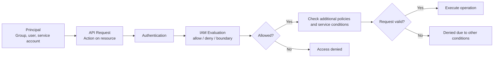
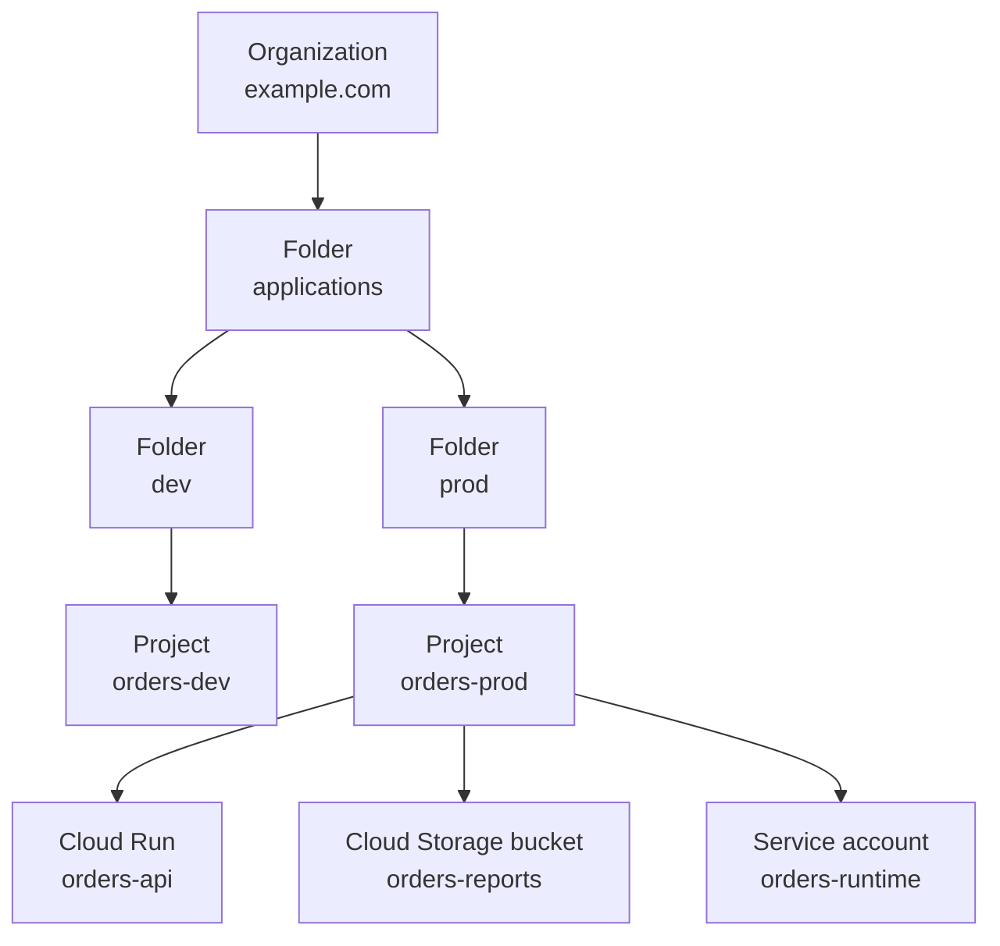
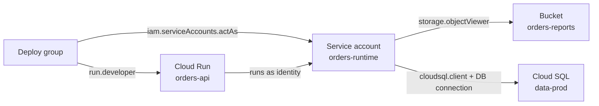

# Principals, IAM policies, and resources in Google Cloud

In Google Cloud Platform (GCP), whether a person can view a project, a pipeline can deploy Cloud Run, or a service can read Cloud Storage data all depends on the relationship between **principal** (access identity), **IAM policy** (access management policy), and **resource** (protected resource).

This lesson belongs to the **IAM and authentication** chapter of the `CLOUD_PROVIDERS_GCP` module. It forms the foundation before organizing projects and VPCs, deploying Compute Engine, GKE, or Cloud Run, using storage/database services, automating releases, and designing resource safeguards. Understanding these three components helps you grant appropriately scoped permissions, trace the root cause of access denials, and reduce blast radius if an identity is compromised.

## 1. Objectives

After this lesson, you can:

- Explain what a **principal** is and distinguish users, groups, service accounts, federated identities, and special principals.
- Identify **resources** along the Organization → Folder → Project → service resource path, and understand where IAM policies can be attached.
- Read an **IAM allow policy**: `bindings`, `members`, `role`, `condition`, `etag`, and `version`.
- Distinguish **authentication** (verifying identity) from **authorization** (checking permissions), and **permission** from **role**.
- Explain inherited permissions from parent levels, the limits of allow policies, and the roles of IAM deny and Principal Access Boundary.
- Analyze scenarios involving Cloud Run, Cloud Storage, Cloud SQL, and CI/CD, and use read-only commands to investigate IAM.

## 2. The big picture: who, what permissions, on which resource?

An access request is usually understood through three questions:

1. **Who is the principal?** For example, `alice@example.com`, the group `orders-deployers@example.com`, or the service account running an application.
2. **Which permissions does the action require?** For example, reading project metadata, updating a Cloud Run service, or reading objects in a bucket.
3. **Which resource is the target of access?** For example, project `orders-prod`, Cloud Run service `orders-api`, or bucket `gs://orders-reports`.

IAM uses a **policy** attached to supported resources to bind a principal to a role. A **role** groups **permissions**; when a principal requests an operation, Google Cloud determines the required permissions and evaluates the applicable policies.



The diagram is a conceptual model. In practice, the exact order and evaluation depend on the service, authentication mechanism, IAM policies, and additional controls. **Having IAM permission does not guarantee every configuration is valid**: an API call can still be blocked by Organization Policy, quotas, networking, or service-specific conditions.

## 3. Principal: identities that can be granted permissions

A **principal** is an entity that can be authenticated and/or serve as the subject of an IAM rule. In an **allow policy**, a principal is typically declared as a `member` of a binding.

| Principal type | Common representation in IAM allow policy | Scenario |
| --- | --- | --- |
| Google Account | `user:alice@example.com` | An individual accessing Console, CLI, or API. |
| Google Group | `group:orders-deployers@example.com` | A collection of users managed for permissions by group. |
| Service account | `serviceAccount:orders-runtime@orders-prod.iam.gserviceaccount.com` | Identity of a Cloud Run service, VM, job, or automated workflow. |
| Domain | `domain:example.com` | Scope of users belonging to a supported domain; can be very broad. |
| Federated identity | `principal://...` or `principalSet://...` | Workload or workforce using an external identity provider via federation. |
| Special principal | `allUsers` or `allAuthenticatedUsers` | Public access or a very broad set of authenticated identities, when allowed by the service and policies. |

The full syntax of `principal://...` and `principalSet://...` depends on the identity pool type and selector; you cannot substitute an arbitrary email address. When writing actual policies, you must use the exact principal identifier format supported by Google Cloud for that mechanism.

### 3.1. Users and groups

A user account represents an individual, but attaching roles directly to hundreds of people is hard to administer. For an application deployment team, you should generally grant permissions to a **Google Group** such as `group:orders-deployers@example.com` and manage membership through HR/onboarding workflows.

Benefits:

- New employees added to the group receive permissions from the applicable bindings; employees leaving the group lose the permissions originating from that group once identity/group changes propagate in the system.
- Permissions can be reviewed by **function**: deployment, operations, auditing.
- Reduces direct per-user bindings and simplifies handoffs when owners change.

However, a user can still receive permissions from **multiple sources**: their individual account, one or more groups, and bindings at ancestor levels. Removing one binding does not necessarily remove all of their permissions.

### 3.2. Service account: workload identity

A **service account** is a type of identity used for applications or automation, for example:

```text
orders-runtime@orders-prod.iam.gserviceaccount.com
ci-deployer@platform-tools.iam.gserviceaccount.com
```

A service account has two distinct roles to tell apart:

1. **As a principal:** it can receive IAM roles to call APIs on other resources, such as reading a bucket or connecting to Cloud SQL.
2. **As a resource:** the service account itself is an IAM resource; another principal can be granted permission to **use/impersonate** its identity, or to manage it.

For example, granting `roles/storage.objectViewer` to `orders-runtime` on a bucket allows the workload to read objects within the scope of that role and resource. This does **not** mean every employee has permission to use the `orders-runtime` identity.

Service account-related permissions also carry different meanings:

- `iam.serviceAccounts.actAs`: commonly used to **attach a service account** to a supported resource or workload.
- Permission to create access tokens (such as via **Service Account Token Creator** when appropriately granted) enables certain impersonation flows.
- Permissions to manage a service account or create long-lived keys are a separate group of permissions; they should be restricted and evaluated separately.

For CI/CD pipelines outside Google Cloud, prefer **Workload Identity Federation** whenever possible instead of storing a long-lived JSON key file. GKE also provides **Workload Identity Federation for GKE** so workloads can use IAM without manually sharing service account keys.

### 3.3. Service agents and default service accounts

Some Google Cloud products create or use dedicated **service agents** to manage resources on behalf of the service. These are not personal accounts or arbitrary service accounts used by your application. Service agent roles are typically designed for the corresponding service agent; **you should not assign service agent roles to regular users or workloads**.

On the other hand, Compute Engine or other services may have default service accounts per project/organization. The existence of an account **does not mean it currently has the required permissions**; you must inspect the actual IAM bindings and state. Do not assume every default service account has Editor permissions.

### 3.4. Public principals require careful consideration

`allUsers` represents anyone, including unauthenticated callers. `allAuthenticatedUsers` is a very broad scope of authenticated identities, **not limited to company employees**. These members are only valid when allowed by the resource type and organization/service policies.

For example, a public Cloud Run endpoint can be configured to allow callers without IAM authentication to invoke the service; however, that must be an **intentional publishing decision**, accompanied by appropriate application protection. For a bucket storing internal reports or a database, never use public principals as a quick fix for a permission error.

## 4. Resource: the target to which permissions apply

Google Cloud has a **resource hierarchy**:



| Level/resource | Role | Example of commonly placed permissions |
| --- | --- | --- |
| **Organization** | Governance root for the organization's resources. | Permissions reserved for organization admins and authorized auditors. |
| **Folder** | Separates environments, departments, or products. | Shared roles across the entire `prod` or `dev` branch. |
| **Project** | Management boundary for most service resources. | Application deployment roles on a specific project. |
| **Service resource** | Buckets, Cloud Run services, Secret Manager secrets, service accounts, and many other types. | Object read role on a single bucket or permission to use a specific service account. |

**Not every resource supports attaching an IAM allow policy directly**, and not every role can be granted at every level. Some permissions must be attached at the project or a service-specified resource. Check the IAM documentation for the **specific resource type** before deciding where to place a binding.

For example, a Cloud Run service has a resource name like:

```text
projects/orders-prod/locations/asia-southeast1/services/orders-api
```

The path indicates the project name, region, and service. The region determines where it is deployed; the **resource hierarchy** determines management relationships and policy scope. Services in two different regions within the same project can still inherit permissions granted at the project level, though network connectivity or data access in the two regions will not automatically be identical.

### 4.1. Target resource and policy-holding resource

Suppose the operations group is assigned a role at Folder `prod`. When accessing a Cloud Run service in project `orders-prod`, the Folder-level policy can contribute permissions to the request. Even though the policy does not sit directly on the Cloud Run service, it still takes effect **through ancestors**.

Conversely, a role attached to bucket `orders-reports` only applies within the bucket's scope according to the capabilities of the role and corresponding policy; it does not automatically grant read access to every other bucket in the same project.

## 5. IAM permissions, roles, and policies

### 5.1. Permission is the smallest controlled operation

An **IAM permission** typically has a name in the form `service.resource.verb`, for example:

- `run.services.get`: view Cloud Run service details.
- `run.services.update`: update a Cloud Run service.
- `storage.objects.get`: read an object's content or metadata within supported service scope.
- `resourcemanager.projects.get`: view project metadata.

An API operation may require **multiple permissions** and check them across **multiple resources**. Therefore, seeing a single permission in a role does not guarantee it is enough to complete an entire deployment workflow.

### 5.2. Roles group permissions

A binding usually grants a **role** rather than directly granting individual permissions:

| Role type | Characteristics | When to use |
| --- | --- | --- |
| **Basic role** (`roles/owner`, `roles/editor`, `roles/viewer`) | Broad scope, created for simple administration. | Avoid using by default for workloads or teams with narrow duties. |
| **Predefined role** | Defined by Google Cloud around service functions, e.g., `roles/run.developer` or `roles/storage.objectViewer`. | Prefer when it fits the job and resource scope. |
| **Custom role** | Organization selects a list of permissions allowed in a custom role. | When predefined roles are too broad, and the required permissions can be included in a custom role. |

**Principle of least privilege:** only grant the necessary permissions, at the lowest resource level that meets the requirement, and for the required duration. For example, to let a team read reports in a bucket, consider `roles/storage.objectViewer` on **that bucket** rather than granting Viewer/Editor on the whole project.

Note: a role is only a **set of permissions**; the **binding of a role to a principal on a resource** is what determines who gets which permissions where.

### 5.3. What is the structure of an allow policy?

Here is an **illustrative example** of an IAM allow policy attached to project `orders-prod`; principals, conditions, and timestamps are chosen for learning purposes:

```yaml
version: 3
bindings:
  - role: roles/run.developer
    members:
      - group:orders-deployers@example.com
  - role: roles/viewer
    members:
      - group:temporary-auditors@example.com
    condition:
      title: temporary_read_access
      description: Read access limited until the approved timestamp
      expression: request.time < timestamp("2027-01-01T00:00:00Z")
etag: BwExampleOnly
```

| Field | Meaning |
| --- | --- |
| `bindings[]` | Bindings granting a role to a list of members; a binding can have a condition. |
| `role` | The granted role, e.g., `roles/run.developer`. |
| `members[]` | Principals receiving the role using supported IAM syntax. |
| `condition` | IAM Conditions expression; the binding only takes effect when the condition evaluates to true and the context supports it. |
| `etag` | Optimistic concurrency control value when updating the policy, preventing overwriting someone else's changes. |
| `version` | Policy format version; IAM Conditions in allow policies use the format supporting version 3. |

**Do not use `etag: BwExampleOnly` to write a real policy.** When modifying an IAM policy via API, you must read the actual `etag` and send it back properly; avoid a read–modify–write pattern that overwrites permissions just updated by someone else.

When reading a policy, distinguish **content attached directly on the resource being inspected** from **effective permissions** calculated from that resource and its ancestors.

### 5.4. IAM Conditions are not an authentication mechanism

IAM Conditions restrict the validity of a binding based on supported attributes, such as request time or resource attributes. In the example above, the auditors group only receives the role from the binding when `request.time` is earlier than the specified timestamp.

Conditions **do not replace authentication**. The system still needs to know which principal is calling the API; the condition only helps decide whether the binding is valid in that request context. Not all attributes are supported across every service or permission; check the IAM Conditions documentation when designing expressions.

## 6. IAM allow inheritance from ancestor resources

Suppose:

```text
Organization: example.com
└── Folder: workloads
    └── Folder: prod
        ├── Project: orders-prod
        │   ├── Cloud Run service: orders-api
        │   └── Bucket: orders-reports
        └── Project: payments-prod
```

Place the following bindings:

| Where allow binding is attached | Principal | Role | Scope of impact |
| --- | --- | --- | --- |
| Folder `prod` | `group:prod-observers@example.com` | `roles/viewer` | Permissions included in the role on corresponding resources in both projects under the `prod` branch. |
| Project `orders-prod` | `group:orders-deployers@example.com` | `roles/run.developer` | Only on relevant resources in project `orders-prod`, unless other bindings exist. |
| Bucket `orders-reports` | `serviceAccount:orders-runtime@orders-prod.iam.gserviceaccount.com` | `roles/storage.objectViewer` | Object read permissions on the specified bucket. |

When someone in `prod-observers` accesses `orders-prod`, permissions from the Folder can apply even though they do not appear in the output of reading the project's **direct policy**. When `orders-deployers` is granted a role at project `orders-prod`, that role **does not automatically propagate** to the sibling project `payments-prod`.

Key points to remember:

1. **Allow is additive:** permissions granted from bindings on the resource and applicable ancestors can all contribute to effective permissions.
2. **Child-level bindings do not remove parent-level permissions:** deleting a binding on a project does not necessarily revoke permissions originating from a Folder or Organization.
3. **Conditions remain in effect:** a binding with an IAM Condition only grants permissions when the expression is satisfied.
4. **Only grant at high levels if you truly want the entire branch to receive the permissions:** new projects added to a Folder can also be affected by Folder-level bindings.

### 6.1. IAM deny and Principal Access Boundary

A matching allow binding is **not the whole access decision**:

- **IAM deny policy:** for permissions and principals covered by an applicable deny rule, the operation can be denied even if an allow binding exists. Some rules have explicitly configured exceptions.
- **Principal Access Boundary (PAB):** limits **the set of resources a principal is eligible to access**, when this mechanism is applied to the principal. It does not grant additional permissions on its own.
- **Organization Policy:** constrains how resources are created or configured, such as service locations for supported constraints. This is a different control layer from IAM allow/deny.
- **Service conditions:** permission to call an API does not mean networking, quotas, resource state, or in-database permissions are satisfied.

A conceptual check:

```text
Is there a matching allow binding?
    │
    ├─ No → Not granted by IAM allow.
    │
    └─ Yes
        ├─ Is there a matching IAM deny? → May be denied.
        ├─ Restricted by Principal Access Boundary? → May be denied.
        └─ Passes IAM controls → Still must satisfy other service controls.
```

Do not treat the diagram above as a complete description of the policy evaluation engine order. Use it as a checklist when troubleshooting errors.

## 7. Distinguishing authentication and authorization

Two concepts frequently encountered in IAM guides:

| Step | Question | Example |
| --- | --- | --- |
| **Authentication** | Which identity does this request come from? | User signs in with `gcloud auth login`; workload obtains a short-lived token via metadata server or federation. |
| **Authorization** | Does the authenticated identity have permission to perform this operation on the resource? | Google Cloud checks IAM permissions for updating a Cloud Run service in the project. |

Successful authentication **does not mean having permission**. For instance, running `gcloud auth login` may succeed, yet `gcloud projects get-iam-policy orders-prod` still returns `PERMISSION_DENIED` if the identity lacks permission to read the policy.

Conversely, being listed in an allow policy **does not automatically grant a sign-in method**; the principal must use an appropriate authentication mechanism to call the service. Tokens also have expiration times, audiences/scopes, or service-specific requirements; IAM policies do not modify those token constraints.

**Application Default Credentials (ADC)** is the mechanism Google Cloud client libraries use to locate credentials in the runtime environment. Using ADC does not create new IAM permissions: the **actual identity** ADC resolves to must still be granted the required permissions. On a developer workstation, distinguish the CLI login identity from the identity the application uses through ADC.

## 8. Real-world scenario: Cloud Run accessing Cloud Storage and Cloud SQL

Suppose an organization has:

- Project `orders-prod` containing Cloud Run service `orders-api`.
- The service runs under identity `orders-runtime@orders-prod.iam.gserviceaccount.com`.
- Bucket `orders-reports` used to store reports.
- A Cloud SQL instance in project `data-prod`.
- Group `orders-deployers@example.com` deploying new versions.

### 8.1. Three distinct permission relationships

| Requirement | Principal | Target resource for binding | Illustrative role/permission |
| --- | --- | --- | --- |
| Deploy group updates Cloud Run service | `group:orders-deployers@example.com` | Project `orders-prod` or Cloud Run service when supported by resource/role | `roles/run.developer` within appropriate scope. |
| Deploy group attaches runtime service account to Cloud Run service | Same deploy group | Service account `orders-runtime` | `iam.serviceAccounts.actAs` permission, commonly via `roles/iam.serviceAccountUser`. |
| Workload reads report objects | `serviceAccount:orders-runtime@orders-prod.iam.gserviceaccount.com` | Bucket `orders-reports` | `roles/storage.objectViewer`. |
| Workload connects to Cloud SQL in another project | Runtime service account | Project `data-prod` or appropriate resource scope | `roles/cloudsql.client`, plus a valid connection path and database authentication. |

**Distinguish deployment permissions from runtime permissions:** allowing a deployer to update Cloud Run **does not mean** the running application uses that person's permissions. Cloud Run calls Google Cloud APIs using the **runtime service account** attached to the service. Bucket read access should be granted to the runtime service account at the bucket scope, rather than granting broad permissions to the entire deploy group.

**Distinguish Cloud SQL IAM from database authentication:** `roles/cloudsql.client` provides the Cloud SQL permissions needed to connect via supported mechanisms; the application still needs proper network/connector configuration and a supported database login method. IAM for Google Cloud operations does not automatically replace users/roles inside PostgreSQL or MySQL.

### 8.2. Access flow diagram



If Cloud Run hits a `403` error while downloading reports, inspect the **runtime service account in use**, target bucket, direct and inherited bindings, IAM deny/PAB (if any), and Cloud Storage policies. Granting additional roles to the **deployer** usually does not fix access errors coming from the application.

### 8.3. CI/CD pipeline using external identity

A GitHub Actions runner can use **Workload Identity Federation** to exchange an identity from an external provider for short-lived credentials according to trust configuration. The pipeline can be authorized to:

1. Access a deployment service account with limited permissions.
2. Deploy Cloud Run in the required project/region.
3. Avoid keeping a long-lived JSON private key in the CI system.

Permissions for workloads outside Google Cloud to use or impersonate a service account must be granted explicitly; trust configuration in the identity pool must restrict to the exact repository, branch, or appropriate source attributes. Federation **does not automatically grant deploy roles** across the entire organization.

## 9. Read-only practice: tracing principals, roles, and resources

The following commands **only read metadata/policies**. Replace placeholders with actual values; your account needs the corresponding IAM policy read permissions.

```bash
# Allow policy attached DIRECTLY to a project
gcloud projects get-iam-policy PROJECT_ID --format=yaml

# Policy attached directly at Folder and Organization
gcloud resource-manager folders get-iam-policy FOLDER_ID --format=yaml
gcloud organizations get-iam-policy ORG_ID --format=yaml

# IAM policy attached directly to a service account resource
gcloud iam service-accounts get-iam-policy \
  orders-runtime@orders-prod.iam.gserviceaccount.com \
  --project=orders-prod \
  --format=yaml

# View permissions of a predefined role
gcloud iam roles describe roles/run.developer --format=yaml
```

Notes:

- `get-iam-policy` on a project **does not aggregate all inherited bindings** from Folders/Organization.
- The IAM policy **of a service account resource** answers who has permission to act **on that service account**. It is not the list of roles the service account holds on other buckets/projects.
- `roles/run.developer` has a specific list of permissions; roles can change when Google Cloud updates predefined roles. Inspect the role directly instead of inferring from the role name.
- If reading a policy fails with `PERMISSION_DENIED`, check your permission to view policies. Do not conclude the policy is empty or the resource does not exist solely from this error.

### 9.1. Troubleshooting workflow for 403/permission denied errors

1. **Identify the actual principal** sending the request: CLI account, ADC, Cloud Run/VM/GKE service account, or federated principal?
2. **Read the target resource and action**: which project, which bucket, which API method, which permission is reported missing?
3. **Trace IAM allow bindings** from the resource up to Project, Folder, and Organization; include group memberships and IAM Conditions.
4. **Check other restrictions**: IAM deny, PAB, Organization Policy, service-level policies, quotas, and network configuration.
5. **Apply the smallest appropriate change** and retry the operation. You can use **Policy Troubleshooter** to analyze specific permissions when supported by the service/tool and you have permission to view the required data.

Do not react to every 403 error by granting `roles/editor` or `roles/owner`: overly broad permissions increase risk and still fail to solve errors outside IAM allow.

## 10. Practice: designing policies with least privilege

Scenario: the `orders-deployers` group needs to deploy the application, the `prod-observers` group only needs to view production resources, and the `orders-api` service only reads one reports bucket.

Recommended design:

1. Create separate **Google Groups** for deployment and observation; manage membership according to actual responsibilities.
2. Attach observer permissions at **Folder `prod`** only if you want the group to observe the entire branch; otherwise attach at a narrower project/resource.
3. Attach Cloud Run developer permissions at the **project or supported Cloud Run resource** matching the application's scope.
4. Grant `iam.serviceAccounts.actAs` to the deploy group only on the **runtime service account to be attached**.
5. Attach `roles/storage.objectViewer` for the **runtime service account** on the exact **bucket**.
6. Use IAM Conditions, temporary permissions, and deny/PAB/Organization Policy mechanisms where appropriate; avoid specifying conditions not yet supported by the resource.
7. Test again with the actual identities of the deploy group and service; keep an audit trail of changes.

This model reduces the chance of a deploy team accessing unrelated data, limits the permissions exploitable if a workload token is leaked, and scales more cleanly when adding new projects.

## 11. Common misconceptions

| Misconception | Reality |
| --- | --- |
| “Being able to log into GCP means having permission to access the project.” | Authentication proves identity; authorization still requires appropriate IAM permissions. |
| “A service account is just an email, not a resource.” | A service account can act as a **principal**, and is also a **resource** others can be granted permissions to act upon. |
| “Attaching the Viewer role at the project level lets you read all data.” | The role's scope and permissions determine access; not every data type or operation is included in `roles/viewer`. |
| “Not seeing a group in project IAM means the group has no permissions.” | Bindings from Organization/Folder can be inherited down to the project. |
| “The Run Developer role alone is enough for all deploy steps.” | Depending on the operation, you may also need `iam.serviceAccounts.actAs` and permissions on related resources. |
| “If Cloud Run gets a 403, grant more permissions to the deployer.” | Runtime API calls usually use the **runtime service account**; you must identify the actual caller. |
| “`allAuthenticatedUsers` only includes logged-in company employees.” | It is a very broad set of authenticated principals, not limited to people inside your organization. |
| “Having IAM allow permission means the command will definitely succeed.” | Deny/PAB/Organization Policy/quotas/networking and service conditions can still block it. |

## 12. Comprehension check

Given the system:

```text
Organization
└── Folder: prod
    ├── Project: orders-prod
    │   ├── Cloud Run: orders-api
    │   ├── Bucket: orders-reports
    │   └── Service Account: orders-runtime
    └── Project: payments-prod
```

Configured bindings:

- Folder `prod`: `group:prod-readers@example.com` has `roles/viewer`.
- Project `orders-prod`: `group:orders-deployers@example.com` has `roles/run.developer`.
- Bucket `orders-reports`: service account `orders-runtime` has `roles/storage.objectViewer`.

**Questions**

1. Can the `prod-readers` group receive permissions to view role-supported resources in `payments-prod` even though that project's policy does not list the group?
2. Does the `orders-deployers` group automatically manage Cloud Run in `payments-prod`?
3. If Cloud Run `orders-api` cannot read objects in the bucket, which principal should you check first?
4. Having `roles/run.developer`, can the deploy group definitely attach any runtime service account to Cloud Run?
5. Someone in the `prod-readers` group was removed from project IAM but can still view resources. What should you check?
6. Does granting `roles/storage.objectViewer` on the bucket to `orders-runtime` mean deployers can read the bucket using their personal accounts?

**Suggested answers**

1. **Yes, possibly.** The allow binding at Folder `prod` applies down to child projects, provided the permissions belong to the role and are not blocked by conditions or other policies.
2. **No.** A binding on `orders-prod` does not automatically propagate to a sibling project.
3. Check the **runtime service account** actually attached to Cloud Run; then inspect bucket roles/bindings, IAM deny/PAB, conditions, APIs, and the target resource.
4. **No.** Attaching a service account typically also requires `iam.serviceAccounts.actAs` on the target service account and other service conditions.
5. Check **bindings at Folder/Organization** and memberships in other groups; removing a role at the project level does not remove inherited permissions.
6. **No.** The permissions of the service account and the permissions of a deployer's personal account belong to two independent identities.

## 13. Key takeaways for safe operations

- **Principal = who**, **permission/role = what can be done**, **resource = on which target**, and **IAM policy = the declared link between them**.
- **Authentication** identifies the caller; **authorization** evaluates whether the caller has the required permissions on the resource.
- Prefer **Google Groups for humans**, **service accounts/federation for workloads**, and the **narrowest permissions** for the job.
- **Allow bindings can be inherited** from Organization/Folder/Project; child-level bindings do not automatically remove parent-level permissions.
- **A service account is both a principal and a resource**. Permissions to use/impersonate a service account and permissions granted to that service account are **two separate policy paths**.
- Always check **IAM deny, PAB, IAM Conditions, and service controls** when allow permissions look right yet the request still fails.
- When operating Compute Engine, GKE, Cloud Run, Storage, and Cloud SQL, track the actual identity used by the workload, the exact target resource, and permissions at both deploy time and runtime.

### References

- [Google Cloud IAM overview](https://cloud.google.com/iam/docs/overview)
- [Principal identifiers](https://cloud.google.com/iam/docs/principal-identifiers)
- [Allow policy structure](https://cloud.google.com/iam/docs/policies)
- [IAM roles and permissions](https://cloud.google.com/iam/docs/understanding-roles)
- [Resource hierarchy access control](https://cloud.google.com/iam/docs/resource-hierarchy-access-control)
- [IAM Conditions](https://cloud.google.com/iam/docs/conditions-overview)
- [Service accounts overview](https://cloud.google.com/iam/docs/service-account-overview)
- [Workload Identity Federation](https://cloud.google.com/iam/docs/workload-identity-federation)
