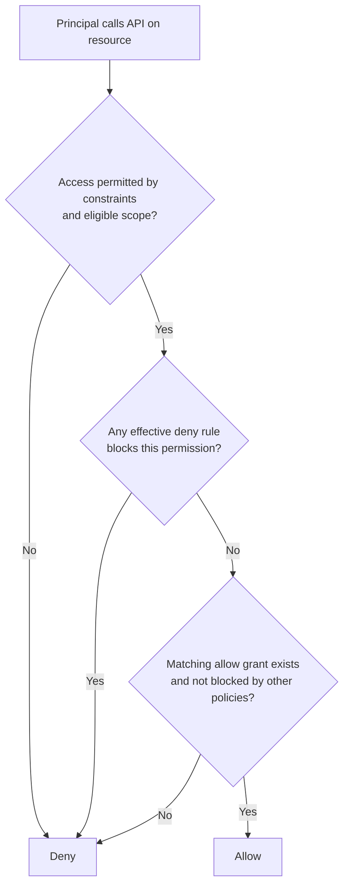
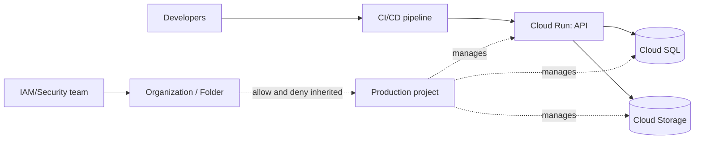

# IAM deny policies and restricting access permissions

## 1. When permissions are granted yet an action must still be blocked

In Google Cloud, **Identity and Access Management (IAM)** determines **who** can perform **which action** on **which resource**. The usual approach is granting a role through an **allow policy**. However, organizations sometimes want operations teams to keep broad working rights while still **prohibiting certain high-risk actions**, for example:

- Preventing the development team from creating long-lived service account keys in production.
- Allowing only the admin group to delete projects or modify IAM in critical environments.
- Blocking deletion of a sensitive resource type even when a user holds a role at the Folder or Organization level.
- Enforcing restrictions by **Resource Manager tags**, such as blocking actions only on projects tagged `env=prod`.

An **IAM deny policy** creates rules prohibiting the use of specific IAM permissions. If a deny rule matches, **the permission is blocked even if an allow role grants it**. This serves as a security guardrail across your Google Cloud architecture.

In the **CLOUD_PROVIDERS_GCP** module, this concept connects directly to **Organization/Folder/Project** governance, protecting **IAM and VPCs**, operating **Compute Engine, GKE, Cloud Run, Cloud SQL**, running **CI/CD**, and limiting the blast radius of operational mistakes.

After this lesson, you will know how to:

1. Distinguish **authentication**, **allow**, **deny**, **Principal Access Boundary (PAB)**, and other restriction mechanisms.
2. Explain **inheritance scope**, effective permission precedence, and the effect of exceptions.
3. Read and design **deny rules** consisting of principals, permissions, and tag-based conditions.
4. Understand how to create, list, inspect, and update deny policies via Google Cloud Console and `gcloud`.
5. Recognize risks of accidental lockouts, impact on service agents, policy propagation delays, and how to handle them.

> **Scope:** This lesson presents sample policies and admin commands for study and review. Apply live changes only after confirming approvers, recovery accounts, blast radius, and required permissions. All project IDs, emails, tags, and organization IDs in examples are **fictitious**.

## 2. Foundational concepts

### 2.1. Authentication differs from authorization

**Authentication** identifies who a request comes from. For example, an employee signs in via Cloud Identity/Google Workspace, or Cloud Run uses a service account.

**Authorization** determines which operations that identity is allowed to perform. For example, a service account may be allowed to read Secret Manager without being allowed to edit project IAM.

Successfully signing in with `gcloud auth login` or obtaining an access token **does not guarantee** permission to access a resource. IAM and other constraints are still evaluated when an API is called.

### 2.2. Principal, role, permission, resource

| Component | Meaning | Illustrative example |
| --- | --- | --- |
| **Principal** | Identity of a user, group, service account, or principal set | `alice@example.com`, group `platform@example.com` |
| **Role** | Predefined or custom collection of IAM permissions | `roles/iam.serviceAccountKeyAdmin` |
| **Permission** | Specific action required by an API | `iam.serviceAccountKeys.create` in IAM v1 form |
| **Resource** | Object to protect | Project, service account, VM, bucket, database |
| **Allow policy** | Links a principal to a role over a resource scope | Platform team is granted the service account key admin role |
| **Deny policy** | Defines principals barred from using specific permissions | Prohibit platform team from creating service account keys in the prod project |

Roles are typically granted via allow policies on a resource and **inherited downward**. Deny policies also apply across the hierarchy, though they are managed separately through the **IAM v2 API**.

## 3. How are deny policies evaluated?

When a principal calls an API, the system determines the required permissions, evaluates relevant policies, and returns a decision. You can visualize this conceptually:



This diagram is an **explanatory model**, not the exact sequential execution order inside IAM. IAM evaluates all relevant policy types when deciding; **an allow grant cannot override an active deny rule**. Other policies, such as Principal Access Boundary, can further restrict access.

| Does allow include permission? | Does an effective deny rule block permission? | Combined allow + deny outcome |
| --- | --- | --- |
| No | No | **Not allowed**, because there is no grant |
| Yes | No | May be allowed, if other constraints permit |
| Yes | Yes | **Denied** |
| No | Yes | **Denied** |

For example, group `platform@example.com` is granted `roles/iam.serviceAccountKeyAdmin` at the Folder level. If a deny policy on the production project blocks `iam.googleapis.com/serviceAccountKeys.create` for this group, they **cannot create service account keys** in the production project, even though the role is inherited from the Folder.

### Inheritance scope

Google Cloud Resource Manager organizes resources as:

```text
Organization
└── Folder: Engineering
    ├── Project: acme-dev-001
    │   └── Service resources
    └── Project: acme-prod-001
        ├── Service accounts
        ├── Compute Engine / GKE / Cloud Run
        └── Cloud SQL / Cloud Storage / other services
```

A deny policy is **attached** to an **Organization**, **Folder**, or **Project**. It applies to the attached resource and **descendant** resources within that scope. A deny policy attached at the Organization can affect numerous projects; a deny policy on a project affects only resources inside that project.

A child-level deny policy **cannot disable** an active deny policy at a parent level. Likewise, granting extra roles on a project cannot “break” a deny rule inherited from a Folder or Organization. Deny policies across levels are evaluated together; always inspect the **entire ancestry chain** when diagnosing a permission error.

## 4. Structure of an IAM deny policy

A deny policy contains metadata and one or more deny rules. Common fields:

| Field | Role | Notes |
| --- | --- | --- |
| `displayName` | Human-readable descriptive name | E.g., “Block service account key creation in production” |
| `rules[]` | List of rules | Each policy needs at least one deny rule |
| `denyRule.deniedPrincipals` | Affected principals | Can be users, service accounts, groups, or supported principal sets |
| `denyRule.exceptionPrincipals` | Principals **exempted from this deny rule** | **Does not grant allow permissions** and does not exempt from other deny policies |
| `denyRule.deniedPermissions` | Blocked permissions | Must be on the deny-supported permissions list, using IAM v2 format |
| `denyRule.exceptionPermissions` | Permissions exempted from this rule | Useful when using broad permission groups |
| `denyRule.denialCondition` | Condition for the deny rule to take effect | Supports only conditions based on **resource tags** |
| `etag` | Policy version token | Used during updates to detect concurrent edits |
| `name`, `uid`, `kind` | Policy identifiers and type | IAM manages metadata when creating policies |

### 4.1. Permissions use the IAM v2 format

When inspecting roles and allow policies, we usually see permission names like `iam.serviceAccountKeys.create`. Deny policies use the **fully qualified service domain name** format:

```text
IAM v1: iam.serviceAccountKeys.create
IAM v2: iam.googleapis.com/serviceAccountKeys.create

IAM v1: resourcemanager.projects.delete
IAM v2: cloudresourcemanager.googleapis.com/projects.delete
```

Do not mechanically replace the first dot with a slash: some permissions follow special naming rules. Check **[Permissions supported in deny policies](https://cloud.google.com/iam/docs/deny-permissions-support)**. **Not every IAM permission can be used in a deny policy.**

### 4.2. Principal formats

Examples of principal identifiers in a deny policy:

```text
principal://goog/subject/alice@example.com
principalSet://goog/group/platform@example.com
principalSet://goog/public:all
```

The exact identifier depends on the principal type (Google user, Google group, service account, Workforce/Workload Identity Federation, etc.). For example, `principalSet://goog/public:all` represents a very broad set of principals; **never use it indiscriminately in every policy**.

In many contexts, broad principal sets **also include service agents** that Google Cloud products rely on to operate. If a broad block is genuinely necessary, evaluate and add appropriate exceptions for service agents following Google Cloud guidance. Accidentally blocking service agents can break managed components such as GKE, Cloud Run, or other managed services.

**Important note on exceptions:** `exceptionPrincipals` only states that a principal **is not blocked by this specific deny rule**. It **does not** grant a role, bypass PAB, or guarantee exemption from other deny rules.

### 4.3. Permission groups

Some permission groups allow `*` following **patterns supported by Google Cloud**, such as `SERVICE_FQDN/RESOURCE.*` or `SERVICE_FQDN/*.*` when the corresponding group appears on the supported list.

Permission groups help govern many similar actions, including future permissions matching the pattern. However, that carries risk too: newly introduced permissions can become blocked automatically. **Never invent arbitrary wildcards** in permission names; use only officially listed groups and assess impact before applying.

## 5. Practical example: blocking service account key creation in production

Suppose:

- Group `platform@example.com` manages dev, test, and production operations and holds some Folder-level IAM roles.
- Group `security-admins@example.com` is a **subset** of the platform group responsible for approved exceptions.
- Project `acme-prod-001` hosts production workloads such as Cloud Run, GKE, and Compute Engine.
- The organization wants to **prohibit the platform group from creating service account keys in the production project**, except for security-admins. Key creation in other projects is outside this example deny policy's scope.

### 5.1. Sample JSON policy

The following illustrative content can serve as a draft `deny-policy.json` for an approved test environment:

```json
{
  "displayName": "Restrict service account key creation in production",
  "rules": [
    {
      "denyRule": {
        "deniedPrincipals": [
          "principalSet://goog/group/platform@example.com"
        ],
        "exceptionPrincipals": [
          "principalSet://goog/group/security-admins@example.com"
        ],
        "deniedPermissions": [
          "iam.googleapis.com/serviceAccountKeys.create"
        ]
      }
    }
  ]
}
```

Meaning:

1. Regular platform members **cannot create new keys** for service accounts within the production project's resource scope.
2. Security-admins members (who are also in platform) **are exempted from this deny rule**, yet still require an allow role containing `iam.serviceAccountKeys.create` to perform the action.
3. The policy **does not revoke existing keys**, does not block using already-created keys, does not block key deletion, and does not restrict key creation outside this project.
4. Principals **outside the platform group** are not blocked by this deny rule; the organization must consider broader protection needs and other constraints.

If the security requirement is to **ban all service account key creation**, administrators can also consider the relevant Organization Policy constraint instead of relying solely on a group-targeted deny rule.

### 5.2. Choosing the right attachment point

For this example, the attachment point is:

```text
cloudresourcemanager.googleapis.com/projects/acme-prod-001
```

This is a fictitious project ID, not a folder display name or billing account. Deny policies can only be attached at an **Organization, Folder, or Project**, never directly like an allow policy on arbitrary individual service resources.

### 5.3. Creating a policy with gcloud

The following command is an **administrative example that modifies permissions**, **not something to run blindly in production**. Use it only after verifying the JSON, principal lists, exceptions, admin rights, and obtaining proper approval:

```bash
gcloud iam policies create block-sa-key-creation \
  --attachment-point=cloudresourcemanager.googleapis.com/projects/acme-prod-001 \
  --kind=denypolicies \
  --policy-file=deny-policy.json
```

If using **PowerShell** on Windows, put the command on **one line**, or use PowerShell's line-continuation syntax:

```powershell
gcloud iam policies create block-sa-key-creation --attachment-point=cloudresourcemanager.googleapis.com/projects/acme-prod-001 --kind=denypolicies --policy-file=deny-policy.json
```

The command passes `--kind=denypolicies` to distinguish it from other IAM policy types. You need deny policy management permissions, not merely a workload resource management role.

### 5.4. Read-only commands to view and inspect

Once the policy has been created by an authorized administrator:

```bash
# List deny policies attached directly to the project
gcloud iam policies list \
  --attachment-point=cloudresourcemanager.googleapis.com/projects/acme-prod-001 \
  --kind=denypolicies \
  --format=json

# Read a specific deny policy
gcloud iam policies get block-sa-key-creation \
  --attachment-point=cloudresourcemanager.googleapis.com/projects/acme-prod-001 \
  --kind=denypolicies \
  --format=json
```

**Note:** Listing deny policies attached **directly** to a project **does not guarantee** you see deny policies **inherited from a Folder/Organization**. When investigating permissions, check the entire ancestry path too.

## 6. Denial condition: restricting by Resource Manager tags

Sometimes a policy should apply only to **production projects**, yet admins want to place it at the **Organization** for centralized management. In that case, you can use a **denial condition** based on **resource tags**.

Example: prohibit `developers@example.com` from deleting projects tagged `env=prod`:

```json
{
  "displayName": "Block developers from deleting production projects",
  "rules": [
    {
      "denyRule": {
        "deniedPrincipals": [
          "principalSet://goog/group/developers@example.com"
        ],
        "deniedPermissions": [
          "cloudresourcemanager.googleapis.com/projects.delete"
        ],
        "denialCondition": {
          "title": "Only apply to production environment",
          "expression": "resource.matchTag('123456789012/env', 'prod')"
        }
      }
    }
  ]
}
```

Here `123456789012` is a **fictitious organization ID** forming part of the tag key's namespaced name; substitute the actual tag. The policy must be attached at the **Organization** or a suitable ancestor scope covering the projects to protect. To protect production projects deliberately, admins must ensure production projects **actually carry the proper tag** and that tag management cannot be altered by unauthorized users.

### Condition evaluation outcomes

| Result of `denialCondition` | Does deny rule take effect? | Consequence |
| --- | --- | --- |
| `true` | **Yes** | Principal is prohibited from using the permissions in the rule |
| `false` | **No** | This rule does not block; allow is still required and other policies still apply |
| Unable to evaluate | **Yes** | Fails closed toward denying access so guardrails are not bypassed |

Deny conditions use **Common Expression Language (CEL)**, yet **permit only the supported resource-tag condition functions**. Never substitute time checks, IP checks, resource names, or arbitrary expressions that can appear in **IAM Conditions for allow policies**.

**Resource Manager tags differ from labels:** tags are built for access conditions and have their own governance mechanism; standard **labels** used for classification and cost reporting are not data sources for `resource.matchTag(...)`.

## 7. Important limits and caveats of deny policies

### 7.1. Not every permission can be denied

Deny policies block only permissions on the **supported list**. Therefore, do not author a policy by taking a role and assuming every permission in it can be dropped into `deniedPermissions`. Find the exact v2 permission, identify affected resources, and verify support.

### 7.2. Policy and rule limits

Per current Google Cloud documentation, an Organization, Folder, or Project can have **up to 500 deny policies**, with **up to 500 total deny rules** across deny policies **attached directly to that resource**. Quota/limit figures can change over time; verify official docs before designing at large scale.

A large number of policies does not automatically yield better security. Admin teams should group rules around clear objectives, documenting owners, scope, and exceptions for easier auditing and updates.

### 7.3. Inheritance and multiple-policy rules

If a principal matches **an active deny rule** among applicable policies, adding extra roles on child resources is insufficient to allow the action. An exception on deny rule A **does not exempt** the principal from deny rule B.

Example:

- Organization denies project deletion for all members of group A.
- Project has an allow role `roles/resourcemanager.projectDeleter` for user X in A.
- Result: X **still cannot delete the project**, unless the Organization deny is modified so X is no longer blocked by that rule; if other denies exist, those still apply too.

### 7.4. Service agents and break-glass accounts

Broad denies such as `principalSet://goog/public:all` can block **service agents**, disrupting managed services. Google Cloud recommends considering exceptions for appropriate service agent principal sets when denying broad principal sets. Never assume every service agent operates with human-operator privileges, and never add overly broad exceptions without verifying business need.

Ensure the organization has a **controlled admin and recovery path** to fix broken policies. Removing an allow role or granting Owner to another account cannot bypass an active deny if the required permissions remain denied.

### 7.5. Policy propagation is not instantaneous

Deny policy changes exhibit **eventual consistency**. Google Cloud notes that changes typically take effect within about **2 minutes**, though occasionally **7 minutes or longer** may be required. When testing, do not conclude a policy failed based solely on an API call made immediately after creation.

### 7.6. Updates require version concurrency control

`etag` is a version token that prevents overwriting concurrent updates. When modifying a deny policy:

1. Read the current policy and record its etag.
2. Review existing rules, exceptions, and conditions; evaluate impact on inherited policies.
3. Prepare the new JSON, preserving metadata and etag as required by the update operation.
4. Apply the update via a controlled admin command, then read back the result and verify actual access.

Example update syntax (do not execute blindly in the lesson):

```bash
gcloud iam policies update block-sa-key-creation \
  --attachment-point=cloudresourcemanager.googleapis.com/projects/acme-prod-001 \
  --kind=denypolicies \
  --policy-file=deny-policy-updated.json
```

When updating a policy, altering one rule can impact the system broadly; apply changes via change-approval review and monitor the outcome.

## 8. Comparing deny with other access restriction mechanisms

Google Cloud offers multiple control layers. Using the right tool keeps policies clear and avoids overly broad deny rules.

| Tool | Question answered | Commonly used when |
| --- | --- | --- |
| **IAM allow policy** | Who **is granted** which role/permissions on a resource? | Granting least privilege to users and workloads |
| **IAM allow conditions** | When is a role **grant** active? | Limiting by supported conditions, such as tags or matching resource attributes |
| **IAM deny policy** | Which principal **is barred from using** a permission, even if allowed? | Prohibiting dangerous actions; blocking excessive or inherited grants |
| **Principal Access Boundary (PAB)** | Which sets of resources is a principal **eligible to access**? | Constraining the resource scope that can be granted access |
| **Organization Policy** | Which configuration/resource types are allowed to be created or used? | Enforcing constraints such as restricting service account key creation via matching constraints |
| **VPC Service Controls** | How are data/API flows controlled across supported services inside a perimeter? | Reducing data exfiltration risk along service boundaries, paired with IAM |
| **VPC firewall / Cloud Armor** | Which network traffic is accepted? | Controlling connectivity and traffic, without replacing IAM permissions |

**PAB does not grant access.** When a principal lies outside PAB's eligible boundary, no amount of broad allow roles crosses that boundary. **A deny policy is not a firewall**: it blocks supported permissions at the authorization layer, rather than blocking all network paths to a VM or database.

Nor does IAM replace other safeguards: strong authentication, short-lived workload identities instead of long-lived keys where appropriate, encryption, audit logs, backups, and cost monitoring.

## 9. Applying to a Google Cloud service architecture

Consider an e-commerce platform with these components:



The deployment team needs to update images and configurations in the production project. The security team wants:

- Developers to **deploy via pipeline**, without self-granting sensitive roles or creating long-lived service account keys.
- Only the admin team to edit critical IAM policies.
- Nobody outside a designated group to delete the production project.
- The system to keep running normally when Cloud Run, Cloud SQL, GKE, or other services use service agents.

How to analyze:

1. **Identify the principal actually calling the API.** Commands run inside CI/CD may use the pipeline's service account; a deny targeting a human group does not automatically block the pipeline identity.
2. **Analyze exact permissions.** Deploying Cloud Run, editing IAM, creating service account keys, and deleting projects are separate permissions; do not deny an entire service when you only need to block one action.
3. **Choose the right attachment point.** Rules applying only to production can live on the project, or on an ancestor with tag-based conditions for centralized management.
4. **Evaluate necessary exceptions.** If using a broad principal set, list service agents and recovery paths. Exceptions must stay narrow with clear owners.
5. **Verify end-to-end.** Test both a valid operation (pipeline still deploys) and a blocked operation (e.g., key creation from a denied principal).

Real-world example: a user holds `roles/resourcemanager.projectIamAdmin` on a project, yet a deny policy blocks `cloudresourcemanager.googleapis.com/projects.setIamPolicy`. They can still perform other allowed operations not restricted by other policies, yet **cannot modify the project's allow policy via the denied permission**.

> **Security note:** Blocking a few permissions can help curb privilege escalation, yet it is insufficient to claim all escalation paths are closed. Many other vectors exist, such as custom roles, attaching service accounts, altering policy bindings, or product admin rights. Review actual permission paths and supported permissions at design time.

## 10. Troubleshooting PERMISSION_DENIED

A `403 PERMISSION_DENIED` error can stem from missing allow, an active deny rule, PAB, Organization Policy, an IAM Condition, a disabled API, or service-specific constraints. Never conclude “it's a deny policy” merely because a user believes they hold a role.

Troubleshooting workflow:

1. **Identify the actual principal:** active `gcloud` account, VM/Cloud Run attached service account, or pipeline identity.
2. **Identify resource and permission:** API method, target resource, project/folder/organization, and required permission.
3. **Inspect allow grants:** does the role actually contain the permission? Where is the binding attached? Is an IAM Condition rendering the binding inactive?
4. **Inspect deny policies:** examine directly attached and ancestor-inherited policies; read `deniedPrincipals`, `exceptionPrincipals`, `deniedPermissions`, and `denialCondition`.
5. **Check PAB and other constraints:** if outside eligible scope, adding roles will not help.
6. **Check timestamps and logs:** recently edited policies may not have propagated yet; inspect Cloud Audit Logs and **Policy Troubleshooter** when supported by the service/case.
7. **Fix at the actual blocking point:** update the deny rule or exception in the owning policy; add allow roles only when allow is genuinely missing.

Example diagnostic table:

| Symptom | Possible cause | Resolution |
| --- | --- | --- |
| User holds Owner yet cannot delete project | Deny `projects.delete` at Organization/Folder/Project | Check deny policy, condition, and exception list |
| Service account cannot create key | Deny `serviceAccountKeys.create` or Organization Policy forbids key creation | Identify the blocking layer; prefer keyless authentication |
| Cloud Run stops deploying after tightening IAM | Deny targets pipeline principal or service agent, or allow is missing | Verify actual principal, impact on service agents, and required permissions |
| User has role yet cannot edit IAM | Deny `projects.setIamPolicy`; another policy may also apply | Inspect both v1/v2 permissions and inheritance |
| Command just after policy change behaves inconsistently | Change has not finished propagating | Confirm version, wait for propagation to finish, and re-test |
| User is in exceptions yet still gets 403 | No allow; blocked by another deny rule; blocked by PAB or other policy | Inspect the entire authorization decision, not just one rule |

## 11. Safe workflow for designing and reviewing deny policies

Instead of starting with “deny everything”, start from **the risky action to prevent**:

### Step 1: State a clear objective

For example: “Prevent developers from deleting projects tagged `env=prod`; security-admins are considered for exceptions; deployment pipelines continue working”.

Explicitly specify **who**, **permission**, **resource**, **scope**, and **actions that must continue working**.

### Step 2: Select minimal permissions

Consult **Permissions supported in deny policies** to find the exact v2 permission. Do not pick a broad permission group if only one action needs denying. Review all grant paths that could permit an equivalent action.

### Step 3: Choose principals and exceptions

Use appropriately scoped groups or principal sets; verify how members are added/removed from groups. Account for service agents and recovery accounts. Exceptions should have business justification and an approver.

### Step 4: Choose policy attachment point

Attach at the project for narrow scope, or at a Folder/Organization when a shared policy is needed. Read parent-level deny policies first, as they may already block the same permission.

### Step 5: Verify conditions and tags

If using tags, confirm resources carry the exact tags and users cannot arbitrarily alter tags to bypass the constraint. Predict the impact of **unable to evaluate** condition outcomes.

### Step 6: Independent review and scenario testing

Test in an authorized environment using equivalent principals:

- **Negative test:** denied principal must receive an error when invoking the blocked permission.
- **Positive test:** exception principal **with valid allow** still performs the expected action.
- **Regression test:** normal operational flows and required service agents remain uninterrupted.
- **Scope test:** resources outside the deny scope are not blocked by this policy.

For broad Organization-level changes, testing and preparing a rollback plan are especially critical.

### Step 7: Document and monitor

Record the design doc, policy ID, attachment point, etag, owner, rationale, exception approvals, test evidence, and change log. Monitor permission errors post-rollout, watch audit logs, and periodically retire rules no longer needed.

## 12. Policy analysis practice exercises

### Exercise 1: Explain the policy

Given the deny rule:

```json
{
  "deniedPrincipals": [
    "principalSet://goog/group/developers@example.com"
  ],
  "exceptionPrincipals": [
    "principalSet://goog/group/security-admins@example.com"
  ],
  "deniedPermissions": [
    "cloudresourcemanager.googleapis.com/projects.delete"
  ]
}
```

Suppose this policy is attached at a Folder containing prod and test projects.

1. Can a `developers` member holding `roles/resourcemanager.projectDeleter` delete a project in that Folder?
2. Can a member belonging to **both developers and security-admins** (who is exempted) delete the project if they have **no allow** for `projects.delete`?
3. If the Organization has another deny policy that also blocks `projects.delete` for security-admins, does the answer to question 2 change when that person is granted allow?

**Answer hints:** (1) No, if the deny is active. (2) No, because an exception does not grant allow. (3) Still no, because the independent Organization deny can block them.

### Exercise 2: Read the condition

Given the expression:

```cel
resource.matchTag('123456789012/env', 'prod')
```

Explain behavior when the condition is `true`, `false`, and **unable to evaluate**. Why shouldn't you replace a Resource Manager tag with an arbitrary label?

**Hint:** A deny rule applies when `true` or unable to evaluate; it is skipped due to the condition only when `false`. Tags and labels have different purposes and IAM capabilities.

### Exercise 3: Read-only check in an authorized account

List deny policies **attached directly** to a project you have permission to view:

```bash
gcloud iam policies list \
  --attachment-point=cloudresourcemanager.googleapis.com/projects/PROJECT_ID \
  --kind=denypolicies \
  --format=json
```

Then answer:

1. Are any deny policies attached directly?
2. Where else must you inspect to know the effective denies on the project?
3. If you lack permission to view policies at the Organization/Folder, can you conclude “there is no deny”?

**Hint:** No. You must inspect ancestors as well and confirm the inspector holds necessary read permissions.

## 13. Common misconceptions

| Misconception | Accurate understanding |
| --- | --- |
| “The Owner role always overrides deny.” | A matching deny blocks the permission even if an allow role grants it. |
| “Granting another role on the project overrides an Organization deny.” | Ancestor denies remain in effect on child resources. |
| “An exception principal is guaranteed to succeed.” | An exception only exempts from that rule's deny; allow is still needed and other policies still apply. |
| “Any IAM permission can be put into deny.” | Only permissions supported by Google for deny; use v2 format. |
| “Using `*` anywhere is valid.” | Wildcards are only valid in **supported permission groups**. |
| “Deny conditions work just like all IAM allow conditions.” | Deny conditions support only **resource tag** conditions. |
| “Blocking `public:all` won't affect system services.” | It can include service agents, requiring careful exception design. |
| “Checking deny policies on the project is enough.” | Denies attached at Organization/Folder can also be inherited. |
| “Policy updates take effect system-wide instantly.” | Changes take propagation time, sometimes more than a few minutes. |
| “Deny replaces VPC firewalls and Organization Policy.” | Each tool controls a distinct layer and action category. |

## 14. Pre-deployment checklist for deny policies

- [ ] Control objective expressed as **principal + permission + resource + scope**.
- [ ] Looked up exact **IAM v2 permission** and confirmed it is on the deny-supported list.
- [ ] Reviewed all relevant **allow grants** and Organization/Folder/Project deny policies.
- [ ] Selected an appropriate attachment point; not unintentionally affecting unintended projects.
- [ ] Designed `exceptionPrincipals` and `exceptionPermissions` minimally.
- [ ] Assessed service agents, pipeline identities, recovery paths, and policy admin rights.
- [ ] If using a denial condition, verified Resource Manager tags and unable-to-evaluate cases.
- [ ] Tested both blocked operations and legitimate operations that must keep working.
- [ ] Prepared review/rollback plan, recorded etag, and saved change evidence.
- [ ] Planned monitoring for authorization errors during policy propagation.

## 15. Official references

1. [Google Cloud – IAM deny policies: overview](https://cloud.google.com/iam/docs/deny-overview)
2. [Deny access to resources: create, view, update, and delete policies](https://cloud.google.com/iam/docs/deny-access)
3. [Permissions supported in deny policies](https://cloud.google.com/iam/docs/deny-permissions-support)
4. [Principal identifiers for deny policies](https://cloud.google.com/iam/docs/principal-identifiers)
5. [IAM policy types and policy evaluation](https://cloud.google.com/iam/docs/policy-types)
6. [Conditions in deny policies](https://cloud.google.com/iam/docs/conditions-overview)
7. [Prevent users from granting access](https://cloud.google.com/iam/docs/deny-access-change-permissions)
8. [Troubleshooting permission errors](https://cloud.google.com/iam/docs/resolve-permission-errors)
9. [gcloud iam policies – CLI reference](https://cloud.google.com/sdk/gcloud/reference/iam/policies)

**Key takeaway:** Allow policies answer “which permissions are granted?”, while IAM deny policies answer “which permissions stay blocked even if granted?”. A secure Google Cloud architecture must examine **effective permissions across the entire organization**, controlled exceptions, and operational continuity for both humans and workloads.
