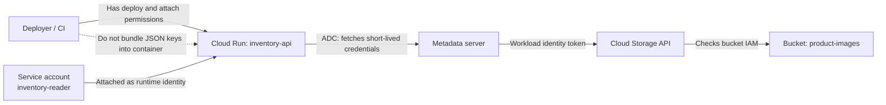
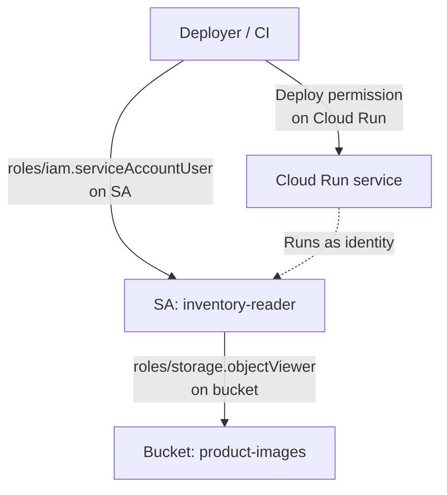
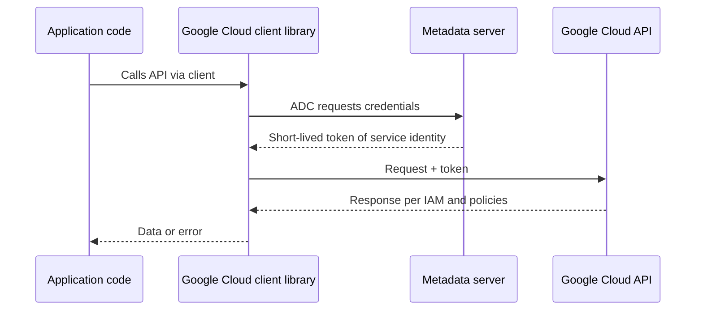

# Service accounts and the application identity lifecycle

When an application running on Google Cloud needs to read an object in Cloud Storage, query BigQuery, publish messages to Pub/Sub, or access Secret Manager, it must have an **identity** so Google Cloud knows *who is calling the API*. That identity must be granted **appropriate permissions** to answer *what it is allowed to do*. The core mechanism workloads use for this is a **service account**.

This lesson belongs to the **IAM and authentication** chapter of the `CLOUD_PROVIDERS_GCP` module. Along the journey exploring Google Cloud from organizations, projects, IAM, and VPCs to Compute Engine, GKE, Cloud Run, storage, databases, release automation, reliability monitoring, and cost, service accounts are the link connecting **running code** with **resource access permissions**. Good identity design reduces credential leak risk, limits blast radius upon compromise, and keeps applications operable from deployment through retirement.

## 1. Learning objectives

After this lesson, you can:

1. Distinguish a **service account**, user account, service agent, and workload identities.
2. Explain why a service account is both a **principal** granted permissions and a **resource** others can be permitted to use or administer.
3. Separate granting permissions **for a service account to access resources** from granting permissions **for a person or runner to attach/impersonate a service account**.
4. Choose the right authentication approach for Cloud Run, Compute Engine, GKE, local developer workstations, and CI/CD outside Google Cloud.
5. Leverage **Application Default Credentials (ADC)**, the metadata server, impersonation, and Workload Identity Federation to reduce reliance on long-lived JSON keys.
6. Practice creating a single-purpose service account, granting read access on the exact bucket, attaching it to a test workload, and verifying results.
7. Plan the entire lifecycle: **design → create → grant → use → monitor → modify → disable → delete/undelete**.

## 2. Context: why do applications need their own identities?

Consider an `inventory-api` application running on Cloud Run. The application only needs to list objects in a bucket to compile a product catalog; it does not need to create VMs, delete buckets, or edit IAM. The deployer might be a developer or a CI/CD pipeline, yet **the deployer's permissions should never become the application's runtime permissions**.

Three actors in the same deployment flow serve different purposes:

| Actor | Task to perform | Typical identity |
| --- | --- | --- |
| Administrator / CI/CD | Create service account, grant permissions, deploy service | User account or dedicated deployment identity |
| Workload `inventory-api` | List objects in bucket while handling requests | Runtime service account holding only required object read permissions |
| Google Cloud platform | Orchestrate Cloud Run resources and internal service APIs | Google Cloud-managed **service agents** when required by the product |

If a single highly privileged service account is shared by deployers and all applications, a vulnerability in one workload can allow calling APIs far beyond its intended job. Sound design separates identities by **intended purpose and trust boundary**.



This diagram highlights the **logical path**. When code calls an API using a client library, the library typically looks up credentials via ADC; in Cloud Run, the environment supplies credentials for the service identity. Authentication and IAM checks happen inside Google Cloud infrastructure, not via role-checking code written by the application itself.

## 3. What is a service account?

A **service account** is an identity in Google Cloud IAM intended for workloads or automated processes. Unlike a user account tied to a human, a service account is usually tied to a specific application, service, or job.

Example service account created by an admin team:

```text
inventory-reader@sample-project.iam.gserviceaccount.com
```

Where:

- `inventory-reader` is the ID chosen by the creator.
- `sample-project` is the **project ID owning the service account**; a service account is created inside a project and cannot be moved to another project after creation.
- The email address is the standard identifier in configs, IAM members, and the CLI; each service account also has its own **unique ID**.

A service account **is not a Google Workspace user**, has no interactive password like a personal account, and does not require a specific employee as an owner. A service account's permissions come from **IAM policy bindings** and associated conditions/rules, never automatically upon creation.

### 3.1. Distinguishing similar identities

| Type | Who creates/manages | Purpose | Notes |
| --- | --- | --- | --- |
| **User account** | Organization/user | Employees signing in, administering, developing | Never use personal credentials as a production application's long-term identity |
| **User-managed service account** | App or admin team | Dedicated identity for services, jobs, VMs, pipelines | Preferred for workloads with specific permissions |
| **Default service account** | Created by Google Cloud when enabling/initializing certain services | Default identity for certain workloads | Audit historical roles; avoid default use if overly broad |
| **Service agent** | Managed by Google Cloud for a service | Google Cloud service performing internal operations | Never delete/alter permissions without understanding product dependencies |
| **Kubernetes ServiceAccount (KSA)** | Kubernetes/GKE | In-cluster Kubernetes identity for Pods | Distinct from IAM service accounts; can link via Workload Identity Federation for GKE |
| **Federated workload principal** | Verified via identity federation | Workloads outside GCP or inside GKE accessing resources | Some flows bind IAM directly to this principal; others impersonate an IAM service account |

For example, the Compute Engine default service account typically looks like:

```text
PROJECT_NUMBER-compute@developer.gserviceaccount.com
```

**`PROJECT_NUMBER` differs from `PROJECT_ID`.** Some default service accounts historically received `roles/editor` automatically in older projects or when org policy allowed it. Never assume every current project grants Editor; inspect the actual IAM policy and the `iam.automaticIamGrantsForDefaultServiceAccounts` constraint. Prefer a user-managed service account with narrow roles.

## 4. Key insight: a service account is both a principal and a resource

This is the root cause of many IAM errors and also where over-privileging happens most easily.

### 4.1. Service account as a principal: “what can it do?”

When a service account acts as a **principal**, IAM bindings on buckets, secrets, topics, or projects decide which actions the service account can perform.

Example:

```text
Resource: gs://product-images
Member:   serviceAccount:inventory-reader@sample-project.iam.gserviceaccount.com
Role:     roles/storage.objectViewer
```

This binding allows the `inventory-reader` identity to exercise permissions provided by the role on **that bucket**. It **does not** grant a developer permission to impersonate `inventory-reader`, nor does it automatically attach this service account to Cloud Run.

### 4.2. Service account as a resource: “who is allowed to use it?”

The service account itself is an **IAM resource** with its own policy. You can grant a user or deployment identity permission to attach or impersonate the service account.

Example:

```text
Resource: inventory-reader@sample-project.iam.gserviceaccount.com
Member:   user:developer@example.com
Role:     roles/iam.serviceAccountUser
```

This binding enables the user to **attach the service account to a resource** when they also hold sufficient permissions to create/edit the target resource. It does not directly grant `roles/storage.objectViewer` to the user; the user deploys so the workload runs under the attached identity.



### 4.3. Easily confused roles

| Role | Granted on which resource? | Primary purpose | Do not confuse with |
| --- | --- | --- | --- |
| `roles/iam.serviceAccountUser` | Service account | Includes `iam.serviceAccounts.actAs`, allowing attaching the SA when holding workload modification rights | **Does not** automatically permit minting access tokens via `--impersonate-service-account` |
| `roles/iam.serviceAccountTokenCreator` | Service account | Can create short-lived credentials, sign blobs/JWTs, and impersonate depending on operation | Not a deployment-only role |
| `roles/iam.serviceAccountAdmin` | Service account or suitable admin scope | Manages service account metadata and lifecycle | Not a role an application needs to read a bucket |
| `roles/storage.objectViewer` | Bucket or scope containing buckets | Lets a principal view/list objects per role permissions | Grants no rights to attach or impersonate an SA |
| `roles/run.developer` and related deploy roles | Cloud Run/project or supported resource | Manages deployments within permitted scope | Does not replace `iam.serviceAccounts.actAs` when selecting a runtime SA |

**Security impact:** anyone permitted to impersonate a service account can act with that service account's access rights. Anyone permitted to attach a privileged service account to a workload can indirectly exercise its permissions via code running on that workload. Therefore, roles on **service account resources** must be governed just as strictly as roles granted to the service account itself.

You can apply **IAM Conditions**, context-based restrictions, and supported organization policies to tighten controls. Design these per resource type and permission; never assume every condition works across all APIs.

## 5. The application identity lifecycle

A service account's lifecycle starts **before the application runs** and continues until all dependencies, permissions, and credentials are safely revoked.

| Stage | Decisions / tasks | Evidence to retain |
| --- | --- | --- |
| **1. Design** | Which app needs an identity? Which APIs/permissions are mandatory? Which environment? | Owner, purpose, target resources, permission matrix |
| **2. Create** | Choose owning project, ID/description, naming convention | Email, unique ID, project, management labels if any |
| **3. Grant** | Bind narrow roles on target resources; grant attach/impersonate rights to the right actors | IAM bindings, justification, approver |
| **4. Attach runtime** | Attach to Cloud Run/VM, configure GKE workload or Federation for CI | Deployment revision config, environment |
| **5. Operate** | Monitor API calls, IAM policies, credential usage, 403 errors, permission changes | Audit logs, auth metrics, alerts |
| **6. Modify / rotate** | Adjust permissions as app evolves; rotate keys if keys are unavoidable | Cutover plan, test results |
| **7. Decommission** | Find dependencies, migrate workloads, disable first, observe, delete once certain | Dependency list, zero-usage evidence, deletion schedule |
| **8. Recover if needed** | Re-enable a disabled account or undelete within the supported window | Incident/change record, access verification |

Never use creation date or email name as proof a service account is no longer needed. A service account may be used by quarterly workloads, infrequent batch jobs, or disaster recovery runbooks.

## 6. Designing a single-purpose service account

Before creating any identity, build an **access matrix** from actual duties:

| Workload | Target resource | Required action | Reference role |
| --- | --- | --- | --- |
| `inventory-api` on Cloud Run | Bucket `product-images` | List/read objects | `roles/storage.objectViewer` on bucket |
| `orders-worker` on Cloud Run Jobs | Pub/Sub topic `new-orders` | Publish messages | `roles/pubsub.publisher` on topic |
| `billing-report` batch job | Reporting BigQuery dataset | Query data | Job permissions and data read permissions per BigQuery model |
| Internal `secrets-reader` | One Secret Manager secret | Access secret versions | `roles/secretmanager.secretAccessor` on secret |

These examples are illustrative only. For BigQuery, job creation rights and data read rights may live on different resources; verify role definitions, dataset locations, and actual product requirements. For Secret Manager, restrict permissions to the **specific secret** rather than the whole project whenever possible.

Scope selection principles:

1. **Separate by workload and environment.** `api-dev` and `api-prod` should have distinct identities. Never use a single “all-apps” SA system-wide without strict justification.
2. **Minimize permissions.** Prefer specialized roles and bind on the smallest target resource supported by the service.
3. **Separate deployment permissions from runtime.** CI may need deploy permissions, whereas the container only needs business runtime permissions.
4. **Restrict impersonation rights.** Grant `Token Creator` only to actors that genuinely need to mint short-lived credentials.
5. **Avoid static credentials when alternatives exist.** On Google Cloud, prefer runtime-attached service identities; externally, prefer federation.
6. **Record a clear owner.** Service accounts do not automatically have an “employee owner”; ops records must identify the accountable team, application, and review date.

The rule “one service account per workload” is a guideline, not a hard API constraint. When one application has multiple jobs with vastly different permission needs, **each sensitive function** may warrant its own SA.

## 7. How do applications actually obtain credentials?

### 7.1. ADC decouples code from credential origin

**Application Default Credentials (ADC)** is the default credential lookup strategy supported by many Google Cloud client libraries. When an application calls an API, the library searches for credentials in priority order:

1. The `GOOGLE_APPLICATION_CREDENTIALS` environment variable, if set and pointing to a valid credential config file.
2. Local development credentials created by `gcloud auth application-default login`, if present.
3. Credentials from the **metadata server** of a Google Cloud workload with an attached service account, if available.

This order is a **lookup sequence**, not a security ranking. A file referenced by `GOOGLE_APPLICATION_CREDENTIALS` can be a **Workload Identity Federation configuration**, not necessarily a service account private key. If an app runs on Cloud Run while still setting this environment variable to an unnecessary JSON key, code may bypass the runtime credential, increasing risk and causing unexpected permission errors.

The `gcloud auth login` command authenticates **the CLI for a human user**; `gcloud auth application-default login` sets up **local ADC for application libraries**. Both maintain separate files/configs and cannot be treated as one.

### 7.2. Metadata server and short-lived credentials

When a Cloud Run service has a user-managed SA attached, the workload uses the metadata server to obtain tokens representing that SA; client libraries typically handle fetching and refreshing tokens. There is no need to place separate key files inside images or repositories.



Security note: any code running inside the same workload trust boundary that can access runtime credentials can invoke the APIs permitted to that SA. **Minimizing SA permissions** remains the primary safeguard to limit blast radius if the application is compromised.

### 7.3. Authentication patterns by runtime environment

| Environment | Preferred approach | Avoid |
| --- | --- | --- |
| **Cloud Run service/job** | Attach user-managed service account as service identity; code uses ADC | Putting JSON private keys in images, Secret Manager, or source code unnecessarily |
| **Compute Engine VM** | Attach SA to VM and use metadata server/ADC; check VM IAM and access scopes | Long-lived user accounts inside startup scripts |
| **GKE** | Workload Identity Federation for GKE, granting permissions to Kubernetes workloads/KSAs or linking IAM SAs as needed | Placing a JSON key in a Kubernetes Secret shared by all pods |
| **Developer workstation** | User ADC or ADC with service account impersonation for appropriate testing | Copying service account private keys between employees |
| **CI/CD outside GCP** | Workload Identity Federation with trusted identity provider; impersonation if needed | Long-lived JSON keys in CI variables |
| **Legacy runtime lacking federation/metadata support** | Evaluate short-lived credential brokers or key controls as an exception | Generating keys by default for every app |

**GKE note:** a Kubernetes ServiceAccount and an IAM service account are two distinct objects. Workload Identity Federation for GKE lets Kubernetes workloads be recognized by Google Cloud as principals and receive IAM directly on supported resources; where compatibility or alternative design requires it, **IAM service account impersonation** can be used. Giving a KSA the same name as an IAM SA email does not link them automatically.

**Compute Engine note:** some VM configurations also carry **OAuth access scopes**. Effective access must satisfy both IAM and appropriate scope limits, so a VM with valid IAM can still be denied if access scopes are too narrow. When using the `cloud-platform` scope where recommended, continue enforcing permissions via IAM.

## 8. Practice: creating a bucket-read-only identity for Cloud Run

This lab assumes you are authorized to administer a **practice project**, have a **private bucket** with test data, and have a test Cloud Run service. Write operations are clearly marked; **run only after replacing placeholders and confirming target resources**. No JSON keys need to be created.

### 8.1. Set variables and verify inputs (read-only)

In Bash on Cloud Shell or a workstation with the Google Cloud CLI:

```bash
# Replace values with your LAB project and bucket.
PROJECT_ID="YOUR_PROJECT_ID"
BUCKET="YOUR_PRIVATE_LAB_BUCKET"
REGION="asia-southeast1"
CLOUD_RUN_SERVICE="inventory-api"

SA_ID="inventory-reader"
SA_EMAIL="$SA_ID@$PROJECT_ID.iam.gserviceaccount.com"

gcloud auth list
gcloud config get-value project

# Verify the project exists and the active account can view it.
gcloud projects describe "$PROJECT_ID" \
  --format="value(projectId)"

# List existing service accounts (read-only).
gcloud iam service-accounts list \
  --project="$PROJECT_ID" \
  --format="table(email,displayName,disabled)"

# Inspect the lab bucket (read-only).
gcloud storage buckets describe "gs://$BUCKET"
```

Pass the project ID explicitly to avoid confusion with default config. If the project, bucket, or Cloud Run service does not exist yet, provision the prerequisites per your permissions and process before continuing; never switch to a production project.

### 8.2. Create the service account (modifies project)

Pick a **user-managed** SA whose name reflects its duty. If the email already exists, check whether it is currently in use rather than recreating arbitrarily.

```bash
gcloud iam service-accounts create "$SA_ID" \
  --project="$PROJECT_ID" \
  --display-name="Lab inventory reader"
```

Verify the result:

```bash
gcloud iam service-accounts describe "$SA_EMAIL" \
  --project="$PROJECT_ID" \
  --format="yaml(email,uniqueId,displayName,disabled)"
```

**Do not grant Editor, Owner, or Storage Admin just to make the lab pass.** A new service account should receive only the exact working permissions, never “just-in-case” elevated roles.

### 8.3. Grant role on the bucket, not across the project

The task requires the workload to **list and read objects** in `BUCKET`. `roles/storage.objectViewer` should be placed on the **target bucket** when aligned with security requirements.

Before modifying, inspect the current policy (read-only):

```bash
gcloud storage buckets get-iam-policy "gs://$BUCKET"
```

After confirming it is the lab bucket and the exact identity, **the following command modifies bucket IAM**:

```bash
gcloud storage buckets add-iam-policy-binding "gs://$BUCKET" \
  --member="serviceAccount:$SA_EMAIL" \
  --role="roles/storage.objectViewer"
```

Readback:

```bash
gcloud storage buckets get-iam-policy "gs://$BUCKET"
```

To understand the difference, compare with the command below **for illustration only—do not run**:

```bash
# DO NOT run in the lab: overly broad if the app only needs one bucket.
gcloud projects add-iam-policy-binding "$PROJECT_ID" \
  --member="serviceAccount:$SA_EMAIL" \
  --role="roles/storage.objectViewer"
```

A project-level role can apply to many resources in the project via inheritance, wider than “read only one bucket”. In practice, access can still be constrained by deny policies, principal access boundaries, IAM Conditions, or service rules; always verify effective permissions for the exact API called.

### 8.4. Attach the service account to Cloud Run (modifies workload)

The operator needs **permission to update the Cloud Run service** plus `iam.serviceAccounts.actAs` on the SA, typically via `roles/iam.serviceAccountUser` on the SA. These two are **deployer permissions**, separate from the application's `roles/storage.objectViewer`.

Before making changes, inspect the current Cloud Run service:

```bash
gcloud run services describe "$CLOUD_RUN_SERVICE" \
  --project="$PROJECT_ID" \
  --region="$REGION" \
  --format=yaml
```

After confirming this is the lab service, run the **update command that takes real effect**:

```bash
gcloud run services update "$CLOUD_RUN_SERVICE" \
  --project="$PROJECT_ID" \
  --region="$REGION" \
  --service-account="$SA_EMAIL"
```

Changing a Cloud Run service identity can create a new revision and immediately affect traffic once rolled out. For critical applications, plan rollouts, testing, and rollbacks just like any other runtime configuration change.

Readback:

```bash
gcloud run services describe "$CLOUD_RUN_SERVICE" \
  --project="$PROJECT_ID" \
  --region="$REGION" \
  --format=yaml
```

Locate the service account configuration in Cloud Run's template/revision details. Do not confuse the **deploy command caller**, the **Cloud Run service identity**, and the platform **service agent**.

### 8.5. Code using ADC without a service account key

Python example using the Google Cloud Storage client library (requires `google-cloud-storage` installed in the application environment):

```python
from google.cloud import storage

BUCKET = "YOUR_PRIVATE_LAB_BUCKET"

# Do not load key files or hardcode fixed credentials.
client = storage.Client()

for blob in client.list_blobs(BUCKET, max_results=10):
    print(blob.name)
```

On Cloud Run, the library receives credentials from the service identity via ADC. Outcomes depend on IAM, bucket state, API enablement, networking, and other conditions. If it returns `403 PERMISSION_DENIED`, do not rush to add Editor; verify the service identity, bucket, and exact missing permission.

### 8.6. Testing impersonation during local development

If you want to **test a command as the SA identity without downloading a private key**, an operator can use `--impersonate-service-account`. They need permission to **mint short-lived credentials for the SA**, usually via `roles/iam.serviceAccountTokenCreator` on that exact service account.

```bash
# Read-only; assumes the user has been granted impersonation permission.
gcloud storage ls "gs://$BUCKET" \
  --impersonate-service-account="$SA_EMAIL"
```

Important distinction: `roles/iam.serviceAccountUser` suffices for many **attach** scenarios, yet is **not** enough for a user to use gcloud's impersonation flag. `Token Creator` is stronger because it allows exercising the SA's permissions via short-lived credentials; do not grant it to everyone merely for testing convenience.

For client libraries in local development, ADC with impersonation can be configured via supported commands and environments, which is **local ADC** configuration separate from `gcloud auth login`. Check relevant documentation before picking a test flow.

## 9. How to tell which identity a workload is using

**Never rely solely on the fact that a service account exists.** You must verify which identity is attached to the workload and which credentials are actually used to call APIs.

### 9.1. Inspecting configuration

- **Cloud Run:** check the service identity in service/revision config or via `gcloud run services describe`.
- **Compute Engine:** check the VM's `serviceAccounts` property and related access scopes.
- **GKE:** check the Kubernetes ServiceAccount used by the Pod, Workload Identity Federation for GKE policies, and configured IAM bindings or impersonation.
- **CI/CD:** check the runner identity and Workload Identity Federation binding; never guess what role a pipeline runs with from its pipeline name.

### 9.2. Checking IAM policies in the right place

Two questions require checking two different policy locations:

| Question | Policy to inspect |
| --- | --- |
| “Which buckets can `inventory-reader` read?” | IAM policies of the bucket/project/organization plus Cloud Storage-related rules |
| “Who can impersonate or attach `inventory-reader`?” | IAM policy on the **service account** plus parent policies that could grant applicable rights |

Example fetching the policy **on the service account resource**:

```bash
gcloud iam service-accounts get-iam-policy "$SA_EMAIL" \
  --project="$PROJECT_ID"
```

This command **is not** a complete list of roles the SA holds on buckets, secrets, or other projects. To find those bindings, inspect IAM policies on the target resources or use an appropriate permission analysis tool.

### 9.3. Troubleshooting 403 errors

When a client library reports `PERMISSION_DENIED`:

1. Confirm **which credential** ADC selected; check for unintended `GOOGLE_APPLICATION_CREDENTIALS` or local ADC overrides.
2. Confirm the SA/identity actually attached to the workload and the active running revision.
3. Confirm the API, target project, bucket/dataset/topic/secret, and resource name.
4. Look up the **permissions** required by the API, then check policies on the target resource and relevant denies/conditions.
5. If the failure occurs during deployment, separate **SA attach permission** errors from **runtime API call permission** errors.
6. After fixing the exact needed permission, retry the smallest test case and inspect audit logs/app output to confirm.

**A 403 error does not always mean “missing role on the service account”.** It could be missing permission on the **resource**, a deny policy, access scope limits, wrong credentials, or another blocking policy.

## 10. Monitoring permissions and usage in operations

Application identities are lifecycle assets, so permissions cannot be “grant once and forget”.

### 10.1. What to document

- Application name and environment using the SA; owning project.
- Target resources and granted permissions/roles; business justification.
- People/runners allowed to attach or impersonate.
- Linked workload/job config, batch schedules, and accountable owner.
- List of user-managed keys if any; rotation schedule and secure storage location.
- IAM changes, auth failures, anomalous access patterns, and periodic review outcomes.

### 10.2. Observability sources and limits

**Cloud Audit Logs** can help track admin operations or data access depending on log type, service, permissions, and log enablement/retention settings. Never assume all data calls are fully logged without checking **Data Access audit logs**, product behavior, and retention policies.

**IAM Recommender**, Service Account Insights, Policy Analyzer, and equivalent analysis tools can help spot excess permissions or low-usage service accounts. These are **signals**, not absolute proof a workload no longer needs an identity: infrequent batch jobs, disaster recovery pipelines, and paused apps may show no recent activity.

For critical resources, set up alerts for permission changes, unexpected private key creation, unusual impersonation calls, spikes in auth errors, and leaked credential detections where supported by your services and monitoring tools.

## 11. Service account private keys and safer alternatives

A service account can hold multiple credential types. **User-managed keys** require the utmost caution because private key files can be copied, leaked, and used outside intended environments.

| Option | Characteristics | Assessment |
| --- | --- | --- |
| Runtime service identity + metadata server | No private key distribution needed; short-lived credentials issued to workload | **Preferred** when running on supported Google Cloud services |
| Service account impersonation | Authenticated identity obtains short-lived SA credentials with proper permissions | **Preferred** for CLI/CI actions needing to act as an SA |
| Workload Identity Federation | Exchanges proof from an identity provider outside GCP/GKE for Google Cloud access | **Preferred** for workloads without a directly attached runtime SA |
| User-managed JSON key | Long-lived key usable by anyone who obtains the file | **Exception only** when alternatives cannot work; requires strict governance |
| Google-managed key | Managed by Google Cloud in supported product flows | Does not mean users can download a private key |

**Organization policies** can block creating or uploading service account keys. Depending on when your organization was created and current configs, these constraints may be enforced by default. Never try to bypass policies by using another project without authorization.

If a user-managed key is strictly unavoidable:

1. Document clearly why federation, impersonation, or runtime identity cannot apply.
2. Issue the key through an approved process; never commit to Git, Docker images, public artifacts, or share via chat/email.
3. Store in a proper secret manager, restrict readers, and monitor usage.
4. Maintain a **rotation** schedule: issue new key, migrate workload to new key, verify, then disable/delete old key.
5. Watch leak alerts, review short-term usage/permissions, and keep an incident response plan.

**Disabling or deleting a key does not necessarily revoke already-issued short-lived access tokens derived from that key immediately.** In severe incidents, you may need to disable or delete the entire service account to halt identity usage while accepting the impact on dependent workloads. That decision belongs to incident response and must account for all apps using the SA.

## 12. Adapting service accounts as applications evolve

Suppose `inventory-api` initially only reads objects, and later needs to publish events to Pub/Sub.

Controlled approach:

1. Identify the exact **Pub/Sub topic** and publish permission needed.
2. Grant `roles/pubsub.publisher` to the same SA **on that exact topic** if it remains a reasonable duty of the app; or split out a separate worker with an independent SA if the new function warrants isolation.
3. Deploy application code and test real publishing with a test payload.
4. Watch for `PERMISSION_DENIED` and inspect Cloud Audit Logs to confirm the workload uses the right service identity.
5. Review obsolete roles and revoke them cleanly.

Never broaden permissions to something like `roles/editor` because a deployment hit an error. That quickly leads to **privilege accumulation**: after several quick fixes, a small SA grows into an identity with near-project-wide access.

When migrating a workload from an old SA to a new SA, update both **runtime configuration** and **target resource policies**, roll out via canary/revision testing, and only then revoke old permissions. Changing an email in an environment variable does not create IAM bindings or switch runtime identities.

## 13. Decommissioning, disabling, and safely deleting

A service account once used in production may still be tied to batch jobs, infrequently accessed services, or recovery workflows. Deleting it immediately can break API calls even while deployments and infrastructure appear healthy.

### 13.1. Recommended decommission workflow

1. **Build a dependency inventory:** Cloud Run services/jobs, VMs, GKE workloads, CI runners, DR plans, IaC, and all related policy grants/impersonations.
2. **Migrate workloads:** attach replacement SAs where needed, test functionality, and verify API access paths.
3. **Check activity:** combine logs/insights with application owners; never rely solely on last-used timestamps.
4. **Disable in a controlled way:** this step has real impact; monitor errors long enough to cover operational schedules (Google Cloud recommends at least an observation window after disabling before deletion).
5. **Recover if a dependency surfaces:** re-enable the SA within the incident window, then fix the root cause.
6. **Delete once certain:** record deletion date, approver, and plan for cleaning up IAM bindings/credentials.
7. **Post-deletion review:** confirm no workloads or configs still depend on that identity.

**Disabling** an SA causes requests using that identity and credential issuance for that SA to fail; this can cut off access for live services. **Deleting** an SA is stronger: per Google Cloud docs, undeletion is usually possible only within **30 days after deletion** and subject to conditions, such as the name not having been reused by a new SA.

### 13.2. Reference commands (do not run on live serving systems)

Check status first (read-only):

```bash
gcloud iam service-accounts describe "$SA_EMAIL" \
  --project="$PROJECT_ID" \
  --format="yaml(email,uniqueId,disabled)"
```

Only when approved in an identity retirement plan and workloads have migrated, **this command disables the live SA**:

```bash
gcloud iam service-accounts disable "$SA_EMAIL" \
  --project="$PROJECT_ID"
```

If an unexpected dependency emerges and recovery is authorized:

```bash
gcloud iam service-accounts enable "$SA_EMAIL" \
  --project="$PROJECT_ID"
```

The deletion command below is **for recognizing the operation only—do not run in the lab**:

```bash
# ILLUSTRATION: removes ability to use the identity and requires a separate deletion workflow.
gcloud iam service-accounts delete "$SA_EMAIL" \
  --project="$PROJECT_ID"
```

**Recreating a service account with the same email is not restoration.** Google Cloud uses an internal unique ID; a new SA with the same name is a different principal and does not inherit the deleted SA's IAM bindings. By contrast, a valid `undelete` restores the same identity and preserves corresponding bindings.

In IAM policies, references to a deleted SA may temporarily appear with a `deleted:` prefix and a unique ID suffix. When cleaning up policies, take care not to confuse old and new principals simply because they share an email address.

### 13.3. Handle default service accounts with care

Some services fall back to a default service account if no other runtime identity is chosen. Deleting a default SA can break deployments or API calls and may prevent recreating it afterward. When unsure, **prefer planned disabling** over deletion; first migrate default workloads onto user-managed SAs with controlled IAM.

## 14. Common issues and root-cause tracing

| Symptom | Possible cause | Resolution |
| --- | --- | --- |
| Deployer can edit Cloud Run but cannot pick the SA | Missing `iam.serviceAccounts.actAs` on the SA | Check attach permissions and SA policy; do not grant Token Creator to fix this |
| Has `roles/iam.serviceAccountUser` yet `--impersonate-service-account` fails | `actAs` does not grant token creation | Requires appropriate permission such as `roles/iam.serviceAccountTokenCreator`, granted only to users who truly need impersonation |
| App returns 403 reading bucket despite successful deploy | Runtime SA lacks permission on bucket, or ADC uses a different identity | Check bucket policy and actual credentials |
| Works on dev laptop, fails on Cloud Run | Laptop uses user ADC; Cloud Run uses a different runtime SA | Test with the exact SA/impersonation and assign separate permissions |
| GKE Pod cannot call API | KSA, workload identity, IAM binding, or annotation/mapping misconfigured | Review Workload Identity Federation for GKE setup on the exact cluster |
| VM has IAM role yet API is denied | VM access scopes restrict it or credentials are wrong | Inspect IAM, scopes, and runtime credentials |
| Disabling one SA breaks multiple apps at once | SA shared across too many workloads | Re-enable to recover if authorized; split SAs per workload and migrate one by one |
| After recreating SA with same email, old roles “vanished” | New SA has a different unique ID | Use undelete when eligible; if a brand-new SA, grant roles and reconfigure cleanly |
| JSON key file leaked in repository | Long-lived key copied | Run incident response, disable/delete key, check tokens and permissions; purge from storage and review logs |

One foundational question speeds up triage: **is this an identity authentication failure, an SA usage permission failure, an SA resource permission failure, or a workload configuration failure?** Classifying correctly prevents granting overly broad roles.

## 15. Practice exercises

### Exercise 1 — Two sides of a service account

A developer is granted `roles/iam.serviceAccountUser` on `report-reader`. `report-reader` holds `roles/storage.objectViewer` on bucket `finance-reports`.

**Question:** can the developer run `gcloud storage ls ... --impersonate-service-account=report-reader` with only `Service Account User`? If granted permission to deploy a VM and attach `report-reader`, what could code on the VM do?

*Guided answer:* They cannot impersonate to fetch CLI tokens solely with `roles/iam.serviceAccountUser`; that requires appropriate short-lived credential creation rights. If the developer has deploy and attach rights, code on the VM can use the service identity to call APIs permitted to the SA, subject to runtime configuration/limits. This shows why permission to attach a privileged SA must be tightly governed.

### Exercise 2 — Choosing the right credential

A nightly Cloud Run job must read objects from a bucket. The team is considering creating a JSON private key to bake into the image.

**Task:** propose an alternative design.

*Guided answer:* Create a dedicated user-managed SA for the job; grant `roles/storage.objectViewer` on the target bucket; attach the SA as the Cloud Run Job's service identity; code uses ADC from the metadata server. No key needs to live in the image.

### Exercise 3 — CI/CD outside GCP

A pipeline from a Git provider outside Google Cloud needs to deploy Cloud Run. The team wants to avoid storing JSON keys.

**Task:** select an authentication approach and name two permission categories to separate.

*Guided answer:* Configure Workload Identity Federation with a trusted identity source, then grant appropriate permissions to the federated principal or allow impersonating a dedicated deployment SA. The deployer needs Cloud Run edit rights and usually `iam.serviceAccounts.actAs` on the runtime SA; if impersonating, it also needs short-lived token creation rights on the impersonated SA. The runtime SA's permissions to call application APIs are a separate scope.

### Exercise 4 — 403 after deployment

A Python app running on a developer laptop reads a bucket cleanly. The same code on Cloud Run returns `403`. A runtime SA is attached yet has no permissions on the bucket.

**Task:** identify the root cause and minimal fix.

*Guided answer:* ADC on the developer laptop and on Cloud Run use different principals. Grant the required object read permissions to the runtime SA **on the target bucket**, and verify the service identity and API. Never elevate the entire project to Editor.

### Exercise 5 — Accidental deletion and recreating with the same email

An SA `batch-runner` was deleted, and the team immediately created a new SA with the same ID only to find old permissions no longer work.

**Task:** explain why, and how to handle it next time.

*Guided answer:* The new SA has a different unique ID and is treated as a distinct principal. If still within the undelete window and the name has not been taken, restoring the old SA preserves the identity; if a new SA was already created, follow a controlled process to review and re-bind roles to the new principal. Before deleting, migrate workloads, disable cleanly, and monitor dependencies to avoid outages.

### Exercise 6 — Lifecycle review

A company has 50 service accounts, many showing no activity for 90 days yet used during semi-annual disaster recovery drills.

**Task:** should all SAs inactive for 90 days be deleted?

*Guided answer:* No. Inactivity insights are signals to investigate, not proof an SA is obsolete. Check owners, run schedules, DR dependencies, policies, and monitoring; only disable/delete via process after verification.

## 16. Application identity design checklist

- [ ] Each sensitive workload/functional group has an appropriate identity; no casual sharing of privileged SAs.
- [ ] Distinguished **deployer**, **runtime workload**, **service agent**, and **external-to-GCP principal** identities.
- [ ] Owning project, email, unique ID, business owner, and purpose documented for each SA.
- [ ] SA permissions on target resources are **minimum required**, at the narrowest feasible scope.
- [ ] **Attach** and **impersonate** permissions granted to the right actors without conflating the two roles.
- [ ] Google Cloud workloads use service identities/metadata server and ADC where supported.
- [ ] GKE, CI/CD, and external workloads evaluated for appropriate Workload Identity Federation.
- [ ] No JSON private keys created/stored when safer authentication options exist.
- [ ] Verified runtime uses the exact intended identity and IAM bindings sit on the exact resources.
- [ ] Logging, alerts, and lifecycle permission/credential reviews are in place.
- [ ] When changing permissions, run functional tests and inspect 403s, denies, conditions, and scopes.
- [ ] When retiring, check dependencies, disable/observe before deleting, and know undelete limits.

## 17. Official Google Cloud documentation

The pages below help verify CLI syntax, IAM permissions, and current product behavior:

- [Service accounts overview](https://cloud.google.com/iam/docs/service-account-overview): service accounts as principals and resources, identity types, and lifecycle.
- [Service account permissions](https://cloud.google.com/iam/docs/service-account-permissions): `Service Account User`, `Token Creator`, and permissions for attach/impersonate flows.
- [Attach service accounts to resources](https://cloud.google.com/iam/docs/attach-service-accounts): attaching runtime SAs and deployer permissions.
- [Application Default Credentials](https://cloud.google.com/docs/authentication/application-default-credentials): credential lookup order and metadata server source.
- [Cloud Run service identity](https://cloud.google.com/run/docs/securing/service-identity): runtime identity and calling APIs from Cloud Run.
- [Workload Identity Federation for GKE](https://cloud.google.com/kubernetes-engine/docs/concepts/workload-identity): identifying Kubernetes workloads to Google Cloud.
- [Best practices for using service accounts securely](https://cloud.google.com/iam/docs/best-practices-service-accounts): managing permissions, purpose, and low-usage identities.
- [Service account key management](https://cloud.google.com/iam/docs/best-practices-for-managing-service-account-keys): restricting, protecting, and rotating keys.
- [Delete and undelete service accounts](https://cloud.google.com/iam/docs/service-accounts-delete-undelete): disabling, deleting, restoring, and time limits.
- [Google Cloud IAM policy overview](https://cloud.google.com/iam/docs/policies): how IAM policies and bindings control access.

Always ask two separate questions for any service account: **“Who can attach or use this identity?”** and **“When this identity calls an API, what can it actually do?”** Combining those with controlled creation, monitoring, and revocation gives GCP applications the access they need without accumulating privileges or relying on hard-to-protect credentials.
