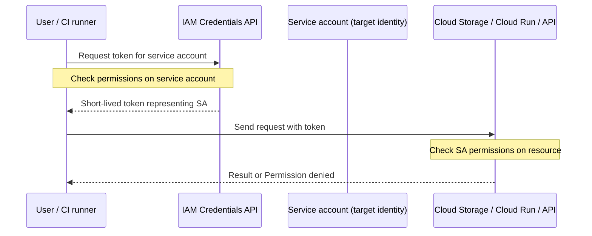

# Service account impersonation and short-lived credentials

> **Chapter:** IAM and authentication  
> **Module:** CLOUD_PROVIDERS_GCP  
> **Module scope:** Explore Google Cloud from project organization, IAM, and VPCs to Compute Engine, GKE, Cloud Run, storage services, and databases. Through deployment scenarios, learners practice selecting services, protecting resources, automating releases, and tracking reliability and cost.

When a developer needs to test an application's Cloud Storage access, or a CI/CD pipeline needs to deploy Cloud Run, downloading and sharing a service account's **JSON private key** is risky: keys can be copied, accidentally pushed to Git, or outlive the task they were created for. **Service account impersonation** lets an authenticated identity obtain **short-lived credentials** for a service account, acting within that service account's permissions, without issuing a private key to the caller.

This is a key technique in GCP IAM management. It helps learners practice the principle of **least privilege**, separate the actor initiating an action from the executing identity, and build safer release, resource access, and audit workflows.

## Learning objectives

After this lesson, you can:

1. Explain **service account**, **impersonation**, **OAuth 2.0 access token**, **OIDC ID token**, and how they differ from JSON service account keys.
2. Trace the permission path from **calling principal** → **token-creation permission on the service account** → **service account permissions on target resources**.
3. Distinguish **Service Account Token Creator**, **Service Account User**, **Service Account OpenID Connect Identity Token Creator**, and the role of Workload Identity Federation.
4. Use `gcloud --impersonate-service-account` to test a resource using a service account's permissions without storing long-lived keys.
5. Select the right credential type when calling Google Cloud APIs, Cloud Run, or running workloads on GKE/Compute Engine.
6. Identify IAM errors, inspect audits, and revoke impersonation rights at the end of a lab.

## 1. Starting from identities and permissions

In Google Cloud, a **principal** is an identity that can be granted IAM permissions: a user, group, service account, or other supported identity. A **service account** is an identity intended for applications or workloads; its address usually has the form:

```text
SERVICE_ACCOUNT_NAME@PROJECT_ID.iam.gserviceaccount.com
```

A service account plays two simultaneous roles:

- As a **principal**: it can be granted IAM roles on buckets, projects, databases, Secret Manager, or other resources.
- As a **resource**: it has its own IAM policy determining who is allowed to use, manage, or mint credentials representing that service account.

For example, a service account `app-reader@my-iam-lab-1234.iam.gserviceaccount.com` is granted `roles/storage.objectViewer` on **one test bucket**. A developer `student@example.com` holds only token-creation permission on that service account. The developer can use short-lived tokens to test reading objects as `app-reader`, without thereby gaining permission to delete objects or administer all resources in the project.

Two permission grants must be kept distinct:

1. **Who can impersonate the service account?** Decided in the IAM policy **of the service account**.
2. **What can the service account do?** Decided in the IAM policy **of the target resource** or inherited from organization/folder/project levels.

If a service account is granted overly broad permissions, anyone able to impersonate it can exercise those broad permissions too. Therefore, granting `roles/iam.serviceAccountTokenCreator` must be treated as a security decision with real impact.

## 2. How does impersonation work?



Step-by-step flow:

1. **Caller** (a user logged into `gcloud` or a workload with an identity) authenticates using its own credentials.
2. Caller requests the IAM Service Account Credentials API to mint credentials for the target service account. Google Cloud evaluates the corresponding permission, such as `iam.serviceAccounts.getAccessToken`.
3. The API returns a token with a **bounded lifetime**. The token represents the target service account and **contains no customer-managed private key**.
4. Caller uses the token to access the service. Google Cloud checks the roles granted to the **target service account** on the corresponding resource, along with applicable conditions/policies.
5. The token expires; to continue, the caller must request a new token, at which point impersonation permission is evaluated again. The token never becomes a long-lived key.

**Key point:** impersonation permission only allows **obtaining credentials**; permission to perform the actual operation still depends on the target service account's permissions at the destination. If the user lacks Token Creator rights, token minting fails; if the service account lacks bucket permissions, the Cloud Storage call fails.

### 2.1. Is impersonation the same as signing in with a service account key?

No. The two approaches produce very different operational consequences:

| Criterion | Service account impersonation | Customer-managed JSON service account key |
|---|---|---|
| Data issued to caller | Permission to call token-minting API; no private key issued | JSON file containing private key |
| Lifetime of final credential | Short-lived token, typically 1 hour max by default | Private key remains usable until disabled/deleted, depending on state |
| Refreshing credentials | Caller must still have impersonation rights and make a new request | Anyone holding the key can use it to request tokens within its granted scope |
| Exposure risk | Token can be abused until expiration; minting rights are a separate risk | Leaked private key creates prolonged access risk until the key is remediated |
| Audit | Token generation and subsequent actions can be traced when appropriate logs are configured | Hard to attribute which human used a shared copy of a key |
| Recommendation | Preferred when an authorized caller needs to run operations as an SA | Avoid creating keys when short-lived or workload identity options exist |

**Short-lived does not mean harmless:** an access token or ID token is still a sensitive bearer credential. Anyone who obtains a valid token can use it within the scope permitted by the token and the service account's roles. Never record tokens in logs, docs, chat, screenshots, or repositories.

## 3. Types of short-lived credentials

### 3.1. OAuth 2.0 access token

An **access token** is typically used to call Google Cloud APIs such as Cloud Storage, Compute Engine, Secret Manager, or supported management APIs. The token is attached to requests, usually in an HTTP header:

```http
Authorization: Bearer ACCESS_TOKEN
```

The API performs **authorization** based on the service account's identity, IAM, and related conditions. An access token is not a guarantee that all operations are permitted.

The IAM Credentials API supports `generateAccessToken` with a list of **OAuth scopes** and a `lifetime`. By default, the typical maximum lifetime is **3,600 seconds (1 hour)**; extending up to **12 hours** applies only when an organization policy permits it and supported invocation options are used. In standard practice, keep default/short lifetimes and do not extend them merely for convenience.

**Expired tokens come with no refresh token** in `generateAccessToken` responses. When calling the API directly, the application must invoke it again for a fresh token while the caller remains authorized. With `gcloud --impersonate-service-account`, the CLI handles credential retrieval for each command.

### 3.2. OpenID Connect (OIDC) ID token

An **ID token** is a token asserting **identity** per OpenID Connect, typically a JWT with claims such as issuer, subject, expiration, and especially **audience (`aud`)**. ID tokens are commonly used when calling **services that authenticate the caller**, such as a Cloud Run service allowing only identities granted invoke permissions.

For example, service A wants to call service B on Cloud Run:

1. Service A fetches an ID token whose `aud` matches the URL/audience accepted by service B.
2. Service A sends the ID token to service B.
3. Service B or its front-end auth layer validates the signature, audience, expiration, and invoke permission; if IAM is required, the SA identity must hold the matching role, such as `roles/run.invoker` on the service.

**Do not use an ID token in place of an access token across all Google Cloud APIs.** ID tokens identify caller and intended recipient; OAuth access tokens are normally used to call resource management APIs.

An ID token created with IAM Credentials API `generateIdToken` has a lifetime of roughly **1 hour**. The method requires `iam.serviceAccounts.getOpenIdToken` on the service account.

### 3.3. Signed JWTs, blobs, and commonly confused concepts

The IAM Credentials API also supports **signing JWTs or blobs** per granted permissions. That is distinct from requesting an OAuth access token or ID token; do not treat arbitrary signed JWTs as credentials for calling every service.

| Type | Primary use | What to verify |
|---|---|---|
| **Access token** | Calling supported Google Cloud APIs | OAuth scopes, resource IAM, token expiry |
| **ID token** | Proving identity to a specific receiving service | `aud`, issuer, expiry, invoke permission if applicable |
| **Signed JWT/blob** | Scenarios requiring signatures or custom-designed integrations | Format, verifying party, signing rights, and purpose |
| **API key** | Identifying an application for API-key-enabled APIs; does not represent an IAM service account | Key restrictions, API/quota, and other auth requirements |
| **SA JSON private key** | Self-signing credentials with a customer-managed key | Protection, lifecycle, revocation; avoid when better options exist |

## 4. Which IAM permissions are actually needed?

Similar-sounding roles **do not substitute for one another**:

| Role / permission | Core capability | When to use |
|---|---|---|
| `roles/iam.serviceAccountTokenCreator` | Mint access tokens, ID tokens; sign JWTs/blobs; supports certain delegation chains | Caller needs to impersonate an SA via `gcloud` or IAM Credentials API |
| `roles/iam.serviceAccountOpenIdTokenCreator` | Mint OIDC ID tokens via `iam.serviceAccounts.getOpenIdToken` | Only ID tokens are needed, without access-token minting or signing |
| `roles/iam.serviceAccountUser` | Includes `iam.serviceAccounts.actAs` to **attach** an SA to compatible resources | Allows deploying a VM, Cloud Run service, job, etc. with a runtime SA |
| `roles/iam.workloadIdentityUser` | Allows a supported workload identity to obtain SA credentials per federation config | Workload Identity Federation for GKE or matching federation scenarios |
| Role on bucket/Cloud Run/Secret Manager... | Permissions to operate on **target resources** | Granted to the **target SA** matching its exact job |

**Important:** `roles/iam.serviceAccountUser` **does not grant** `gcloud --impersonate-service-account`. The **actAs** permission lets you attach an SA to certain resources, whereas directly creating an access token requires `iam.serviceAccounts.getAccessToken`, typically found in `roles/iam.serviceAccountTokenCreator`.

Conversely, holding `roles/iam.serviceAccountTokenCreator` does not automatically grant permission to create VMs, edit Cloud Run, or access buckets if the target service account lacks the corresponding roles.

### 4.1. At what level should permissions be granted?

In a lab, grant Token Creator **directly on the specific service account**. Granting at the project level or higher can widen scope across many service accounts and increase privilege escalation risk.

```text
User: student@example.com
   │
   └── Token Creator solely on SA: app-reader@...iam.gserviceaccount.com
                │
                └── SA holds Storage Object Viewer on one lab bucket
                                │
                                └── Read/list objects in the lab bucket
```

This model constrains **which caller** can use **which SA** and **what actions** that SA can perform. Also review inherited permissions from organization, folder, and project levels, IAM conditions, and permissions of workloads that already attach the SA.

### 4.2. Trust boundaries in real-world systems

Example of a Cloud Run deployment pipeline:

- The pipeline identity is permitted to impersonate a **deploy SA**.
- The deploy SA is only permitted to release the services it manages and **actAs** the runtime SA as required by deployment architecture.
- The Cloud Run **runtime SA** only holds permissions to read secrets or write to the exact buckets needed by the application.

Separating the **deploy identity** from the **runtime identity** prevents application code from inheriting release-management privileges. Specific roles must be tailored by resource type and action rather than assigning Owner/Editor to every service account.

## 5. Preparing the practice lab: prerequisites and scope

This lab uses:

- A dedicated **Google Cloud practice project** where the learner is permitted to create a service account and update designated policies.
- An **existing test Cloud Storage bucket** holding only readable test data. This lesson **does not require creating a new bucket or sensitive data**.
- A user account logged into `gcloud` (or an eligible calling principal) to request tokens.
- An administrator authorized to configure IAM on the service account and bucket. Learners may need an admin to execute role-granting steps.
- **IAM API** and **Service Account Credentials API** enabled per project and organization requirements.

The commands below target **Cloud Shell or a Bash terminal** with the Google Cloud CLI. Values `my-iam-lab-1234`, `student@example.com`, and `my-existing-lab-bucket` are **placeholders** to replace with project/resource names you are authorized to use. If you lack permissions to create or grant roles, read through as an illustration and work with an administrator; **never grant broad roles to bypass organizational controls**.

### 5.1. Verify identity and target project

```bash
# Replace with your learning project and real caller account
PROJECT_ID="my-iam-lab-1234"
CALLER_EMAIL="student@example.com"
SA_NAME="app-reader-lab"
SA_EMAIL="$SA_NAME@$PROJECT_ID.iam.gserviceaccount.com"
BUCKET_NAME="my-existing-lab-bucket"

# View currently authenticated account in gcloud
gcloud auth list --filter="status:ACTIVE"

# Inspect target project before modifying IAM
gcloud projects describe "$PROJECT_ID" \
  --format="table(projectId,name,lifecycleState)"

printf 'Project: %s\nCaller: %s\nService account: %s\nBucket: %s\n' \
  "$PROJECT_ID" "$CALLER_EMAIL" "$SA_EMAIL" "$BUCKET_NAME"
```

**Verify:** the logged-in user must be the intended identity (or an authorized delegate); `CALLER_EMAIL` must **match the real identity** receiving Token Creator. Do not assume setting `CALLER_EMAIL` changes the active account authenticated in `gcloud`.

### 5.2. Check and enable required APIs

Someone with appropriate admin permissions can enable APIs in the project:

```bash
# View enabled APIs (read-only)
gcloud services list --enabled --project="$PROJECT_ID"

# Run only if APIs are not yet enabled and project edits are permitted
gcloud services enable \
  iam.googleapis.com \
  iamcredentials.googleapis.com \
  --project="$PROJECT_ID"
```

A `SERVICE_DISABLED` error or similar message indicates an API is not enabled; `PERMISSION_DENIED` can indicate missing `serviceusage.services.enable` or a blocking policy. Having permission to impersonate a service account does not mean having permission to enable project APIs.

## 6. Practice: create SA, grant permissions, impersonate, and verify

### Step 1 — Create a lab-only service account

Someone authorized to manage service accounts in the project can run:

```bash
gcloud iam service-accounts create "$SA_NAME" \
  --display-name="Read-only impersonation lab" \
  --project="$PROJECT_ID"

gcloud iam service-accounts describe "$SA_EMAIL" \
  --project="$PROJECT_ID" \
  --format="table(email,displayName,disabled)"
```

Do not download a JSON key; this lab **does not require** `gcloud iam service-accounts keys create`. If a service account with the same name already exists, verify its owner and use a separate authorized service account rather than modifying/deleting someone else's SA.

### Step 2 — Grant SA permissions on the test bucket

The bucket administrator grants object list/read permissions:

```bash
gcloud storage buckets add-iam-policy-binding "gs://$BUCKET_NAME" \
  --member="serviceAccount:$SA_EMAIL" \
  --role="roles/storage.objectViewer" \
  --project="$PROJECT_ID"
```

This role is granted **to the service account on the target resource**, not to the calling user. It allows the service account to access objects within the role's capabilities and other constraints; it does not permit deleting the bucket or administering the project.

**Checkpoint:** confirm `BUCKET_NAME` is a lab bucket with the right owner; the bucket can live in another project if your org granted valid access, though for a basic lab keeping it in the same project simplifies management and cleanup.

### Step 3 — Grant impersonation permission to the caller

Someone authorized to edit IAM policy **on the target SA** runs:

```bash
gcloud iam service-accounts add-iam-policy-binding "$SA_EMAIL" \
  --member="user:$CALLER_EMAIL" \
  --role="roles/iam.serviceAccountTokenCreator" \
  --project="$PROJECT_ID"
```

Command breakdown:

- `"$SA_EMAIL"` is the **protected resource**: the target service account.
- `--member="user:$CALLER_EMAIL"` is the principal allowed to request credentials.
- `--role="roles/iam.serviceAccountTokenCreator"` allows the caller to mint tokens and perform signing actions supported by the role. This role must be approved and tightly scoped.
- `--project="$PROJECT_ID"` identifies the project hosting the service account.

In Console, you can go to **IAM & Admin → Service Accounts → select service account → Permissions** and grant the appropriate principal/role. Do not confuse this with project-level IAM when the goal is only allowing impersonation of **one** service account.

### Step 4 — Use impersonation for a **single** gcloud command

From a `gcloud` session logged in as `CALLER_EMAIL`:

```bash
# This command accesses the bucket using the target SA's identity and permissions
gcloud storage ls "gs://$BUCKET_NAME" \
  --project="$PROJECT_ID" \
  --impersonate-service-account="$SA_EMAIL"
```

Expectations:

- If the caller holds Token Creator, required APIs are enabled, the SA has bucket access, and no other policy blocks it, object listing succeeds.
- If the caller lacks token-creation rights, the error occurs at the **impersonation step**, potentially citing `iam.serviceAccounts.getAccessToken`.
- If the token is minted yet the SA lacks read/list rights on the bucket, the command returns a **Cloud Storage permission denied** error. These are two distinct failure modes to diagnose separately.

The command only lists objects, **modifies nothing, and requires no private key**. The `--impersonate-service-account` flag applies to this command; the underlying logged-in identity remains the calling user.

### Step 5 — Illustrating access token generation

The Google Cloud CLI includes a command to print an access token on behalf of a service account:

```bash
# Fetch token without printing the bearer credential to terminal/logs
gcloud auth print-access-token \
  --impersonate-service-account="$SA_EMAIL" > /dev/null
```

Here we redirect output to `/dev/null` to avoid accidentally exposing the token in screenshots or copied logs. In real applications, client libraries typically handle fetching and refreshing tokens for you. If you must handle a token directly to call a REST API, treat it as a **secret** and protect it end to end.

The IAM Credentials API supports `generateAccessToken` with a request format like:

```http
POST https://iamcredentials.googleapis.com/v1/projects/-/serviceAccounts/SERVICE_ACCOUNT_EMAIL:generateAccessToken
Content-Type: application/json
Authorization: Bearer CALLER_ACCESS_TOKEN

{
  "scope": [
    "https://www.googleapis.com/auth/cloud-platform"
  ],
  "lifetime": "900s"
}
```

This is a **format template** for understanding the API, not a literal command to paste verbatim. `CALLER_ACCESS_TOKEN` is the requesting identity's token; `SERVICE_ACCOUNT_EMAIL` is the target SA. `900s` illustrates requesting a 15-minute token; the API may enforce policies and lifetime caps. A successful response returns `accessToken` and `expireTime`; never write this response to public logs.

### Step 6 — Diagnose permissions across two layers

```bash
# Check policy on the service account (which roles does the caller have on the SA?)
gcloud iam service-accounts get-iam-policy "$SA_EMAIL" \
  --project="$PROJECT_ID"

# Check policy on the bucket (what data access does the SA have?)
gcloud storage buckets get-iam-policy "gs://$BUCKET_NAME" \
  --project="$PROJECT_ID"
```

These two outputs are useful evidence yet **do not capture all effective permissions**: permissions can be inherited from organization/folder/project levels, or affected by IAM Conditions, deny policies, or other constraints. Never conclude from a single binding line that the final operation is guaranteed to succeed.

## 7. When to use an ID token instead of an access token?

Suppose a Cloud Run service accepts only authenticated requests at URL `https://SERVICE-REGION-PROJECT.a.run.app`. The calling service account must hold the corresponding invoke role (usually `roles/run.invoker` on the target service). The caller is authorized to mint ID tokens for that SA.

```bash
# Illustrative example: replace with valid URL/audience of target Cloud Run service
SERVICE_URL="https://SERVICE-REGION-PROJECT.a.run.app"

# Mint ID token with exact audience; suppress token value output
gcloud auth print-identity-token \
  --impersonate-service-account="$SA_EMAIL" \
  --audiences="$SERVICE_URL" \
  --include-email > /dev/null
```

In a live request to Cloud Run, the client sends the ID token in the Authorization header, and the receiving service validates identity, audience, and IAM invoker access. A token with the wrong audience can be rejected **even when** the role is right. Being able to mint an ID token also **does not prove** the caller holds permission to invoke the service.

If you only need to mint ID tokens, consider `roles/iam.serviceAccountOpenIdTokenCreator` on the SA rather than the broader Token Creator role. Meanwhile, using `gcloud --impersonate-service-account` for standard APIs requires access-token creation rights.

## 8. Impersonation, ADC, and workload identities

The credential retrieval methods below serve different purposes:

| Environment | Commonly suitable approach | Notes |
|---|---|---|
| **Developer using gcloud CLI** | Use `--impersonate-service-account` on specific commands | Requires Token Creator on the SA; makes explicit which commands run under the SA identity |
| **Local app using client libraries** | Application Default Credentials (ADC) configured with impersonation if supported by language/library | ADC for app libraries differs from gcloud CLI's logged-in identity |
| **Cloud Run runtime** | Attach appropriate service account to service/job; use platform-provided credentials | Normally requires no key file or manual minting via Token Creator |
| **Compute Engine VM** | Attach service account and obtain credentials from metadata server per platform mechanism | Restrict SA permissions and pay attention to VM API access scopes where applicable |
| **GKE workload** | Workload Identity Federation for GKE per supported model | Connects Kubernetes identity to Google Cloud permissions; avoid putting SA keys inside Pods |
| **CI/CD outside GCP** | Workload Identity Federation with trusted identity provider; impersonate SA when needed | Do not store long-lived JSON keys in CI secrets when suitable federation exists |

### 8.1. What is Application Default Credentials (ADC)?

ADC is the mechanism **Google Cloud client libraries** use to locate credentials in the environment. ADC and `gcloud auth login` serve different flows. Running a `gcloud` command with impersonation does not automatically make local application code use that same identity.

For languages/client libraries supporting impersonation in local ADC (e.g., **Go, Java, Node.js, and Python**, per their documentation), you can configure:

```bash
# Run only on a personal dev workstation when intentionally configuring ADC
gcloud auth application-default login \
  --impersonate-service-account="$SA_EMAIL"
```

This command **writes local ADC configuration** so compatible libraries can obtain short-lived credentials when running programs. It is not the default fit for every language, CI/CD environment, or shared machine. If you already have custom ADC settings, understand this change affects local apps using ADC; inspect and restore configuration afterward.

### 8.2. Attaching a service account to a workload differs from local impersonation

When deploying to Cloud Run, GKE, or VMs, software should obtain credentials from the platform-supported workload identity whenever possible. For example, a Cloud Run service with an attached **runtime service account** can use client libraries via ADC inside the runtime environment, avoiding putting keys in images.

Someone **deploying** a resource may need `iam.serviceAccounts.actAs` on the runtime SA; this permission commonly comes from `roles/iam.serviceAccountUser`. However, code executing as the runtime SA and the person deploying are two separate principals. Never grant broad Token Creator just to deploy if the operation only needs `actAs` and the corresponding resource create/update permissions.

### 8.3. How does federation differ from impersonation?

**Workload Identity Federation** lets a workload outside GCP (such as a CI runner) use an identity issued by a supported provider to access Google Cloud per trust mapping, replacing stored JSON keys. Some access flows perform **service account impersonation** after federation; others access directly using the federated principal if supported by the service.

**Workload Identity Federation for GKE** enables Pods/workloads to access Google Cloud with designed permissions tied to a Kubernetes service account or matching principal. Permission setup depends on whether you bind directly or impersonate an IAM service account. Never assume every Pod automatically receives project-wide access.

## 9. Securing credentials and limiting blast radius

A system using short-lived credentials can still be abused if IAM allows the wrong people to impersonate a privileged SA.

### Key principles

1. **Never issue private keys when platform credentials, federation, or impersonation can work.** Inventory and manage any legacy keys that still exist.
2. **Scope target SAs narrowly:** give each workload/pipeline its own dedicated SA; avoid sharing one SA with Owner/Editor across environments.
3. **Restrict impersonation rights:** grant to the exact principals **on the exact service account**; note Token Creator includes JWT/blob signing beyond token minting.
4. **Cap token lifetimes:** prefer default/short lifetimes; do not extend lifetime unnecessarily.
5. **Protect bearer tokens:** avoid putting them in config files, URL query strings, logs, issue trackers, public CI output, or shell history whenever possible.
6. **Separate environments:** keep production SAs and dev SAs distinct; test callers should never have permission to impersonate production SAs.
7. **Monitor audits:** track who minted credentials, when, for which SA, and what actions occurred on protected resources.
8. **Revoke permissions promptly:** delete unneeded impersonation bindings; remember **already-issued tokens can remain valid until expiry**.

### 9.1. How do audit logs assist investigations?

IAM can log short-lived credential generation events (such as `GenerateAccessToken` / `GenerateIdToken`) when **Data Access audit logs** are appropriately configured. Audit logs on target services can help identify executing identities and delegation info depending on the API, log entries, and logging configuration.

An investigation should verify:

- Which principal called the IAM Credentials API?
- Which **service account** was the token minted for, and at what time?
- Were any impersonation permissions granted or modified before the event?
- Which resources were subsequently accessed, in which project, and did calls succeed or fail?
- Were the required logs enabled, and is retention sufficient for analysis?

Never assume every event appears in logs by default: **Data Access audit logs may require explicit enabling**, and log viewing depends on the investigator's permissions. Logging and storage can also incur costs depending on service/configuration. Use Cloud Logging and IAM monitoring tools according to organizational policy.

### 9.2. When a caller's permission is revoked, what happens to old tokens?

Removing a Token Creator binding revokes the caller's ability to **request new tokens** (once the IAM change takes effect), yet already-minted tokens can keep working **until they expire**. Thus, when responding to a leaked token, evaluate the SA's permission scope, expiration time, API activity, and appropriate containment steps. Never treat removing a binding as instant revocation of all existing credentials.

## 10. Completing the lab and cleaning up created bindings

After verifying results, someone with IAM management rights should delete the test bindings created by the lab. Run only against **the dedicated lab SA and bucket** you verified; never remove roles used by other workloads.

```bash
# Re-verify identity and targets before removing bindings
printf 'Caller: %s\nSA: %s\nBucket: %s\n' \
  "$CALLER_EMAIL" "$SA_EMAIL" "$BUCKET_NAME"

# Remove impersonation permission solely for this caller on the lab SA
gcloud iam service-accounts remove-iam-policy-binding "$SA_EMAIL" \
  --member="user:$CALLER_EMAIL" \
  --role="roles/iam.serviceAccountTokenCreator" \
  --project="$PROJECT_ID"

# Remove SA read permission on the lab bucket
gcloud storage buckets remove-iam-policy-binding "gs://$BUCKET_NAME" \
  --member="serviceAccount:$SA_EMAIL" \
  --role="roles/storage.objectViewer" \
  --project="$PROJECT_ID"

# Re-check policies on SA and bucket to confirm lab bindings are gone
gcloud iam service-accounts get-iam-policy "$SA_EMAIL" --project="$PROJECT_ID"
gcloud storage buckets get-iam-policy "gs://$BUCKET_NAME" --project="$PROJECT_ID"
```

If the service account was created **solely for this exercise** and is no longer attached to any workload or resource, an authorized person can delete that SA after verifying. **Never delete shared SAs or application runtime SAs.** Similarly, keep the bucket if it existed prior to the lab and holds data belonging to other owners.

To confirm Token Creator was revoked, retry `--impersonate-service-account` under the exact caller after the IAM change propagates. Keep in mind the CLI/app may cache issued credentials; to verify **new token** issuance is blocked, account for cache state and token lifetime when interpreting results.

## 11. Common errors and diagnostic guidance

| Symptom | Possible cause | Appropriate action |
|---|---|---|
| `PERMISSION_DENIED` or missing `iam.serviceAccounts.getAccessToken` during impersonation | Caller lacks Token Creator on target SA, or blocked by IAM Condition/deny/other policy | Verify logged-in identity and SA policy; grant exact permission at narrow scope |
| `SERVICE_DISABLED` or API not found | IAM Credentials API not enabled in required project | Check `iamcredentials.googleapis.com` and API enablement permissions |
| Token minted successfully yet `gcloud storage ls` fails | SA lacks `storage.objects.list`/corresponding bucket permissions or hits another constraint | Inspect bucket policy and actual SA permissions; avoid granting Owner |
| `gcloud auth print-identity-token` succeeds yet Cloud Run rejects call | Wrong `aud`, SA lacks invoker role, or ingress/authentication misconfigured | Verify audience, IAM on the Cloud Run service, and network path |
| Has `roles/iam.serviceAccountUser` yet cannot impersonate | `actAs` permits attaching SA, not minting access tokens | Grant approved token-creation role if impersonation is truly needed |
| Command uses wrong identity | `gcloud` selected another account, or wrong project/SA | Check `gcloud auth list`, `PROJECT_ID`, and `SA_EMAIL` |
| Local app uses a different identity than gcloud command | ADC and gcloud CLI use different credential lookup paths | Check ADC config and library impersonation support |
| Token worked briefly then reports expired | Credential exceeded its lifetime | Mint a fresh token via supported mechanism; do not use long-lived keys to bypass expiry |
| Token minting logs missing | Data Access audit logs not enabled or lacking log view rights | Check logging policy, service settings, and retention |
| Permissions removed yet old request still succeeds | Previously issued token still valid | Wait for expiry, trim SA permissions if urgent, and inspect logs |

## 12. Four applied scenarios

### Scenario A — Developer needs to verify bucket permissions

A learner must confirm an application can only read objects in one GCP bucket. An admin creates a data-reading SA and grants Token Creator on that SA to the learner. The learner runs `gcloud storage ls --impersonate-service-account` to verify, then removes the binding. As a result, no JSON key is issued and no direct Storage Admin role is granted to the learner.

### Scenario B — CI/CD pipeline deploying Cloud Run

A pipeline outside GCP can use **Workload Identity Federation** to authenticate with a CI identity, then impersonate a deployment SA if required by architecture. The deploy SA can only update services within its scope; Cloud Run's runtime SA is granted Secret Manager and required data access. Control both **who can mint tokens for the deploy SA** and **which runtime SA the deploy SA can attach**.

### Scenario C — Cloud Run calling an authenticated internal API

Cloud Run service A needs to call service B, which accepts only authenticated callers. Service A's runtime SA is granted invoke permissions on service B, and the app obtains an ID token with audience B via platform mechanisms. An extra impersonation layer is unnecessary when the workload already has an appropriate identity and permissions.

### Scenario D — Token Creator mistakenly granted at project level

User `student@example.com` is granted Token Creator at the **project level** instead of on one lab service account. This permission can allow them to request credentials for many SAs, including privileged SAs. Remediation is assessing blast radius, removing the overly broad binding, replacing it with a binding on the specific SA, trimming target SA permissions, and auditing related logs.

## 13. Self-check questions

**1. Does service account impersonation require creating a JSON service account key?**  
**Answer:** no. The caller authenticates with its own identity, is granted permission to mint short-lived credentials for the SA, and uses those credentials to call services.

**2. A caller holds Token Creator on an SA, yet the SA has not been granted bucket read rights. Can the caller read objects?**  
**Answer:** not solely via Token Creator. The caller can mint a token if conditions are met, yet the read request is evaluated against the SA's permissions on the bucket.

**3. Can `roles/iam.serviceAccountUser` be used with `--impersonate-service-account`?**  
**Answer:** no. This role primarily grants `actAs` to attach an SA to supported resources, not permission to create access tokens.

**4. When calling standard Google Cloud APIs, should you use an access token or an ID token?**  
**Answer:** usually an OAuth 2.0 **access token**. ID tokens are used for services verifying caller identity with a specific audience, such as Cloud Run.

**5. Why avoid extending access token lifetimes unnecessarily?**  
**Answer:** a leaked token can be used for as long as it remains valid. Shorter lifetimes shrink the abuse window, though they do not replace least privilege and credential protection.

**6. Does deleting Token Creator immediately invalidate all previously issued tokens?**  
**Answer:** not necessarily. Already-issued tokens can keep working until expiration; evaluate risk and inspect logs.

**7. Why is Token Creator on a privileged SA considered sensitive?**  
**Answer:** anyone granted the role can mint credentials to exercise the SA's permissions, and the role also supports signing operations. Risk scales with all permissions held by the target SA.

**8. Should a GKE Pod store an SA private key to call Google Cloud APIs?**  
**Answer:** prefer workload identity mechanisms supported by GKE/Google Cloud, such as Workload Identity Federation for GKE, with least privilege; consider keys only when no viable alternative exists and under strict policy controls.

## Key takeaways

- **Impersonation has two permission gates:** the caller must hold credential-minting rights on the SA, and the **SA must hold rights** on the target resource.
- **Access tokens** are standard for Google Cloud APIs; **ID tokens** prove identity to a specific audience; both must be protected.
- **Token Creator differs from Service Account User**: `getAccessToken` and `actAs` serve two distinct purposes.
- Prefer **short-lived credentials, workload identities, and federation** to minimize long-lived private keys while tightly scoping SA permissions and impersonation access.
- When troubleshooting, trace **caller → SA → target resource**, audit logs, and token lifetimes. Revoking permission to mint new tokens does not immediately invalidate old tokens.

## References

- [Google Cloud — Service account impersonation](https://cloud.google.com/iam/docs/service-account-impersonation)
- [Google Cloud — Use service account impersonation](https://cloud.google.com/docs/authentication/use-service-account-impersonation)
- [Google Cloud — Create short-lived credentials](https://cloud.google.com/iam/docs/create-short-lived-credentials-direct)
- [Google Cloud — Roles for service account authentication](https://cloud.google.com/iam/docs/service-account-permissions)
- [Google Cloud — Service account audit logs](https://cloud.google.com/iam/docs/audit-logging/examples-service-accounts)
- [Google Cloud — Application Default Credentials](https://cloud.google.com/docs/authentication/application-default-credentials)
