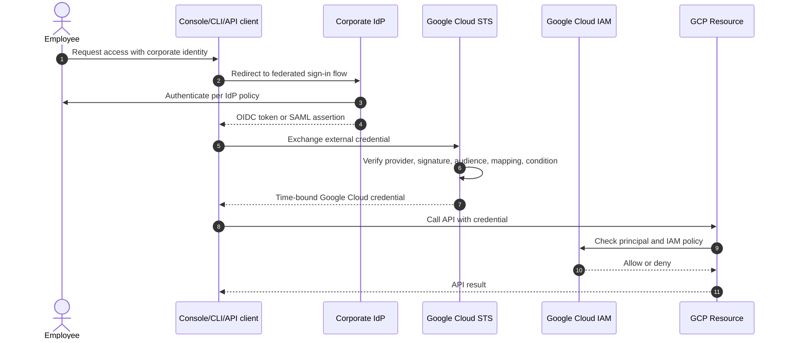
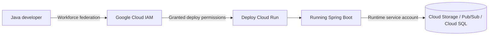

# Workforce Identity Federation for organizational users

## 1. The problem: letting staff log into Google Cloud with corporate identities

An enterprise has hundreds of Java developers, operations engineers, and security specialists. Employees already have accounts in a centralized identity system such as **Microsoft Entra ID**, **Okta**, or an Identity Provider (IdP) supporting **OpenID Connect (OIDC)** or **SAML 2.0**. When teams deploy Spring Boot apps to **Cloud Run**, manage **GKE** clusters, inspect **Compute Engine** VMs, or track budgets, they need to access Google Cloud with appropriate permissions.

If you create a separate, non-centrally managed Google Cloud account for every individual, the organization must handle extra account lifecycles, group permission updates, offboarding lockouts, and access reconciliation. **Workforce Identity Federation** enables **organizational users** to sign into supported Google Cloud products using identities from an external IdP, after which **Google Cloud IAM** evaluates access permissions. This model does not require syncing every external identity into a corresponding Cloud Identity/Google Workspace user.

In the **IAM and authentication** chapter of the **CLOUD_PROVIDERS_GCP** module, this lesson focuses on the journey **user → IdP → Workforce Identity Pool → Google Cloud IAM → resource**, how to configure trust between the two systems, and how to restrict access by groups and attributes. This is a foundational skill for protecting resources, operating Java systems, releasing software, and investigating incidents on GCP.

### Learning outcomes

After this lesson, you can:

1. Explain the purpose and scope of **Workforce Identity Federation (WIF)**, distinguishing it from **Workload Identity Federation** and other SSO types.
2. Describe the roles of **workforce identity pool**, **pool provider**, **IdP token/assertion**, **Security Token Service (STS)**, **attribute mapping**, **attribute condition**, and **IAM allow policy**.
3. Design authorization workflows for **employees, contractors, and operations teams** without assigning one overly broad role to everyone who signs in.
4. Describe the steps to configure OIDC/SAML and test signing in via **Google Cloud console (federated)**, **gcloud CLI**, and supported APIs/client libraries.
5. Diagnose issuer/audience, claim mapping, group membership, IAM, quota project, and token expiration errors; monitor activity and revoke access.

## 2. Distinguishing Workforce from other identity solutions

| Technology | Primary identity | Suitable scenario | What to remember |
| --- | --- | --- | --- |
| **Workforce Identity Federation** | **Humans**: employees, partners, contractors | Use external IdP to access Google Cloud console, CLI, and supported APIs | Federated entities are bound to IAM via workforce pools; no need to sync all users into Google Accounts |
| **Workload Identity Federation** | **Applications/jobs** outside GCP, e.g., GitHub pipelines or Azure workloads | Issue machine identities without long-lived service account keys | Uses **workload identity pools**, with different targets and principal paths from workforce pools |
| **Workload Identity Federation for GKE** | Kubernetes Pods/workloads inside GKE | Workloads call Google Cloud APIs using Kubernetes identities | Configured for GKE workloads; does not replace corporate user login |
| **Cloud Identity / Google Workspace federation** | Users with corresponding Cloud Identity/Workspace accounts | Orgs using many Google products needing synced accounts | Can integrate IdP for SSO yet carries different Google identity admin requirements than workforce federation |
| **Identity Platform / Firebase Authentication** | **End customers** of an application | Users signing into business web/mobile/apps | Does not automatically grant Google Cloud project admin rights via IAM |
| **Service account** | Applications running on Cloud Run, GKE, or VMs | Java backends reading Cloud Storage, publishing to Pub/Sub, or connecting to services | Never use employee identities for automated background processes |

For example: **engineers** use Workforce Identity Federation to access Cloud Logging while on call; **Spring Boot services** on Cloud Run should use a runtime service account to call Cloud Storage; **GitHub Actions** outside GCP should evaluate Workload Identity Federation for pipelines. Separating identity types allows access to be revoked, audited, and scoped to the right actor.

> Workforce Identity Federation is an **authentication and identity federation** mechanism. A person successfully signing into the IdP **does not mean** they can view logs, deploy Cloud Run, or read secrets. Those permissions must be granted separately via IAM on appropriate resources.

## 3. Components and flow of a sign-in session

### 3.1. Core components

| Component | Responsibility | Example |
| --- | --- | --- |
| **Google Cloud organization** | Boundary owning workforce pool config, granting access to child projects/folders/resources | Corporate organization |
| **Workforce identity pool** | Namespace organizing principals from IdPs, managing sessions and grouping providers | `corp-employees` |
| **Workforce pool provider** | Configures trust with an IdP, protocol, issuer/metadata, mapping, and conditions | `entra-prod`, `okta-contractors` |
| **External IdP** | Authenticates users per corporate policy (MFA, account lifecycle, groups) | Microsoft Entra ID, Okta, or OIDC/SAML IdP |
| **OIDC token / SAML assertion** | Carries user info and attributes verifiable by Google Cloud | `sub`, `groups`, tenant, department |
| **STS / token exchange mechanism** | Validates external credentials and issues time-bound Google Cloud access credentials | Exchanges via OAuth 2.0 Token Exchange |
| **Google Cloud IAM** | Evaluates principal, role, conditions, and permissions on target resources | Letting on-call staff read Cloud Logging |
| **Cloud Audit Logs** | Records activity per enabled log types | Who accessed or modified configurations |

A workforce pool is created **at the organization level** and can be referenced when assigning IAM in projects/folders under that organization. Typically, pools/providers use location `global`; the **pool ID must be globally unique**. Never create one workforce pool per project solely for authorization: design pools around IdP sources and use IAM bindings on projects/resources for access scope.

### 3.2. Authentication and authorization diagram



This diagram shows **boundaries of responsibility**; exact steps vary across OIDC authorization code flow, SAML, CLI, and APIs. Some intermediaries exchange an authorization code with the IdP rather than passing tokens directly through the browser. In principle, **the IdP handles authentication**, **the provider/STS verifies identity federation**, and **IAM decides resource permissions**. Enforcing MFA at the IdP does not replace IAM permissions.

### 3.3. Claims, mapping, and conditions are three distinct concepts

- **IdP claim/attribute**: data issued by the IdP, such as a stable user ID, list of group IDs, or tenant ID.
- **Attribute mapping**: expressions mapping IdP claims to IAM attributes like `google.subject`, `google.groups`, `attribute.department`.
- **Attribute condition**: conditional expression on the provider deciding **which identities are permitted to federate/exchange tokens**. Conditions do not grant resource read/write rights on their own.

Typically, `google.subject` is the critical attribute for consistently identifying a user. Choose a **stable, non-reusable identifier**, consulting your IdP's specific guide because ID/UPN/email structures can vary. For groups, prefer stable IDs and groups dedicated to access control.

## 4. OIDC and SAML: choosing a protocol per IdP

### 4.1. OpenID Connect (OIDC)

OIDC builds on OAuth 2.0, using JWT ID tokens with claims such as **issuer (`iss`), audience (`aud`), subject (`sub`), expiration (`exp`)**. The provider requires an **HTTPS issuer URI** and a **client ID** matching the audience issued by the IdP for the federation app. Google Cloud verifies tokens based on provider settings and matching signing keys.

For browser sign-in, **authorization code flow** is normally preferred over implicit flow. With code flow, tokens are exchanged over an appropriate back-channel and additional claims can be fetched from the UserInfo endpoint if configured. If access groups are missing from tokens, inspect IdP config and policies controlling claims included in ID tokens/UserInfo.

### 4.2. SAML 2.0

The IdP issues a signed **SAML assertion** containing subject and attributes. When configuring, pay attention to IdP metadata, **SP Entity ID/audience**, **Assertion Consumer Service (ACS) URL**, certificates, and signing key lifecycles. Group attribute names vary across IdPs; never assume SAML always provides `assertion.groups` like a JWT.

### 4.3. Comparison by deployment requirements

| Criterion | OIDC | SAML 2.0 |
| --- | --- | --- |
| Input credential | OIDC ID token (JWT) | SAML assertion (XML, typically encoded/packaged per flow) |
| Trust metadata | Issuer, client ID/audience, signing keys/JWKS | SAML metadata, entity ID, certificate |
| Example mapping | `google.subject=assertion.sub` | `google.subject=assertion.subject` |
| Access groups | `groups` claim if issued by IdP | SAML attribute defined by IdP |
| Notes | Configure exact tenant, redirect URL, audience, token size | Configure exact NameID, ACS, metadata, signing/encryption |

Choose whichever protocol your **IdP and corporate SSO policy** support reliably. Both work with Workforce Identity Federation when properly configured. A provider with a misconfigured issuer, audience, or signing key fails federation before IAM is even evaluated.

## 5. Organizational design: pools, providers, groups, and access scopes

### 5.1. Never use a workforce pool as a blanket permission bucket across all projects

Suppose an organization has three groups:

- **`gcp-java-developers`**: allowed to view required info in dev projects and deploy to dev environments via authorized workflows.
- **`gcp-observability-readers`**: allowed to read logs/metrics to assist incident response.
- **`gcp-security-auditors`**: allowed to view audit details within approved audit scope.

These groups are managed in the IdP. The workforce pool receives groups/attributes through mapping; **IAM bindings** at projects or resources define what each group can do. A single person can belong to multiple groups without needing organization-wide Owner/Editor.

Manage groups around **specific access/functional duties**, rather than defaulting to mailing lists or broad HR org units. When integrating multiple IdPs, architectures can use separate pools per IdP per official guidance, then bind IAM to principals from the exact corresponding pool. When federating partners, assess trust in the partner's IdP security before enabling direct federation.

### 5.2. Mapping and conditions: illustrative OIDC example

Suppose the IdP issues:

```json
{
  "iss": "https://id.example.org/oidc",
  "aud": "cloud-console-client",
  "sub": "user-immut-124",
  "groups": ["gcp-observability-readers"],
  "department": "engineering",
  "tenant": "trusted-tenant"
}
```

This is only a **fictitious illustrative payload**; real OIDC tokens are signed and contain additional required claims. In provider configuration you might declare:

```text
google.subject=assertion.sub
google.groups=assertion.groups
attribute.department=assertion.department
```

If an issuer serves **multiple tenants**, constrain to the exact permitted tenant, for example:

```cel
assertion.tenant == 'trusted-tenant'
```

The `tenant` name and value format must come from **verified actual claims** issued by your IdP; in Entra ID it may be a different claim such as `tid`. Never copy example expressions verbatim if your IdP does not provide that attribute. With multi-tenant shared issuers, a flawed condition can let your organization accept identities outside the intended scope.

**Distinction:** mapping `google.groups` tells Google Cloud which groups a user belongs to; **it does not grant roles by itself**. Only after an IAM policy binding exists for the matching principal set do users gain permissions on assigned resources.

## 6. IAM principal syntax and granting access by group

Workforce federation lets you reference users or user sets in IAM via principal identifiers:

| Target | Principal format |
| --- | --- |
| Single user (subject) | `principal://iam.googleapis.com/locations/global/workforcePools/POOL_ID/subject/SUBJECT_VALUE` |
| Group from `google.groups` | `principalSet://iam.googleapis.com/locations/global/workforcePools/POOL_ID/group/GROUP_ID` |
| Custom attribute | `principalSet://iam.googleapis.com/locations/global/workforcePools/POOL_ID/attribute.department/engineering` |
| All users in the pool | `principalSet://iam.googleapis.com/locations/global/workforcePools/POOL_ID/*` |

**Avoid granting roles to the whole pool with `*`.** Any newly allowed IdP user could immediately inherit broad permissions. Use **dedicated access groups** or attribute-scoped principal sets, and narrow roles and resources. This is especially vital for sensitive resources like Secret Manager, production Cloud SQL, and IAM configurations.

Illustrative example: an authorized admin grants **Logging Viewer** to the on-call group on a **test project**:

```bash
# Replace all placeholder values; run with an admin identity permitted to grant IAM.
gcloud projects add-iam-policy-binding PROJECT_ID \
  --member="principalSet://iam.googleapis.com/locations/global/workforcePools/POOL_ID/group/gcp-observability-readers" \
  --role="roles/logging.viewer"
```

A member of `gcp-observability-readers` signed in through the provider can read corresponding logs within the role's permissions and applicable policies/conditions; members of other groups do not inherit this access. For resources holding sensitive data, also review **Data Access logs permissions, IAM Conditions, organization constraints, and security policies** where applicable.

### 6.1. Service Usage Consumer and quota project

When using certain Workforce Identity Federation token exchange flows, federated users need **`serviceusage.services.use`** permission on a **workforce pool user project** used for quota and billing. The least-privileged role containing this permission is `roles/serviceusage.serviceUsageConsumer`. That permission **does not replace** Cloud Storage read/write or GKE viewer permissions. When hitting a quota project error, check this permission and required API enablement rather than granting Owner to test.

### 6.2. IAM evaluation still follows standard rules

IAM can be restricted by deny policies, IAM Conditions, Organization Policies, or configured access boundaries. Distinguish:

1. **Does the provider allow federating the identity?** Valid token/claims and condition.
2. **Does IAM hold a binding for the exact principal/role/resource?** Target permission exists.
3. **Do conditions or another policy layer deny it?** E.g., IAM Condition or deny policy.
4. **Does the target service support federated identities for this usage pattern?** Check the official support table.

## 7. Configuring Workforce Identity Federation

### Step 1 — Identify prerequisites

Prepare a **Google Cloud organization**, sufficient admin privileges to create workforce pools/providers and grant IAM per internal policy, an **OIDC- or SAML-compatible IdP**, and a test project for authorization testing. IdP and Google Cloud owners must collaborate to configure **redirect URL, issuer/audience, group claims**, and MFA policies.

Check relevant APIs per current documentation (such as **IAM API**, **Security Token Service API**, **Cloud OAuth API** when required by the flow). Distinguish **organization number**, **project ID**, **project number**, and **pool ID**; these identifiers are not interchangeable.

### Step 2 — Create the workforce identity pool at the organization level

Illustrative CLI command once approved by the organization using an authorized admin identity:

```bash
gcloud iam workforce-pools create POOL_ID \
  --organization=ORGANIZATION_NUMBER \
  --display-name="Corporate workforce" \
  --description="External corporate identities" \
  --session-duration=3600s \
  --location=global
```

**Replace all UPPERCASE placeholders** before running. `POOL_ID` must be globally unique. The default session duration currently documented by Google Cloud is **1 hour**; configurable durations typically range from **15 minutes to 12 hours**, subject to current limits. Choose duration based on sensitivity, actual working window, and temporary access procedures.

### Step 3 — Register the app in the IdP and create the provider

**For OIDC:** register a Google Cloud integration app in your IdP, retrieve the issuer URL and client ID, and configure claims and redirect URL. For browser-based Console/CLI sign-in, the redirect URI typically follows:

```text
https://auth.cloud.google/signin-callback/locations/global/workforcePools/POOL_ID/providers/PROVIDER_ID
```

Create the provider in **Google Cloud Console → IAM → Workforce Identity Pools → select pool → Add Provider**, select OIDC, enter issuer URI/client ID, choose authorization code flow and guided settings. If the IdP requires a client secret, manage it securely without placing secrets in public docs, Git, or terminal history. Apply mapping and attribute conditions, then use **Debug IdP token/Validate provider attributes** to confirm real values.

**For SAML:** register the app in your SAML IdP, configure **SP Entity ID** and **ACS URL**, import certificate metadata, create the SAML provider, and map SAML attributes to Google Cloud attributes. Track **signing certificate** lifecycles during periodic key rotations to prevent sign-in outages.

`POOL_ID`/`PROVIDER_ID` values in URLs and configs must match the actual provider. Creating a provider whose mapping lacks `google.subject`, receives wrong groups, or has a condition evaluating to `false` will still fail login or misalign permissions.

### Step 4 — Bind IAM on projects or resources

Create an **access group** in the IdP (e.g., `gcp-observability-readers`), add a test user, and verify the group appears after mapping. Bind a narrow role like `roles/logging.viewer` on a demo project using the group's principal set. Never bind `roles/owner` or `roles/editor` solely to prove WIF works.

For admin rights to create resources or deploy Cloud Run/GKE, separate roles by responsibility: **viewer**, **deployer**, **IAM administrator**, and **runtime service account** are distinct actors.

### Step 5 — Test sign-in with gcloud CLI

Google Cloud CLI can generate a **login configuration** for browser sign-in:

```bash
gcloud iam workforce-pools create-login-config \
  locations/global/workforcePools/POOL_ID/providers/PROVIDER_ID \
  --output-file=login-config.json

gcloud auth login --login-config=login-config.json
gcloud auth list
```

`create-login-config` writes a file containing endpoint/audience settings, **not an IdP private key**. Even so, protect **file integrity** because altering endpoints can redirect authentication improperly. `gcloud auth login` stores local session credentials; run on access-controlled workstations and never share user profiles. In Windows PowerShell, multi-line commands use the **backtick** continuation character or sit on one line; trailing `\` in the example above is for Bash.

To test permissions after signing in:

```bash
gcloud config set project PROJECT_ID
gcloud logging logs list --project=PROJECT_ID
```

Compare two users: one inside the valid access group and one outside. An unauthorized user can **sign in successfully** yet receive `PERMISSION_DENIED` when reading logs; that confirms IAM is evaluated independently from authentication.

### Step 6 — Sign into Google Cloud console (federated)

Users can open **Google Cloud console (federated)** via the sign-in URL configured for the workforce provider and complete the IdP flow. The UI and supported product scope may differ from Console for standard Google Accounts. Organizations must distribute the **exact provider sign-in URL**, MFA policies, authorization rules, and recovery procedures for IdP outages.

Check the [federated identity supported services table](https://cloud.google.com/iam/docs/federated-identity-supported-services) before promising every Console/CLI/API feature behaves identically to a Google Account.

## 8. Short-lived tokens and API access from Java

### 8.1. Browser login, CLI, and credential files are separate flows

Workforce Identity Federation exchanges external tokens for **time-bound** Google Cloud credentials via STS. Depending on provider type and environment, users can:

- Sign in via **browser** on Console (federated).
- Use `gcloud auth login --login-config=...` for interactive CLI login via IdP in a browser.
- Use an **external account credential configuration** when reading tokens from a supported file, URL, or executable, letting Google Auth Library/client libraries handle exchange.

Do not equate `gcloud auth login` with **Application Default Credentials (ADC)** read by Java. When running Java libraries, know **which credential source the client library selects**. Many Google Cloud Client Libraries for Java support workforce pools, though coverage can vary by product/version.

### 8.2. Example external account configuration from an existing OIDC token

If an IdP already writes a **valid OIDC ID token** to a protected file, you can generate a credential configuration:

```bash
gcloud iam workforce-pools create-cred-config \
  locations/global/workforcePools/POOL_ID/providers/PROVIDER_ID \
  --subject-token-type=urn:ietf:params:oauth:token-type:id_token \
  --credential-source-file=PATH_TO_IDP_ID_TOKEN_FILE \
  --workforce-pool-user-project=USER_PROJECT_ID \
  --output-file=workforce-cred.json
```

`workforce-cred.json` is a **configuration file**, not a service account key. **The source ID token file is the sensitive credential** and must be written/refreshed securely by the IdP flow before expiration. The user needs `serviceusage.services.use` on the appropriate quota/user project. Never copy live tokens into documentation, repositories, or logs.

For `gcloud`, docs also describe signing in via `gcloud auth login --cred-file=workforce-cred.json` when that credential type is supported. For **Java client libraries**, configure ADC by pointing `GOOGLE_APPLICATION_CREDENTIALS` to the external account file in the proper runtime environment and letting the library fetch credentials:

```java
import com.google.auth.oauth2.GoogleCredentials;
import java.io.IOException;

public final class FederationCredentialCheck {
    public static GoogleCredentials load() throws IOException {
        // Respect environment ADC; keep tokens and keys out of source code.
        return GoogleCredentials.getApplicationDefault();
    }
}
```

This requires compatible Google Auth Library dependencies. Loading credentials **does not** prove the GCP API permits the operation; tests must call a specific API with the right principal, IAM role, quota project, and federated-identity-supported service. The example is not a background daemon exchanging tokens on everyone's behalf.

### 8.3. Which identity should a Java backend running on GCP use?

Suppose an engineer signs in via WIF and deploys Spring Boot to **Cloud Run**. When the API serves traffic, Java code normally uses **Cloud Run's runtime service account**, never carrying the engineer's sign-in token. That is intentional:



Workforce Identity Federation is for **human admins/operators**; service accounts/Workload Identity Federation are for **workloads**. Never use developer credentials for production applications accessing databases or storage.

## 9. Security, employee lifecycle, and auditing

### 9.1. Minimum safeguards

1. **MFA and device policies at the IdP:** protect the entry point of sessions, especially for privileged admin accounts.
2. **Restrict providers to trusted issuers and tenants:** verify who tokens represent; enforce attribute conditions when an issuer serves multiple tenants.
3. **Map stable IDs:** avoid identifiers that can be reassigned to someone else; if subjects are recycled, old IAM bindings can grant permissions to the wrong person.
4. **Grant IAM to dedicated access groups:** avoid pool-wide wildcards and overly broad roles; use project/resource scopes and appropriate conditions.
5. **Set reasonable session durations:** long sessions extend exposure if tokens/devices are stolen or group memberships change.
6. **Maintain separate emergency access:** keep tightly controlled Cloud Identity/Google Workspace break-glass accounts independent of the external IdP.
7. **Monitor token exchanges and admin actions:** enable appropriate logs, track pool/provider and binding edits, and maintain runbooks.

### 9.2. Onboarding and offboarding

For new hires, verify identity in the IdP, add them to the right functional **access group**, and let them sign in. Google Cloud permissions are evaluated from IdP attributes/groups and active policies, typically removing the need to provision individual Google users.

When employees switch teams or leave:

- **Revoke/update groups in the IdP**, disabling accounts per policy.
- **Check active sessions/tokens**, revoking Google Cloud sessions when risk is high or immediate cutoff is required; IdP group changes may **not reflect immediately** in existing sessions.
- **Check subject-bound direct IAM grants**, if any, and exceptions; avoid removing a group while leaving behind an individual IAM binding.
- **Reconcile Cloud Audit Logs** around event timestamps, recording who acted and outcomes.

If the IdP goes down or a provider is misconfigured, staff may be locked out even while GCP resources remain healthy. **Break-glass/emergency access** policies must be rehearsed and kept independent of the primary IdP.

### 9.3. Audit Logs and privacy

Google Cloud can record federated principals in audit logs when they operate on resources. **Sign-ins and token exchanges** via Security Token Service are written to **Data Access logs** that must be enabled at organizational scope; these logs are not necessarily on by default. You can enable **detailed audit logging** on providers to aid investigations, while weighing attribute data logged, retention policies, and cost.

Watch events such as: provider config edits, mapping/condition edits, broad group role grants, spikes in token exchange failures, and logins by accounts holding sensitive privileges. Never log raw ID tokens or SAML assertions into application logs or ticketing systems.

## 10. Layer-by-layer troubleshooting

| Symptom | Likely failing layer | How to inspect |
| --- | --- | --- |
| Does not redirect to IdP or redirect errors | Browser sign-in config | Redirect URI/ACS, provider ID, app registration, IdP session |
| STS rejects token | Trust/token validation | Issuer, audience/client ID, signature/JWKS, expiration, SAML metadata |
| Mapping fails to populate `google.subject` | Attribute mapping | Does claim exist? Data type, CEL expression, SAML NameID |
| Sign-in blocked by condition | Attribute condition | Actual tenant/group values in token; verify expression evaluates true/false |
| Sign-in succeeds yet project access is denied | IAM authorization | Principal string, group value, role, resource, IAM Conditions/deny |
| `serviceusage.services.use` error | Quota/user project | Right project, Service Usage Consumer role, enabled APIs |
| CLI works yet Java `GoogleCredentials.getApplicationDefault()` fails | Credential discovery | ADC path, external account config, source token, client library support |
| User recently added to group lacks access | Stale session/claims | Sign in again, verify new claims, session duration, and IAM bindings |
| A Console feature does not work for federated users | Product support | Check supported products and limitations table; find alternative API path if available |
| Token exchange suddenly fails across all users | IdP or quota/provider | IdP health, key rotation, STS quotas, logs, and pool config |

**Recommended debug order:** verify IdP authentication → check provider and token exchange → check claims/mapping/condition → check IAM principal/role/resource → check product policies and APIs. This prevents arbitrarily widening IAM when the root cause is a missing claim or expired token.

**When compromise is suspected:** coordinate with identity/security teams to revoke user sessions, disable necessary accounts/IdP access, remove broad IAM bindings, and inspect audit logs. For broad provider-wide incidents, weigh impact on legitimate users before pausing a provider, using prepared emergency access paths.

## 11. Real-world deployment scenario for a Java team

Suppose an operations team manages:

- Project **`java-dev`**: developers deploy Spring Boot test builds to Cloud Run and view required logs.
- Project **`java-prod`**: only the release team can deploy; on-call ops only views telemetry per granted roles.
- Production Java services: use a **dedicated runtime service account** to read Cloud SQL, Cloud Storage, or Pub/Sub.
- Finance team: views Billing and relevant figures only; no permission to create VMs or administer IAM.

Recommended permission design:

| Identity/group | Target | Permissions per need | Principle |
| --- | --- | --- | --- |
| `gcp-java-dev-deployers` | Dev project | Cloud Run deploy roles and related SA rights at needed scope | Review workflow; no Owner |
| `gcp-prod-release-operators` | Prod project | Specific release roles, protected by approval/JIT when suitable | Separate releasers from workloads |
| `gcp-observability-readers` | Dev/prod projects | `roles/logging.viewer` and required metrics read rights | Read observability data; assess log sensitivity |
| `gcp-billing-readers` | Billing account or authorized reporting source | Billing viewer roles at appropriate scope | Do not assign unrelated project roles |
| Cloud Run runtime service account | Required bucket/topic/DB | Only corresponding business runtime permissions | Never use a developer's WIF session |

**Verification tests:**

1. A developer authenticates via IdP into the workforce pool as a member of `gcp-java-dev-deployers`.
2. The developer accesses dev resources per IAM, yet cannot deploy to prod.
3. A member of `gcp-observability-readers` views logs; after removing them from the group and re-signing in, permissions reflect the updated claims.
4. A user outside all access groups can still authenticate at the IdP yet receives permission errors on protected resources.
5. The running Spring Boot app keeps using its runtime service account; developer group changes do not alter the service's identity.

## 12. Practice exercises, assessment questions, and checklist

### Exercise A — Diagram the WIF architecture

Draw the path `Developer → OIDC/SAML IdP → workforce pool/provider → STS → IAM → Cloud Run project`. Mark where **the user authenticates**, where **Google Cloud validates the token**, and where **authorization is decided**. Explain why granting a role to the entire workforce pool is insecure.

### Exercise B — Build a mapping and IAM table

Using three fictitious users `dev-a`, `sre-b`, and `finance-c` in distinct groups, define `google.subject` and `google.groups` mappings. Determine the principalSet for each access group, then pick suitable roles and projects/resources. Include at least one **login succeeds yet access denied** test to prove authentication/authorization separation.

### Exercise C — Sign in through a managed environment

In an organization with authorized IdP/GCP access, create or use a test provider per policy. Run `Debug IdP token`, sign in via `gcloud auth login --login-config`, call a read-only API, and inspect logs. Without org/IdP admin rights, do a **paper design lab** using fictitious claims without creating real resources.

### Exercise D — Simulate failures and access revocation

In an authorized test environment, sequentially simulate a wrong group claim, missing IAM binding, condition excluding a test account, and quota project missing `serviceusage.services.use`. Diagnose each case along authentication → federation → IAM. Change group membership and sign in again to observe permission updates.

### Checklist

- [ ] I can accurately explain the target audiences of Workforce, Workload Identity Federation, and Identity Platform.
- [ ] I know pools live at the organization level, providers connect IdPs, and STS issues time-bound tokens.
- [ ] I distinguish OIDC issuer/audience/subject from SAML metadata/ACS/NameID.
- [ ] I understand `google.subject`, `google.groups`, mapping, and provider attribute conditions.
- [ ] I write valid principal strings for subjects, groups, and attributes, avoiding pool-wide wildcards.
- [ ] I assign IAM roles by resource, functional group, and least privilege.
- [ ] I distinguish gcloud/browser sessions from Java application ADC and runtime service accounts.
- [ ] I have plans for quota projects, token exchange errors, session expiry, and service limitations.
- [ ] I have procedures for offboarding, session revocation, emergency access, and audit logging.
- [ ] I can demonstrate that successful login **does not** automatically grant resource access.

Workforce Identity Federation succeeds when an organization uses existing staff identities to access Google Cloud, **enforces fine-grained IAM permissions**, revokes access along the employment lifecycle, and audits activity via logs. Java developers must understand this boundary to manage Cloud Run, GKE, Compute Engine, data, and budgets safely while backend code continues running under dedicated workload identities.

## 13. Official documentation for reference and verification

- [Workforce Identity Federation — overview](https://cloud.google.com/iam/docs/workforce-identity-federation)
- [Configure Workforce Identity Federation](https://cloud.google.com/iam/docs/configuring-workforce-identity-federation)
- [Obtain short-lived tokens for Workforce Identity Federation](https://cloud.google.com/iam/docs/workforce-obtaining-short-lived-credentials)
- [Principal identifiers for IAM](https://cloud.google.com/iam/docs/principal-identifiers)
- [Best practices for Workforce Identity Federation](https://cloud.google.com/iam/docs/best-practices-workforce-identity-federation)
- [Federated identity — supported products and limitations](https://cloud.google.com/iam/docs/federated-identity-supported-services)
- [Architecture patterns for identity federation](https://cloud.google.com/iam/docs/federated-identity-architectures)
