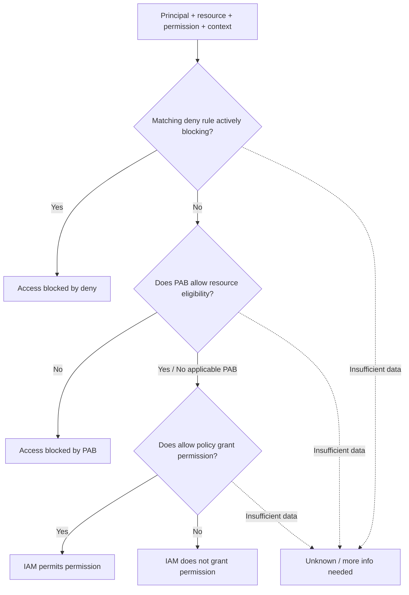
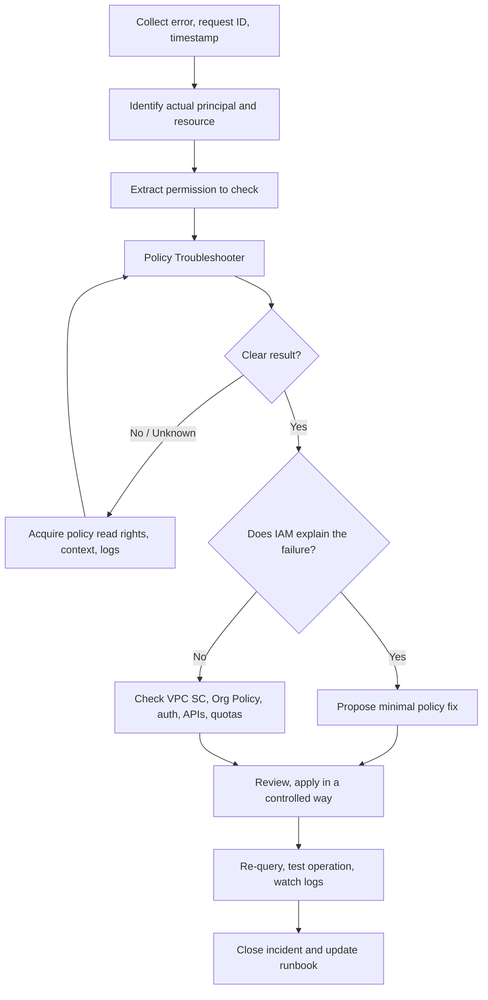

# Policy Troubleshooter and permission error analysis

A working Cloud Run deployment pipeline suddenly reports `PERMISSION_DENIED`. Seeing that the service account already holds a relevant role, an operator assumes Google Cloud IAM is broken. In reality, the permission might not be **allowed**, might be **denied** at the folder/organization level, restricted by a **Principal Access Boundary**, failing an **IAM Condition**, or the request might be sent under a **different identity** than the one being inspected.

In the **CLOUD_PROVIDERS_GCP** module, after learning how to organize projects, IAM, and VPCs and choose Compute Engine, GKE, Cloud Run, storage, or databases, operators need to know how to **prove why an operation is permitted or denied**. This lesson walks through that workflow using **Policy Troubleshooter**, Cloud Audit Logs, and supporting checks. The goal is fixing the exact root cause, preserving least privilege, and minimizing production risk.

> All projects, emails, resource names, events, and query outputs below are **fictitious**. No queries in this lesson are executed against real projects.

## Learning objectives

After this lesson, you can:

1. Describe how **allow policies**, **deny policies**, and **Principal Access Boundary (PAB)** affect access permissions.
2. Construct a Policy Troubleshooter query using **principal + full resource name + permission**, plus context when conditions exist.
3. Interpret `Granted`, `Not granted`, `Denied`, and `Unknown` outcomes without confusing “insufficient data” with “lacks permission”.
4. Use Console, `gcloud`, and Cloud Audit Logs details to pinpoint the binding, deny rule, or condition causing a failure.
5. Distinguish IAM errors from authentication, impersonation, VPC Service Controls, Organization Policy, disabled APIs, and nonexistent resources.
6. Build a **least-privilege** remediation plan, verify after applying changes, and preserve audit evidence.

## 1. Starting from a specific request

Policy Troubleshooter answers a structured question:

> Does **Principal P** have **permission X** on **resource R** under active IAM policies?

These three components are commonly called an **access tuple**:

| Component | Example | What to determine |
| --- | --- | --- |
| **Principal** | `ci-deployer@retail-prod-01.iam.gserviceaccount.com` | The actual identity whose token is sent with the request |
| **Resource** | `//cloudresourcemanager.googleapis.com/projects/retail-prod-01` | Full resource name checked for permissions |
| **Permission** | `resourcemanager.projects.get` | Exact IAM permission of the operation, not the role name |

For accurate diagnostics, also note the **timestamp**, **API method**, **project/region/zone**, **error ID**, **request ID**, and **condition context** if any. If an operation requires multiple permissions, check **each permission on its corresponding resource**.

For example, a Cloud Run deployer may need:

- `run.services.update` on the Cloud Run service when updating the service.
- `iam.serviceAccounts.actAs` on the **workload runtime service account** when attaching that identity to the service.
- `artifactregistry.repositories.downloadArtifacts` on the repository holding the container image, depending on the deploy flow.

Holding the first permission **does not prove** the other two are granted. Therefore, a `GRANTED` result for `run.services.update` is not enough to conclude the entire deploy command will succeed.

## 2. How IAM decides access permissions

### 2.1 Allow policy: permissions must be explicitly granted

An **IAM allow policy** contains **role bindings**: a role grouping permissions attached to a principal (user, group, service account, etc.) on a resource. Bindings from **organization → folder → project → child resource** can be inherited downward within service-supported scopes.

For example, `group:retail-developers@example.com` granted `roles/viewer` on the Retail folder can inherit corresponding read permissions across child projects. However, a role named “Viewer” **does not mean** it holds every read permission across every product: always verify specific permissions inside the role and applicable resource types.

### 2.2 Deny policy: a matching deny rule can block allow

An **IAM deny policy** contains rules blocking supported permissions for principals within the rule's scope. Deny policies can be attached at the organization, folder, or project level and apply to descendant resources per inheritance rules.

In IAM evaluation, **an active matching deny rule blocks the permission even if an allow policy has a binding granting it**, unless the principal is exempted or the deny condition does not apply. Thus, adding `roles/editor` or `roles/owner` usually cannot overcome an active blocking deny rule.

### 2.3 Principal Access Boundary: limiting where a principal is eligible to access

A **Principal Access Boundary (PAB)** can constrain **the set of resources** a principal is eligible to be evaluated for access against. PAB **never grants permissions on its own**. A principal with a valid allow binding can still fail to use a permission if the resource lies outside the eligible set defined by PAB.

PAB analysis in Policy Troubleshooter is documented by Google Cloud as **Preview**; behavior and support levels may change. For specialized principals or policy types, check current version limitations before drawing conclusions.

### 2.4 IAM Conditions: permissions depending on request context

An allow binding or deny rule can carry a **condition** referencing resource info, time, tags, or other supported attributes. For example:

```cel
request.time < timestamp("2027-01-01T00:00:00Z")
```

A binding with the condition above applies only to requests at matching times. If the query leaves time unspecified, the tool may return **Unknown/Unknown conditional**. Supply the actual request timestamp along with relevant attributes instead of assuming the condition evaluates to `true`.

### 2.5 Decision model



This is a **conceptual** learning diagram, not Google Cloud's internal execution sequence. Even an IAM-permitted outcome can still fail at **authentication, API enablement, Organization Policy, VPC Service Controls, quotas, resource configuration, or service-specific checks**.

## 3. What does Policy Troubleshooter provide?

Policy Troubleshooter is part of **Policy Intelligence**. Given an access tuple, it inspects **relevant allow/deny/PAB policies the caller is authorized to view** and explains how bindings or rules led to the verdict.

Key outputs:

| Output / data group | Operational meaning |
| --- | --- |
| **Overall access state** | Aggregated status of the queried permission across tool-supported policies |
| **Allow policy explanation** | Which roles hold the permission, which bindings match the principal, on which resource, and whether conditions are satisfied |
| **Deny policy explanation** | Which deny rules match the permission/principal, plus any exceptions or conditions |
| **PAB explanation** | Whether the resource falls within the principal's eligible boundary, where supported |
| **Condition explanation** | Evaluated condition values and context used |
| **Unknown / missing info** | Lacking permission to read policies/roles, unresolved group memberships, or missing condition context |

**Policy Troubleshooter output is a policy evaluation**, not an attempt by the tool to actually read data, create VMs, or deploy. Running queries also makes no permission changes.

### Permissions required to troubleshoot

- **Enable the Policy Troubleshooter API** (`policytroubleshooter.googleapis.com`) in an appropriate project if not already enabled; enabling APIs requires `serviceusage.services.enable`.
- You need permission to view **allow/deny policies, custom roles**, and related policies/identities to see full explanations. **Security Reviewer** (`roles/iam.securityReviewer`) and **Deny Reviewer** (`roles/iam.denyReviewer`) are examples suggested in documentation within appropriate scopes; required permissions also depend on resource location and policy types.
- Querying via CLI may require quota/billing project permissions, such as those in **Service Usage Consumer** (`roles/serviceusage.serviceUsageConsumer`), alongside API access.
- For bindings using Google Groups or domains, the analyst may need appropriate **membership** read/admin permissions. Without them, group matching may return `Unknown`.
- PAB analysis may require permissions to inspect policies, bindings, and resources tied to the principal; some cases require permissions at the organization or identity pool level.

Never grant `roles/owner` broadly just to read troubleshooting output. Identify the missing read permissions and request them through internal security procedures.

## 4. Standard troubleshooting workflow

When a `gcloud` command, API call, or pipeline fails, follow six steps:

1. **Record the raw error:** preserve the exact error message, `403`/`PERMISSION_DENIED` code, mentioned permission, request ID, error ID, UTC timestamp, and API method.
2. **Identify the actual principal:** for CLI, check `gcloud auth list` and impersonation flags; for Cloud Run/GKE/Compute Engine, identify the service account or federated identity used by the workload at call time.
3. **Identify the exact resource:** use the service's **full resource name**; record project ID, resource ID, and region/zone. Do not confuse the CLI's default project with the project owning the target resource.
4. **Find the exact permission:** take it from the error message, API docs, or Cloud Audit Logs. A role name (`roles/run.developer`) is **not** a permission name (`run.services.update`).
5. **Run Policy Troubleshooter:** review overall status and each allow, deny, and PAB explanation; supply context if conditions require it.
6. **Confirm root cause and propose minimal fix:** cross-check logs, current IAM, and other systems; verify after changes via re-querying and running the appropriate business operation.

### Details to capture in a ticket

```yaml
incident:
  environment: production
  project_id: retail-prod-01
  observed_at_utc: "2026-11-19T01:30:00Z"
  caller: ci-deployer@retail-prod-01.iam.gserviceaccount.com
  resource: //cloudresourcemanager.googleapis.com/projects/retail-prod-01
  permission: resourcemanager.projects.get
  symptom: "PERMISSION_DENIED (illustrative)"
  error_id: "<if-provided-by-service>"
  source: "gcloud / Cloud Audit Logs / CI output"
  evidence:
    - "IAM allow / deny / PAB analysis"
    - "Effective identity and request context"
  proposed_change: "Review only after cause is confirmed"
```

This template is strictly an investigation note; never include access tokens, service account keys, or secrets.

## 5. Using Policy Troubleshooter in Console

1. Sign into [Google Cloud Console](https://console.cloud.google.com/) with an identity permitted to read policies. Open **Policy Troubleshooter** under IAM/Policy Intelligence.
2. If you have an **Error ID** from a permission error and the UI supports it, enter the Error ID so the tool pre-fills context. Otherwise choose **Manual** input.
3. Enter **principal**, **full resource name**, and **permission**. Example:
   - Principal: `developer@example.com`
   - Resource: `//cloudresourcemanager.googleapis.com/projects/retail-prod-01`
   - Permission: `resourcemanager.projects.get`
4. Run the query. Read the **overall access state**, then expand **Allow policy**, **Deny policy**, and **Principal Access Boundary** if present.
5. Note which **project, folder, or organization** holds each policy; identify the role/binding/rule and how conditions evaluated. Watch for `Unknown` annotations.
6. For time- or request-attribute-based IAM Conditions, launch troubleshooting **directly from the matching audit log event** if supported by the UI to carry over request context.
7. Save relevant evidence in the ticket and propose a fix. Some UIs may show remediation options; applying changes still requires IAM permissions and approval workflows.

**Note:** Menu names and button layouts can change. Follow current Google Cloud docs if the UI differs from examples or if your organization disables Preview features.

## 6. Read-only troubleshooting practice with gcloud

Illustrative commands target Bash or Cloud Shell; substitute an authorized test environment. Do not run IAM-modifying commands in this section.

### 6.1 Inspect caller and project

```bash
# View authenticated accounts and the currently active account.
gcloud auth list

# Check default project, for reference only.
gcloud config get-value project

# Inspect target project metadata for reference.
gcloud projects describe retail-prod-01 \
  --format="table(projectId,projectNumber,name)"
```

Two reminders:

- `gcloud auth list` reflects the CLI identity; workloads on GKE/Cloud Run or processes using **impersonation** may call APIs under a different identity.
- A principal can access resources **in a different project** from the API quota/billing project or the CLI's default project. Always pull the **actual** resource from the error.

### 6.2 Query Policy Troubleshooter

Example checking only project metadata read permission:

```bash
gcloud policy-intelligence troubleshoot-policy iam \
  "//cloudresourcemanager.googleapis.com/projects/retail-prod-01" \
  --principal-email="developer@example.com" \
  --permission="resourcemanager.projects.get"
```

Parameters:

| Parameter | Purpose |
| --- | --- |
| `RESOURCE` (first arg) | **Full resource name**, including the `//service.googleapis.com/...` prefix |
| `--principal-email` | Google Account or service account email supported by the command |
| `--permission` | Specific permission, e.g., `resourcemanager.projects.get` |
| `--request-time` | Request timestamp in RFC 3339 format to evaluate relevant conditions |
| `--resource-name`, `--resource-service`, `--resource-type` | Resource attributes for condition evaluation |
| `--destination-ip`, `--destination-port` | Network context when referenced by conditions |

Depending on CLI/API version, **PAB troubleshooting** may require **beta/Preview**. Tool documentation describes running `gcloud beta policy-intelligence troubleshoot-policy iam` for PAB analysis; the standard command covers allow/deny. Never assume an omitted PAB section in standard output proves no PAB applies.

### 6.3 When permissions depend on time

A binding carries an IAM Condition expiring at `2027-01-01T00:00:00Z`. The same principal and permission can produce different results at two timestamps:

```bash
# Fictitious scenario: query status at a specific timestamp.
gcloud policy-intelligence troubleshoot-policy iam \
  "//cloudresourcemanager.googleapis.com/projects/retail-prod-01" \
  --principal-email="developer@example.com" \
  --permission="resourcemanager.projects.get" \
  --request-time="2026-11-19T01:30:00Z"
```

If a condition also references `resource.name`, `resource.type`, or `request.auth`, timestamp alone is insufficient. Provide all tool-supported context, or inspect logs and condition docs to analyze the rest. Important Google Cloud caveat: the tool **does not automatically fetch complete tags for certain regional resources**, so tag-based conditions may not evaluate accurately in those cases.

### 6.4 Querying via REST when integrating internal tools

Sample request body for **Policy Troubleshooter API v3**:

```json
{
  "accessTuple": {
    "principal": "developer@example.com",
    "fullResourceName": "//cloudresourcemanager.googleapis.com/projects/retail-prod-01",
    "permission": "resourcemanager.projects.get"
  }
}
```

Endpoint:

```text
POST https://policytroubleshooter.googleapis.com/v3/iam:troubleshoot
```

The app calling REST needs a **valid OAuth token**, the API enabled, and sufficient policy read permissions to receive useful details. Never record tokens in docs or tickets. v3 responses provide overall access states and separate explanations for allow/deny/PAB; follow the **exact version's schema** rather than assuming v1/v3 fields are identical.

## 7. Interpreting results accurately

Suppose Policy Troubleshooter returns results for `developer@example.com` and permission `resourcemanager.projects.get`:

| Fictitious scenario | Expected outcome | What to inspect in output |
| --- | --- | --- |
| Direct allow binding, no blocking deny/PAB | Granted | Which role contains the permission, where the binding sits |
| No binding grants the permission | Not granted | Does the role lack the permission, wrong principal, or wrong scope? |
| Allow exists yet folder deny policy blocks | Denied | Deny rule, principal/permission match, exceptions, condition |
| Allow exists yet PAB excludes project | Not eligible | PAB policy and resource scope |
| Allow applies only before a timestamp, request arrives after | Not granted by that binding | Condition evaluation and request timestamp |
| Querier lacks policy/group read rights or missing context | Unknown | Read permissions, group info, custom roles, condition context |

An **Unknown** verdict does not mean the principal is definitely granted or definitely denied. Obtain proper policy/role read access (per authorization), membership info, or context before concluding.

### Checking policy inheritance

Consider the hierarchy:

```text
Organization: 111111111111
└── Folder: retail-prod
    └── Project: retail-prod-01
        └── Cloud Run: api
```

An allow binding at the organization can inherit down to the project; a deny rule at the folder can block at the project. Running only `gcloud projects get-iam-policy retail-prod-01` shows **only allow policies attached directly to that project**, missing inherited allow/deny/PAB policies. Policy Troubleshooter is built to aggregate all effective policies you are permitted to view.

If a binding uses a **custom role**, verify that the role includes the required permission. If bound to a group, verify membership at the relevant time and how the tool evaluates groups. Seeing a group name in a policy does not prove a specific principal belongs to that group.

## 8. Case study: Cloud Run deployment denied

A pipeline deploys an orders application from Artifact Registry to Cloud Run in project `retail-prod-01`, region `asia-southeast1`:

```text
CI trigger / Workload Identity Federation
            |
            v
    ci-deployer service account
            |
            +---- Cloud Run service: api
            |        (update service)
            |
            +---- Runtime service account: retail-api-runtime
            |        (attach / actAs)
            |
            +---- Artifact Registry repository: retail-images
                     (read container image)
```

The deploy command fails with 403. Do not reflexively assign `roles/editor` to the service account just because deployment was denied.

**Step 1 — Verify the principal.** Identify the actual token used for deployment. If CI authenticates via Workload Identity Federation and impersonates `ci-deployer@retail-prod-01.iam.gserviceaccount.com`, the principal calling Cloud Run is **ci-deployer**, even though a developer triggered the build.

**Step 2 — Check permissions by operation.** Some baseline permissions:

| Resource | Example permission | Typical role providing permission |
| --- | --- | --- |
| Cloud Run service to update | `run.services.update` | `roles/run.developer` or suitable role |
| Runtime service account | `iam.serviceAccounts.actAs` | `roles/iam.serviceAccountUser` on the service account |
| Artifact Registry repository | `artifactregistry.repositories.downloadArtifacts` | `roles/artifactregistry.reader` on the repository |

Cloud Run may also require `run.services.get`, `run.operations.get`, and other permissions depending on deployment flags. Roles in the table are **illustrative suggestions**; verify against your exact deployment workflow and check each permission.

**Step 3 — Inspect policies.** If `run.services.update` is allowed yet deployment still hits 403, do not assume Troubleshooter is wrong. Check `iam.serviceAccounts.actAs` and image read access on their **respective resources**. Also inspect denies/PAB and conditions for each permission.

**Step 4 — Remediate with least privilege.** If `actAs` is missing, propose granting `roles/iam.serviceAccountUser` on that **specific runtime service account** to the deploy principal rather than project-wide. If the repository sits in another project, grant access on that exact repository in the image-owning project.

**Step 5 — Verify.** Re-run Policy Troubleshooter for the previously missing permission, allow for IAM propagation, and retry the deployment cleanly. Close the incident only once deployment succeeds, the new revision is healthy, and logs/metrics show no new errors.

## 9. Case study: Valid allow exists yet deny policy blocks

User `analyst@example.com` holds a role containing `storage.objects.get` on a project, yet cannot read objects in a production data bucket. Investigation uncovers a **deny policy** attached by security at the folder level covering the tested permission.

**Diagnosis:**

1. Identify the bucket/object, bucket-owning project, and identity whose token read the object.
2. Use the exact Cloud Storage full resource name to check permissions, or start at project scope when tracing inherited bindings; note differences in how allow policies are inspected across services.
3. Read the **Deny policy explanation**: where the rule is attached, which principal and permission matched, whether conditions hold, and whether the principal sits in exceptions.
4. Never try “fixing” it by adding `roles/storage.admin` while the deny remains active.
5. If business requires access, work with the deny policy owner to evaluate **exception principals**, exception groups, or condition adjustments. Assess data risk before applying.

**Limitation:** Policy Troubleshooter does not evaluate access granted via **Cloud Storage ACLs**. If ACLs are still used, inspect them separately per the bucket/object access model. If requests are blocked by **VPC Service Controls**, use the VPC SC violation analyzer.

## 10. Case study: IAM Condition and out-of-window request

An operations team grants a user update access on a resource during a maintenance window using an IAM Condition permitting access only before `2027-01-01T00:00:00Z`.

A request at `2026-12-31T23:30:00Z` can satisfy the condition; a request at `2027-01-01T01:00:00Z` will not. Queries omitting `request.time` lack enough facts to evaluate the condition.

**Approach:**

1. Pull the request timestamp from audit logs (in UTC and RFC 3339 format).
2. Run Policy Troubleshooter with the matching `--request-time`.
3. Read the **condition explanation**; never infer from local time without converting accurately to UTC.
4. If the condition inspects resource attributes, pass `--resource-name`, `--resource-service`, and `--resource-type` where applicable.
5. If access has expired, follow a **time-bound** access request workflow or adjust the maintenance window per policy instead of deleting all conditions.

Especially with **tag-based conditions**, heed Policy Troubleshooter's caveat on regional resources. Insufficient-context outputs must be treated as **inconclusive**.

## 11. Case study: Service account impersonation principal mix-up

Engineer `developer@example.com` runs:

```bash
gcloud run services describe api \
  --project="retail-prod-01" \
  --region="asia-southeast1" \
  --impersonate-service-account="ci-deployer@retail-prod-01.iam.gserviceaccount.com"
```

There are **two crucial permission checks**:

1. **User → service account:** `developer@example.com` must be permitted to impersonate the service account. `iam.serviceAccounts.getAccessToken` (typically in `roles/iam.serviceAccountTokenCreator`) is checked on the **target service account**. With federation, related conditions and roles may also apply.
2. **Service account → Cloud Run:** after receiving credentials, `ci-deployer@...` must hold `run.services.get` or required permissions on the target Cloud Run resource.

If step 1 fails, check the access tuple for **developer** with `iam.serviceAccounts.getAccessToken` on the service account. If step 1 succeeds yet step 2 fails, check the access tuple for **ci-deployer** with the Cloud Run permission.

**Do not confuse `roles/iam.serviceAccountUser` with `roles/iam.serviceAccountTokenCreator`.** `iam.serviceAccounts.actAs` attaches a service account to a resource, while `iam.serviceAccounts.getAccessToken` mints short-lived tokens for CLI/API impersonation. They serve distinct operations and should both be granted minimally.

## 12. Reading Cloud Audit Logs for evidence

Cloud Audit Logs help identify **timestamp, principal, API method, resource, status, and sometimes the failing permission**. Sample query in **Logs Explorer**:

```text
resource.type="audited_resource"
protoPayload.status.code=7
timestamp>="2026-11-19T00:00:00Z"
```

This is only a filter example that must be **adapted per service**: logs may use a resource type other than `audited_resource`, not every denial carries `code=7`, and one failure can emit multiple entries. For a specific project, add corresponding project or log-name filters.

Useful fields in an audit log entry:

```json
{
  "protoPayload": {
    "serviceName": "run.googleapis.com",
    "methodName": "<service-method>",
    "authenticationInfo": {
      "principalEmail": "ci-deployer@retail-prod-01.iam.gserviceaccount.com"
    },
    "authorizationInfo": [
      {
        "permission": "run.services.update",
        "granted": false
      }
    ],
    "status": {
      "code": 7,
      "message": "Permission denied"
    }
  }
}
```

This is a **fictitious excerpt**, not a mandatory schema for every API. Not every entry contains `authorizationInfo` or identical fields. When available, open the exact audit log entry and use **Troubleshoot access issue** to forward request context into Policy Troubleshooter.

**Admin Activity logs** are recorded automatically by Google Cloud; **Data Access logs** for many services are **off by default** and must be configured before an incident happens. You cannot expect to retrieve Data Access events that were never logged. Moreover, log readers need appropriate permissions, and logs may contain data requiring protection.

## 13. Failures outside Policy Troubleshooter's scope

Policy Troubleshooter is powerful yet **not an all-in-one diagnostic tool for all of Google Cloud**:

| Symptom or limitation | What to check next |
| --- | --- |
| Expired token, missing token, wrong audience, `UNAUTHENTICATED` | Authentication chain, credentials, ADC, workload identity/federation, OAuth scopes |
| API not enabled on consumer project | Service Usage; API name and project/quota project |
| Resource nonexistent, wrong project or region | Resource name, API path, state, and resource read permissions |
| VPC Service Controls blocks access | **VPC Service Controls violation analyzer**, perimeter policy, denial ID |
| Organization Policy blocks configuration | Effective organization policy for the resource type/operation |
| Cloud Storage ACLs or non-IAM access controls | ACLs and appropriate bucket/object settings |
| Unified Access Policies (UAPs) | Inspect UAP/bindings per docs; Policy Troubleshooter does not yet support UAPs |
| IAM Condition missing attributes or regional tags | Supply context/audit logs; verify actual tags without treating Unknown as Granted |
| Unreadable group membership or custom roles | Membership/policy/role read rights or coordinate with identity admins |
| Quotas, billing, unavailable SKUs, invalid config | Quotas, Cloud Billing, service docs, and resource constraints |
| IAM just updated yet old queries show stale result | IAM propagation, caching, active tokens; re-verify once consistent |

**Avoid “grant Owner just to be sure”:** besides privilege exposure, it usually fails to bypass deny/PAB, Organization Policy, or VPC SC. Targeted remediation reduces security risk and keeps audits clean.

## 14. Operational workflow and division of responsibilities

An access incident often spans multiple owners:

| Role | Responsibility |
| --- | --- |
| Developer/CI owner | Supplies error, API call flow, project, identity, timestamp, and business need |
| Platform engineer | Normalizes resource/permission, runs Policy Troubleshooter, checks service account and APIs |
| IAM/Security administrator | Analyzes inherited allow/deny/PAB, approves or applies controlled IAM updates |
| Organization administrator | Reviews Organization Policies and top-level policies if needed |
| SRE/Operations | Verifies application recovery, watches logs/metrics, conducts post-incident review |

### Suggested runbook



A complete incident record answers: **who** failed, **what** operation, on **which** resource, **when**, **which** policy decided it, **what** was changed, **who** approved it, and **how** functionality was verified. For production, keep a rollback plan or time-bound temporary access path where appropriate.

## 15. Common misconceptions

| Misconception | Accurate understanding |
| --- | --- |
| “Holding `roles/editor` guarantees API calls succeed.” | Deny/PAB/conditions, API enablement, and other controls can still block |
| “Policy Troubleshooter returning Unknown means no permission.” | Unknown means missing data/visibility or context; insufficient to conclude |
| “Checking one permission checks the entire operation.” | One operation can require multiple permissions across multiple resources |
| “`gcloud auth list` shows the identity of every app request.” | Apps/CI can use separate service accounts, federation, or impersonation |
| “Project IAM policy is all of IAM.” | Inherited allow, deny, PAB, and policies at other scopes also apply |
| “Service Account User and Token Creator are the same.” | `actAs` and `getAccessToken` handle two different steps |
| “A 403 error always means a missing IAM role.” | Can stem from other policies, API settings, or service conditions |
| “Granting the permission makes errors vanish instantly.” | IAM propagation and other conditions may need time and re-testing |
| “Troubleshooter actually ran a live access test.” | It evaluates IAM policies; it does not replace functional testing |
| “Troubleshooter also evaluates ACLs and VPC Service Controls.” | Separate tools and workflows are needed for ACLs and VPC SC |

## 16. Practice exercises

### Exercise 1 — Building an access tuple

An application using service account `orders-reader@retail-dev-01.iam.gserviceaccount.com` cannot view metadata for project `retail-dev-01`. State the three fields to enter into Policy Troubleshooter.

<details>
<summary>Answer hint</summary>

Principal: `orders-reader@retail-dev-01.iam.gserviceaccount.com`. Full resource name: `//cloudresourcemanager.googleapis.com/projects/retail-dev-01`. Permission: `resourcemanager.projects.get`. If the error message specifies a different permission, use that exact actual permission.
</details>

### Exercise 2 — Allow exists yet still denied

A service account has a binding containing `run.services.update` on the project. Troubleshooter identifies a folder-level deny rule blocking this permission. Should you add `roles/owner` on the project?

<details>
<summary>Answer hint</summary>

No. A matching deny rule still blocks despite allow. Inspect the deny rule, scope, conditions, and exceptions; coordinate with the policy owner to address business and security requirements.
</details>

### Exercise 3 — Which permission is missing in Cloud Run deploy?

CI has `run.services.update` yet reports missing `iam.serviceAccounts.actAs` when deploying a service using `retail-api-runtime@retail-prod-01.iam.gserviceaccount.com`. Which principal, resource, and permission do you check?

<details>
<summary>Answer hint</summary>

Check the **actual deploy principal** against the **runtime service account** using `iam.serviceAccounts.actAs`. Then inspect `roles/iam.serviceAccountUser` bindings or roles containing that permission at the service account scope, along with deny/PAB/conditions.
</details>

### Exercise 4 — Distinguishing impersonation

An engineer holds `roles/iam.serviceAccountUser` on the CI service account yet cannot run `--impersonate-service-account`. Which missing permission should normally be checked?

<details>
<summary>Answer hint</summary>

Check `iam.serviceAccounts.getAccessToken` for the **engineer** on the **target service account**, typically included in `roles/iam.serviceAccountTokenCreator`. `roles/iam.serviceAccountUser` provides `actAs`, not token creation.
</details>

### Exercise 5 — Unknown outcome

Policy Troubleshooter returns Unknown for a group-based binding; the person running the query lacks membership read access. Can you conclude the service account is not in the group and directly grant `roles/editor`?

<details>
<summary>Answer hint</summary>

No. Verify membership/group evaluation capability and policy read access first. Unknown does not prove lack of permission. Granting broad roles masks the root cause and violates least privilege.
</details>

### Exercise 6 — Choosing the right tool

A request has valid IAM allow yet is rejected by **VPC Service Controls**. Which tool should be used to analyze the cause?

<details>
<summary>Answer hint</summary>

Use the **VPC Service Controls violation analyzer** with the denial/violation ID; Policy Troubleshooter does not diagnose service perimeters. Both tools can be used for their respective control layers.
</details>

## 17. IAM troubleshooting checklist

- [ ] Recorded exact error text, project, UTC timestamp, and request ID/error ID.
- [ ] Identified the **actual** calling principal, including impersonation or workload identity.
- [ ] Identified the full resource name and required permission; did not substitute a role name for a permission.
- [ ] Checked direct and inherited allow policies, custom roles, and group memberships.
- [ ] Checked applicable deny policies and Principal Access Boundaries, plus exceptions/conditions.
- [ ] Provided request context to evaluate IAM Conditions or explicitly noted Unknown.
- [ ] Cross-checked Cloud Audit Logs where available and noted current log limitations.
- [ ] Checked VPC SC, Organization Policy, API enablement, authentication, and quotas if IAM did not explain the failure.
- [ ] Selected the least-privileged solution at the narrowest suitable scope.
- [ ] Accounted for IAM propagation, re-ran troubleshooting, and tested the business operation.
- [ ] Saved before/after evidence, approver, and risk/rollback notes.

## Official reference documentation

- [Policy Intelligence — Troubleshoot IAM permissions](https://cloud.google.com/policy-intelligence/docs/troubleshoot-access): console and CLI guide, allow/deny/PAB outcomes, and IAM Conditions.
- [IAM — Troubleshoot IAM-related policies](https://cloud.google.com/iam/docs/troubleshoot-policies): distinguishing allow, deny, PAB, and UAP.
- [IAM — Resolve permission errors](https://cloud.google.com/iam/docs/resolve-permission-errors): workflow to locate and fix missing permissions.
- [IAM — Permission error messages](https://cloud.google.com/iam/docs/permission-error-messages): causes and error message context.
- [gcloud policy-intelligence troubleshoot-policy iam](https://cloud.google.com/sdk/gcloud/reference/policy-intelligence/troubleshoot-policy/iam): syntax and condition flags.
- [Policy Troubleshooter REST v3](https://cloud.google.com/policy-intelligence/docs/reference/policytroubleshooter/rest/v3/iam/troubleshoot): request body and response schema.
- [IAM — Full resource names](https://cloud.google.com/iam/docs/resource-names): formatting resources used in access tuples.
- [IAM — Service account authentication roles](https://cloud.google.com/iam/docs/service-account-permissions): distinguishing `actAs` from impersonation.
- [Cloud Run IAM roles](https://cloud.google.com/run/docs/reference/iam/roles): permissions needed to deploy Cloud Run from containers.
- [IAM audit logging](https://cloud.google.com/iam/docs/audit-logging): structure and finding IAM activity logs.
- [VPC Service Controls violation analyzer](https://cloud.google.com/vpc-service-controls/docs/violation-analyzer): analyzing requests rejected by a service perimeter.
