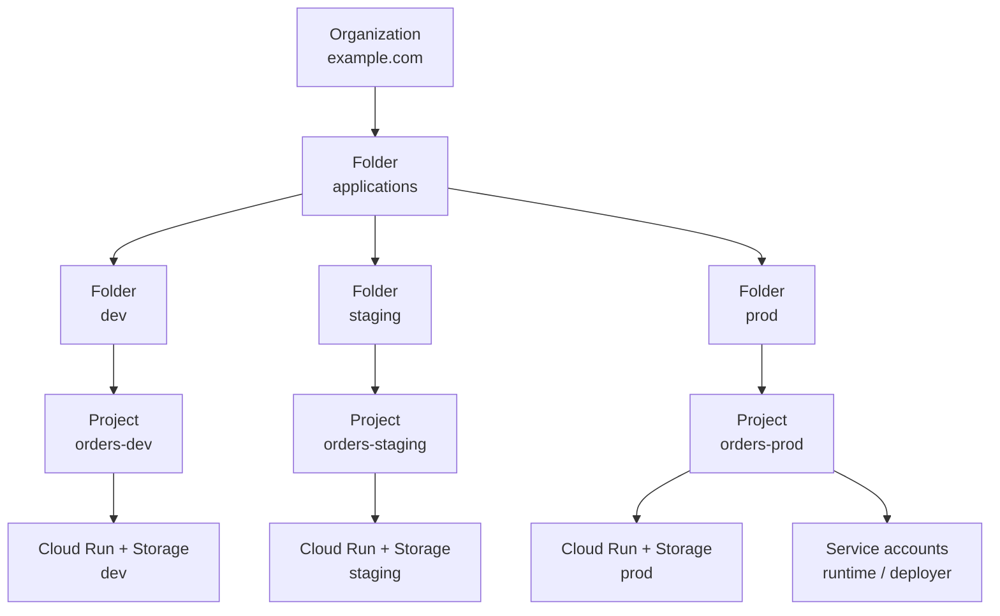
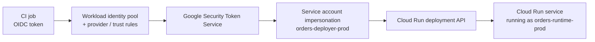

# Practicing environment- and workload-based authorization on Google Cloud

A system may deploy the same application across development, testing, and production environments, yet **must never grant the same permission set across every environment**. Developers need rapid experimentation in `dev`; pipelines need release permissions into `prod`; running applications only need to call the exact services and data they depend on. If everyone and every workload shares one broad account, a configuration mistake or credential leak in one environment can compromise the entire system.

This practical lesson belongs to the **IAM and authentication** chapter of the `CLOUD_PROVIDERS_GCP` module. When organizing projects, IAM, and VPCs to run Compute Engine, GKE, Cloud Run, Cloud Storage, and databases, you must clearly specify **which principal can do what on which resource**, design permissions around environment boundaries, and verify access before automating releases. The examples below use fictitious resources; they do not grant permissions in any real project until you intentionally run commands with real identifiers.

## 1. Expected outcomes

After this lesson, you can:

- Separate `dev`, `staging`, and `prod` by project and explain the role of Folders in IAM inheritance.
- Build a **permission matrix** for developers, QA, SREs, CI/CD pipelines, and application runtime identities.
- Distinguish **users/groups**, **deployer service accounts**, **runtime service accounts**, and Kubernetes ServiceAccount identities in GKE.
- Assign appropriate roles on the right project, bucket, Cloud Run service, or service account while preventing unintended sprawl through Folders.
- Use **Workload Identity Federation** so CI/CD and GKE access Google Cloud with short-lived credentials instead of storing long-lived JSON keys whenever possible.
- Read and inspect IAM policies, trace `PERMISSION_DENIED` errors, and revoke bindings when no longer needed.

## 2. Scenario: the Orders system across three environments

A company deploys an `orders-api` service. The application runs on **Cloud Run**, reads files from **Cloud Storage**, and connects to **Cloud SQL**. Engineering may also have a batch-processing workload on **GKE** and some maintenance jobs running on **Compute Engine**.

To limit blast radius, each environment uses an **independent project**:



**Why separate projects?**

- Each project has its own scoped IAM policies, resources, APIs, and service limits; costs can be monitored per environment.
- Permissions granted on project `orders-dev` do not automatically propagate to `orders-prod`.
- Organization Policies and other governance controls can be tailored per Folder or project as needed.
- It is straightforward to control whether a `dev` app can ever touch buckets, databases, or service accounts in `prod`.

**Key reminder:** Folders group projects and pass down supported inherited policies; Folders **do not create a shared VPC network, do not share secrets or data**, and do not sync roles from one project to a sibling project. Shared resources must be designed explicitly.

In these examples, `example.com`, `orders-dev`, and email addresses are placeholders. In real deployments, substitute your organization's managed domains, project IDs, and principals.

## 3. Analyzing principals and permission types

Before running IAM commands, list **who acts**, **what action they take**, **on which resource**, and **in which environment**.

### 3.1. Participating identities

| Principal | Function | Environment | Preferred scope |
| --- | --- | --- | --- |
| `group:orders-developers@example.com` | Develop, view logs, test deployments. | `dev` | Project `orders-dev` or specific resources. |
| `group:orders-qa@example.com` | Test and observe. | `staging` | Read and invoke access on services under test, avoiding broad admin rights. |
| `group:prod-observers@example.com` | Monitor status and diagnose issues. | `prod` | Suitable read-only roles; restrict sensitive data access. |
| `group:prod-approvers@example.com` | Approve release changes. | `prod` | Approval workflow rights; does not default to needing IAM write permissions. |
| `orders-deployer-prod@orders-prod.iam.gserviceaccount.com` | Release pipeline identity. | `prod` | Deploy Cloud Run and attach the approved runtime service account. |
| `orders-runtime-prod@orders-prod.iam.gserviceaccount.com` | Running application identity. | `prod` | Read buckets and connect to dependent services; no deploy permissions needed. |
| Kubernetes ServiceAccount `orders/orders-reader` | Workload running inside GKE. | `prod` | Read access on required resources via Workload Identity Federation for GKE. |

**Groups** are a clean way to manage humans by role. **Service accounts** are identities for applications or automation. A service account can act as a **principal** granted permissions on buckets/projects, and simultaneously as a **resource** that another principal can be granted permission to use or impersonate.

### 3.2. Sample IAM roles per task

| Task | Role commonly considered | Narrowest usable attachment level | Notes |
| --- | --- | --- | --- |
| Update Cloud Run service | `roles/run.developer` | Service or project, depending on permissions and service creation needs. | Deploying with a runtime service account may also require `iam.serviceAccounts.actAs`. |
| Attach service account to workload | `roles/iam.serviceAccountUser` | **The exact service account** permitted to be attached. | Includes `iam.serviceAccounts.actAs`; does not permit minting arbitrary access tokens. |
| Read Cloud Storage objects | `roles/storage.objectViewer` | Bucket or supported resource. | Do not grant across the whole project if only one bucket is needed. |
| Invoke Cloud Run service with IAM authentication enabled | `roles/run.invoker` | Target Cloud Run service. | Calls may still need valid ID tokens and remain subject to ingress/network settings. |
| Connect to Cloud SQL via supported mechanism | `roles/cloudsql.client` | Project or supported Cloud SQL scope. | Does not replace networking or database users/roles. |
| View logs | `roles/logging.viewer` and extra roles if needed | Project or supported scope. | Sensitive logs, including private logs, may require additional permissions. |
| View monitoring data | `roles/monitoring.viewer` | Project or supported scope. | Not equivalent to permission to read all application data. |

No single predefined role fits every environment and every operation. When picking a role, inspect its **actual permissions** and whether it can be bound on the target resource. Deployment commands may also require permissions on Artifact Registry, Cloud Build, service accounts, APIs, or other resources.

## 4. Designing an environment-based permission matrix

Suggested governance rules:

| Task | Dev | Staging | Prod |
| --- | --- | --- | --- |
| Developer deploys Cloud Run | Can allow dev group directly within dev scope. | Via test pipeline or designated group. | Only via release pipeline identity and approval process. |
| View logs/monitoring | Developers and SREs as needed. | QA, developers, and SREs under suitable roles. | Controlled ops/observer groups, avoiding exposing sensitive data. |
| Read application objects | Dev runtime service account. | Staging runtime service account. | Prod runtime service account, on matching prod bucket. |
| Access Cloud SQL | Dev app identity and authorized dev admin accounts. | Staging app identity. | Prod runtime identity and vetted DBA/ops team. |
| Edit project IAM | Authorized platform admin team. | Authorized platform admin team. | Only approved admin group; executed via audited workflow. |
| Use service account to deploy | Can allow dev group to use specific dev runtime SA. | Pipeline uses specific staging runtime SA. | Only prod deployer SA is allowed to attach prod runtime SA. |

This is a **target matrix**, not yet an IAM configuration. Convert it into concrete bindings in the steps below.

### 4.1. Least-privilege principles

1. **Separate by function:** developers, operators, QA, reviewers, deployers, and runtimes do not need the same permission set.
2. **Separate by environment:** never grant prod-level permissions on Folder `applications` if they are only meant for dev.
3. **Separate by workload:** `orders-api` and `payments-api` use separate service accounts; avoid one runtime account able to read every bucket/database.
4. **Prefer narrow predefined roles** over `roles/editor` or `roles/owner`; use custom roles when justified and supported by permissions.
5. **Bind at the narrowest level supporting the operation:** specific bucket, specific service account, specific Cloud Run service, or project when creating new resources.
6. **Separate IAM management from app runtime rights:** pipelines do not need rights to edit Organization Policies or grant themselves extra roles.

Never evaluate only permissions granted directly on a project. Allow bindings at **ancestor Organization/Folders** can continue applying to child projects. Check IAM deny, Principal Access Boundary, IAM Conditions, and other service controls when verifying effective permissions.

## 5. Preparing the practice lab

**Assumptions:** projects, Folders, buckets, Cloud Run services, and groups already exist. The operator holds appropriate IAM permissions to view and modify bindings on the designated resources. Creating Organizations, Folders, and linking billing lie outside this exercise.

The commands below are **operational examples** that modify live IAM on projects if executed. Run only in authorized test projects, substitute all resource names, and review scope before applying. This exercise requires neither creating service account keys nor storing credentials in repositories.

Set Bash variables to avoid mixing up projects:

```bash
DEV_PROJECT="orders-dev"
STAGING_PROJECT="orders-staging"
PROD_PROJECT="orders-prod"
REGION="asia-southeast1"

DEV_RUNTIME_SA="orders-runtime-dev@$DEV_PROJECT.iam.gserviceaccount.com"
PROD_RUNTIME_SA="orders-runtime-prod@$PROD_PROJECT.iam.gserviceaccount.com"
PROD_DEPLOY_SA="orders-deployer-prod@$PROD_PROJECT.iam.gserviceaccount.com"
```

Verify you are using the right account and projects:

```bash
# Currently active CLI account and default project
gcloud auth list
gcloud config get-value project

# Project metadata; makes no resource modifications
gcloud projects describe "$DEV_PROJECT"
gcloud projects describe "$PROD_PROJECT"

# Inspect policies attached directly to projects (excludes inherited permissions)
gcloud projects get-iam-policy "$DEV_PROJECT" --format=yaml
gcloud projects get-iam-policy "$PROD_PROJECT" --format=yaml
```

For IAM operations, **signing in successfully proves only authentication**. Authorization still depends on the active account's permissions. If reading policies returns `PERMISSION_DENIED`, ask an administrator for policy read rights rather than concluding the project has no IAM.

## 6. Step 1 — Create separate service accounts by environment and function

Create service accounts representing runtimes and pipelines:

```bash
# Application runtime in dev environment
gcloud iam service-accounts create orders-runtime-dev \
  --project="$DEV_PROJECT" \
  --display-name="Orders runtime dev"

# Application runtime in prod environment
gcloud iam service-accounts create orders-runtime-prod \
  --project="$PROD_PROJECT" \
  --display-name="Orders runtime prod"

# Pipeline identity dedicated to deploying into prod
gcloud iam service-accounts create orders-deployer-prod \
  --project="$PROD_PROJECT" \
  --display-name="Orders CI/CD deployer prod"
```

If a service account already exists, **do not duplicate it**; verify with read-only commands:

```bash
gcloud iam service-accounts describe "$DEV_RUNTIME_SA" \
  --project="$DEV_PROJECT"

gcloud iam service-accounts describe "$PROD_RUNTIME_SA" \
  --project="$PROD_PROJECT"

gcloud iam service-accounts describe "$PROD_DEPLOY_SA" \
  --project="$PROD_PROJECT"
```

Why separate `orders-deployer-prod` from `orders-runtime-prod`?

- **Deployer service account** is used when the pipeline calls APIs to deploy a new revision. It holds permissions to manage deployment resources and **attach** a designated runtime service account.
- **Runtime service account** is the principal Cloud Run uses when the application calls Google Cloud APIs after deployment. It receives required data access permissions, yet normally **needs no** deploy or IAM edit permissions.

**Limitation to recognize:** a deployer permitted to update code running under a runtime identity can indirectly make that code exercise the runtime identity's permissions. Therefore, protect the pipeline, build environment, image sources, review workflows, and approvals alongside restricting the deployer's IAM roles.

## 7. Step 2 — Bind roles for developers in dev

Example allowing the dev team to update Cloud Run in project `orders-dev`:

```bash
gcloud projects add-iam-policy-binding "$DEV_PROJECT" \
  --member="group:orders-developers@example.com" \
  --role="roles/run.developer"
```

When deployment needs to attach `orders-runtime-dev` to Cloud Run, the deploy team needs `iam.serviceAccounts.actAs` on the **target service account**. Grant `roles/iam.serviceAccountUser` on that exact account:

```bash
gcloud iam service-accounts add-iam-policy-binding "$DEV_RUNTIME_SA" \
  --project="$DEV_PROJECT" \
  --member="group:orders-developers@example.com" \
  --role="roles/iam.serviceAccountUser"
```

These two bindings do two distinct things: one permits operating on Cloud Run per role permissions, and the other permits attaching a **specific service account**. Depending on source/image deployment flow, build, image registry, and service usage permissions may also be needed; do not assume these two roles cover the entire pipeline.

**Check:** `orders-developers` must not receive equivalent bindings on `orders-prod`. Never grant `roles/run.developer` on Folder `applications` for dev convenience, because permissions there can propagate into staging and prod.

## 8. Step 3 — Authorize the prod release pipeline

In prod, rather than letting all developers deploy directly, the pipeline uses `orders-deployer-prod` and runs only after build, test, review, and approval gates.

### 8.1. Grant Cloud Run permissions to the deployer

Example project-level grant so the pipeline **can create new services** in the project (broader than updating an existing service):

```bash
gcloud projects add-iam-policy-binding "$PROD_PROJECT" \
  --member="serviceAccount:$PROD_DEPLOY_SA" \
  --role="roles/run.developer"
```

If the pipeline only updates an existing service, evaluate binding a narrower role directly on that **Cloud Run service**. Verify exact permissions for pipeline steps and image/registry access.

Allow the deployer to **attach the exact prod runtime service account**:

```bash
gcloud iam service-accounts add-iam-policy-binding "$PROD_RUNTIME_SA" \
  --project="$PROD_PROJECT" \
  --member="serviceAccount:$PROD_DEPLOY_SA" \
  --role="roles/iam.serviceAccountUser"
```

Never grant `roles/iam.serviceAccountUser` across the **whole project** if the pipeline needs only one runtime account; doing so lets it attach other service accounts in the project.

### 8.2. Supplying credentials to the pipeline: prefer federation

A pipeline outside Google Cloud (such as an OIDC-enabled CI system) can use **Workload Identity Federation** for short-lived credentials. Typical flow:



In the **impersonation** model, a principal from the identity pool receives `roles/iam.workloadIdentityUser` on the deployer service account; the deployer itself holds the scoped deployment permissions from the previous steps.

The illustration below assumes you **already created** the workload identity pool/provider, validated the token issuer, configured attribute mappings, and constrained the repository in trust config:

```bash
# Replace identity pool project number, pool ID, and repository value
POOL_PROJECT_NUMBER="123456789012"
POOL_ID="ci-pool"
REPOSITORY="example-co/orders"

gcloud iam service-accounts add-iam-policy-binding "$PROD_DEPLOY_SA" \
  --project="$PROD_PROJECT" \
  --member="principalSet://iam.googleapis.com/projects/$POOL_PROJECT_NUMBER/locations/global/workloadIdentityPools/$POOL_ID/attribute.repository/$REPOSITORY" \
  --role="roles/iam.workloadIdentityUser"
```

**Mandatory safety requirements:** configure the provider to accept only the trusted issuer, constrain relevant claims such as organization, repository, branch, or release environment, and protect pipeline approval gates. The `principalSet` binding alone **does not prove** the provider enforces those checks. `POOL_PROJECT_NUMBER` is the **project number holding the identity pool**, which can differ from `PROD_PROJECT`.

No service account JSON private key needs to be downloaded for OIDC federation. Never share one service account across multiple pipelines/environments with excess permissions.

### 8.3. Deploying Cloud Run with a dedicated runtime identity

Once the pipeline authenticates as the right deployer identity and can access container images, for example:

```bash
gcloud run deploy orders-api \
  --project="$PROD_PROJECT" \
  --region="$REGION" \
  --image="asia-southeast1-docker.pkg.dev/orders-prod/apps/orders-api:v1" \
  --service-account="$PROD_RUNTIME_SA"
```

This illustrative command performs a live deployment if executed. The image repository must exist, Cloud Run needs configured image-pull permissions, and the pipeline must hold deploy permissions. In change-controlled organizations, run only after artifacts are verified and the image version is approved.

**Distinction:** the account calling `gcloud run deploy` is the **deployer**; the account Cloud Run uses at runtime is the `--service-account` value. Application data read rights belong on the runtime account, not the deployer unless the pipeline genuinely needs to read that data.

## 9. Step 4 — Grant data access only to runtime workloads

### 9.1. Cloud Run reads only its environment's bucket

Suppose the bucket storing `orders-api` reports in prod is `gs://orders-reports-prod`. Grant object read permissions to the **prod runtime** on that exact bucket:

```bash
gcloud storage buckets add-iam-policy-binding gs://orders-reports-prod \
  --member="serviceAccount:$PROD_RUNTIME_SA" \
  --role="roles/storage.objectViewer"
```

In dev, the equivalent grant must use `orders-runtime-dev` and bucket `gs://orders-reports-dev`. **Never** share one runtime service account across both environments, and never grant project-level read roles when only one bucket is needed.

If the app needs to **write new objects**, `roles/storage.objectViewer` is insufficient; select an appropriate write role/permission and evaluate overwrite/delete rights. Never default to `roles/storage.admin` just to fix a write error.

### 9.2. Connecting to Cloud SQL in another project

Suppose the Cloud SQL instance resides in project `orders-data-prod`. The runtime may need permission to use Google Cloud connection mechanisms:

```bash
DATA_PROD_PROJECT="orders-data-prod"

gcloud projects add-iam-policy-binding "$DATA_PROD_PROJECT" \
  --member="serviceAccount:$PROD_RUNTIME_SA" \
  --role="roles/cloudsql.client"
```

Notes:

- `roles/cloudsql.client` covers connecting to Cloud SQL through supported mechanisms. It **does not** replace network reachability, Cloud SQL connector/Auth Proxy settings, or other service requirements.
- Access privileges **inside PostgreSQL/MySQL** (database users, roles, table privileges) are a separate layer.
- Organizations may evaluate narrower scopes if resource types and permissions support them; the project grant here clearly illustrates the boundary between the Cloud Run project and the database project.
- Dev environments must never connect straight to production databases merely because developers can create workloads in dev.

### 9.3. Cloud Run calling another Cloud Run service

If `orders-api` needs to call a Cloud Run backend requiring IAM authentication, the backend can grant `roles/run.invoker` to the caller's runtime service account on the **target service**:

```bash
gcloud run services add-iam-policy-binding backend-api \
  --project="$PROD_PROJECT" \
  --region="$REGION" \
  --member="serviceAccount:$PROD_RUNTIME_SA" \
  --role="roles/run.invoker"
```

The caller must send an **ID token with matching audience** when the backend enforces IAM authentication. Invoker and ID tokens do not bypass ingress restrictions, VPC/service networking, or in-app authentication logic.

## 10. Step 5 — Authorizing a GKE workload

When an application runs on GKE, distinguish at least two identity layers:

- **Kubernetes ServiceAccount (KSA):** the workload's identity inside Kubernetes, e.g., `orders/orders-reader`.
- **IAM principal via Workload Identity Federation for GKE:** lets the workload authenticate to Google Cloud APIs using the mapped workload identity.

For services supporting Workload Identity Federation for GKE principal identifiers, you can grant IAM roles **directly to the KSA principal**, avoiding JSON keys or letting all Pods share a broadly privileged Google service account.

Assuming the cluster/node pools have Workload Identity Federation for GKE enabled/configured per mode, and namespace `orders` and KSA `orders-reader` exist:

```bash
# Project number of the project hosting the GKE cluster / workload identity pool
GKE_PROJECT_NUMBER="123456789012"
GKE_PROJECT_ID="orders-prod"

gcloud storage buckets add-iam-policy-binding gs://orders-reports-prod \
  --member="principal://iam.googleapis.com/projects/$GKE_PROJECT_NUMBER/locations/global/workloadIdentityPools/$GKE_PROJECT_ID.svc.id.goog/subject/ns/orders/sa/orders-reader" \
  --role="roles/storage.objectViewer"
```

The `principal://...` identifier above is the **KSA principal** for that exact namespace and service account, not `serviceAccount:orders-runtime-prod@...`. When using this pattern, the Pod must run with `serviceAccountName: orders-reader` and proper cluster config.

If a target service or library does not yet support this principal format, GKE also supports allowing a KSA to **impersonate an authorized IAM service account**. Enabling WIF, configuring the GKE metadata server, binding accounts, and deploying are separate checks; adding an IAM binding on a bucket **does not configure** the cluster on its own.

**Never grant the default node service account read access across all buckets** just because one Pod needs data. Scope permissions per KSA/namespace/workload, keeping in mind Pods can use whatever KSA identity they are allowed to mount.

## 11. Step 6 — Inspecting policies and effective permissions

After every change, inspect **the exact resource holding the IAM policy**, not just the project:

```bash
# Allow policies attached directly to projects
gcloud projects get-iam-policy "$DEV_PROJECT" --format=yaml
gcloud projects get-iam-policy "$PROD_PROJECT" --format=yaml

# Who is allowed to act on the runtime service account?
gcloud iam service-accounts get-iam-policy "$PROD_RUNTIME_SA" \
  --project="$PROD_PROJECT" \
  --format=yaml

# Who has access on the prod bucket?
gcloud storage buckets get-iam-policy gs://orders-reports-prod

# IAM policy of the Cloud Run backend
gcloud run services get-iam-policy backend-api \
  --project="$PROD_PROJECT" \
  --region="$REGION" \
  --format=yaml
```

**Keep in mind the two perspectives on a service account:**

1. `gcloud iam service-accounts get-iam-policy` tells you **who is allowed to act on the service account resource**, such as `actAs`.
2. To find **where the service account holds roles**, inspect policies on target **projects/buckets/Cloud Run services** and bindings from ancestor levels. You cannot read the policy *of the service account* and think that lists all permissions it holds elsewhere.

### 11.1. Checking permissions inherited from Folders

A group granted `roles/viewer` on Folder `prod` can receive view permissions across resources in `orders-prod` even though `gcloud projects get-iam-policy orders-prod` does not display that binding.

To read policies at a Folder or Organization (requires corresponding permissions):

```bash
gcloud resource-manager folders get-iam-policy FOLDER_ID --format=yaml
gcloud organizations get-iam-policy ORG_ID --format=yaml
```

Never infer complete effective permissions from a single resource's **direct policy**. When in doubt, use **Policy Troubleshooter** in Console for the exact **principal – permission – resource** triple; analysis completeness depends on your policy and metadata read access.

### 11.2. Expected behavior test matrix

| Test | Expected outcome |
| --- | --- |
| Dev developer deploys Cloud Run in `orders-dev` once auxiliary permissions are in place. | **Allowed**. |
| Dev developer deploys directly to `orders-prod`. | **Denied**, unless other grants or inherited permissions exist. |
| Prod runtime reads objects in `orders-reports-prod`. | **Allowed** per role and applicable service conditions. |
| Dev runtime reads objects in `orders-reports-prod`. | **Denied**, unless another grant exists. |
| Prod pipeline attaches a runtime service account outside the approved list. | **Denied** if the pipeline lacks `actAs` on that service account. |
| Caller without `run.invoker` calls an IAM-authenticated backend. | **Denied** unless permitted by another access mechanism. |
| GKE Pod using KSA `orders-reader` reads bucket with WIF properly set up. | **Allowed** when IAM and access paths are valid. |

These are **design target outcomes**, not guaranteed solely by the sample commands. Verify all ancestor IAM bindings, conditions, denies, PAB, and live service configs to confirm.

### 11.3. Diagnosing permission errors without widening access

When hitting `403 PERMISSION_DENIED`, capture the **actual principal**, **resource**, **permission/API method**, and **timestamp**:

1. **Who sent the request?** Current CLI account, ADC identity, Cloud Run/Compute Engine service account, or federated KSA?
2. **Which permission is missing?** Cloud Run deploy rights, `iam.serviceAccounts.actAs`, `storage.objects.get`, Cloud SQL rights, or service invoke rights?
3. **Is the binding in the right place?** Project, bucket, Cloud Run service, service account resource, or ancestor Folder/Organization?
4. **Are conditions or denies involved?** IAM Conditions, deny policies, and PAB can constrain allow.
5. **Any non-IAM issue?** Cloud Run ingress, database login, VPC, disabled APIs, quotas, or Organization Policy.

Classic mistake: `orders-runtime-prod` gets `403` reading Cloud Storage. Granting `roles/storage.objectViewer` to the **developer group** instead of the **runtime service account** leaves the error unresolved. Fix the binding for the right principal on the right bucket.

## 12. Revoking permissions and operational workflows

Keep a rollback plan whenever a binding is misapplied or no longer needed. For example, to revoke the illustrative bindings in dev and prod:

```bash
# Revoke developer rights on dev project
gcloud projects remove-iam-policy-binding "$DEV_PROJECT" \
  --member="group:orders-developers@example.com" \
  --role="roles/run.developer"

# Revoke deployer right to attach prod runtime service account
gcloud iam service-accounts remove-iam-policy-binding "$PROD_RUNTIME_SA" \
  --project="$PROD_PROJECT" \
  --member="serviceAccount:$PROD_DEPLOY_SA" \
  --role="roles/iam.serviceAccountUser"

# Revoke bucket read access from prod runtime
gcloud storage buckets remove-iam-policy-binding gs://orders-reports-prod \
  --member="serviceAccount:$PROD_RUNTIME_SA" \
  --role="roles/storage.objectViewer"
```

Run revocation commands only after confirming the exact member, role, and resource. Another binding at an ancestor level may still grant the same permission. Revoked permissions may also not take effect instantaneously across every cached token or system; **verify through real behavior and audit logs**, not just the IAM UI.

### 12.1. Emergency access and auditing

In prod, organizations may need a **break-glass** procedure for severe incidents. That procedure should include approvals, time limits, access logs, and post-incident review. Emergency access should never be standing `roles/owner` across the entire developer group.

**Cloud Audit Logs** support investigating admin operations and access per service capabilities. Admin Activity logs and Data Access logs follow different collection/enablement rules; configure log collection and log-reading permissions ahead of time if you need to inspect data access events. Pair Audit Logs with infrastructure-as-code changes and pipeline history to answer **who granted which role, when, and why**.

### 12.2. Design mistakes to avoid

| Mistake | Consequence | Fix |
| --- | --- | --- |
| Granting `roles/editor` to every runtime account. | Buggy or exploited app code gains broad blast radius. | Grant narrow roles matching resources and API needs. |
| Granting `roles/run.developer` on Folder `applications` to dev group. | Developers may gain access in staging/prod. | Bind roles on `orders-dev` or dev resources. |
| Sharing one runtime SA across dev and prod. | Hard to guarantee data and environment isolation. | Create independent SAs per workload/environment. |
| Giving pipeline `actAs` on all project service accounts. | Pipeline can attach accounts more privileged than needed. | Grant `roles/iam.serviceAccountUser` on the specific SA. |
| Storing SA JSON keys in CI. | Leaked keys enable prolonged unauthorized access. | Use federation/short-lived tokens and enforce trust controls. |
| Checking only project IAM policy and assuming no access exists. | Misses inherited permissions at Folder/Organization. | Read ancestor policies and use Policy Troubleshooter. |
| Immediately granting broad roles upon seeing `403`. | Increases risk and often fails to fix the error. | Identify caller, permission, resource, and all control layers. |

## 13. Applied exercises

### Exercise A — Identifying where to place bindings

Given projects `orders-dev`, `orders-staging`, `orders-prod` and bucket `orders-reports-prod`. Propose where to attach permissions for each case:

1. Developers only need to deploy Cloud Run in dev.
2. Service account `orders-runtime-prod` only needs to read objects in the prod bucket.
3. Prod pipeline needs to attach service account `orders-runtime-prod` during deployment.
4. SRE needs to view metrics across all three projects; no app data access needed.
5. Pod `orders/orders-reader` on prod GKE needs to read the prod bucket.

**Suggested answers:** (1) Suitable dev project/service with a narrow Cloud Run role. (2) Prod bucket, `roles/storage.objectViewer` for runtime SA. (3) On the runtime SA itself, grant `roles/iam.serviceAccountUser` to the deployer SA. (4) Consider `roles/monitoring.viewer` on the relevant projects—or on the Folder only if you want it across the whole branch; review metrics scope config for cross-project viewing. (5) Properly configured Workload Identity Federation for GKE plus bucket read role for the KSA principal, or a supported impersonation setup.

### Exercise B — Incident analysis

After a release, `orders-api` on Cloud Run in prod gets `403` reading the bucket. A developer signed in with their personal account can still read the bucket in Console. A teammate suggests granting `roles/editor` to all service accounts in the project.

Answer:

1. Why does the developer being able to read the bucket **not prove** Cloud Run can read it?
2. Which principal must you identify at runtime?
3. On which resources should you check policies?
4. If the runtime SA already has `roles/storage.objectViewer` on the bucket yet still fails, what else must you check?

**Suggested answers:** (1) The developer and the workload are two distinct principals. (2) The runtime service account actually configured on the Cloud Run service/revision. (3) IAM policies on the bucket and applicable ancestor resources. (4) Exact object/key accessed, right bucket/project, IAM Conditions, IAM deny/PAB, Organization Policy, app configuration, and detailed error messages. Never add `roles/editor` to guess at an error.

### Exercise C — Evaluating inherited permissions

Group `group:prod-observers@example.com` holds `roles/viewer` on Folder `prod`. An admin deletes a Viewer binding for this group on project `orders-prod`, yet the group can still view some metadata. What happened?

**Answer:** Viewer permissions from Folder `prod` are still inherited down to the project. To change scope, evaluate and update the binding at the proper level or redesign Folder/project structure; deleting a project binding cannot remove an allow inherited from an ancestor.

## 14. Pre-production IAM operations checklist

- [ ] Clear **Organization / Folder / Project** diagram separating dev, staging, and prod.
- [ ] Approved permission matrix by **principal × operation × resource × environment**.
- [ ] Every runtime workload has a dedicated identity holding only required roles.
- [ ] Deployer and runtime are separate identities; `actAs` is restricted to permitted accounts.
- [ ] External CI/CD uses **Workload Identity Federation** or keyless methods where supported.
- [ ] GKE workloads use appropriate KSAs/Workload Identity Federation, avoiding broad shared node permissions.
- [ ] Verified roles/bindings on both target resources **and** ancestors.
- [ ] Tested both **allowed** and **denied** cases using real principals.
- [ ] Accounted for deny policies, PAB, IAM Conditions, Organization Policy, and service configs.
- [ ] Audit logs, revocation procedures, and periodic IAM reviews are in place.

## 15. Conclusion

Safe authorization on Google Cloud starts with **separating environments**, then separating **human identities**, **deployer identities**, and **runtime identities**. Every IAM binding must clearly specify principal, role, and target resource, scoped tightly enough for the job.

For **Cloud Run**, separate deployment permissions from runtime API-calling permissions. For **GKE**, distinguish Kubernetes ServiceAccounts from IAM principals via Workload Identity Federation. For **Cloud Storage** and **Cloud SQL**, grant access to the exact data or services actually used while verifying networking, database authentication, and other constraints.

As you expand to Compute Engine, add projects, or automate releases, keep applying the same workflow: **identify principal → identify permission → choose role → choose resource/scope → grant access → verify → monitor and revoke when no longer needed**.

### Google Cloud reference documentation

- [IAM overview](https://cloud.google.com/iam/docs/overview)
- [Resource hierarchy access control](https://cloud.google.com/iam/docs/resource-hierarchy-access-control)
- [Roles and permissions](https://cloud.google.com/iam/docs/understanding-roles)
- [Service accounts overview](https://cloud.google.com/iam/docs/service-account-overview)
- [Workload Identity Federation](https://cloud.google.com/iam/docs/workload-identity-federation)
- [Workload Identity Federation for GKE](https://cloud.google.com/kubernetes-engine/docs/concepts/workload-identity)
- [Cloud Run service identity](https://cloud.google.com/run/docs/securing/service-identity)
- [IAM Policy Troubleshooter](https://cloud.google.com/policy-intelligence/docs/troubleshoot-access)
