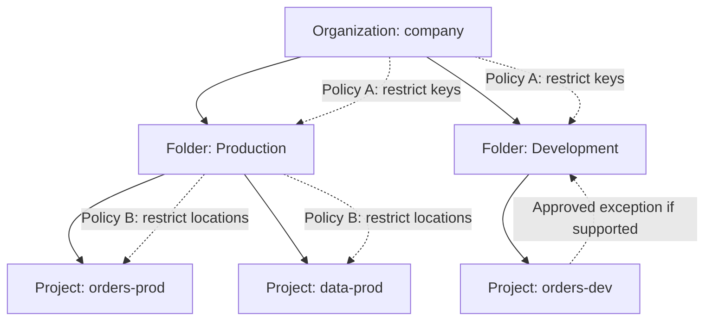
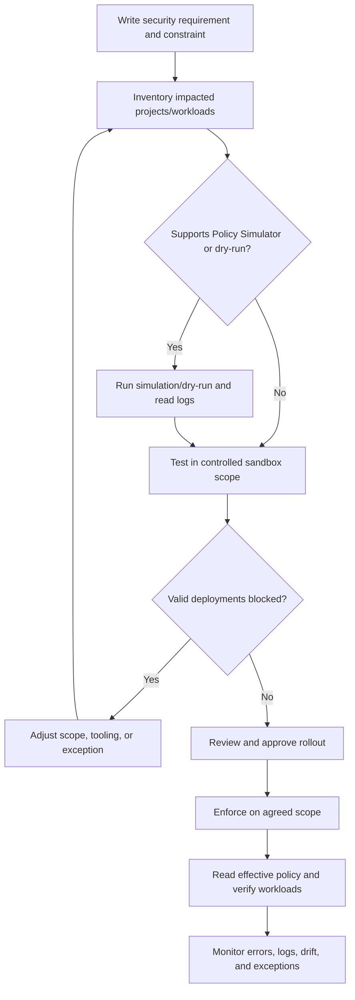

# Organization Policy and Resource Constraints

An engineer who has permission to create a Compute Engine VM, deploy Cloud Run, or configure Cloud Storage is not necessarily allowed to configure those resources in **any arbitrary way**. An enterprise may require that resources only be created in approved locations, restrict long-lived service account keys, control public connectivity, or enforce specific security settings. That is the role of **Google Cloud Organization Policy Service**: establishing consistent governance limits across multiple projects.

This lesson belongs to the **Organization Governance** chapter of the `CLOUD_PROVIDERS_GCP` module. When learning how to organize projects, IAM, and VPCs, choose Compute Engine/GKE/Cloud Run, store data, automate releases, or manage reliability and cost, you need to know whether organization policies allow the desired configuration. Choosing the technically right service while violating governance constraints still produces an undeployable design.

In this lesson, a **constraint** is a system-defined restriction type; an **organization policy** is a configuration applying that constraint to a location in the resource hierarchy; and an **effective policy** is the resulting outcome after evaluating inheritance, overrides, conditions, and Google-managed defaults. Examples use hypothetical environments: no actions need to be taken on a production organization to complete reading this lesson.

## 1. What Problems Does Organization Policy Solve?

Imagine a company with dozens of projects. The security team requires that no service account JSON keys be created for new workloads. If you only write that rule in a wiki, teams may forget to check; if you write a periodic checker script, misconfigurations may already have reached production. Organization Policy pushes part of those rules down to the enforcement layer of Google Cloud services that support the constraint.

| Problem | Desired Rule | Role of Organization Policy |
| --- | --- | --- |
| Credential management | Restrict creation of user-managed service account keys | Blocks new key creation when the corresponding constraint is enforced. |
| Resource location | Only allow creating supported resources in approved locations | Rejects non-compliant creation requests at supported services. |
| Restricting network configurations | Disallow certain endpoint or ingress types | Applies constraints suited to each service and resource type. |
| Multi-project governance | All projects in the production folder follow shared rules | Set policies at the organization or folder so child projects inherit them. |
| Controlled exceptions | A sandbox group needs a different option for experimentation | Use a child policy or tag-based conditions when the constraint allows it and it is approved. |

Organization Policy creates **guardrails**. It does not automatically detect every vulnerability, does not replace reviewing existing configurations, and does not automatically make every service compliant. Applicability depends on the constraint, resource type, enforcing service, and check timing.

### 1.1. Distinguishing from IAM, VPC, and Other Governance Tools

| Mechanism | Primary Question | Example |
| --- | --- | --- |
| **IAM allow/deny** | *Who* has permission to perform what action on a resource? | The deployment service account can only update Cloud Run services in its assigned project. |
| **Organization Policy** | *Which configuration or behavior* is allowed by the system? | New service account keys cannot be created even if the caller holds the corresponding IAM permission. |
| **VPC/firewall/Cloud Armor** | Which network traffic is allowed in/out or how is it protected? | Block a source IP to an application; control ingress/egress. |
| **VPC Service Controls** | Reduce data exfiltration risk across access boundaries of supported services | Create a service perimeter for eligible services and projects. |
| **Quotas** | How much resource capacity can be consumed or at what rate can APIs be called? | Limit CPU count or API request rate per quota scope. |
| **Cloud Billing budgets** | How does spending compare against the budget? | Send alerts when forecasted spend exceeds thresholds; not a hard cap by default. |

A successful VM creation request typically must satisfy IAM, Organization Policy, quotas, service limits, and product-specific conditions **simultaneously**. Having the `Owner` role on a project does not mean you can bypass an effective Organization Policy. Conversely, an Organization Policy allowing a configuration type does not mean an account immediately has IAM permissions to create that resource.

## 2. Three Core Concepts: Constraint, Policy, and Enforcement

### Constraint: A Checkable Rule

A constraint defines a restriction condition. Names in the API/reference typically look like:

```text
constraints/iam.managed.disableServiceAccountKeyCreation
constraints/gcp.resourceLocations
```

Specific names act as API contracts; the word `managed` and constraint types reflect the configuration mechanism. Do not invent names based on English descriptions. Before using one, check the [official constraint catalog](https://cloud.google.com/resource-manager/docs/organization-policy/org-policy-constraints) or [Organization Policy constraints](https://docs.cloud.google.com/organization-policy/reference/org-policy-constraints).

### Organization Policy: A Configuration Attached to a Resource

With Organization Policy API v2, policy resource names typically have the form:

```text
organizations/123456789012/policies/iam.managed.disableServiceAccountKeyCreation
folders/234567890123/policies/iam.managed.disableServiceAccountKeyCreation
projects/my-production-project/policies/iam.managed.disableServiceAccountKeyCreation
```

In CLI commands, a constraint may be passed as `iam.managed.disableServiceAccountKeyCreation`, whereas reference documentation displays the `constraints/` prefix. The segment after `policies/` in the resource name is the constraint name, not an arbitrary YAML filename.

Each policy configures **one constraint** at the chosen resource scope, with one or more rules. Those rules determine whether to enforce, which values are allowed or denied, or which conditions must hold. When policies exist at multiple levels, the outcome on a project is evaluated according to hierarchy rules and the constraint type.

### Enforcement: Target Services Check Requests

Organization Policy Service stores and serves policies; **the relevant Google Cloud service** enforces the restriction as defined by the constraint. For instance, when attempting to create a service account key and a constraint blocks it, the API may return a `FAILED_PRECONDITION` error. Some constraints apply only on resource creation or update, and many constraints do not alter previously created resources.

Therefore, distinguish between:

- **Existing policy configuration:** what the CLI/API reports for the policy resource.
- **Effective policy:** the rule that applies after inheritance and defaults for the queried resource.
- **Actual compliance:** the state of existing resources and requests checked by services.

These three layers are related, not equivalent.

## 3. How Policies Propagate Through Organization → Folder → Project

A resource hierarchy typically looks like:



This is a learning diagram about **scope**. A project outside the Production folder will not automatically receive policies attached only to that folder. However, it can still inherit policies attached at the organization or other ancestors.

### 3.1. "No Direct Policy" Is Different from "No Restrictions"

If project `orders-prod` has no direct policy for a constraint, it typically inherits the effective value from its folder or organization. If there is no explicit policy anywhere in the hierarchy, the constraint's **Google-managed default** behavior takes effect; some defaults are already restrictive. Therefore, a `describe` command without `--effective` returning `NOT_FOUND` does not prove the project is allowed to do everything.

### 3.2. Inheritance, Overrides, and Merging Depend on Constraint Type

| Policy Type | Key Rule | Practical Note |
| --- | --- | --- |
| Modern managed constraint | A child policy can inherit or override a policy from an ancestor, without legacy list-style merging | Read the effective policy; check the constraint's `parameters` syntax. |
| Legacy boolean constraint | If a project/folder has its own rule, that rule's enforce value decides at that level | Can override `true`/`false` when permitted; do not assume higher-level booleans "can never be relaxed." |
| Legacy list constraint | Can replace or merge depending on inheritance settings; when merging, denied values take precedence on conflict | Read `inheritFromParent` and the effective policy, not just the project YAML. |
| Custom constraint | Has enforce rules with custom conditions defined by the organization; deployed on Google-supported resources | Verify conditions, resource types, and which `CREATE`/`UPDATE` methods are checked. |

**There is no single merge formula valid for every policy.** For legacy list rules, `inheritFromParent: true` can be declared to merge according to the constraint type's rules. For managed constraints, inheritance selects and applies the effective policy from the appropriate level rather than merging parameter lists like legacy constraints. To predict outcomes, consult [Hierarchy evaluation](https://docs.cloud.google.com/organization-policy/hierarchy-evaluation) and run `describe --effective`.

### 3.3. Three Commonly Misunderstood Operations

- **Inherit parent:** remove specific configuration on a child to use the effective policy from the parent.
- **Override:** set a policy on a child to change the outcome relative to the inherited policy, if permissions and constraint type allow.
- **Restore Google-managed default:** return the resource to the constraint's default behavior, **which may differ** from inheriting the parent policy. Default does not necessarily mean "allow everything."

Deleting a policy (`delete`) on a project typically causes the project to fall back to inheriting from its parent; `reset` is designed to restore the constraint's default behavior. Before using either in production, verify the exact command, constraint type, and resulting effective policy.

## 4. Constraint Categories and Recognizing Syntax

Google Cloud currently describes three primary groups:

| Group | Characteristics | Typical Use Cases |
| --- | --- | --- |
| **Managed constraints** | Google defines rules and may provide `parameters`; integrates better with policy analysis tools | Restricting a specific behavior, resource type, or Google-managed list of configuration values. |
| **Legacy managed constraints** | Older predefined constraints, commonly **boolean** or **list** with `allowedValues`/`deniedValues` | Restricting resource locations or service configuration values. |
| **Custom constraints** | Organization-defined restrictions for supported resource types, usually using CEL expressions and specific enforcement methods | Enforcing a property on Cloud Run/GKE/Compute Engine during supported `CREATE`/`UPDATE` operations. |

Example of a **boolean rule**:

```yaml
name: organizations/123456789012/policies/iam.managed.disableServiceAccountKeyCreation
spec:
  rules:
  - enforce: true
```

Illustrative example of a **legacy list rule** for location restriction:

```yaml
name: folders/234567890123/policies/gcp.resourceLocations
spec:
  rules:
  - values:
      allowedValues:
      - in:asia-southeast1-locations
```

The second example uses a region value group; before applying it, you must verify **group values**, the list of supported services, and any need for global/multi-region resources. It can also block resources created indirectly by other services. Allowing only one region is not sufficient to prove that all data and every log/backup remain in that region.

For custom constraints, the organization defines the resource type, method types (such as `CREATE`/`UPDATE`), condition, and action (typically `ALLOW`/`DENY`) per the Organization Policy API schema; a policy at the organization, folder, or project then decides whether to enforce that constraint. You cannot write an arbitrary CEL expression for a resource if the service does not support custom constraints.

### 4.1. Choosing Constraints by Requirement Rather Than Familiar Names

| Governance Requirement | First Constraint / Group to Check | What Must Be Verified |
| --- | --- | --- |
| No issuing long-lived service account keys | `iam.managed.disableServiceAccountKeyCreation` | Impact on legacy workloads and key management processes. |
| No creating service accounts outside centralized provisioning | `iam.managed.disableServiceAccountCreation` | Do services automatically create default service accounts upon activation? |
| Resources must be created in approved locations | `gcp.resourceLocations` | Services, resource types, location groups, exceptions, and non-retroactive limits. |
| Only accept approved ingress for Cloud Run | Available Cloud Run constraints or custom constraints supporting the resource | Ingress configuration differs from invoker IAM; does it affect load balancers/VPC? |
| Restrict sharing or granting permissions by domain | IAM/domain-related constraints | Distinguish IAM membership, service accounts, and organizational exceptions. |
| Prevent non-compliant VM configurations | Compute Engine managed constraints or custom constraints supporting VMs | Distinguish create-time vs. update-time and related resource types. |

Constraint names and support types can evolve over time, especially when Google provides a managed constraint replacing a legacy constraint. Do not select both blindly: read their descriptions, limitations, and interactions.

## 5. Which IAM Permissions Are Needed to View and Manage Organization Policies?

Organization Policy features separate read permissions from write permissions. Someone designing or auditing policies may need permission to read policy resources and effective policies; someone changing policies must hold administrative permissions on the appropriate resource.

| Task | Permission Scope to Consider |
| --- | --- |
| View a constraint and effective policy | Organization policy/constraint read permissions per resource IAM; an admin can grant an appropriate viewer role. |
| Create, edit, delete policies on organization/folder/project | Policy admin permissions, typically `roles/orgpolicy.policyAdmin` on the assigned scope. |
| Create custom constraints | Permission to create/manage custom constraints at the organization level, plus permission to apply policies on target resources. |
| View dry-run violation logs | Cloud Logging/Audit Logs read permissions appropriate to where logs are stored. |
| Use policy tags or delegations | Permissions to manage tag bindings/read tags as needed, in addition to policy admin permissions when modifying. |

Grant administrative permissions only to people/processes accountable for governance. A policy at the organization level can affect hundreds of projects. Standard application deployment accounts **do not need** permission to edit organization policies to deploy a Cloud Run service.

### Separating Operator and Application Identities

IAM determines who can modify policies; Organization Policy determines which resource configurations are accepted. If a policy prohibits service account keys, the recommended alternative is using workload identities and short-lived credentials (an attached runtime service account, or Workload Identity Federation where appropriate), rather than requesting the Owner role to try creating keys.

## 6. Checking Direct and Effective Policies with gcloud

The commands below are **read-only**. Run them using an identity authorized to inspect the target project/folder/organization. Replace project ID, folder ID, and organization ID with real values:

```bash
# Policy attached directly to the organization for the selected constraint.
gcloud org-policies describe iam.managed.disableServiceAccountKeyCreation \
  --organization=123456789012

# Policy attached directly to the folder (if any).
gcloud org-policies describe gcp.resourceLocations \
  --folder=234567890123

# Policy attached directly to the project.
gcloud org-policies describe iam.managed.disableServiceAccountKeyCreation \
  --project=orders-prod

# Effective outcome applied at the project after inheritance/defaults.
gcloud org-policies describe iam.managed.disableServiceAccountKeyCreation \
  --project=orders-prod \
  --effective
```

Interpreting results:

1. `describe` **without** `--effective` returns the policy set directly at the queried level. `NOT_FOUND` may simply mean there is **no direct policy** at that level.
2. `describe --effective` returns the policy after inheritance/default calculation at the resource level; this is what you must read before assuming a request will be accepted.
3. If a rule has tag-based conditions, you must also check the resource's actual tag bindings and how conditions are evaluated.
4. When a policy is newly changed, enforcement has propagation latency; documentation notes it can take up to around **15 minutes** for full effect. Do not conclude a policy is ignored from a single test immediately after setting it.

Lacking read permission produces a `PERMISSION_DENIED` error. This differs from `NOT_FOUND` caused by having no direct policy; read the error details and resource scope before drawing conclusions.

### 6.1. Tracing the Origin of a Restriction

Suppose project `orders-prod` cannot create service account keys:

1. Read the effective policy for `iam.managed.disableServiceAccountKeyCreation` on the project.
2. Read direct policies on the project, parent folders, and organization where authorized.
3. Identify where an enforce rule or restrictive Google-managed default is set.
4. Check whether rules have tag conditions and whether the constraint is enabled by default by Google for this organization.
5. Cross-reference audit logs and the error details of the blocked action itself.

This is better than trying to add broad IAM roles or requesting removal of an organization-wide constraint.

## 7. Designing Policies Around Resource Requirements

An organization typically has multiple environments with different risk profiles. Describe the requirement first, then choose the constraint.

| Context | Requirement | Suggested Scope | Impact Checks |
| --- | --- | --- | --- |
| Production API on Cloud Run | Restrict unapproved ingress paths | Production folder or target project | Domains, load balancers, Cloud Run invoker IAM, internal call paths. |
| Data with residency requirements | Restrict locations for supported resource types | Sensitive data folder | Cloud SQL/Cloud Storage/BigQuery, backups, logs, dependency regions. |
| Compute Engine VMs | Block unsafe VM configurations or credentials per appropriate constraints | VM folder or organization | Autoscaling, image pipelines, service accounts, monitoring agents. |
| GKE | Restrict non-compliant cluster/node configurations | Container runtime folder | Compatibility with GKE Autopilot/Standard and upgrade processes. |
| Entire organization | Restrict user-created service account keys | Organization | CI/CD, automation, third-party tools using long-lived credentials. |

Do not apply an organization-level rule without checking services that automatically create supporting resources. For example, blocking service account creation can prevent certain products from completing API enablement/initialization if their workflow relies on creating a default service account. Safe governance requires surveying both **current operational paths** and **new provisioning workflows**.

### 7.1. Location Constraints and the Misconception of "Guaranteed Data Residency"

The `gcp.resourceLocations` constraint can restrict resource creation to approved locations for **supported services/resources**. It is not a certification that all data across every service stays in one country. You must read per-service documentation on where data is processed, backups/replicas, routing, logs, metadata, and locations of companion services.

One impact example: if `orders-prod` only allows a single region while the disaster recovery system plans to create a database replica in a second region, the DR plan can fail right at the replica creation step. Residency rules, RTO/RPO, and multi-region architecture must be designed together.

### 7.2. Distinguishing Labels and Tags When Setting Conditional Rules

Many organization policies support **conditional rules** using **Resource Manager tags**. This is a governed mechanism with namespaces, tag keys/tag values, and bindings; do not confuse it with labels attached directly to Compute Engine VMs, Cloud Run, or projects for metadata/billing purposes.

Example CEL expression used in a policy condition:

```text
resource.matchTag("123456789012/environment", "development")
```

This expression is illustrative only: the numeric namespace, tag key, and tag value must match the organization's actual tags. For constraints that support conditions, use tags to scope exceptions to a specific group of resources rather than opening up the entire organization.

## 8. Conditional Policies and Valid Exceptions

An exception is an intentional change to scope and enforcement, not a reason to abandon controls. A reviewed process might include:

1. The requester specifies which policy/constraint is blocking what operation and the business impact.
2. The policy owner verifies the root cause, data/resource classification, and alternative deployment paths.
3. Specify the exact project/folder or tag condition allowed to differ.
4. Review IAM: who can attach or change tags, who can edit policies, and whether changing a tag creates a control bypass.
5. Set an expiration date and closure criteria for the exception; track changes and audit logs.
6. Re-verify the effective policy and resource state after the change.

Note: permission to attach tags is also part of the security model. If a developer can attach the tag `environment=exempt` to any project, a conditional policy relying on that tag loses its meaning. Tag bindings and delegation must be tightly governed.

### Illustrative Decision Record (ADR)

```text
Policy: Restrict service account key creation
Constraint: iam.managed.disableServiceAccountKeyCreation
Goal: Eliminate user-managed long-lived credentials
Scope: Organization 123456789012
Impact: Legacy scripts currently reading JSON key files from disk
Preferred solution: Workload Identity Federation / attached service accounts
Exception (if needed): specific project, owner, expiration date, auditing
Verification: effective policy + sandbox test + audit logs
Rollback: requires approver, impact assessment prior to change
```

## 9. Dry-Run and Policy Simulator: Validating Before Blocking

A configuration may be syntactically valid yet block critical operations: for example, a CI/CD system creating service account keys, a release tool needing a disallowed region, or a product automatically creating supporting resources. You must test in a non-production environment and use policy evaluation capabilities where supported by the service.

### 9.1. What Is Dry-Run?

In dry-run mode, a dry-run-capable constraint can **record expected violations in audit logs without rejecting requests solely due to the dry-run rule**. Live rules, IAM, and other constraints continue operating normally. This lets operations teams observe impact before switching to enforcement.

**Dry-run is not supported for all constraints.** According to Google Cloud documentation, custom and managed constraints are supported; among legacy managed constraints, only specific ones are supported. Always read the dry-run support section for the constraint and method before planning a rollout.

Illustrative YAML file for a managed constraint supporting dry-run:

```yaml
# Illustrative policy; replace ID with an authorized organization.
# Only dryRunSpec is present in this example.
name: organizations/123456789012/policies/iam.managed.disableServiceAccountKeyCreation
dryRunSpec:
  rules:
  - enforce: true
```

After an administrator reviews and saves the content above as `policy-dry-run.yaml`, the illustrative command to **update the dry-run state** is:

```bash
# MODIFIES CONFIGURATION: run only after approval in an appropriate environment.
gcloud org-policies set-policy policy-dry-run.yaml \
  --update-mask=dryRunSpec
```

An existing live policy configuration must be preserved when updating dry-run; `--update-mask=dryRunSpec` avoids touching `spec`. Before making live changes, read the existing policy, handle `etag`/concurrency as required by the API and tooling, and avoid overwriting changes from another administrator.

### 9.2. Path from Proposal to Enforcement



Policy Simulator and dry-run serve related but non-identical purposes. Simulator evaluates expected impact based on supported capabilities/data; dry-run observes actual requests while the simulated policy is active. Neither tool replaces testing real resource creation, update, and deployment flows.

### 9.3. Promoting a Policy to Live

Structurally, a policy file can contain `spec` for live rules and `dryRunSpec` for dry-run rules. For supported constraints, `set-policy` with `--update-mask=spec` can update only the live spec, **provided an approved configuration file is used**.

After making changes, check the policy and audit logs, record the version/etag, and wait the documented propagation window before drawing conclusions. Do not automatically promote from `dryRunSpec` to `spec` just because no violation logs appeared for a few minutes — the system may simply not have executed the checked operation yet.

## 10. Custom Constraints: When Predefined Ones Are Not Enough

Suppose internal standards require every new production Cloud Run service to use a specific ingress type. If a Google-managed constraint meets the requirement accurately, prefer using it. Otherwise, the platform team can consider custom constraints **when the corresponding Cloud Run resource type and property are supported**.

A custom constraint is defined at the organization level and typically includes:

| Component | Question to Resolve |
| --- | --- |
| Custom constraint name | Is the name unique and stable within the organization? |
| Resource type | Which resource type is supported (for example, a Cloud Run resource)? |
| Method types | Check on `CREATE`, `UPDATE`, or both? |
| CEL condition | What condition defines a compliant configuration or a violation? |
| Action type | Does a true condition lead to `ALLOW` or `DENY` as defined? |
| Metadata/description | Will operators understand the error and how to remediate it? |

Defining a custom constraint **does not automatically apply it** to all resources. After defining the constraint, you must create an organization policy referencing the `custom.*` name and enforce it at the chosen scope. Use dry-run/Policy Simulator when supported, then test both resource creation and update commands.

Important limitations:

- Not every service and resource type supports custom constraints.
- Certain fields are readable in CEL while others are not; field names must follow the schema published by the service.
- A rule applying only to `CREATE` does not necessarily block `UPDATE`, and vice versa.
- A new constraint generally does not automatically fix the state of existing resources; existing resources must be audited separately.
- A policy placed at the wrong level can block upgrade/deployment paths of running systems.

Consult [Create custom constraints](https://docs.cloud.google.com/organization-policy/create-custom-constraints) and [Cloud Run custom constraints](https://docs.cloud.google.com/run/docs/securing/custom-constraints) for Google-verified schemas and examples.

## 11. Implementation Scenario: Multi-Environment Ordering Product

An enterprise has three projects:

| Project | Workload | Governance Constraints |
| --- | --- | --- |
| `orders-dev` | Dev Cloud Run API, dev Cloud SQL, experimental CI/CD | Test environment, yet still complies with service account key restrictions; exceptions must be approved. |
| `orders-prod` | Cloud Run API, HA Cloud SQL, image storage bucket | Resource locations must be approved; ingress per network design; restrict long-lived credentials. |
| `shared-platform` | Artifact Registry, logging, pipelines, shared networking | Policies compatible with dependencies of both environments; separately manage who can edit policies. |

### 11.1. Starting from System Requirements

The application requires Cloud Run to connect to Cloud SQL, store images on Cloud Storage, and deploy via CI/CD. RPO/RTO may require replicas or backups in another location. Before applying a "single-region only" policy, the team must determine:

1. Which region do workloads run in, and do backups and disaster recovery require an additional region?
2. Do Cloud Storage buckets have a different location from Compute/Cloud SQL?
3. Are there pipelines or managed services that automatically create resources in a different default location?
4. Does Cloud Run ingress need to be public, internal, or behind a load balancer?
5. How does CI/CD currently obtain credentials? Does it still use long-lived JSON key files?

If these questions are unanswered, do not roll out broad constraints to production.

### 11.2. Using a Governance Matrix Before Writing Policies

| Decision | Scope | Verifying Owner | Evidence |
| --- | --- | --- | --- |
| No creating new service account keys | Organization | Platform & Security teams | Effective policy, key-free workflow runs, audit logs. |
| Location of sensitive resources | Production folder or data projects | Data owners & SRE | Region list, supported service matrix, test resource creation, DR design. |
| Cloud Run ingress | `orders-prod` project per supported constraints | API/Security teams | Deployment tests, load balancer, internal endpoints, invoker IAM. |
| Sandbox exception | Approved project | Security owner | ADR, expiration, tag permissions, effective policy after update. |

This matrix connects organization governance with service selection, resource protection, release automation, and reliability. The goal is not to create as many policies as possible, but to ensure constraints are explainable, testable, and operable.

### 11.3. When CI/CD Deployment Fails

Suppose a pipeline previously used a service account JSON key to deploy Cloud Run. After restricting new key creation, the key rotation job fails. The appropriate fix is to migrate the pipeline to federation/impersonation or an appropriate service account identity, verify least-privilege deployment permissions, and update operational documentation. Simply requesting to remove the Organization Policy for all of production to "get the build green again" defeats the control's purpose and usually fails to solve the underlying issue long-term.

## 12. Finding Root Causes When an API Returns a Policy Error

A typical error may appear as:

```text
FAILED_PRECONDITION: Operation denied by org policy
... constraints/<constraint-name> ...
```

Exact messages vary by service/API. `PERMISSION_DENIED` errors can also come from IAM or other control mechanisms. Read the **error code, violation details, and constraint name**, avoiding conclusions from a few keywords.

| Symptom | Possible Cause | How to Check |
| --- | --- | --- |
| Cannot create service account key | Constraint blocks key creation, or missing IAM permission | Read error details; check effective `iam.managed.disableServiceAccountKeyCreation` and IAM. |
| Cannot create Cloud SQL/VM in a region | Location constraint, quota, or SKU/region availability | Check `gcp.resourceLocations`; compare region against service availability and quotas. |
| Cloud Run deploy reports invalid ingress | Cloud Run constraint or incorrect request schema | Read constraint name from error; check effective policy and ingress config. |
| Policy does not appear on project | Viewing direct policy; policy is inherited from folder/org | Try `describe --effective` and inspect the hierarchy. |
| Policy recently changed but behavior did not | Propagation delay or service does not check that operation | Wait per documentation; test with controlled create/update, not unrelated existing resources. |
| Developer has Owner yet is still blocked | Organization Policy or another control independent of IAM allow | Compare the IAM action against the specific constraint. |
| Some legacy resources remain non-compliant | Constraint only blocks create/update, not retroactive | Inventory existing resources and plan separate remediation. |

### Five-Step Diagnostic Process

1. **Record the exact failing request:** project ID, location, resource type, API method, timestamp, and request ID; do not put access tokens/secrets into tickets.
2. **Read API response/audit logs:** determine whether the error is IAM, quota, missing API, Organization Policy, or service configuration.
3. **Identify the specific constraint:** look up the official catalog, verify the enforcing service and default behavior.
4. **Read direct and effective policies:** trace organization → folder → project, check tag conditions and recently updated versions.
5. **Propose a controlled fix:** adjust the workload to comply or request an exception with bounded scope, duration, and approver; re-test in sandbox and record evidence.

Do not turn a constraint error into a request to "grant `orgpolicy.policyAdmin` to developers." Permission to edit organization policies is a broad administrative privilege that can alter protections across many workloads.

## 13. Common Governance Design Pitfalls

1. **Confusing IAM with Organization Policy:** IAM allows an action while a constraint still blocks the configuration type; fixing the wrong layer will not resolve it.
2. **Reading direct policy and concluding there are no limits:** the policy may be inherited or set by a Google-managed default.
3. **Assuming all boolean/list/managed constraints merge identically:** evaluation behavior differs by type.
4. **Treating reset and inherit as the same:** reverting to default can retain a Google-set restriction.
5. **Choosing `gcp.resourceLocations` as the sole residency solution:** overlooks supported service scope, backups, logs, metadata, and cross-region dependencies.
6. **Attaching a label expecting tag-based policy conditions to trigger:** Resource Manager tags and resource labels have different semantics.
7. **Enabling an organization-wide constraint immediately:** can break CI/CD, bootstrapping, or services that create resources automatically.
8. **Believing dry-run supports all constraints and tests every path:** some constraints are unsupported, and rare flows may not occur during testing.
9. **Expecting a policy to fix existing resources:** many restrictions affect only create/update and require a remediation program.
10. **Allowing anyone to create exceptions:** loses auditability and risks control bypasses simply by changing tags or projects.

## 14. Practice Exercises

### Exercise A — Reading Policies Without Modifying Configuration

You have read access to project `orders-prod` in an organization. Find the constraint related to service account keys and answer:

1. Is the policy attached directly to the project?
2. Is the effective policy currently enforcing?
3. If the direct policy returns `NOT_FOUND`, which additional levels must be checked?
4. Are there Google-managed defaults or tag conditions to consider?

Write the corresponding `gcloud org-policies describe` commands and explain each hypothetical output. **Creating real keys is not required** to complete this exercise.

### Exercise B — Designing Location Constraints

A company wants transaction data to prefer `asia-southeast1`, while the SRE team needs a disaster recovery location. Prepare a constraint table containing: data type, service, primary location, backup/DR location, supported constraint, approved exception, and verification method. If requiring strictly one region makes the DR plan infeasible, present the trade-off decision to negotiate with Security/Compliance.

### Exercise C — Dry-Run Before Blocking Ingress

The security team wants to restrict Cloud Run ingress in production. Describe:

- Resources and constraints to look up;
- Conditions for choosing a managed or custom constraint;
- How to apply dry-run where supported and read audit logs;
- Which CI/CD, health check, load balancer, and internal call flows must be tested;
- Rollout scope, rollback criteria, and approvers.

### Exercise D — Investigating a Service Account Key Creation Error

A script creating a service account key returns `FAILED_PRECONDITION`. The developer insists they already have the Project Owner role. Formulate hypotheses covering IAM, Organization Policy, and defaults, write the inspection order, and propose a solution using short-lived credentials instead of requesting removal of the entire policy.

### Self-Check Questions

1. How does a constraint differ from a policy and an effective policy?
2. Why do sufficient IAM permissions not guarantee a resource creation operation will succeed?
3. Under what circumstances can legacy list policies merge, and how do you verify the result?
4. When there is no direct policy, what determines the final behavior?
5. How does dry-run differ from live enforcement and Policy Simulator?
6. How do tags differ from labels when scoping exceptions?
7. Why does applying a location constraint not automatically guarantee all data stays in one region?
8. Why should CI/CD workflows be audited before blocking service account key creation?

**Mnemonic workflow:** identify risk → find matching constraint → choose application tier → verify inheritance/effective policy → evaluate services and existing resources → test via simulation/dry-run/sandbox → review exceptions → enforce with controls → monitor and reconcile.

## 15. Official Documentation to Continue

- [Organization Policy Service overview](https://docs.cloud.google.com/organization-policy/overview)
- [Organization policy constraints reference](https://docs.cloud.google.com/organization-policy/reference/org-policy-constraints)
- [Hierarchy evaluation](https://docs.cloud.google.com/organization-policy/hierarchy-evaluation)
- [Create organization policies](https://docs.cloud.google.com/organization-policy/create-organization-policies)
- [Apply organization policies](https://docs.cloud.google.com/organization-policy/apply-policies)
- [Test organization policies (dry-run)](https://docs.cloud.google.com/organization-policy/test-policies)
- [Create custom constraints](https://docs.cloud.google.com/organization-policy/create-custom-constraints)
- [Restrict resource locations](https://docs.cloud.google.com/organization-policy/restrict-locations)
- [Restrict IAM service account usage](https://docs.cloud.google.com/organization-policy/restrict-service-accounts)

Constraint characteristics, allowed values, supported services, and default behaviors can change. Before applying in a live system, always check the reference for that exact constraint and verify the **effective policy** result on affected projects.
