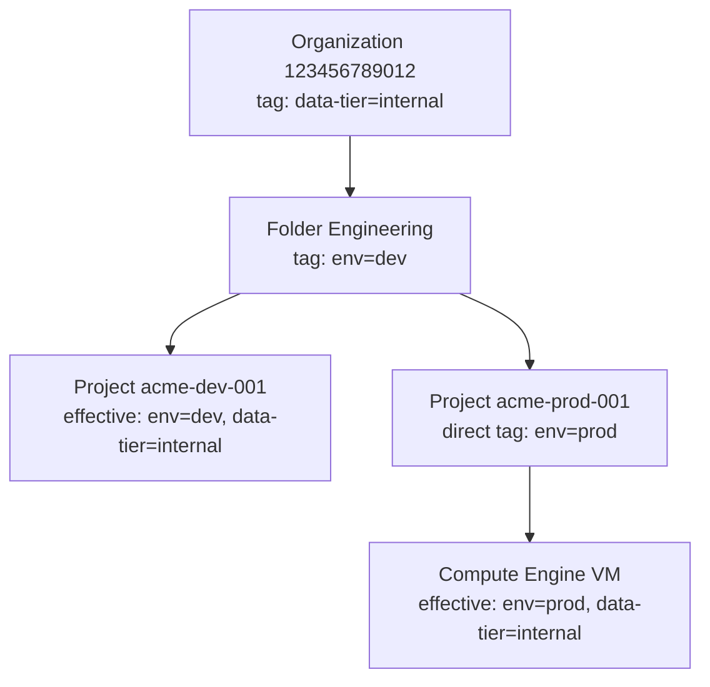
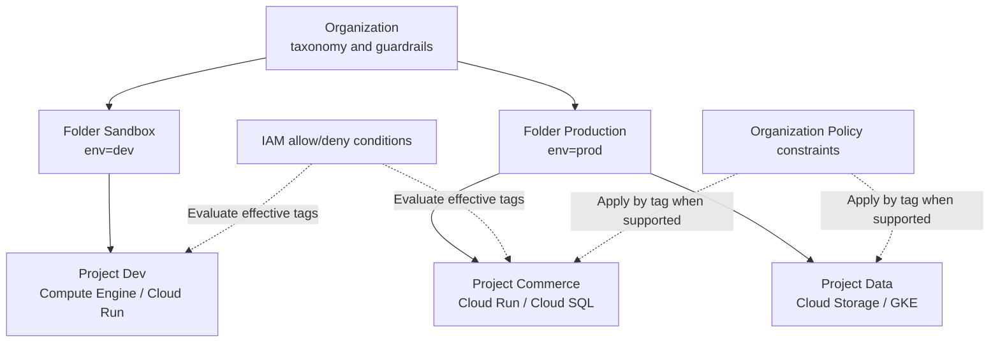

# Applying Tags to IAM Conditions and Organization Policies

## 1. Why Organizations Need Tags to Govern Google Cloud

When Google Cloud has only one experimental project, granting permissions and configuring policies project by project seems simple. However, once an organization has dozens or hundreds of projects across **development, staging, and production**, multiple product groups, and varied data classifications, manual configuration easily leads to hard-to-control exceptions:

- Developers need to modify VMs in **dev** environments without affecting **prod** systems.
- Critical workloads must comply with strict security rules even if moved to a new Folder or Project.
- Operations teams want to apply the same type of **Organization Policy** to an appropriate group of resources rather than creating separate policies per project.
- Security teams need to control who can change environment classification markers, because **changing a tag can alter access permissions**.

**Resource Manager tags** solve resource classification using **key–value** pairs that can be governed with IAM and used as **conditions** for supported policies. For example, the tag `env=dev` can allow an IAM allow binding to grant operations only on development resources; the tag `env=prod` can trigger an Organization Policy constraint.

In the **CLOUD_PROVIDERS_GCP** module, this knowledge connects Organization/Folder/Project governance with IAM, VPCs, Compute Engine, GKE, Cloud Run, storage, databases, and deployment automation. Tags are a building block of governance architecture: they help teams apply consistent rules as infrastructure scales while evaluating trade-offs across security, reliability, and operations.

After this lesson, you will be able to:

1. Distinguish between **Resource Manager tags**, **labels**, and **network tags**.
2. Model **TagKey → TagValue → TagBinding**, understanding identifiers, scopes, and inheritance.
3. Write tag-based CEL expressions for **IAM Conditions** and organization policies.
4. Explain why an IAM allow condition and an **Organization Policy condition** lead to two different kinds of decisions.
5. Establish a safe workflow for designing, testing, and modifying tags across a multi-project environment.

> **Convention:** Organization ID `123456789012`, Project ID `acme-dev-001`, Project number `987654321098`, accounts, and tag IDs here are all **hypothetical examples**. Commands that modify resources are solely for learning syntax and must be adapted and impact-tested before being applied in a live system.

## 2. What Are Tags and How Do They Differ from Labels?

A **Resource Manager tag** is a **tag key** and **tag value** pair defined at the **Organization or Project**. To attach that pair to a resource, Google Cloud creates a **tag binding** linking the tag value to the resource. For supported resource types, IAM and Organization Policy can read effective tags to evaluate conditions.

| Characteristic | Resource Manager tags | Labels | Compute Engine network tags |
| --- | --- | --- | --- |
| Common purpose | Governance, classification, access and policy conditions | Reporting, filtering, cost allocation, automation | Selecting VMs as targets of certain traditional firewall rules |
| How managed | TagKey, TagValue, and TagBinding are distinct resources | Metadata on individual resources | Network configuration field on a VM |
| Inheritance across Organization/Folder/Project | Yes, following effective tag rules | Not via Resource Manager tag rules | No |
| Used in IAM tag-based conditions | Yes, where resource types/permissions support it | No | No |
| Used as Organization Policy conditions | Yes, within supported constraints and resources | No | No |
| Controlling who can edit | Tag admin and tag user roles; can be delegated separately | Permissions of the respective resource/service | Permissions to update VM and corresponding network configs |

**Do not substitute** `resource.matchTag(...)` with a label value or network tag and expect IAM Conditions to work. If environment-based access conditions are required, use properly created and bound **Resource Manager tags**.

Google Cloud also offers specialized tag mechanisms such as **secure tags** and other tag features. Check their purpose and support matrix before adopting them; sharing the word "tag" does not mean all tag mechanisms are interchangeable. **Never store sensitive data** such as passwords, tokens, or personally identifiable information in tags.

## 3. Data Model: TagKey, TagValue, and TagBinding

Suppose an organization creates an environment taxonomy:

```text
Organization: organizations/123456789012
  TagKey:
    shortName: env
    namespacedName: 123456789012/env
    permanent ID: tagKeys/111111111111

  TagValues:
    shortName: dev
    permanent ID: tagValues/222222222222
    namespacedName: 123456789012/env/dev

    shortName: prod
    permanent ID: tagValues/333333333333
    namespacedName: 123456789012/env/prod
```

In this example, defining the key `env` and values `dev` and `prod` **does not attach** tags to any project automatically. You must create a **TagBinding** between `tagValues/222222222222` or `tagValues/333333333333` and the target resource.

### Three Easily Confused Name Forms

| Name | Example | Usage |
| --- | --- | --- |
| **Short name** | `env`, `prod` | Human-readable name within the defined namespace |
| **Namespaced name** | `123456789012/env`, `123456789012/env/prod` | `resource.matchTag('123456789012/env', 'prod')` expressions and many gcloud commands |
| **Permanent ID** | `tagKeys/111111111111`, `tagValues/333333333333` | `resource.matchTagId(...)` expressions, immutable identifier matching |

The prefix of a namespaced name can be the **numeric Organization ID** or **Project ID** if the tag key is created under a project. Do not use a Project number or arbitrary Folder name in place of the actual namespace.

**Choosing IDs vs. names:** namespaced names are readable and easier to manage in declarative configs; however, if a tag is deleted and recreated with the same name, name-based conditions can unintentionally match the new object. Permanent IDs are never reused, making them suitable when avoiding that risk; in return, recreating a tag requires updating conditions referencing the old ID.

### Binding Limits and Dynamic Values

A resource can only have **one value directly attached per key**. Google Cloud enforces limits on direct tag bindings per resource and certain services impose specific limits; consult the documentation for the specific resource type.

Google Cloud supports **dynamic tag values** for certain use cases at their respective release stages, but **dynamic tag values are currently not supported in IAM Conditions or Organization Policy Service constraints**. Therefore, for an `env` tag used in access/policy conditions, use **predefined** values such as `dev`, `test`, and `prod`.

## 4. How Tags Are Inherited and Overridden

When a tag value is attached to an Organization, Folder, or Project, **descendant resources inherit** that value. A child resource can attach a **different value for the same tag key** to override the inherited value.



In this example:

- `acme-dev-001` **inherits** `env=dev` from the Engineering Folder.
- `acme-prod-001` **overrides** `env=dev` with `env=prod` because both share the key `env`.
- VMs in the prod project typically see **effective tags** `env=prod` and `data-tier=internal`, unless a closer binding overrides the same key.

If the `env=prod` binding is removed from the prod project, it can **revert to inheriting** `env=dev` from the parent Folder. This is critical: **removing a direct tag does not necessarily leave a resource "untagged."**

### Effective Tags vs. Direct Tags

**Direct tags** are tags attached directly to a resource. **Effective tags** are the resulting set after applying both direct bindings and bindings inherited from ancestor resources.

When investigating why an IAM Condition evaluates to `true` or an Organization Policy applies, inspect **effective tags**, not just direct bindings. Furthermore, **moving a project to another Folder** can change effective tags and thus alter policy outcomes.

A cautious design approach is setting a **safe default value** at the Organization and overriding it only on classified, approved resources. For example, make `env=unclassified` the default for access decisions, and attach `env=dev` only after team verification. Unclassified resources will then **not match** conditions granting developer access.

## 5. CEL Expressions Used with Tags

IAM Conditions and tag-conditional Organization Policy rules use a subset of expressions from **Common Expression Language (CEL)**. Common functions include:

| Function | Example | Meaning |
| --- | --- | --- |
| `resource.matchTag(key, value)` | `resource.matchTag('123456789012/env', 'prod')` | Resource has this effective tag key/value |
| `resource.hasTagKey(key)` | `resource.hasTagKey('123456789012/cost-center')` | Resource has any value for this key |
| `resource.matchTagId(keyId, valueId)` | `resource.matchTagId('tagKeys/111111111111', 'tagValues/333333333333')` | Matches using permanent IDs |
| `resource.hasTagKeyId(keyId)` | `resource.hasTagKeyId('tagKeys/111111111111')` | Has the key by permanent ID |

Example condition allowing access to the dev environment **and** workloads with an assigned owner tag:

```cel
resource.matchTag('123456789012/env', 'dev') &&
resource.hasTagKey('123456789012/team')
```

Example condition matching **prod or staging**:

```cel
resource.matchTag('123456789012/env', 'prod') ||
resource.matchTag('123456789012/env', 'staging')
```

These are only expressions; to change actual permissions, they must be placed into the **right policy type**, at the **right scope**, with the **corresponding principal/role or constraint**.

**Limits are not identical:** IAM allow conditions support additional attributes beyond tags where supported; **Organization Policy tag-based conditions** only support the tag functions/expressions accepted by the service documentation. Do not copy a CEL expression from IAM into Organization Policy without verifying support, expression length, and branch limits.

## 6. Applying Tags to IAM Allow Conditions

### 6.1. Problem Statement

The group `developers@example.com` needs to manage Compute Engine VMs in the development environment. They **must not manage production VMs** via this role. The organization has two projects under the same Folder:

| Project | Effective tag | Desired behavior for this binding |
| --- | --- | --- |
| `acme-dev-001` | `env=dev` | VM admin role takes effect, if other policies allow |
| `acme-prod-001` | `env=prod` | VM admin role from this binding does not take effect |
| Unclassified project | `env=unclassified` | VM admin role from this binding does not take effect |

The IAM team can create a **conditional IAM allow binding** at the Folder scope containing the projects, such as the following JSON snippet:

```json
{
  "role": "roles/compute.instanceAdmin.v1",
  "members": [
    "group:developers@example.com"
  ],
  "condition": {
    "title": "ManageDevInstances",
    "description": "Only grant role on resources with effective tag env=dev",
    "expression": "resource.matchTag('123456789012/env', 'dev')"
  }
}
```

This is a **sample single binding**, not the Folder's complete allow policy. The role `roles/compute.instanceAdmin.v1` contains the Compute Engine administrative permissions specified in the role reference; specific actions may still require additional permissions on related resources.

### 6.2. How to Interpret the Outcome

- When a request targets a resource where the condition matches `env=dev`, **that binding can grant** the permissions in the role.
- When a request targets a resource with `env=prod` or no match, **that binding does not grant** the role's permissions.
- If the user has **another allow binding** granting the same permissions on the prod project, this conditional binding **does not revoke** permissions granted elsewhere.
- If an **IAM deny policy**, **Principal Access Boundary**, or another constraint blocks the action, a `true` condition still does not guarantee the request succeeds.
- Some APIs/permissions evaluate conditions against a different resource context than expected; test the exact operation and verify that the resource type supports tags in IAM.

**Key point:** an IAM allow condition is a **condition on one grant**; it is not an "absolute deny" over other grants. To forbid a permission even when other allow grants exist, evaluate **IAM deny policies** with supported permissions and conditions.

### 6.3. Adding a Condition via Google Cloud Console

An operational workflow in an approved environment:

1. Identify the resource holding the allow policy to edit, such as a Folder or Project, and existing roles.
2. Open **IAM → Grant access** or edit an existing principal's binding.
3. Select the role, **Add IAM condition → Resource → Tag**.
4. Select the tag key/value from the scope or switch to the condition editor and enter `resource.matchTag('123456789012/env', 'dev')`.
5. Review **all role grants** for the principal and inheritance scope; save changes once approved.
6. Test both positive and negative cases: dev must work, and prod must not be granted access by this binding.

Some Console screens do not fully support tag-based allow conditions for every flow; when encountering UI limits, use `gcloud` or the API and verify effective permissions.

### 6.4. Tags Can Change Access Without Editing Bindings

Suppose the binding above is configured on the Folder. If someone with tag-binding permissions changes a VM from `env=prod` to `env=dev`, the condition matches and the role becomes active. Therefore, **permission to create/modify TagBindings is also a sensitive privilege**. Never grant permission to alter environment tags to principals whose access is restricted by those very tags.

## 7. Applying Tags to IAM Deny Conditions

Deny conditions can also evaluate resource tags, though the **supported denied permissions** and expressions follow specific rules. For example, the security team wants to prevent a group from deleting projects with the effective tag `env=prod`:

```json
{
  "displayName": "Protect production projects",
  "rules": [
    {
      "denyRule": {
        "deniedPrincipals": [
          "principalSet://goog/group/developers@example.com"
        ],
        "deniedPermissions": [
          "cloudresourcemanager.googleapis.com/projects.delete"
        ],
        "denialCondition": {
          "title": "ProductionOnly",
          "expression": "resource.matchTag('123456789012/env', 'prod')"
        }
      }
    }
  ]
}
```

This JSON is an **IAM deny policy** sample, not an Organization Policy. In IAM deny, permissions must be in the **[supported permissions list](https://cloud.google.com/iam/docs/deny-permissions-support)** and use **IAM v2** format. Deny policies attach to an **Organization, Folder, or Project** and inherit downward.

If a deny rule's condition evaluates to `true` (or fails to evaluate under supported deny semantics), denied principals cannot use that permission **even if an allow binding grants it**. `exceptionPrincipals`, if specified, exempts principals only from **that specific rule**, without granting permissions or disabling other deny rules.

IAM deny does not block all networking, APIs, or every interaction with a service. It blocks only **specific permissions** within policy scope. For Cloud Run, GKE, Compute Engine, and managed services, evaluate service accounts, CI/CD identities, and service agents before setting broad deny rules.

## 8. Applying Tags to Organization Policies

**Organization Policy Service** manages **constraints** that place limits on configurations or actions for Google Cloud resources. A constraint can require/disable a feature, restrict allowed resource locations, or govern service settings, depending on the constraint catalog. In many cases, constraints are evaluated **when creating or updating resources**, rather than rejecting every IAM operation.

With **tag-conditional** organization policies, the same constraint can enforce different rules depending on which tags a resource carries.

### 8.1. Boolean Constraint Example: Restricting Serial Port Access

Suppose an organization wants to use the constraint **`compute.disableSerialPortAccess`** to disable serial port access on Compute Engine in production environments, while leaving other environments at the default behavior without enforcing this constraint.

An illustrative YAML policy placed at the Organization level:

```yaml
name: organizations/123456789012/policies/compute.disableSerialPortAccess
spec:
  rules:
    - condition:
        expression: "resource.matchTag('123456789012/env', 'prod')"
        title: "ProductionOnly"
      enforce: true
    - enforce: false
```

Reading the policy part by part:

1. `name` identifies the resource owning the policy (`organizations/123456789012`) and the **constraint** (`compute.disableSerialPortAccess`).
2. The first rule has condition `env=prod` and `enforce: true`: enforces the constraint on matching resources.
3. The second rule has **no condition**, acting as the **default rule** in the policy when the conditional rule above does not match.
4. `enforce: false` only indicates that **this constraint** is not enforced by that rule; it does not remove IAM deny policies, other Org Policies, or other restrictions.

In this policy type, Google Cloud requires **one unconditional rule** when using conditional rules. When modifying, preserve valid structure and evaluate inheritance across Organization/Folder/Project.

**Important limitation:** A constraint that supports tag-based conditions on **Organization/Folder/Project** does not necessarily support conditions based on **tags attached directly to service resources** such as VMs or buckets. For legacy managed constraints, support for tags on service resources is limited to specific constraints. Always check [Scope organization policies with tags](https://cloud.google.com/organization-policy/scope-policies) and the specific constraint documentation.

### 8.2. Syntax for Reading and Updating Policies

To inspect directly set policies and **effective** policies (including inheritance), authorized users run:

```bash
# Policy attached directly to the Organization
gcloud org-policies describe compute.disableSerialPortAccess \
  --organization=123456789012

# Effective policy on a Project
gcloud org-policies describe compute.disableSerialPortAccess \
  --project=acme-prod-001 \
  --effective
```

The command to actually set a policy is:

```bash
# Use only after approval, reviewing existing policies, and backing up configuration
gcloud org-policies set-policy policy.yaml
```

**Operational warning:** `set-policy` **writes the policy for the specified resource**, potentially overwriting existing rules. This is a high-impact change requiring evaluation of current effective policies, admin permissions, inheritance, and rollback plans. The `policy.yaml` example illustrates structure only; this lesson **does not execute** policy modification commands.

### 8.3. List Constraint Example: Restricting Deployment Regions

Another scenario uses `gcp.resourceLocations` (a list constraint) to control allowed locations. For list constraints, policies typically express `allowedValues`/`deniedValues` and may include tag-conditional rules.

```yaml
name: organizations/123456789012/policies/gcp.resourceLocations
spec:
  rules:
    - values:
        allowedValues:
          - in:us-east1-locations
    - condition:
        expression: "resource.matchTag('123456789012/region-exception', 'us-west1')"
      values:
        allowedValues:
          - in:us-west1-locations
```

This is a **structural example** aligned with Google Cloud documentation, not a region recommendation for a live system. The semantics of `allowedValues` and rule combination are determined by the **constraint type** and effective policy calculation. Do not assume all list constraints accumulate values identically. When defining deployment policies, check the schema, supported region list, data constraints, and use Policy Simulator/dry run where available.

## 9. Differences Between IAM Conditions and Organization Policy Conditions

| Question | Tag-based IAM allow condition | Tag-based IAM deny condition | Tag-based Organization Policy rule |
| --- | --- | --- | --- |
| **Target** | An IAM binding of principal + role | A deny rule for principal + permission | A constraint set on Organization/Folder/Project |
| **Effect on match** | Binding can **grant** permissions | Deny rule **blocks** permissions | Rule applies the constraint's value/enforcement |
| **Does matching guarantee API success?** | No, deny/PAB and API requirements still apply | No, this is a deny rule | No, IAM and other constraints still apply |
| **When tag is missing/unmatched** | That binding does not grant | Deny rule does not apply when condition returns `false` | Rule does not match; check default rule and inheritance |
| **Example** | Let developers manage `env=dev` VMs | Block deleting `env=prod` projects | Enforce serial port restriction on `env=prod` |
| **What to verify** | IAM condition support for permission and resource | Supported denied permissions list + tag conditions | Constraint, unconditional rule, and supported resource types |

**A single problem may require multiple tools.** For example: use an IAM allow condition to limit developers to dev; IAM deny to block deleting prod projects; and Organization Policy to prohibit an unsafe configuration. Tags help define scope, but tags **by themselves do not grant or deny** anything without policies referencing them.

## 10. Creating and Attaching Tags with gcloud

The examples below illustrate governance workflows. `list`/`describe` commands are **read-only**; `create` commands modify organization configuration. Use real values and authorized permissions only in appropriate environments.

### Step 1: List Tag Keys and Values

```bash
# Read-only: tag keys defined on the Organization
gcloud resource-manager tags keys list \
  --parent=organizations/123456789012

# Read-only: values for the illustrative env key
gcloud resource-manager tags values list \
  --parent=tagKeys/111111111111
```

Permanent IDs in examples must be replaced with real values from `list` output.

### Step 2: Create Tag Keys and Tag Values

If the organization **does not yet have** an `env` key and the taxonomy is approved, an authorized admin can create it:

```bash
# Create key under the organization, then capture the returned ID
gcloud resource-manager tags keys create env \
  --parent=organizations/123456789012

# Once TagKey exists, create predefined values
gcloud resource-manager tags values create dev \
  --parent=tagKeys/111111111111

gcloud resource-manager tags values create prod \
  --parent=tagKeys/111111111111
```

Do not create duplicate keys/values just to run exercises. Use the organization's published taxonomy so policies do not depend on multiple redundant tag sets.

### Step 3: Attach a Tag to a Project

After confirming the target project's **Project number** and the **TagValue ID** to attach, create a TagBinding:

```bash
gcloud resource-manager tags bindings create \
  --tag-value=tagValues/222222222222 \
  --parent=//cloudresourcemanager.googleapis.com/projects/987654321098
```

This illustrates **attaching `env=dev`** to a hypothetical project. Since Organization, Folder, and Project are global resources, `--location` is **not required**. When binding to regional/zonal product resources, `--location` may be mandatory and the resource name must follow service conventions.

**Required permissions:** creating/modifying tag definitions may require `roles/resourcemanager.tagAdmin`; binding/unbinding tags requires `roles/resourcemanager.tagUser` on both the tag value and the target resource, plus any service-specific permissions. Separate responsibilities across **taxonomy governance**, **tag binding**, **IAM management**, and **Organization Policy governance**.

### Step 4: Inspect Direct and Effective Tags

```bash
# Read-only: directly attached tag bindings
gcloud resource-manager tags bindings list \
  --parent=//cloudresourcemanager.googleapis.com/projects/987654321098

# Read-only: includes inherited tags
gcloud resource-manager tags bindings list \
  --parent=//cloudresourcemanager.googleapis.com/projects/987654321098 \
  --effective
```

When verifying conditional IAM/Org Policies, **use the effective output**. If the API does not yet reflect a newly changed tag, account for propagation time.

### Step 5: Remove a Tag Through a Controlled Change Process

```bash
# Illustrative mutation command; do not run by default
gcloud resource-manager tags bindings delete \
  --tag-value=tagValues/222222222222 \
  --parent=//cloudresourcemanager.googleapis.com/projects/987654321098
```

Before deleting, verify **which inherited tag value will surface afterward**. Removing `env=prod` could cause the project to inherit `env=dev`, unintentionally granting permissions or relaxing policies. Review the impact and choose safe defaults.

## 11. Designing a Taxonomy and Delegating Tag Administration

A sustainable tag system needs consistent naming and clear ownership.

| Suggested Tag Key | Illustrative Values | Intended Use | Who Should Administer? |
| --- | --- | --- | --- |
| `env` | `unclassified`, `dev`, `staging`, `prod` | Scope permissions and configs by environment | Platform/Security |
| `data-tier` | `public`, `internal`, `restricted` | Classify data to select guardrails | Data governance/Security |
| `criticality` | `low`, `medium`, `high` | Recovery testing plans or operational rules | SRE/System owners |
| `exception-approved` | `no`, `yes` | Enable controlled policy exceptions | Dedicated approvers |

This table is a design suggestion, not a mandatory Google Cloud catalog. A tag should only drive policies if its meaning is **stable, verifiable, and edit-controlled**.

### Which Permissions Must Be Separated?

- **Tag administrator:** creates/modifies TagKey/TagValue definitions and manages taxonomy lifecycle.
- **Tag user/binding manager:** attaches or removes tags on designated resources.
- **IAM policy administrator:** creates and edits allow/deny bindings referencing tags.
- **Organization Policy administrator:** creates/edits constraints and tag-conditional rules.
- **Resource owner:** proposes workload classification; should not unilaterally remove tags used as guardrails.

If the same person can both administer workloads and change tags in a way that grants themselves additional permissions, separation of duties is undermined. A multi-team environment needs approval workflows for sensitive tag changes, audit logs, and periodic reviews.

## 12. Multi-Service Operational Scenario

Suppose a company has three workload groups:



**Business requirements:**

1. Developers need permission to manage dev-classified resources; production changes go through pipelines with separately scoped service accounts.
2. All production projects must satisfy baseline security guardrails.
3. Promoting a workload from dev to prod requires re-evaluating permissions and constraints.
4. Deployments must still meet SLOs, RTO/RPO, quotas, and budgets; tags do not automatically solve performance or reliability requirements.

**Design analysis:**

- The `env` tag uses predefined values defined at the Organization for consistency.
- Developers' IAM allow binding matches only `env=dev`, attached at the appropriate ancestor scope.
- Sensitive permissions such as deleting projects or modifying IAM configs are managed separately; consider a deny policy to forbid them regardless of allow grants.
- Organization Policies use `env=prod` conditions for supported constraints; defaults handle untagged resources safely.
- Deployment pipelines use dedicated service accounts with least privilege; IAM Conditions must be tested on the identity **actually calling the API**.
- Any change from `env=dev` → `env=prod` or moving a project across Folders must include a **before/after effective tags analysis**.

### Scenario Test Matrix

| Resource | Effective `env` | Principal / Action | Expected Result in Example |
| --- | --- | --- | --- |
| Dev VM | `dev` | Developer manages VM via conditional binding | Can be granted role, if no other policy blocks |
| Prod VM | `prod` | Developer uses same binding | This binding does not grant permission |
| Prod Project | `prod` | Developer deletes project, covered by matching IAM deny rule | Denied despite any allow |
| Prod VM | `prod` | User modifies serial port under enforced constraint | Restricted by Organization Policy |
| Unclassified Project | `unclassified` | Developer uses binding matching only `dev` | Binding does not grant permission |
| Prod Project newly moved across Folders | Value may change | CI/CD and relevant user operations | Must re-verify effective tags and policies |

This test matrix is an **illustrative architectural plan**, not proof that specific products are already configured accurately. Test with real permissions in an authorized project before applying policies across all of production.

## 13. Common Errors and How to Investigate Them

| Symptom | Possible Cause | How to Check |
| --- | --- | --- |
| Condition does not match even though "tag is attached" | Attached a **label**, network tag, or wrong namespace | Verify TagKey/TagValue and `tags bindings list --effective` |
| Resource loses access after removing a tag | Effective tag shifted to another value or no longer matches allow condition | Compare effective tags before/after; inspect conditional bindings |
| Project permissions change after Folder move | Effective tags and inherited policies changed | Inspect old/new ancestors, TagBindings, effective IAM and Org Policy |
| Developer still accesses prod | Another allow binding exists, or user can modify tags themselves | Use Policy Troubleshooter and inspect all allow/deny/PAB and Tag User roles |
| Constraint does not trigger on directly tagged VM | Constraint does not support tag conditions on that service resource type | Check support scope and place tags on Organization/Folder/Project if appropriate |
| Cannot create TagBinding | Missing Tag User on tag value/resource or service-specific permission | Check exact IAM on the tag and target resource |
| `org-policies describe` shows no policy at a level | No policy attached directly at that level | Check `--effective` and ancestor policies |
| Permissions do not change right after tag update | Tag/policy change has not finished propagating | Wait for consistency and retry at an appropriate interval |
| Untagged resource bypasses production guardrails | Policy activates only on `env=prod` and lacks a safe default | Design baseline rules, provisioning workflow, and mandatory classification |

**Timing note:** tag updates generally take effect within a few minutes; Resource Manager documentation states most cases take within **2 minutes**, occasionally **7 minutes or longer**. **Organization Policy** changes may have different propagation delays (documentation notes up to roughly **15 minutes**). Never use an API call immediately after a change to claim policies have stabilized.

### Suggested Investigation Sequence

1. Identify **principal**, API method, permission, resource, and request timestamp.
2. Inspect the resource's **effective tags**; confirm the tag key namespace and value.
3. Inspect allow/deny bindings and conditions from the resource up through ancestors.
4. Inspect the constraint's **effective Organization Policy** if the error occurs during resource creation/update.
5. Confirm whether the service and resource type support tag-based conditions.
6. Check **Cloud Audit Logs**, Policy Troubleshooter/Policy Simulator, or Organization Policy **dry-run** where supported.
7. Propose the smallest change addressing root cause, and test permissions and unintended side effects.

## 14. Controlled Rollout Workflow

### Phase 1: Design the Taxonomy

List resource groups, IAM and constraint requirements, keys/values, and owners. Define **safe defaults** and behavior when tags are missing, misapplied, or removed.

### Phase 2: Delegate Permissions

Separate taxonomy administration, tag binding/unbinding, IAM editing, and Organization Policy editing. For security-sensitive tags, enforce approvals and auditing. Also verify pipeline service accounts and service agents.

### Phase 3: Test

Create or use an authorized test project. Attach tags per plan, verify effective tags, and test **positive cases** (valid access must work), **negative cases** (restricted access must not work), and **fallback cases** (missing/removed tags).

### Phase 4: Policy Review

For IAM, evaluate all grants/denies, not just the condition being authored. For Organization Policy, inspect the **constraint**, unconditional rule, inheritance, and enforcement state; use simulator/dry-run where applicable.

### Phase 5: Deploy and Monitor

Roll out scope by scope, monitoring audit logs and authorization/deployment errors after propagation. Record policy versions, tag IDs, expected impact, accountable owners, and recovery steps.

### Phase 6: Periodic Review

Periodically identify unused tag keys, unclassified projects, overly broad Tag User grants, conditions referencing deleted IDs, and expired policy exceptions.

## 15. Practice Exercises

### Exercise 1: Computing Effective Tags

Given Organization tagged `env=unclassified`, Folder `Engineering` tagged `env=dev`, and Project `Payments` tagged `env=prod`:

1. What effective `env` do resources inside Project `Payments` see?
2. If the direct binding `env=prod` is removed from `Payments`, what does effective `env` become?
3. If Folder `Engineering` is moved to a new branch that does not inherit `env=unclassified`, what could change?

**Suggested answers:** (1) `prod`; (2) `dev`; (3) all effective tags and inherited policies under the new ancestors must be recalculated.

### Exercise 2: Comparing Two Expressions

```cel
resource.matchTag('123456789012/env', 'dev')
```

```cel
resource.hasTagKey('123456789012/env')
```

Explain why the same resource tagged `env=prod` matches only the second expression. When used in IAM allow, how does this difference affect granted scope?

### Exercise 3: Reading Organization Policy Structure

```yaml
name: organizations/123456789012/policies/compute.disableSerialPortAccess
spec:
  rules:
    - condition:
        expression: "resource.matchTag('123456789012/env', 'prod')"
      enforce: true
    - enforce: false
```

Explain the role of the unconditional rule. If a resource has `env=dev`, is this constraint enforced by the illustrative policy? If an unclassified resource is actually production, why is this a taxonomy and governance risk?

### Exercise 4: Read-Only Inspection with Granted Permissions

On a resource you are authorized to view, list TagKeys, TagValues, and direct/effective TagBindings using the `gcloud` commands learned. Compare them with an active IAM binding or Organization Policy if you have read access. You do not need to create or remove tags to complete this exercise.

### Exercise 5: Designing a Change Workflow

A development project is about to move to production, with Cloud Run and Cloud SQL. Write the minimum review steps to:

- Transition the effective environment tag properly.
- Prevent the development team from accidentally retaining production access.
- Confirm required Organization Policies take effect on supported resources.
- Avoid disrupting CI/CD or service agents.
- Re-verify cost, backups, monitoring, and reliability targets after environment transition.

## 16. Checklist for Governing Tags and Policies

- [ ] Tags driving policies are **Resource Manager tags**, not labels or network tags.
- [ ] Keys/values are predefined; dynamic tag values are not used for IAM/Org Policy conditions.
- [ ] Namespaces, short names, and permanent IDs are specified accurately.
- [ ] Direct and **effective tags** have been verified, including inheritance/overrides when moving resources.
- [ ] Safe defaults exist for missing or removed tags.
- [ ] Tag Admin, Tag User, IAM Admin, and Organization Policy Admin permissions are separated appropriately.
- [ ] IAM allow conditions are understood as scoping **a single binding**, not blocking other grants.
- [ ] IAM deny policies reference supported permissions and account properly for principals/service agents.
- [ ] Organization Policies include an unconditional default rule, proper constraint type, and supported tag scope.
- [ ] Testing, simulator, or dry-run has been used where appropriate to evaluate permissions and policies before rollout.
- [ ] Audit logs, owners, change controls, and rollback plans are in place.
- [ ] After updating tags/policies, sufficient propagation time was waited and actual behavior verified.

## 17. Official Google Cloud Documentation

To verify per-service and per-version support at implementation time:

1. [Resource Manager tags – Overview](https://cloud.google.com/resource-manager/docs/tags/tags-overview)
2. [Create and manage tags](https://cloud.google.com/resource-manager/docs/tags/tags-creating-and-managing)
3. [IAM – Tags and conditional access](https://cloud.google.com/iam/docs/tags-access-control)
4. [IAM Conditions – Attribute reference](https://cloud.google.com/iam/docs/conditions-attribute-reference)
5. [Organization Policy – Scope policies with tags](https://cloud.google.com/organization-policy/scope-policies)
6. [Create organization policies](https://cloud.google.com/organization-policy/create-organization-policies)
7. [Services that support tags](https://cloud.google.com/resource-manager/docs/tags/tags-supported-services)
8. [IAM deny overview](https://cloud.google.com/iam/docs/deny-overview)
9. [Google Cloud CLI – Resource Manager tags](https://cloud.google.com/sdk/gcloud/reference/resource-manager/tags)
10. [Google Cloud CLI – Organization policies](https://cloud.google.com/sdk/gcloud/reference/org-policies)

**Remember:** tags do not create permissions or constraints on their own. Their power comes from **the policy referencing the tag**, **where the policy is applied**, the resource's **effective tags**, and **who has permission to modify tags**. Therefore, every tag-based IAM Conditions and Organization Policy design must be verified across all four factors simultaneously.
