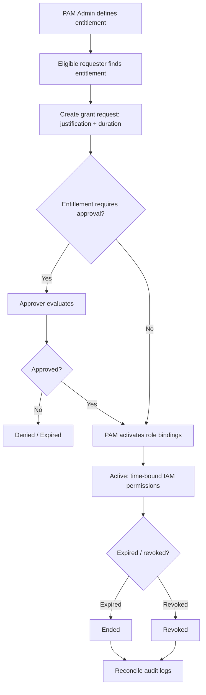

# Privileged Access Manager and Time-Bound Access Grants

Production on-call engineers sometimes need to perform actions that everyday permissions do not allow: modifying a Cloud Run configuration to mitigate an incident, inspecting a Compute Engine VM, or performing maintenance in Google Cloud. Granting broad administrative roles permanently means a single compromised account can have widespread impact. Requiring an admin to manually add and remove IAM bindings for every incident slows down operations and makes auditing difficult.

**Google Cloud Privileged Access Manager (PAM)** solves this with **just-in-time (JIT) privileged access**: eligible users **request a predefined set of IAM roles**, optionally providing justification and obtaining approval; permissions take effect only for a **bounded duration**, after which PAM removes them. This lesson belongs to the **Organization Governance** chapter, connecting concepts across projects, folders, organizations, IAM, resource protection, Compute Engine/GKE/Cloud Run operations, and system reliability.

Projects, accounts, and events in this lesson are **hypothetical examples**. Mutation commands are presented for learning the workflow and should only be executed on authorized resources after verifying scope, requester, and organizational policies.

## Learning Objectives

After this lesson, you will be able to:

1. Distinguish **entitlement**, **grant request**, **approval**, **active grant**, **IAM role binding**, and **audit log**.
2. Design JIT access around **principal, role, resource, duration, justification, and approval workflow**.
3. Prepare Google Cloud PAM at the right **organization, folder, or project** level with required admin permissions.
4. Execute the request, approval, status check, and grant revocation workflow via Console or `gcloud`.
5. Explain the roles of IAM Conditions, IAM deny policies, Principal Access Boundary, and permission propagation time.
6. Design runbooks for production maintenance, emergency access, auditing, and grant troubleshooting.

## 1. Why Is Time-Bound Privileged Access Needed?

An application developer usually only needs to view logs, inspect service health, and deploy to development. During a production incident, they may need **elevated permissions for 60 minutes** to update a Cloud Run service. Once the incident is resolved, those permissions are no longer needed.

Comparing three approaches:

| Management Approach | Baseline Permissions | Handling Privileged Needs | Primary Risk |
| --- | --- | --- | --- |
| Grant admin roles **permanently** | Always privileged | Immediate use | Large attack surface, hard to justify standing access |
| Add/remove IAM bindings **manually** | May lack permissions | File ticket, admin adds binding and remembers to remove it | Forgetting to revoke, hard to standardize durations and approvals |
| **Privileged Access Manager** | Least-privilege baseline | Request grant from entitlement; approval if configured; auto-expires | Requires proper entitlement, permission, monitoring, and process design |

PAM fits **controlled privilege elevation**. It does not replace proper IAM design, secure sign-in, environment isolation, project structure, backups, or sensitive data restrictions.

### Typical Scenarios

- **Incident response:** On-call SRE needs permission to update a production service for 1 hour.
- **Database maintenance:** DBA needs Cloud SQL administrative config permissions during a maintenance window.
- **Security investigation:** Security engineer needs temporarily elevated investigation permissions.
- **Break-glass:** A small emergency responder group can activate permissions without pre-approval, subject to mandatory justification and tight monitoring.
- **Scoped infrastructure changes:** An engineer needs an appropriate role to troubleshoot a Compute Engine/VPC incident without holding the role all month.

**Note:** When defining permissions, select roles containing the task's actual permissions. For example, holding `roles/run.developer` does not automatically grant `iam.serviceAccounts.actAs` on the runtime service account; if the task needs both, design both separately at the appropriate scope.

## 2. The Google Cloud PAM Model

PAM centers on two resource types:

1. **Entitlement:** A *requestable permission configuration*. It defines resource scope, IAM roles, eligible principals, maximum duration, and approval workflow.
2. **Grant:** A *specific elevation request* created against an entitlement by an eligible principal, carrying requested duration, justification, status, and approval history.



### Components Inside an Entitlement

| Component | Meaning | Illustrative Example |
| --- | --- | --- |
| **Scope** | Organization, folder, or project where the entitlement is created | Project `retail-prod-01` |
| **Entitlement ID** | Stable name users search for when requesting elevation | `prod-cloudrun-incident` |
| **Role bindings** | Temporary IAM roles granted; may include IAM Conditions | `roles/run.developer` |
| **Eligible requesters** | List of users/groups/identities allowed to submit requests | Group `sre-oncall@example.com` |
| **Maximum grant duration** | Maximum duration per activation | 1 hour (`3600s`) |
| **Justification requirement** | Whether the requester must supply a reason | Ticket `INC-2042` |
| **Approval workflow** | No approval needed or designated approvers | Group `platform-approvers@example.com` |
| **Notifications** | Stakeholders who must be notified | Operations monitoring mailbox |

PAM uses **time-conditioned IAM role bindings** to grant and remove permissions. This mechanism follows IAM change propagation rules: a grant becoming `Active` does not mean every request to every service sees the permission instantaneously; similarly, revocation or expiration must be verified against state and effective permissions.

### An Entitlement Is Not a Grant

Creating an entitlement **does not automatically grant permissions** to everyone on the requester list. Eligible users merely gain the ability to **request**. When a grant activates, **only the requesting principal** receives elevation; adding a Google Group to eligible requesters does not grant the privileged role to every group member simultaneously.

One entitlement can serve many independent incidents, each with different grant durations and justifications.

## 3. How Does PAM Interact with IAM and the Resource Hierarchy?

In Google Cloud, projects can sit under folders and organizations. Whichever level an entitlement is created at becomes the root scope of the IAM permissions it grants; permissions can **inherit down to child resources** following standard IAM rules.

```text
Organization: example.com
└── Folder: Retail
    ├── Project: retail-dev-01
    └── Project: retail-prod-01
        ├── Cloud Run service: checkout
        ├── Compute Engine VM: worker-01
        └── Cloud SQL instance: orders-db
```

An entitlement attached to the **Retail folder** with a broad admin role can affect **both dev and prod** if the role is inherited. An entitlement on **project retail-prod-01** is usually easier to scope tightly. When operations should touch only a subset of resources, use **IAM Conditions** where supported by the service and permissions.

Never assume a project-level entitlement applies to only one Cloud Run service. If a role is granted at the project level without further constraints, many resources in that project fall within its scope.

### Other Control Layers Remain in Effect

PAM grants **temporary allow bindings**, so effective access remains subject to other control layers:

- **IAM deny policy:** A matching deny rule can block a permission even while a PAM grant is `Active`.
- **Principal Access Boundary:** Restricts the set of resources a principal is eligible to access; PAM does not bypass that boundary.
- **IAM Conditions:** Temporarily granted roles can include conditions on resources, time, tags, and IAM-supported attributes.
- **Organization Policy:** Can block configuration or resource types, which adding roles cannot resolve.
- **VPC Service Controls:** Can block requests crossing a perimeter even when IAM allows them.
- **API enablement, quotas, billing, and authentication:** Must still be satisfied for business operations to succeed.

Therefore, **`Active` does not mean "permitted to do everything."** When `PERMISSION_DENIED` persists, inspect the exact principal, permission, resource, and conditions via Policy Troubleshooter and Cloud Audit Logs.

## 4. Choosing Scope and Roles Using Least Privilege

Entitlement design should start from **the task to perform**, then select roles:

1. Specify the need: "on-call needs to update Cloud Run service `checkout` during 5xx errors," not merely "needs admin."
2. Identify required **API operations and IAM permissions**; separate Cloud Run update permissions, `iam.serviceAccounts.actAs`, and Artifact Registry image read permissions.
3. Find a predefined role or create a **custom role** with sufficient permissions. Avoid roles with broad IAM management permissions unless genuinely necessary.
4. Pick the smallest viable scope: the target **project**, or resource-narrowing conditions where supported.
5. Bound requesters, approvers, and durations to operational schedules.
6. Document rationale, ticket reference, owner, and verification/revocation steps.

| Decision | Option to Consider | Risk of Over-Broad Configuration |
| --- | --- | --- |
| Resource scope | Specific production project | Folder/organization propagates across many projects |
| Role | Task-sufficient role, custom role if needed | `Owner`/`Editor` or `setIamPolicy` beyond need |
| Eligible requesters | On-call group with governed membership | Anyone can request or abuse workflow |
| Approvers | Independent of requester and understands risk | No oversight on critical changes |
| Max duration | Task completion time plus reasonable buffer | High privileges linger too long |
| Justification | Mandatory ticket, scope, timing | No audit trail of purpose |
| Logging/alerting | Monitor requests, approvals, activations, revocations | Hard to investigate post-incident |

**Critical warning:** PAM does not automatically prevent **persistence** if the temporary role includes permissions such as `resourcemanager.projects.setIamPolicy`, `*setIamPolicy`, or `iam.roles.update`. An elevated user could use that window to create **permanent bindings** or modify roles. Choose narrow roles, require reviews, and detect unexpected IAM changes.

### Limits Documented for PAM

Current Google Cloud documentation states:

- An entitlement can configure **at most 30 roles**.
- **Max grant duration** ranges from **30 minutes to 7 days** (`1800s` to `604800s`); a request cannot exceed the entitlement's limit.
- Up to **20 requesting principals** and up to **20 principals per approval stage** can be declared; groups can manage larger rosters, while only the specific requester receives the grant.
- Use predefined/custom roles only for **services supporting IAM Conditions**. Legacy basic roles `Owner`, `Editor`, and `Viewer` **are not supported by PAM**; documentation distinguishes supported basic roles `Admin`, `Writer`, and `Reader`.
- A requester can have at most **10 open grants per entitlement** at once, and cannot submit overlapping scope requests while a grant is active/scheduled/awaiting approval.
- Avoid granting **service agent roles** in entitlements, as those roles are meant for Google-managed identities and can carry very broad permissions.

Limits and Preview features evolve over time; verify current documentation before production rollout. Never pick a 7-day duration just because the tool allows it when the runbook only needs 1 hour.

## 5. Preparing PAM and Administrative Permissions

Before creating entitlements:

1. Identify the organization/folder/project that will host the entitlement and target resources.
2. Verify PAM is **onboarded/enabled** at the right scope. The PAM service API is `privilegedaccessmanager.googleapis.com`.
3. Configure IAM for config admins, audit reviewers, and IAM scope admins.
4. Confirm planned roles **are supported by PAM** and lack permissions that easily enable persistent post-grant access.
5. Verify eligible requester/approver lists, group memberships, notifications, and production protection policies.

### Separation of Permissions

| Role / Persona | Typical Role / Permission | Notes |
| --- | --- | --- |
| **PAM administrator** | `roles/privilegedaccessmanager.admin` | Manages entitlements/grants within scope |
| **Project IAM administrator** | `roles/resourcemanager.projectIamAdmin` | PAM docs require this alongside PAM Admin when creating/editing/deleting project-level entitlements |
| **Folder IAM administrator** | `roles/resourcemanager.folderAdmin` | Needed for IAM operations at the folder level |
| **Organization IAM administrator** | `roles/iam.securityAdmin` | Combined with PAM Admin when configuring at organization scope |
| **Viewer** | `roles/privilegedaccessmanager.viewer` | Views entitlement/grant info where authorized |
| **Audit reviewer** | `roles/logs.viewer`, additional log permissions if needed | Views Cloud Audit Logs within permitted scope |
| **Eligible requester** | Listed in the entitlement | PAM docs do not require a separate PAM role just to submit eligible requests |
| **Approver** | Listed in the approval workflow | Does not need a separate PAM role just to approve/deny grants on entitlements they are assigned to |

This is guidance for common **predefined roles**; exact permissions depend on resource types and organizational policies. Staff who only approve ticket-based access do not need full IAM admin roles at the same time.

### CLI Pre-Checks Before Making Changes

```bash
# Read-only check of current Google Cloud CLI identity and default project.
gcloud auth list
gcloud config get-value project

# Inspect target project to govern (replace with actual project).
gcloud projects describe retail-prod-01 \
  --format="table(projectId,projectNumber,name)"

# Check if PAM API is in the project's enabled services list.
gcloud services list --enabled \
  --project=retail-prod-01 \
  --filter="config.name:privilegedaccessmanager.googleapis.com"
```

If PAM needs to be enabled or onboarded, follow official setup procedures with `serviceusage.services.enable` and matching IAM permissions. **Do not enable the API on the wrong project** or attempt to fix permission errors by granting `roles/owner`.

## 6. Creating an Entitlement via Google Cloud Console

Suppose the SRE team needs `roles/run.developer` for up to 1 hour in project `retail-prod-01` when handling application incidents.

1. Open [Privileged Access Manager in Google Cloud Console](https://console.cloud.google.com/iam-admin/pam) and select the **exact project** or target scope.
2. Open the **Entitlements** tab and select **Create**.
3. Set an entitlement ID, such as `prod-cloudrun-incident`; choose the temporary roles allowed. If you must restrict resources below project level, consider **IAM Conditions** supported by those permissions.
4. Set **Maximum grant duration** to **1 hour**, no longer than operationally needed.
5. Select **eligible requesters**, such as the on-call group; configure **mandatory justification**.
6. Choose the approval mode:
   - For risky production tasks, specify **manual approvers** and require approval justification if appropriate.
   - For unapproved break-glass flows, establish compensating controls: tiny requester group, short duration, logging/alerts, and post-incident review.
7. Add necessary notification recipients, review role/scope impact, and create the entitlement.
8. Have another admin verify the configuration; no grant is automatically active merely because an entitlement exists.

**Watch separation of duties:** whoever configures entitlements controls who can elevate. Manage entitlement changes via reviews, limit who can edit entitlements, and alert when conditions/roles change.

### Designing the Entitlement in a Table Before Creating It

| Field | Illustrative Value |
| --- | --- |
| Scope | `projects/retail-prod-01` |
| ID | `prod-cloudrun-incident` |
| Roles | `roles/run.developer` (verify any additional runtime execution permissions) |
| Eligible requesters | `group:sre-oncall@example.com` |
| Approvers | `group:platform-approvers@example.com` |
| Maximum duration | `3600s` |
| Requester justification | Mandatory, referencing incident number |
| Approval | One independent approver, if supported by workflow |
| Notification | Operations/security teams |
| Owner | Platform Security |

This is a **specification table**, not a YAML schema sent directly to the PAM API. CLI docs specify an `entitlement.yaml` schema with fields like `privilegedAccess`, `eligibleUsers`, `maxRequestDuration`, `requesterJustificationConfig`, and `approvalWorkflow`; fetch the schema matching your tool version before writing IaC/scripts.

### Multi-Stage Approvals

Certain options such as **two-stage sequential approvals** and requiring multiple approvers per stage are tied in Google Cloud docs to **Security Command Center Premium/Enterprise** and **Preview** status. Never assume every organization has these options. Verify entitlements and product prerequisites before designing a two-stage workflow.

## 7. Users Requesting Temporary Access

Example: an on-call engineer is tasked with fixing a Cloud Run `checkout` failure in `retail-prod-01`.

1. The user opens PAM, picks the scope hosting the entitlement, and opens the **My entitlements** tab.
2. Selects `prod-cloudrun-incident` and clicks **Request grant**.
3. Enters duration, e.g., **60 minutes**, not exceeding the entitlement maximum.
4. Enters a specific justification: `INC-2042: checkout 5xx, rollback revision after checking logs`. Justification should state *action, resource, ticket, and needed duration*.
5. Submits the request. Depending on config, the grant may **await approval** or activate immediately.
6. Perform privileged tasks only once the grant is genuinely **Active**, IAM has propagated, and the **target project** is confirmed.
7. Complete incident mitigation, track changes, and close or proactively revoke the grant early if no longer needed.

PAM supports **scheduled grants** in certain flows/releases; an approved grant can be scheduled to start in the future. For immediate-activation requests, if no decision is made within **24 hours**, the grant expires. For scheduled requests, approval must complete **before the chosen activation time**.

### Submitting Requests via gcloud

The syntax below illustrates **grant creation** and is not executed on live systems in this lesson. Project/entitlement values are hypothetical:

```bash
# Find entitlements the currently signed-in account is eligible to request.
gcloud pam entitlements search \
  --project=retail-prod-01 \
  --location=global \
  --caller-access-type=grant-requester

# Inspect a specific entitlement before requesting access.
gcloud pam entitlements describe prod-cloudrun-incident \
  --project=retail-prod-01 \
  --location=global

# Request a 1-hour grant tied to an incident ticket.
gcloud pam grants create \
  --entitlement=prod-cloudrun-incident \
  --project=retail-prod-01 \
  --location=global \
  --requested-duration=3600s \
  --justification="INC-2042: investigate checkout 5xx and rollback if approved"
```

The CLI returns a **grant ID**; save it for status checks and auditing. Do not assume `create` succeeding means IAM permissions are already active; the grant may still be awaiting approval or activating.

## 8. Approvers Evaluating a Grant

Approvers must review **requester**, **resource scope**, **roles**, **duration**, **justification**, **request timestamp**, and alignment with the ticket. When needed, verify the situation with the system owner.

Console workflow:

1. Go to PAM, **Approve grants** tab → **Pending approval**.
2. Open the request and read the full entitlement and justification.
3. If valid, click **Approve** and provide a reason if required by the workflow.
4. If invalid, click **Deny** and explain why so the requester can submit a proper request.

**You cannot approve your own request.** This is a crucial control boundary; approvers must be independent of requesters.

### CLI for Approvers

```bash
# List entitlements where you are an approver.
gcloud pam entitlements search \
  --project=retail-prod-01 \
  --location=global \
  --caller-access-type=grant-approver

# Search grants awaiting your review on an entitlement.
gcloud pam grants search \
  --project=retail-prod-01 \
  --location=global \
  --entitlement=prod-cloudrun-incident \
  --caller-relationship=can-approve

# Example approval command (replace GRANT_ID with actual ID).
gcloud pam grants approve GRANT_ID \
  --project=retail-prod-01 \
  --location=global \
  --entitlement=prod-cloudrun-incident \
  --reason="INC-2042: reviewed scope and approved for incident mitigation"
```

For incomplete or out-of-scope requests, use `gcloud pam grants deny` with a clear reason. Once an approval decision is recorded, it cannot simply be "undone"; if a grant is already `Active` and must end early, use **revoke** per procedure.

### When a Request Has Multiple Approvers

Depending on entitlement configuration, the required number of approvals must be met before activation. In multi-stage workflows (where available), later stages are notified only after earlier stages complete; a single **deny** can transition the grant to `Denied` and stop the flow. Track overall grant status rather than relying solely on a chat message saying "someone clicked Approve."

## 9. Grant Lifecycle and States

A grant is not simply "granted" or "not granted." During operations, distinguish:

| Displayed State | Meaning | Appropriate Action |
| --- | --- | --- |
| **Approval awaited** | Waiting for approver decision | Track SLA, verify request has not expired |
| **Scheduled** | Scheduled to activate in the future | Cross-check maintenance window and approval deadline |
| **Activating** | PAM is applying permissions | Hold off operating until it transitions to `Active` |
| **Active** | Grant has been activated | Verify exact permissions and execute approved task |
| **Activation failed** | Could not activate due to non-retryable error | Check PAM/service agent permissions, IAM policy, and returned error |
| **Denied** | Request was rejected | Review reason, adjust scope or ticket |
| **Expired** | Request was not approved in time | Submit a new request if still needed |
| **Ended** | Grant duration elapsed; PAM removed permissions | Verify work and audit logs |
| **Revoking / Revoked** | Revocation in progress / revoked early | Monitor until final state |
| **Withdrawing / Withdrawn** | Requester withdrawing / withdrew grant | Confirm current state |

Live states can also show special flags such as **Modified through IAM** if a PAM-created role binding was edited directly in IAM. When bindings are modified outside PAM, PAM **can only delete unmodified bindings it created itself**, requiring investigation and proper cleanup. Never edit PAM-managed bindings directly to try "speeding up" permissions.

### IAM Propagation and Expiration Timing

PAM relies on time-bounded IAM Conditions. Permissions may not work immediately when a grant becomes `Active` because IAM updates must propagate. Upon expiration or revocation, also consider in-flight jobs, active tokens/sessions, and permissions granted via other channels.

**Grant expiration does not undo actions already taken**: newly created VMs, changed Cloud Run configs, or permanent IAM bindings created by an authorized user remain unless separately inspected and remediated. Thus grant duration is **one access control layer**, not an infrastructure rollback tool.

## 10. Viewing and Revoking Grants

Operators and auditors need visibility into grant status, recipients, timestamps, and decision history.

```bash
# List grants under an entitlement (requires appropriate viewer permissions).
gcloud pam grants list \
  --project=retail-prod-01 \
  --location=global \
  --entitlement=prod-cloudrun-incident

# Describe a specific grant ID.
gcloud pam grants describe GRANT_ID \
  --project=retail-prod-01 \
  --location=global \
  --entitlement=prod-cloudrun-incident

# Example revoking an Active grant early.
# Only authorized personnel should run this in practice.
gcloud pam grants revoke GRANT_ID \
  --project=retail-prod-01 \
  --location=global \
  --entitlement=prod-cloudrun-incident \
  --reason="INC-2042 resolved; elevated access no longer required"
```

**Inspect the grant before revoking:** confirm grant ID, requester, resource, status, and reason. Revocation can interrupt in-progress work; coordinate with on-call when needed. Afterward, confirm the state transitions to `Revoked` and verify effective IAM.

Per PAM documentation, **grant history in the UI** is viewable for **30 days after a grant ends**; long-term audit retention must rely on Cloud Audit Logs and organizational log sinks/retention rather than expecting UI history to persist indefinitely.

## 11. Auditing PAM Through Cloud Audit Logs

For any privileged grant, auditing should answer:

1. **Who** submitted the request? With what **justification and ticket**?
2. **Who** approved or denied it? When was the decision made?
3. When did the grant **activate**, at what scope, and with which roles?
4. While `Active`, what did the grantee **do** on resources?
5. When did the grant **expire** or get **revoked**? Were any out-of-band IAM edits made?

Reference Logs Explorer query:

```text
protoPayload.serviceName="privilegedaccessmanager.googleapis.com"
timestamp>="2026-11-19T00:00:00Z"
```

This filter can be narrowed by project, entitlement/grant resource name, and API method. PAM generates **Admin Activity audit logs** for mutating operations such as `ApproveGrant`, `RevokeGrant`, and `CreateEntitlement` (by API/permission type); data reads may fall under **Data Access logs**, requiring configuration and permissions per Google Cloud logging rules.

Google Cloud also records **system events** for grant lifecycle transitions, such as:

```text
PAMActivateGrant
PAMEndGrant
PAMExpireGrant
PAMReportExternalGrantModification
```

Do not query only `ApproveGrant` and conclude no grants activated: an entitlement **not requiring approval** can become `Active` without an approval event; system events leave their own trail.

### Correlating Grants with Resource Actions

PAM logs show **elevation history**; logs from **Cloud Run**, **Compute Engine**, **Cloud SQL**, **Cloud Storage**, or **IAM** show the actual API calls executed during that window. During investigations, correlate:

| Evidence | Where to Look | Content |
| --- | --- | --- |
| Entitlement/Grant ID | PAM history/API | Roles, requester, justification, duration |
| Approval/denial event | PAM audit logs | Approver, timestamp, reason |
| Activation/revoke/end | PAM system events and grant status | Window during which permissions could be used |
| API modifications | Service Cloud Audit Logs | Principal, resource, method, status |
| Change ticket/CI logs | Operations system | Goal, accountable owner, outcome |
| IAM policy changes | IAM/Resource Manager Cloud Audit Logs | Any bindings added/edited/removed unexpectedly |

Data Access logs for some services are **not enabled by default**, and not every API method writes the same log type. Design log sinks, read access, and retention before incidents happen; avoid placing tokens, passwords, or customer data inside grant justifications.

## 12. Case Study: Production Cloud Run Incident Mitigation

A retail application runs on Cloud Run in `retail-prod-01`. During a release, the new revision spikes 5xx errors. The on-call SRE needs to inspect revisions and potentially roll back configuration.

### Pre-Incident Design

- Standing permissions: view logs and service status needed for day-to-day duties.
- Entitlement: `prod-cloudrun-incident` at project scope, with roles chosen after listing exact permissions needed for rollback.
- Requesters: on-call SRE group.
- Approvers: platform lead or security on-call; requesters cannot self-approve.
- Max duration: **60 minutes**; mandatory ticket and justification.
- Notifications: production owners, security monitoring.
- Post-check: Cloud Run change logs, final active revision, grant end timestamp.

### Illustrative Timeline

| Time (UTC) | Event | What to Verify |
| --- | --- | --- |
| 08:00 | 5xx error-rate alert fires | Production impact confirmed |
| 08:07 | On-call requests grant `INC-2042`, 60 minutes | Right entitlement, right project |
| 08:10 | Approver approves | Valid justification and approver |
| 08:11 | Grant Active | IAM propagated, right principal |
| 08:20 | SRE rolls back revision | Audit logs and change record |
| 08:35 | Error rate returns to normal | SLO/latency, health checks |
| 08:40 | Early grant revocation | State `Revoked`, permissions verified |
| 09:00 | Post-incident review | Actions taken, follow-up improvements |

**Design note:** The temporary role must cover rollback actions without allowing IAM edits or project deletion. If rollback requires acting as the runtime service account, verify exact `iam.serviceAccounts.actAs` permissions and target resource. An IAM deny policy or Organization Policy can still block actions; in that case, analyze the blocking policy rather than blindly escalating roles.

### Incident Completion Time Is Not Grant Duration

60 minutes is the **permission limit**, not an SLA for recovery. Once changes are complete, revoking early shrinks the exposure window. If an incident drags on, submit a new request or follow a process-supported renewal path instead of manually editing temporary IAM bindings.

## 13. Case Study: Controlled Break-Glass

A critical system may fail off-hours when regular approvers are unreachable. Security decides to create a **break-glass** entitlement requiring no pre-approval.

Risk-mitigation measures:

1. **Restrict eligible principals** to a small group with strong authentication and periodic membership audits.
2. **Restrict scope/roles**; never grant `Owner` or org-wide IAM edit permissions by default.
3. **Short duration**, requiring justification with incident ID, incident commander, and intended actions.
4. **Automated notifications** immediately upon request/activation; monitor Cloud Audit Logs and resource actions.
5. **Mandatory post-check**: verify actions taken, necessity, any permanent bindings created, and when access ended.
6. **Periodic drills** in a controlled environment to catch permission or approval issues before a real incident.

Skipping pre-approval **does not mean** skipping accountability. For break-glass, logging, alerting, and post-incident reviews must scale proportionally with the granted privilege.

## 14. Case Study: Folder-Level Entitlement When Only One Project Is Needed

An organization has folder `Retail` containing `retail-dev-01` and `retail-prod-01`. A PAM Admin creates an entitlement at the folder level to reduce configuration count. SREs only want production permissions.

**Risk:** If roles are granted at the folder and inherited, permissions can apply to both projects. **IAM inheritance** and resource restrictions must be evaluated before approval.

Design options:

- Create the entitlement **directly on the prod project** if access is needed only in that project.
- If **reusing a parent-level configuration**, evaluate requesting grants at a **child scope** where enabled/supported. Google Cloud docs describe scoping inherited entitlements at child levels as **Preview**.
- For resources narrower than a project, apply **IAM Conditions** or require **fine-grained access restrictions** if provided by the PAM/API version. Test exact permissions and supported resource types.
- Verify results with Policy Troubleshooter on **both dev and prod** to prevent unintended over-granting.

Never infer from an entitlement name like `prod-only` that scope is actually restricted to production; **actual IAM bindings and conditions** determine access.

## 15. Common Errors and Diagnostics

| Symptom | What to Check | How to Resolve |
| --- | --- | --- |
| Entitlement missing from `My entitlements` | Selected scope; is requester in eligible principals/groups? | Check project/folder/organization and membership |
| Creating entitlement returns `PERMISSION_DENIED` | Are PAM Admin and scope IAM admin permissions sufficient? | Check admin roles at the right level; avoid global Owner |
| Request rejected due to duration | Duration exceeds `maxRequestDuration` or product limits | Adjust request duration to match entitlement |
| Grant stays `Approval awaited` too long | Approvers, notifications, approval policy | Follow up with approvers and deadlines; re-request if expired |
| Grant became `Expired` | Approval did not occur within 24h or before scheduled time | Submit new request with valid ticket |
| Grant `Active` yet task gets 403 | IAM propagation; wrong principal/resource; missing another permission; deny/PAB | Policy Troubleshooter and API logs for exact action |
| Grant fails to activate, `Activation failed` | IAM policy update error, service setup, permissions/service agent | Read grant error and Cloud Audit Logs; engage PAM admin |
| Grant ended yet permissions remain | Permanent binding exists, IAM propagation, or PAM binding modified externally | Inspect effective IAM and `Modified through IAM` flag |
| Requester wants to self-approve | PAM disallows self-approval | Choose independent approver or proper emergency workflow |
| Full history missing in Console | UI retains history for a limited window | Use Cloud Audit Logs/long-term retention for auditing |
| Permission blocked despite Active grant | IAM deny, PAB, Organization Policy, VPC SC, or service-specific API | Do not fix by granting broader roles; inspect the blocking control |

### Minimal Diagnostic Sequence

```text
Verify active identity and scope
    ↓
Does the entitlement allow the principal to request?
    ↓
Grant ID and current status?
    ↓
Are approval and duration valid?
    ↓
Is the grant Active and has IAM propagated?
    ↓
Right permission on the right resource?
    ↓
Deny / PAB / Conditions / Org Policy / VPC SC?
    ↓
Audit logs and business-operation verification
```

## 16. Distinguishing PAM from Other Mechanisms

| Mechanism | Primary Function | Relationship to PAM |
| --- | --- | --- |
| **IAM allow policy** | Grants standard roles/permissions | PAM creates time-bound role bindings |
| **IAM Conditions** | Conditions for when a binding applies | PAM relies on time conditions and can include additional conditions |
| **IAM deny policy** | Blocks supported permissions | A matching deny can still block PAM permissions |
| **Principal Access Boundary** | Limits the set of resources a principal can access | PAM does not bypass the boundary |
| **Policy Troubleshooter** | Explains why a permission is allowed or denied | Used to diagnose after a grant is Active |
| **Service account impersonation** | Uses a service account identity via short-lived tokens | Distinct from temporary IAM role elevation; can pair in auth design |
| **Cloud Audit Logs** | Records API activity and system events | Correlates grant history with actions taken |
| **Organization Policy** | Restricts configuration/resource types | PAM does not override organization policies |
| **Cloud Billing budgets** | Monitors and alerts on spend | PAM does not cap costs incurred during privileged actions |

**Do not confuse** grant lifetime with **credential lifetime**. PAM creates temporary access grants in IAM; it does not issue special privileged passwords that immediately kill every application session upon expiry. Consider tokens, running jobs, and modified resources when closing an incident.

## 17. Governance and Post-Check Runbook

Adopting PAM in an organization requires both pre-deployment design and post-action operations:

### Pre-Deployment

- Assign an owner for every entitlement, document role lists, and record business rationale.
- Map the resource hierarchy to verify exact folder/project impact scope.
- Standardize max duration rules, requester/approver lists, and justification requirements.
- Verify roles lack permissions enabling persistent access unless extra controls exist.
- Verify PAM onboarding, notifications, audit log visibility, and backup approver coverage.
- Test in non-production projects; audit IAM inheritance and conditions.

### During a Request

- Requester records ticket, scope, task, duration, and expected outcome.
- Approver checks requester, role, project, duration, and data impact.
- Operate only after the grant is `Active` and effective access is confirmed.
- Track configuration/deployment changes, keep logs, and coordinate with the service owner.

### After Completion

- Revoke early if no longer needed; confirm final state and re-check permissions.
- Reconcile grant history, PAM audit logs, and service API audit logs.
- Detect any IAM bindings, roles, or resources modified outside ticket scope.
- Update postmortems, entitlement lists, and durations if reality differed from assumptions.
- Retain evidence per organizational retention policy; never rely solely on 30-day Console history.

## 18. Practice Exercises

### Exercise 1 — Designing an Entitlement

On-call engineers need to update Cloud Run in a production project for up to 45 minutes, without editing IAM. Define the entitlement scope, role, eligible requesters, approvers, duration, and justification.

<details>
<summary>Suggested Answer</summary>

Scope at the specific production project; minimal role containing permissions needed to update Cloud Run without `setIamPolicy`; on-call group as eligible requesters; independent platform lead group as approvers; maximum 45 minutes (within 30m–7d); justification includes incident ticket, service, and task. Check IAM Conditions if restricting to a specific service.
</details>

### Exercise 2 — When a Grant Is Not Enough

A PAM grant containing `roles/run.developer` is Active, yet deploying Cloud Run still fails missing `iam.serviceAccounts.actAs`. Should you grant PAM Admin to the requester?

<details>
<summary>Suggested Answer</summary>

No. PAM Admin manages entitlements, not permission to use runtime service accounts. Identify the exact principal and runtime service account, verify `iam.serviceAccounts.actAs`, grant the appropriate scoped role if approved, and check deny/PAB policies.
</details>

### Exercise 3 — Can You Self-Approve?

A user is both a requester and listed among approvers. They want to self-approve their own emergency request.

<details>
<summary>Answer</summary>

PAM does not allow approving requests created by yourself. An independent approver per workflow is required, or a separate pre-approved break-glass entitlement with strict justification and auditing.
</details>

### Exercise 4 — Difference Between Ended and Clean Trace

A grant has `Ended`, yet an `roles/iam.securityAdmin` binding created while the grant was Active still exists in production. Does that permission automatically vanish with the grant?

<details>
<summary>Answer</summary>

Do not assume so. PAM only automatically manages unmodified bindings it created itself; a separate permanent binding has an independent lifecycle. Investigate Cloud Audit Logs and remediate the resulting IAM binding per policy.
</details>

### Exercise 5 — Calculating Duration

An entitlement allows at most 1 hour. A user requests 90 minutes for maintenance, and no approver responds within 24 hours for an immediate-activation request. Identify both issues.

<details>
<summary>Answer</summary>

The 90-minute request exceeds `maxRequestDuration` of 60 minutes, so duration must be reduced or the entitlement updated via proper governance. An immediate request awaiting approval that goes unanswered for 24 hours becomes `Expired` and must be re-requested if still needed.
</details>

### Exercise 6 — Choosing Scope

Folder `Retail` contains both dev and prod projects, yet an engineer only needs to fix one production service. What risk does placing the entitlement on the folder create?

<details>
<summary>Suggested Answer</summary>

Roles granted at the folder can inherit down to both projects. Create a project-level entitlement or use scope/condition mechanisms supported by PAM and the service, then verify permissions across both environments.
</details>

### Exercise 7 — Analyzing State After Revoke

A grant transitioned to `Revoked`, yet a newly created VM still exists in the project. Did PAM fail to roll back?

<details>
<summary>Answer</summary>

No. Revoke terminates temporary IAM permissions; it does not delete VMs or undo actions already taken. Post-checks and separate infrastructure lifecycle workflows must handle resource changes.
</details>

## 19. Checklist for Evaluating a Production Entitlement

- [ ] Scope matches organization/folder/project and inheritance impact has been verified.
- [ ] Roles/permissions are least privilege, avoiding broad IAM admin unless necessary.
- [ ] Only PAM-supported roles and services are used.
- [ ] Requesters are principals/groups with clearly governed membership.
- [ ] Approvers are independent; backup coverage exists when approvers are unavailable.
- [ ] Duration is just enough, within product and business limits.
- [ ] Justification is mandatory where appropriate; contains no secrets or sensitive data.
- [ ] Notifications, Cloud Audit Logs, and long-term evidence storage are configured.
- [ ] Request, approval, Active, revoke/end, and IAM propagation have been tested.
- [ ] Deny/PAB/Organization Policy/VPC SC and service-specific permissions have been verified.
- [ ] Runbooks exist for incidents, break-glass, and post-checks for out-of-band IAM binding edits.
- [ ] Entitlements, roles, and approvers are reviewed periodically and upon organizational structure changes.

## Official Documentation References

- [Google Cloud — Privileged Access Manager overview](https://cloud.google.com/iam/docs/pam-overview): concepts, use cases, limits, and IAM interactions.
- [Privileged Access Manager permissions and setup](https://cloud.google.com/iam/docs/pam-permissions-and-setup): preparing permissions and onboarding at project/folder/organization.
- [Create entitlements in Privileged Access Manager](https://cloud.google.com/iam/docs/pam-create-entitlements): requesters, roles, scope, maximum duration, approval workflows, and limits.
- [Request temporary elevated access](https://cloud.google.com/iam/docs/pam-request-temporary-elevated-access): creating grants, duration, justification, activation, and request limits.
- [Approve or deny grants](https://cloud.google.com/iam/docs/pam-approve-deny-grants): review workflows and deadlines.
- [View grants](https://cloud.google.com/iam/docs/pam-view-grants): states, history, and out-of-band binding modifications.
- [Revoke grants](https://cloud.google.com/iam/docs/pam-revoke-grants): revoking grants early.
- [Privileged Access Manager audit logging](https://cloud.google.com/iam/docs/audit-logging/audit-logging-pam): Admin Activity, Data Access, and system events.
- [gcloud pam reference](https://cloud.google.com/sdk/gcloud/reference/pam): CLI commands for entitlements and grants.
- [IAM Conditions overview](https://cloud.google.com/iam/docs/conditions-overview): restricting access via policy binding attributes.
- [Policy Troubleshooter](https://cloud.google.com/policy-intelligence/docs/troubleshoot-access): explaining why a permission is denied even when Active.
