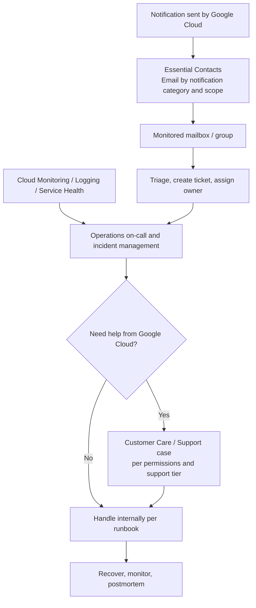
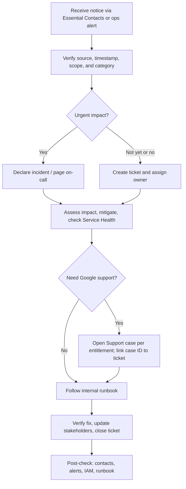

# Essential Contacts, Support Channels, and Operational Points of Contact on Google Cloud

A well-designed Google Cloud system can still suffer an outage if **critical notifications do not reach the right people**. Google may send alerts about security, billing, impending service suspension, or product changes, while the operations team monitors Cloud Run, GKE, Compute Engine, VPC networking, storage, and databases. Each kind of message needs a different recipient, action owner, and escalation path.

This lesson sits in the **Organization Governance** chapter of the `CLOUD_PROVIDERS_GCP` module. After understanding Organization, Folder, Project, and IAM structures, learners must build communication channels to govern resources, protect applications, automate deployments, and track reliability and costs. The focus here is **Essential Contacts**, **Google Cloud support channels**, and **operational contact delegation** for multi-project organizations.

> Essential Contacts is a way to register **email addresses to receive categorized notifications from Google Cloud**. It is not an on-call paging system, does not automatically open technical support cases, and does not replace application alerts in Cloud Monitoring.

## 1. Learning Objectives

After this lesson, you will be able to:

- Explain what Essential Contacts is, when to use it, and the service's limitations.
- Distinguish notification categories: **Billing, Legal, Product updates, Security, Suspension, Technical**.
- Choose where to configure contacts across **Organization, Folder, or Project**, and identify contacts inherited from ancestors.
- Design a roster of **primary contacts, backup contacts, group mailboxes, and escalation paths** for each notification category.
- Distinguish Essential Contacts from **Google Cloud Customer Care/Support**, **Service Health**, **Cloud Monitoring**, budget alerts, and internal incident management tools.
- Prepare a technical support case with sufficient evidence without including passwords, service keys, or sensitive data.
- Validate notification intake workflows using security, billing, product change, and service disruption scenarios.

## 2. Why Are Points of Contact Part of Organization Governance?

Consider an enterprise with projects `orders-dev`, `orders-staging`, `orders-prod`, and `payments-prod`. The system runs smoothly, yet a notice affecting the production project goes to the personal email of an employee who transferred departments. The operations team misses the alert; follow-up remediation is delayed even though dashboards and IAM were configured accurately.

The problem has at least four dimensions:

1. **Recipients:** Which address does Google Cloud contact for information concerning an Organization, Folder, or Project?
2. **Classification:** Is this a security, billing, legal, product change, or technical notice?
3. **Action:** Who is responsible for reading, verifying, assessing impact, and creating remediation work?
4. **Escalation:** When help from Google Cloud is needed or impact crosses team boundaries, where is a support request opened and who coordinates?

A sound design combines multiple mechanisms:



Email intake from Essential Contacts, monitoring alerts, and opening Support cases **complement** one another. Never expect a single channel to carry the entire incident lifecycle.

## 3. What Is Essential Contacts?

**Essential Contacts** lets you register representative email addresses to receive **important categories of Google Cloud notifications** for resources within a chosen scope. A contact record typically has these attributes:

| Attribute | Meaning |
| --- | --- |
| **Email address** | Address where notifications are sent. Managed group addresses can be chosen to avoid relying on one individual. |
| **Notification categories** | One or more notification categories subscribed by this address. |
| **Language** | Preferred language for notifications from Google Cloud's supported list; not every notice is guaranteed to be translated. |
| **Resource scope** | Organization, Folder, or Project where the contact is configured. |

For example, a record means: "Send `SECURITY` and `SUSPENSION` notifications for this resource branch to `gcp-security@example.com`." That email address does not automatically receive permissions to view projects, data, or IAM policies.

### 3.1. Notification Categories to Care About

| Category | Purpose of Notifications | Recommended Owner |
| --- | --- | --- |
| **Billing** | Billing notices, billing accounts, and related billing issues. | FinOps, Finance, or billing administrators. |
| **Legal** | Legal notices, terms issues, or legally binding requests. | Legal counsel or compliance point of contact. |
| **Product updates** | Product updates or changes that may affect service usage plans. | Cloud Platform, system architects, service owners. |
| **Security** | Security notifications and issues requiring security response. | Cloud Security or Security Operations. |
| **Suspension** | Warnings regarding risk or action of service/resource suspension. | High-priority operations lead, coordinating Security and Billing depending on cause. |
| **Technical** | Technical notices regarding services, resources, or operational changes. | SRE/Cloud Operations and product teams owning workloads. |

Category names in config/APIs typically appear as `BILLING`, `LEGAL`, `PRODUCT_UPDATES`, `SECURITY`, `SUSPENSION`, and `TECHNICAL`. Depending on the UI/API, you may also encounter an option covering all categories. Prefer **explicitly assigning needed categories** rather than subscribing every email to all notification types by default.

**Note:** categories indicate **topic**, not urgency. A Technical notice might only require reviewing a planned change; a Billing notice might lead to an outage if unaddressed in time. Always read the contents and deadlines in a notice before setting internal priority.

### 3.2. What Does Essential Contacts Not Do?

Essential Contacts **does not**:

- Grant IAM roles or access permissions to email recipients.
- Replace permission controls for who can create and track **Support cases**.
- Guarantee detection of every workload failure or send alerts whenever an API/VM/Pod fails.
- Provide on-call schedules, read acknowledgments, automated incident assignment, or internal response SLAs.
- Replace backup policies, Cloud Monitoring alerting, centralized logging, or notifications from other billing/identity systems.

Someone can be an Essential Contacts recipient yet **lack permission to open Support cases**. Conversely, someone with IAM roles to open Support cases may not be listed as an Essential Contact for the organization.

## 4. Organization, Folder, Project Scopes and Inherited Contacts

Essential Contacts is managed along the Google Cloud resource hierarchy. Contacts configured at a parent level apply downward to child resources; contacts at child levels add coverage for that branch's specific needs.

Consider this resource tree:

```text
Organization: example.com
├── Folder: shared-services
│   └── Project: net-host-prod
└── Folder: applications
    ├── Folder: dev
    │   └── Project: orders-dev
    └── Folder: prod
        ├── Project: orders-prod
        └── Project: payments-prod
```

One configuration plan:

| Configuration Level | Contact Email | Category | Intent |
| --- | --- | --- | --- |
| **Organization** | `cloud-security@example.com` | Security, Suspension | Security team receives critical org-wide notices. |
| **Organization** | `cloud-finance@example.com` | Billing | Organization-level billing point of contact. |
| **Organization** | `cloud-legal@example.com` | Legal | Legal point of contact. |
| **Folder `applications`** | `cloud-platform@example.com` | Product updates, Technical | Platform team tracks changes and technical issues for the apps branch. |
| **Folder `prod`** | `sre-prod@example.com` | Technical, Suspension | SRE group accountable for production workloads. |
| **Project `payments-prod`** | `payments-owner@example.com` | Technical | Payments application team receives notices specific to its project. |

When evaluating effective contacts for `payments-prod`, inspect records set on the project itself plus applicable ancestors: Folder `prod`, Folder `applications`, and Organization. **Contacts attached at a child level do not automatically remove parent-level contacts.**

### 4.1. Choosing Configuration Level by Responsibility Scope

**Set at Organization** when the point of contact truly holds enterprise-wide responsibility: central security, legal, shared billing administration, or platform governance. The benefit is that newly created projects under the organization still have proper org-level contacts.

**Set at Folder** when notifications should route by business unit, platform team, or environment. For example, Folder `prod` routes to production on-call SREs, whereas Folder `dev` routes to platform/dev tools teams tracking less urgent changes.

**Set at Project** when a project requires a dedicated owner, such as `payments-prod` operated by a specialized payments team. Do not repeat the same email across hundreds of projects if a single Folder-level record fulfills the role.

### 4.2. "Direct Contacts" and "Effective Contacts" Differ

When auditing configuration, distinguish:

- **Direct contacts:** records stored directly on a specific Organization, Folder, or Project.
- **Computed/effective contacts:** the set of contacts applicable to the resource and category being evaluated, including contacts inherited from ancestors per the service's inheritance rules.

If you list only **direct** contacts on `payments-prod`, you may not see `cloud-security@example.com` even though Security is configured at the Organization. Conversely, an email appearing in the effective contacts list **does not mean** that user can administer the project.

Do not confuse this inheritance logic with IAM allow policies. Both use the Resource Manager hierarchy, yet **their rules and purposes differ**; you cannot infer IAM permissions from an Essential Contacts list.

## 5. Designing Operational Points of Contact: Groups, Owners, and Backups

An email list is insufficient without accountable people monitoring and acting on it. Before registering Essential Contacts, build an **operational contact directory**.

| Role | Primary Team | Backup Team | Responsibility |
| --- | --- | --- | --- |
| Security Contact | Cloud Security/SOC | Lead on-call SRE | Assess security notices, coordinate risk mitigation, retain evidence. |
| Billing Contact | FinOps/Finance | Cloud Platform | Verify payment status, billing deadlines, and spend. |
| Suspension Contact | Incident Manager or SRE | Security + Billing | Prioritize verification and prevent disruption; route to root-cause team. |
| Technical Contact | Cloud Operations/SRE | Workload owner | Assess technical changes or issues; align with release schedules. |
| Product Updates Contact | Cloud Platform | Architects/app teams | Analyze changes, deprecations, and migration work. |
| Legal Contact | Legal | Compliance lead | Assess legal notices and notify stakeholders. |
| Support Case Owner | SRE/Cloud Support Coordinator | Authorized on-call operator | Create, update, track cases, and relay findings to remediation teams. |

### 5.1. Why Use Managed Group Emails?

For example, `gcp-security@example.com` is a group mailbox or distribution alias delivering to active responders. When an engineer leaves, the organization simply updates group membership rather than remembering to edit dozens of individual contacts.

Design requirements:

1. **Primary and backup groups** with clear owners.
2. Mechanism confirming on-call received the notice and created an internal ticket.
3. Workflow updating membership on role changes, leave, or contractor turnover.
4. Verification of external email delivery, spam filters, and email retention policies.
5. Verification that mailboxes are active; avoid unowned aliases or forwarding to unmanaged personal addresses.

Not every notice warrants waking on-call at night. **High-risk Security/Suspension notices** need rapid triage workflows, whereas Product updates can usually enter scheduled change backlogs. Actual priority must follow notice content and business impact.

### 5.2. Responsibility Differs from IAM Permissions

Someone in `cloud-legal@example.com` does not need `roles/owner` on every project to receive legal notices. Someone in Finance does not necessarily need read access to Cloud SQL data. Grant **roles matching actual job duties**, separate from notification recipient status.

Personnel permitted to modify Essential Contacts should be designated administrators. Google Cloud provides IAM permissions and roles for Essential Contacts, such as admin and viewer roles; verify current role definitions and grant them at the required scope. Never grant `roles/owner` just to update contact emails.

## 6. Configuring Essential Contacts in the Console

Example configuration at Organization or Project scope:

1. Sign in to Google Cloud Console with an appropriately authorized identity.
2. Select the exact **Organization, Folder, or Project** in the resource picker.
3. Open **Essential Contacts** (searchable in Console if menu placement changes).
4. Add a monitored group email; select the **notification categories** to receive.
5. Choose an appropriate supported language and save.
6. Re-verify the contact list, applicable scope, and actual mailbox owners.
7. For child projects, inspect **effective contacts** to ensure inherited configs are accounted for.

To prevent environment mix-ups, log in the change ticket: resource type, resource ID, email, category, accountable team, approver, and reason for change. Email names should indicate function clearly, e.g., `gcp-security@...` instead of `contact1@...`.

### 6.1. Contact Record Model in the API

The JSON model below illustrates key fields of a record; **it is not an automated API call to create contacts**:

```json
{
  "email": "gcp-security@example.com",
  "notificationCategorySubscriptions": [
    "SECURITY",
    "SUSPENSION"
  ],
  "languageTag": "en"
}
```

Where:

- `email` is the destination address for notifications.
- `notificationCategorySubscriptions` lists notification categories.
- `languageTag` picks a preferred language in a format supported by the service. `en` here is illustrative; verify the supported language list in Console/API.

Essential Contacts inspection APIs distinguish **listing direct records** from **computing applicable contacts** for a resource. The REST paths below illustrate the read semantics:

```text
GET /v1/organizations/123456789012/contacts
    → Lists contacts attached directly to the Organization

GET /v1/projects/orders-prod/contacts
    → Lists contacts attached directly to the Project

GET /v1/projects/orders-prod/contacts:compute
    → Computes contacts applicable to the Project, including eligible inherited sources
```

These are reference paths for the Essential Contacts API; actual calls must target host `essentialcontacts.googleapis.com` with an authorized identity and required/supported query parameters per API version. Never use a project's direct `list` output as a substitute for checking effective contacts.

### 6.2. Post-Configuration Checks

Verify immediately:

- Emails are entered accurately and receiving groups have active owners.
- Required categories are selected at the appropriate scope.
- Production projects receive both expected ancestor contacts and dedicated contacts.
- No departed contacts, unowned auto-forwards, or external-email blocks exist.
- Tickets/runbooks exist for actionable notices.

Sending an **internal test email** to an alias only proves the mail system can receive email; it **does not confirm** Google Cloud generated a test Essential Contacts notice. Verify the configuration in Console/API and run tabletop intake drills separately.

## 7. Google Cloud Support Channels: Customer Care and Support Cases

**Essential Contacts** registers notification recipients. **Google Cloud Customer Care/Support** is the channel for engaging Google for answers or troubleshooting product/service issues according to the organization's entitlements and support tier.

Google Cloud offers support options such as **Basic, Standard, Enhanced, and Premium**; features, hours, priorities, and response targets depend on **your active tier, issue type, product, and current terms**. Never promise "response in X minutes" from a tier name alone without verifying actual contract/support entitlements.

| Need | Channel to Use | Notes |
| --- | --- | --- |
| Reading IAM or Cloud Run setup guides | Google Cloud product docs and guides | Good for learning; does not replace production incident response. |
| Questions about invoices and charges | Billing Support / Billing section | Usually follows a dedicated billing support workflow. |
| Application hits a technical bug needing Google investigation | Customer Care / Support case | Case-opening rights and support scope depend on tier/contract. |
| Tracking announced Google Cloud service issues | Google Cloud Service Health | Provides broad visibility plus project-scoped Personalized Service Health features where supported. |
| Tracking workload metrics, logs, and alerts | Cloud Monitoring, Cloud Logging, on-call tools | Primary internal detection and response mechanisms. |
| Legal, security, or suspension notices from Google | Essential Contacts and internal response workflow | Emails must have assigned handlers. |
| Design discussions with partners or account teams | Contracted partner/account channel | Use only when the enterprise has designated contacts and entitlements. |

### 7.1. Who Is Allowed to Open and Manage Support Cases?

Permission to manage Support cases is **separate** from Essential Contacts. Dedicated IAM roles exist for viewing or editing technical support cases, such as `roles/cloudsupport.techSupportViewer` and `roles/cloudsupport.techSupportEditor` in supported environments. Actual ability to use roles and file cases also depends on Customer Care configuration, resources, and support tier.

In practice:

- Grant case creation/update rights to SREs, platform engineers, or authorized support coordinators.
- Ensure **shift handoff** coverage so another operator can take over a case if the creator is off shift.
- Record the case ID in the internal incident ticket so multiple teams do not open duplicate cases.
- Periodically review who can view/modify cases; do not assume Essential Contacts recipients need `roles/owner`.

### 7.2. What Should Go Into a Support Case?

When creating a case in **Google Cloud Console → Support** (menu location may vary), include enough detail for support engineers to understand scope and impact:

| Field | Illustrative Example |
| --- | --- |
| **Title** | "Cloud Run in asia-southeast1 experiencing spike in HTTP 5xx." |
| **Service / location** | Cloud Run, region `asia-southeast1`. |
| **Project / resource** | Project ID `orders-prod`, service `orders-api`. |
| **Timeframe** | Started `2026-11-19 01:15 UTC`, ongoing. |
| **Business impact** | 30% of order requests failing; no workaround yet. |
| **Technical symptoms** | Error codes, request IDs, sanitized logs, latency and 5xx graphs. |
| **Steps tried** | Revision rollback, quota and network checks; describe outcomes. |
| **Priority** | Assessed from real impact and Customer Care/support-tier criteria. |
| **Response contact** | Active on-call SRE group, approved communication channel. |

**Never send** passwords, private keys, service account JSON keys, access tokens, session cookies, or unnecessary customer data in a case. Scrub/redact identifying details from logs and share only what is needed for investigation per company policy.

### 7.3. Distinguishing Internal Severity from Support Priority

An enterprise might label an incident `SEV-1` in its internal runbook, while the Customer Care portal uses its support tier's **priority/severity** system. The two taxonomies do not necessarily share identical names or criteria.

For example:

- **Internally:** `SEV-1` means production ordering is down, requiring an incident commander and stakeholder updates.
- **When opening a Support case:** select the level matching impact, tier definitions, and Google Cloud guidelines; supply full metrics so support engineers can evaluate.

Never pick the highest priority purely to get a faster reply when criteria are not met. Conversely, genuinely severe impact must be documented clearly and escalated through the appropriate entitled channel.

## 8. Other Observability and Alerting Channels You Cannot Ignore

### 8.1. Google Cloud Service Health

**Google Cloud Service Health** reports Google Cloud service events, including public status views and project/resource-scoped **Personalized Service Health** features when supported and configured.

When suspecting a regional or service outage:

1. Check workload error graphs in Cloud Monitoring.
2. Check Service Health for events matching timeframe, location, and product.
3. Correlate published incidents with actual application errors; **do not assume** every workload failure has a Service Health notice.
4. If deeper investigation is needed and entitled, open a Support case with timestamps, project ID, request IDs, and evidence.

### 8.2. Cloud Monitoring and On-Call Systems

Cloud Monitoring should define alert policies for:

- HTTP 5xx rates on Cloud Run or Load Balancers.
- Rising latency and falling request throughput.
- Unready GKE nodes/Pods, scheduling failures, or autoscaling errors.
- Unhealthy Compute Engine VMs, abnormal CPU/memory/disk usage.
- Cloud SQL CPU, connections, storage, or availability.
- High quota utilization, API rate limits, and permission errors where metrics/logs exist.

Alert policies can use supported notification channels to notify on-call teams or incident tools. On-call schedules, rotations, acknowledgments, and escalation rules must be operated **separately**. Essential Contacts emails do not replace this mechanism.

### 8.3. Billing and Cost Alerts

**Cloud Billing budgets** can alert on spend thresholds and forecasts depending on configuration; this cost monitoring mechanism differs from Essential Contacts' Billing category. A standard budget **is not a hard spend cap**. Finance leads must align with Cloud Operations on:

- Official billing notification channels.
- Operational spend alert thresholds, owners, and review cadence.
- Workflows to investigate unexpected charges, quota spikes, or misconfigured deployments.
- Response plans if a billing account issue risks impacting live services.

### 8.4. Cloud Logging, Audit Logs, and Security

**Cloud Audit Logs** trace administrative actions and certain data access events depending on service support; **Security Command Center** and other security controls help detect risk findings per org configuration. These tools cannot be replaced by subscribing to the Security category in Essential Contacts.

Scenario where a service account is abused: you must inspect identities, logs, and target resources; Essential Contacts may deliver important notices from Google, yet investigation and response still rely on internal observability and responders.

## 9. Runbook: From Notification Email to Concrete Action

Organizations should standardize a workflow simple enough for someone new on-call to execute accurately.



### 9.1. Intake and Source Verification

Do not click unfamiliar links or sign in through unverified email URLs. Verify the notice through official Console channels, especially for billing or suspension emails that could be spoofed. Identify:

- Which Project, Folder, Organization, or billing account is affected.
- Timestamps and action deadlines; whether the email specifies a cutoff date.
- Notification category and impact on production services.
- Application owner and assigned department from the contact directory.

### 9.2. Triage and Route to the Right Team

| Category Received | First Response Step | When to Escalate? |
| --- | --- | --- |
| **Billing** | Finance checks payment status and Billing Console. | Suspension risk, large unexpected spend, or billing support needed. |
| **Security** | SOC verifies indicators, assesses impacted resources, triggers response workflow. | Potential data/key exposure, anomalous activity, or production threat. |
| **Suspension** | Incident Manager verifies policy or billing/service issue, assigns owner. | Immediately if critical disruption is likely or deadline is tight. |
| **Technical** | SRE reads details, cross-checks resources, change calendar, and system health. | Production errors, technical update deadlines, or Google investigation needed. |
| **Product updates** | Platform logs in backlog, analyzes compatibility and upgrade schedule. | Deprecation/breaking change affects products; plan ahead of deadline. |
| **Legal** | Route to Legal and archive handling trail per internal policy. | Response deadline or legal obligation requiring leadership/compliance involvement. |

**Urgent** notices need a dedicated path to reach active on-call responders; group mailboxes should route into tickets/incidents per rules approved by operations.

### 9.3. Communication During and After an Incident

When an incident is opened:

1. Designate an **incident commander** or coordinating owner.
2. Record impact, affected projects/regions/services, start time, and mitigations.
3. If a Support case exists, assign **one point of contact** to update Google and sync updates internally.
4. Send updates on an agreed cadence to internal users and stakeholders without speculating on root cause before evidence exists.
5. After recovery, document verified root cause, gaps in alerting/contacts, and preventive actions.

Never let multiple team members send conflicting summaries to Google; a single coordinated channel avoids contradictions and speeds up case resolution.

## 10. Organizational Deployment Scenarios

### 10.1. Scenario A — Suspension Risk Warning on a Prod Project

The organization has:

```text
Organization: example.com
├── Contact SECURITY / SUSPENSION → cloud-security@example.com
├── Contact BILLING              → cloud-finance@example.com
└── Folder: applications
    └── Folder: prod
        ├── Contact SUSPENSION / TECHNICAL → sre-prod@example.com
        └── Project: orders-prod
```

If a Suspension notice affects `orders-prod` within these contacts' scope, the respective points of contact receive emails via inherited configuration. Both Security and SRE receiving the email **does not mean either automatically owns the whole issue alone**. The runbook must state that the Incident Manager leads coordination, Finance checks billing risks if applicable, Security investigates policy/security causes if relevant, and SRE assesses Cloud Run/Cloud SQL impact.

Sample handling sequence:

1. Verify the notice via official channels, confirming deadline and scope.
2. Trigger emergency operations if service loss is at risk.
3. Investigate the applicable root cause: billing, policy, security, or compliance requirement.
4. Authorized owner opens the appropriate support channel if needed, supplying project ID and verified evidence.
5. After resolution, verify resource health, serving availability, and cost/security alerts.

### 10.2. Scenario B — Cloud Run 5xx Spike Without Essential Contacts Email

Cloud Monitoring detects HTTP 5xx jumping from 0.2% to 18% on `orders-api`. No Essential Contacts email arrived.

This is **not evidence that Essential Contacts is broken**. Errors could stem from application code, database, network, quotas, or service conditions; Essential Contacts does not provide default alerting for every application error.

The SRE team executes:

1. Inspect dashboards, logs, and the latest Cloud Run revision.
2. Check Cloud SQL connectivity, latency, connection counts, regional quotas, and VPC changes.
3. Cross-check Service Health for signs of infrastructure issues.
4. Roll back or shed load per runbook if needed, recording outcomes.
5. Open a Support case if sufficient evidence points to an issue needing Google investigation and the org has support entitlement.

### 10.3. Scenario C — Product Update with a Migration Deadline

The Platform team receives a Product updates notice about a change with an enforcement deadline. On-call handles it through a **change management process**, rather than immediately upgrading production:

- Record the exact product, API/feature, effective date, and potentially impacted projects.
- Inventory applications using the feature and identify owners.
- Create tickets with assigned owners and target completion dates ahead of the deadline.
- Test on dev/staging, check IAM/Organization Policies, and assess downtime and cost.
- Approve and roll out to prod via CI/CD; run post-deployment checks and close tickets.

This is why Product updates usually go to Platform/Architecture and workload owners, whereas Suspension requires a faster emergency response channel.

## 11. Auditing and Maintaining Contact Lists

Essential Contacts is only useful if lists stay current. An operational checklist:

| Suggested Cadence | Action Required | Output |
| --- | --- | --- |
| When creating a new project | Check inherited contacts and project owner. | Project has valid Security, Billing, and Technical contacts. |
| On staff or vendor turnover | Audit emails, groups, and on-call channels. | No orphaned addresses; backups ready. |
| Quarterly | Audit direct and effective contacts at critical scopes. | Contact lists match current org structure. |
| Post-incident / Support case | Assess whether notices reached the right people without delay or misrouting. | Process improvements and responder training. |
| Before billing or org changes | Audit Billing, Legal, Suspension, and Support ownership. | Clear contacts before wide-impact governance changes. |

### 11.1. Data to Store in the Contact Directory

Each internal governance record should contain:

```yaml
resource: "projects/orders-prod"
contact_category: "TECHNICAL"
contact_email: "sre-prod@example.com"
owner_team: "Cloud SRE"
backup_team: "Cloud Platform"
ticket_queue: "PROD-OPS"
oncall_reference: "internal-oncall-schedule"
last_reviewed: "2026-11-19"
```

This is an **internal governance data template**, not an Essential Contacts API request format. Fields like `owner_team`, `ticket_queue`, `oncall_reference`, and `last_reviewed` help operations teams audit ownership, while Essential Contacts itself does not manage on-call schedules or ticket queues.

Do not place personal phone numbers, credentials, or secrets in public contact directories. If using an on-call tool, store a reference to an appropriately permissioned schedule.

### 11.2. Auditing Contact Admin and Support Permissions

Two permission sets must be audited separately:

- Who can create/edit/delete **Essential Contacts** at Organization, Folder, and Project levels?
- Who can view/create/update **Support cases** under the support tier?

Also audit IAM permissions of every account in the response workflow. For instance, a log-reader account should not automatically edit billing; a ticket owner should not automatically administer the Organization. Overly broad permissions pose a greater risk than missing a single notification.

## 12. Practice Exercises

Suppose an enterprise operates this resource tree:

```text
Organization: example.com
└── Folder: applications
    ├── Folder: dev
    │   └── Project: orders-dev
    └── Folder: prod
        ├── Project: orders-prod
        └── Project: payments-prod
```

The enterprise has groups `cloud-security@example.com`, `cloud-finance@example.com`, `sre-prod@example.com`, `orders-team@example.com`, `payments-team@example.com`, and `cloud-legal@example.com`.

**Exercise A — Designing Contacts**

Propose scopes and categories for:

1. Security team monitoring organization-wide risk.
2. Finance team managing organizational billing status.
3. SRE team operating all projects in Folder `prod`.
4. Payments team receiving technical notices specifically for `payments-prod`.
5. Legal receiving enterprise-wide legal notifications.

**Suggested answers:**

| Need | Proposed Configuration | Rationale |
| --- | --- | --- |
| Security | Organization, `SECURITY` and consider `SUSPENSION` per delegation. | Org-wide coverage and intake of critical alerts. |
| Finance | Organization, `BILLING`. | Centralized billing contact; coordinate with actual billing scope. |
| Production SRE | Folder `prod`, `TECHNICAL` and `SUSPENSION`. | Covers all production projects in that branch. |
| Payments | Project `payments-prod`, `TECHNICAL`. | Application owner receives notices for its dedicated project. |
| Legal | Organization, `LEGAL`. | Centralized handling of organizational legal matters. |

**Exercise B — Checking Inheritance**

`payments-prod` has no `cloud-security@example.com` record in its **directly attached** project contacts. However, the Organization configured that email for `SECURITY`. Can you conclude Security will not receive notices about `payments-prod`?

**Answer:** No. You must inspect **computed/effective contacts** to include inherited configurations from Organization/Folders. A project's direct contacts list is not the full set of applicable contacts.

**Exercise C — Distinguishing Channels**

For 10 minutes, Cloud Run `orders-api` returns many `503` errors, yet no Essential Contacts email arrives. Will you:

1. Wait for an Essential Contacts email?
2. Inspect Cloud Monitoring, Logging, revisions, backends, and Service Health?
3. Immediately open a top-priority Support case with no impact data?

**Answer:** Prioritize **(2)**, follow the runbook according to impact severity, mitigate the issue, and gather evidence. **Do not** wait for an Essential Contacts email because that service does not monitor every workload failure. If Google assistance is needed, open a Support case per current entitlements/tier, provide concrete data, and choose an accurate priority.

**Exercise D — Recipients Differ from Resolvers**

Finance receives a Billing notice warning of potential suspension on a production project. Finance lacks permissions to modify Cloud Run, and SRE does not manage billing accounts. Who handles it?

**Answer:** Trigger the cross-functional workflow: Finance resolves billing, SRE evaluates disruption risk and mitigation options, and the Incident Manager coordinates if needed. Never grant `roles/owner` to everyone just to solve this; each team performs its part using its delegated permissions.

## 13. Key Takeaways

- **Essential Contacts** lets Google Cloud deliver categorized notifications to contacts scoped at Organization, Folder, or Project.
- **Notification category** indicates content topic; urgency must be assessed from the actual notice and business impact.
- Contacts **can apply from ancestors**: distinguish direct contacts from computed/effective contacts.
- Use **group addresses with clear owners, backups, and tracking workflows** instead of a single individual's email.
- Being registered in Essential Contacts **does not grant IAM roles**, Support case permissions, or data access.
- **Customer Care/Support**, **Service Health**, **Cloud Monitoring**, **Cloud Logging**, and **Billing budgets** serve distinct purposes and must be combined in operations.
- During incidents, verify the notice, classify, assign an owner, mitigate impact, open a Support case if needed, and review communication channels afterward.
- Contact directories, responder IAM, on-call schedules, alert policies, and escalation paths must be reviewed upon **project creation, staff changes, architecture shifts, or post-incidents**.

### Google Cloud References

- [Essential Contacts overview](https://cloud.google.com/resource-manager/docs/managing-notification-contacts)
- [Essential Contacts API](https://cloud.google.com/essential-contacts/docs/reference/rest)
- [Google Cloud Customer Care](https://cloud.google.com/support)
- [Get support](https://cloud.google.com/support/docs/getting-support)
- [Google Cloud Service Health](https://cloud.google.com/service-health/docs/overview)
- [Cloud Monitoring alerting](https://cloud.google.com/monitoring/alerts)
- [Cloud Billing budgets](https://cloud.google.com/billing/docs/how-to/budgets)
