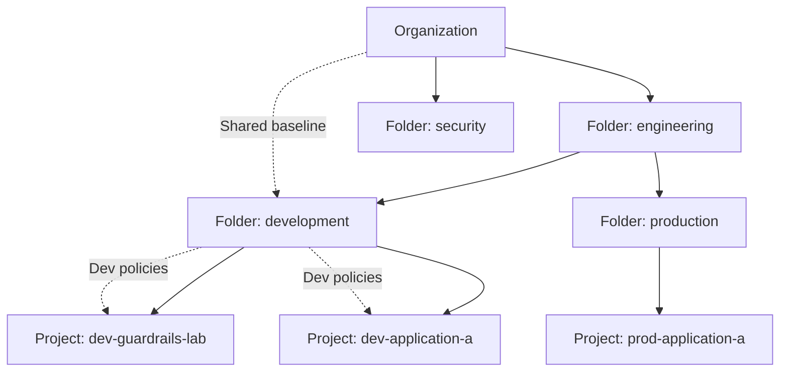
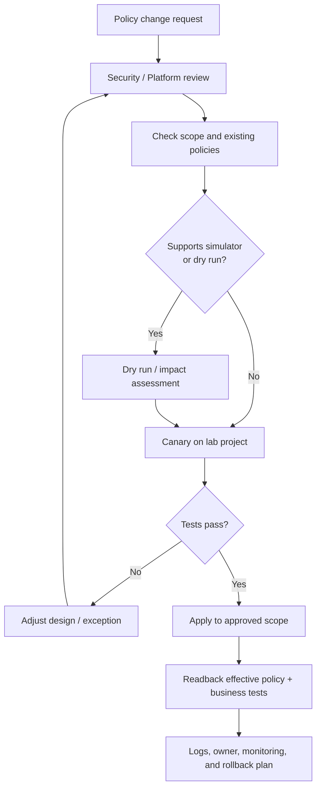

# Hands-On: Setting Up Guardrails for a Development Environment

An application development team on Google Cloud needs enough permissions to experiment with Compute Engine, GKE, Cloud Run, databases, and storage services. However, if every member holds Owner on every project, can create service account keys at will, assign public IPs uncontrollably, and deploy into any region, the development environment accumulates security, cost, and operational risks. **Guardrails** are rules and control mechanisms that keep development teams operating within **agreed boundaries**.

This lesson belongs to the **Organization Governance** chapter of the `CLOUD_PROVIDERS_GCP` module. The module spans project organization, IAM, and VPCs through Compute Engine, GKE, Cloud Run, storage, databases, release automation, reliability monitoring, and cost. This hands-on lab brings those concepts together into a `dev` environment with appropriate permissions, verified policies, and violation detection.

## 1. Learning Objectives

After this lesson, you will be able to:

1. Distinguish **preventive**, **detective**, **corrective**, and **cost/usage** guardrails.
2. Design guardrail enforcement scopes across **organization → folder → project** while separating `dev`, `staging`, and `prod`.
3. Select appropriate protection layers: **IAM**, **Organization Policy**, networking/VPC, workload identities, logs, quotas, and budgets.
4. Inspect **effective organization policies**, understand inherited policy behavior, and use **dry-run** mode on supported constraints.
5. Practice restricting service account key creation on a **lab project**, confirming scope, recording baseline state, reading back results, and planning rollback.
6. Build a test matrix of allowed/blocked behaviors, monitor via Cloud Audit Logs, and decide whether to roll out more broadly.
7. Recognize each mechanism's limits: budget alerts are not always hard limits; Organization Policy does not replace IAM, firewalls, or backups.

**Lab scope:** this lesson uses an example project `dev-guardrails-lab` under an existing organization. Identifiers are illustrative only. **Read-only configuration** steps can be executed with appropriate viewer permissions; **policy-applying** operations are only for administrators authorized on an **approved test project**. This lesson does not require modifying a real organization or production environment.

## 2. What Is a Guardrail and How Does It Differ from an Operational Rule?

The statement "Do not create JSON keys for service accounts" is a **policy rule**. A guardrail automatically rejects key creation operations, or logs when they happen, turning the rule into verifiable system behavior.

| Group | Goal | Example GCP Mechanisms | What to Observe |
| --- | --- | --- | --- |
| **Preventive** | Prevent invalid configurations from being created | Organization Policy, IAM deny/allow policies, firewalls | Requests denied with specific reasons |
| **Detective** | Identify drift and anomalous behavior | Cloud Audit Logs, Cloud Asset Inventory, Security Command Center, Monitoring | Logs, findings, alerts routed to right owners |
| **Corrective** | Return resources to an allowed state | IAM remediation workflows, approved automation, IaC reconciliation | Accountable changes and readback |
| **Cost/usage** | Surface rising spend early and curb over-provisioning | Cloud Billing budget alerts, quotas, service configuration limits | Notifications, quota metrics, usage trends |

A well-defined guardrail specifies **the controlled target, prevented action, enforcement scope, owner, verification method, and exception process**. For example: "Do not create **user-managed service account keys** in projects under the development folder; workloads use runtime identities or Workload Identity Federation; exceptions must be reviewed separately."

No single service governs an entire organization. You must combine protection layers because each product addresses a different kind of decision:

- **IAM** answers: *Who can do what on which resource?*
- **Organization Policy** answers: *Which configurations or actions are restricted by constraints?*
- **VPCs, firewalls, and network configs** answer: *Which network flows are allowed through?*
- **Auditing/Monitoring** answers: *What happened, what is happening, or what risks are emerging?*
- **Budgets and quotas** help control usage and spending per each product's mechanics.

## 3. Governance Boundaries: Organization, Folder, Project

Guardrails must be attached at the right governance level. A reference model:



**Organization** is the broad scope for governing resources and baseline policies. **Folders** group projects by environment or owning unit. **Projects** are the common boundary for IAM bindings, APIs, quotas, application resources, and cost tracking.

A policy placed on a folder can affect **all child projects**, including projects created later. Therefore, when testing a new constraint, start on a **lab project** before applying it to the `development` folder.

### 3.1. IAM Inheritance vs. Organization Policy Inheritance

Both can appear at the organization, folder, and project levels, yet they **do not behave identically**:

| Aspect | IAM Allow Policy | Organization Policy |
| --- | --- | --- |
| Question | Does this principal have the permission? | Does this request/configuration satisfy the constraint? |
| Declaration form | Principal ↔ role bindings, optionally with conditions | Constraint + rules; boolean, list, or parameterized by type |
| Inheritance | Roles granted at parent levels generally apply down to child resources | Effective policy is computed per the constraint and rules across relevant levels |
| How to verify | Policy inspection, IAM Policy Troubleshooter, controlled permission tests | `org-policies describe --effective`, audit logs, Policy Simulator/dry run where supported |
| Common mistake | Granting Editor to fix every error | Assuming a child policy can always/never override every parent rule |

**Effective policy** is the policy actually evaluated after considering inheritance and rules for that constraint. Do not look only at the policy defined directly on the project: a project may have no local policy yet still be constrained by its folder or organization. Merge, replace, or override behavior depends on the constraint type and configuration; always check the effective result rather than guessing from folder names.

### 3.2. Labels and Tags Are Not the Same

- **Labels** are key–value metadata commonly used for classification, reporting, filtering, and cost analysis per service support.
- **Resource Manager tags** are a dedicated governance structure with TagKey/TagValue/TagBinding and corresponding admin permissions; certain Organization Policies or IAM Conditions can use tags for conditional enforcement.

Never treat a label like `environment=dev` as an automatic "protective wall." To vary policies by environment, choose a product-supported **tag/condition type**, protect tag editing permissions, and test policy expressions.

## 4. Turning Business Requirements into a Guardrail Set

Suppose a company wants the backend team to experiment with APIs and databases while staying within GCP resources approved for `dev`. Translate goals into testable statements:

| ID | Goal for Dev Environment | Proposed Mechanism | Test |
| --- | --- | --- | --- |
| G-01 | Dev members lack full project admin | Group-based IAM, least-privilege roles, separate deployer/runtime SAs | Dev accounts cannot grant Owner/Editor outside assigned permissions |
| G-02 | Restrict long-lived private keys for SAs | Managed Organization Policy constraint on service account key creation | Key creation is denied when live policy is enforced; workloads still use ADC |
| G-03 | Use services in approved locations | Organization Policy on resource locations (where supported by service) | Creating supported resources in unlisted locations is blocked |
| G-04 | Avoid exposing admin ports to the Internet | Firewall policies/Firewall Rules and network config review process | Rules allowing SSH/RDP from public sources are excluded from managed environments |
| G-05 | Resources must identify an accountable owner | Label/tag conventions, IaC reviews, or custom constraints where supported | Pipeline checks required metadata prior to deployment |
| G-06 | Receive signals on abnormal spend | Billing budget alerts, quotas, and Monitoring | Alerts fire at thresholds; do not confuse with hard caps |
| G-07 | Maintain a trail of policy and IAM changes | Audit Logs, Cloud Asset Inventory, alerts | Can trace actor, timestamp, scope, and action |

These examples do not mean every project must enable **all** constraints. Select policies based on application needs, deployment schedules, and evaluated exceptions. For example, blocking **service account creation** outright can break initialization steps of some services; restricting **service account key creation** is usually more appropriate when the goal is simply reducing long-lived credentials.

## 5. Preparing the Lab Project and Permission Matrix

Before running scripts, confirm the exact values below:

| Variable / Value | Meaning | Illustrative Example |
| --- | --- | --- |
| `ORG_ID` | Governing organization ID | `123456789012` |
| `DEV_FOLDER_ID` | Folder holding dev projects | `234567890123` |
| `LAB_PROJECT_ID` | Project dedicated to hands-on practice | `dev-guardrails-lab` |
| `POLICY_ADMIN` | Identity authorized to manage Org Policies in test scope | An authorized admin group |
| `DEVELOPER_GROUP` | Developer group with right-sized permissions | Engineering team group |
| `BILLING_ACCOUNT` | Project's billing account | Chosen from viewable Cloud Billing configs |

Projects/organizations must actually exist; IDs in the table are **placeholders**, not resources created by this lesson. In Cloud Shell or a workstation with Google Cloud CLI:

```bash
gcloud --version
gcloud auth list
gcloud config get-value project

# Select an authorized readable lab project; pass --project explicitly in subsequent commands.
LAB_PROJECT_ID="YOUR_LAB_PROJECT_ID"

gcloud projects describe "$LAB_PROJECT_ID" \
  --format="yaml(projectId,projectNumber,parent,lifecycleState)"

# Inspect the project's current IAM allow policy.
gcloud projects get-iam-policy "$LAB_PROJECT_ID" \
  --format="yaml(bindings)"
```

These commands are **read-only**. In this lab, if viewer permissions are insufficient, ask the admin team for the appropriate inventory viewer role/permissions rather than requesting Owner just to run a command.

Roles to distinguish:

- **Developer:** deploys/views workloads per specialized roles; does not edit IAM or policies by default.
- **Organization Policy Administrator** (`roles/orgpolicy.policyAdmin`): manages Organization Policies within assigned scope; a powerful role that must have limited holders.
- **Deployer/CI:** holds permissions to deploy specific services and `iam.serviceAccounts.actAs` on the runtime SA when attaching to workloads.
- **Runtime service account:** holds permissions strictly for APIs the application needs, such as reading a bucket or publishing to a topic.
- **Billing administrator / budget owner:** needs appropriate Cloud Billing permissions; project permissions do not automatically grant billing account management rights.

If the organization already enforces a baseline, dev teams must not unilaterally relax parent policies. In practice, guardrail governance usually belongs to Platform/Security, while developers submit change requests through review workflows.

## 6. Surveying Current State Before Making Changes

### 6.1. Reading Effective Organization Policies

Pick three illustrative constraints:

- `iam.managed.disableServiceAccountKeyCreation`: managed constraint blocking creation of user-managed service account key credentials.
- `iam.disableServiceAccountKeyCreation`: **legacy managed** version with a similar goal; may already be enforced by default in some organizations.
- `gcp.resourceLocations`: legacy managed list constraint controlling locations where supported services can create certain resource types.

```bash
LAB_PROJECT_ID="YOUR_LAB_PROJECT_ID"

# Read effective policy, including parent impact.
gcloud org-policies describe \
  iam.managed.disableServiceAccountKeyCreation \
  --project="$LAB_PROJECT_ID" \
  --effective

gcloud org-policies describe \
  iam.disableServiceAccountKeyCreation \
  --project="$LAB_PROJECT_ID" \
  --effective

gcloud org-policies describe \
  gcp.resourceLocations \
  --project="$LAB_PROJECT_ID" \
  --effective
```

If a command returns `NOT_FOUND`, it usually indicates **no matching policy exists at the queried API scope**, not that every request is allowed. Check constraint defaults, other policies, IAM, and service restrictions. Besides the effective policy, inspect the **local** policy to see if a direct configuration is currently overriding anything:

```bash
gcloud org-policies describe \
  iam.managed.disableServiceAccountKeyCreation \
  --project="$LAB_PROJECT_ID"
```

**Never apply a new policy over a resource with pending changes under review.** If a local policy exists, save the current definition along with its `etag` and compare against the new design before editing; use tool-supported versioning/concurrency controls.

### 6.2. Reading Configurations Outside Organization Policy

```bash
# Subnets and regions in the project.
gcloud compute networks subnets list \
  --project="$LAB_PROJECT_ID" \
  --format="table(name,region.basename(),ipCidrRange)"

# Existing VPC firewall rules; does not include all firewall policy layers.
gcloud compute firewall-rules list \
  --project="$LAB_PROJECT_ID" \
  --format="table(name,network,direction,priority,disabled)"

# List service accounts to see available workload identities.
gcloud iam service-accounts list \
  --project="$LAB_PROJECT_ID" \
  --format="table(email,displayName,disabled)"
```

Listing VPC firewall rules **is not enough** to evaluate the entire network path; hierarchical firewall policies, network firewall policies, routes, load balancers, and product-specific ingress/egress settings also apply. If the project has not enabled the Compute Engine API or lacks a VPC, those commands may not return expected lists; note this clearly rather than silently enabling APIs.

## 7. Choosing Supported Constraints and Understanding Dry-Run Limits

**Organization Policy Service** provides Google Cloud-managed constraints plus custom constraints for supported resources/attributes. Constraint names and applicability must be checked against the latest product documentation.

Three concepts are easily confused:

1. **Configuration check (readback):** reading existing policies, especially `--effective`. This does not simulate any change.
2. **Policy Simulator:** evaluates impact of a change within supported product capabilities and constraint types. It does not guarantee detecting all future usage patterns.
3. **Organization Policy dry run:** defines a `dryRunSpec` on a supported constraint; the system logs potential violations **without blocking requests via the dry-run rule**.

**Dry run is not supported for all constraints.** Google Cloud supports custom constraints, managed constraints, and specific legacy managed constraints. For instance, `gcp.resourceLocations` is a legacy constraint and should not be assumed usable in a `dryRunSpec` template. This lab picks the **managed constraint `iam.managed.disableServiceAccountKeyCreation`**, though you must still verify its availability in your organization.

To practice, you need a project with billing enabled per dry-run requirements, Organization Policy admin permissions, and appropriate audit log access. If the feature is unavailable or permissions are insufficient, complete the **read-only inspection and policy design** parts and ask an admin to execute on the lab project.

## 8. Hands-On A: Dry-Running Service Account Key Creation Restrictions

**Goal:** on the lab project, observe which user-managed service account key creation requests would be denied in the future before considering live enforcement. This guardrail steers developers toward **Cloud Run/Compute Engine service identities, ADC, impersonation, or Workload Identity Federation** instead of distributing JSON private key files.

### 8.1. Checking Scope and Baseline State

```bash
LAB_PROJECT_ID="YOUR_LAB_PROJECT_ID"
CONSTRAINT="iam.managed.disableServiceAccountKeyCreation"

gcloud projects describe "$LAB_PROJECT_ID" \
  --format="yaml(projectId,projectNumber,parent)"

gcloud org-policies describe "$CONSTRAINT" \
  --project="$LAB_PROJECT_ID"

gcloud org-policies describe "$CONSTRAINT" \
  --project="$LAB_PROJECT_ID" \
  --effective
```

If the project already has a local policy managed by another team, **do not overwrite it**. Build changes atop the existing policy, preserving `spec` and any `etag` needed for concurrency control. If both legacy and managed key-restriction policies are active, changing only one may **not alter the final outcome** because the other remains enforced.

### 8.2. Authoring a dryRunSpec-Only Policy

Create `dev-key-policy-dryrun.yaml` **on your lab workstation** with the following contents, replacing `YOUR_LAB_PROJECT_ID`:

```yaml
name: projects/YOUR_LAB_PROJECT_ID/policies/iam.managed.disableServiceAccountKeyCreation
dryRunSpec:
  rules:
    - enforce: true
```

Structural notes:

- `name` specifies the target **project** and constraint; this is not the Console project display name.
- `dryRunSpec` declares the simulated rule. It is **not** the live `spec` used for real enforcement.
- `enforce: true` indicates the behavior to evaluate under the managed constraint.
- Do not move this policy up to a folder or organization merely because the constraint name is shared; changing scope can impact many projects.

After carefully reviewing the file and authorized permissions, the command below **writes the dry-run config to the lab project** while **not blocking operations due to the dry-run rule**:

```bash
gcloud org-policies set-policy \
  ./dev-key-policy-dryrun.yaml \
  --update-mask=dryRunSpec
```

`--update-mask=dryRunSpec` updates only the dry-run field of the policy, reducing the risk of accidentally overwriting live policies. Policy behavior may require propagation time; do not declare failure just because changes do not take effect immediately.

### 8.3. Verifying the Saved Dry Run

```bash
gcloud org-policies describe \
  iam.managed.disableServiceAccountKeyCreation \
  --project="$LAB_PROJECT_ID"

gcloud org-policies describe \
  iam.managed.disableServiceAccountKeyCreation \
  --project="$LAB_PROJECT_ID" \
  --effective
```

In the **local** policy output, look for `dryRunSpec.rules`. Also inspect `spec` and the effective policy to see whether any **live** restriction is already active. Seeing `dryRunSpec.enforce=true` **does not prove** violations occurred, nor **does it prove** key creation is currently blocked.

To assess impact, check **Organization Policy / Dry run** in the Console and search **Organization Policy audit logs** for potential violations. Those logs appear only when matching operations occur; seeing zero logs over a short window is not enough to declare the policy harmless. Account for long-interval scheduled workloads and tools used off-hours.

This lab **does not ask you to intentionally create a JSON private key** to trigger a violation: minting real credentials carries security risk and is unnecessary to understand the guardrail workflow.

## 9. Hands-On B: Applying a Live Guardrail Under Control

After reviewing dry-run impact and completing approvals, the governance team may decide to enforce the **live** policy on the lab project. Before this step, ensure you have:

- Inventory of workloads currently using SA keys and a migration plan to ADC/federation.
- Verification of parent policies that may interact, including legacy versions.
- Backup of the **existing local policy** config, assigned rollback owner, and rollout timestamp.
- Test scenarios for relevant deployment flows, Cloud Run, VMs, and CI/CD pipelines.

### 9.1. Live YAML for the Lab Project

This is a **live blocking configuration template**; never use in production without approval:

```yaml
name: projects/YOUR_LAB_PROJECT_ID/policies/iam.managed.disableServiceAccountKeyCreation
spec:
  rules:
    - enforce: true
```

Save as `dev-key-policy-live.yaml`. Only an administrator authorized for the lab project runs:

```bash
gcloud org-policies set-policy \
  ./dev-key-policy-live.yaml \
  --update-mask=spec
```

This updates the **live** part of the policy. It does not automatically delete existing keys or migrate workloads to new identities. If the project already had a local policy, setting a new one can replace older rules; merge properly and handle concurrency rather than blindly overwriting with the sample. Check CLI docs for your installed version if a different `update-mask` expression is required.

### 9.2. Reading Back and Evaluating Behavior

```bash
gcloud org-policies describe \
  iam.managed.disableServiceAccountKeyCreation \
  --project="$LAB_PROJECT_ID"

gcloud org-policies describe \
  iam.managed.disableServiceAccountKeyCreation \
  --project="$LAB_PROJECT_ID" \
  --effective
```

Verify `spec.rules.enforce` and the **effective policy** on the project. After propagation, run **approved business workflows**: deploying Cloud Run with a runtime SA, calling APIs via ADC, building/deploying via CI runners, and expected tasks must continue working. If a legitimate key-creating flow now fails, address it via credential redesign or an appropriately scoped policy exception.

### 9.3. Rollback and Difference Between Revert and Delete

A **proper rollback** restores the **recorded pre-change configuration**, rather than guessing `enforce: false`.

- If the project had a local policy before the lab: restore the saved `spec`, ensuring subsequent valid edits are not overwritten.
- If there was originally no local policy and the project only received one during the lab: an admin may consider deleting **that local policy** to revert to parent inheritance.
- If a parent enforces the policy, deleting the local policy **does not remove** the parent constraint.
- If only removing dry run while preserving the live policy, update `dryRunSpec` separately rather than deleting the entire policy by mistake.

The local policy deletion command below is shown **for identification only**; never run it without a recorded baseline state and rollback plan:

```bash
# MUTATING: deletes the local policy for this constraint on the project.
gcloud org-policies delete \
  iam.managed.disableServiceAccountKeyCreation \
  --project="YOUR_LAB_PROJECT_ID"
```

In practice, protect restore/delete operations with reviewed changes, check `etag` when supported by tooling, and read back the effective policy. Notably, **rolling back a policy does not mean every workload immediately recovers**: you may need to wait for propagation and fix configurations altered during testing.

## 10. Hands-On C: Restricting Deployment Locations

An organization may want dev environments to run primarily in an approved region for data governance, latency, and cost. The `gcp.resourceLocations` constraint restricts locations **for resource types and services supporting this constraint**.

### 10.1. Identifying Requirements First

For example, a dev team has test users in Vietnam and considers `asia-southeast1` as a candidate. Do not assume this region works for every workload: some services or features exist only in other regions; storage services offer regional, dual-region, or multi-region locations; data residency rules also involve backups, logs, and data transfer flows.

Build a dependency table:

| Workload | Candidate Location | Questions to Verify |
| --- | --- | --- |
| Cloud Run API | `asia-southeast1` | Are the service/configuration and dependent databases available in this region? |
| GKE cluster | Supported region or zone | Are node pools and machine types available across all planned zones? |
| Cloud SQL | Database region | How are HA, backups, replicas, and latency to the app handled? |
| Cloud Storage bucket | Product-supported location | Do objects have specific residency or redundancy requirements? |
| BigQuery dataset | Regional or multi-regional | Are queries, other datasets, and data transfers in the same or compatible locations? |

### 10.2. Checking Policy and Deploying with Administrators

Read first:

```bash
gcloud org-policies describe gcp.resourceLocations \
  --project="$LAB_PROJECT_ID" \
  --effective
```

For list constraints, admins specify **allowed location values** using syntax and values published by Google Cloud. Never guess region strings in YAML without checking the constraint's allowed-values reference. Because this is a legacy managed constraint, **do not assume dry run is available**. Use supported impact-analysis tools, test in the lab project, and read back the effective policy.

If a location restriction breaks a pipeline, distinguish:

1. Constraint blocked because the location is disallowed.
2. Service does not yet support the chosen region/zone.
3. VPC/subnets, disks, and workloads are placed in mismatched scopes.
4. Insufficient quota or capacity in that region/zone.

A sensible guardrail does not necessarily allow only **one** region; consider backup/DR locations matching RTO/RPO and application storage needs.

## 11. IAM Guardrails: Keeping Developer Permissions Right-Sized

Organization Policy does not replace IAM design. A developer works effectively with clear deployment and observability permissions without holding full project control.

| User or Workload Group | Need | Principle-Based Permission Grant |
| --- | --- | --- |
| Developer | View logs, read service state, deploy to dev if assigned | Service-specific roles; scoped to the right project/resources |
| CI deployer | Deploy Cloud Run/GKE, attach runtime SA | Deploy roles plus `iam.serviceAccounts.actAs` on the exact service account |
| Runtime service account | Call databases, buckets, Pub/Sub, Secret Manager | Narrowest functional roles on target resources |
| Security/Platform | Manage policies, view audits, handle exceptions | Controlled, audited administrative permissions |
| Billing/FinOps | View costs, configure budgets/alerts | Appropriate Cloud Billing roles |

**Typical risk:** teams grant `roles/editor` to the default Compute Engine service account or attach an over-privileged service account to dev VMs. Any code running on the VM that can fetch runtime credentials can exercise that SA's permissions within applicable limits. Separate service accounts per workload and avoid user-managed keys where ADC works.

Before applying IAM, build a matrix: **principal → role → resource → rationale → review date**. Use IAM Policy Troubleshooter to evaluate effective permissions; check allow, deny, and conditions as supported by products. A policy letting developers deploy while denying IAM edits is far better than granting full admin "to stop 403 errors."

### 11.1. Inspecting Current IAM (Read-Only)

```bash
gcloud projects get-iam-policy "$LAB_PROJECT_ID" \
  --format="table(bindings.role,bindings.members)"

# Direct policy on a service account, if you have read permission.
gcloud iam service-accounts get-iam-policy \
  "RUNTIME_SA@YOUR_LAB_PROJECT_ID.iam.gserviceaccount.com" \
  --project="$LAB_PROJECT_ID"
```

A service account resource's policy shows who can manage, attach, or impersonate it within that policy's scope; it does **not** show all roles that service account holds on buckets, projects, or other secrets. You must inspect target resource policies or use an appropriate IAM analysis tool.

## 12. Network Guardrails: Reducing Public Attack Surface

The goal of a dev environment is not "zero Internet in all cases," but **allowing only necessary, justified traffic flows**. Controls to consider:

- **Do not assign external IPs to VMs by default**; when VMs must call APIs or pull packages from the Internet, evaluate Cloud NAT, Private Google Access, or controlled egress paths.
- **Block public SSH/RDP** via firewall design, preferring administrative access like IAP TCP forwarding or organization-approved mechanisms.
- **Segment networks** between application tiers and data tiers; open only required ports and avoid `0.0.0.0/0` on management ports.
- **Design Cloud Run/GKE ingress** based on product mechanics and public/private requirements rather than inferring from VPC presence.
- **Plan DNS and connectivity to managed services** like Secret Manager/Artifact Registry; tightening egress without checking dependencies easily breaks builds/deployments.

A network review table:

| Component | Check | Response on Deviation |
| --- | --- | --- |
| Dev VM | Has an unapproved external IP? | Confirm need; switch to managed egress if appropriate |
| Firewall | Ingress rule opens management ports to public sources? | Propose narrow rule by identity/network range; test connectivity |
| Subnet | In an approved region and CIDR? | Cross-check scale forecast, shared networks, and routes |
| Cloud Run | Are ingress/egress appropriate? | Verify runtime config, endpoints, and caller identity |
| Load balancer | Are public endpoints and backends protected? | Use auth, WAF/Cloud Armor where required, and monitoring |

**Hierarchical firewall policies** and higher-level network policies can apply rules across resource groups, though they have their own evaluation and priority models; inspect policies attached to the organization/folder/VPC and their effect on live traffic. Never assume a single VPC rule represents the entire decision.

## 13. Cost Guardrails: Budgets, Quotas, and Labels

Dev environments can rack up large bills if VMs/GPUs run continuously, oversized databases are created, or test environments are forgotten. Combine three mechanisms:

### 13.1. Billing Budgets

In **Cloud Billing → Budgets & alerts**, admins can configure budgets per billing account or supported scopes such as projects, labels, or services, selecting monthly periods and alert thresholds like 50%, 80%, and 100%.

**Current note:** *alerts-only budgets* only **notify**—they do not disable APIs, stop VMs, or hard-cap charges. Certain **spend cap budgets** may be supported for eligible products/conditions; verify scope and availability in Cloud Billing before calling anything a "hard cap." If using Pub/Sub notifications for automated responses, design for latency/accrued spend, test logic, and weigh the impact of shutting down projects.

### 13.2. Quotas and Service Limits

Quotas cap certain usage metrics or resource creation rates, such as vCPUs per region or API request rates. Quotas are **not equivalent to spend caps**: a few expensive resources can still generate huge bills, and storage/network costs may not align with the quota you are watching.

For dev teams, request right-sized project limits and use quota monitoring to detect approaching thresholds. Certain quotas can be raised or lowered depending on API and permissions; check the specific mechanism.

### 13.3. Labels for Cost Allocation

Example standardized labels:

```yaml
environment: dev
team: payments
cost-center: cc123
owner: backend-platform
```

Labels are only useful when supported by services, applied consistently, and reflected in Cloud Billing reports. You can add label checks in `terraform plan` or deployment pipelines. **Do not assume** every GCP resource supports the exact same label set, and never use labels as permission boundaries.

## 14. Detective Guardrails: Audit Logs, Asset Inventory, Monitoring

An organization needs to know **whether someone tried changing policies/IAM, whether non-compliant resources appeared, and whether bills spiked abnormally**.

| Signal Source | Value | Limitations to Understand |
| --- | --- | --- |
| **Cloud Audit Logs – Admin Activity** | Tracks many administrative changes | Must select right service/resource/log scope and retention |
| **Cloud Audit Logs – Data Access** | Tracks certain data accesses per config | Not enabled/recorded uniformly by default for every service; can incur log costs |
| **Cloud Asset Inventory** | Surveys/snapshots resources and IAM to spot drift | Point-in-time data; requires analysis and permissions |
| **Security Command Center** | Detects misconfigurations/security issues per feature tier | Findings depend on service, configuration, and tier support |
| **Cloud Monitoring/Logging alerts** | Alerts on incidents and key metrics | Must configure channels, thresholds, and response workflows |
| **Cloud Billing reports/budgets** | Tracks spend and trends over time | Billing data latency; alerts-only does not block spending |

This lab produces the following verifiable outcomes:

1. Org Policy changes have an audit trail identifying the actor.
2. Post-rollout effective policy matches expected values.
3. Dry-run signals are evaluated against real business flows; never treat "no logs seen" as proof of safety.
4. Budget alerts have functioning email/Pub/Sub or notification channels.
5. A designated person or team is **accountable for handling** detected violations.

When configuring log exports or alerts in a project, consider access permissions, potentially sensitive data, retention, and cost. Building dashboards without an accountable owner does not create an effective operational guardrail.

## 15. From Manual Changes to Policy as Code

After the lab, move guardrail configurations into a reviewed workflow, such as an IaC repository or organizational policy management system. Policy definition files from the lab enter version-controlled change management once processes mature.



A guardrail change pull request should include:

- **Goal and risk:** what behavior must be blocked/detected, and why.
- **Scope:** impacted organization, folders, projects, resource sets, and environments.
- **Verification plan:** old policy, new policy, positive/negative tests, check timing.
- **Dependencies/exceptions:** CI, Cloud Run, GKE, VMs, SAs, databases, backups, failover regions.
- **Recovery plan:** exact state to restore, authorized executors, and re-verification steps.

Organization Policy changes take time to propagate; running a pipeline immediately after `set-policy` does not guarantee every request sees the new policy. Include an effective-policy verification phase and scoped behavioral tests before expanding up to a folder.

## 16. Capstone Practice: Dev API with Predictable Costs

An ordering app team has Cloud Run APIs, Pub/Sub, Cloud SQL, and an image bucket. They need room to experiment without letting a credential leak or network misconfiguration affect the entire organization.

**Proposed guardrail design:**

1. **Projects and folders:** all dev apps live in designated projects under the `development` folder; production sits in a separate folder.
2. **IAM:** developers can deploy/view logs in dev; separate CI deployer; Cloud Run runtime SA can only publish to Pub/Sub and access required secrets/buckets.
3. **Credentials:** evaluate the managed constraint prohibiting service account key creation, dry-run on the lab project, and enforce through workflow only afterward.
4. **Network:** keep internal services off public exposure, check Cloud Run ingress and VPC firewalls; design proper egress paths for apps needing outbound access.
5. **Location:** place Cloud Run and Cloud SQL in approved regions after checking product support; evaluate resource locations constraint if binding rules are needed.
6. **Cost:** set budget alerts per dev project, configure quotas, and schedule shutdowns for experimental resources with clear owners.
7. **Observability:** track policy changes, IAM edits, 403 errors, drift, and spend via logs/alerts.

### 16.1. Acceptance Test Matrix

| Test | Expected Result | If Incorrect |
| --- | --- | --- |
| Developer account views dev service logs | Allowed per granted role | Check IAM on project/log scope |
| Developer modifies project-wide IAM without assignment | Denied | Check permissions inherited from folder/organization |
| Cloud Run uses runtime SA to read required bucket | Succeeds | Check ADC, service identity, and bucket policy |
| Creating a new SA key while live constraint is active | Denied per constraint | Check effective managed/legacy policies and propagation time |
| Creating resources in another region (for constraint-supported services) | Denied if outside allowlist | Check allowed location values and constraint scope |
| CI deploys a valid Cloud Run change | Succeeds after policy rollout | Check deployer roles, SA `actAs`, and dependencies |
| Dev spend exceeds alerts-only budget threshold | Sends alert per configured rule | Check budget scope, recipients, and notification channel; do not assume shutdown |
| Policy modified by administrator | Audited trail recorded | Check Audit Logs, retention, and sinks/alerts |

**You do not need to create unsafe resources to run every negative test.** Use Policy Simulator or evaluate on admin-controlled lab resources depending on constraint support. For tests with real impact like creating keys or public VMs, follow dedicated safety procedures and never run them in production.

### 16.2. Completion Criteria

A guardrail passes its trial phase when:

- Effective policy matches the approved scope and values.
- Legitimate dev workloads operate without unexpected permission/config errors.
- False-positive blocks or required exceptions have been resolved.
- Logs and alerts reach the right handlers; budgets/quotas are understood within product limits.
- Change records, owners, and verified rollback plans are in place.

## 17. Common Errors and Troubleshooting

| Symptom | Common Cause | Resolution |
| --- | --- | --- |
| `PERMISSION_DENIED` reading policy | Missing Organization Policy viewer permission | Request the right viewer permission on target resource; never request blanket Owner |
| `PERMISSION_DENIED` on `set-policy` | Missing Org Policy Admin or blocked by higher-level policy | Identify authorized admin and scope |
| No local policy yet resource is blocked | Inherited policy or constraint default | Run `describe --effective` and check related constraints |
| Dry run saved yet actions are not blocked | Dry run only logs; does not enforce blocks | Apply live `spec` after review if enforcement is desired |
| Cannot create dry run for a constraint | Constraint type does not support dry run | Check support docs; use simulator/canary where appropriate |
| State appears unchanged after editing live policy | Propagation delay; API or resource behaves differently | Wait within documented window, read back, and test eligible requests |
| Region restriction breaks build/deploy | Allowed locations omit a dependency | Check Artifact Registry, GKE, Cloud Run, databases, and backups |
| Unable to reach VM after restricting SSH | No alternative IAP/VPN/admin path prepared | Verify access path before changing firewalls |
| Quotas not hit yet spend keeps rising | Quotas are not billing caps | Use reports/budgets; inspect cost drivers and resource shutdown strategy |
| Budget exceeds 100% yet workloads still run | Budget is alerts-only | Choose supported control mechanisms; design custom automation if needed |
| Deleted local policy yet still blocked | Parent policy remains effective | Inspect parent policy; never relax without approval |
| IAM errors after switching SA | Deployer and runtime principals differ | Check `actAs`, runtime permissions, and ADC |

## 18. Self-Practice Exercises

### Exercise 1 – Distinguishing IAM and Organization Policy

A developer holds a role allowing VM creation, yet creating a VM in region X is rejected due to a location policy.

**Question:** Should you grant the Editor role?

*Guided answer:* No. That is likely an **Organization Policy** blocking the location, not missing IAM permissions. Check effective `gcp.resourceLocations`, regulated resource types, supported locations, and follow the exception workflow if needed.

### Exercise 2 – Picking the Right Application Level

The Platform team wants to test restricting service account keys without knowing which dev pipelines still rely on keys.

**Question:** Should they enforce it on the organization immediately?

*Guided answer:* First survey the current state, apply dry run if the constraint supports it, and test in a controlled **lab project**. Only after verifying impact should you plan a reviewed rollout to a folder or organization.

### Exercise 3 – Distinguishing Alerts-Only Budgets from Quotas

A project has a 100 USD monthly budget; this month's spend reaches 105 USD, and VMs keep running.

**Question:** Is the budget broken?

*Guided answer:* If it is an **alerts-only budget**, continuing to incur charges is normal—the budget only alerts. Quotas limit service usage, not invoice ceilings. Evaluate spend cap budgets where supported or impact-assessed automated controls.

### Exercise 4 – Analyzing a Flawed Rollback

Before the lab, the parent folder enforced a key-creation ban. The team tested a new policy on the project, then deleted the local policy, yet key creation remains blocked.

**Question:** Why?

*Guided answer:* Deleting the project policy causes the project to revert to inheriting constraints from the folder/organization. To determine effective rules, inspect `--effective` and corresponding constraints rather than treating the project's local policy as the whole picture.

### Exercise 5 – Difference Between Dry Run and Enforcement

A team puts `dryRunSpec.enforce=true` into a policy and observes that previously forbidden commands still succeed.

*Guided answer:* Dry run logs hypothetical violations when the constraint supports it and requests occur; it **does not reject** requests. To enforce blocks, apply a live `spec` after evaluation and approval.

### Exercise 6 – Network Guardrail

A dev VPC firewall rule opens SSH from `0.0.0.0/0`. The team needs VM access for debugging.

*Guided answer:* Evaluate IAP TCP forwarding, VPN, or controlled admin paths, narrow source ranges as required, user authentication, and Audit Logs. Test the alternative access path before changing the rule; apply within dev scope with a rollback plan.

## 19. Guardrails Deployment Checklist

- [ ] **Organization, folder, project**, and owners for each environment are identified.
- [ ] Goals, scopes, exceptions, and accountable owners for each guardrail are documented.
- [ ] Local policies and **effective policies** are inspected before making changes.
- [ ] IAM allow/deny, Organization Policy, and network policies are clearly distinguished.
- [ ] Supported constraints are chosen for the exact resource types; never inferred from names.
- [ ] For dry run, constraint support is confirmed and it is understood that actions **are not blocked**.
- [ ] Impact assessments cover Cloud Run, GKE, Compute Engine, CI/CD, and databases.
- [ ] Developer, deployer, and runtime SA IAM follow least privilege.
- [ ] Network ingress/egress and admin access paths are designed before tightening firewalls.
- [ ] Budgets/quotas are interpreted accurately: alerts-only does not automatically stop spending.
- [ ] Audit Logs, alerts, and violation handlers are configured.
- [ ] Mutation commands undergo review; before-and-after configuration snapshots are recorded.
- [ ] Effective policies and business workflows are verified post-deployment.
- [ ] Rollback plans rely on **recorded pre-change state**, not guesswork.

## 20. Official Documentation

- [Introduction to the Organization Policy Service](https://cloud.google.com/resource-manager/docs/organization-policy/overview): constraint concepts, policies, and inheritance scopes.
- [Create organization policies](https://cloud.google.com/organization-policy/create-organization-policies): configuring `spec`, `rules`, and updating policies.
- [Test organization policies](https://cloud.google.com/organization-policy/test-policies): dry-run support scope, `dryRunSpec`, and viewing violations.
- [Restrict service accounts](https://cloud.google.com/organization-policy/restrict-service-accounts): managed and legacy constraints for service accounts.
- [Organization policy constraints](https://cloud.google.com/resource-manager/docs/organization-policy/org-policy-constraints): catalog and per-constraint limits.
- [Scope organization policies with tags](https://cloud.google.com/organization-policy/scope-policies): using tags and conditions for flexible policy scoping.
- [Google Cloud IAM](https://cloud.google.com/iam/docs/overview): principals, roles, allow, and deny.
- [VPC firewall rules](https://cloud.google.com/firewall/docs/firewalls): managing network access and firewall rules.
- [Cloud Audit Logs](https://cloud.google.com/logging/docs/audit): checking administrative and access audit trails.
- [Cloud Asset Inventory](https://cloud.google.com/asset-inventory/docs/overview): detecting changes and inventorying resources.
- [Create and manage budgets](https://cloud.google.com/billing/docs/how-to/budgets): budget alerts, scopes, and cost control options.
- [gcloud org-policies command reference](https://cloud.google.com/sdk/gcloud/reference/org-policies): `describe`, `set-policy`, and `delete` syntax.

A well-operated guardrail satisfies two criteria simultaneously: **preventing or detecting the identified risk** while **allowing legitimate development workflows to proceed**. Roll them out as an iterative loop—**measure baseline → choose constraint → assess impact → test on lab project → apply → read back → monitor → tune**—rather than treating a single policy toggle as complete environment governance.
