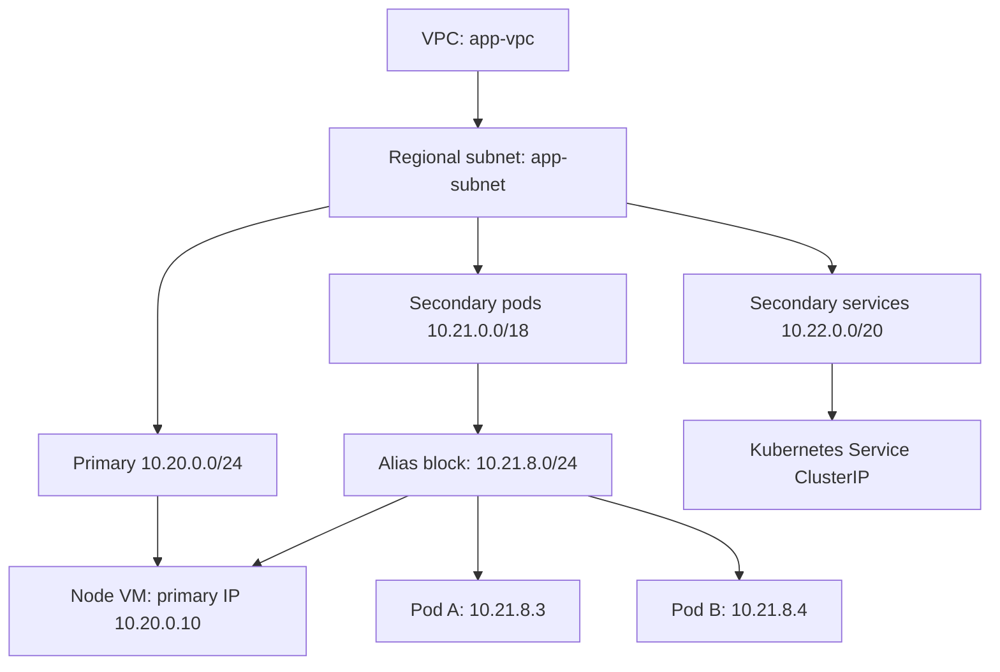

# Primary IP Ranges, Secondary Ranges, and Alias IPs

> **Chapter:** VPC and Routing  
> **Module:** CLOUD_PROVIDERS_GCP  
> **Module Scope:** Explore Google Cloud from project organization, IAM, and VPCs to Compute Engine, GKE, Cloud Run, storage services, and databases. Through deployment scenarios, learners learn to select services, secure resources, automate releases, and monitor reliability and cost.

When deploying workloads into Google Cloud, a **VPC network** provides the logical networking space for compatible resources. Each subnet has a **primary IPv4 range**; a subnet can also have multiple **secondary IPv4 ranges**. In models requiring multiple addresses on the same network interface, Google Cloud also supports **alias IP ranges**. These three concepts are related but not synonymous: *primary/secondary* describe **address ranges belonging to a subnet**; *alias IP* describes **additional addresses or address ranges assigned to a VM interface**.

Distinguishing them is especially important when designing Compute Engine and **VPC-native GKE**: node IPs are typically drawn from the primary range, Pod IPs are drawn from the Pod secondary range via alias IPs, and Kubernetes Service virtual IPs are allocated from the Service range. If planned poorly, you can run out of Pod addresses even when the subnet still has plenty of IPs to create VMs.

## Learning Objectives

After this lesson, you will be able to:

1. Distinguish the global scope of a VPC from the **regional** scope of subnets and the **zonal** scope of many VMs.
2. Explain primary IP ranges, secondary IP ranges, and alias IP ranges using diagrams and CIDR examples.
3. Describe how VM, Pod, and Kubernetes Service IP addresses are allocated in VPC-native GKE.
4. Plan CIDR ranges to avoid overlap and recognize IP exhaustion risks.
5. Create and inspect a custom-mode VPC and subnets with secondary ranges using the Console or `gcloud`.
6. Distinguish **routing**, **firewalls**, and **IAM permissions** when testing connectivity, and safely clean up lab resources.

## 1. The Big Picture: VPC, Subnets, and VMs

In GCP, **a VPC network is a global resource**; a subnet is a **regional resource**. A single VPC can contain multiple subnets across different regions. A Compute Engine VM resides in a **zone**, but its network interface connects to a subnet belonging to **the region containing that zone**.

```text
Project: demo-network
└── VPC network: app-vpc (global)
    ├── Region: asia-southeast1
    │   ├── Subnet: app-subnet
    │   │   ├── Primary IPv4: 10.20.0.0/24
    │   │   ├── Secondary "pods": 10.21.0.0/18
    │   │   └── Secondary "services": 10.22.0.0/20
    │   └── VM node in zone asia-southeast1-a
    │       ├── Primary internal IP: 10.20.0.10
    │       └── Alias IP range for Pods: 10.21.8.0/24
    └── Another region
        └── Separate subnet with non-overlapping CIDR ranges
```

These addresses are **for illustration only**; no resources have been created yet. Real networks must consider connectivity with on-premises networks, VPC Peering, Shared VPC, IP requirements of each workload, and organization policies before finalizing CIDRs.

| Concept | Belongs to | Primary role |
|---|---|---|
| **VPC network** | Network host project, global scope | Logical network, foundation for connectivity, routing, and firewalls |
| **Subnet** | One VPC and one region | Contains address ranges to allocate to workloads |
| **Primary IPv4 range** | Subnet | Allocates primary internal addresses for VM interfaces and resources using primary IPs |
| **Secondary IPv4 range** | Subnet | Creates additional named IPv4 space, e.g., for GKE Pods/Services |
| **Primary internal IP of NIC** | VM network interface | Primary internal address of the interface, drawn from the primary range |
| **Alias IP range** | VM network interface | One or more additional IPs or an IP block from the subnet's primary/secondary range |
| **Kubernetes Service ClusterIP** | Virtual service inside a GKE cluster | Virtual address for Service access; not the same as an alias IP assigned to a VM |

A VPC **does not** have a single CIDR entered when creating the network. CIDRs are declared on **the subnets**. With a **custom-mode VPC**, administrators create subnets and choose addresses themselves; with an **auto-mode VPC**, Google Cloud pre-creates subnets per region using predefined IP ranges. When IP plan control or hybrid network integration is needed, custom mode is generally easier to manage.

## 2. What Is a Primary IPv4 Range?

A **primary IPv4 range** is the main IPv4 range of a subnet, expressed in CIDR notation. For example:

```text
Primary range: 10.20.0.0/24
Theoretical network: 10.20.0.0 to 10.20.0.255 (256 addresses)
VM A - nic0: 10.20.0.10
VM B - nic0: 10.20.0.11
```

A VM interface obtains its **primary internal IPv4 address** from the primary range of the subnet it connects to. When creating a VM, this address can be assigned automatically or chosen via service mechanisms. Not all 256 addresses of a `/24` can be assigned: Google Cloud reserves several addresses according to subnet rules.

### Key Characteristics to Remember

- **A subnet has one primary IPv4 range**, though it can have multiple secondary ranges.
- **Primary internal IP** is the main IP of a NIC; a VM can have multiple NICs if machine configuration and services permit, with each NIC belonging to an appropriate subnet.
- The primary range typically serves VMs/nodes, resources using primary addresses, and purposes required by services.
- Primary range size limits how many addresses can be assigned to VMs or nodes. In VPC-native GKE, **node IPs** are typically taken from here, whereas **Pod IPs** come from another range.
- You can **expand** a primary range per product rules when non-conflicting space is available; **shrinking** or replacing the CIDR should not be assumed to be a simple operation.

**Example:** a cluster has 100 nodes, each needing a primary IP, so a `/28` primary subnet is too small even if the Pod secondary range is huge. Conversely, having plenty of IPs left in a `/24` primary range does not guarantee the cluster can create more Pods if the Pod secondary range is exhausted.

## 3. What Are Secondary IPv4 Ranges?

A **secondary IPv4 range** is an additional **named** IPv4 range in a subnet. It does not replace the primary range. A subnet can have multiple secondary ranges, for example:

```text
Subnet: app-subnet, region asia-southeast1
  primary:          10.20.0.0/24
  secondary "pods": 10.21.0.0/18
  secondary "services": 10.22.0.0/20
```

In this subnet:

- `10.20.0.0/24` provides primary addresses for VMs/nodes.
- `10.21.0.0/18` is a secondary range named `pods`, reserved for Pod addresses in the VPC-native GKE architecture.
- `10.22.0.0/20` is a secondary range named `services`, reserved for Kubernetes Service ClusterIP addresses in the GKE example.

### Design Rules

1. Every CIDR must be in proper **network prefix** form. For instance, `10.21.0.0/18` covers `10.21.0.0` to `10.21.63.255`; `10.21.8.0/18` does not represent a properly aligned `/18` network range.
2. **Primary and secondary ranges must not overlap** with one another or with other subnets in the same VPC. Connections to other networks also impose non-overlap constraints.
3. **Secondary range names** are used when services like GKE reference a range; do not confuse the name `pods` with the CIDR address itself.
4. Allocate capacity based on the number of VMs/nodes, Pods, and Services to be served, while leaving room for growth.
5. Do not assume adding a secondary range automatically shifts resources' IPs from primary to secondary; the service must be configured to **use** the appropriate range.

For private networks, RFC 1918 IPv4 address blocks are commonly chosen. Some GCP architectures can also use internal addresses via other supported mechanisms; therefore, do not infer that every secondary range must reside in a single type of private IP block. In this lab, we only use example CIDRs within `10.0.0.0/8`.

## 4. What Is an Alias IP and How Does It Relate to a Subnet?

An **alias IP range** is an additional IP address or block of IP addresses assigned to **a VM's network interface**. In terms of allocation source, an alias IP can be drawn from the **primary range or a secondary range** of the subnet that the NIC is using. It is not a new VPC, not a separate subnet, and not a public address.

```text
NIC of a VM
│
├── Primary internal IP: 10.20.0.10
│   └── drawn from primary subnet range 10.20.0.0/24
│
└── Alias IP range: 10.21.8.0/24
    └── drawn from secondary "pods" 10.21.0.0/18
        ├── Pod A: 10.21.8.3
        ├── Pod B: 10.21.8.4
        └── Remaining IPs in the block are managed per workload
```

Suppose GKE assigns an alias block `10.21.8.0/24` to a node; the VPC knows that Pod addresses belonging to that block can be routed to the node's NIC. Google Cloud manages routes to alias addresses through the platform's networking model, avoiding the need to create a separate custom static route for every Pod.

**Do not confuse these three actions:**

| Action | Impact |
|---|---|
| Adding secondary range `pods=10.21.0.0/18` to the subnet | Declares an **additional address pool**; does not assign the entire range to a VM |
| Assigning alias block `10.21.8.0/24` to a node's NIC | Reserves **a slice of the address pool** for that VM interface |
| A Pod using IP `10.21.8.3` on the node | The workload/container uses an IP within the allocated block; GKE/CNI handles networking details |

### Alias IPs Do Not Automatically Solve Every Connectivity Issue

Assigning an alias IP range to a NIC does not mean applications inside the guest OS are automatically configured to listen on every address in that range. With self-managed VMs, the OS and application must be configured appropriately for the addressing model. In VPC-native GKE, Kubernetes/GKE and cluster networking components automate many of those steps for Pods.

Alias IPs also **do not replace firewalls**. If a route to the destination exists but an ingress/egress rule blocks the protocol or port, traffic will still fail. Whether a service can use an IP also depends on IAM, application settings, GKE policies, and the actual network path.

## 5. How Does VPC-Native GKE Use Address Ranges?

In **VPC-native GKE**, the cluster uses alias IPs to provide Pod addresses from a subnet's secondary range. A typical layout:



**Explanation:**

- **Node (VM):** receives its primary internal IP from the subnet's primary range.
- **Pod:** receives its IP from the Pod secondary range. GKE allocates an alias IP block to each node and manages Pod IPs within that block.
- **Kubernetes Service:** is assigned a **virtual ClusterIP** from the Service range per cluster configuration; a ClusterIP is not an alias IP attached to a node's NIC. Service traffic handling is managed by Kubernetes/GKE networking.
- **GKE Autopilot or Standard:** both involve address range decisions; the degree of node control and certain allocation/configuration mechanisms may differ. Check the options for the cluster being used.

### 5.1. Why Not Share One Range for Everything?

Separating primary, Pod secondary, and Service secondary ranges helps:

- Establish clear boundaries between node, Pod, and Service addresses.
- Forecast capacity per group and track which pool is running low.
- Avoid needing to assign a separate primary IP to every Pod.
- Enable GKE to manage Pod IPs without manually creating routes for each Pod.

Separating address ranges **does not automatically create security isolation** between Pods and VMs. Authorization, firewalls, and Kubernetes NetworkPolicy or supported network policy mechanisms must be designed separately.

### 5.2. Calculating Capacity Before Deployment

Suppose a cluster expects at most **12 nodes** and each node supports **up to 64 Pods**. You should not simply multiply `12 × 64 = 768` and pick a CIDR with barely 768 addresses: GKE allocates **per-node IP blocks** based on the Pods-per-node limit and rounding rules, and blocks are not necessarily filled 100%.

In a specific configuration where each node is allocated a `/24` block (256 addresses), 12 nodes will require 3,072 addresses in total **for block allocation**, before counting headroom. A `/20` range has 4,096 theoretical addresses and may fit block sizing for this example; a `/18` range gives more headroom. **This is only an illustrative calculation**, since actual block size depends on max Pods per node, cluster mode, and IP allocation features.

In real design:

1. Determine maximum nodes per cluster and per node pool.
2. Determine the Pods-per-node limit and how GKE sizes IP blocks.
3. Reserve extra nodes for upgrades, repairs, or autoscaling.
4. Verify Service IP limits and cluster IP allocation mode.
5. Avoid overlap with other VPCs, peerings, VPN/Interconnect, and on-premises networks.
6. Document both **range names** and **CIDRs**, checking version/configuration limits of GKE before creating the cluster.

A project can **still have CPU and quota available yet fail to schedule Pods/nodes** if it runs out of IPs. Therefore, IP capacity is part of capacity planning, not merely an initial network setting.

## 6. How Do Routing and Firewalls Relate?

When a subnet has primary and secondary IP ranges, the VPC uses **subnet routes** to route to those address ranges. When an alias IP range is attached to a VM interface, the platform manages delivery to the corresponding NIC. You **do not need to manually create a separate static route for every Pod alias IP** in a typical VPC-native GKE model.

```text
Traffic source
      │
      ▼
VPC routing: is there a path to the destination CIDR?
      │
      ▼
Firewall / network policy: is this flow allowed?
      │
      ▼
Destination NIC / node / Pod / application: does it accept and process it?
```

| Layer | Function | Failure example |
|---|---|---|
| **Subnet range** | Defines the pool of internal addresses allocated | No IPs left for nodes or Pods |
| **VPC routing** | Determines the path to the destination IP range | Hybrid network does not know the route to the secondary CIDR |
| **VPC firewall** | Controls traffic to/from VMs per applied rules | Blocks TCP port even though both machines are in the same VPC |
| **GKE NetworkPolicy / network policy** | Controls communication between workloads per enabled mechanism | Pod cannot reach service despite valid CIDR |
| **Application/service** | Listens on port, authenticates, and handles requests | Service does not open port or rejects authorization |

### 6.1. Do Secondary Ranges Automatically Traverse VPN or Peering?

Never assume so. Within the same VPC, subnet routes cover primary/secondary ranges. But when traversing **Cloud VPN, Cloud Interconnect, VPC Network Peering**, or other multi-VPC designs, you must verify:

- CIDRs do not conflict with partner or on-premises networks.
- Forward/return paths and **route advertisements** (e.g., via Cloud Router and BGP) include secondary ranges per actual configuration.
- Custom route import/export rules, subnet route exchange, and limitations of each connection type.
- Firewalls, ACLs on both sides, workload routing, and permitted address ranges.

**Example:** an on-premises application accesses Pod IP `10.21.8.3` over a hybrid connection. If the on-premises network does not know the route to `10.21.0.0/18`, the connection may fail even though the Pod is running and GKE assigned a valid IP.

### 6.2. Alias IPs and NAT

An alias IP is **an internal address on the interface**, not a public IP. If a workload needs Internet access from an internal IP, an appropriate egress mechanism such as Cloud NAT or another architecture-approved path may be required. Assigning an alias IP **does not** automatically create a public address and does not guarantee Internet egress.

## 7. Hands-On: Creating a VPC and Subnet with Primary/Secondary Ranges

This lab only creates a **VPC and subnet**, without creating VMs or a GKE cluster; this lets you inspect IP configuration without keeping billable VMs or Kubernetes clusters running. You can perform it via **Console or Cloud Shell**. If studying within an organization, use a sandbox project and CIDRs approved by the network owner.

### 7.1. Preparing Permissions and Choosing CIDRs

Prerequisites:

- Project access and appropriate VPC/subnet management permissions, or an administrator performing the actions for you.
- **Compute Engine API** enabled; creating a VM is not required.
- Permissions to view VPCs, subnets, and routes to verify results.
- A set of CIDRs that do not overlap with the project's networks or any connected networks.

Lab table:

| Attribute | Illustrative value |
|---|---|
| Project ID | `PROJECT_ID` — replace with your lab project |
| VPC | `ip-ranges-lab` |
| Subnet | `app-subnet` |
| Region | `asia-southeast1` |
| Primary | `10.20.0.0/24` |
| Secondary named `pods` | `10.21.0.0/18` |
| Secondary named `services` | `10.22.0.0/20` |

**Do not copy these CIDR ranges directly into an environment connected to production**: cross-check the IP plan before creating anything. There is no need to assign external IPv4 addresses or open Internet firewalls in this exercise.

### 7.2. Option A — Google Cloud Console

1. Open **Google Cloud Console → VPC network → VPC networks** in the right project.
2. Select **Create VPC network**.
3. Name it `ip-ranges-lab`; select **Custom** for subnet creation mode.
4. In the subnet creation section, enter name `app-subnet`, region `asia-southeast1`, and **Primary IPv4 range** `10.20.0.0/24`.
5. Add **Secondary IPv4 ranges** (if presented in the subnet section): one named `pods` with CIDR `10.21.0.0/18`, and one named `services` with CIDR `10.22.0.0/20`.
6. Review names, region, CIDRs, and firewall configuration suggested by the UI. Do not open ports from the Internet just to test addresses.
7. Click **Create**. After the resource appears, open the subnet details page and verify the primary/secondary information.

If the VPC creation screen does not support adding all secondary ranges immediately, you can create the custom VPC first and then create or edit the subnet via **VPC network → VPC networks → Subnets** per your granted permissions.

### 7.3. Option B — Cloud Shell and gcloud

Replace `PROJECT_ID` with your own lab project ID and confirm you are signed in with the right account:

```bash
PROJECT_ID="my-gcp-network-lab"
NETWORK_NAME="ip-ranges-lab"
SUBNET_NAME="app-subnet"
REGION="asia-southeast1"

# Verify active identity and project
gcloud auth list --filter="status:ACTIVE"
gcloud projects describe "$PROJECT_ID" \
  --format="table(projectId,name,lifecycleState)"

# Read existing subnets before selecting CIDRs
gcloud compute networks subnets list --project="$PROJECT_ID"
```

Only once the project and CIDR plan are verified, an authorized user can run:

```bash
# If Compute Engine API is not yet enabled and you have permission to enable it:
gcloud services enable compute.googleapis.com --project="$PROJECT_ID"

# Create a VPC in custom subnet mode
gcloud compute networks create "$NETWORK_NAME" \
  --subnet-mode=custom \
  --project="$PROJECT_ID"

# Create a subnet and two named secondary IPv4 ranges
gcloud compute networks subnets create "$SUBNET_NAME" \
  --network="$NETWORK_NAME" \
  --region="$REGION" \
  --range=10.20.0.0/24 \
  --secondary-range=pods=10.21.0.0/18,services=10.22.0.0/20 \
  --project="$PROJECT_ID"
```

**Note:** creating a VPC/subnet in this lab does not create any VM or cluster. However, related services using that network may incur charges; always monitor Cloud Billing and clean up resources after practice.

### 7.4. Post-Creation Verification

```bash
# List VPCs in the project
gcloud compute networks list --project="$PROJECT_ID"

# List subnets in the project
gcloud compute networks subnets list --project="$PROJECT_ID"

# View CIDR fields and secondary range names of the specific subnet
gcloud compute networks subnets describe "$SUBNET_NAME" \
  --region="$REGION" \
  --project="$PROJECT_ID" \
  --format="yaml(name,network,region,ipCidrRange,secondaryIpRanges)"

# View route information in the project
gcloud compute routes list --project="$PROJECT_ID"
```

**Expected results:**

- VPC `ip-ranges-lab` displays with subnet mode **CUSTOM**.
- `app-subnet` is in region `asia-southeast1`.
- Field `ipCidrRange` is `10.20.0.0/24`.
- Field `secondaryIpRanges` contains **`pods = 10.21.0.0/18`** and **`services = 10.22.0.0/20`**.
- VPC routes are inspected at the appropriate network level; no alias IPs are attached to VMs yet because the lab has not created any VMs.

### 7.5. Testing Expansion with a Third Secondary Range (Optional)

If you want to distinguish **declaring a secondary range** from **assigning an alias IP**, you can add an independent range for hypothetical purposes:

```bash
# Only try if 10.23.0.0/24 is unused and non-overlapping
gcloud compute networks subnets update "$SUBNET_NAME" \
  --region="$REGION" \
  --add-secondary-ranges=jobs=10.23.0.0/24 \
  --project="$PROJECT_ID"

gcloud compute networks subnets describe "$SUBNET_NAME" \
  --region="$REGION" \
  --project="$PROJECT_ID" \
  --format="yaml(ipCidrRange,secondaryIpRanges)"
```

This adds a secondary range named `jobs` to the subnet; it **does not automatically create VMs, Pods, or alias IPs**. Once a range is bound to workloads, modifying/deleting it is subject to constraints of the active service. In this lab, you can delete the entire subnet during cleanup since no workloads depend on it.

## 8. Hands-On: Observing Alias IPs on a VM (Extension)

To see an alias IP assigned to a NIC, you need a VM or node with an alias range. Creating VMs and GKE clusters can incur charges, so this section is an **optional extension**, not required to complete the lab above.

### 8.1. Observing via Console

On an **authorized lab VM** in the subnet's region:

1. Go to **Compute Engine → VM instances**, select a running VM in the right subnet or create a dedicated lab VM if permitted and budgeted.
2. Open **Networking → Network interfaces** in the VM configuration; select the appropriate NIC.
3. Locate **Alias IP ranges**; select the secondary range named `pods` (or a range designed for alias allocation), then choose an unallocated address or subrange.
4. Save according to the conditions and operations supported by the Console. Some network interface changes may require stopping the VM or meeting other restrictions.
5. Reopen VM details to verify that **primary internal IPv4** and **alias IP range** are two distinct entries.

With self-managed VMs, the application and OS inside the VM may require extra configuration to use the alias range. Do not assume that adding an alias makes every IP in the range automatically respond to ping or every service listen on it.

### 8.2. Inspecting with a Read-Only Command

If a VM already has an alias IP and you know the exact project, zone, and VM name:

```bash
VM_NAME="my-existing-lab-vm"
ZONE="asia-southeast1-a"

gcloud compute instances describe "$VM_NAME" \
  --zone="$ZONE" \
  --project="$PROJECT_ID" \
  --format="yaml(name,zone,networkInterfaces)"
```

In `networkInterfaces`, compare `networkIP` (primary internal IP) with `aliasIpRanges` (if present). A VM without alias configuration may not show an `aliasIpRanges` field; that **does not mean** the subnet lacks secondary ranges.

### 8.3. Connection to GKE Configuration

When configuring a VPC-native GKE cluster on a subnet with secondary ranges, administrators can select **named secondary ranges** for Pods and Services via cluster settings, such as `pods` and `services`. GKE uses this configuration to allocate IPs for nodes/Pods/Services according to cluster mode. Merely creating a subnet with those two ranges **does not deploy GKE**.

Because a cluster involves many critical attributes—node pools, location, access control, Standard/Autopilot mode, version, and cost—this lesson stops at **address planning** and omits cluster creation commands lacking operational context.

## 9. Cleaning Up Lab Resources

If you only created the VPC/subnet in step 7, you can delete them in the order **subnet → VPC**, after verifying no VMs, GKE clusters, network connections, or other resources are using them.

**Before deleting:** double-check `PROJECT_ID`, `NETWORK_NAME`, `SUBNET_NAME`, and `REGION`. Delete only resources you created specifically for the lab; never run these commands on a shared VPC.

```bash
printf 'Project: %s\nVPC: %s\nSubnet: %s\nRegion: %s\n' \
  "$PROJECT_ID" "$NETWORK_NAME" "$SUBNET_NAME" "$REGION"

# Verify subnet and VPC before deletion
gcloud compute networks subnets describe "$SUBNET_NAME" \
  --region="$REGION" \
  --project="$PROJECT_ID"
gcloud compute networks describe "$NETWORK_NAME" \
  --project="$PROJECT_ID"

# Only when certain no dependent workloads remain:
gcloud compute networks subnets delete "$SUBNET_NAME" \
  --region="$REGION" \
  --project="$PROJECT_ID"

gcloud compute networks delete "$NETWORK_NAME" \
  --project="$PROJECT_ID"
```

Verify the result with `gcloud compute networks list --project="$PROJECT_ID"` and `gcloud compute networks subnets list --project="$PROJECT_ID"`. If deletion is rejected because dependent resources exist, **inventory** the reported resources and coordinate with their owners rather than bulk-deleting to force through the error.

## 10. Common Errors and Diagnostics

| Scenario | Possible cause | Troubleshooting action |
|---|---|---|
| Cannot create subnet | CIDR overlaps primary/secondary of another subnet or invalid format | Check the whole VPC and connected networks; use properly aligned prefixes |
| Blocked at `gcloud compute networks create` | Missing IAM permissions or Compute Engine API not enabled | Check identity, roles, APIs, and policies; do not self-escalate privileges |
| GKE runs out of Pod IPs while VMs can still be created | Pod secondary range too small; primary still has node IPs | Check cluster allocation, Pods per node, block size, and Pod range expansion strategy |
| Cannot create nodes even though Pod secondary has plenty of space | Primary range out of node IPs or blocked by quota/other resource limits | Check primary capacity, quotas, and node pool status |
| Service ClusterIP is not in the Pod range | Design separates secondary ranges for Services and Pods | Check GKE's Service range; this is usually expected |
| Subnet has a secondary range but VM has no `aliasIpRanges` | Secondary range only exists on the subnet, not attached to the VM | Check NIC or GKE/node configuration; do not confuse subnet config with alias assignment |
| VM has an alias IP but application cannot be reached | Firewall, route, OS/app, policy, or return path misconfigured | Inspect each layer instead of unconditionally adding more secondary ranges |
| On-premises connection cannot reach Pods | Pod CIDR route not advertised/learned, IP collision, or firewall | Check Cloud Router/VPN and bidirectional routing |
| Trying to delete subnet fails | VMs, GKE, forwarding rules, or dependent resources remain | Inventory the exact network/subnet, remove dependencies per process |
| Mistaking an alias IP for a public IP | Confusing a NIC's secondary internal IP with an external address | Check NIC configuration, external IPs, and separate egress/NAT |

## 11. Three Design Scenarios

### Scenario A — Web Application on Compute Engine

A team deploys multiple VMs running a web application in a `10.20.0.0/24` subnet. Each VM needs one primary internal IP; there are no Pods or multi-IP-per-NIC requirements yet. In this case, **the primary range can suffice for basic networking needs**. There is no need to add secondary ranges or alias IPs just to run ordinary web VMs.

If later a networking component requires multiple logical IPs on the same NIC, alias IPs can be evaluated against application requirements at that time. Choosing a secondary range is a decision about **addressing and operations**, not a mandatory feature for every Compute Engine VM.

### Scenario B — Scaling Pods in VPC-Native GKE

A cluster can scale nodes up but hits Pod IP allocation errors as workloads grow. The project still has CPU quota and the subnet primary range still has IPs. The team discovers the `pods` secondary range is only `/23`, leaving insufficient IP blocks for new nodes under the current configuration.

Resolution requires checking the per-node block size and GKE-supported options, such as expanding the Pod address space or redesigning allocation per cluster version/mode. Do not randomly modify the primary range when the root cause lies in the **Pod secondary range**.

### Scenario C — Connecting a Data Center to GCP

An enterprise has an on-premises network `10.21.0.0/16`, while the GCP project plans to assign `10.21.0.0/18` as the Pod secondary range. The two ranges **overlap**, creating ambiguous routing risks when connected via VPN/Interconnect.

Before creating subnets or clusters, the network team must plan non-overlapping CIDRs, verify route advertisements and return paths, and review firewalls and security policies. A sound IP plan prevents having to re-address running workloads later.

## 12. Self-Check Questions

**1. How do primary IP ranges and secondary IP ranges differ?**  
**Answer:** a primary range is the main address range of a subnet, typically supplying primary internal IPv4 addresses for VMs/nodes; a secondary range is an additional named range that can be used for alias IPs or service purposes such as GKE Pods/Services.

**2. Does creating a `pods` secondary range automatically give a VM an alias IP?**  
**Answer:** no. Adding a secondary range only creates address space on the subnet; alias IPs must be assigned to a NIC via the corresponding mechanism or managed by GKE.

**3. If a node has primary IP `10.20.0.10` and alias block `10.21.8.0/24`, where can Pod IPs reside?**  
**Answer:** in the VPC-native GKE example, Pods can use IPs within the `10.21.8.0/24` alias block allocated to that node, depending on the allocation mechanism.

**4. Is the IP range for Kubernetes Services the same as an alias range assigned to a VM's NIC?**  
**Answer:** no. A ClusterIP is a virtual Service IP handled by Kubernetes/GKE networking; the Service address pool may come from a secondary range chosen for the cluster.

**5. Do VPCs and subnets in GCP share the same geographic scope?**  
**Answer:** no. A VPC is a global resource; a subnet belongs to a region, while Compute Engine VMs are typically tied to a zone within that region.

**6. Why can GKE fail to create new Pods even when the primary range still has plenty of IPs?**  
**Answer:** Pods require IPs from the Pod secondary range in the VPC-native model, and GKE also allocates IP blocks per node. The Pod secondary range can run out before the primary range.

**7. When a route to the Pod CIDR exists, is traffic guaranteed to succeed?**  
**Answer:** no. Firewalls, network policies, return paths, and application configuration can still block connectivity.

**8. Should you reuse an on-premises network's CIDR for a secondary range in a hybrid VPC?**  
**Answer:** no. Overlapping ranges cause routing problems; a consistent IP plan must be established before connecting.

## Key Takeaways

- **Primary and secondary are properties of a subnet; alias IP is an additional allocation on a VM interface.**
- **Global VPC, regional subnet, zonal VM** are three scopes that must be distinguished when placing resources.
- **VPC-native GKE:** nodes use the primary range, Pods use the Pod secondary range via alias IPs, and Service ClusterIPs come from the appropriate Service range as virtual addresses.
- **CIDR design** must account for node counts, Pods, Services, block allocation, and connected networks; IP exhaustion can happen before CPU or quota exhaustion.
- **Routing, firewalls, and workload policies** are separate layers; adding addresses alone does not fix connectivity errors.
- **After practicing, inventory and clean up lab resources** per ownership rules, while monitoring actual services using the VPC that may generate charges.

## References

- [Google Cloud — VPC networks](https://cloud.google.com/vpc/docs/vpc)
- [Google Cloud — Alias IP ranges](https://cloud.google.com/vpc/docs/alias-ip)
- [Google Cloud — Subnets](https://cloud.google.com/vpc/docs/subnets)
- [Google Cloud — Routes](https://cloud.google.com/vpc/docs/routes)
- [Google Kubernetes Engine — VPC-native clusters](https://cloud.google.com/kubernetes-engine/docs/concepts/alias-ips)
