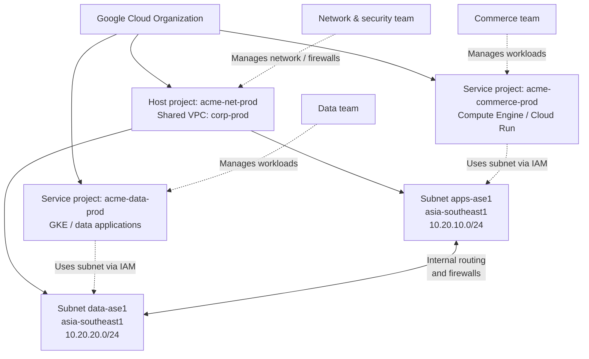

# Shared VPC and Host Project vs. Service Project Separation

## 1. The Networking Problem with Multiple Google Cloud Projects

A Google Cloud system often grows from a single experimental project into multiple projects organized by environment, product team, or governance requirements. For example, the sales team runs APIs on Cloud Run, the data team uses GKE and Cloud SQL, and the platform team manages VPCs, firewalls, VPNs, and links to office systems. If every team creates its own separate VPC, the organization must manage multiple IP ranges, cross-connections, security rules, and outbound access points.

**Shared VPC** allows resources from multiple **service projects** to use **one or more VPC networks managed in a host project**. This architecture separates responsibility for managing **the shared network** from responsibility for deploying and operating **workloads**. Eligible resources across different service projects can communicate via internal IP addresses on the same VPC, governed by appropriate routing and firewalls.

In the **CLOUD_PROVIDERS_GCP** module, this knowledge connects **Organization/Folder/Project, IAM, VPC, and routing** with Compute Engine, GKE, Cloud Run, databases, Infrastructure as Code (IaC), reliability monitoring, and cost management.

After this lesson, you will be able to:

1. Clearly distinguish **host project**, **service project**, **Shared VPC network**, **shared subnet**, and **IAM Network User**.
2. Design connectivity and permission boundaries across network, security, and application teams.
3. Explain limits around project associations, subnets, routing, firewalls, and existing resources.
4. Identify specific requirements for **Compute Engine, GKE, and Cloud Run** when using Shared VPC.
5. Apply `gcloud` commands to inspect, configure in authorized environments, and verify a deployment.
6. Evaluate Shared VPC across **security, reliability, cost, and operational responsibilities**.

> **Note:** Project names, IP ranges, groups, and addresses in the examples are hypothetical. Commands to create, associate, or modify IAM are shown for learning syntax; execute them only in permitted environments and after verifying impact.

## 2. Concepts and Architectural Structure

### 2.1. The Host Project Holds Network Resources

A **host project** is a project in which an administrator enables Shared VPC. It contains the shared VPC network and related networking resources, such as:

- VPC networks, regional subnets, primary/secondary IPv4 ranges, and certain IP addresses.
- Routes, firewall rules, and firewall policies enforced at their respective scopes.
- Networking components such as Cloud Router, Cloud NAT, Cloud VPN, or Cloud Interconnect when deployed in the host project.
- IAM permissions allowing principals from service projects to **use** shared subnets.

Not every networking resource must reside in the host project. For example, the placement of load balancers and backend components depends on the load balancing type, and managed services have their own integration patterns. Consult product documentation before deciding placement.

### 2.2. Service Projects Hold Workloads

A **service project** is a project attached to a host project. It holds application resources and carries corresponding operational responsibilities:

- Compute Engine VMs or managed instance groups.
- GKE clusters and Kubernetes workloads.
- Cloud Run services/jobs with supported connectivity to Shared VPC.
- Storage, database, and application components according to each product's connectivity capabilities.
- IAM for applications, CI/CD, quotas, and resource cost reporting belonging to that project.

Attaching a service project **does not automatically grant** all principals permission to use every subnet and **does not automatically move** existing VMs or networks into Shared VPC.

### 2.3. An Intuitive Diagram



Both service projects in the diagram use **the same VPC**. Packets are routed within that network; a project is a boundary for resource administration and access control, **not an automatic wall blocking traffic between two application groups**. To prevent access between workloads, you must still design firewalls, identities, application authentication, and appropriate constraints.

### 2.4. Fundamental Rules and Limits

| Rule | Design implication |
| --- | --- |
| Host and service projects must normally belong to the **same Organization** | Uses the organization as an administrative boundary; migrating across Organizations has special procedures and transition exceptions |
| **A service project can attach to only one host project** at a time | You cannot use attachment to directly link one service project to two host projects |
| A host project can serve **multiple service projects** | Suited for centralized network management across many teams, within quota limits |
| A project cannot be both a host project and a service project simultaneously | You cannot build a "host → service → service" chain with Shared VPC |
| An Organization can have **multiple host projects** | Typically separates production and nonproduction networks, or isolation boundaries |
| The VPC in the host project is **global**, and subnets are **regional** | VMs or zonal resources must pick zones within the region of the corresponding shared subnet |
| Shared VPC can use custom-mode or auto-mode VPCs; legacy VPCs are not supported | Custom-mode generally aids proactive IPAM and subnet planning |

Counts of host/service projects, network resources, and attachments are all subject to **quotas/limits**; check them at design time rather than hardcoding a fixed number in long-term architecture.

## 3. What Does Shared VPC Solve—and What Doesn't It Solve?

### Key Benefits

- **Centralized network management:** the network team can manage CIDRs, routes, hybrid connectivity, and firewalls in the host project.
- **Separation of duties:** application teams can create VMs/clusters in their own projects without needing VPC edit permissions on the host.
- **Internal IP usage across multiple projects:** resources participating in the same Shared VPC can use the VPC's internal routes, subject to firewalls and service permissions.
- **Consistent governance:** easier to standardize outbound connectivity, DNS, observability, and network egress controls across workloads.
- **Team-level cost tracking:** most workload resource charges remain associated with the owning service project.

### Limits to Understand Accurately

- **Attaching a project does not create a new "tunnel":** resources must be explicitly configured to use the shared network or subnet; attachment only establishes eligibility to use it.
- **Does not automatically grant network permissions:** principals still need appropriate IAM roles, and services may require their own authorized service agents.
- **Does not automatically isolate traffic:** splitting into multiple service projects or subnets **is not a firewall**.
- **Does not automatically open internet access:** VMs without external IPs typically need Cloud NAT or an appropriate egress path; Private Google Access serves a different purpose.
- **Does not automatically grant application permissions:** `compute.networkUser` on a subnet does not grant permission to read Cloud Storage, Secret Manager, or Cloud SQL.
- **Does not automatically alter existing networks:** existing VMs and components in a service project do not change networks just because the service project was attached.

## 4. Separating Administrative Permissions: Who Owns What?

Shared VPC only creates meaningful separation if IAM is designed accordingly.

| Administrative role | Common IAM role | Scope | Primary responsibility |
| --- | --- | --- | --- |
| **Shared VPC Admin** | `roles/compute.xpnAdmin`, along with required project/IAM admin roles such as `roles/resourcemanager.projectIamAdmin` | Appropriate Organization or Folder | Enables host projects, attaches/detaches service projects, organizes delegation |
| **Network Admin** | `roles/compute.networkAdmin` | Host project | Manages VPCs, subnets, routes, and most network resources; does not automatically grant firewall editing |
| **Security Admin** | `roles/compute.securityAdmin` | Host project or approved scope | Manages firewalls and corresponding network security components |
| **Service Project Admin** | `roles/compute.networkUser` | Host project or assigned **subnet** | Uses permitted networks/subnets; does not become Network Admin |
| **Compute/Workload Admin** | E.g., `roles/compute.instanceAdmin.v1` | Service project | Creates and manages VMs; typically combined with subnet usage permission |
| **Service agent** | Role per service and scenario | Host project, subnet, and/or service project | Acts on behalf of GKE, Cloud Run, or managed products |

**Least-privilege principle:** Prefer granting `roles/compute.networkUser` on **specific subnets** if a team only needs certain subnets. Granting it on the **entire host project** is broader and may allow using both existing subnets and future subnets.

### Two Permission Layers Together

Suppose user `devops@example.com` needs to create a VM in service project `acme-commerce-prod` using subnet `apps-ase1` in host project `acme-net-prod`:

1. In the **service project**, the principal needs roles allowing VM creation and management of associated resources.
2. In the **host project or subnet `apps-ase1`**, the principal needs `roles/compute.networkUser` to use the subnet.
3. Auxiliary permissions such as using the VM's service account, disks, images, or other resources must be granted per action.

If permission at layer (1) is missing, the principal cannot create the VM. If permission at layer (2) is missing, the command can fail when attaching the network interface even if the principal has full VM permissions inside the service project.

**Real-world delegation example:** the application team owns templates, images, CI/CD, and workloads in the service project; the network team owns subnets, addressing, and routes in the host; the security team controls ingress/egress. Establish a change-request workflow when workloads need ports opened or new subnets added.

### IAM Is Not a Packet-Filtering Layer

The `compute.networkUser` role controls **who can use the network when creating/configuring eligible resources**. Once VM A and VM B are running on the same VPC, whether packets pass depends on **routes, firewall rules/policies, OS firewalls, and applications**. Revoking Network User is not a kill switch for existing live traffic.

## 5. Planning Subnets, IPs, and Routes

### 5.1. Global VPC, Regional Subnets

A VPC in Google Cloud has **global** scope. A subnet has **regional** scope and is used by resources in that region. For example:

| Region | Illustrative shared subnet | Primary CIDR | Workload |
| --- | --- | --- | --- |
| `asia-southeast1` | `apps-ase1` | `10.20.10.0/24` | VMs/APIs of the Commerce service project |
| `asia-southeast1` | `data-ase1` | `10.20.20.0/24` | GKE nodes belonging to the Data service project |
| `asia-southeast2` | `apps-ase2` | `10.21.10.0/24` | Standby resources in another region if DR is designed |

CIDRs and locations are for practice only, **not IP ranges allocated to a real system**. During IPAM planning, avoid conflicts with on-premises networks, Cloud VPN/Interconnect, VPC Peering, and address ranges planned for managed services.

### 5.2. Primary and Secondary IP Ranges

- VMs use internal addresses from the subnet's **primary range**.
- **VPC-native** GKE uses **secondary ranges** for Pods and Services per cluster configuration.
- CIDR sizing must account for growth, node/pod counts, headroom, and reserved addresses—not just current VM count.

Secondary ranges in the host project can be used by a GKE cluster in a service project if permissions and configuration satisfy GKE Shared VPC requirements. Therefore, the network team and Kubernetes team must align on IPAM before creating clusters.

### 5.3. Routing and Firewalls

The VPC provides routing between subnets and dynamic/static routes per network configuration. When two VMs are in the **same Shared VPC but different service projects**, internal routing still relies on the VPC's addresses and routes. However:

- **Firewalls must still allow required flows.** Google Cloud has default firewall behaviors (such as implied deny ingress); never equate having a route with having connectivity permission.
- Certain routes, Cloud Routers, and hybrid links are centrally managed in the host project.
- DNS, Private Google Access, Cloud NAT, Private Service Connect, and connectivity to managed services have **separate configurations** and are not automatically enabled by Shared VPC.
- Organization/Folder-level firewall policies and network firewall policies can affect traffic; verify priority order and scope.

Example: a payment-processing VM in `apps-ase1` needs to call an internal API in `data-ase1` over TCP 8443. The network team must verify appropriate routes, accepted ingress rules at the destination, target identities/network tags, and TLS/application authentication. Both VMs sharing `corp-prod` is not enough to conclude connectivity will succeed.

### 5.4. Subnet Usage Permission Differs from Blocking Data Flow

Suppose the Commerce team only has Network User on `apps-ase1`. They cannot create new VMs on `data-ase1` without the corresponding permission. Yet a Commerce VM **can still connect** to a service IP in `data-ase1` if routes and firewalls allow it. To truly isolate data flows, you need **firewall policies, segmentation**, and application-level controls.

## 6. Configuring Shared VPC with gcloud

This section describes a verifiable workflow in an approved lab environment. Using hypothetical names:

```text
Organization:   organizations/123456789012
Host project:   acme-net-prod
Service project: acme-commerce-prod
VPC network:    corp-prod
Subnet:         apps-ase1
Region:         asia-southeast1
CIDR:           10.20.10.0/24
Group:          commerce-devops@example.com
```

**Prerequisites before deployment:** host and service projects belong to the same Organization per standard rules; the operator holds Shared VPC Admin permissions at the right scope; billing, Compute Engine API, network/IAM admin permissions, and quotas meet requirements. Check relevant Organization Policies before making changes.

### Step 1: Verify Projects and APIs

```bash
# Read-only: confirm exact Project IDs
gcloud projects describe acme-net-prod
gcloud projects describe acme-commerce-prod

# Read-only: check whether Compute Engine API is enabled
gcloud services list --enabled --project=acme-net-prod \
  --filter="config.name=compute.googleapis.com"
gcloud services list --enabled --project=acme-commerce-prod \
  --filter="config.name=compute.googleapis.com"
```

If the API is not yet enabled, an authorized user can run `gcloud services enable compute.googleapis.com --project=PROJECT_ID` for each project. Enabling APIs can have governance/cost implications depending on services used afterward; follow your organization's change process.

### Step 2: Create Custom Mode VPC and Subnet in the Host Project

```bash
# Mutates resources: run only in an approved lab
gcloud compute networks create corp-prod \
  --subnet-mode=custom \
  --project=acme-net-prod

gcloud compute networks subnets create apps-ase1 \
  --network=corp-prod \
  --region=asia-southeast1 \
  --range=10.20.10.0/24 \
  --project=acme-net-prod
```

Creating this subnet **does not automatically configure ingress firewalls, Cloud NAT, or secondary IP ranges for GKE**. If the network and subnet already exist, inspect their configuration rather than duplicating them.

### Step 3: Enable the Host Project

```bash
# Mutates Shared VPC state: requires Shared VPC Admin permission
gcloud compute shared-vpc enable acme-net-prod
```

This command applies when the principal holds Shared VPC admin permissions at the Organization level. If permissions are granted **at a Folder**, Google Cloud provides the corresponding `gcloud beta compute shared-vpc enable` workflow; verify documentation and permission scope before running.

**Enabling the host does not yet share the network with service projects.** You must attach service projects and configure subnet usage permissions in subsequent steps.

### Step 4: Attach the Service Project

```bash
# Mutates project association; requires permissions and satisfied constraints
gcloud compute shared-vpc associated-projects add acme-commerce-prod \
  --host-project=acme-net-prod
```

Verify the relationship with read-only commands:

```bash
# From the service project, inspect the attached host
gcloud compute shared-vpc get-host-project acme-commerce-prod

# From the host, list attached service projects
gcloud compute shared-vpc list-associated-resources acme-net-prod
```

If this fails, check the Organization, Shared VPC Admin permissions on relevant Folders, APIs, quotas, and the policy `constraints/compute.restrictSharedVpcHostProjects`.

### Step 5: Grant Usage Permission Only on Required Subnets

In our example, the Commerce team only needs subnet `apps-ase1`. First **read the existing IAM policy**:

```bash
gcloud compute networks subnets get-iam-policy apps-ase1 \
  --region=asia-southeast1 \
  --project=acme-net-prod \
  --format=json
```

After verifying the authorized principal for the subnet, grant the permission:

```bash
# Mutates IAM on a single subnet, not the entire host project
gcloud compute networks subnets add-iam-policy-binding apps-ase1 \
  --region=asia-southeast1 \
  --project=acme-net-prod \
  --member="group:commerce-devops@example.com" \
  --role="roles/compute.networkUser"
```

Re-check the policy and list of subnets usable by the principal (running under the exact identity being tested):

```bash
gcloud compute networks subnets get-iam-policy apps-ase1 \
  --region=asia-southeast1 \
  --project=acme-net-prod

gcloud compute networks subnets list-usable \
  --project=acme-net-prod
```

The `list-usable` command shows subnets that the currently authenticated identity has permission to use; results depend on the caller's IAM. It **does not prove** VMs/Cloud Run/GKE have succeeded in network connectivity.

**Distinguishing principals:** if CI/CD creates VMs on behalf of an application team using a service account, it may be the **pipeline's service account** that needs Network User, not just the human user group. GKE/Cloud Run also have **service agents** that need the right roles per product documentation.

### Step 6: Use the Subnet When Creating Workloads

For a new VM in a service project, specify the **service project** in the project flag and the **shared subnet** from the host project. Illustrative lab example:

```bash
# VM creation example that may incur charges; run only when authorized
gcloud compute instances create commerce-demo-vm \
  --project=acme-commerce-prod \
  --zone=asia-southeast1-a \
  --machine-type=e2-micro \
  --subnet=projects/acme-net-prod/regions/asia-southeast1/subnetworks/apps-ase1 \
  --no-address
```

VM type, default image, quotas, and machine type availability must be verified by region and policy at runtime. `--no-address` avoids assigning an external IPv4 to the VM, **but the VM will not automatically have internet outbound access**; updating packages from the internet may require Cloud NAT or an appropriate egress solution.

After creating the VM, verify the network interface with a read-only command:

```bash
gcloud compute instances describe commerce-demo-vm \
  --project=acme-commerce-prod \
  --zone=asia-southeast1-a \
  --format="yaml(networkInterfaces)"
```

The subnet path should reside in the host project while the VM resides in the service project. This is the core expression of Shared VPC: **shared network, separated workload ownership**.

## 7. Three Subnet Permission Scoping Patterns

| Approach | Scope of use | When appropriate | Notes |
| --- | --- | --- | --- |
| **Grant Network User on the host project** | Subnets across VPCs in the host project, including eligible future subnets | Broadly trusted platform teams | Broader privilege; easier to accidentally deploy to the wrong subnet |
| **Grant Network User on a subnet** | Only the granted subnet | Splitting by team, environment, or application tier | Requires IAM updates when adding subnets; still must control traffic |
| **Combine IAM and Organization Policy** | Subnets permitted by IAM and constrained by policy where supported | Organizations needing guardrails across many projects | Constraints vary by resource type; do not replace firewalls |

For governance example, `constraints/compute.restrictSharedVpcSubnetworks` can restrict which subnets may be used when creating certain eligible resource types; `constraints/compute.restrictSharedVpcHostProjects` restricts which host projects can be attached. Constraints have **specific scopes and enforcement timing**, typically not affecting existing VMs in the same way they restrict new resource creation.

## 8. Shared VPC with Compute Engine, GKE, and Cloud Run

### 8.1. Compute Engine

For VMs, a service project administrator selects a shared subnet in the **same region** as the VM's zone, with permission to use the subnet and necessary Compute Engine permissions. The VM is created in the service project, while network/subnetwork references point to the host project.

The network team in the host project manages routes, firewalls, and IPAM. To keep VMs without public IPs, `--no-address` can be combined with Organization Policy rules controlling external IPs and Cloud NAT/Private Google Access options where appropriate.

**Key takeaway:** a VM already attached to another VPC in the service project does not automatically move to Shared VPC. Migrating workloads may require **creating new VMs/network interfaces or resources** and a cutover plan; never assume every resource type supports changing subnets in place.

### 8.2. Google Kubernetes Engine (GKE)

GKE has additional requirements beyond attaching the service project:

1. The VPC and **primary/secondary ranges** must be prepared for nodes, Pods, and Services.
2. The service project's **GKE service agent** needs required permissions in the host project or subnet. GKE Shared VPC documentation may require `roles/compute.networkUser` and `roles/container.hostServiceAgentUser` per the setup procedure.
3. If GKE needs to create/manage firewall resources in the host project, administrators must select the least-privilege permissions supported by documentation or corresponding roles; never grant a service agent Security Admin across the entire Organization.
4. Cluster, node pool, and load balancer creation must account for **network firewalls, IP aliases, secondary ranges, quotas**, and cluster type.

For example, the GKE service agent for a service project with Project number `234567890123` has the form:

```text
service-234567890123@container-engine-robot.iam.gserviceaccount.com
```

**Do not** substitute Project ID for Project number. Other service agents such as `SERVICE_PROJECT_NUMBER@cloudservices.gserviceaccount.com` may also need permissions depending on deployment flow. Use [Configure clusters with Shared VPC](https://cloud.google.com/kubernetes-engine/docs/how-to/cluster-shared-vpc) and actual GKE access settings to choose the right roles.

### 8.3. Cloud Run

A Cloud Run service or job in a service project can send egress traffic to a Shared VPC using:

- **Direct VPC egress**: direct egress connection to a shared subnet without a Serverless VPC Access connector.
- **Serverless VPC Access connector**: uses a connector under supported configurations; the connector can live in the service project or be shared from the host project depending on design.

Operations teams must verify the **Cloud Run service agent**, subnet, IAM, and egress choice. For example, a service project's Cloud Run service agent has the form:

```text
service-SERVICE_PROJECT_NUMBER@serverless-robot-prod.iam.gserviceaccount.com
```

When using Direct VPC egress in Shared VPC, the agent may require `roles/compute.networkUser` on the subnet or host project and corresponding network-viewing permissions per the Cloud Run guide. Depending on IPv6/dual-stack configuration, additional roles may be needed. Do not assume that a deployer's `roles/run.admin` role automatically grants network permissions to the service agent.

**Important note:** for Cloud Run **services/jobs**, Direct VPC is used for **egress** into the VPC; it **does not** automatically turn all inbound requests into traffic traversing that subnet. Ingress must be configured separately (Cloud Run ingress settings, load balancers, IAM, and application security layers).

### 8.4. Cloud SQL and Other Managed Services

A VM or Cloud Run service using Shared VPC may need to reach Cloud SQL via private IP, Private Service Connect, or another service-supported method. **Shared VPC does not automatically provide private connectivity to every managed service.**

For Cloud SQL private IP, you may need to set up **Private Services Access** on the host project's VPC with allocated IP ranges and appropriate permissions. Choices also depend on database engine, version, product networking model, and Shared VPC compatibility rules. When deploying, follow Cloud SQL's specific connectivity guide rather than just attaching the project.

## 9. Cost Attribution: Does the Host or Service Project Pay?

Shared VPC centralizes networking without pooling every charge into the host project. As a general rule:

- **Compute Engine VMs and workload resources** in a service project are billed to the service project owning those resources.
- **Network egress** generated by a VM is typically attributed to the project containing the VM.
- **Load balancer** charges depend on the project owning the associated load balancer components.
- Outbound traffic charges through a **Cloud VPN gateway** generally attach to the project hosting that gateway; if the VPN gateway sits in the host project, charges may accrue on the host.
- For **Cloud Interconnect VLAN attachments**, traffic charges over the attachment may be billed to the project owning the attachment.

Consequently, examine **Cloud Billing across both host and service projects** when budgeting. Shared VPC aids cost-center separation, but does not guarantee a team's total bill consists exclusively of charges inside that team's service project.

Example:

| Component | Owning project | Where charges typically appear |
| --- | --- | --- |
| Order-processing VM | `acme-commerce-prod` | Commerce service project |
| Analytics GKE nodes | `acme-data-prod` | Data service project and charges per GKE model |
| Cloud VPN gateway in host | `acme-net-prod` | Host project for gateway charges and corresponding traffic |
| Cloud NAT / load balancer | Depends on creation method and resource type | Verify SKU, owning project, and current billing docs |

To optimize, measure costs by **controllable components**: cross-region traffic, egress, Cloud NAT, load balancing, logging volume, and VM/cluster utilization. Adopting Shared VPC does not automatically lower these unit prices.

## 10. Deployment Scenario: Commerce and Data Teams

### Requirements

An organization has two applications:

- **Commerce:** Cloud Run API receiving orders; one VM processing nightly jobs; needs access to internal services.
- **Data:** GKE running data pipelines; exposes only a required data API to Commerce.
- **Platform/Network:** manages subnets, on-premises links, and egress controls.
- **Security:** manages firewalls and monitors network behavior.

The goal is to share one production VPC **without giving network administration rights to application teams**, while limiting one team's visibility or access into the other team's data.

### Design Decisions

1. Create a dedicated host project `acme-net-prod` with custom-mode VPC `corp-prod`.
2. Create subnets segmented by workload/region, preparing secondary ranges for GKE.
3. Attach `acme-commerce-prod` and `acme-data-prod` to the host.
4. Grant `compute.networkUser` per subnet to the exact users/CI/CD/service agents.
5. Use firewall policies to allow Commerce to call only the data API on the required port, paired with application authentication.
6. Intentionally design Cloud NAT/Private Google Access, DNS, and database connectivity.
7. Set up logging, metrics, reachability checks, and alerts across both host and service projects.

### Permission and Traffic Matrix

| Scenario | Desired outcome | Required controls |
| --- | --- | --- |
| Commerce CI creates VM on `apps-ase1` | Allowed | VM creation role in service project and Network User on subnet |
| Commerce CI creates VM on `data-ase1` | Denied | Do not grant Network User on Data subnet; add Org Policy if needed |
| Commerce VM calls Data API on port 8443 | Allow only exact API | Routing, ingress/egress firewalls, TLS, and application authentication |
| Commerce VM connects directly to Data database | Denied | Firewalls, database auth, identity restrictions, and network paths |
| Data team edits default route or opens VPC-wide ingress | Denied | Retain Network/Security Admin solely in host project |
| VPN outage breaks on-premises link | Detectable and actionable | Monitoring, alerts, runbooks, recovery procedures |

**Trade-off:** A shared network reduces link count and standardizes governance, yet a firewall or route change on the host can impact **multiple service projects**. Thus you need IaC, impact assessments, controlled rollouts, connectivity testing, and rollback plans.

## 11. Shared VPC Compared to Other Connectivity Options

| Option | When appropriate | How it differs from Shared VPC |
| --- | --- | --- |
| **Separate VPC per project** | A team has simple network needs and manages independently | Each VPC has its own routes/firewalls/IPAM; requires explicit links for cross-communication |
| **Shared VPC** | Multiple projects need to share one network with centralized management | Resources from service projects use host subnets under granted permissions |
| **VPC Network Peering** | Private IP connectivity needed between **two separate VPC networks** | Both networks remain independently managed; peering does not share IAM or unify subnets/firewalls |
| **Private Service Connect** | Want to publish/consume a specific service via an endpoint | Service-level connectivity model; does not make projects share ownership of a VPC |
| **Cloud VPN / Interconnect** | Connects Google Cloud to on-premises or external infrastructure | Establishes hybrid links; can combine with Shared VPC for multi-service-project use |

**Decision example:** If two teams need one unified network and the platform team manages all subnets, Shared VPC usually fits well. If two companies or organizations must keep networks independent and only expose one private API, Private Service Connect or a dedicated connectivity option is generally worth evaluating instead. Do not force Shared VPC as a substitute for every cross-organization connectivity need.

## 12. Common Errors and Investigation Workflow

| Symptom | Possible cause | Investigation direction |
| --- | --- | --- |
| Cannot attach service project | Different Organization, already attached to another host, missing permissions, or blocked by Org Policy | `get-host-project`, Shared VPC Admin IAM, `restrictSharedVpcHostProjects` |
| Shared subnet not visible | Not attached yet, subnet not shared/authorized, or caller lacks view/use permissions | `list-associated-resources`, `list-usable`, IAM on subnet |
| `PERMISSION_DENIED` when creating VM | Has VM role in service project but lacks Network User on subnet | Check calling principal and subnet `get-iam-policy` |
| VM created yet cannot reach another VM | Ingress/egress firewalls, routes, or OS/application not permitting | VPC Flow Logs, Firewall Rules Logging, Connectivity Tests, port checks |
| VM cannot reach the internet | No external IP and missing Cloud NAT/egress; misconfigured routes or firewalls | Check interface, NAT/router, firewalls, and default route |
| GKE cluster fails to create | Missing secondary ranges, GKE service agent IAM, or firewall permissions | Check GKE Shared VPC guide, CIDRs, service agents, and operations logs |
| Cloud Run cannot use private IP | Direct VPC egress/connector not configured; service agent lacks IAM | Check region/subnet, Cloud Run service agent, and egress settings |
| Cloud SQL private IP fails | Private Services Access/PSC or routes/addresses not set up properly | Read Cloud SQL network configuration and host network |
| Network charges rise in host project | VPN, Interconnect, NAT, or host-owned components generating traffic | Billing by project/SKU and actual traffic flows |
| Workload stays on old network after attach | Existing resources do not reconfigure automatically | Plan recreation or migration by service type |

### Troubleshooting Sequence

1. Identify **service project**, **host project**, **workload type**, **subnet/region**, and the actual executing identity.
2. Read the attachment relationship using `get-host-project` or `list-associated-resources`.
3. Check **whether the subnet is permitted** and review related IAM/Org Policies.
4. Inspect network interface configuration, IPs, routes, firewalls, DNS, NAT, and service configuration.
5. Verify using **Connectivity Tests**, **VPC Flow Logs**, **Firewall Rules Logging**, and application logs if enabled/applicable.
6. Separate **permission errors at resource creation** from **connectivity errors on running resources**.
7. Fix the root cause with minimal blast radius, then re-test both permitted flows and flows that must stay blocked.

## 13. Safe Operations and Shared VPC Lifecycle

### Network Change Workflow

Changes in the host project have a wide blast radius, so you should:

- Clearly document **who owns** the host, service projects, subnets, and policies.
- Manage VPCs, subnets, routes, firewalls, and IAM via **Terraform/IaC** or a peer-reviewed configuration workflow.
- Monitor **Cloud Audit Logs**, VPC Flow Logs, Firewall Rules Logging, and Monitoring at appropriate scopes.
- Maintain formal request workflows for subnets/IPs, port openings, route changes, Network User grants, and revocations.
- Test changes on a test project or equivalent environment; prepare rollback and communication plans when production is affected.
- Periodically audit unused subnets, available IPs, overly broad IAM, cross-connections, quotas, and costs.

### Protecting the Host Project

The host project is critical infrastructure because service projects depend on its network. Google Cloud uses **liens** in certain cases to reduce accidental deletion of host projects, yet organizations must still govern project deletion permissions, lien modification, API disabling, and routing/firewall edits. A lien **does not replace** Organization Policy approvals and safeguards.

### When You Need to Detach a Service Project

Detaching a project in a live system can break connectivity and disrupt dependent resources. The standard workflow is:

1. Inventory VMs, GKE, Cloud Run, network interfaces, load balancers, connectors, and references to shared subnets.
2. Design replacement networking or remove dependencies per each resource type's documentation.
3. Perform controlled workload changes and verify no resources still depend on Shared VPC.
4. Only then should an administrator detach the service project and, when appropriate, disable Shared VPC on the host.

Read-only commands to preview first:

```bash
gcloud compute shared-vpc list-associated-resources acme-net-prod
gcloud compute shared-vpc get-host-project acme-commerce-prod
```

Detach command **can cause disruption**—do not execute during this lesson:

```bash
gcloud compute shared-vpc associated-projects remove acme-commerce-prod \
  --host-project=acme-net-prod
```

Never delete a host project or service project just to "clean up networking" while dependencies remain; consult [Deprovision Shared VPC](https://cloud.google.com/vpc/docs/deprovisioning-shared-vpc).

## 14. Practice Exercises and Knowledge Checks

### Exercise 1: Identify Resource Placement and Roles

Given host project `team-network` and two service projects `app-a` and `app-b` sharing one Shared VPC, determine where each should live:

1. Shared subnets and firewall rules.
2. VMs and CI/CD pipelines of application A.
3. IAM role `roles/compute.networkUser` for team A to use its authorized subnet.
4. Compute charges of application B's VMs.

**Hint:** (1) Host; (2) service project A; (3) IAM on host or subnet, granted to team A's principal; (4) service project B.

### Exercise 2: Explain the Difference Between IAM and Firewalls

Team App A only has `compute.networkUser` on subnet `app-a-subnet`. VM A needs to call VM B in a different subnet within the same VPC. Is that automatically blocked? Why must you check routing, firewalls, and application controls as well?

**Hint:** It is not automatically blocked. Network User restricts **permission to use a subnet when configuring resources**, whereas live traffic is controlled by network and application layers.

### Exercise 3: Inspect Shared VPC Relationships with Read-Only Commands

With appropriate read permissions, run:

```bash
gcloud compute shared-vpc get-host-project SERVICE_PROJECT_ID
gcloud compute shared-vpc list-associated-resources HOST_PROJECT_ID
gcloud compute networks subnets list-usable --project=HOST_PROJECT_ID
```

Answer: which project is the host, which service projects are attached, and which subnets can the current principal use? Which command proves a resource **is currently using a subnet**, rather than merely proving **permission** to use a subnet?

**Hint:** Inspect the network configuration of the VM/GKE/Cloud Run resource itself using the corresponding describe command; `list-usable` only shows usage eligibility based on permissions.

### Exercise 4: Design a Production Control Matrix

The organization wants the Commerce team to deploy Cloud Run into shared subnet `apps-prod` without editing the VPC and without accessing the Data team's database. Specify:

1. Which principals need IAM in the **service project** and **host/subnet**?
2. Does Cloud Run use **Direct VPC egress** or a connector, and where is ingress controlled?
3. Which firewalls and authentication mechanisms must be verified between Commerce and Data?
4. Which cost items must be tracked across both host and service projects?

### Exercise 5: Incident Investigation

A GKE pipeline works fine in a service project, yet creating a new cluster fails with a subnet permission error; another Compute Engine pipeline still creates VMs successfully. Provide three testable hypotheses.

**Hint:** GKE service agent lacks Network User/Host Service Agent User; secondary ranges are not prepared; firewall permissions in the host are insufficient. Never simply grant Owner across the entire service project, as it neither fixes the root cause nor respects least privilege.

## 15. Checklist Before Adopting Shared VPC

- [ ] Distinguished Organization, Folder, host project, service projects, and owners at each level.
- [ ] Projects are eligible to attach; service projects are not already attached to another host.
- [ ] Clearly defined custom-mode VPC, IP ranges, regions, GKE secondary ranges, and growth plan.
- [ ] Decided between sharing all subnets or specific subnets, with rationale for permission scope.
- [ ] Granted least-privilege Network User on host/subnets and workload permissions in service projects.
- [ ] Reviewed IAM for CI/CD service accounts and Cloud Run/GKE service agents.
- [ ] Checked Organization Policy constraints applicable to the host and shared subnets.
- [ ] Designed routes, firewalls, DNS, NAT, private connectivity, and ingress/egress for every service.
- [ ] Identified which applications require recreation or cutover when migrating from standalone VPCs.
- [ ] Verified both permitted flows and blocked flows using appropriate networking tools.
- [ ] Accounted for network, VPN/Interconnect, NAT, load balancing, and log charges by owning project.
- [ ] Prepared runbooks, change plans, monitoring, and safe service-project detachment procedures.

## 16. Official Google Cloud Documentation

1. [Shared VPC – Overview and host/service project model](https://cloud.google.com/vpc/docs/shared-vpc)
2. [Provision Shared VPC – Configuration and permissions](https://cloud.google.com/vpc/docs/provisioning-shared-vpc)
3. [Deprovision Shared VPC – Safe detachment and disabling](https://cloud.google.com/vpc/docs/deprovisioning-shared-vpc)
4. [Shared VPC – Quotas and limits](https://cloud.google.com/vpc/docs/quota)
5. [VPC Network overview – Routing and network scope](https://cloud.google.com/vpc/docs/overview)
6. [IAM roles for networking-related job functions](https://cloud.google.com/iam/docs/job-functions/networking)
7. [GKE – Configure clusters with Shared VPC](https://cloud.google.com/kubernetes-engine/docs/how-to/cluster-shared-vpc)
8. [Cloud Run – Connect to a Shared VPC network](https://cloud.google.com/run/docs/configuring/connecting-shared-vpc)
9. [Cloud Run – Direct VPC egress with Shared VPC](https://cloud.google.com/run/docs/configuring/shared-vpc-direct-vpc)
10. [Cloud SQL – Configure private IP](https://cloud.google.com/sql/docs/mysql/configure-private-ip)
11. [Organization Policy constraints – Shared VPC](https://cloud.google.com/resource-manager/docs/organization-policy/org-policy-constraints)

**Key takeaway:** Shared VPC allows **one network to serve multiple projects** and keeps network administration centralized in the **host project**, while application resources and most charges sit in **service projects**. A sound design simultaneously requires three layers: **project attachment**, **IAM for subnet usage**, and **routing/firewalls plus workload-specific configuration**. Missing any layer can lead to deployment, connectivity, or security failures.
